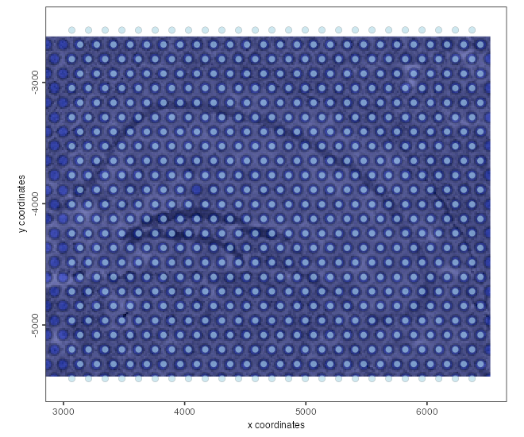
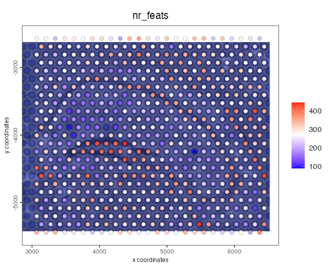
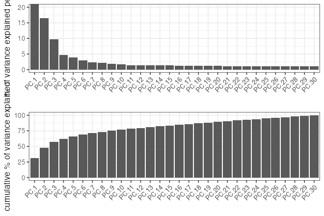
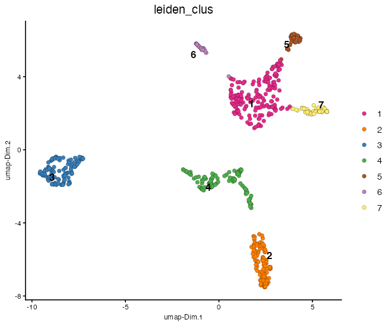
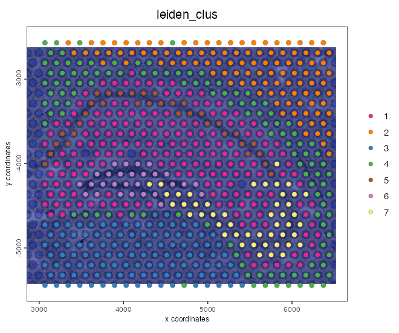
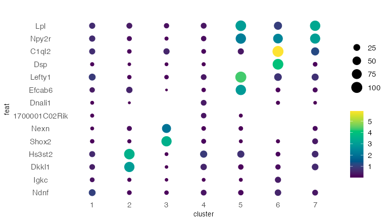
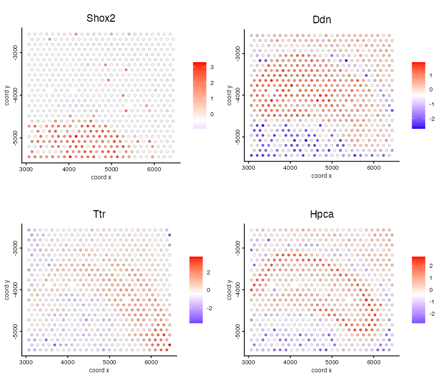
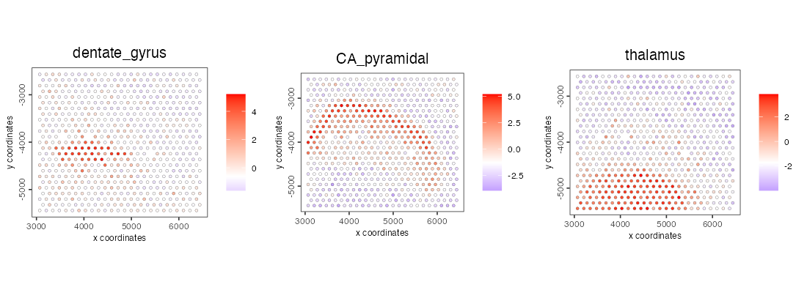

# General workflow: grid and spot-based data

Grid and spot-based technologies (Visium, Visium HD, Stereo-seq) measure
expression at fixed capture locations. A spot can hold more than one
cell, so the unit of analysis is the spot, and cell types are estimated
per spot.

This page runs the main steps of a spatial workflow on a small Visium
dataset of the mouse brain (624 spots, 634 genes) from GiottoData. The
dataset is small so every step runs in seconds; the results are not
meant to be biologically meaningful. The [in situ
workflow](https://giottosuite.com/dev/articles/general_workflow_insitu.md)
runs the same steps on imaging-based data. The whole page runs in about
10 seconds with at most 2 GB of memory (Apple M4 Max, one R session).

## 1 Load the data

``` r

# Install Giotto Suite once (see the Installation page)
install.packages("GiottoUtils",
    repos = c("https://giotto-suite.r-universe.dev", "https://cloud.r-project.org"))
GiottoUtils::suite_install(ref = "disk_full", install_arrow = TRUE)
```

[`loadGiottoMini()`](https://giotto-suite.github.io/GiottoData/reference/loadGiottoMini.html)
returns a Giotto object with the spot counts, spot positions and the
tissue image. To start from your own Visium output instead, use
[`createGiottoVisiumObject()`](https://giottosuite.com/dev/reference/createGiottoVisiumObject.md)
(see the [Visium mouse brain
tutorial](https://giottosuite.com/dev/articles/visium_mouse_brain.md)).

``` r

library(Giotto)

g <- GiottoData::loadGiottoMini("visium")

spatPlot2D(g, show_image = TRUE, point_size = 2.5, point_alpha = 0.6)
```



## 2 Quality control

[`addStatistics()`](https://giottosuite.com/dev/reference/addStatistics.md)
adds the number of detected genes (`nr_feats`) and the total counts
(`total_expr`) per spot. Plotting them on the tissue shows whether low
quality spots cluster in one region, for example at a tissue edge or a
fold.

``` r

g <- addStatistics(g, expression_values = "raw")

spatPlot2D(g, show_image = TRUE, cell_color = "nr_feats",
    color_as_factor = FALSE, point_size = 2.5)
```



[`filterGiotto()`](https://giottosuite.com/dev/reference/filterGiotto.md)
then removes genes detected in fewer than 10 spots and spots with fewer
than 100 detected genes.

``` r

g <- filterGiotto(g, expression_threshold = 1, feat_det_in_min_cells = 10,
    min_det_feats_per_cell = 100)
```

## 3 Normalization and highly variable genes

[`normalizeGiotto()`](https://giottosuite.com/dev/reference/normalizeGiotto.md)
normalizes each spot to its library size, log-transforms and scales the
values.
[`calculateHVF()`](https://giottosuite.com/dev/reference/calculateHVF.md)
then flags the genes with the most variable expression; only these are
used for the PCA.

``` r

g <- normalizeGiotto(g)
g <- calculateHVF(g, method = "var", n_top_feats = 200)
```

## 4 Dimension reduction

``` r

g <- runPCA(g, feats_to_use = "hvf", ncp = 30)

screePlot(g, ncp = 30)
```



The scree plot flattens after about 10 components, so the next steps use
the first 10. The nearest neighbour network is built first:
[`runUMAP()`](https://giottosuite.com/dev/reference/runUMAP.md) reuses
it for the embedding and
[`doLeidenCluster()`](https://giottosuite.com/dev/reference/doLeidenCluster.md)
clusters on it.

``` r

g <- createNearestNetwork(g, type = "kNN", dimensions_to_use = 1:10, k = 15)
g <- runUMAP(g, dimensions_to_use = 1:10, n_neighbors = 15)
```

## 5 Clustering

``` r

g <- doLeidenCluster(g, nn_network_to_use = "kNN", network_name = "kNN.pca",
    resolution = 0.5)

plotUMAP(g, cell_color = "leiden_clus", point_size = 2)
```



``` r

spatPlot2D(g, cell_color = "leiden_clus", show_image = TRUE, point_size = 2.5)
```



## 6 Marker genes

[`findMarkers_one_vs_all()`](https://giottosuite.com/dev/reference/findMarkers_one_vs_all.md)
compares each cluster with all other spots. The dot plot shows the top
two markers per cluster: dot size is the percentage of spots that
express the gene, color the mean expression.

``` r

markers <- findMarkers_one_vs_all(g, method = "gini",
    expression_values = "normalized", cluster_column = "leiden_clus",
    min_feats = 5)
top_markers <- markers[, head(.SD, 2), by = "cluster"]

dotPlot(g, feats = unique(top_markers$feats), cluster_column = "leiden_clus")
```



See [differential
expression](https://giottosuite.com/dev/articles/find_degs.md) for the
other marker methods.

## 7 Spatially variable genes

Spatial analyses need a spatial network, which connects each spot to its
neighbours.
[`binSpect()`](https://giottosuite.com/dev/reference/binSpect.md) then
ranks genes by how often neighbouring spots both express them.

``` r

g <- createSpatialNetwork(g, method = "Delaunay")

spatial_genes <- binSpect(g)

spatFeatPlot2D(g, feats = spatial_genes$feats[1:4],
    expression_values = "scaled", point_size = 1.5, cow_n_col = 2)
```



See [spatial
genes](https://giottosuite.com/dev/articles/spatial_genes.md) for the
other methods and for co-expression modules of spatial genes.

## 8 Cell type enrichment per spot

Because a spot can hold several cells, cell types are scored per spot
instead of assigned to it. PAGE needs only a list of marker genes per
cell type; here we use a few well-known markers of three mouse brain
regions. PAGE expects more than 5 markers per cell type by default, so
`min_overlap_genes` is lowered for these short lists.

``` r

marker_list <- list(
    dentate_gyrus = c("Prox1", "C1ql2", "Dsp"),
    CA_pyramidal = c("Hpca", "Fibcd1", "Spink8", "Wfs1"),
    thalamus = c("Tcf7l2", "Shox2", "Prkcd"))
sign_matrix <- makeSignMatrixPAGE(sign_names = names(marker_list),
    sign_list = marker_list)

g <- runPAGEEnrich(g, sign_matrix = sign_matrix, min_overlap_genes = 2)

spatCellPlot2D(g, spat_enr_names = "PAGE",
    cell_annotation_values = names(marker_list), cow_n_col = 3,
    point_size = 1.2)
```



With a single-cell reference, deconvolution estimates the proportion of
each cell type per spot instead; see
[deconvolution](https://giottosuite.com/dev/articles/deconvolution.md)
and [PAGE and rank
enrichment](https://giottosuite.com/dev/articles/page_rank_enrichment.md).

## 9 Scale up

The same steps run on full slides when the object is stored on disk with
GiottoDisk. These tutorials run them on complete datasets:

- [Visium HD colorectal cancer, 8 µm
  bins](https://giottosuite.com/dev/articles/visiumhd_crc_bins_giottodisk.md)
- [Visium HD colorectal cancer, segmented
  cells](https://giottosuite.com/dev/articles/visiumhd_crc_cells_giottodisk.md)
- [Stereo-seq mouse testis,
  bins](https://giottosuite.com/dev/articles/stereoseq_testis_bins_giottodisk.md)

## 10 Further reading

- [Spatial domains with BANKSY and
  HMRF](https://giottosuite.com/dev/articles/spatial_domains.md): group
  spots into tissue regions using their neighbours, beyond the
  expression clusters found here.
- [Deconvolution](https://giottosuite.com/dev/articles/deconvolution.md):
  estimate cell type proportions per spot from a single-cell reference
  instead of a marker list.
- [Spatial
  genes](https://giottosuite.com/dev/articles/spatial_genes.md): the
  other spatial gene methods, and modules of co-expressed spatial genes.

## 11 Session info

sessionInfo()

``` r

sessionInfo()
```

    R version 4.5.3 (2026-03-11)
    Platform: aarch64-apple-darwin20
    Running under: macOS Tahoe 26.7.3

    Matrix products: default
    BLAS:   /Library/Frameworks/R.framework/Versions/4.5-arm64/Resources/lib/libRblas.0.dylib 
    LAPACK: /Library/Frameworks/R.framework/Versions/4.5-arm64/Resources/lib/libRlapack.dylib;  LAPACK version 3.12.1

    locale:
    [1] C.UTF-8/C.UTF-8/C.UTF-8/C/C.UTF-8/C.UTF-8

    time zone: America/New_York
    tzcode source: internal

    attached base packages:
    [1] stats     graphics  grDevices utils     datasets  methods   base     

    other attached packages:
    [1] Giotto_4.3.7      GiottoClass_0.8.0

    loaded via a namespace (and not attached):
      [1] colorRamp2_0.1.0            gridExtra_2.3              
      [3] rlang_1.3.0                 magrittr_2.0.5             
      [5] GiottoUtils_0.2.11          matrixStats_1.5.0          
      [7] compiler_4.5.3              systemfonts_1.3.2          
      [9] vctrs_0.7.3                 pkgconfig_2.0.3            
     [11] SpatialExperiment_1.20.0    fastmap_1.2.0              
     [13] backports_1.5.0             magick_2.9.1               
     [15] XVector_0.50.0              magic_1.6-1                
     [17] labeling_0.4.3              ggraph_2.2.2               
     [19] ragg_1.5.2                  purrr_1.2.2                
     [21] bluster_1.20.0              cachem_1.1.0               
     [23] beachmat_2.26.0             jsonlite_2.0.0             
     [25] DelayedArray_0.36.0         BiocParallel_1.44.0        
     [27] tweenr_2.0.3                terra_1.9-11               
     [29] irlba_2.3.7                 parallel_4.5.3             
     [31] cluster_2.1.8.2             R6_2.6.1                   
     [33] RColorBrewer_1.1-3          parallelly_1.47.0          
     [35] GenomicRanges_1.62.1        scattermore_1.2            
     [37] Rcpp_1.1.1                  Seqinfo_1.0.0              
     [39] SummarizedExperiment_1.40.0 future.apply_1.20.2        
     [41] R.utils_2.13.0              IRanges_2.44.0             
     [43] Matrix_1.7-5                igraph_2.3.4               
     [45] tidyselect_1.2.1            dichromat_2.0-0.1          
     [47] abind_1.4-8                 viridis_0.6.5              
     [49] codetools_0.2-20            listenv_0.10.1             
     [51] lattice_0.22-9              tibble_3.3.1               
     [53] Biobase_2.70.0              withr_3.0.3                
     [55] S7_0.2.1                    future_1.70.0              
     [57] polyclip_1.10-7             pillar_1.11.1              
     [59] MatrixGenerics_1.22.0       geometry_0.5.2             
     [61] checkmate_2.3.4             stats4_4.5.3               
     [63] dbscan_1.2.4                plotly_4.12.0              
     [65] generics_0.1.4              GiottoDisk_0.0.0.8         
     [67] S4Vectors_0.48.0            ggplot2_4.0.2              
     [69] sparseMatrixStats_1.22.0    scales_1.4.0               
     [71] GiottoData_0.3.8            globals_0.19.1             
     [73] gtools_3.9.5                glue_1.8.1                 
     [75] lazyeval_0.2.2              tools_4.5.3                
     [77] GiottoVisuals_0.2.16        tilework_1.0.0             
     [79] BiocNeighbors_2.4.0         data.table_1.18.6.1        
     [81] RSpectra_0.16-2             ScaledMatrix_1.18.0        
     [83] graphlayouts_1.2.3          tidygraph_1.3.1            
     [85] cowplot_1.2.0               grid_4.5.3                 
     [87] tidyr_1.3.2                 colorspace_2.1-2           
     [89] SingleCellExperiment_1.32.0 BiocSingular_1.26.1        
     [91] ggforce_0.5.0               cli_3.6.6                  
     [93] rsvd_1.0.5                  textshaping_1.0.5          
     [95] S4Arrays_1.10.1             viridisLite_0.4.3          
     [97] dplyr_1.2.0                 uwot_0.2.4                 
     [99] gtable_0.3.6                R.methodsS3_1.8.2          
    [101] digest_0.6.39               progressr_0.18.0           
    [103] BiocGenerics_0.56.0         SparseArray_1.10.9         
    [105] ggrepel_0.9.8               rjson_0.2.23               
    [107] htmlwidgets_1.6.4           farver_2.1.2               
    [109] R.oo_1.27.1                 memoise_2.0.1              
    [111] htmltools_0.5.9             lifecycle_1.0.5            
    [113] httr_1.4.8                  MASS_7.3-65                
