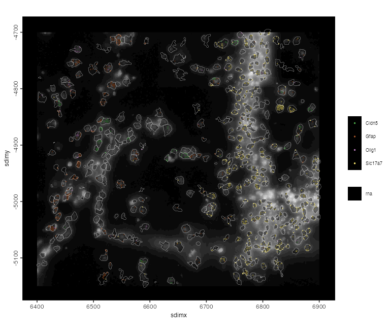
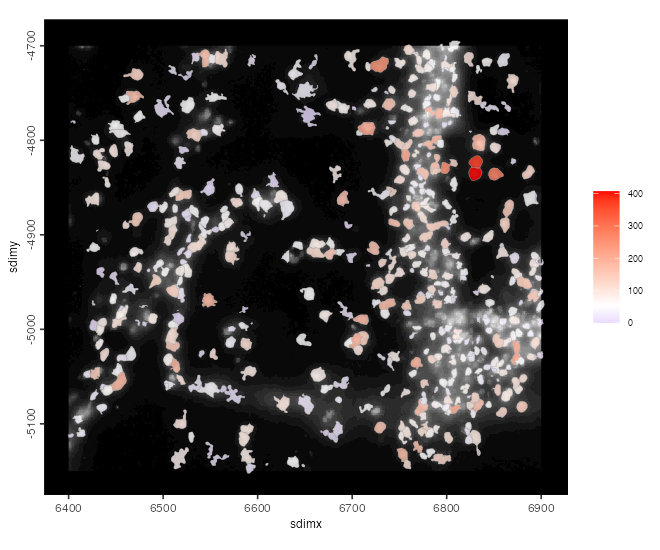
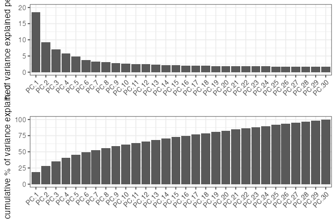
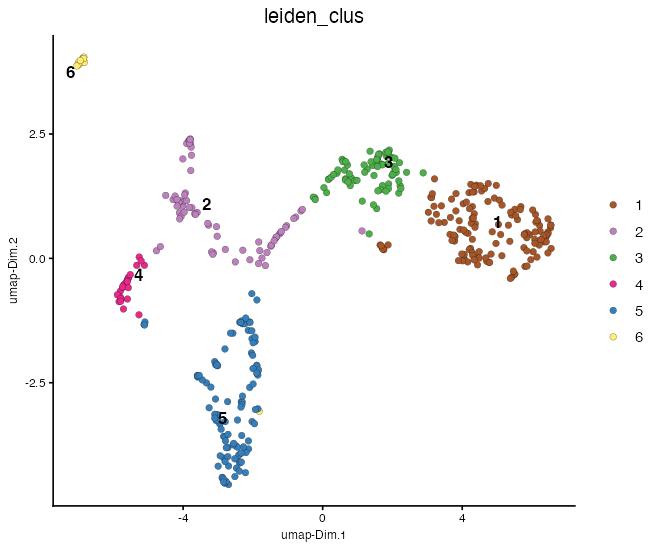
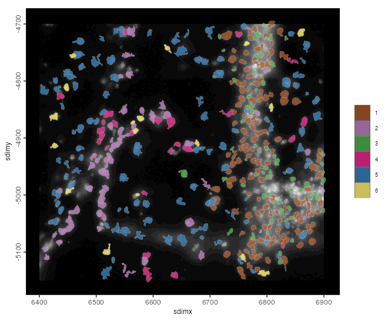
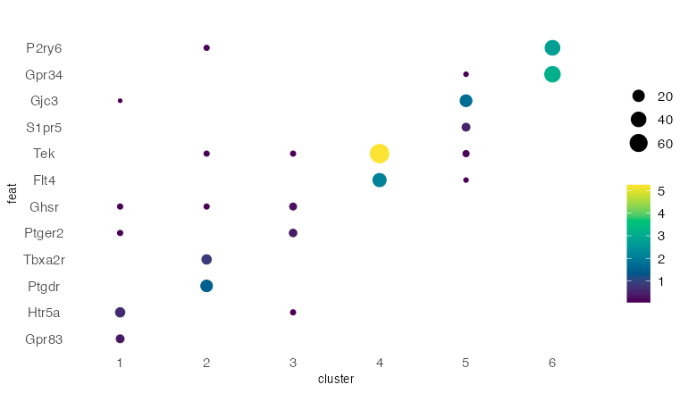
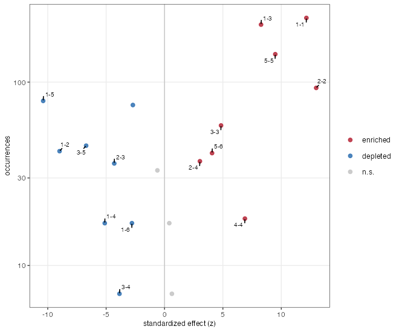
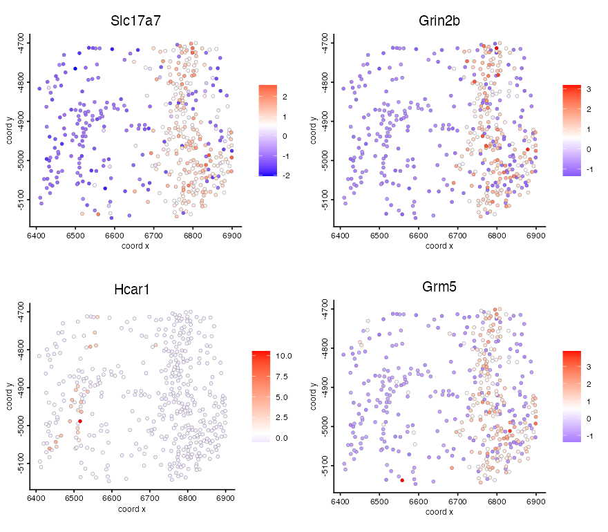

# General workflow: in situ imaging-based data

In situ imaging-based technologies (MERSCOPE, CosMx, Xenium) detect
individual transcripts and segment the cells. The raw data are a table
of transcript positions and a set of cell outlines (polygons);
expression per cell is obtained by counting the transcripts inside each
outline.

This page runs the main steps of a spatial workflow on a small MERSCOPE
dataset of the mouse brain (about 80,000 transcripts, 498 cells, 337
genes) from GiottoData. The dataset is small so every step runs in
seconds; the results are not meant to be biologically meaningful. The
[grid
workflow](https://giottosuite.com/dev/articles/general_workflow_grid.md)
runs the same steps on spot-based data. The whole page runs in about 10
seconds with at most 2 GB of memory (Apple M4 Max, one R session).

## 1 Load the data

``` r

# Install Giotto Suite once (see the Installation page)
install.packages("GiottoUtils",
    repos = c("https://giotto-suite.r-universe.dev", "https://cloud.r-project.org"))
GiottoUtils::suite_install(ref = "disk_full", install_arrow = TRUE)
```

The mini object already contains processed results. To show the steps
from the start, we take its three raw parts, the transcripts, the cell
outlines and a DAPI image, and build a new object from them. With your
own data, the vendor readers such as
[`importMerscope()`](https://giottosuite.com/dev/reference/importMerscope.md),
[`importCosMx()`](https://giottosuite.com/dev/reference/importCosMx.md)
and
[`importXenium()`](https://giottosuite.com/dev/reference/importXenium.md)
give you the same parts (see [import
utilities](https://giottosuite.com/dev/articles/import_utilities.md)).

``` r

library(Giotto)

mini <- GiottoData::loadGiottoMini("vizgen")
transcripts <- getFeatureInfo(mini, feat_type = "rna", return_giottoPoints = TRUE)
cells <- getPolygonInfo(mini, name = "z0", return_giottoPolygon = TRUE)
dapi <- getGiottoImage(mini, name = "dapi_z0")

g <- createGiottoObjectSubcellular(
    gpoints = list(rna = transcripts),
    gpolygons = list(cell = cells),
    images = list(dapi))

spatInSituPlotPoints(g, feats = list(rna = c("Gfap", "Slc17a7", "Olig1", "Cldn5")),
    show_image = TRUE, image_name = "dapi_z0", point_size = 0.4,
    show_polygon = TRUE, polygon_color = "white", polygon_line_size = 0.1)
```



## 2 Aggregate transcripts into cells

[`calculateOverlap()`](https://giotto-suite.github.io/GiottoClass/reference/calculateOverlap.html)
finds the cell outline that contains each transcript, and
[`overlapToMatrix()`](https://giotto-suite.github.io/GiottoClass/reference/overlapToMatrix.html)
counts them into a cell by gene expression matrix.

``` r

g <- calculateOverlap(g, spatial_info = "cell", feat_info = "rna")
g <- overlapToMatrix(g, poly_info = "cell", feat_info = "rna", name = "raw")
```

## 3 Quality control

Besides the detected genes and total counts per cell from
[`addStatistics()`](https://giottosuite.com/dev/reference/addStatistics.md),
imaging data have two extra checks. The cell area flags segmentation
errors, such as fragments a few µm² in size. The `Blank-` probes are
negative controls that measure background; they are removed before
analysis.

``` r

g <- addStatistics(g, expression_values = "raw")

cell_area <- expanse(getPolygonInfo(g, name = "cell", return_giottoPolygon = TRUE))
g <- addCellMetadata(g, new_metadata = cell_area, by_column = TRUE,
    column_cell_ID = "cell_ID")

spatInSituPlotPoints(g, feats = NULL, show_image = TRUE, image_name = "dapi_z0",
    show_polygon = TRUE, polygon_fill = "total_expr",
    polygon_fill_as_factor = FALSE, polygon_alpha = 0.8,
    polygon_line_size = 0.1)
```



``` r

keep_cells <- pDataDT(g)[area >= 10, cell_ID]
keep_genes <- grep("^Blank-", featIDs(g), value = TRUE, invert = TRUE)
g <- subsetGiotto(g, cell_ids = keep_cells, feat_ids = keep_genes)

g <- filterGiotto(g, expression_threshold = 1, feat_det_in_min_cells = 5,
    min_det_feats_per_cell = 5)
```

The thresholds are lower than for spot-based data: a gene panel of a few
hundred genes detects far fewer genes per cell than whole-transcriptome
sequencing does per spot.

## 4 Normalization

``` r

g <- normalizeGiotto(g)
```

## 5 Dimension reduction

Gene panels are designed to contain informative genes, so the PCA uses
all of them instead of a highly variable subset (`feats_to_use = NULL`).
With whole transcriptome panels, such as CosMx 6K or Xenium 5K, select
highly variable genes first as in the [grid
workflow](https://giottosuite.com/dev/articles/general_workflow_grid.md).

``` r

g <- runPCA(g, feats_to_use = NULL, ncp = 30)

screePlot(g, ncp = 30)
```



The nearest neighbour network is built first:
[`runUMAP()`](https://giottosuite.com/dev/reference/runUMAP.md) reuses
it for the embedding and
[`doLeidenCluster()`](https://giottosuite.com/dev/reference/doLeidenCluster.md)
clusters on it.

``` r

g <- createNearestNetwork(g, type = "kNN", dimensions_to_use = 1:10, k = 15)
g <- runUMAP(g, dimensions_to_use = 1:10, n_neighbors = 15)
```

## 6 Clustering

``` r

g <- doLeidenCluster(g, nn_network_to_use = "kNN", network_name = "kNN.pca",
    resolution = 0.5)

plotUMAP(g, cell_color = "leiden_clus", point_size = 2)
```



With cell outlines, clusters can be shown as filled cells on the image.

``` r

spatInSituPlotPoints(g, feats = NULL, show_image = TRUE, image_name = "dapi_z0",
    show_polygon = TRUE, polygon_fill = "leiden_clus",
    polygon_fill_as_factor = TRUE, polygon_alpha = 0.8,
    polygon_line_size = 0.1)
```



## 7 Marker genes

[`findMarkers_one_vs_all()`](https://giottosuite.com/dev/reference/findMarkers_one_vs_all.md)
compares each cluster with all other cells. The dot plot shows the top
two markers per cluster: dot size is the percentage of cells that
express the gene, color the mean expression.

``` r

markers <- findMarkers_one_vs_all(g, method = "gini",
    expression_values = "normalized", cluster_column = "leiden_clus",
    min_feats = 5)
top_markers <- markers[, head(.SD, 2), by = "cluster"]

dotPlot(g, feats = unique(top_markers$feats), cluster_column = "leiden_clus")
```



## 8 Cell neighbourhoods

At single-cell resolution we can ask which cell types are neighbours
more or less often than expected by chance. The spatial network connects
each cell to its neighbours;
[`cellProximityMotifs()`](https://giottosuite.com/dev/reference/cellProximityMotifs.md)
counts the pairs of neighbouring clusters and compares them with random
relabelings of the cells.

``` r

g <- createSpatialNetwork(g, method = "Delaunay")

proximities <- cellProximityMotifs(g, spatial_network_name = "Delaunay_network",
    cluster_column = "leiden_clus", size = 2L, n_perm = 1000L)

plotMotifEnrichment(g, proximities)
```



Pairs to the right of zero (for example 2-2) are neighbours more often
than expected, pairs to the left less often. See the [Atera breast
cancer
tutorial](https://giottosuite.com/dev/articles/atera_human_breast_cancer.md)
for motifs of more than two cells, and [interaction changed
features](https://giottosuite.com/dev/articles/interaction_changed_features.md)
for genes whose expression changes next to another cell type.

## 9 Spatially variable genes

[`binSpect()`](https://giottosuite.com/dev/reference/binSpect.md) works
the same way on cells as on spots.

``` r

spatial_genes <- binSpect(g)

spatFeatPlot2D(g, feats = spatial_genes$feats[1:4],
    expression_values = "scaled", point_size = 1.5, cow_n_col = 2)
```



## 10 Scale up

The same steps run on full slides with hundreds of thousands of cells
when the object is stored on disk with GiottoDisk. These tutorials run
them on complete datasets:

- [MERSCOPE human colon
  cancer](https://giottosuite.com/dev/articles/merscope_human_colon_cancer_giottodisk.md)
- [CosMx human colon, whole
  transcriptome](https://giottosuite.com/dev/articles/cosmx_colon_wtx_giottodisk.md)
- [Xenium human breast
  cancer](https://giottosuite.com/dev/articles/xenium_human_breast_cancer_giottodisk.md)

## 11 Further reading

- [Feature
  aggregation](https://giottosuite.com/dev/articles/feature_aggregation.md):
  how the counts Giotto aggregates from transcripts compare with the
  vendor’s own cell matrix.
- [Cell type
  annotation](https://giottosuite.com/dev/articles/cell_typing_cluster_tree.md):
  name the clusters found here.
- [Interaction changed
  features](https://giottosuite.com/dev/articles/interaction_changed_features.md):
  genes whose expression in a cell changes next to another cell type.

## 12 Session info

sessionInfo()

``` r

sessionInfo()
```

    R version 4.5.3 (2026-03-11)
    Platform: aarch64-apple-darwin20
    Running under: macOS Tahoe 26.7.3

    Matrix products: default
    BLAS:   /Library/Frameworks/R.framework/Versions/4.5-arm64/Resources/lib/libRblas.0.dylib 
    LAPACK: /Library/Frameworks/R.framework/Versions/4.5-arm64/Resources/lib/libRlapack.dylib;  LAPACK version 3.12.1

    locale:
    [1] C.UTF-8/C.UTF-8/C.UTF-8/C/C.UTF-8/C.UTF-8

    time zone: America/New_York
    tzcode source: internal

    attached base packages:
    [1] stats     graphics  grDevices utils     datasets  methods   base     

    other attached packages:
    [1] Giotto_4.3.7      GiottoClass_0.8.0

    loaded via a namespace (and not attached):
      [1] colorRamp2_0.1.0            gridExtra_2.3              
      [3] rlang_1.3.0                 magrittr_2.0.5             
      [5] GiottoUtils_0.2.11          matrixStats_1.5.0          
      [7] compiler_4.5.3              systemfonts_1.3.2          
      [9] vctrs_0.7.3                 pkgconfig_2.0.3            
     [11] SpatialExperiment_1.20.0    fastmap_1.2.0              
     [13] backports_1.5.0             magick_2.9.1               
     [15] XVector_0.50.0              magic_1.6-1                
     [17] labeling_0.4.3              ggraph_2.2.2               
     [19] ragg_1.5.2                  purrr_1.2.2                
     [21] bluster_1.20.0              cachem_1.1.0               
     [23] beachmat_2.26.0             jsonlite_2.0.0             
     [25] DelayedArray_0.36.0         smotif_0.2.0               
     [27] BiocParallel_1.44.0         tweenr_2.0.3               
     [29] terra_1.9-11                irlba_2.3.7                
     [31] parallel_4.5.3              cluster_2.1.8.2            
     [33] R6_2.6.1                    RColorBrewer_1.1-3         
     [35] smotifrs_0.2.0              GenomicRanges_1.62.1       
     [37] scattermore_1.2             Rcpp_1.1.1                 
     [39] Seqinfo_1.0.0               SummarizedExperiment_1.40.0
     [41] R.utils_2.13.0              IRanges_2.44.0             
     [43] Matrix_1.7-5                igraph_2.3.4               
     [45] tidyselect_1.2.1            dichromat_2.0-0.1          
     [47] abind_1.4-8                 viridis_0.6.5              
     [49] codetools_0.2-20            lattice_0.22-9             
     [51] tibble_3.3.1                Biobase_2.70.0             
     [53] withr_3.0.3                 S7_0.2.1                   
     [55] polyclip_1.10-7             pillar_1.11.1              
     [57] MatrixGenerics_1.22.0       geometry_0.5.2             
     [59] checkmate_2.3.4             stats4_4.5.3               
     [61] dbscan_1.2.4                plotly_4.12.0              
     [63] generics_0.1.4              GiottoDisk_0.0.0.8         
     [65] S4Vectors_0.48.0            ggplot2_4.0.2              
     [67] scales_1.4.0                GiottoData_0.3.8           
     [69] gtools_3.9.5                glue_1.8.1                 
     [71] lazyeval_0.2.2              tools_4.5.3                
     [73] GiottoVisuals_0.2.16        tilework_1.0.0             
     [75] BiocNeighbors_2.4.0         data.table_1.18.6.1        
     [77] RSpectra_0.16-2             ScaledMatrix_1.18.0        
     [79] graphlayouts_1.2.3          tidygraph_1.3.1            
     [81] cowplot_1.2.0               grid_4.5.3                 
     [83] tidyr_1.3.2                 colorspace_2.1-2           
     [85] SingleCellExperiment_1.32.0 BiocSingular_1.26.1        
     [87] ggforce_0.5.0               cli_3.6.6                  
     [89] rsvd_1.0.5                  textshaping_1.0.5          
     [91] S4Arrays_1.10.1             viridisLite_0.4.3          
     [93] dplyr_1.2.0                 uwot_0.2.4                 
     [95] gtable_0.3.6                R.methodsS3_1.8.2          
     [97] digest_0.6.39               progressr_0.18.0           
     [99] BiocGenerics_0.56.0         SparseArray_1.10.9         
    [101] ggrepel_0.9.8               rjson_0.2.23               
    [103] htmlwidgets_1.6.4           farver_2.1.2               
    [105] R.oo_1.27.1                 memoise_2.0.1              
    [107] htmltools_0.5.9             lifecycle_1.0.5            
    [109] httr_1.4.8                  MASS_7.3-65                
