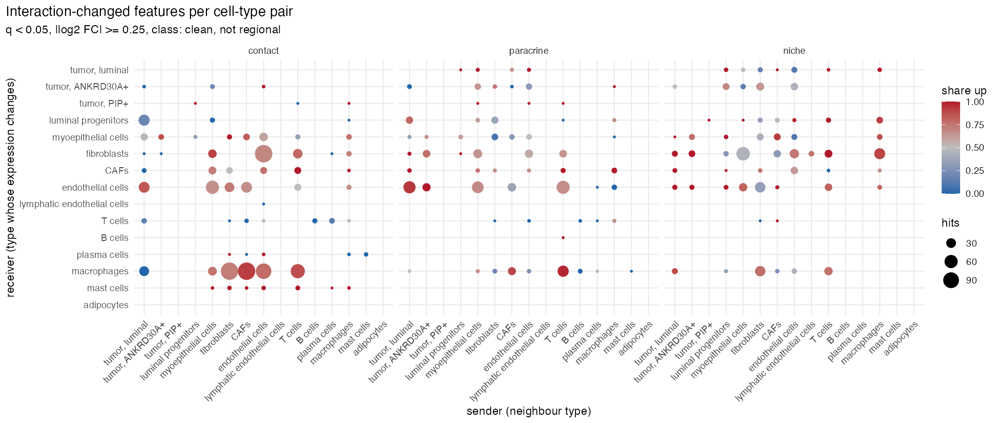
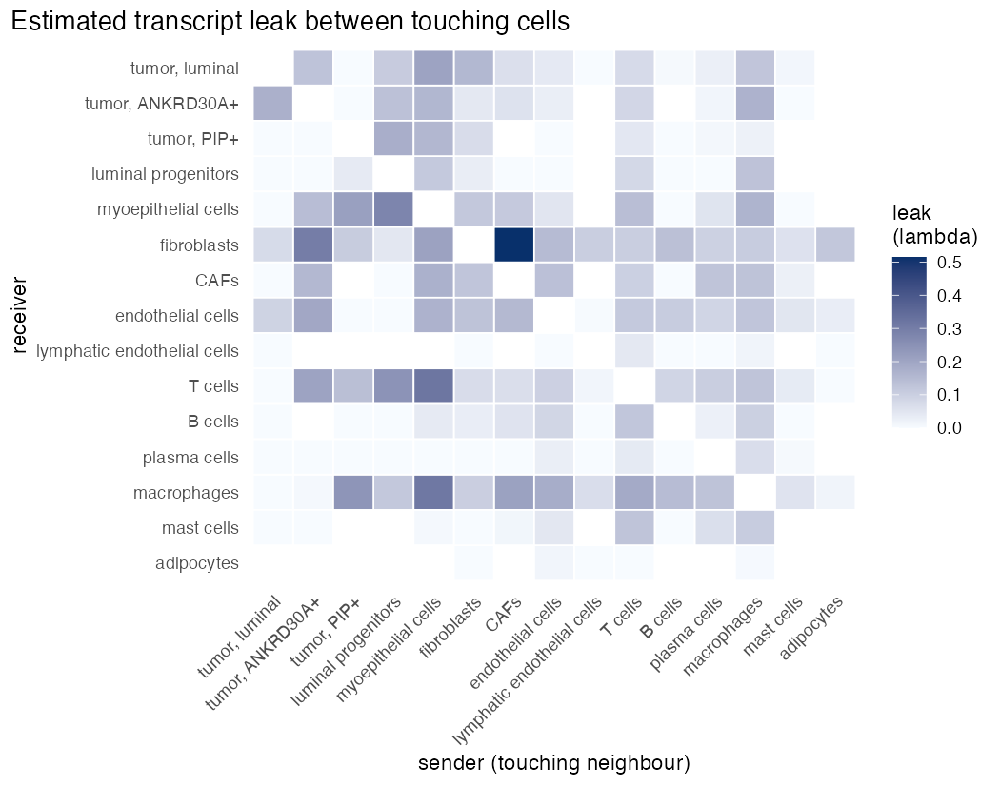
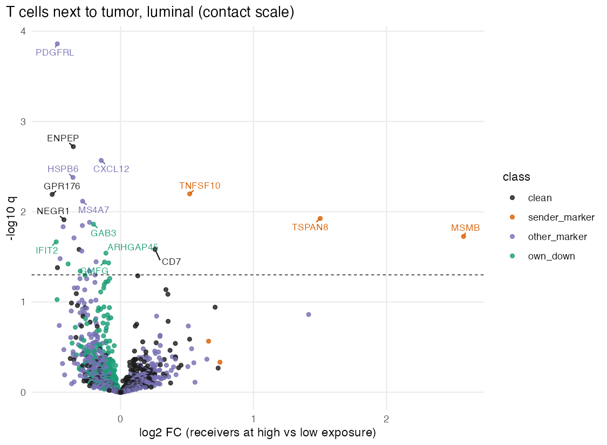
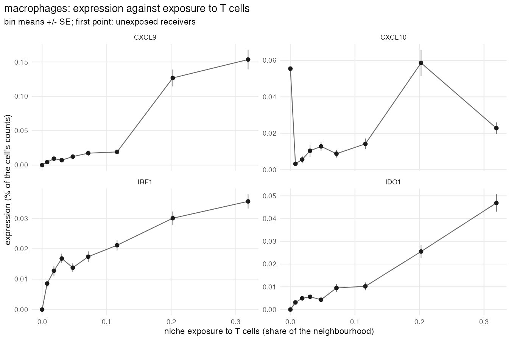
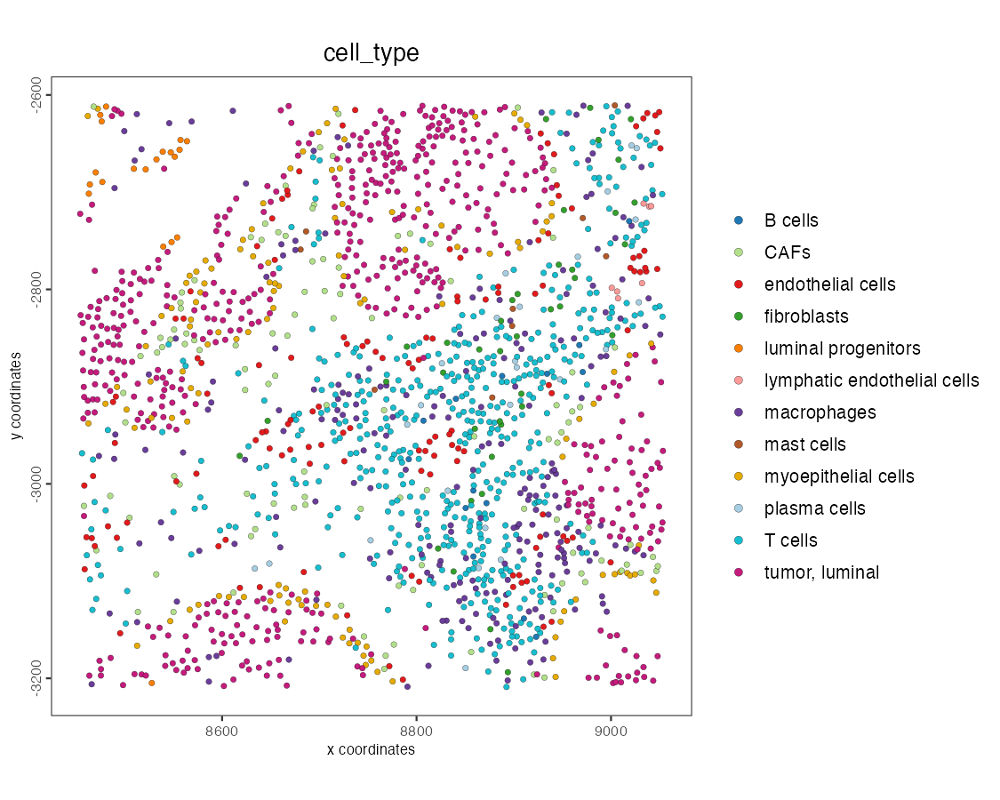
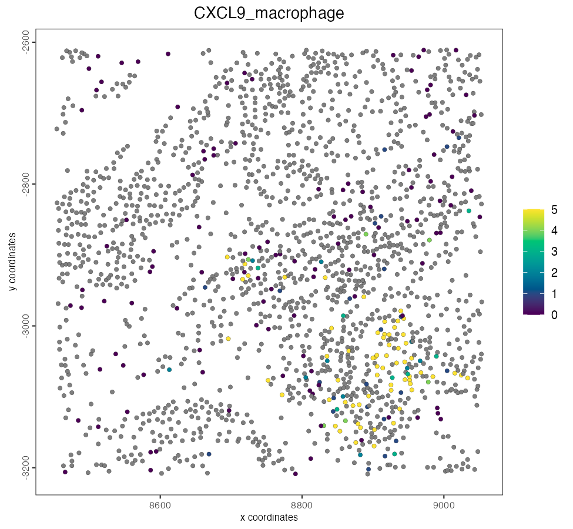
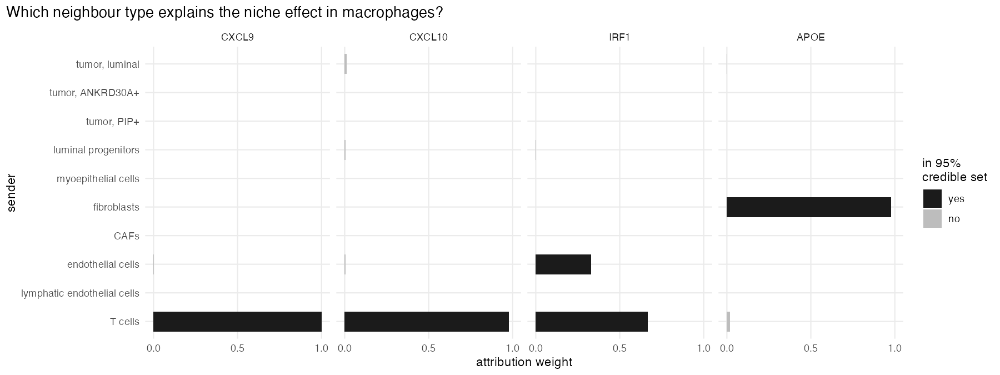
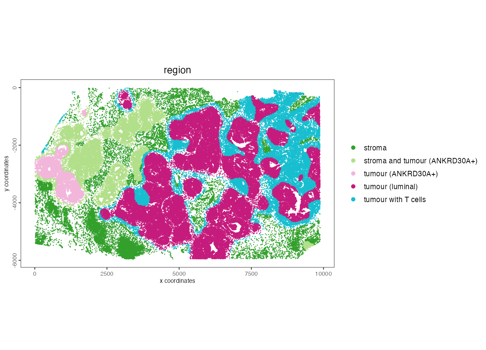
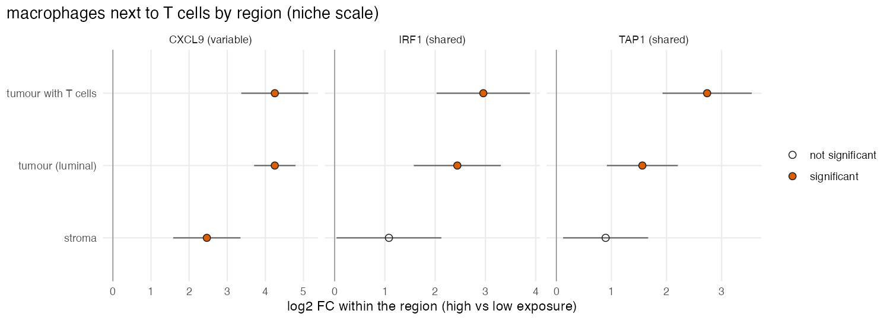

# Interaction-changed features

## 1 Overview

A cell’s expression depends partly on its neighbours. An immune cell
next to a tumour cell, or a macrophage among T cells, may switch genes
on or off.
[`findInteractionChangedFeats()`](https://giottosuite.com/dev/reference/findInteractionChangedFeats.md)
looks for these **interaction-changed features** (ICF): genes whose
expression in one cell type, the *receiver*, changes with its exposure
to another cell type, the *sender*.

In imaging-based data this question has a trap. Transcripts leak across
cell boundaries, and segmentation is never perfect, so a T cell that
touches a tumour cell picks up some of the tumour cell’s transcripts. A
naive test then reports tumour genes as “induced” in T cells. The
default method since Giotto 4.3.6, `method = "edgeicg"` (from the
[edgeicg](https://github.com/drieslab/edgeicg) package), is built around
this:

- it estimates, for every pair of cell types, how much of a touching
  neighbour’s expression leaks into a cell, and removes that leak cell
  by cell before testing;
- it tests three scales of exposure: touching cells (**contact**), the
  neighbours within about 75 µm (**paracrine**) and the regional
  neighbourhood of about 450 µm (**niche**);
- it calibrates the niche scale against spatially shifted copies of the
  tissue, and attributes each niche hit to the sender type that explains
  it best;
- it labels every hit by how likely it is to be an artefact, for example
  a gene that marks the sender;
- optionally, it estimates every effect within regions of the tissue
  (spatial domains, niches) and tests whether it differs between them.

The engine works on sums over cells, reads a GiottoDisk expression store
in spatial windows without loading it, and runs in parallel.

This tutorial continues from the [Atera Human Breast
Cancer](https://giottosuite.com/dev/articles/atera_human_breast_cancer.md)
example: a whole section of 170,000 cells with an 18,000-gene panel, its
cell types, and the motif analysis that found T cells deep inside tumour
nests.

## 2 Setup

``` r

# Install Giotto Suite once (see the Installation page)
install.packages("GiottoUtils",
    repos = c("https://giotto-suite.r-universe.dev", "https://cloud.r-project.org"))
GiottoUtils::suite_install(ref = "disk_full", install_arrow = TRUE)
# a gene set used below
install.packages("msigdbr")
```

``` r

library(arrow) # load before terra or GiottoClass
library(Giotto)
library(GiottoDisk)
library(data.table)

project_dir <- "path/to/atera_project" # the project of the Atera breast example
```

Load the annotated object of the breast example:

``` r

g <- loadGiotto(project_dir, name = "annotated")
```

The results on this page were computed from the 10x expression matrix:
the optional **Aggregate** step of the breast example was skipped. With
that matrix, Leiden clustering gives 19 clusters instead of 18, which
were mapped to the same 15 cell types (clusters 12 and 18 are both
myoepithelial cells). The 10x matrix assigns transcripts with 10x’s own
segmentation, whereas
[`aggregateFeatures()`](https://giotto-suite.github.io/GiottoClass/reference/aggregateFeatures.html)
assigns them by the cell outlines, so about 2–3% of the counts per cell
differ. If you aggregated, your numbers will differ somewhat from the
ones shown here.

## 3 Choose the features

edgeicg can test every gene; on this section all 17,000 detected genes
take about 10 minutes with 8 workers, but about 40 GB of memory. A
focused set is faster and lighter. We take the 2,000 highly variable
features of the breast example and add the 200 genes of the MSigDB
Hallmark *interferon-γ response*: the motif analysis found T cells among
tumour cells, and interferon-γ is what activated T cells release.

The gene set matters here. Genes that are switched on in a few cells,
such as the chemokines CXCL9 and CXCL10, are rarely among the highly
variable features, which favour genes that separate cell types.

``` r

hvf <- fDataDT(g)[hvf == "yes", feat_ID]
ifng <- unique(subset(
    msigdbr::msigdbr(species = "Homo sapiens", collection = "H"),
    gs_name == "HALLMARK_INTERFERON_GAMMA_RESPONSE"
)$gene_symbol)
feats <- intersect(union(hvf, ifng), fDataDT(g)$feat_ID)
length(feats)
```

    [1] 2123

## 4 Run

``` r

icf <- findInteractionChangedFeats(g,
    cluster_column = "cell_type",
    selected_feats = feats,
    spatial_covariates = TRUE,
    workers = 8
)
icf$edgeicg
```

    EdgeICG: 169528 cells, 15 types, 2101 genes, 210 pairs (pass1 64 s, pass2 73 s, pass3 6 s)
      leak fitted on: all (17423 genes)
      hits: q < 0.05 and |log2 FC| >= 0.25 (q < 0.05 alone)
      contact   3552 (6176)
      paracrine 1354 (2055)
      niche     1462 (1630), screen
                attributed (receiver, gene): 936

This takes about 5 minutes with 8 workers, with a peak of about 18 GB of
memory. The expression is read from the GiottoDisk store in spatial
windows; fewer `workers` use less memory. What the settings do:

- `cluster_column`: the cell types. Every ordered pair of types is a
  receiver and sender pair (210 here).
- `selected_feats`: the features to test. The leak is still estimated
  from all 17,423 detected features, which takes one extra pass over
  them (about 2 of the 5 minutes); see [The
  leak](#the-leak-and-why-the-classes-matter).
- `spatial_covariates = TRUE`: adjusts the niche scale for smooth trends
  across the section (tissue zones), which otherwise produce niche hits
  of their own. It adds about 10% to the run time.
- `min_lfc` (default 0.25): a hit must also change by at least this log2
  fold change. On a whole section even tiny, confounded differences
  become significant; the floor keeps effects that are large enough to
  matter.
- `workers`: parallel workers. Results do not depend on their number.
- `method` is not given: `"edgeicg"` is the default.

The full fit is kept in `icf$edgeicg`; the table of hits is
`icf$ICFscores`.

## 5 Results

`icf$ICFscores` has one row per receiver, sender, scale and feature with
q \< 0.1:

- `cell_type`, `int_cell_type`: receiver and sender;
- `scale`: contact, paracrine or niche;
- `log2fc`: the fold change between receivers at high (90th percentile)
  and low (10th percentile) exposure to the sender;
- `z`, `p.value`, `p.adj`: the test, adjusted within each scale;
- `class`: how the hit could arise without an interaction;
- `regional`: a niche hit that recurs in three or more receiver types,
  more likely a tissue zone than an interaction;
- `top_sender`, `alpha`: for niche hits, the sender type the effect is
  attributed to and the share of the evidence it explains.

The classes are, in order of precedence:

| class | the gene … | read it as |
|----|----|----|
| `sender_marker` | is much higher in the sender than in the receiver | leaked or mis-assigned transcripts that the leak model did not fully remove |
| `other_marker` | marks a third cell type | the same, from a third type nearby |
| `own_down` | is a receiver gene going down next to a sender that expresses it much less | mixed or mis-segmented cells, or dilution |
| `clean` | none of these | a candidate interaction |

``` r

sc <- icf$ICFscores
dcast(sc[p.adj < 0.05], scale ~ class, fun.aggregate = length,
    value.var = "feats")
```

           scale clean other_marker own_down sender_marker
          <char> <int>        <int>    <int>         <int>
    1:   contact  1063          906     1084           499
    2:     niche   625          391      296           150
    3: paracrine   535          358      344           117

At contact scale, more than two thirds of the significant hits are of an
artefact class. That is the leak problem in numbers; the rest of this
tutorial uses the `clean` hits.

### 5.1 Overview

[`plotICFOverview()`](https://giottosuite.com/dev/reference/plotICF_edgeicg.md)
counts the clean hits for every receiver and sender pair at each scale.
Dot size is the number of hits, colour the share that go up.

``` r

type_order <- c("tumor, luminal", "tumor, ANKRD30A+", "tumor, PIP+",
    "luminal progenitors", "myoepithelial cells", "fibroblasts", "CAFs",
    "endothelial cells", "lymphatic endothelial cells", "T cells", "B cells",
    "plasma cells", "macrophages", "mast cells", "adipocytes")
plotICFOverview(g, icf, cell_order = type_order)
```



Stromal and immune cells change most with their neighbours: macrophages
next to fibroblasts, CAFs, endothelial cells and T cells, endothelial
cells and fibroblasts in the tumour’s neighbourhood. Tumour cells change
little at contact and more at niche scale.

### 5.2 The leak, and why the classes matter

[`plotICFLeak()`](https://giottosuite.com/dev/reference/plotICF_edgeicg.md)
shows the estimated leak: the share of a touching sender’s expression
that turns up in the receiver.

The leak is one number per receiver and sender pair, the same for every
gene. edgeicg estimates it from all genes at once: in receivers touching
the sender, each gene rises in proportion to how much the sender
expresses it, and the slope of that relation across genes is the leak. A
robust fit keeps genes with a real response to the sender from pulling
the slope.

Which genes go into that fit matters. Genes chosen for being variable or
for marking cell types are the genes with the strongest real
differences, and they pull the estimate. On this section, the leak
estimated from the 2,101 selected features agreed only moderately with
the one from all genes (correlation 0.60, on average about 30% higher),
while 3,000 random genes reproduced it closely (0.99). That is why
edgeicg estimates the leak from all features in the expression, even
when you test only `selected_feats`.

``` r

plotICFLeak(g, icf, cell_order = type_order)
```



Small cells with large neighbours pick up the most: T cells next to
tumour cells (0.41 next to ANKRD30A+ and 0.28 next to luminal tumour
cells), and mast cells next to T cells and macrophages. Fibroblasts next
to ANKRD30A+ tumour cells and CAFs are also high, which partly reflects
how these types grade into each other.

Two settings change how the leak is estimated:

- `leak_genes = "tested"` estimates it from `selected_feats` only. This
  saves the extra pass, but the leak then depends on your selection.
- `leak` reuses the leak of an earlier run, e.g. `leak = icf$edgeicg`.
  This is useful when you rerun with other settings on the same data, as
  in [Region-specific effects](#region-specific-effects) below.

With a targeted panel of a few hundred genes there is no broader set to
use, so the leak estimate is less certain; rely more on the classes
below.

[`plotICFPair()`](https://giottosuite.com/dev/reference/plotICF_edgeicg.md)
shows every feature tested for one pair at one scale. For T cells
touching luminal tumour cells:

``` r

plotICFPair(g, icf, receiver = "T cells", sender = "tumor, luminal",
    scale = "contact")
```



No tumour gene goes up significantly: the leak model removes the
transcripts a T cell picks up from the tumour cells it touches. Most
decreases are genes of other stromal types (`other_marker`) or the T
cell’s own genes going down (`own_down`). Few clean hits remain, all
small. T cells touching tumour cells look much like the other T cells.

This is where estimating the leak from all genes pays off. With
`leak_genes = "tested"`, the leak for this pair is estimated at 0 from
the 2,101 selected features, and three tumour genes, MSMB, TSPAN8 and
TNFSF10, come out as significant increases (`sender_marker`, log2 FC
0.5–2.6). The class would still have warned you, but the leak model
should have removed them.

Where the leak is estimated lower than a strong marker’s spillover, some
of that marker remains. The `sender_marker` class flags these hits: 499
at contact scale here, most between macrophages, myoepithelial cells and
stromal cells.

## 6 Interferon response near T cells

The macrophages tell a different story. Their clean hits next to T
cells:

``` r

sc[cell_type == "macrophages" & int_cell_type == "T cells" &
    class == "clean" & !regional & p.adj < 0.05][order(p.adj)][
    1:12, .(feats, scale, log2fc, z, p.adj, top_sender, alpha)]
```

          feats     scale log2fc     z   p.adj top_sender alpha
         <char>    <char>  <num> <num>   <num>     <char> <num>
     1:    FGL2 paracrine   0.93   7.9 1.7e-11       <NA>    NA
     2:   CXCL9     niche   4.25   7.6 8.8e-11    T cells  1.00
     3:   CIITA   contact   0.71   7.2 5.6e-10       <NA>    NA
     4:    CD74   contact   0.50   6.7 1.3e-08       <NA>    NA
     5:    FGL2   contact   0.62   6.6 3.0e-08       <NA>    NA
     6:    TAP1     niche   2.13   6.6 6.0e-08    T cells  0.96
     7: CLEC10A   contact   0.86   6.2 2.1e-07       <NA>    NA
     8:    IRF1     niche   2.64   6.0 1.6e-06    T cells  0.68
     9:   WARS1     niche   1.93   5.9 3.0e-06    T cells  0.89
    10:   DAPP1   contact   1.19   5.6 4.7e-06       <NA>    NA
    11:  SAMHD1   contact   0.48   5.6 6.1e-06       <NA>    NA
    12: CD200R1   contact   0.79   5.6 7.3e-06       <NA>    NA

Two programmes stand out. In T-cell-rich niches, macrophages switch on
the interferon-γ response: the chemokines CXCL9 and CXCL10, which
attract more T cells, the transcription factor IRF1, the
antigen-processing gene TAP1 and WARS1. Where they touch T cells, they
raise MHC class II (CIITA, the master regulator, and CD74). Both are
what macrophages do when activated T cells release interferon-γ.
`log2fc` is capped at ±4.25; CXCL9 is close to absent in macrophages
away from T cells.

### 6.1 Expression against exposure

A hit is a slope.
[`plotICFExposure()`](https://giottosuite.com/dev/reference/plotICF_edgeicg.md)
shows the data behind it: receivers binned by their exposure to the
sender, and their mean expression (as a share of the cell’s counts) in
each bin. The first point holds the unexposed cells.

``` r

plotICFExposure(g, icf, receiver = "macrophages", sender = "T cells",
    feats = c("CXCL9", "CXCL10", "IRF1", "IDO1"), scale = "niche")
```



CXCL9, IRF1 and IDO1 rise steadily with the share of T cells around a
macrophage. CXCL10 rises too, but it is also high in macrophages with no
T cells nearby, so another source drives it there as well.

### 6.2 Where it happens

A 600 µm window around the macrophages with the most T cells nearby. The
cell outlines coloured by cell type, and by their CXCL9 counts:

``` r

roi <- c(8454, 9054, -3209, -2609) # xmin, xmax, ymin, ymax
gz <- subsetGiottoLocs(g,
    x_min = roi[1], x_max = roi[2], y_min = roi[3], y_max = roi[4])

# one color per cell type, as in the breast example
type_colors <- c(
    "tumor, luminal" = "#c51b7d", "tumor, ANKRD30A+" = "#f1b6da",
    "tumor, PIP+" = "#7a0177", "luminal progenitors" = "#ff7f00",
    "myoepithelial cells" = "#e6ab02",
    "fibroblasts" = "#33a02c", "CAFs" = "#b2df8a",
    "endothelial cells" = "#e31a1c", "lymphatic endothelial cells" = "#fb9a99",
    "T cells" = "#17becf", "B cells" = "#1f78b4", "plasma cells" = "#a6cee3",
    "macrophages" = "#6a3d9a", "mast cells" = "#b15928", "adipocytes" = "#ffff99"
)
spatInSituPlotPoints(gz, show_polygon = TRUE, polygon_feat_type = "cell",
    polygon_fill = "cell_type", polygon_fill_as_factor = TRUE,
    polygon_fill_code = type_colors, polygon_alpha = 1, polygon_line_size = 0.1)

# raw CXCL9 counts per cell
spatInSituPlotPoints(gz, show_polygon = TRUE, polygon_feat_type = "cell",
    polygon_fill = "CXCL9", polygon_fill_as_factor = FALSE,
    polygon_fill_gradient_style = "sequential",
    polygon_alpha = 1, polygon_line_size = 0.1)
```



The CXCL9-high cells (yellow, right) sit in the dense patch of T cells
(cyan, left) at the lower right of the window; cells in the tumour and
stroma above have almost none. They are mostly macrophages, but CAFs and
fibroblasts in the same patch express CXCL9 too (15% of the CAFs in this
window have 10 or more counts, against 19% of the macrophages). edgeicg
calls the response to T cells in macrophages (niche q \< 1e-10); in CAFs
the effect points the same way but is not significant (q = 0.08). A map
shows every cell; the test asks, per receiver type, whether expression
follows the exposure to a sender.

### 6.3 Which neighbour explains a niche effect?

Neighbourhoods overlap: a T-cell-rich niche also holds stromal and
endothelial cells. For niche hits, edgeicg weighs the candidate sender
types against each other.
[`plotICFAttribution()`](https://giottosuite.com/dev/reference/plotICF_edgeicg.md)
shows the share of the evidence each sender explains; black bars form
the 95% credible set.

``` r

plotICFAttribution(g, icf, receiver = "macrophages",
    feats = c("CXCL9", "CXCL10", "IRF1", "APOE"), cell_order = type_order)
```



The interferon genes are attributed to T cells. APOE, which macrophages
also change with their niche, is attributed to fibroblasts instead: a
different neighbourhood, and likely a different macrophage state.

### 6.4 Beyond macrophages

The same response shows up, more weakly, in stromal cells near T cells:

``` r

ifn <- c("CXCL9", "CXCL10", "IRF1", "STAT1", "GBP1", "TAP1", "IDO1")
sc[int_cell_type == "T cells" & cell_type != "macrophages" &
    feats %in% ifn & class == "clean" & p.adj < 0.05][order(cell_type, p.adj),
    .(cell_type, feats, scale, log2fc, p.adj)]
```

                cell_type  feats     scale log2fc   p.adj
                   <char> <char>    <char>  <num>   <num>
     1:              CAFs   IRF1 paracrine   1.44 1.1e-03
     2:              CAFs   TAP1 paracrine   1.12 8.3e-03
     3: endothelial cells  STAT1   contact   0.31 4.7e-04
     4:       fibroblasts  STAT1   contact   0.38 4.0e-08
     5:       fibroblasts  STAT1 paracrine   0.34 8.8e-05
     6:       fibroblasts  STAT1     niche   0.46 7.9e-04
     7:       fibroblasts   IRF1   contact   0.45 2.7e-03
     8:       fibroblasts   GBP1   contact   0.39 3.1e-03
     9:       fibroblasts   GBP1 paracrine   0.35 8.1e-03
    10:       fibroblasts   IRF1 paracrine   0.57 1.3e-02

## 7 Region-specific effects

So far every effect is one number for the whole section. An interaction
can also hold in one part of the tissue only, or go in opposite
directions in two parts, so that the effect for the whole section is
weak or cancels out. With `region_column`, edgeicg also estimates every
effect within each region and tests whether it differs between regions.
The leak model and the rest of the model stay those of the whole
section.

### 7.1 Define the regions

Any label per cell works: spatial domains, an HMRF result, a
pathologist’s annotation. Here we group cells by the cell types around
them, the same neighbourhood edgeicg uses for the niche scale (a
Gaussian of 150 µm), into five niches:

``` r

cx <- merge(pDataDT(g)[, .(cell_ID, cell_type)],
    getSpatialLocations(g, output = "data.table")[, .(cell_ID, sdimx, sdimy)],
    by = "cell_ID", sort = FALSE)
lv <- sort(unique(cx$cell_type))
ex <- edgeicg::edgeicg_exposures(cbind(cx$sdimx, cx$sdimy),
    match(cx$cell_type, lv), length(lv), sigma_n = 150)
set.seed(1)
km <- kmeans(ex$N, centers = 5, nstart = 10, iter.max = 50)
# names from the main cell types of each cluster (round(km$centers, 2))
region_names <- c("tumour (ANKRD30A+)", "stroma", "tumour with T cells",
    "tumour (luminal)", "stroma and tumour (ANKRD30A+)")
cx[, region := region_names[km$cluster]]
g <- addCellMetadata(g, new_metadata = cx[, .(cell_ID, region)],
    by_column = TRUE, column_cell_ID = "cell_ID")

region_colors <- c("tumour (luminal)" = "#c51b7d",
    "tumour (ANKRD30A+)" = "#f1b6da", "tumour with T cells" = "#17becf",
    "stroma" = "#33a02c", "stroma and tumour (ANKRD30A+)" = "#b2df8a")
spatPlot2D(g, cell_color = "region", color_as_factor = TRUE,
    cell_color_code = region_colors, point_size = 0.05,
    point_shape = "no_border")
```



The T-cell-rich niche (cyan) rims the tumour nests on the right of the
section, where the motif analysis found T cells deep inside tumour.

### 7.2 Run with regions

The same run as above, with `region_column`. The leak does not change
with regions, so we reuse it from the first run with `leak`:

``` r

icf <- findInteractionChangedFeats(g,
    cluster_column = "cell_type",
    selected_feats = feats,
    spatial_covariates = TRUE,
    workers = 8,
    region_column = "region",
    leak = icf$edgeicg
)
```

Reusing the leak skips the pass over all features, so this takes about 3
minutes, with a peak of about 12 GB. The results for the whole section
(`icf$ICFscores`) are exactly those of the run above; `icf$ICFregion`
holds the region effects: for every entry that differs between regions
or is significant in at least one, one row per region with

- `effect`, `log2fc`, `z`, `q`: the effect within the region. `log2fc`
  uses the same exposure contrast as the whole section (10th to 90th
  percentile), so regions can be compared;
- `n_cells`, `n_exposed`: receivers in the region, and those exposed to
  the sender. A region is used for a receiver type with at least 50 of
  its cells, and for an entry with at least 20 exposed receivers;
- `Q`, `q_het`: the test of whether the effect differs between regions;
- `pattern`: `shared` (no difference), `specific` (significant in one
  region only), `opposite` (significant in one region, the other
  direction in another) or `variable` (different strengths);
- `class`: the hit class, as in `ICFscores`.

``` r

reg <- icf$ICFregion
dcast(unique(reg[class == "clean" & pattern != "shared",
    .(feats, cell_type, int_cell_type, scale, pattern)]),
    scale ~ pattern, fun.aggregate = length, value.var = "feats")
```

           scale opposite specific variable
          <char>    <int>    <int>    <int>
    1:   contact      101      225      294
    2:     niche       86      119       70
    3: paracrine       93      241      151

### 7.3 Is the interferon response local?

[`plotICFRegion()`](https://giottosuite.com/dev/reference/plotICF_edgeicg.md)
shows the effect in each region, with a 95% interval; filled points are
significant in that region. For the macrophages and T cells:

``` r

region_order <- c("tumour with T cells", "tumour (luminal)",
    "tumour (ANKRD30A+)", "stroma", "stroma and tumour (ANKRD30A+)")
plotICFRegion(g, icf, receiver = "macrophages", sender = "T cells",
    feats = c("CXCL9", "IRF1", "TAP1"), scale = "niche",
    regions = region_order)
```



       feats              region n_exposed log2fc    z       q   q_het  pattern
    1: CXCL9 tumour with T cells      2947   4.25  9.5 1.4e-17 7.8e-14 variable
    2: CXCL9    tumour (luminal)       128   4.25 15.3 1.3e-48 7.8e-14 variable
    3: CXCL9              stroma       298   2.47  5.5 2.9e-05 7.8e-14 variable
    4:  IRF1 tumour with T cells      2947   2.96  6.2 4.6e-07 1.0e+00   shared
    5:  IRF1    tumour (luminal)       128   2.44  5.5 2.3e-05 1.0e+00   shared
    6:  IRF1              stroma       298   1.08  2.0 7.5e-01 1.0e+00   shared
    7:  TAP1 tumour with T cells      2947   2.74  6.6 4.5e-08 8.7e-01   shared
    8:  TAP1    tumour (luminal)       128   1.56  4.8 8.3e-04 8.7e-01   shared
    9:  TAP1              stroma       298   0.90  2.3 6.2e-01 8.7e-01   shared

The response is not confined to the T-cell-rich niche. Wherever
macrophages have T cells around them, in the tumour or in the stroma,
they raise IRF1 and TAP1 to a similar degree (`shared`). CXCL9 rises
everywhere too, but more strongly in the tumour niches than in the
stroma (`variable`). The other two niches have too few macrophages near
T cells to test.

### 7.4 Other region-specific candidates

To list the candidate interactions that are confined to a region or go
in opposite directions:

``` r

reg[class == "clean" & pattern %in% c("specific", "opposite") & q < 0.05][
    order(q_het), .(feats, cell_type, int_cell_type, scale, region, log2fc,
    q, q_het, pattern)]
```

## 8 Reading the results with care

- **Use the clean hits, and look at the data.** The classes flag the
  likely artefacts, but no rule catches all of them.
  [`plotICFExposure()`](https://giottosuite.com/dev/reference/plotICF_edgeicg.md)
  shows whether a hit follows exposure or rests on a few cells.
- **Cell types that grade into each other.** Luminal progenitors next to
  luminal tumour cells have many hits, including tumour genes going up.
  Cells at the border of two clusters share features of both, so part of
  this is the labels rather than an interaction. The same holds for
  fibroblasts and CAFs.
- **Effects that are too uniform.** Exposure varies little for some
  receivers, such as myoepithelial cells, which line every duct and are
  always next to tumour cells. Their power is low.
- **Regions.** A whole section gives a lot of power, so effects of
  different strength in different regions are common (`variable`). A
  small region has few exposed receivers and noisy estimates; look at
  `n_exposed` and the interval in
  [`plotICFRegion()`](https://giottosuite.com/dev/reference/plotICF_edgeicg.md).
  `opposite` is called when one region is significant and another goes
  the other way with \|z\| of at least 2, so a one-region effect is now
  and then labelled `opposite` by chance. Regions defined from the cell
  types themselves, as here, follow the exposure, so compare regions
  with similar exposure where you can.
- **Associations, not causes.** A hit says expression changes with
  exposure. It does not say the sender causes it; both may follow a
  third factor. The attribution helps choose between sender types, not
  between sender and something unmeasured.
- **What was checked.** On this section, with these cell types and 3,000
  genes, effects planted into real counts were found in 97% (contact),
  88% (paracrine) and 78% (niche) of cases with
  `spatial_covariates = TRUE`, and genes without a planted effect were
  called in 2.8% of cases. Without the spatial covariates, niche recall
  was 85% but genes without an effect were called in 6.1% of cases,
  mostly at niche scale. Splitting the T cells at random into two halves
  gave almost no hits between the halves (0.3% of tests with \|z\| \> 3
  at every scale). In simulations, the test between regions called 4–5%
  of entries without a region difference at p \< 0.05, recovered effects
  confined to one region in 84% of cases and effects of opposite sign in
  two regions in 92%.

## 9 Settings

Settings are passed to
[`findInteractionChangedFeats()`](https://giottosuite.com/dev/reference/findInteractionChangedFeats.md)
or collected with `icfParam("edgeicg", ...)`:

| setting | default | what it does |
|----|----|----|
| `expression_values` | `"raw"` | counts to model; edgeicg needs raw counts |
| `use_polygons` | `TRUE` | touching cells from the cell outlines; otherwise nearest neighbours |
| `min_lfc` | 0.25 | effect-size floor for the reported hits |
| `report_q` | 0.1 | entries with q below this go into `ICFscores` |
| `spatial_covariates` | `FALSE` | adjust the niche scale for smooth spatial trends |
| `calibrate`, `min_shift` | `TRUE`, 450 | the spatial calibration of the niche scale (shift in µm) |
| `workers` | 0 | parallel workers (mirai); 0 runs sequentially |
| `backend` | `"auto"` | the Rust kernels of edgeicgrs when installed |
| `block_genes`, `window_cells` | 500, auto | memory per task: genes per block and cells per spatial window |
| `leak_genes` | `"all"` | features the leak is estimated from: all features, or `"tested"` (only `selected_feats`) |
| `leak` | none | reuse the leak of an earlier run (`icf$edgeicg`) |
| `region_column` | none | cell metadata column with a region per cell; adds `ICFregion` |
| `min_cells_region`, `min_exposed_region` | 50, 20 | receivers per region, and exposed receivers per entry and region |

`method = "classic"` runs the original permutation test, the default
before Giotto 4.3.6. It does not model the leak and loads the full
expression matrix, and it is kept for comparison only.

## 10 Session info

``` r

sessionInfo()
```
