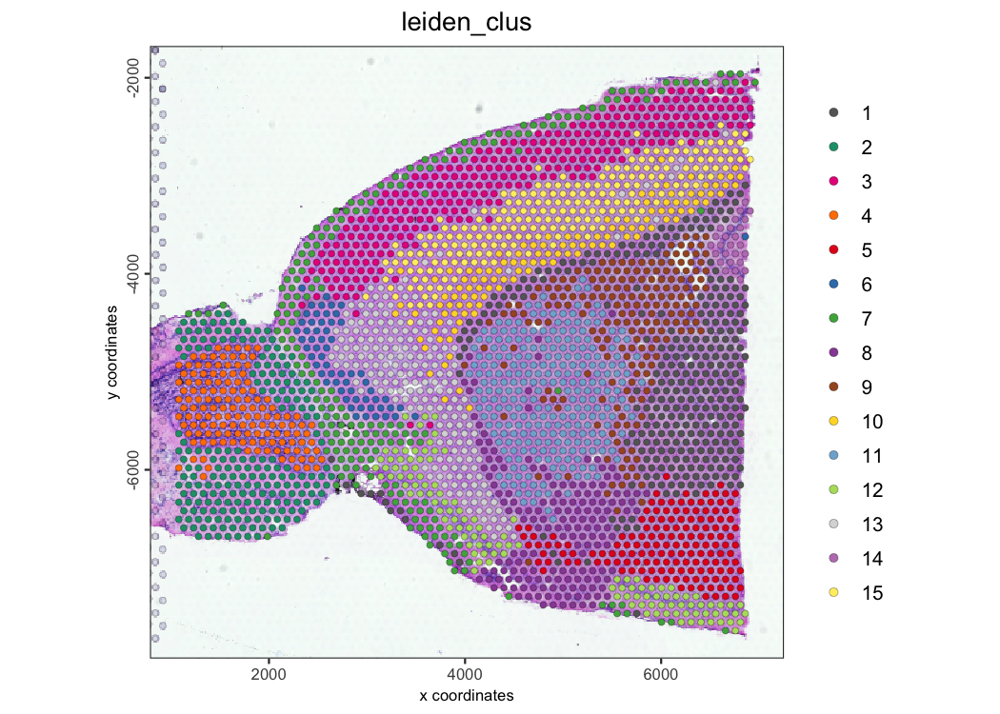
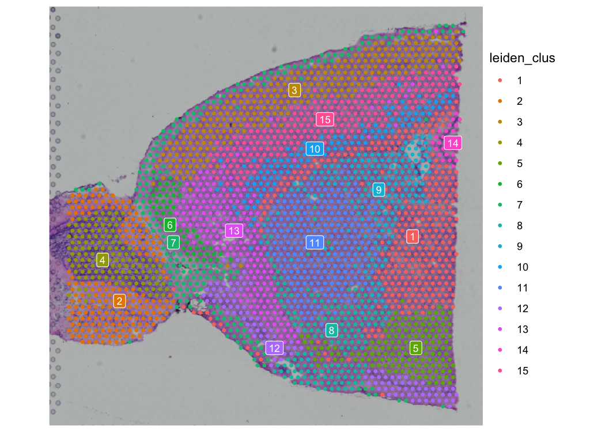

# Interoperability: Seurat

## 1 Introduction

[GiottoConnect](https://github.com/giotto-suite/GiottoConnect) converts
between Giotto and Seurat with
[`seuratToGiotto()`](https://giotto-suite.github.io/GiottoConnect/reference/seuratToGiotto.html)
and
[`giottoToSeurat()`](https://giotto-suite.github.io/GiottoConnect/reference/giottoToSeurat.html).
Both work with Seurat v3, v4 and v5 objects: the converter reads the
layout of the object (assays, images, reductions, graphs) instead of
depending on the Seurat version.

This tutorial converts a Visium dataset in both directions and checks
that the result can be used on each side. For analysis in either
package, see their own tutorials.

``` r

library(Giotto)
library(GiottoConnect)
library(Seurat)
library(SeuratData)

# SeuratData::InstallData("stxBrain")
```

## 2 Seurat to Giotto

``` r

brain <- LoadData("stxBrain", type = "anterior1")

brainG <- seuratToGiotto(brain)
brainG
```

``` r
An object of class giotto 
>Active spat_unit:  cell 
>Active feat_type:  rna 
dimensions    : 31053, 2696 (features, cells)
[SUBCELLULAR INFO]
[AGGREGATE INFO]
expression -----------------------
  [cell][rna] raw
spatial locations ----------------
  [cell] raw
attached images ------------------
images      : anterior1 


Use objHistory() to see steps and params used
```

The counts of the `Spatial` assay become the `raw` expression values of
the feature type `rna`. The Visium spot positions are converted from
image pixels to microns, and the tissue image, reductions and nearest
neighbour graphs are carried over.
[`mappingProvenance()`](https://giotto-suite.github.io/GiottoConnect/reference/mappingProvenance.html)
lists what could not be carried over or was estimated, such as the
micron-per-pixel scale:

``` r

mappingProvenance(brainG)$losses
```

``` r
  part_id                      kind field
1    locs recovered_from_parameters units
                                                                note   source
1 0.72993 um per px (100 um spot pitch / measured spacing 137.00 px) recorded
```

The result is a regular Giotto object, so the usual workflow runs on it:

``` r

brainG <- normalizeGiotto(brainG)
brainG <- addStatistics(brainG)
brainG <- calculateHVF(brainG)
brainG <- runPCA(brainG)
brainG <- createNearestNetwork(brainG, dimensions_to_use = 1:15, k = 15)
brainG <- doLeidenClusterIgraph(brainG, resolution = 0.5)

spatPlot2D(brainG,
    show_image = TRUE,
    cell_color = "leiden_clus",
    point_size = 1.5
)
```



## 3 Giotto to Seurat

``` r

brain2 <- giottoToSeurat(brainG)
brain2
```

``` r
An object of class Seurat 
31053 features across 2696 samples within 1 assay 
Active assay: rna (31053 features, 0 variable features)
 2 layers present: counts, data
 1 dimensional reduction calculated: pca
 1 spatial field of view present: fov
```

One spatial unit and feature type is converted at a time (the active
ones by default; see the `spat_unit` and `feat_type` arguments). The
feature type becomes the assay `rna`, with the raw counts in its
`counts` layer and the normalized values in `data`. Reductions (with the
PCA loadings), nearest neighbour networks and cell metadata are carried
over, and the spots and tissue image become a Visium image named `fov`.
The Giotto clusters can therefore be shown directly with Seurat’s
spatial plots:

``` r

SpatialDimPlot(brain2, group.by = "leiden_clus", label = TRUE, label.size = 3)
```



[`readbackCheck()`](https://giotto-suite.github.io/GiottoConnect/reference/readbackCheck.html)
compares the Seurat object with the Giotto object, part by part:

``` r

readbackCheck(brainG, brain2)
```

``` r
<giottoReadback> PASS: 28 MATCH, 0 DECLARED, 0 UNDECLARED
```

## 4 Session Info

``` r

sessionInfo()
```

``` r
R version 4.5.3 (2026-03-11)
Platform: aarch64-apple-darwin20
Running under: macOS Tahoe 26.7.3

Matrix products: default
BLAS:   /Library/Frameworks/R.framework/Versions/4.5-arm64/Resources/lib/libRblas.0.dylib 
LAPACK: /Library/Frameworks/R.framework/Versions/4.5-arm64/Resources/lib/libRlapack.dylib;  LAPACK version 3.12.1

locale:
[1] C.UTF-8/C.UTF-8/C.UTF-8/C/C.UTF-8/C.UTF-8

time zone: America/New_York
tzcode source: internal

attached base packages:
[1] stats     graphics  grDevices utils     datasets  methods   base     

other attached packages:
[1] stxBrain.SeuratData_0.1.2 SeuratData_0.2.2.9002     Seurat_6.0.0             
[4] SeuratObject_5.4.0        sp_2.2-1                  GiottoConnect_0.1.0      
[7] Giotto_4.3.7              GiottoClass_0.8.0        

loaded via a namespace (and not attached):
  [1] RColorBrewer_1.1-3          jsonlite_2.0.0              magrittr_2.0.5             
  [4] magick_2.9.1                farver_2.1.2                vctrs_0.7.3                
  [7] memoise_2.0.1               GiottoUtils_0.2.10          terra_1.9-11               
 [10] htmltools_0.5.9             S4Arrays_1.10.1             BiocNeighbors_2.4.0        
 [13] SparseArray_1.10.9          sctransform_0.4.3           parallelly_1.50.0          
 [16] KernSmooth_2.23-26          htmlwidgets_1.6.4           ica_1.0-3                  
 [19] plyr_1.8.9                  plotly_4.12.1               cachem_1.1.0               
 [22] igraph_2.3.4                lifecycle_1.0.5             pkgconfig_2.0.3            
 [25] rsvd_1.0.5                  Matrix_1.7-5                R6_2.6.1                   
 [28] fastmap_1.2.0               MatrixGenerics_1.22.0       future_1.82.0              
 [31] digest_0.6.39               colorspace_2.1-4            patchwork_1.3.2            
 [34] S4Vectors_0.48.1            RSpectra_0.16-2             irlba_2.4.1                
 [37] GenomicRanges_1.62.1        beachmat_2.26.0             labeling_0.4.3             
 [40] progressr_0.18.0            httr_1.4.9                  polyclip_1.10-7            
 [43] abind_1.4-8                 compiler_4.5.3              proxy_0.4-29               
 [46] bit64_4.6.0-1               withr_3.0.3                 S7_1.0.0                   
 [49] backports_1.5.1             BiocParallel_1.44.0         DBI_1.3.0                  
 [52] viridis_0.6.5               fastDummies_1.7.6           R.utils_2.13.0             
 [55] ggforce_0.5.0               MASS_7.3-65                 rappdirs_0.3.4             
 [58] DelayedArray_0.36.0         classInt_0.4-11             rjson_0.2.23               
 [61] bluster_1.20.0              gtools_3.9.5                units_1.0-1                
 [64] GiottoVisuals_0.2.16        tools_4.5.3                 otel_0.3.0                 
 [67] future.apply_1.21.0         R.oo_1.27.1                 glue_1.8.1                 
 [70] dbscan_1.2.4                sf_1.1-1                    grid_4.5.3                 
 [73] checkmate_2.3.4             Rtsne_0.17                  cluster_2.1.8.2            
 [76] reshape2_1.4.5              generics_0.1.4              hdf5r_1.3.12               
 [79] gtable_0.3.6                R.methodsS3_1.8.2           class_7.3-23               
 [82] tidyr_1.3.2                 data.table_1.18.6.1         BiocSingular_1.26.1        
 [85] tidygraph_1.3.1             ScaledMatrix_1.18.0         XVector_0.50.0             
 [88] BiocGenerics_0.56.0         RcppAnnoy_0.0.23            ggrepel_0.9.8              
 [91] RANN_2.6.2                  pillar_1.11.1               stringr_1.6.0              
 [94] spam_2.11-3                 RcppHNSW_0.6.0              dplyr_1.2.1                
 [97] tweenr_2.0.3                lattice_0.22-9              bit_4.6.0                  
[100] tidyselect_1.2.1            SingleCellExperiment_1.32.0 pbapply_1.7-5              
[103] gridExtra_2.3.1             IRanges_2.44.0              Seqinfo_1.0.0              
[106] SummarizedExperiment_1.40.0 scattermore_1.2             stats4_4.5.3               
[109] pls_2.9-0                   graphlayouts_1.2.3          Biobase_2.70.0             
[112] matrixStats_1.5.0           stringi_1.8.9               yaml_2.3.12                
[115] codetools_0.2-20            ggraph_2.2.2                tibble_3.3.1               
[118] colorRamp2_0.1.0            cli_3.6.6                   uwot_0.2.4                 
[121] dichromat_2.0-0.1           Rcpp_1.1.2                  globals_0.20.0             
[124] png_0.1-9                   parallel_4.5.3              ggplot2_4.0.4              
[127] dotCall64_1.2               sparseMatrixStats_1.22.0    listenv_1.1.0              
[130] SpatialExperiment_1.20.0    viridisLite_0.4.3           e1071_1.7-17               
[133] scales_1.4.0                ggridges_0.5.7              purrr_1.2.2                
[136] crayon_1.5.3                rlang_1.3.0                 cowplot_1.2.0
```
