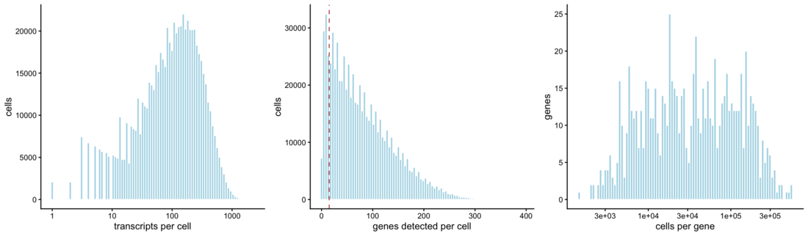
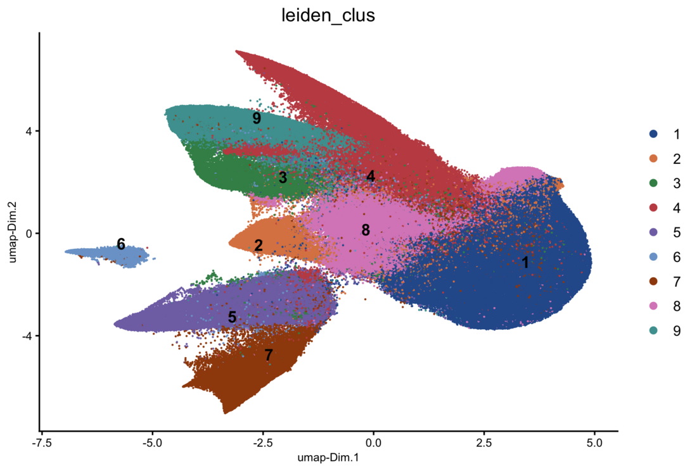
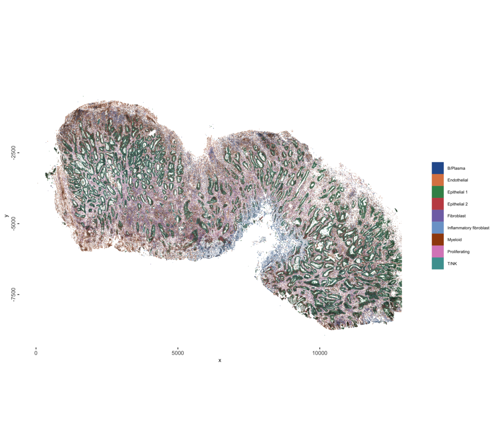
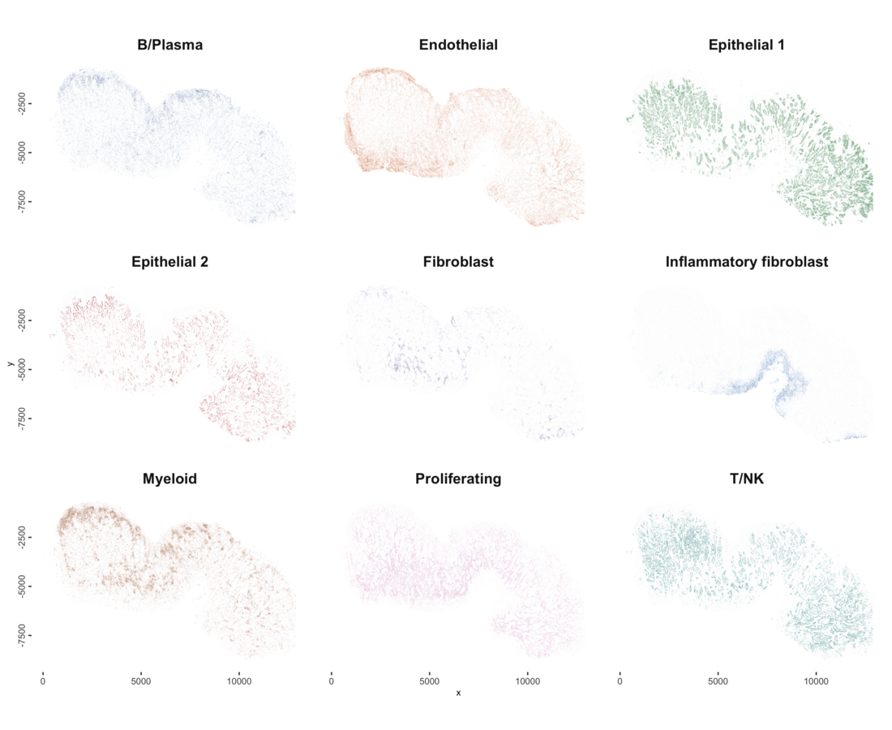
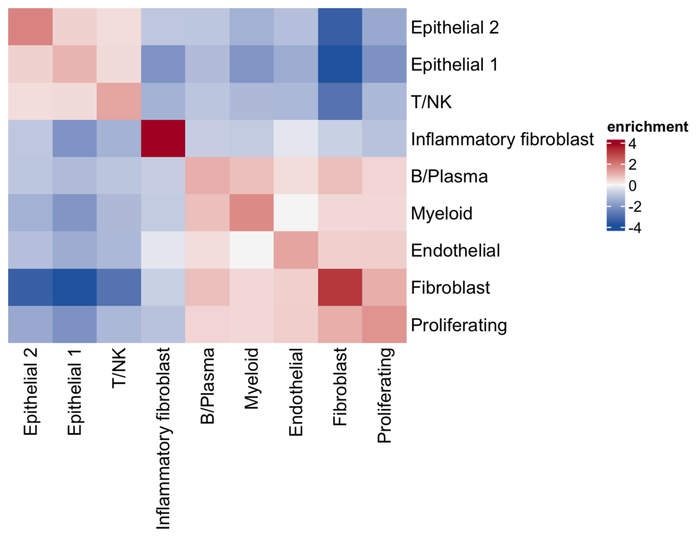

# Human colon cancer MERSCOPE with GiottoDisk

## 1 The dataset

Vizgen MERSCOPE, human colon cancer, FFPE, region R1 of
`202502261437_HuColonCan-FFPE-D2M1883-V2-UltraSm-ST_VMSC18810` ([data
release](https://info.vizgen.com/merfish-2.0-data-release-form)). Panel:
815 gene targets, 85 `Blank` barcodes. 151,017,583 transcripts, 703,879
segmented cells. Export 33 GB.

| vendor file | size | contents |
|----|----|----|
| `detected_transcripts.parquet` | 3.3 GB | transcript, x, y, z, cell, not read |
| `detected_transcripts.csv` | 17 GB | same table as text, not read |
| `cell_boundaries.parquet` | 1.9 GB | polygons, seven z-planes per cell |
| `cell_by_gene.csv` | 1.2 GB | vendor cell x gene matrix |
| `cell_metadata.csv` | 237 MB | centroid, volume, counts |
| `cell_numeric_categories.csv` | 25 MB | numeric annotations |
| `cell_categories.csv` | 14 MB | categorical annotations |
| `*.vzg2`, `*.h5ad` | 7.1 GB, 2.4 GB | viewer bundle, AnnData export, not read |

Inputs read: `cell_boundaries.parquet`, `cell_by_gene.csv`,
`cell_metadata.csv`.

## 2 Packages

``` r

remotes::install_github(c(
    "giotto-suite/GiottoUtils@65fb1a9b",
    "giotto-suite/GiottoClass@b3e79326",
    "giotto-suite/GiottoVisuals@bec7b11b",
    "giotto-suite/Giotto@e611ed99",
    "drieslab/tilework@f4616fa3"))
remotes::install_local("path/to/GiottoDisk")   # branch feat/merscope-on-dev
BiocManager::install("scran")
```

## 3 Setup

``` r

suppressMessages({
  library(Giotto); library(GiottoClass); library(GiottoDisk)
  library(data.table); library(ggplot2); library(cowplot)
  library(Matrix); library(terra)
})

# MERSCOPE region directory (the folder containing cell_by_gene.csv)
MERSCOPE <- "data/region_R1"
# GiottoDisk vault directory, outside any cloud-synced folder
VAULT    <- "vault"
dir.create(VAULT, showWarnings = FALSE, recursive = TRUE)
stopifnot(dir.exists(MERSCOPE))

setArtifactDumpDir(VAULT)
th <- theme_classic(base_size = 9)
set.seed(42)

CLUS_COLS <- c("#2B5C9B", "#DD8452", "#3E8E57", "#C44E52", "#8172B3",
               "#7BA3D0", "#A0490D", "#DA8BC3", "#4C9F9F", "#5A5A5A",
               "#9E3D6B", "#1B7F79")
clus_palette <- function(x) {
    lev <- levels(factor(x))
    setNames(CLUS_COLS[seq_along(lev)], lev)
}
```

## 4 Ingest

``` r

src <- sourceCreate(VAULT)
g <- createGiottoMerscopeObject(
    merscope_dir     = MERSCOPE,
    backend          = src,
    load_transcripts = FALSE)
instructions(g) <- createGiottoInstructions(
    save_plot = FALSE, show_plot = TRUE, return_plot = FALSE)
g
```

    ## An object of class giotto 
    ## >Active spat_unit:  cell 
    ## >Active feat_type:  rna 
    ## dimensions    : 815, 703879 (features, cells)
    ## [SUBCELLULAR INFO]
    ## polygons      : cell 
    ## [AGGREGATE INFO]
    ## expression -----------------------
    ##   [cell][rna] raw
    ##   [cell][neg_probe] raw
    ## spatial locations ----------------
    ##   [cell] raw
    ## 
    ## 
    ## Use objHistory() to see steps and params used

Setting `backend` builds the object on disk: polygons go into a parquet
geometry store. `load_transcripts = FALSE` skips
`detected_transcripts.parquet`, so the object has no transcript layer.
The cell x gene layer is read from `cell_by_gene.csv`, and the negative
controls go into their own `[cell][neg_probe]` layer. The y coordinates
are negated on load, so plots have the orientation of the Vizgen images.

``` r

g <- addStatistics(g, expression_values = "raw")
snapshotSave(src, g, name = "aggregated", overwrite = TRUE)
```

    ##   backend : `gDirSource`
    ##   path    : vault

``` r

cells <- as.data.table(pDataDT(g))
feats <- as.data.table(fDataDT(g))
data.table(item  = c("cells", "gene targets", "median transcripts / cell",
                     "median genes / cell"),
           value = c(format(nrow(cells), big.mark = ","),
                     format(nrow(feats), big.mark = ","),
                     median(cells$total_expr), median(cells$nr_feats)))
```

| item                      |   value |
|:--------------------------|--------:|
| cells                     | 703,879 |
| gene targets              |     815 |
| median transcripts / cell |     102 |
| median genes / cell       |      66 |

## 5 Quality control and filtering

**QC plots**

``` r

spatInSituPlotPoints(g, show_polygon = TRUE, polygon_fill = "total_expr",
                     polygon_fill_as_factor = FALSE,
                     polygon_fill_gradient_style = "sequential",
                     polygon_color = "black", polygon_line_size = 0.01,
                     background_color = "white")
```


``` r

# transcripts per cell
p_tx <- filterDistributions(g, method = "sum", detection = "cells",
                            scale_axis = "log10", nr_bins = 90,
                            show_plot = FALSE, return_plot = TRUE) +
    labs(title = NULL, x = "transcripts per cell", y = "cells") + th

# genes detected per cell, with the detection floor
p_genes <- filterDistributions(g, method = "threshold", detection = "cells",
                               nr_bins = 90,
                               show_plot = FALSE, return_plot = TRUE) +
    geom_vline(xintercept = 15, color = "#C44E52", linetype = "dashed") +
    labs(title = NULL, x = "genes detected per cell", y = "cells") + th

# cells per gene
p_cells <- filterDistributions(g, method = "threshold", detection = "feats",
                               scale_axis = "log10", nr_bins = 90,
                               show_plot = FALSE, return_plot = TRUE) +
    labs(title = NULL, x = "cells per gene", y = "genes") + th

plot_grid(p_tx, p_genes, p_cells, nrow = 1)
```



``` r

cells <- as.data.table(pDataDT(g))
g <- addCellMetadata(g, new_metadata = data.table(
         cell_ID = cells$cell_ID,
         qc_fail = ifelse(cells$nr_feats < 15, "removed", "kept")),
     by_column = TRUE, column_cell_ID = "cell_ID")
spatInSituPlotPoints(g, show_polygon = TRUE, polygon_fill = "qc_fail",
                     polygon_fill_as_factor = TRUE,
                     polygon_fill_code = c(kept = "#B9C6D6", removed = "#C44E52"),
                     polygon_color = "black", polygon_line_size = 0.01,
                     background_color = "white")
```


Raising `min_det_feats_per_cell` discards more poorly segmented and
low-signal cells at the cost of losing real cells with sparse
expression; lowering it keeps those cells but admits fragments and
near-empty polygons into the clustering.

``` r

g <- filterGiotto(g, expression_threshold = 1, feat_det_in_min_cells = 10,
                  min_det_feats_per_cell = 15, verbose = TRUE)
```

    ## 
    ## Feature type:  rna 
    ## Number of cells removed:  88181  out of  703879 
    ## Number of feats removed:  0  out of  815

## 6 Normalization and dimension reduction

Normalization puts cells on a comparable scale so that differences in
total counts per cell, which track cell size and detection efficiency,
do not dominate the distances used for clustering.

``` r

g <- normalizeGiotto(g, norm_methods = "standard", scale_feats = FALSE,
                     scale_cells = FALSE)
g <- addStatistics(g, expression_values = "normalized")
g <- runPCA(g, expression_values = "normalized", ncp = 100)
```

``` r

screePlot(g, ncp = 30)
```


## 7 Neighbors, UMAP, clustering

``` r

g <- createNearestNetwork(g, dim_reduction_to_use = "pca",
                          dimensions_to_use = 2:15, k = 30, type = "sNN",
                          minimum_shared = 5, engine = "hnsw")
g <- doLeidenCluster(g, resolution = 0.25, n_iterations = 100)
g <- runUMAP(g, dim_reduction_to_use = "pca", dimensions_to_use = 2:15,
             n_neighbors = 30, min_dist = 0.01)
```

``` r

PAL_CLUS <- clus_palette(pDataDT(g)$leiden_clus)
plotUMAP(g, cell_color = "leiden_clus", cell_color_code = PAL_CLUS, point_size = 0.03,
         point_shape = "no_border")
```



## 8 Markers

``` r

mk <- findMarkers_one_vs_all(g, method = "scran", expression_values = "normalized",
                             cluster_column = "leiden_clus", min_feats = 3)
setorder(mk, cluster, ranking)
top <- mk[, .(top_genes = paste(head(feats, 6), collapse = ", ")), by = cluster]
top[]
```

    ## start with cluster  1start with cluster  2start with cluster  3start with cluster  4start with cluster  5start with cluster  6start with cluster  7start with cluster  8start with cluster  9

**Top marker genes per cluster**

| cluster | top_genes                                    |
|--------:|:---------------------------------------------|
|       1 | PABPC1, HMGA1, SOX9, MYC, ERBB3, EPCAM       |
|       2 | MYBL2, RNF43, VEGFA, E2F1, CDCA7, MKI67      |
|       3 | MMP1, MMP3, SOD2, COL3A1, COL1A2, CXCL8      |
|       4 | COL1A2, COL3A1, COL4A1, VWF, PLVAP, EGFL7    |
|       5 | CD74, ITGB2, LYZ, CIITA, CYBB, C1QC          |
|       6 | MZB1, XBP1, IRF4, POU2AF1, DERL3, PRDM1      |
|       7 | IL2RB, TRAC, ZAP70, CD2, FYN, ITGB2          |
|       8 | RNF43, VEGFA, ERBB3, RBM39, SOX9, EPCAM      |
|       9 | COL5A1, THBS2, CDH11, COL1A2, PDGFRB, COL3A1 |

``` r

sel <- unique(mk[, head(feats, 3), by = cluster]$V1)
dotPlot(g, feats = sel, cluster_column = "leiden_clus")
```


## 9 Cell types

Each Leiden cluster is named from its top markers in section 8.

``` r

g <- annotateGiotto(g,
    annotation_vector = c("1" = "Epithelial 1", "2" = "Epithelial 2",
                          "3" = "Inflammatory fibroblast", "4" = "Endothelial",
                          "5" = "Myeloid", "6" = "Fibroblast",
                          "7" = "B/Plasma", "8" = "T/NK",
                          "9" = "Proliferating"),
    cluster_column = "leiden_clus", name = "cell_type")
cells <- as.data.table(pDataDT(g))
PAL <- clus_palette(cells$cell_type)
```

``` r

ct <- cells[, .(cells = .N), by = .(cell_type)]
ct[, pct := round(100 * cells / sum(cells), 1)][order(-cells)]
```

| cell_type               |  cells |  pct |
|:------------------------|-------:|-----:|
| Epithelial 1            | 188013 | 30.5 |
| Endothelial             | 104017 | 16.9 |
| T/NK                    |  86986 | 14.1 |
| Myeloid                 |  69248 | 11.2 |
| Proliferating           |  55973 |  9.1 |
| B/Plasma                |  42793 |  7.0 |
| Epithelial 2            |  32755 |  5.3 |
| Inflammatory fibroblast |  23226 |  3.8 |
| Fibroblast              |  12687 |  2.1 |

``` r

setorder(ct, -cells); ct[, cell_type := factor(cell_type, levels = rev(cell_type))]
ggplot(ct, aes(cell_type, cells, fill = cell_type)) +
    geom_col(width = 0.75) +
    scale_fill_manual(values = PAL, guide = "none") +
    coord_flip() +
    geom_text(aes(label = formatC(cells, big.mark = ",", format = "d")),
              hjust = -0.1, size = 2.6) +
    scale_y_continuous(expand = expansion(mult = c(0, 0.22))) +
    labs(x = NULL, y = "cells") + th
```


``` r

snapshotSave(src, g, name = "clustered", overwrite = TRUE)
```

    ##   backend : `gDirSource`
    ##   path    : vault

## 10 The slide

``` r

spatInSituPlotPoints(g, show_polygon = TRUE, polygon_fill = "cell_type",
                     polygon_fill_as_factor = TRUE, polygon_fill_code = PAL,
                     polygon_color = "black", polygon_line_size = 0.01,
                     background_color = "white")
```



``` r

# segmentation polygons filled by cell type
p_facets <- spatInSituPlotPoints(g, show_polygon = TRUE, polygon_fill = "cell_type",
                                 polygon_fill_as_factor = TRUE, polygon_fill_code = PAL,
                                 polygon_color = NA, background_color = "white",
                                 show_legend = FALSE, show_plot = FALSE, return_plot = TRUE)

# 40,000 cells in gray behind every panel
bgv <- p_facets$layers[[1]]$data[poly_ID %in% sample(unique(poly_ID), min(uniqueN(poly_ID), 40000L)),
                                 .(x, y, poly_ID)]
p_facets$layers <- c(geom_polygon(data = bgv, aes(x, y, group = poly_ID),
                                  fill = "#E8E8E8", color = NA, inherit.aes = FALSE),
                     p_facets$layers)

# one panel per cell type
p_facets + facet_wrap(~cell_type, ncol = 3) +
    theme(strip.background = element_blank(),
          strip.text = element_text(size = 13, face = "bold"),
          panel.spacing = unit(10, "pt"))
```



## 11 Cell boundaries in a 400 um window

``` r

# 400 um window at the center of the section
sl  <- as.data.table(getSpatialLocations(g, output = "data.table"))
ctr <- c(median(sl$sdimx), median(sl$sdimy))
XL  <- ctr[1] + c(-200, 200)
YL  <- ctr[2] + c(-200, 200)

# segmentation polygons filled by cell type
p_types <- spatInSituPlotPoints(g, show_polygon = TRUE, polygon_fill = "cell_type",
                                polygon_fill_as_factor = TRUE, polygon_fill_code = PAL,
                                polygon_color = "black", polygon_line_size = 0.12,
                                background_color = "white",
                                show_plot = FALSE, return_plot = TRUE)

# cropped to the window
p_types + coord_fixed(xlim = XL, ylim = YL, expand = FALSE)
```


## 12 Spatial neighborhood composition

Each cell is linked to its twenty nearest neighbors.
[`cellProximityEnrichment()`](https://giottosuite.com/dev/reference/cellProximityEnrichment.md)
counts the links between each pair of cell types and compares the counts
with 1,000 random relabelings of the cells, so a log2 enrichment above 0
means the pairing is more common than chance. The clustering used no
spatial information, so this tests whether the expression-defined
populations are spatially organized.

``` r

g <- createSpatialNetwork(g, method = "kNN", k = 20, name = "kNN20")
cpe <- cellProximityEnrichment(g, cluster_column = "cell_type",
                               spatial_network_name = "kNN20",
                               number_of_simulations = 1000)
head(cpe$enrichm_res[type_int == "hetero"][order(-enrichm)], 8)[
    , .(pair = unified_int, enrichment = round(enrichm, 2), p.adj_higher)]
```

| pair                      | enrichment | p.adj_higher |
|:--------------------------|-----------:|-------------:|
| Fibroblast–Proliferating  |       1.10 |     0.000999 |
| B/Plasma–Myeloid          |       0.84 |     0.000999 |
| B/Plasma–Fibroblast       |       0.83 |     0.000999 |
| Endothelial–Proliferating |       0.59 |     0.000999 |
| Endothelial–Fibroblast    |       0.57 |     0.000999 |
| Epithelial 1–Epithelial 2 |       0.52 |     0.000999 |
| B/Plasma–Proliferating    |       0.49 |     0.000999 |
| Myeloid–Proliferating     |       0.44 |     0.000999 |

``` r

cellProximityHeatmap(g, CPscore = cpe, order_cell_types = TRUE, scale = FALSE)
```



## 13 Session

``` r

sessionInfo()
```

    ## R version 4.5.2 (2025-10-31)
    ## Platform: aarch64-apple-darwin20
    ## Running under: macOS 27.0.1
    ## 
    ## Matrix products: default
    ## BLAS:   /System/Library/Frameworks/Accelerate.framework/Versions/A/Frameworks/vecLib.framework/Versions/A/libBLAS.dylib 
    ## LAPACK: /Library/Frameworks/R.framework/Versions/4.5-arm64/Resources/lib/libRlapack.dylib;  LAPACK version 3.12.1
    ## 
    ## locale:
    ## [1] en_US/en_US/en_US/C/en_US/en_US
    ## 
    ## time zone: America/New_York
    ## tzcode source: internal
    ## 
    ## attached base packages:
    ## [1] stats     graphics  grDevices utils     datasets  methods   base     
    ## 
    ## other attached packages:
    ## [1] future_1.76.0       terra_1.9-50        Matrix_1.7-4       
    ## [4] cowplot_1.2.0       ggplot2_4.0.3       data.table_1.18.6.1
    ## [7] GiottoDisk_0.0.0.6  Giotto_4.3.5        GiottoClass_0.7.18 
    ## 
    ## loaded via a namespace (and not attached):
    ##   [1] RColorBrewer_1.1-3          shape_1.4.6.1              
    ##   [3] jsonlite_2.0.0              wk_0.9.5                   
    ##   [5] magrittr_2.0.5              magick_2.9.1               
    ##   [7] farver_2.1.2                rmarkdown_2.32             
    ##   [9] GlobalOptions_0.1.4         vctrs_0.7.3                
    ##  [11] memoise_2.0.1               GiottoUtils_0.2.7          
    ##  [13] htmltools_0.5.9             S4Arrays_1.10.1            
    ##  [15] BiocNeighbors_2.4.0         SparseArray_1.10.10        
    ##  [17] sass_0.4.10                 parallelly_1.48.0          
    ##  [19] bslib_0.12.0                htmlwidgets_1.6.4          
    ##  [21] plotly_4.12.1               cachem_1.1.0               
    ##  [23] igraph_2.3.3                lifecycle_1.0.5            
    ##  [25] iterators_1.0.14            pkgconfig_2.0.3            
    ##  [27] rsvd_1.0.5                  R6_2.6.1                   
    ##  [29] fastmap_1.2.0               clue_0.3-68                
    ##  [31] MatrixGenerics_1.22.0       digest_0.6.39              
    ##  [33] colorspace_2.1-3            S4Vectors_0.48.1           
    ##  [35] dqrng_0.4.1                 irlba_2.3.7                
    ##  [37] GenomicRanges_1.62.1        beachmat_2.26.0            
    ##  [39] filelock_1.0.3              labeling_0.4.3             
    ##  [41] progressr_1.0.0             httr_1.4.9                 
    ##  [43] polyclip_1.10-7             abind_1.4-8                
    ##  [45] compiler_4.5.2              bit64_4.8.6                
    ##  [47] withr_3.0.3                 doParallel_1.0.17          
    ##  [49] S7_0.2.2                    backports_1.5.1            
    ##  [51] BiocParallel_1.44.0         viridis_0.6.5              
    ##  [53] ggforce_0.5.0               R.utils_2.13.0             
    ##  [55] MASS_7.3-65                 DelayedArray_0.36.1        
    ##  [57] rjson_0.2.23                bluster_1.20.0             
    ##  [59] gtools_3.9.5                GiottoVisuals_0.2.16       
    ##  [61] tools_4.5.2                 otel_0.2.0                 
    ##  [63] future.apply_1.20.2         R.oo_1.27.1                
    ##  [65] glue_1.8.1                  dbscan_1.2.6               
    ##  [67] grid_4.5.2                  checkmate_2.3.4            
    ##  [69] cluster_2.1.8.1             generics_0.1.4             
    ##  [71] gtable_0.3.6                R.methodsS3_1.8.2          
    ##  [73] tidyr_1.3.2                 BiocSingular_1.26.1        
    ##  [75] tidygraph_1.3.1             ScaledMatrix_1.18.0        
    ##  [77] metapod_1.18.0              XVector_0.50.0             
    ##  [79] BiocGenerics_0.56.0         tilework_1.0.0             
    ##  [81] ggrepel_0.9.8               foreach_1.5.2              
    ##  [83] pillar_1.11.1               RcppHNSW_0.7.0             
    ##  [85] limma_3.66.0                circlize_0.4.18            
    ##  [87] dplyr_1.2.1                 tweenr_2.0.3               
    ##  [89] lattice_0.22-7              bit_4.6.0                  
    ##  [91] tidyselect_1.2.1            ComplexHeatmap_2.26.1      
    ##  [93] SingleCellExperiment_1.32.0 locfit_1.5-9.12            
    ##  [95] scuttle_1.20.0              knitr_1.52                 
    ##  [97] gridExtra_2.3.1             IRanges_2.44.0             
    ##  [99] Seqinfo_1.0.0               edgeR_4.8.2                
    ## [101] SummarizedExperiment_1.40.0 scattermore_1.2            
    ## [103] stats4_4.5.2                xfun_0.61                  
    ## [105] graphlayouts_1.2.5          Biobase_2.70.0             
    ## [107] statmod_1.5.2               matrixStats_1.5.0          
    ## [109] yaml_2.3.12                 evaluate_1.0.5             
    ## [111] codetools_0.2-20            ggraph_2.2.2               
    ## [113] tibble_3.3.1                colorRamp2_0.1.1           
    ## [115] cli_3.6.6                   uwot_0.2.5                 
    ## [117] arrow_25.0.1                jquerylib_0.1.4            
    ## [119] Rcpp_1.1.2                  globals_0.19.1             
    ## [121] png_0.1-9                   parallel_4.5.2             
    ## [123] assertthat_0.2.1            scran_1.38.1               
    ## [125] listenv_1.0.0               viridisLite_0.4.3          
    ## [127] scales_1.4.0                crayon_1.5.3               
    ## [129] purrr_1.2.2                 GetoptLong_1.1.1           
    ## [131] rlang_1.3.0

NA \`\`\`
