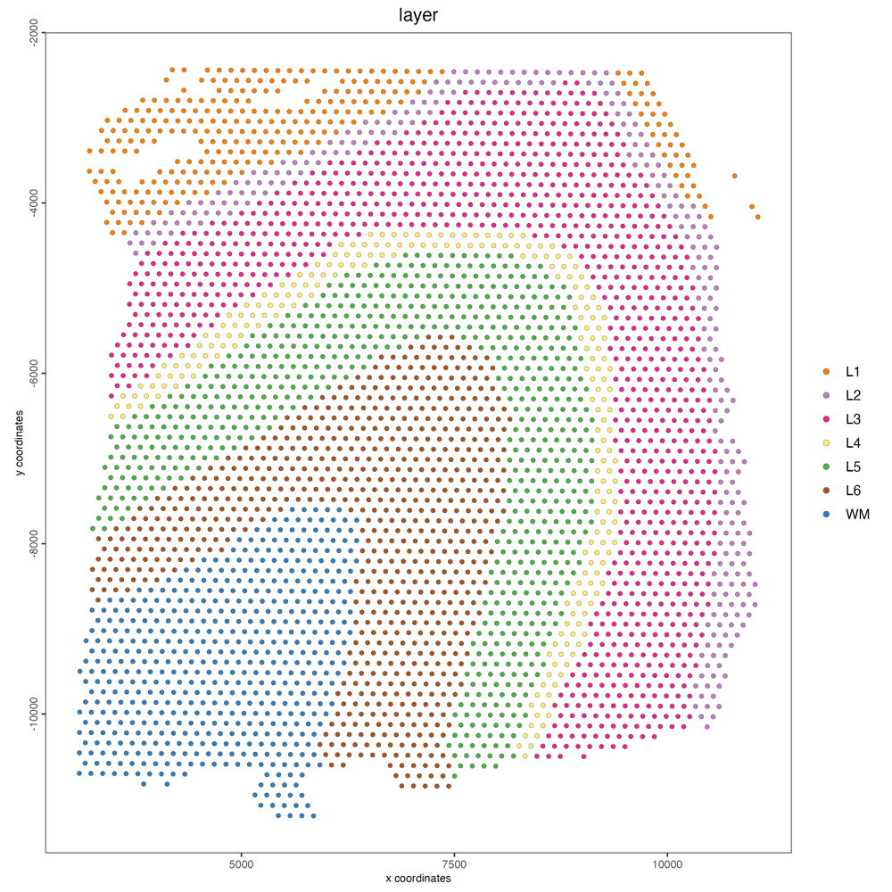
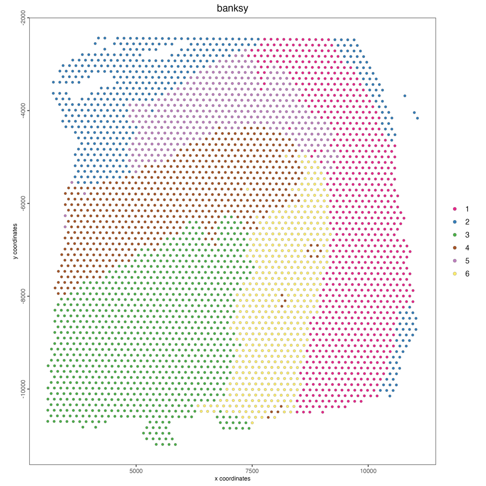
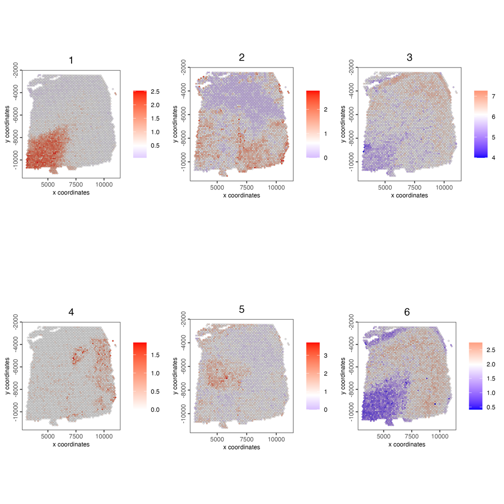
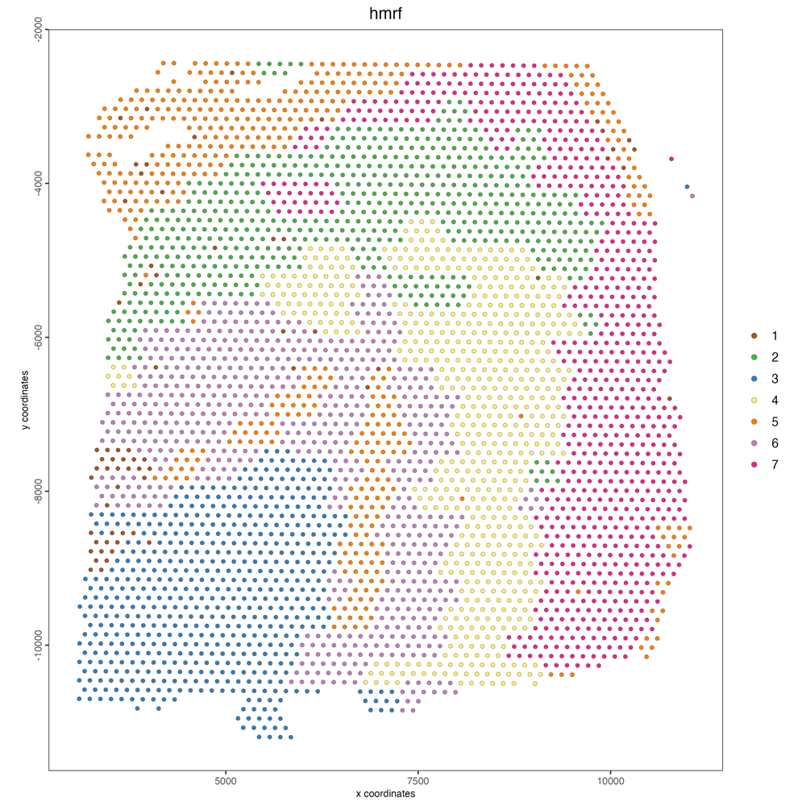

# Spatial domains with BANKSY and HMRF

Spatial domains are regions of tissue with a shared expression profile.
[`findSpatialDomains()`](https://giottosuite.com/dev/reference/findSpatialDomains.md)
finds them with two native methods:

- `"neighborhood"`: the BANKSY embedding (Singhal et al. 2024), each
  spot’s expression together with its neighbours’ mean and gradient,
  clustered with Leiden;
- `"hmrf"`: the hidden Markov random field (Zhu et al. 2018), a Gaussian
  mixture with a prior that neighbouring spots share a domain.

This tutorial runs both on the human dorsolateral prefrontal cortex
(DLPFC) slice 151673 (Visium, Maynard et al. 2021) and compares them
with its manual annotation of the six cortical layers and the white
matter.

## 1 Download the data

The counts come from the spatialLIBD bucket; the spot positions, image
and layer annotation from the
[HumanPilot](https://github.com/LieberInstitute/HumanPilot) repository.

``` r

library(Giotto)

data_dir <- file.path(tempdir(), "dlpfc_151673")
dir.create(file.path(data_dir, "spatial"), recursive = TRUE,
    showWarnings = FALSE)
libd <- "https://raw.githubusercontent.com/LieberInstitute/HumanPilot/master/10X"
files <- c(
    "151673_filtered_feature_bc_matrix.h5" = "https://spatial-dlpfc.s3.us-east-2.amazonaws.com/h5/151673_filtered_feature_bc_matrix.h5",
    "spatial/tissue_positions_list.csv" = file.path(libd, "151673/tissue_positions_list.txt"),
    "spatial/scalefactors_json.json" = file.path(libd, "151673/scalefactors_json.json"),
    "spatial/tissue_lowres_image.png" = file.path(libd, "151673/tissue_lowres_image.png"),
    "layers.tsv" = file.path(libd, "barcode_level_layer_map.tsv"))
for (f in names(files)) {
    dest <- file.path(data_dir, f)
    if (!file.exists(dest)) download.file(files[[f]], dest, mode = "wb")
}
```

## 2 Create and process the object

``` r

g <- createGiottoVisiumObject(expr_data = "filter",
    h5_visium_path = file.path(data_dir, "151673_filtered_feature_bc_matrix.h5"),
    h5_tissue_positions_path = file.path(data_dir, "spatial/tissue_positions_list.csv"),
    h5_image_png_path = file.path(data_dir, "spatial/tissue_lowres_image.png"),
    h5_json_scalefactors_path = file.path(data_dir, "spatial/scalefactors_json.json"))

# keep the annotated spots and add their layer
layers <- data.table::fread(file.path(data_dir, "layers.tsv"), header = FALSE,
    col.names = c("cell_ID", "sample", "layer"))[sample == 151673]
g <- subsetGiotto(g, cell_ids = intersect(spatIDs(g), layers$cell_ID))
g <- addCellMetadata(g, new_metadata = layers[, c("cell_ID", "layer")],
    by_column = TRUE, column_cell_ID = "cell_ID")

g <- filterGiotto(g, expression_threshold = 1, feat_det_in_min_cells = 10,
    min_det_feats_per_cell = 100)
g <- normalizeGiotto(g)
g <- calculateHVF(g, method = "var", n_top_feats = 2000)
g <- createSpatialNetwork(g, method = "Delaunay")

spatPlot2D(g, cell_color = "layer", point_size = 1.5)
```



The highly variable features are the 2,000 with the highest variance
(`method = "var"`). They favour highly expressed genes, which carry the
layer structure here; see [choosing the
features](#choosing-the-features).

## 3 BANKSY

BANKSY adds to each spot the mean expression of its 6 nearest spots and
the gradient over its 18 nearest (`compute_agf = TRUE`), weighted by
`lambda`, runs PCA, and clusters the spots with Leiden.

``` r

g <- createSpatialNetwork(g, method = "kNN", k = 6, name = "kNN6")
g <- createSpatialNetwork(g, method = "kNN", k = 18, name = "kNN18")

g <- findSpatialDomains(g, method = "neighborhood",
    feats_to_use = "hvf", lambda = 0.8, compute_agf = TRUE,
    spatial_network_name = c("kNN6", "kNN18"),
    resolution = 0.3, name = "banksy")

spatPlot2D(g, cell_color = "banksy", point_size = 1.5)
```



## 4 HMRF

HMRF starts from spatial co-expression modules: genes that vary together
across the tissue, summarised as one score per module per spot. The
scores are spatially informed and few, so the k-means start of HMRF is
fast and stable. Each step is a separate function, so any spatially
variable gene test or module method can be used.

``` r

# 1. spatially variable genes (any spatialAutoCor() method)
sv <- spatialAutoCor(g, method = "binspect", return_gobject = FALSE)
spatial_genes <- head(sv[adj.p.value < 0.05]$feats, 1000)

# 2. co-expression modules, stored as the spatial enrichment "spatial_module"
g <- spatialCoexpression(g, feats = spatial_genes, n_modules = 30)

spatCellPlot2D(g, spat_enr_names = "spatial_module",
    cell_annotation_values = as.character(1:6), point_size = 0.8,
    cow_n_col = 3)
```



``` r

# 3. HMRF on the module scores
g <- findSpatialDomains(g, method = "hmrf", spat_enr_name = "spatial_module",
    k = 7, beta = 5, name = "hmrf")

spatPlot2D(g, cell_color = "hmrf", point_size = 1.5)
```



## 5 Compare with the layers

``` r

meta <- pDataDT(g)
c(banksy = mclust::adjustedRandIndex(meta$banksy, meta$layer),
  hmrf = mclust::adjustedRandIndex(meta$hmrf, meta$layer))
```

    banksy   hmrf
      0.42   0.43

Both methods recover the layers to a similar degree (adjusted Rand
index, ARI, with the manual annotation), and both separate the white
matter clearly. On this slice BANKSY took about 2 s, and the HMRF steps
(spatially variable genes, modules and fit) under 10 s.

Choosing the HMRF settings

[`runHMRF()`](https://giottosuite.com/dev/reference/runHMRF.md) fits
several `k` and `beta` in one call and
[`hmrfSummary()`](https://giottosuite.com/dev/reference/hmrfSummary.md)
compares them: `coherence` is the share of neighbouring spots in the
same domain, and `smallest_domain` near 0 means `k` is too large.

``` r

g <- runHMRF(g, spat_enr_name = "spatial_module", k = 7,
    betas = c(0, 2, 5, 10))
hmrfSummary(g)
```

           setting     k  beta     loglik confidence coherence smallest_domain
    1:  hmrf_k7_b0     7     0 -114112.47      0.874     0.586           0.016
    2:  hmrf_k7_b2     7     2  -83698.65      0.981     0.887           0.039
    3:  hmrf_k7_b5     7     5  -39269.60      0.987     0.906           0.018
    4: hmrf_k7_b10     7    10   36987.02      0.987     0.916           0.009

Each setting is stored as a cell metadata column (`hmrf_k7_b5`, …) and
its domain probabilities as a spatial enrichment of the same name.

On module scores, HMRF scales each module (`zscore = "feature"`, the
default for a spatial enrichment). The number of modules matters more
than `beta`: on this slice 30 modules gave a higher ARI than 10 or 20.

Choosing the BANKSY settings

`lambda` weights the neighbourhood: near 0 the domains follow cell
types, near 1 they follow the neighbourhood. `resolution` sets the
number of domains.
[`findSpatialDomains()`](https://giottosuite.com/dev/reference/findSpatialDomains.md)
passes other arguments to
[`runNeighborhoodPCA()`](https://giottosuite.com/dev/reference/runNeighborhoodPCA.md),
for example `npcs`. The embedding is also available on its own with
[`runNeighborhoodPCA()`](https://giottosuite.com/dev/reference/runNeighborhoodPCA.md),
to cluster it differently.

Choosing the features

The features matter more than the method’s settings. On this slice the
default of
[`calculateHVF()`](https://giottosuite.com/dev/reference/calculateHVF.md)
(`method = "cov_groups"`) selects genes with little layer signal, and
BANKSY reaches an ARI of about 0.2 with them, against about 0.4 with the
2,000 highest-variance genes.

## 6 Citation

If you use these methods, please cite the original papers:

- Singhal V, Chou N, Lee J, et al. BANKSY unifies cell typing and tissue
  domain segmentation for scalable spatial omics data analysis. *Nature
  Genetics* 56, 431–441 (2024).
  <https://doi.org/10.1038/s41588-024-01664-3>
- Zhu Q, Shah S, Dries R, Cai L, Yuan GC. Identification of spatially
  associated subpopulations by combining scRNAseq and sequential
  fluorescence in situ hybridization data. *Nature Biotechnology* 36,
  1183–1190 (2018). <https://doi.org/10.1038/nbt.4260>
- Maynard KR, Collado-Torres L, Weber LM, et al. Transcriptome-scale
  spatial gene expression in the human dorsolateral prefrontal cortex.
  *Nature Neuroscience* 24, 425–436 (2021).
  <https://doi.org/10.1038/s41593-020-00787-0>
