# Stereo-seq Mouse Testis: 10 µm Bins

## 1 Overview

This tutorial analyzes a Stereo-seq section of mouse testis at the level
of 10 µm square bins. It reads them into an on-disk GiottoDisk project,
clusters them, and looks for spatially variable genes and the modules
they form.

On a disk-backed object the expression matrix lives as parquet files in
a project directory, so the same Giotto commands run on data larger than
memory. Two related tutorials start from the [segmented
cells](https://giottosuite.com/dev/articles/stereoseq_testis_cells_giottodisk.md)
and from [the 0.5 µm bins and your own
polygons](https://giottosuite.com/dev/articles/stereoseq_testis_own_polygons_giottodisk.md).

## 2 Install extra packages

This tutorial uses GiottoDisk for on-disk processing. These are preview
dev builds off the dev and gsource Giotto package branches. If
GiottoDisk has not been installed yet, use the following:

``` r

# GiottoDisk install
GiottoUtils::suite_install("GiottoDisk")
# Optional for matrix maths speedup:
install.packages("GiottoKernels",
    repos = c("https://giotto-suite.r-universe.dev", "https://cloud.r-project.org")
)
```

## 3 Dataset explanation

STOmics’ [mouse testis demo
dataset](https://demo.stomicsdb.tech/B04652F6_Mouse_Testis_Stereo-seq_FF_V1.3_mIF/outs/)
(chip B04652F6): a fresh frozen section of mouse testis on the
Stereo-seq Transcriptomics T FF V1.3 kit, stained with DAPI and
processed with SAW. Stereo-seq captures transcripts on spots 0.5 µm
apart. The tissue GEF holds the counts summed into square bins of 1, 5,
10, 20, 50, 100, 150 and 200 spots, so `bin20` is 10 µm.

### 3.1 Download links

`curl` links from STOmics

    base=https://demo.stomicsdb.tech/B04652F6_Mouse_Testis_Stereo-seq_FF_V1.3_mIF/outs
    mkdir B04652F6 && cd B04652F6
    curl -O ${base}/B04652F6.tissue.gef           # 7.8 GB
    curl -O ${base}/B04652F6_DAPI_regist.tif        # 140 MB

  

The Giotto Stereo-seq readers take this folder as downloaded, with the
files side by side, as well as a SAW `outs/` directory with
`feature_expression/` and `image/` subdirectories.

## 4 Setup

``` r

library(arrow) # this must be libraried before terra or GiottoClass
library(Giotto)
library(GiottoDisk)

data_dir    <- "path/to/B04652F6"
project_dir <- "path/to/stereoseq_testis_bins_project"

# set an appropriate amount of parallel workers for your computer
future::plan(future::multisession, workers = 4)
```

## 5 Read the data

`sourceCreate()` sets up a `gDirSource`: a managed project directory
that holds the object on disk. `setArtifactDumpDir()` points the
expression and spatial writes at it.

``` r

# declare a Giotto directory backend to use
gdsrc <- GiottoDisk::sourceCreate(project_dir, type = "gDirSource")
# point data content writes to the backend's artifact subdirectory
GiottoDisk::setArtifactDumpDir(gdsrc)
```

[`createGiottoStereoSeqObjectBin()`](https://giottosuite.com/dev/reference/createGiottoStereoSeqObjectBin.md)
reads one bin size from the tissue GEF, together with the registered
DAPI image. Passing the backend to `backend` creates the object as a
disk-backed project. `bin_size = "bin50"` reads the 25 µm bins the same
way.

``` r

g <- createGiottoStereoSeqObjectBin(data_dir,
    bin_size = "bin20",
    backend = gdsrc # creates the object as a backed project
)
g
```

    An object of class giotto 
    >Active spat_unit:  bin20 
    >Active feat_type:  rna 
    dimensions    : 27487, 171790 (features, cells)
    [SUBCELLULAR INFO]
    [AGGREGATE INFO]
    expression -----------------------
      [bin20][rna] raw
    spatial locations ----------------
      [bin20] raw
    attached images ------------------
    images      : image 


    Use objHistory() to see steps and params used

The expression matrix is a disk store:

``` r

class(getExpression(g, output = "exprObj")[])
```

    [1] "parquetExprStore"
    attr(,"package")
    [1] "GiottoDisk"

Each bin, colored by the number of genes it detects:

``` r

g <- addStatistics(g, expression_values = "raw")
spatPlot2D(g,
    cell_color = "nr_feats",
    color_as_factor = FALSE,
    gradient_style = "sequential",
    point_size = 0.3,
    point_border_stroke = 0,
    background_color = "black"
)
```

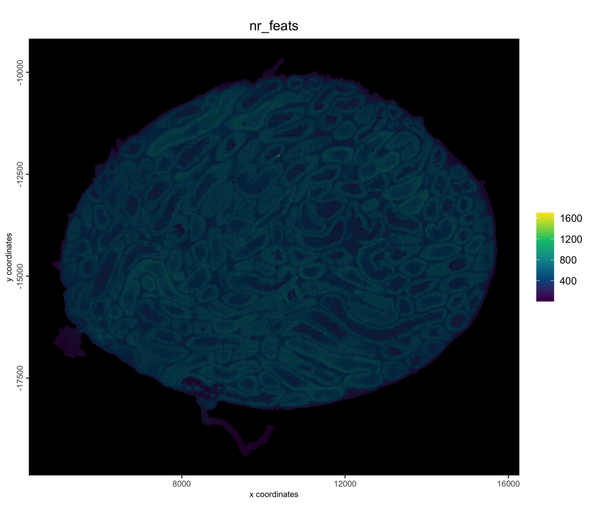

### 5.1 Save

Backed Giotto projects write named snapshots of the analysis state to
the project directory, which can be treated as checkpoints.

``` r

# The return value is needed since saveGiotto makes changes during the write
g <- saveGiotto(g, name = "ingest")
```

      backend : `gDirSource`
      path    : path/to/stereoseq_testis_bins_project

## 6 Quality control and filtering

``` r

cx <- pDataDT(g)
cat(sprintf("%s bins | median %d counts, %d features per bin\n",
    format(nrow(cx), big.mark = ","),
    median(cx$total_expr), median(cx$nr_feats))
)
```

    171,790 bins | median 671 counts, 541 features per bin

``` r

g <- filterGiotto(g,
    expression_threshold   = 1,
    feat_det_in_min_cells  = 10,
    min_det_feats_per_cell = 50,
    verbose = FALSE
)
cat(sprintf("%s bins x %s features retained\n",
    format(length(spatIDs(g)), big.mark = ","),
    format(nrow(fDataDT(g)), big.mark = ","))
)
```

    171,085 bins x 23,598 features retained

## 7 Normalize and select features

``` r

g <- normalizeGiotto(g,
    scalefactor = 1e4,
    logbase = exp(1),
    log_offset = 1,
    scale_feats = FALSE,
    scale_cells = FALSE,
    verbose = FALSE
)
g <- calculateHVF(g,
    method = "var_p_resid",
    n_top_feats = 2000,
    verbose = FALSE
)
```

The highly variable features are chosen by Pearson residuals
(`method = "var_p_resid"`). The genes that mark the germ cell stages are
detected in most bins, and a selection by coefficient of variation would
favor genes detected in few bins instead.

## 8 Dimension reduction

``` r

g <- runPCA(g,
    feats_to_use = "hvf",
    ncp = 50,
    scale_unit = TRUE,
    center = TRUE,
    verbose = FALSE
)
screePlot(g, ncp = 50)
```

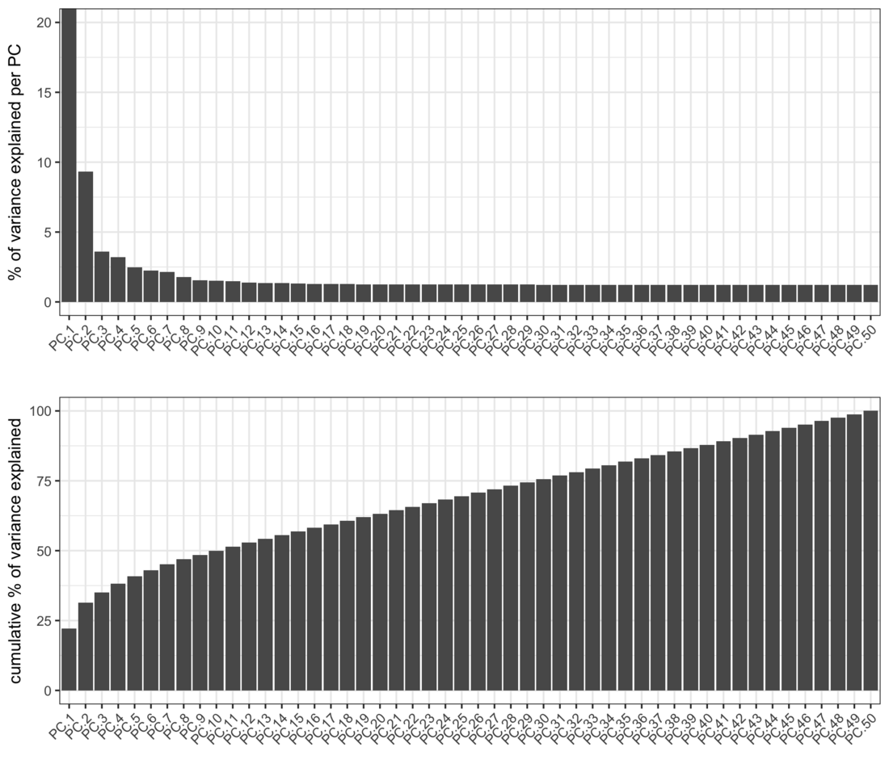

The scree plot flattens after about 10 PCs, so those are used below.

## 9 Clustering

The kNN network is built first.
[`runUMAP()`](https://giottosuite.com/dev/reference/runUMAP.md) then
reuses it instead of searching for neighbors again, and Leiden clusters
on the same network.

``` r

dims_to_use <- 1:10

g <- createNearestNetwork(g,
    type = "kNN",
    dimensions_to_use = dims_to_use,
    k = 30,
    engine = "hnsw",
    verbose = FALSE
)
g <- runUMAP(g,
    dimensions_to_use = dims_to_use,
    n_neighbors = 30,
    min_dist = 0.3,
    verbose = FALSE
)
g <- doLeidenCluster(g,
    nn_network_to_use = "kNN",
    network_name = "kNN.pca",
    resolution = 0.5,
    n_iterations = 20,
    objective_function = "modularity",
    verbose = FALSE
)
cat(length(unique(pDataDT(g)$leiden_clus)), "clusters\n")

g <- saveGiotto(g, name = "clustered")
```

    9 clusters
      backend : `gDirSource`
      path    : path/to/stereoseq_testis_bins_project

One color per cluster, reused by every plot below so the zoom matches
the overview:

``` r

clus <- GiottoUtils::mixedsort(unique(pDataDT(g)$leiden_clus))
clus_colors <- stats::setNames(getDistinctColors(length(clus)), clus)

plotUMAP(g,
    cell_color = "leiden_clus",
    cell_color_code = clus_colors,
    color_as_factor = TRUE,
    point_border_stroke = 0,
    point_size = 0.1
)
```

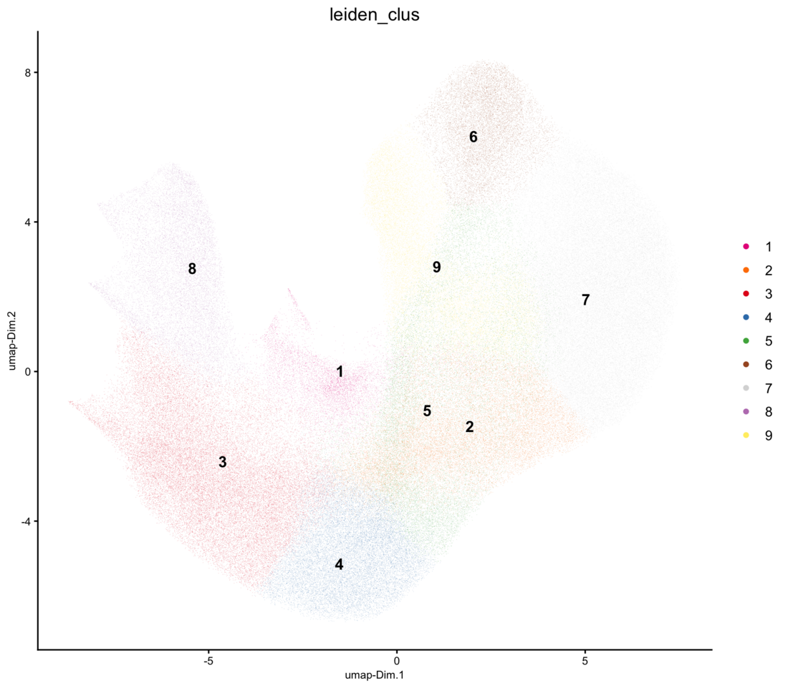

``` r

spatPlot2D(g,
    cell_color = "leiden_clus",
    cell_color_code = clus_colors,
    color_as_factor = TRUE,
    point_border_stroke = 0,
    point_size = 0.3,
    background_color = "black"
)
```

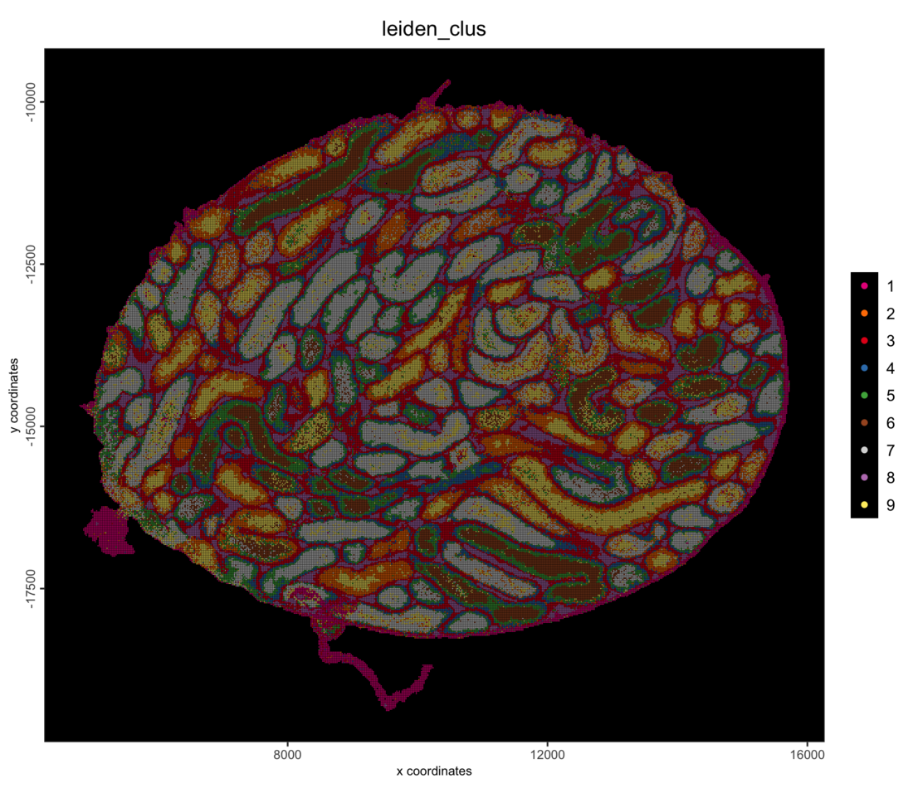

Zoom into a region over the H&E image.
[`subsetGiottoLocs()`](https://giotto-suite.github.io/GiottoClass/reference/subsetGiottoLocs.html)
keeps the bins inside a window:

``` r

sl <- getSpatialLocations(g, output = "data.table")
roi_x <- stats::median(sl$sdimx)
roi_y <- stats::median(sl$sdimy)
half <- 1000 # spots; 1 mm across at 0.5 um per spot

g_roi <- subsetGiottoLocs(g,
    x_min = roi_x - half, x_max = roi_x + half,
    y_min = roi_y - half, y_max = roi_y + half
)
spatPlot2D(g_roi,
    cell_color = "leiden_clus",
    cell_color_code = clus_colors,
    color_as_factor = TRUE,
    show_image = TRUE,
    point_size = 1.2,
    point_alpha = 0.7,
    point_border_stroke = 0
)
```

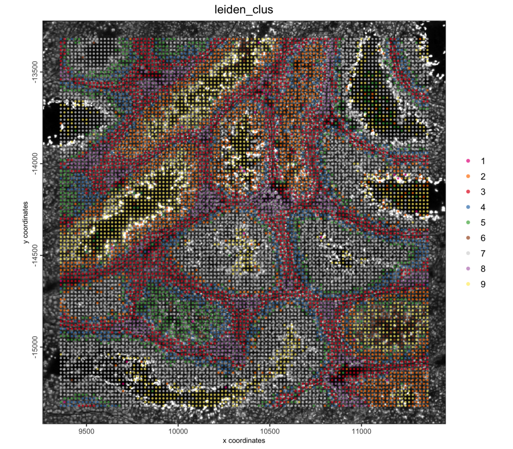

The object is saved to the project directory and can be reloaded with
`loadGiotto(project_dir, name = "clustered")`.

## 10 Spatially variable genes

[`binSpect()`](https://giottosuite.com/dev/reference/binSpect.md) looks
for genes whose expression is spatially coherent. It marks the bins
where a gene is highly expressed (here the top 30% by rank) and tests
whether those bins are neighbors of each other more often than expected
by chance. The neighbors come from a spatial network that links each bin
to its 8 nearest bins.

``` r

g <- createSpatialNetwork(g,
    name = "kNN_network",
    method = "kNN",
    k = 8,
    verbose = FALSE
)
```

``` r

hvf <- fDataDT(g)[hvf == "yes"]$feat_ID

ranktest <- binSpect(g,
    subset_feats = hvf,
    bin_method = "rank",
    spatial_network_name = "kNN_network"
)
head(ranktest[, .(feats, z, adj.p.value, n_on)], 10)
```

          feats        z adj.p.value  n_on
         <char>    <num>       <num> <num>
     1:    Tnp2 600.8063           0 51331
     2:    Tnp1 563.0806           0 51193
     3:    Prm2 531.3587           0 51349
     4:    Prm1 460.2792           0 51337
     5: Gm42418 322.2000           0 51420
     6:    Jak3 290.0129           0 23617
     7:    Gsg1 286.6862           0 51226
     8:  mt-Co1 285.0203           0 51328
     9:    Odf1 268.3273           0 51230
    10:    Smcp 266.5296           0 51212

The six top-ranked genes:

``` r

top_genes <- ranktest$feats[1:6]

spatFeatPlot2D(g,
    expression_values = "normalized",
    feats = top_genes,
    gradient_style = "sequential",
    point_size = 0.25,
    point_border_stroke = 0,
    background_color = "black",
    cow_n_col = 2,
    return_plot = FALSE
)
```

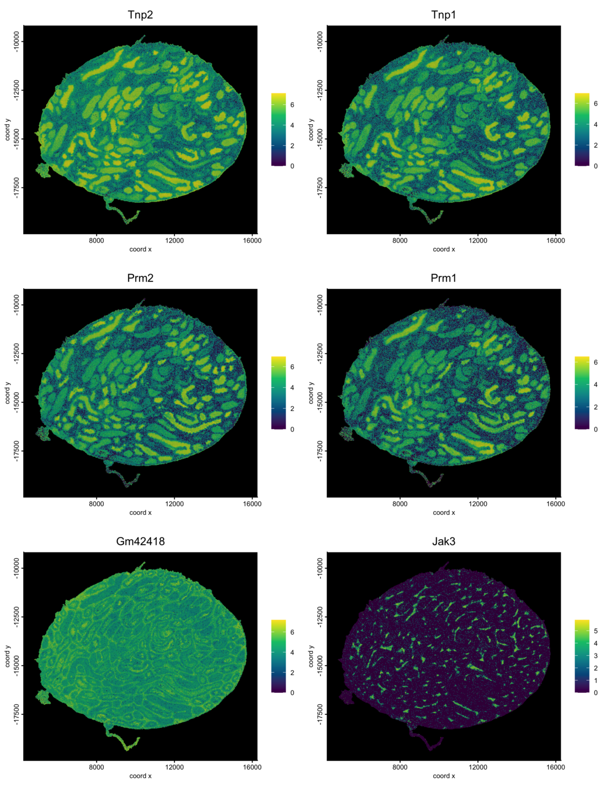

### 10.1 Spatial co-expression modules

Genes that are spatially variable often share a pattern, for example
because they mark the same cell type or tissue region.
[`spatialCoexpression()`](https://giottosuite.com/dev/reference/spatialCoexpression.md)
averages each bin’s expression with its neighbors’ in the spatial
network, correlates the genes on these smoothed values, and clusters the
correlation into modules. It runs on the significant genes from
[`binSpect()`](https://giottosuite.com/dev/reference/binSpect.md).

``` r

spatial_genes <- ranktest[adj.p.value < 0.001]$feats

coexpr <- spatialCoexpression(g,
    feats = spatial_genes,
    spatial_network_name = "kNN_network",
    n_modules = 12,
    return_gobject = FALSE
)
coexpr$summary
```

        module  size within_cor between_cor      score
         <int> <int>      <num>       <num>      <num>
     1:      1    39 0.63857748 -0.12142856 0.63857748
     2:      6    20 0.48387743 -0.08011622 0.46388732
     3:      4    35 0.44516206  0.10950009 0.34236138
     4:      2     7 0.38172842  0.05591895 0.31402984
     5:      3   104 0.33817747  0.09361879 0.26545330
     6:      5    19 0.24489266 -0.01377779 0.21852978
     7:     10    68 0.12207710  0.06399708 0.09944087
     8:      8    18 0.10999448  0.01141249 0.09538269
     9:     12   143 0.10200221  0.06481151 0.08300532
    10:      9    36 0.09143085  0.04275446 0.07641946
    11:      7   119 0.07761904  0.04263079 0.06488491
    12:     11   215 0.02719805  0.04008886 0.02280509

The summary ranks the modules: a high `within_cor` and a low
`between_cor` mean a module is coherent and distinct from the others.
Large modules with a low `within_cor` collect genes that fit no clear
pattern.

``` r

heatmapCoexpression(g, coexpr, return_plot = FALSE)
```

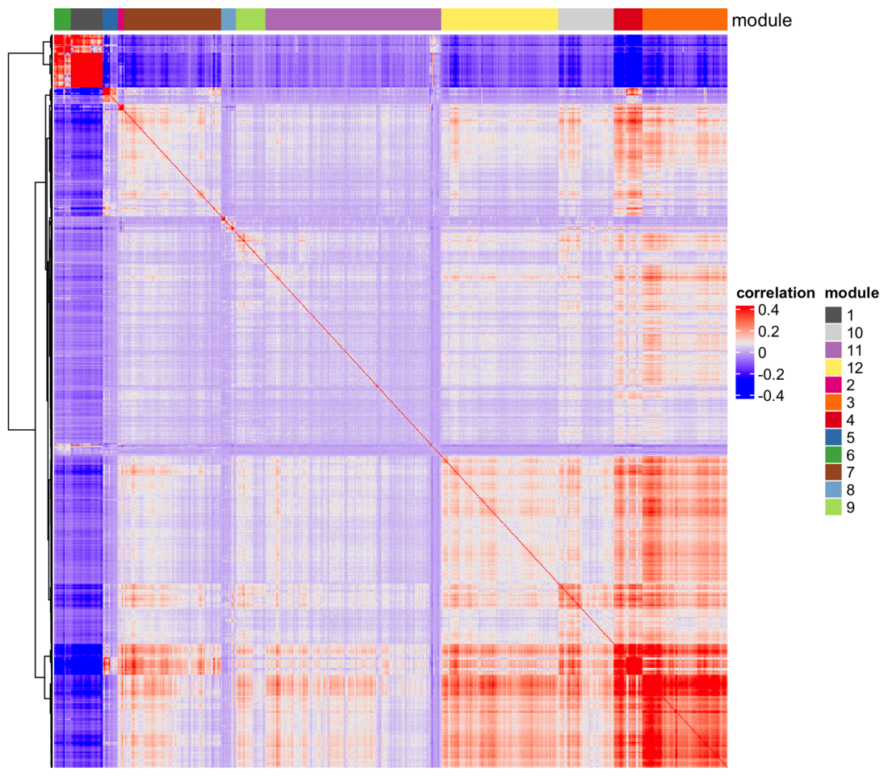

The genes that best represent each of the four top-ranked modules:

``` r

top_modules <- coexpr$summary$module[1:4]
coexpr$feats[module %in% top_modules][
    order(match(module, top_modules), -module_cor),
    head(.SD, 5), by = "module"
]
```

        module       feat_ID module_cor
         <int>        <char>      <num>
     1:      1          Gsg1  0.7024363
     2:      1 4933411K16Rik  0.6934879
     3:      1          Smcp  0.6897757
     4:      1          Spz1  0.6884019
     5:      1          Prm3  0.6878658
     6:      6         Ccer1  0.5818429
     7:      6        Dusp13  0.5750531
     8:      6         Tex33  0.5718520
     9:      6 1700093K21Rik  0.5632256
    10:      6        Sh3d21  0.5623584
    11:      4           Clu  0.5781033
    12:      4        mt-Co1  0.5639297
    13:      4       mt-Cytb  0.5597102
    14:      4        mt-Co2  0.5449608
    15:      4        mt-Nd4  0.5367893
    16:      2       Gm42418  0.4706080
    17:      2         Cmss1  0.4336734
    18:      2          Gphn  0.4094248
    19:      2      AY036118  0.3855622
    20:      2         Lars2  0.3842359
        module       feat_ID module_cor
         <int>        <char>      <num>

Not every module is a cell type: the module of Gm42418, Cmss1 and Lars2
collects genes that are often reported as technical background in
single-cell and spatial data.

The same call with the default `return_gobject = TRUE` adds the module
of each gene to the feature metadata, and one score per bin and module,
the mean expression of its genes, as a spatial enrichment:

``` r

g <- spatialCoexpression(g,
    feats = spatial_genes,
    spatial_network_name = "kNN_network",
    n_modules = 12
)
```

A few bins score far higher than the rest, so each module’s color scale
is capped at the 99th percentile of its non-zero scores. A module of
scattered cells shows as sparse single bins at this scale:

``` r

scores <- getSpatialEnrichment(g, name = "spatial_module", output = "data.table")

for (m in as.character(top_modules)) {
    v <- scores[[m]]
    spatCellPlot2D(g,
        spat_enr_names = "spatial_module",
        cell_annotation_values = m,
        gradient_style = "sequential",
        gradient_limits = c(0, stats::quantile(v[v > 0], 0.99)),
        point_size = 0.25,
        point_border_stroke = 0,
        background_color = "black",
        return_plot = FALSE
    )
}
```

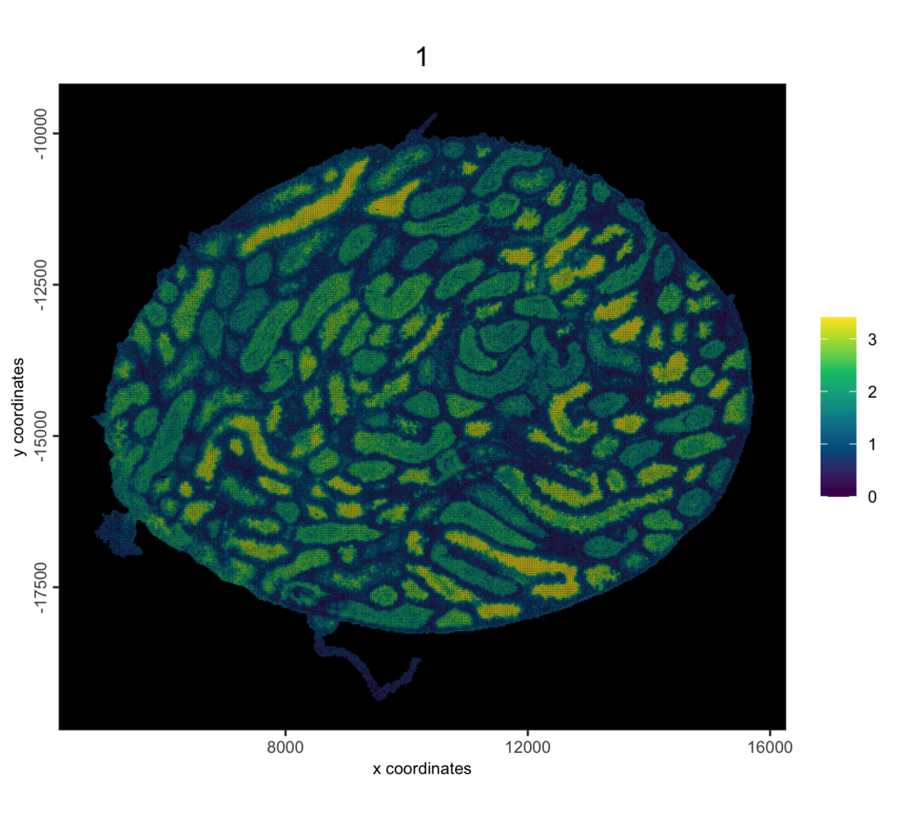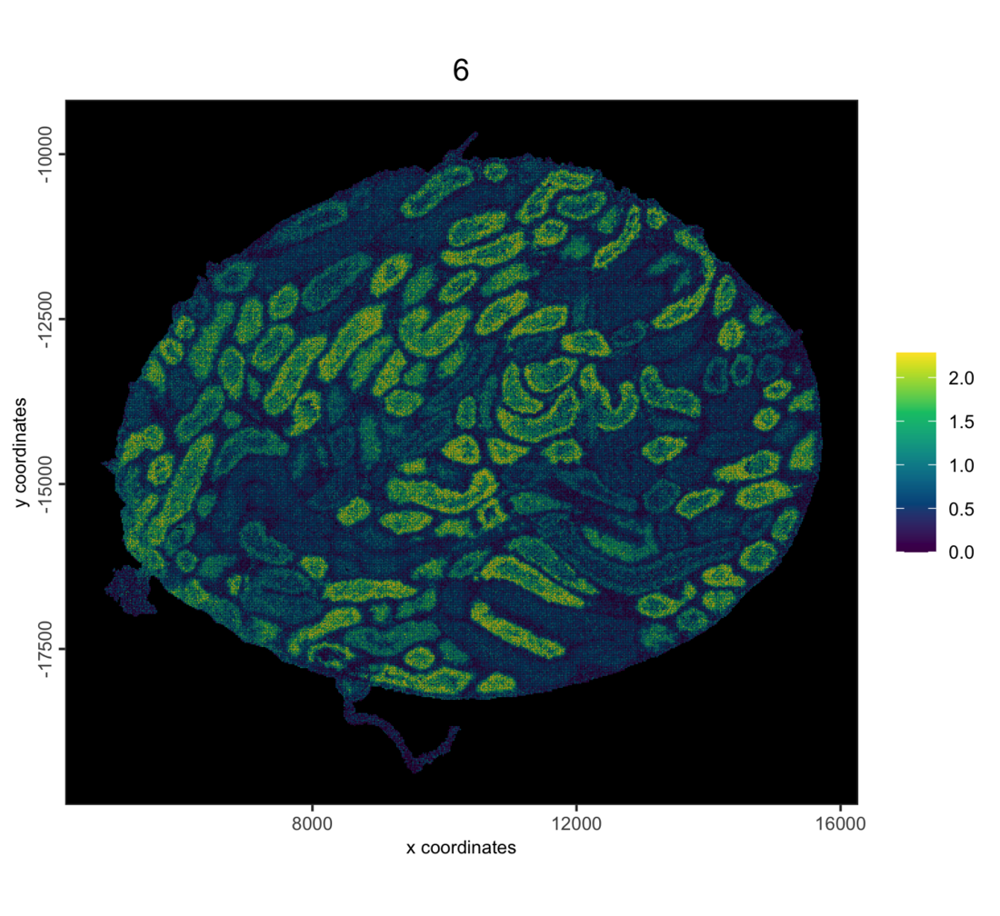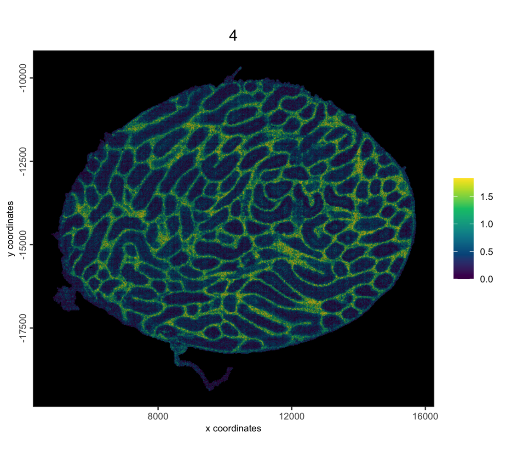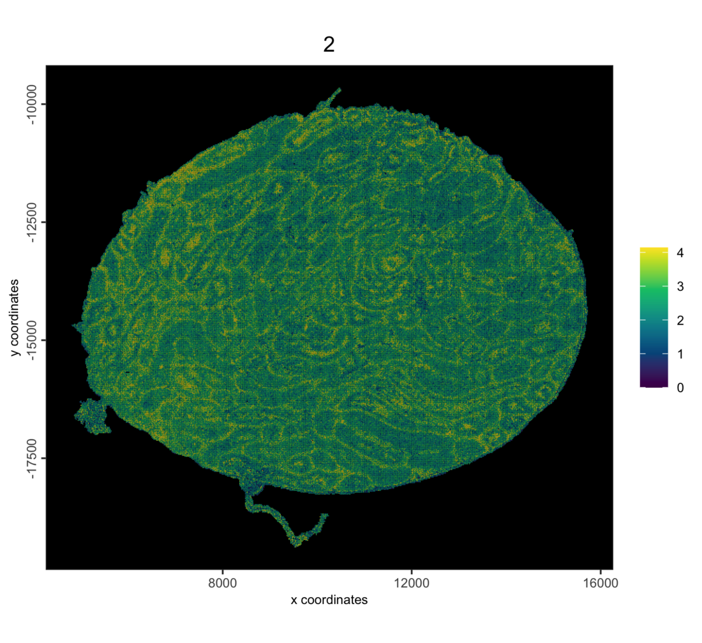

``` r

g <- saveGiotto(g, name = "spatial")
```

      backend : `gDirSource`
      path    : path/to/stereoseq_testis_bins_project

## 11 Further reading

- [Stereo-seq mouse testis: segmented
  cells](https://giottosuite.com/dev/articles/stereoseq_testis_cells_giottodisk.md),
  with cell typing from a cluster tree
- [Stereo-seq mouse testis: 0.5 µm bins into your own
  polygons](https://giottosuite.com/dev/articles/stereoseq_testis_own_polygons_giottodisk.md)
- [Stereo-seq Data
  Import](https://giottosuite.com/dev/articles/stereoseq_importer.md),
  which covers the readers and the files in a SAW output directory

## 12 Session info

``` r

sessionInfo()
```

    R version 4.5.3 (2026-03-11)
    Platform: aarch64-apple-darwin20
    Running under: macOS Tahoe 26.6.2

    Matrix products: default
    BLAS:   /Library/Frameworks/R.framework/Versions/4.5-arm64/Resources/lib/libRblas.0.dylib 
    LAPACK: /Library/Frameworks/R.framework/Versions/4.5-arm64/Resources/lib/libRlapack.dylib;  LAPACK version 3.12.1

    locale:
    [1] C.UTF-8/C.UTF-8/C.UTF-8/C/C.UTF-8/C.UTF-8

    time zone: America/New_York
    tzcode source: internal

    attached base packages:
    [1] stats     graphics  grDevices utils     datasets  methods   base     

    other attached packages:
    [1] GiottoDisk_0.0.0.6 Giotto_4.3.5       GiottoClass_0.7.18 arrow_23.0.1.2    

    loaded via a namespace (and not attached):
      [1] RColorBrewer_1.1-3          shape_1.4.6.1              
      [3] jsonlite_2.0.0              magrittr_2.0.4             
      [5] magick_2.9.1                farver_2.1.2               
      [7] rmarkdown_2.31              GlobalOptions_0.1.4        
      [9] vctrs_0.7.2                 memoise_2.0.1              
     [11] GiottoUtils_0.2.7           terra_1.9-11               
     [13] htmltools_0.5.9             S4Arrays_1.10.1            
     [15] BiocNeighbors_2.4.0         Rhdf5lib_1.32.0            
     [17] SparseArray_1.10.9          rhdf5_2.54.1               
     [19] sass_0.4.10                 parallelly_1.47.0          
     [21] bslib_0.10.0                htmlwidgets_1.6.4          
     [23] plotly_4.12.0               cachem_1.1.0               
     [25] igraph_2.2.2                lifecycle_1.0.5            
     [27] iterators_1.0.14            pkgconfig_2.0.3            
     [29] rsvd_1.0.5                  Matrix_1.7-5               
     [31] R6_2.6.1                    fastmap_1.2.0              
     [33] clue_0.3-68                 MatrixGenerics_1.22.0      
     [35] future_1.70.0               digest_0.6.39              
     [37] colorspace_2.1-2            S4Vectors_0.48.0           
     [39] irlba_2.3.7                 GenomicRanges_1.62.1       
     [41] beachmat_2.26.0             filelock_1.0.3             
     [43] labeling_0.4.3              httr_1.4.8                 
     [45] polyclip_1.10-7             abind_1.4-8                
     [47] compiler_4.5.3              bit64_4.6.0-1              
     [49] withr_3.0.2                 doParallel_1.0.17          
     [51] S7_0.2.1                    backports_1.5.0            
     [53] BiocParallel_1.44.0         viridis_0.6.5              
     [55] ggforce_0.5.0               R.utils_2.13.0             
     [57] MASS_7.3-65                 DelayedArray_0.36.0        
     [59] rjson_0.2.23                bluster_1.20.0             
     [61] gtools_3.9.5                GiottoVisuals_0.2.16       
     [63] tools_4.5.3                 otel_0.2.0                 
     [65] future.apply_1.20.2         R.oo_1.27.1                
     [67] glue_1.8.0                  dbscan_1.2.4               
     [69] rhdf5filters_1.22.0         grid_4.5.3                 
     [71] checkmate_2.3.4             cluster_2.1.8.2            
     [73] generics_0.1.4              gtable_0.3.6               
     [75] R.methodsS3_1.8.2           tidyr_1.3.2                
     [77] data.table_1.18.2.1         BiocSingular_1.26.1        
     [79] tidygraph_1.3.1             ScaledMatrix_1.18.0        
     [81] XVector_0.50.0              BiocGenerics_0.56.0        
     [83] tilework_1.0.0              ggrepel_0.9.8              
     [85] foreach_1.5.2               pillar_1.11.1              
     [87] RcppHNSW_0.6.0              circlize_0.4.18            
     [89] dplyr_1.2.0                 tweenr_2.0.3               
     [91] lattice_0.22-9              bit_4.6.0                  
     [93] tidyselect_1.2.1            ComplexHeatmap_2.26.1      
     [95] SingleCellExperiment_1.32.0 knitr_1.51                 
     [97] gridExtra_2.3               IRanges_2.44.0             
     [99] Seqinfo_1.0.0               SummarizedExperiment_1.40.0
    [101] scattermore_1.2             stats4_4.5.3               
    [103] xfun_0.57                   graphlayouts_1.2.3         
    [105] Biobase_2.70.0              matrixStats_1.5.0          
    [107] lazyeval_0.2.2              yaml_2.3.12                
    [109] evaluate_1.0.5              codetools_0.2-20           
    [111] ggraph_2.2.2                tibble_3.3.1               
    [113] colorRamp2_0.1.0            cli_3.6.5                  
    [115] uwot_0.2.4                  jquerylib_0.1.4            
    [117] dichromat_2.0-0.1           Rcpp_1.1.1                 
    [119] globals_0.19.1              png_0.1-9                  
    [121] parallel_4.5.3              ggplot2_4.0.2              
    [123] assertthat_0.2.1            listenv_0.10.1             
    [125] SpatialExperiment_1.20.0    viridisLite_0.4.3          
    [127] scales_1.4.0                purrr_1.2.1                
    [129] crayon_1.5.3                GetoptLong_1.1.1           
    [131] rlang_1.3.0                 cowplot_1.2.0

NA \`\`\`
