# Stereo-seq Mouse Testis: Segmented Cells

## 1 Overview

This tutorial starts from the cells that STOmics’ SAW pipeline segmented
on a Stereo-seq section of mouse testis. It reads them into an on-disk
GiottoDisk project, clusters them, and names the clusters with a cluster
tree, following [Cell typing with a cluster
tree](https://giottosuite.com/dev/articles/cell_typing_cluster_tree.md).

On a disk-backed object the expression matrix and the cell polygons live
as parquet files in a project directory, so the same Giotto commands run
on data larger than memory. Two related tutorials start from the [10 µm
bins](https://giottosuite.com/dev/articles/stereoseq_testis_bins_giottodisk.md)
and from [the 0.5 µm bins and your own
polygons](https://giottosuite.com/dev/articles/stereoseq_testis_own_polygons_giottodisk.md).

## 2 Install extra packages

This tutorial uses GiottoDisk for on-disk processing. These are preview
dev builds off the dev and gsource Giotto package branches. If
GiottoDisk has not been installed yet, use the following:

``` r

# GiottoDisk install
GiottoUtils::suite_install("GiottoDisk")
# Optional for matrix maths speedup:
install.packages("GiottoKernels",
    repos = c("https://giotto-suite.r-universe.dev", "https://cloud.r-project.org")
)
```

## 3 Dataset explanation

STOmics’ [mouse testis demo
dataset](https://demo.stomicsdb.tech/B04652F6_Mouse_Testis_Stereo-seq_FF_V1.3_mIF/outs/)
(chip B04652F6): a fresh frozen section of mouse testis on the
Stereo-seq Transcriptomics T FF V1.3 kit, stained with DAPI and
processed with SAW. Stereo-seq captures transcripts on spots 0.5 µm
apart; SAW sums them into square bins of 1 to 200 spots and, separately,
into cells.

SAW segments the nuclei in the DAPI image and assigns the spots to
cells. `B04652F6.cellbin.gef` holds that segmentation, and
`B04652F6.adjusted.cellbin.gef` the result of SAW’s cell correction,
which refines which spots belong to each cell: it assigns 93 million of
the counts to cells, against 50 million in the segmentation alone. This
tutorial uses the adjusted cells, the default of the Giotto readers.

### 3.1 Download links

`curl` links from STOmics

    base=https://demo.stomicsdb.tech/B04652F6_Mouse_Testis_Stereo-seq_FF_V1.3_mIF/outs
    mkdir B04652F6 && cd B04652F6
    curl -O ${base}/B04652F6.adjusted.cellbin.gef   # 1.2 GB
    curl -O ${base}/B04652F6_DAPI_regist.tif        # 140 MB

  

The Giotto Stereo-seq readers take this folder as downloaded, with the
files side by side, as well as a SAW `outs/` directory with
`feature_expression/` and `image/` subdirectories.

## 4 Setup

``` r

library(arrow) # this must be libraried before terra or GiottoClass
library(Giotto)
library(GiottoDisk)

data_dir    <- "path/to/B04652F6"
project_dir <- "path/to/stereoseq_testis_cells_project"

# set an appropriate amount of parallel workers for your computer
future::plan(future::multisession, workers = 4)
```

## 5 Read the data

`sourceCreate()` sets up a `gDirSource`: a managed project directory
that holds the object on disk. `setArtifactDumpDir()` points the
expression and spatial writes at it.

``` r

# declare a Giotto directory backend to use
gdsrc <- GiottoDisk::sourceCreate(project_dir, type = "gDirSource")
# point data content writes to the backend's artifact subdirectory
GiottoDisk::setArtifactDumpDir(gdsrc)
```

[`createGiottoStereoSeqObjectCell()`](https://giottosuite.com/dev/reference/createGiottoStereoSeqObjectCell.md)
reads the adjusted cellbin GEF: the cell by gene counts, the cell
centers and outlines, and the registered DAPI image. Passing the backend
to `backend` creates the object as a disk-backed project.

``` r

g <- createGiottoStereoSeqObjectCell(data_dir,
    gef_type = "adjusted_cellbin",
    backend = gdsrc # creates the object as a backed project
)
g
```

    An object of class giotto 
    >Active spat_unit:  cell 
    >Active feat_type:  rna 
    dimensions    : 27295, 198248 (features, cells)
    [SUBCELLULAR INFO]
    polygons      : cell 
    [AGGREGATE INFO]
    expression -----------------------
      [cell][rna] raw
    spatial locations ----------------
      [cell] raw
    attached images ------------------
    images      : image 


    Use objHistory() to see steps and params used

The expression matrix and the polygons are disk stores:

``` r

class(getExpression(g, output = "exprObj")[])
class(getPolygonInfo(g, "cell", return_giottoPolygon = TRUE)[])
```

    [1] "parquetExprStore"
    attr(,"package")
    [1] "GiottoDisk"
    [1] "parquetGeomStore"
    attr(,"package")
    [1] "GiottoDisk"

The cell outlines over the DAPI image:

``` r

sl <- getSpatialLocations(g, output = "data.table")
roi_x <- stats::median(sl$sdimx)
roi_y <- stats::median(sl$sdimy)
half <- 600 # spots; 0.3 mm at 0.5 um per spot

spatInSituPlotPoints(g,
    show_image = TRUE,
    feats = NULL,
    show_polygon = TRUE,
    polygon_feat_type = "cell",
    polygon_color = "yellow",
    polygon_alpha = 0,
    polygon_line_size = 0.2,
    xlim = c(roi_x - half, roi_x + half),
    ylim = c(roi_y - half, roi_y + half)
)
```

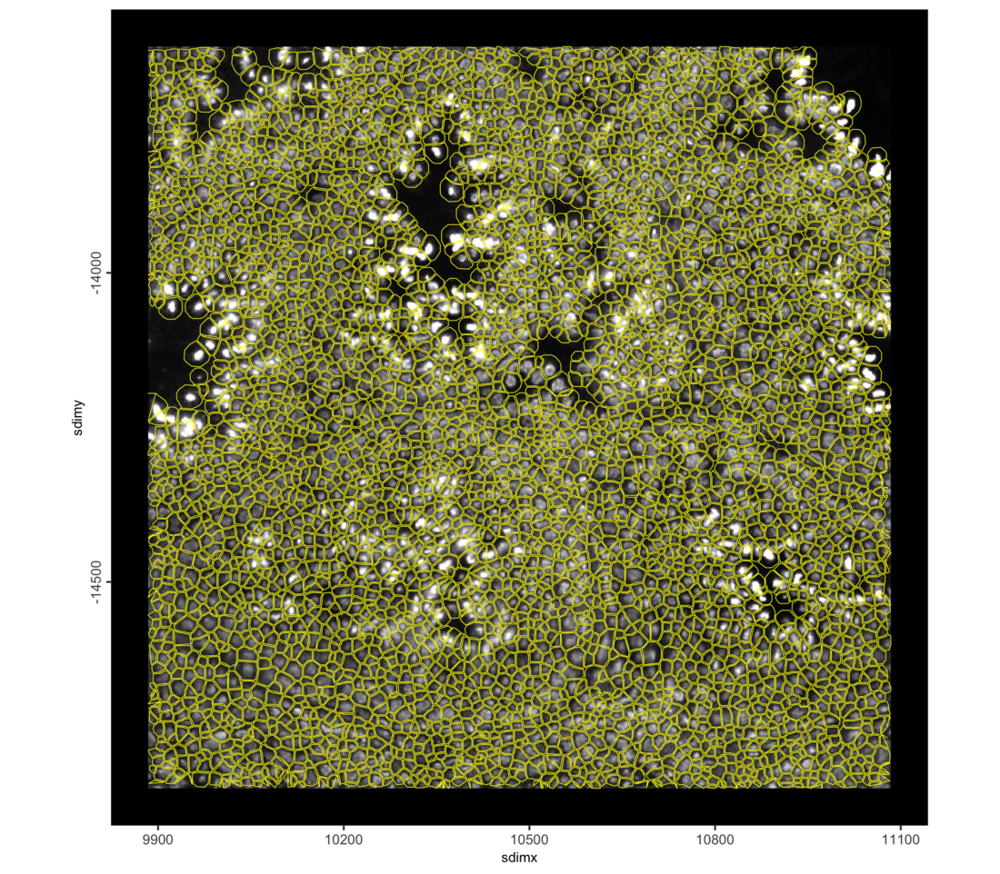

### 5.1 Save

Backed Giotto projects write named snapshots of the analysis state to
the project directory, which can be treated as checkpoints.

``` r

# The return value is needed since saveGiotto makes changes during the write
g <- saveGiotto(g, name = "ingest")
```

      backend : `gDirSource`
      path    : path/to/stereoseq_testis_cells_project

## 6 Quality control and filtering

``` r

g <- addStatistics(g, expression_values = "raw")
cx <- pDataDT(g)
cat(sprintf("%s cells | median %d counts, %d features per cell\n",
    format(nrow(cx), big.mark = ","),
    median(cx$total_expr), median(cx$nr_feats))
)
```

    198,248 cells | median 410 counts, 349 features per cell

``` r

g <- filterGiotto(g,
    expression_threshold   = 1,
    feat_det_in_min_cells  = 10,
    min_det_feats_per_cell = 50,
    verbose = FALSE
)
cat(sprintf("%s cells x %s features retained\n",
    format(length(spatIDs(g)), big.mark = ","),
    format(nrow(fDataDT(g)), big.mark = ","))
)
```

    197,292 cells x 23,245 features retained

## 7 Normalize and select features

``` r

g <- normalizeGiotto(g,
    scalefactor = 1e4,
    logbase = exp(1),
    log_offset = 1,
    scale_feats = FALSE,
    scale_cells = FALSE,
    verbose = FALSE
)
g <- calculateHVF(g,
    method = "var_p_resid",
    n_top_feats = 2000,
    verbose = FALSE
)
```

The highly variable features are chosen by Pearson residuals
(`method = "var_p_resid"`). Most cells in the testis are germ cells, and
the genes that mark their stages, such as the protamines, are detected
in many cells. A selection by coefficient of variation favors genes
detected in few cells instead, and with about 400 counts per cell those
give components that pick out small groups of cells by a single gene.

## 8 Dimension reduction

``` r

g <- runPCA(g,
    feats_to_use = "hvf",
    ncp = 50,
    scale_unit = TRUE,
    center = TRUE,
    verbose = FALSE
)
screePlot(g, ncp = 50)
```

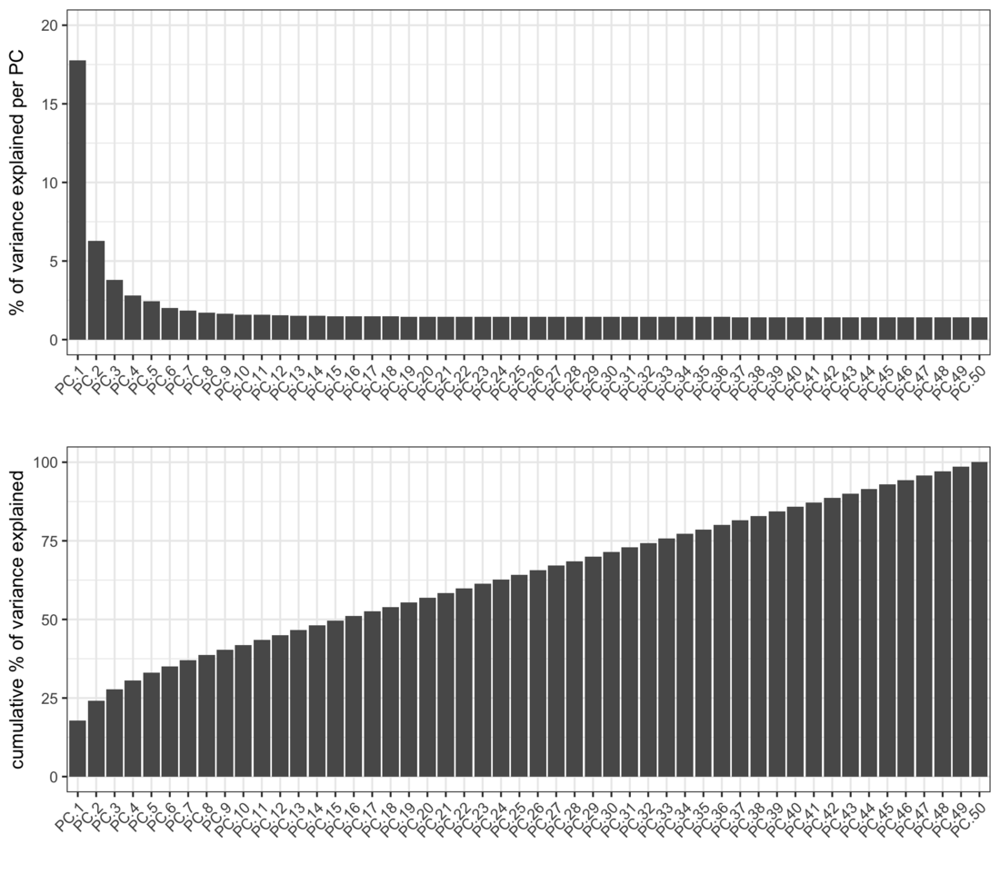

The scree plot flattens after about 10 PCs, so those are used below.

## 9 Clustering

The kNN network is built first.
[`runUMAP()`](https://giottosuite.com/dev/reference/runUMAP.md) then
reuses it instead of searching for neighbors again, and Leiden clusters
on the same network. The resolution is set on the high side: the cluster
tree below groups the clusters again, so it is better to split too much
than too little.

``` r

dims_to_use <- 1:10

g <- createNearestNetwork(g,
    type = "kNN",
    dimensions_to_use = dims_to_use,
    k = 30,
    engine = "hnsw",
    verbose = FALSE
)
g <- runUMAP(g,
    dimensions_to_use = dims_to_use,
    n_neighbors = 30,
    min_dist = 0.3,
    verbose = FALSE
)
g <- doLeidenCluster(g,
    nn_network_to_use = "kNN",
    network_name = "kNN.pca",
    resolution = 1,
    n_iterations = 20,
    objective_function = "modularity",
    verbose = FALSE
)
table(pDataDT(g)$leiden_clus)
clusters <- GiottoUtils::mixedsort(unique(as.character(pDataDT(g)$leiden_clus)))
# one color per cluster, shared by the plots below
clus_colors <- stats::setNames(getDistinctColors(length(clusters)), clusters)

g <- saveGiotto(g, name = "clustered")
```


        1     2     3     4     5     6     7     8     9    10    11    12    13 
    10965 17435 28142 11918 15861 14154 11832 15358  9184  7610  4734  7900  3866 
       14    15    16    17    18    19 
     3726 11281  2705 10930  9130   561
      backend : `gDirSource`
      path    : path/to/stereoseq_testis_cells_project

``` r

plotUMAP(g,
    cell_color = "leiden_clus",
    color_as_factor = TRUE,
    cell_color_code = clus_colors,
    point_border_stroke = 0,
    point_size = 0.1
)
```

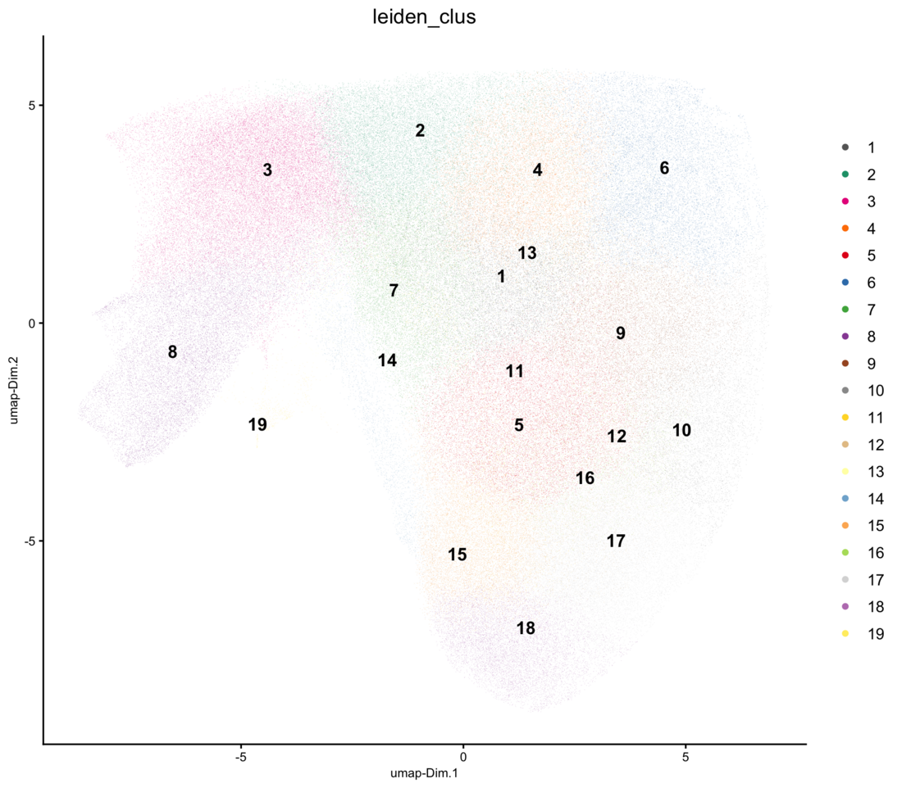

``` r

spatPlot2D(g,
    cell_color = "leiden_clus",
    color_as_factor = TRUE,
    cell_color_code = clus_colors,
    point_border_stroke = 0,
    point_size = 0.3,
    background_color = "black"
)
```

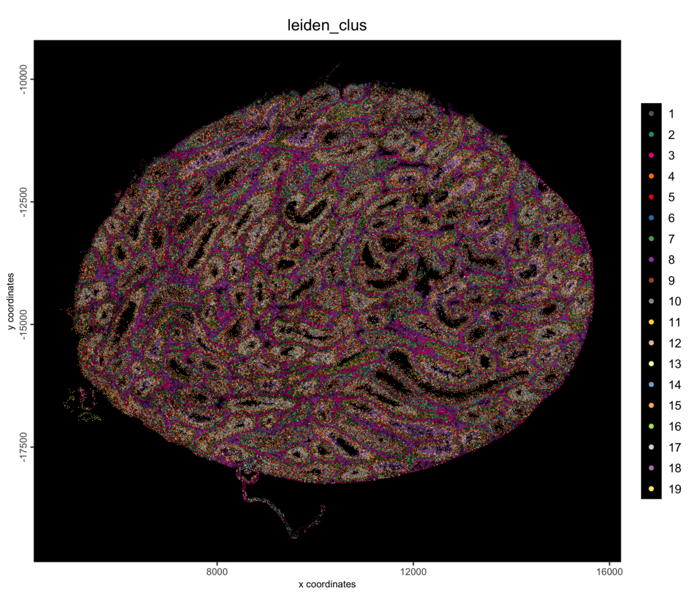

## 10 Cell typing with a cluster tree

The steps below follow [Cell typing with a cluster
tree](https://giottosuite.com/dev/articles/cell_typing_cluster_tree.md),
which explains each of them in more detail.

### 10.1 Build the cluster tree

``` r

CLUS <- "leiden_clus"
hvf  <- fDataDT(g)[hvf == "yes"]$feat_ID

tree <- calculateClusterTree(g,
    cluster_column = CLUS,
    feats = hvf,
    cor = "pearson",
    distance = "average"
)
plot(tree, hang = -1)
```

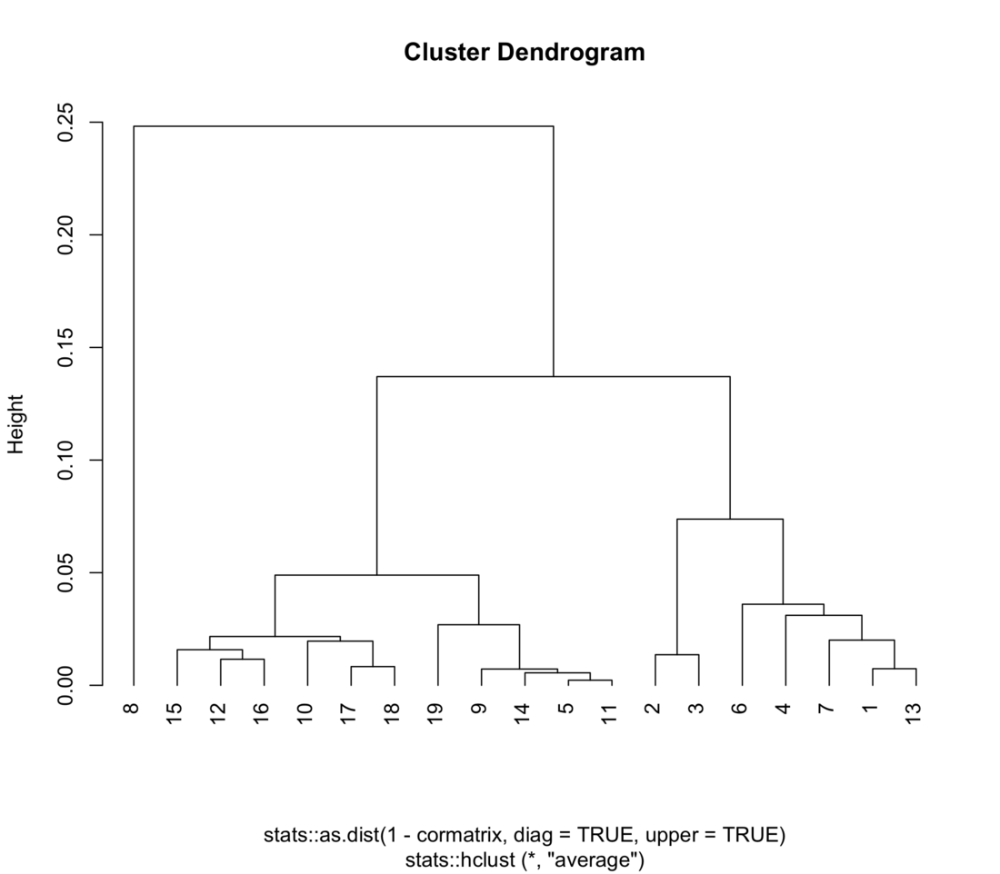

### 10.2 Markers

``` r

mk <- findMarkers_one_vs_all(g,
    method = "scran",
    cluster_column = CLUS,
    min_feats = 10,
    verbose = FALSE
)
gi <- findGiniMarkers_one_vs_all(g,
    cluster_column = CLUS,
    min_feats = 10,
    verbose = FALSE
)
nm <- findClusterTreeMarkers(g,
    cluster_column = CLUS,
    tree = tree,
    method = "scran",
    verbose = FALSE
)
```

### 10.3 Assemble the annotation prompt

[`writeClusterTreeQuery()`](https://giottosuite.com/dev/reference/writeClusterTreeQuery.md)
writes the tree, the per-cluster markers and the markers of each split
into one prompt for a language model, together with a description of the
sample.

``` r

prompt_file <- file.path(tempdir(), "stereoseq_testis_celltyping_prompt.txt")

q <- writeClusterTreeQuery(g,
    cluster_column = CLUS,
    tree = tree,
    markers = mk,
    gini_markers = gi,
    node_markers = nm,
    context = list(
        tissue = "mouse testis",
        assay = "Stereo-seq whole-transcriptome, fresh frozen section, SAW cell segmentation on DAPI"
    ),
    file_name = prompt_file
)
cat(length(q), "lines\n")
```

    323 lines

### 10.4 Apply the annotation

The model answers with a label for each cluster and for each node of the
tree, saved here as `testis_cell_types.json`. Check the answer against
the markers above, and against where each cluster sits in the tissue,
before using it.

The tree is shallow: every cluster correlates with every other above
0.75, and most splits are below 0.05. Each tubule holds germ cells at
several stages, and segmented cells pick up counts from their neighbors,
so the spermatid genes are detected nearly everywhere. The clusters
still follow the layers of the tubules, from the basal compartment at
the rim through spermatocytes and round spermatids to elongating
spermatids in the lumen, and the cell types between the tubules.

`testis_cell_types.json`

    {
      "nodes": [
        {
          "node": 18,
          "short": "all cells",
          "label": "all cells"
        },
        {
          "node": 17,
          "short": "seminiferous tubules",
          "label": "cells of the seminiferous tubules"
        },
        {
          "node": 16,
          "short": "early germ cells and Sertoli",
          "label": "Sertoli cells, spermatogonia, spermatocytes and round spermatids"
        },
        {
          "node": 7,
          "short": "basal compartment",
          "label": "basal compartment of the tubules"
        },
        {
          "node": 14,
          "short": "meiotic and round spermatid layers",
          "label": "spermatocytes and round spermatids"
        },
        {
          "node": 13,
          "short": "spermatocytes",
          "label": "spermatocytes"
        },
        {
          "node": 10,
          "short": "pachytene and late spermatocytes",
          "label": "pachytene and late spermatocytes"
        },
        {
          "node": 4,
          "short": "late spermatocytes, peritubular-mixed",
          "label": "late spermatocytes and peritubular cells"
        },
        {
          "node": 15,
          "short": "spermatids and scattered cells",
          "label": "elongating spermatids and scattered interstitial cells"
        },
        {
          "node": 11,
          "short": "elongating spermatids",
          "label": "elongating and elongated spermatids"
        },
        {
          "node": 8,
          "short": "elongated spermatids",
          "label": "elongated spermatids"
        },
        {
          "node": 6,
          "short": "Tnp-high spermatids",
          "label": "Tnp-high elongating spermatids"
        },
        {
          "node": 9,
          "short": "condensing spermatids",
          "label": "condensing spermatids"
        },
        {
          "node": 5,
          "short": "Prm-high spermatids",
          "label": "Prm-high elongated spermatids"
        },
        {
          "node": 12,
          "short": "spermatids with interstitial cells",
          "label": "spermatids mixed with interstitial cells"
        },
        {
          "node": 3,
          "short": "spermatids, vascular and immune",
          "label": "spermatids with vascular and immune cells"
        },
        {
          "node": 2,
          "short": "spermatids, endothelium, macrophages",
          "label": "spermatids, endothelial cells and macrophages"
        },
        {
          "node": 1,
          "short": "spermatids and macrophages",
          "label": "spermatids and macrophages"
        }
      ],
      "clusters": [
        {
          "cluster": "1",
          "cell_type": "late spermatocytes (Tuba3a/b+)",
          "confidence": "medium",
          "markers": [
            "Tuba3a",
            "Tuba3b",
            "Rsph1",
            "Ldhc",
            "Meig1"
          ],
          "merge_with": null
        },
        {
          "cluster": "2",
          "cell_type": "early spermatocytes (Tex101+)",
          "confidence": "low",
          "markers": [
            "Tex101",
            "Clu",
            "Hspa5",
            "Clgn",
            "Ldhc"
          ],
          "merge_with": "3"
        },
        {
          "cluster": "3",
          "cell_type": "basal compartment: Sertoli cells and spermatogonia",
          "confidence": "medium",
          "markers": [
            "Clu",
            "Cst12",
            "Sparc",
            "Ctsl",
            "Defb19"
          ],
          "merge_with": null
        },
        {
          "cluster": "4",
          "cell_type": "spermatocytes",
          "confidence": "low",
          "markers": [
            "Tuba3a",
            "Tuba3b",
            "Piwil1",
            "Nasp"
          ],
          "merge_with": "7"
        },
        {
          "cluster": "5",
          "cell_type": "elongating spermatids (Odf2+, Ropn1l+)",
          "confidence": "low",
          "markers": [
            "Prm2",
            "Tnp1",
            "Odf2",
            "Ropn1l",
            "Gsg1"
          ],
          "merge_with": null
        },
        {
          "cluster": "6",
          "cell_type": "round spermatids (Lyzl1+, Spaca1+)",
          "confidence": "medium",
          "markers": [
            "Lyzl1",
            "Lyzl6",
            "Spaca1",
            "Spaca7",
            "Pdilt"
          ],
          "merge_with": null
        },
        {
          "cluster": "7",
          "cell_type": "pachytene spermatocytes (Piwil1+)",
          "confidence": "high",
          "markers": [
            "Piwil1",
            "Tuba3b",
            "Slc2a3",
            "Nasp"
          ],
          "merge_with": null
        },
        {
          "cluster": "8",
          "cell_type": "Leydig cells",
          "confidence": "high",
          "markers": [
            "Cyp11a1",
            "Cyp17a1",
            "Fabp3",
            "Akr1cl",
            "Jak3"
          ],
          "merge_with": null
        },
        {
          "cluster": "9",
          "cell_type": "round spermatids (Actl7b+, Spaca7+)",
          "confidence": "medium",
          "markers": [
            "Fam209",
            "Actl7b",
            "Spaca1",
            "Spaca7",
            "Dusp13"
          ],
          "merge_with": null
        },
        {
          "cluster": "10",
          "cell_type": "early elongating spermatids (Tnp1+)",
          "confidence": "medium",
          "markers": [
            "Tnp1",
            "Tnp2",
            "Fam209",
            "Actl7b",
            "Sh3d21"
          ],
          "merge_with": null
        },
        {
          "cluster": "11",
          "cell_type": "macrophages, spermatid-mixed",
          "confidence": "low",
          "markers": [
            "F13a1",
            "Lyz2",
            "C1qa",
            "Csf1r",
            "Apoe"
          ],
          "merge_with": null
        },
        {
          "cluster": "12",
          "cell_type": "elongating spermatids (Tnp+, Grip1+)",
          "confidence": "low",
          "markers": [
            "Tnp1",
            "Tnp2",
            "Sh3d21",
            "Grip1",
            "Ctnna2"
          ],
          "merge_with": "16"
        },
        {
          "cluster": "13",
          "cell_type": "peritubular myoid cells and fibroblasts, spermatocyte-mixed",
          "confidence": "low",
          "markers": [
            "Col1a1",
            "Col1a2",
            "C3",
            "Ctgf"
          ],
          "merge_with": null
        },
        {
          "cluster": "14",
          "cell_type": "endothelial cells, spermatid-mixed",
          "confidence": "low",
          "markers": [
            "Cldn5",
            "Ptprb",
            "Cd93",
            "Eng",
            "Rgs5"
          ],
          "merge_with": null
        },
        {
          "cluster": "15",
          "cell_type": "elongated spermatids (Prm+, Smcp+)",
          "confidence": "medium",
          "markers": [
            "Prm1",
            "Prm2",
            "Smcp",
            "Oaz3",
            "Gsg1"
          ],
          "merge_with": null
        },
        {
          "cluster": "16",
          "cell_type": "spermatids, scattered",
          "confidence": "low",
          "markers": [
            "Tnp1",
            "Prm2",
            "Prm1",
            "Tnp2"
          ],
          "merge_with": "12"
        },
        {
          "cluster": "17",
          "cell_type": "elongating spermatids (Prm+, Tnp+)",
          "confidence": "medium",
          "markers": [
            "Prm2",
            "Tnp1",
            "Prm1",
            "Tnp2",
            "Smcp"
          ],
          "merge_with": null
        },
        {
          "cluster": "18",
          "cell_type": "late elongated spermatids (Spz1+, Dnajb3+)",
          "confidence": "medium",
          "markers": [
            "Prm1",
            "Spz1",
            "Dnajb3",
            "Eif1"
          ],
          "merge_with": null
        },
        {
          "cluster": "19",
          "cell_type": "adipocytes",
          "confidence": "high",
          "markers": [
            "Fabp4",
            "Cfd",
            "Lpl",
            "Car3",
            "Plin4"
          ],
          "merge_with": null
        }
      ]
    }

  

[`annotateClusterTree()`](https://giottosuite.com/dev/reference/annotateClusterTree.md)
turns the tree into cell type columns at several levels of detail: `k`
is the number of groups at each level. Annotating the tree at 5, 10 and
15 groups shows how the broad compartments split into cell types and
stages further down the tree.

``` r

ans <- jsonlite::fromJSON(labels_json, simplifyVector = FALSE)

labels <- list(
    clusters = stats::setNames(
        vapply(ans$clusters, function(x) x$cell_type, ""),
        vapply(ans$clusters, function(x) as.character(x$cluster), "")
    ),
    nodes = stats::setNames(
        vapply(ans$nodes, function(x) x$short, ""),
        vapply(ans$nodes, function(x) as.character(x$node), "")
    )
)
lvls <- GiottoUtils::mixedsort(unique(as.character(pDataDT(g)[[CLUS]])))

g <- annotateClusterTree(g,
    tree = tree,
    labels = labels,
    cluster_column = CLUS,
    k = c(5, 10, 15, length(lvls))
)
table(g$cell_types_k5)
```


                     basal compartment              elongating spermatids 
                                 45577                              49556 
                          Leydig cells meiotic and round spermatid layers 
                                 15358                              52735 
    spermatids with interstitial cells 
                                 34066

``` r

GiottoVisuals::plotClusterTree(g,
    cluster_column = CLUS,
    tree = tree,
    labels = labels,
    k = c(5, 10, 15),
    gini_markers = gi,
    node_labels = FALSE
)
```

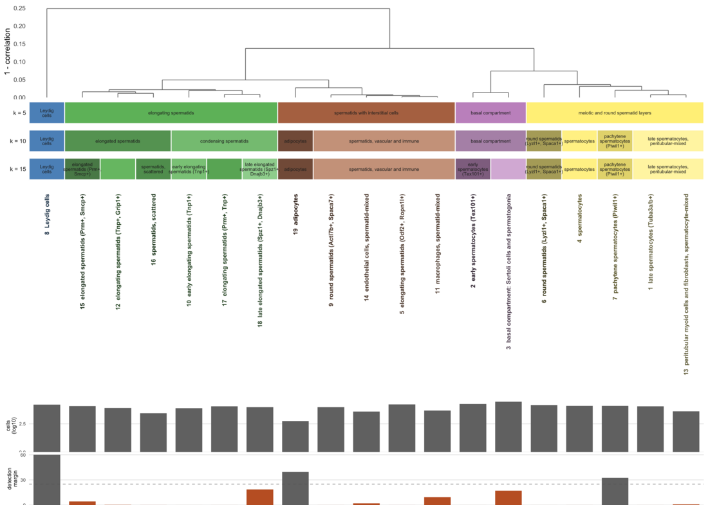

`k` sets the number of groups. The tree can also be cut by how different
the clusters are: with `h`, clusters that are more than that fraction
dissimilar (1 - correlation, averaged between the two groups) stay
apart. On this tree a cut at 1%, 2.5% and 5% gives 14, 8 and 4 groups:

``` r

g <- annotateClusterTree(g,
    tree = tree,
    labels = labels,
    cluster_column = CLUS,
    h = c(0.01, 0.025, 0.05)
)
```

``` r

GiottoVisuals::plotClusterTree(g,
    cluster_column = CLUS,
    tree = tree,
    labels = labels,
    h = c(0.01, 0.025, 0.05),
    gini_markers = gi,
    node_labels = FALSE
)
```

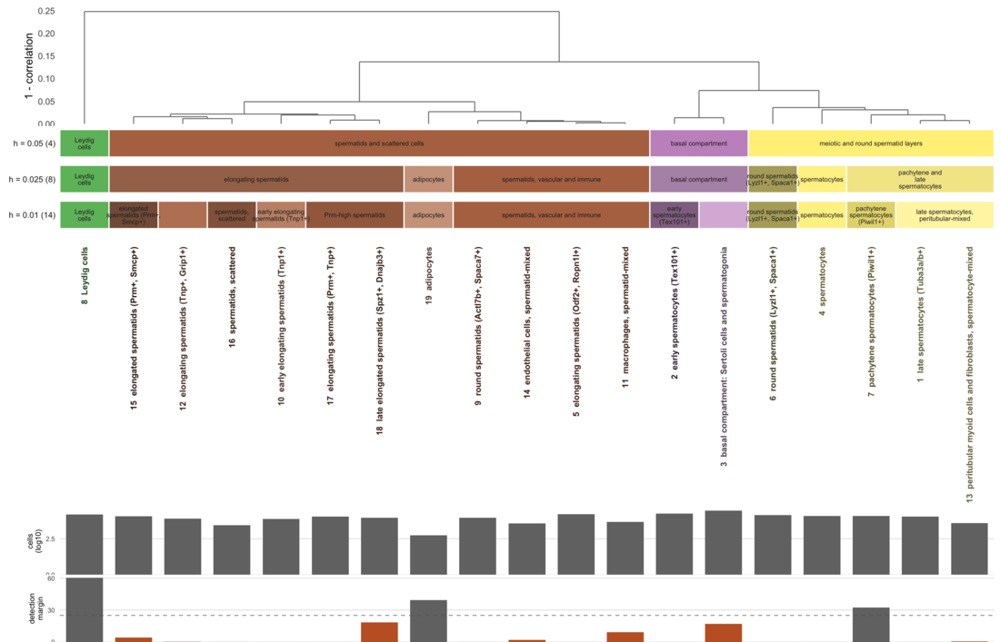

## 11 Results

``` r

k5_types <- sort(unique(g$cell_types_k5))
k5_colors <- stats::setNames(getDistinctColors(length(k5_types)), k5_types)

spatPlot2D(g,
    color_as_factor = TRUE,
    cell_color = "cell_types_k5",
    cell_color_code = k5_colors,
    point_border_stroke = 0,
    point_size = 0.3,
    background_color = "black",
    theme_param = list(legend.position = "right")
)
```

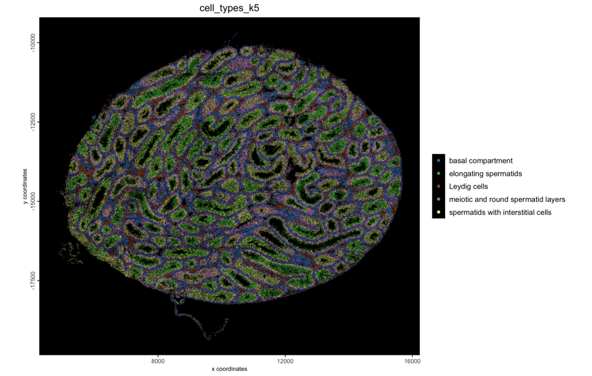

One color per type, reused in the zoom below:

``` r

k15_types <- sort(unique(g$cell_types_k15))
k15_colors <- stats::setNames(getDistinctColors(length(k15_types)), k15_types)

spatPlot2D(g,
    color_as_factor = TRUE,
    cell_color = "cell_types_k15",
    cell_color_code = k15_colors,
    point_border_stroke = 0,
    point_size = 0.3,
    background_color = "black",
    theme_param = list(legend.position = "right")
)
```

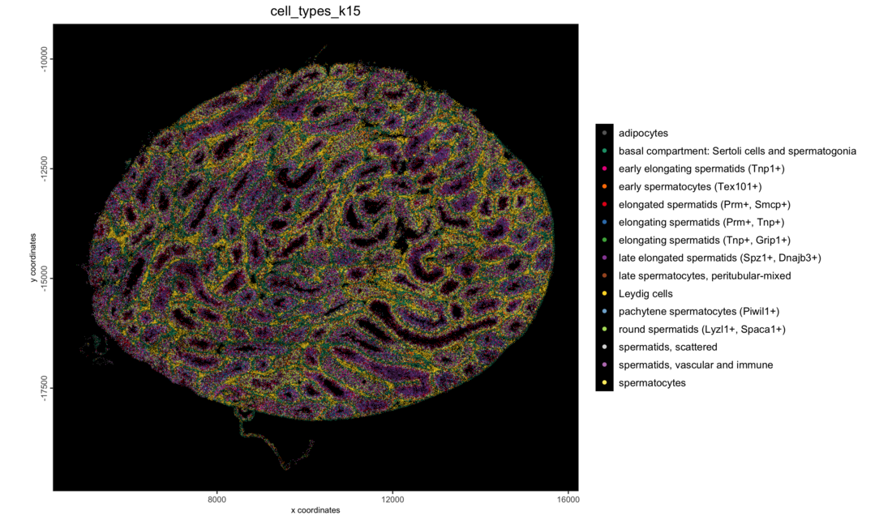

Zoom into a region with the cell polygons, filled by cell type, over the
DAPI image:

``` r

spatInSituPlotPoints(g,
    show_image = TRUE,
    feats = NULL,
    show_polygon = TRUE,
    polygon_feat_type = "cell",
    polygon_fill = "cell_types_k15",
    polygon_fill_as_factor = TRUE,
    polygon_fill_code = k15_colors,
    polygon_line_size = 0.1,
    polygon_alpha = 0.7,
    xlim = c(roi_x - half, roi_x + half),
    ylim = c(roi_y - half, roi_y + half)
)
```

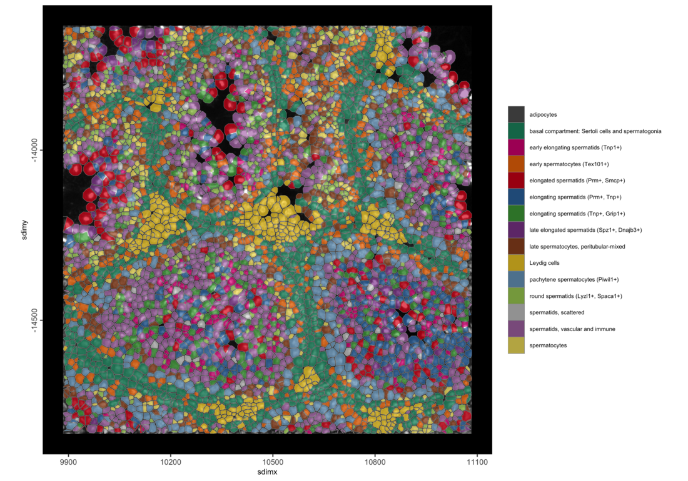

The same region, with the cells filled by the normalized expression of
marker genes from the outside of a tubule to its lumen: Leydig cells
(Cyp17a1), the basal compartment (Clu), spermatocytes (Piwil1), round
spermatids (Spaca1), and elongating spermatids (Tnp1, Prm1):

``` r

marker_genes <- c("Cyp17a1", "Clu", "Piwil1", "Spaca1", "Tnp1", "Prm1")

for (gene in marker_genes) {
    print(spatInSituPlotPoints(g,
        show_image = TRUE,
        feats = NULL,
        show_polygon = TRUE,
        polygon_feat_type = "cell",
        polygon_fill = gene,
        expression_values = "normalized",
        polygon_fill_as_factor = FALSE,
        polygon_fill_gradient_style = "sequential",
        polygon_line_size = 0.1,
        polygon_alpha = 0.8,
        xlim = c(roi_x - half, roi_x + half),
        ylim = c(roi_y - half, roi_y + half),
        show_plot = FALSE,
        return_plot = TRUE
    ) + ggplot2::ggtitle(gene))
}
```

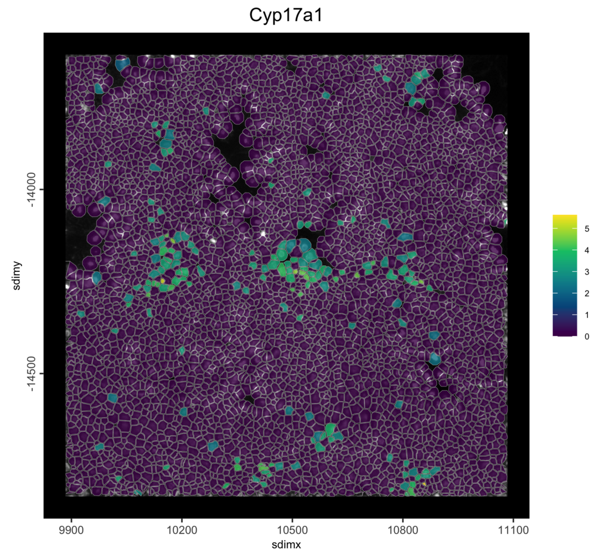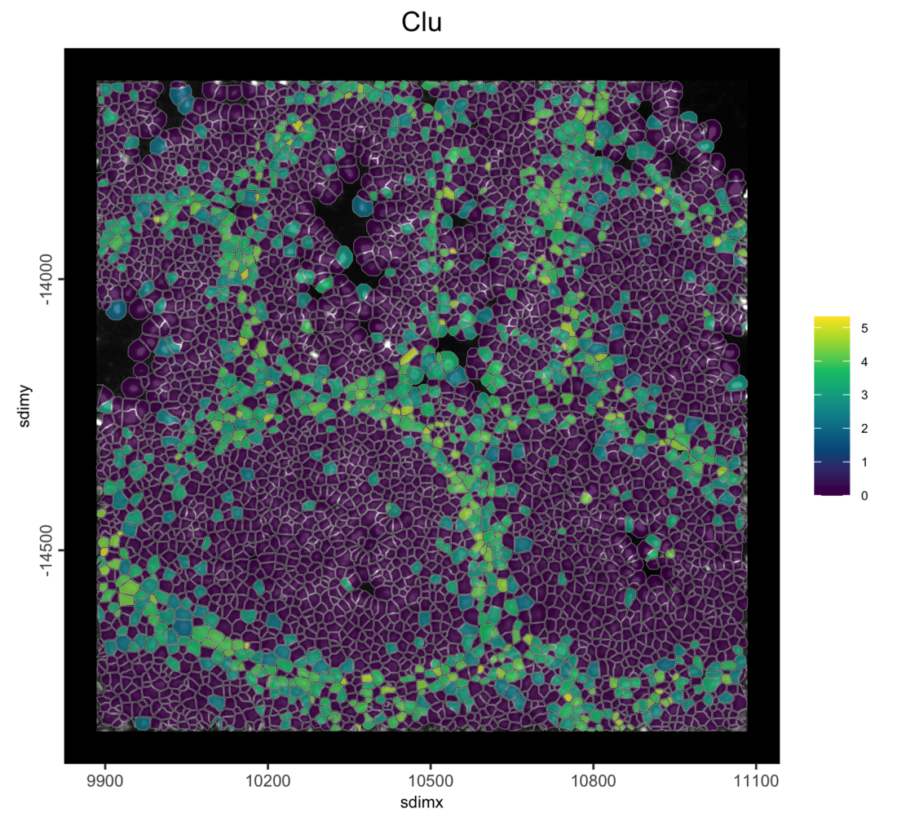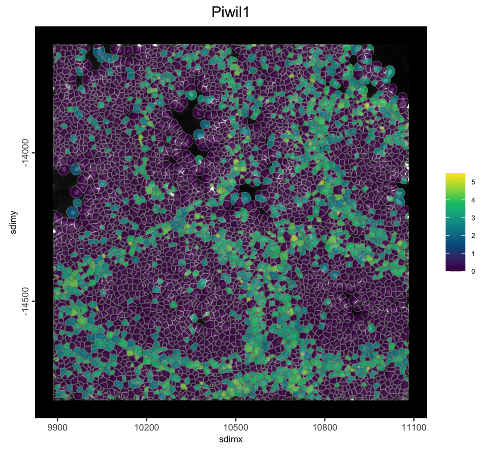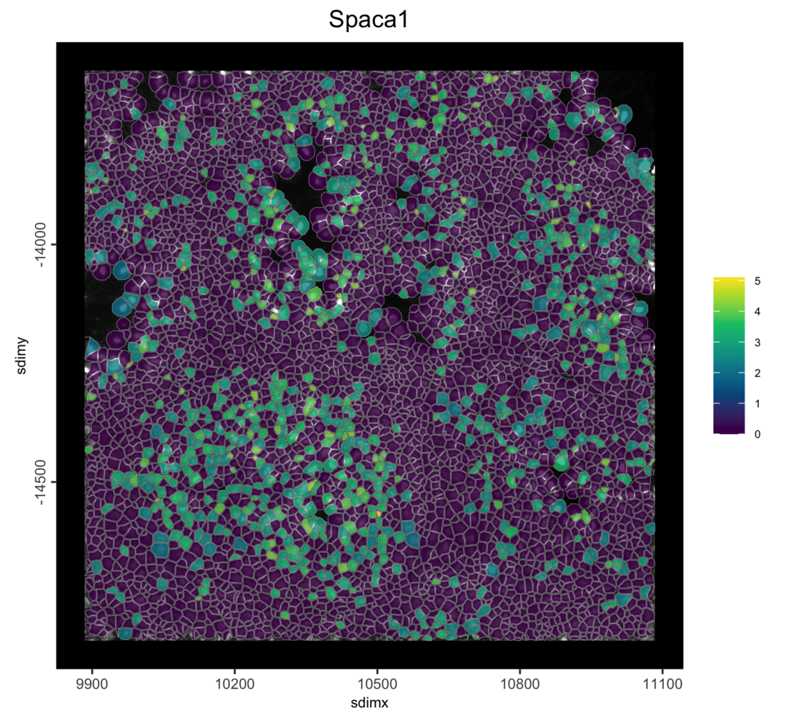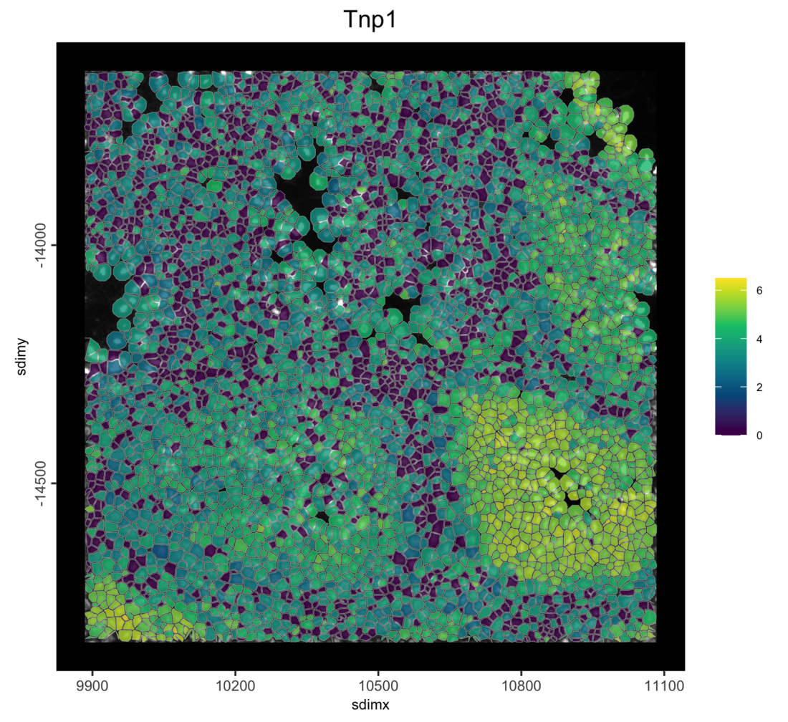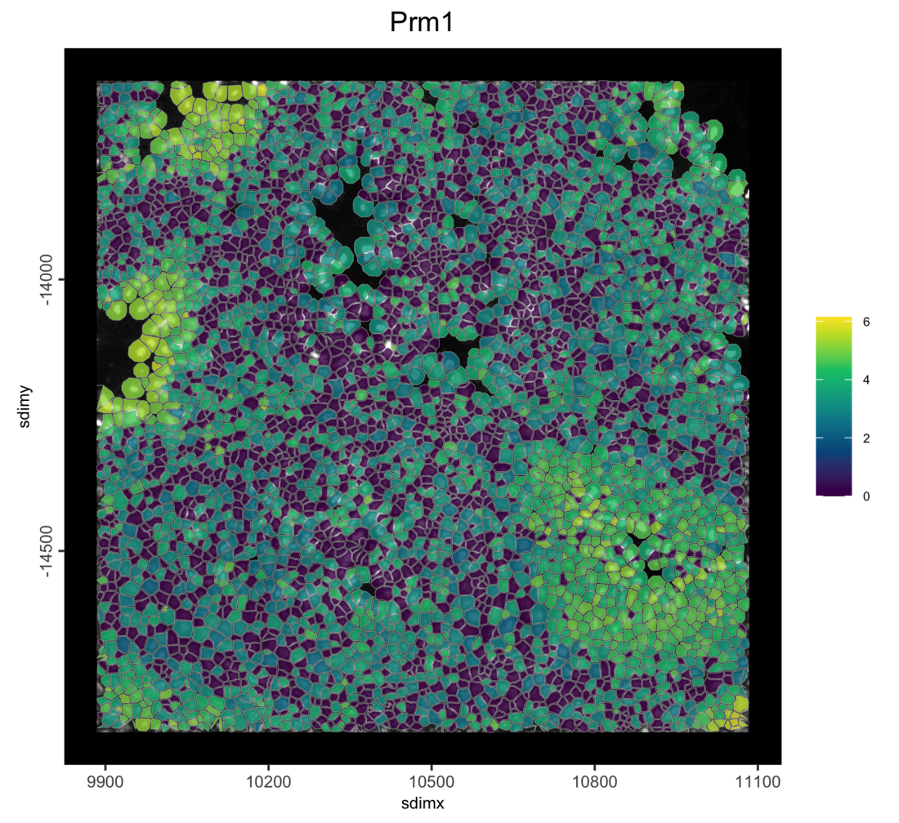

``` r

g <- saveGiotto(g, name = "annotated")
```

      backend : `gDirSource`
      path    : path/to/stereoseq_testis_cells_project

The object is saved to the project directory and can be reloaded with
`loadGiotto(project_dir, name = "annotated")`.

## 12 Further reading

- [Stereo-seq mouse testis: 10 µm
  bins](https://giottosuite.com/dev/articles/stereoseq_testis_bins_giottodisk.md),
  with spatially variable genes and co-expression modules
- [Stereo-seq mouse testis: 0.5 µm bins into your own
  polygons](https://giottosuite.com/dev/articles/stereoseq_testis_own_polygons_giottodisk.md)
- [Stereo-seq Data
  Import](https://giottosuite.com/dev/articles/stereoseq_importer.md),
  which covers the readers and the files in a SAW output directory

## 13 Session info

``` r

sessionInfo()
```

    R version 4.5.3 (2026-03-11)
    Platform: aarch64-apple-darwin20
    Running under: macOS Tahoe 26.6.2

    Matrix products: default
    BLAS:   /Library/Frameworks/R.framework/Versions/4.5-arm64/Resources/lib/libRblas.0.dylib 
    LAPACK: /Library/Frameworks/R.framework/Versions/4.5-arm64/Resources/lib/libRlapack.dylib;  LAPACK version 3.12.1

    locale:
    [1] C.UTF-8/C.UTF-8/C.UTF-8/C/C.UTF-8/C.UTF-8

    time zone: America/New_York
    tzcode source: internal

    attached base packages:
    [1] stats     graphics  grDevices utils     datasets  methods   base     

    other attached packages:
    [1] GiottoDisk_0.0.0.6 Giotto_4.3.5       GiottoClass_0.7.18 arrow_23.0.1.2    

    loaded via a namespace (and not attached):
      [1] RColorBrewer_1.1-3          ggdendro_0.2.0             
      [3] jsonlite_2.0.0              wk_0.9.5                   
      [5] magrittr_2.0.4              magick_2.9.1               
      [7] farver_2.1.2                rmarkdown_2.31             
      [9] vctrs_0.7.2                 memoise_2.0.1              
     [11] GiottoUtils_0.2.7           terra_1.9-11               
     [13] htmltools_0.5.9             S4Arrays_1.10.1            
     [15] BiocNeighbors_2.4.0         Rhdf5lib_1.32.0            
     [17] SparseArray_1.10.9          rhdf5_2.54.1               
     [19] sass_0.4.10                 parallelly_1.47.0          
     [21] bslib_0.10.0                htmlwidgets_1.6.4          
     [23] plotly_4.12.0               cachem_1.1.0               
     [25] igraph_2.2.2                lifecycle_1.0.5            
     [27] pkgconfig_2.0.3             rsvd_1.0.5                 
     [29] Matrix_1.7-5                R6_2.6.1                   
     [31] fastmap_1.2.0               MatrixGenerics_1.22.0      
     [33] future_1.70.0               digest_0.6.39              
     [35] colorspace_2.1-2            S4Vectors_0.48.0           
     [37] dqrng_0.4.1                 irlba_2.3.7                
     [39] GenomicRanges_1.62.1        beachmat_2.26.0            
     [41] filelock_1.0.3              labeling_0.4.3             
     [43] progressr_0.18.0            httr_1.4.8                 
     [45] polyclip_1.10-7             abind_1.4-8                
     [47] compiler_4.5.3              bit64_4.6.0-1              
     [49] withr_3.0.2                 S7_0.2.1                   
     [51] backports_1.5.0             BiocParallel_1.44.0        
     [53] viridis_0.6.5               DBI_1.3.0                  
     [55] ggforce_0.5.0               R.utils_2.13.0             
     [57] duckdb_1.5.1                MASS_7.3-65                
     [59] DelayedArray_0.36.0         rjson_0.2.23               
     [61] bluster_1.20.0              gtools_3.9.5               
     [63] GiottoVisuals_0.2.16        tools_4.5.3                
     [65] otel_0.2.0                  future.apply_1.20.2        
     [67] R.oo_1.27.1                 glue_1.8.0                 
     [69] rhdf5filters_1.22.0         grid_4.5.3                 
     [71] checkmate_2.3.4             cluster_2.1.8.2            
     [73] generics_0.1.4              gtable_0.3.6               
     [75] R.methodsS3_1.8.2           tidyr_1.3.2                
     [77] data.table_1.18.2.1         metapod_1.18.0             
     [79] BiocSingular_1.26.1         tidygraph_1.3.1            
     [81] ScaledMatrix_1.18.0         XVector_0.50.0             
     [83] BiocGenerics_0.56.0         tilework_1.0.0             
     [85] ggrepel_0.9.8               pillar_1.11.1              
     [87] RcppHNSW_0.6.0              limma_3.66.0               
     [89] dplyr_1.2.0                 tweenr_2.0.3               
     [91] lattice_0.22-9              bit_4.6.0                  
     [93] tidyselect_1.2.1            locfit_1.5-9.12            
     [95] SingleCellExperiment_1.32.0 scuttle_1.20.0             
     [97] knitr_1.51                  gridExtra_2.3              
     [99] IRanges_2.44.0              Seqinfo_1.0.0              
    [101] edgeR_4.8.2                 SummarizedExperiment_1.40.0
    [103] scattermore_1.2             stats4_4.5.3               
    [105] xfun_0.57                   graphlayouts_1.2.3         
    [107] Biobase_2.70.0              statmod_1.5.2              
    [109] matrixStats_1.5.0           lazyeval_0.2.2             
    [111] yaml_2.3.12                 evaluate_1.0.5             
    [113] codetools_0.2-20            ggraph_2.2.2               
    [115] tibble_3.3.1                colorRamp2_0.1.0           
    [117] cli_3.6.5                   uwot_0.2.4                 
    [119] jquerylib_0.1.4             dichromat_2.0-0.1          
    [121] Rcpp_1.1.1                  globals_0.19.1             
    [123] dbplyr_2.5.2                parallel_4.5.3             
    [125] ggplot2_4.0.2               assertthat_0.2.1           
    [127] scran_1.38.1                listenv_0.10.1             
    [129] SpatialExperiment_1.20.0    viridisLite_0.4.3          
    [131] scales_1.4.0                purrr_1.2.1                
    [133] rlang_1.3.0                 cowplot_1.2.0

NA \`\`\`
