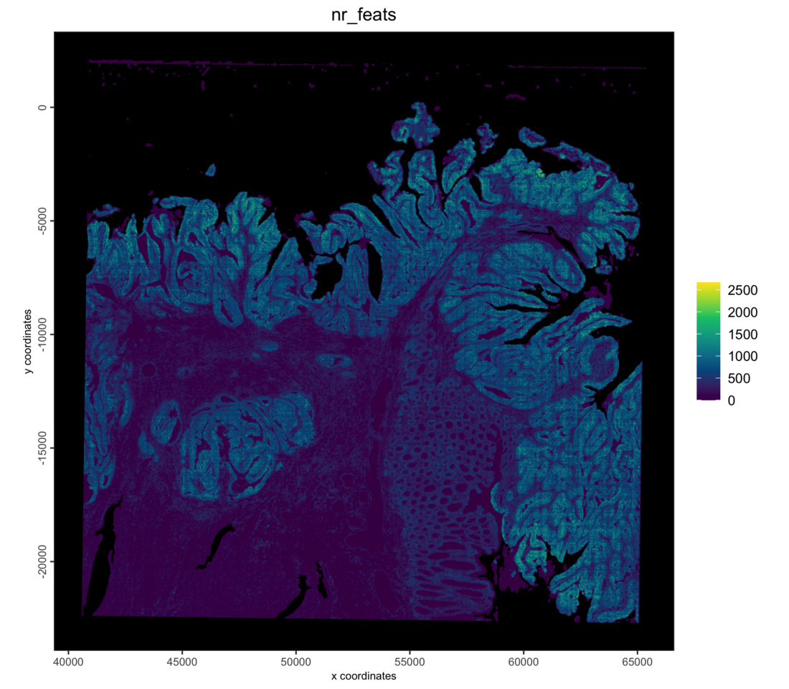
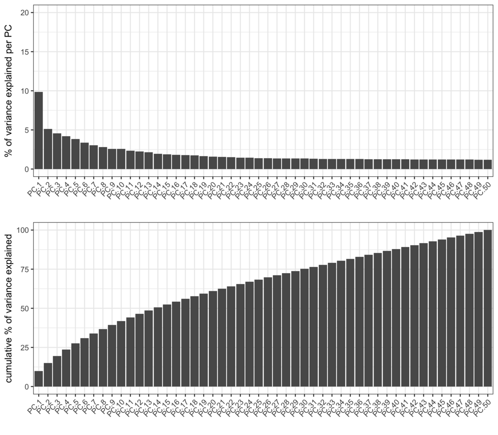
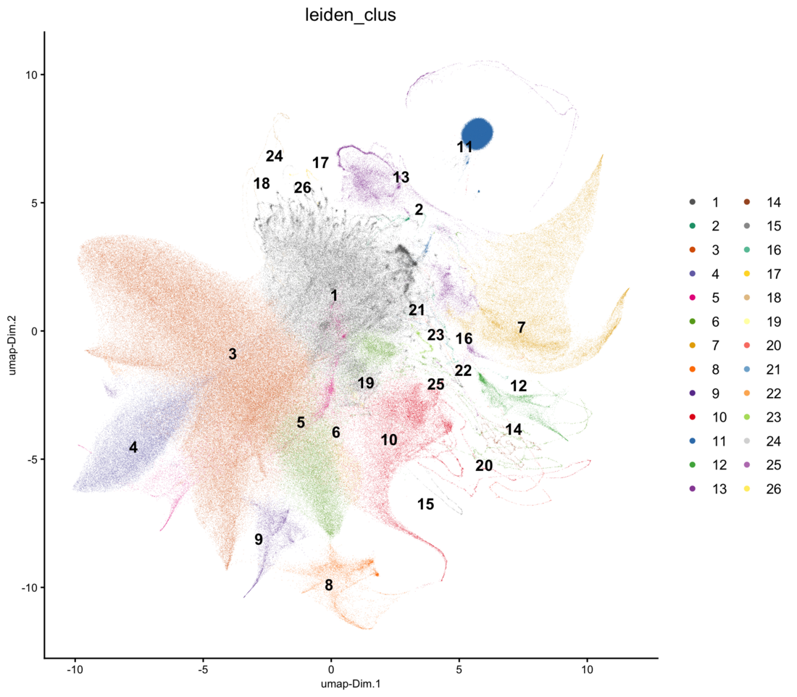
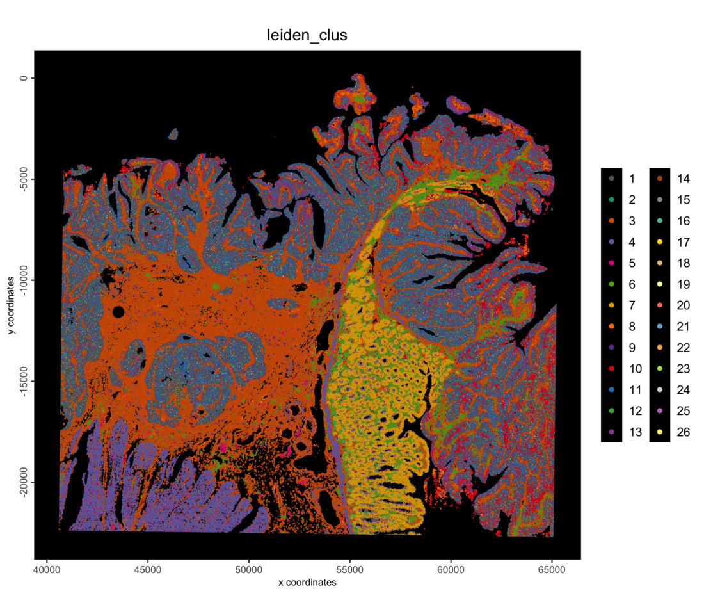
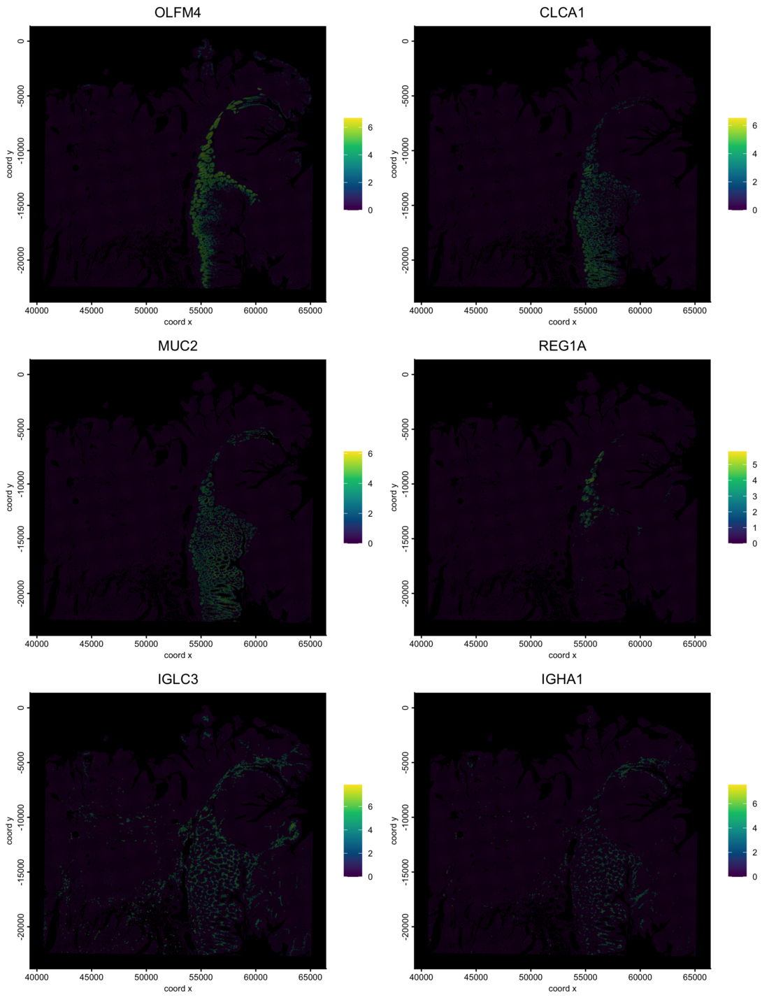
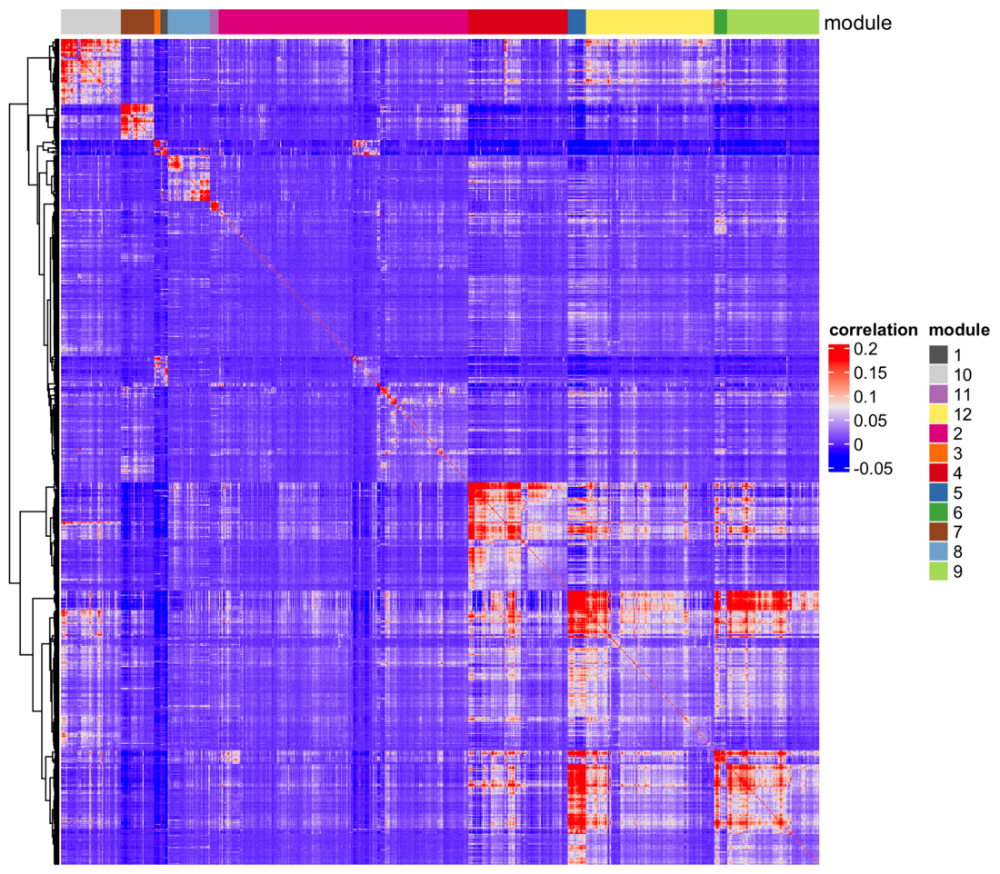
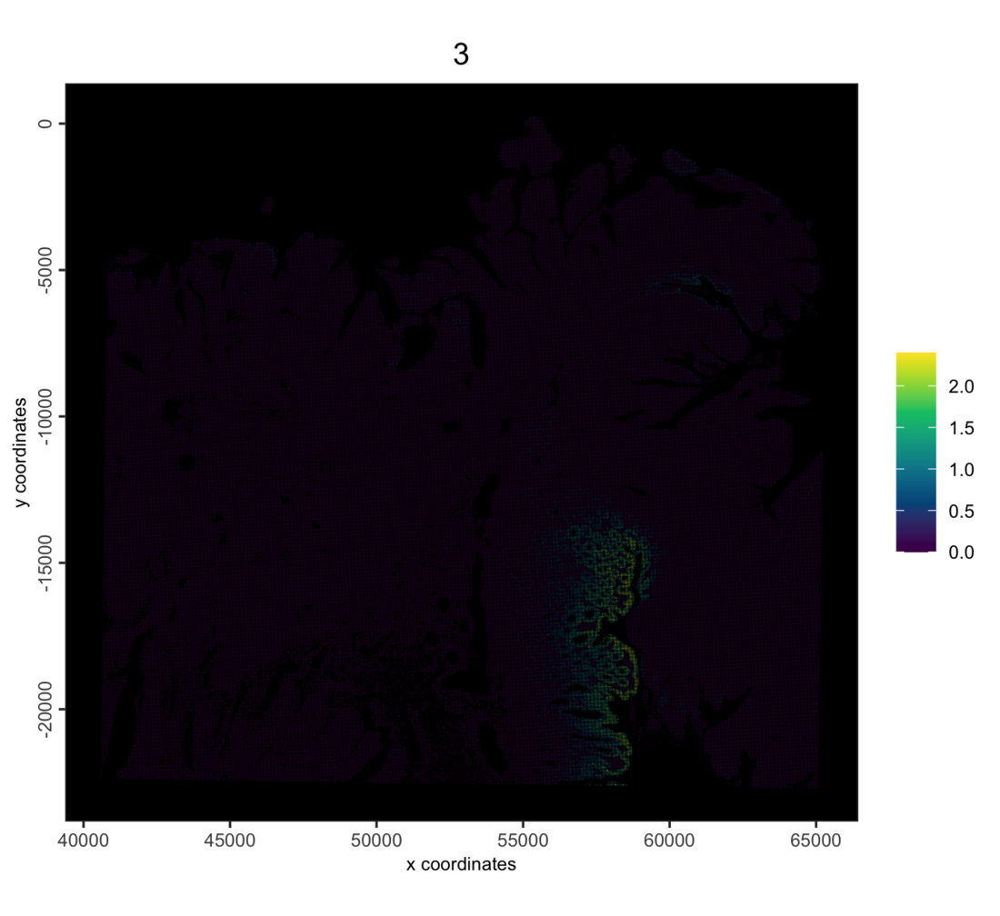
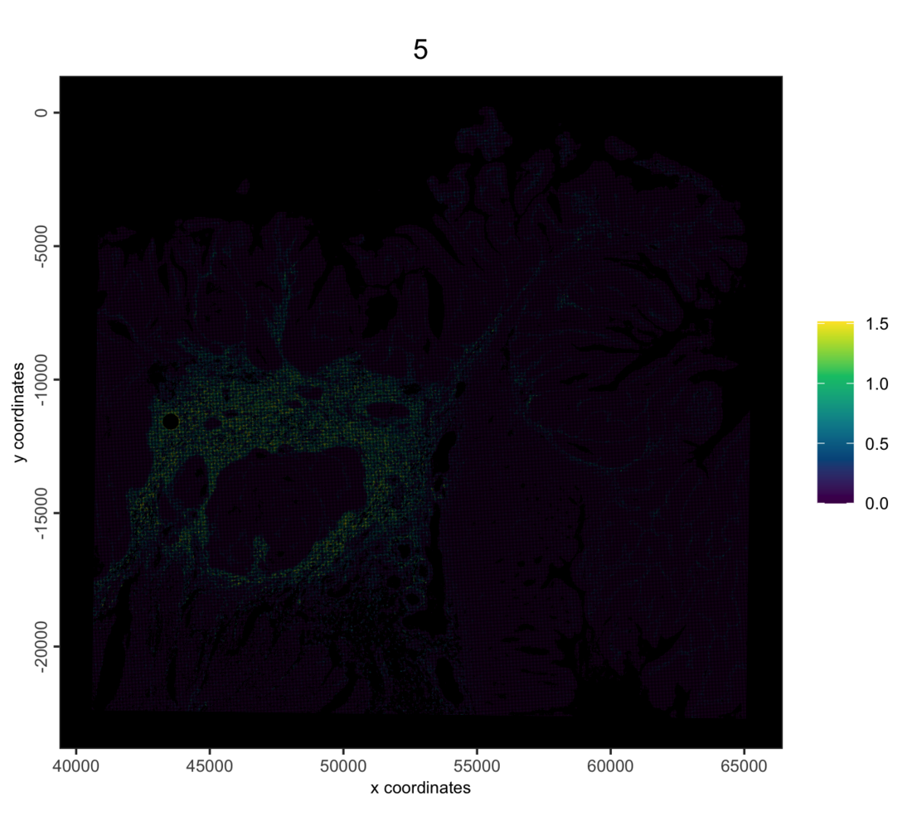
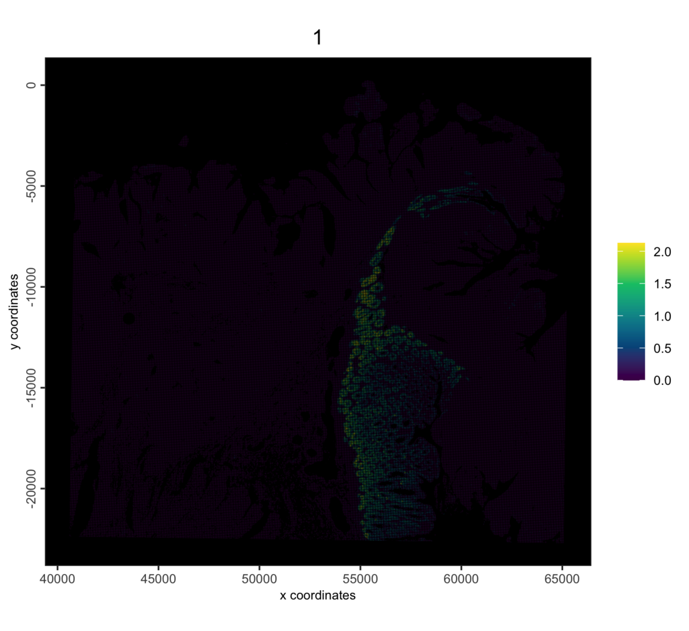
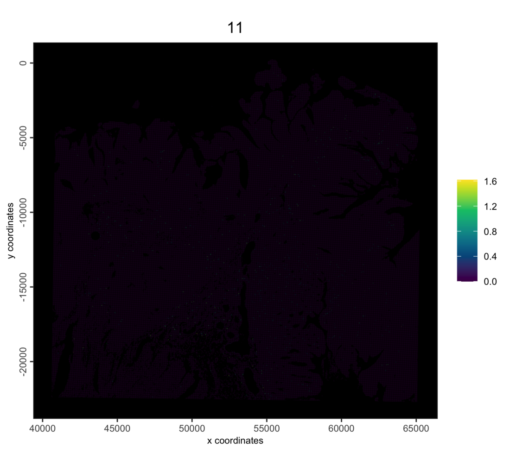

# Visium HD Human Colorectal Cancer: 8 µm Bins

## 1 Overview

This tutorial starts from the 8 µm bins that Space Ranger already
aggregated from the 2 µm grid. It reads them into an on-disk GiottoDisk
project, then filters, normalizes, clusters and plots them.

On a disk-backed object the expression matrix lives as parquet files in
a project directory, so the same Giotto commands run on data larger than
memory. Two related tutorials start from the [segmented
cells](https://giottosuite.com/dev/articles/visiumhd_crc_cells_giottodisk.md)
and from [the 2 µm bins and your own
polygons](https://giottosuite.com/dev/articles/visiumhd_crc_own_polygons_giottodisk.md).

## 2 Install extra packages

This tutorial uses GiottoDisk for on-disk processing. These are preview
dev builds off the dev and gsource Giotto package branches. If
GiottoDisk has not been installed yet, use the following:

``` r

# GiottoDisk install; also installs arrow (with zstd support) and tilework
remotes::install_github("giotto-suite/GiottoUtils", ref = "dev")
GiottoUtils::suite_install("GiottoDisk", install_arrow = TRUE)
# Optional for matrix maths speedup:
install.packages("GiottoKernels",
    repos = c("https://giotto-suite.r-universe.dev", "https://cloud.r-project.org")
)
```

## 3 Dataset explanation

10x Genomics’ [Visium HD Spatial Gene Expression Library, Human
Colorectal Cancer
(FFPE)](https://www.10xgenomics.com/datasets/visium-hd-cytassist-gene-expression-libraries-of-human-crc-v4),
processed with Space Ranger 4.0.1. Space Ranger bins the probe counts at
2, 8 and 16 µm; this tutorial uses the 8 µm bins.

### 3.1 Download links

`curl` links from 10x Genomics

    base=https://cf.10xgenomics.com/samples/spatial-exp/4.0.1/Visium_HD_Human_Colon_Cancer/Visium_HD_Human_Colon_Cancer
    mkdir outs && cd outs
    curl -O ${base}_binned_outputs.tar.gz      # 15.9 GB
    tar -xzf Visium_HD_Human_Colon_Cancer_binned_outputs.tar.gz

  

This gives `outs/binned_outputs/` with one `square_002um`,
`square_008um` and `square_016um` folder per bin size.

## 4 Setup

``` r

library(arrow) # this must be libraried before terra or GiottoClass
library(Giotto)
library(GiottoDisk)

data_dir    <- "path/to/outs"
project_dir <- "path/to/visiumhd_crc_bins_project"

# set an appropriate amount of parallel workers for your computer
future::plan(future::multisession, workers = 4)
```

## 5 Read the data

`sourceCreate()` sets up a `gDirSource`: a managed project directory
that holds the object on disk. `setArtifactDumpDir()` points the
expression and spatial writes at it.

``` r

# declare a Giotto directory backend to use
gdsrc <- GiottoDisk::sourceCreate(project_dir, type = "gDirSource")
# point data content writes to the backend's artifact subdirectory
GiottoDisk::setArtifactDumpDir(gdsrc)
```

[`createGiottoVisiumHDObjectBin()`](https://giottosuite.com/dev/reference/createGiottoVisiumHDObjectBin.md)
reads one bin size. Passing the backend to `backend` creates the object
as a disk-backed project. `bin = 16` reads the 16 µm bins the same way.

``` r

g <- createGiottoVisiumHDObjectBin(file.path(data_dir, "binned_outputs"),
    bin = 8,
    tissue_only = TRUE, # only the bins under the tissue
    backend = gdsrc     # creates the object as a backed project
)
g
```

    An object of class giotto 
    >Active spat_unit:  bin008 
    >Active feat_type:  rna 
    dimensions    : 18982, 516880 (features, cells)
    [SUBCELLULAR INFO]
    [AGGREGATE INFO]
    expression -----------------------
      [bin008][rna] raw
    spatial locations ----------------
      [bin008] raw
    attached images ------------------
    images      : image 


    Use objHistory() to see steps and params used

The expression matrix is a disk store:

``` r

class(getExpression(g, output = "exprObj")[])
```

    [1] "parquetExprStore"
    attr(,"package")
    [1] "GiottoDisk"

Each bin, colored by the number of genes it detects:

``` r

g <- addStatistics(g, expression_values = "raw")
spatPlot2D(g,
    cell_color = "nr_feats",
    color_as_factor = FALSE,
    gradient_style = "sequential",
    point_size = 0.3,
    point_border_stroke = 0,
    background_color = "black"
)
```



### 5.1 Save

Backed Giotto projects write named snapshots of the analysis state to
the project directory, which can be treated as checkpoints.

``` r

# The return value is needed since saveGiotto makes changes during the write
g <- saveGiotto(g, name = "ingest")
```

      backend : `gDirSource`
      path    : path/to/visiumhd_crc_bins_project

## 6 Quality control and filtering

``` r

cx <- pDataDT(g)
cat(sprintf("%s bins | median %d counts, %d features per bin\n",
    format(nrow(cx), big.mark = ","),
    median(cx$total_expr), median(cx$nr_feats))
)
```

    516,880 bins | median 435 counts, 337 features per bin

``` r

g <- filterGiotto(g,
    expression_threshold   = 1,
    feat_det_in_min_cells  = 10,
    min_det_feats_per_cell = 50,
    verbose = FALSE
)
cat(sprintf("%s bins x %s features retained\n",
    format(length(spatIDs(g)), big.mark = ","),
    format(nrow(fDataDT(g)), big.mark = ","))
)
```

    467,941 bins x 18,871 features retained

## 7 Normalize and select features

``` r

g <- normalizeGiotto(g,
    scalefactor = 1e4,
    logbase = exp(1),
    log_offset = 1,
    scale_feats = FALSE,
    scale_cells = FALSE,
    verbose = FALSE
)
g <- calculateHVF(g,
    method = "cov_loess",
    n_top_feats = 2000,
    verbose = FALSE
)
```

## 8 Dimension reduction

``` r

g <- runPCA(g,
    feats_to_use = "hvf",
    ncp = 50,
    scale_unit = TRUE,
    center = TRUE,
    verbose = FALSE
)
screePlot(g, ncp = 50)
```



The scree plot flattens after about 15 PCs, so those are used below.

## 9 Clustering

The kNN network is built first.
[`runUMAP()`](https://giottosuite.com/dev/reference/runUMAP.md) then
reuses it instead of searching for neighbors again, and Leiden clusters
on the same network.

``` r

dims_to_use <- 1:15

g <- createNearestNetwork(g,
    type = "kNN",
    dimensions_to_use = dims_to_use,
    k = 30,
    engine = "hnsw",
    verbose = FALSE
)
g <- runUMAP(g,
    dimensions_to_use = dims_to_use,
    n_neighbors = 30,
    min_dist = 0.3,
    verbose = FALSE
)
g <- doLeidenCluster(g,
    nn_network_to_use = "kNN",
    network_name = "kNN.pca",
    resolution = 0.2,
    n_iterations = 20,
    objective_function = "modularity",
    verbose = FALSE
)
cat(length(unique(pDataDT(g)$leiden_clus)), "clusters\n")

g <- saveGiotto(g, name = "clustered")
```

    26 clusters
      backend : `gDirSource`
      path    : path/to/visiumhd_crc_bins_project

One color per cluster, reused by every plot below so the zoom matches
the overview:

``` r

clus <- GiottoUtils::mixedsort(unique(pDataDT(g)$leiden_clus))
clus_colors <- stats::setNames(getDistinctColors(length(clus)), clus)

plotUMAP(g,
    cell_color = "leiden_clus",
    cell_color_code = clus_colors,
    color_as_factor = TRUE,
    point_border_stroke = 0,
    point_size = 0.1
)
```



``` r

spatPlot2D(g,
    cell_color = "leiden_clus",
    cell_color_code = clus_colors,
    color_as_factor = TRUE,
    point_border_stroke = 0,
    point_size = 0.3,
    background_color = "black"
)
```



Zoom into a region over the H&E image.
[`subsetGiottoLocs()`](https://giotto-suite.github.io/GiottoClass/reference/subsetGiottoLocs.html)
keeps the bins inside a window:

``` r

sl <- getSpatialLocations(g, output = "data.table")
roi_x <- stats::median(sl$sdimx)
roi_y <- stats::median(sl$sdimy)
half <- 2200 # pixels; about 0.6 mm at 0.27 um per pixel

g_roi <- subsetGiottoLocs(g,
    x_min = roi_x - half, x_max = roi_x + half,
    y_min = roi_y - half, y_max = roi_y + half
)
spatPlot2D(g_roi,
    cell_color = "leiden_clus",
    cell_color_code = clus_colors,
    color_as_factor = TRUE,
    show_image = TRUE,
    point_size = 1.2,
    point_alpha = 0.7,
    point_border_stroke = 0
)
```


The object is saved to the project directory and can be reloaded with
`loadGiotto(project_dir, name = "clustered")`.

## 10 Spatially variable genes

[`binSpect()`](https://giottosuite.com/dev/reference/binSpect.md) looks
for genes whose expression is spatially coherent. It marks the bins
where a gene is highly expressed (here the top 30% by rank) and tests
whether those bins are neighbors of each other more often than expected
by chance. The neighbors come from a spatial network that links each bin
to its 8 nearest bins.

``` r

g <- createSpatialNetwork(g,
    name = "kNN_network",
    method = "kNN",
    k = 8,
    verbose = FALSE
)
```

``` r

hvf <- fDataDT(g)[hvf == "yes"]$feat_ID

ranktest <- binSpect(g,
    subset_feats = hvf,
    bin_method = "rank",
    spatial_network_name = "kNN_network"
)
head(ranktest[, .(feats, z, adj.p.value, n_on)], 10)
```

                   feats        z adj.p.value  n_on
                  <char>    <num>       <num> <num>
     1:            OLFM4 885.9878           0 28074
     2:            CLCA1 784.0727           0 21485
     3:             MUC2 781.8279           0 25402
     4: DEPRECATED_REG1A 751.8565           0  4758
     5:            REG1A 751.0270           0  4687
     6: DEPRECATED_IGHA2 736.5453           0 31787
     7:            IGLC3 676.5789           0 39224
     8:            IGHA1 654.5728           0 16752
     9:            CLCA4 649.0724           0  4884
    10:           SPINK4 632.9500           0 16188

The six top-ranked genes. Probes that 10x marks as `DEPRECATED_` are
skipped; some of them target a gene that has another probe too, such as
REG1A.

``` r

top_genes <- ranktest[!startsWith(feats, "DEPRECATED_")]$feats[1:6]

spatFeatPlot2D(g,
    expression_values = "normalized",
    feats = top_genes,
    gradient_style = "sequential",
    point_size = 0.1,
    point_border_stroke = 0,
    background_color = "black",
    cow_n_col = 2,
    return_plot = FALSE
)
```



### 10.1 Spatial co-expression modules

Genes that are spatially variable often share a pattern, for example
because they mark the same cell type or tissue region.
[`spatialCoexpression()`](https://giottosuite.com/dev/reference/spatialCoexpression.md)
averages each bin’s expression with its neighbors’ in the spatial
network, correlates the genes on these smoothed values, and clusters the
correlation into modules. It runs on the significant genes from
[`binSpect()`](https://giottosuite.com/dev/reference/binSpect.md).

``` r

spatial_genes <- ranktest[adj.p.value < 0.001 &
    !startsWith(feats, "DEPRECATED_")]$feats

coexpr <- spatialCoexpression(g,
    feats = spatial_genes,
    spatial_network_name = "kNN_network",
    n_modules = 12,
    return_gobject = FALSE
)
coexpr$summary
```

        module  size within_cor  between_cor       score
         <int> <int>      <num>        <num>       <num>
     1:      3    10 0.45587006 -0.010289861 0.455870058
     2:      5    28 0.40112262  0.049551215 0.377119014
     3:      1    11 0.28381770 -0.006246849 0.282670226
     4:     11    14 0.21186522  0.010336027 0.207495312
     5:      6    20 0.20215588  0.034412832 0.193118970
     6:      7    51 0.14073241  0.003549368 0.138784782
     7:     10    92 0.09444868  0.017175508 0.091854608
     8:      4   153 0.08172591  0.017675004 0.079440453
     9:      8    65 0.06902027  0.009422162 0.067659740
    10:      9   142 0.06751609  0.022270041 0.065317769
    11:     12   198 0.04233570  0.024023761 0.040883010
    12:      2   385 0.01022288  0.011573649 0.009999368

The summary ranks the modules: a high `within_cor` and a low
`between_cor` mean a module is coherent and distinct from the others.
Large modules with a low `within_cor` collect genes that fit no clear
pattern.

``` r

heatmapCoexpression(g, coexpr, return_plot = FALSE)
```



The genes that best represent each of the four top-ranked modules:

``` r

top_modules <- coexpr$summary$module[1:4]
coexpr$feats[module %in% top_modules][
    order(match(module, top_modules), -module_cor),
    head(.SD, 5), by = "module"
]
```

        module feat_ID module_cor
         <int>  <char>      <num>
     1:      3     CA4  0.5873250
     2:      3  GUCA2A  0.5846494
     3:      3 SLC26A3  0.5626766
     4:      3    ZG16  0.4846346
     5:      3   CLCA4  0.4689647
     6:      5   THBS2  0.5376692
     7:      5   SFRP4  0.5144048
     8:      5  CTHRC1  0.4945319
     9:      5 COL11A1  0.4698855
    10:      5     ELN  0.4573143
    11:      1  SPINK4  0.3792945
    12:      1   OLFM4  0.3673571
    13:      1   CLCA1  0.3448918
    14:      1    CHGA  0.3339099
    15:      1    MUC2  0.3316704
    16:     11  TPSAB1  0.3689585
    17:     11    CPA3  0.3408935
    18:     11   MS4A2  0.2487235
    19:     11     HDC  0.2481234
    20:     11    CTSG  0.2433529
        module feat_ID module_cor
         <int>  <char>      <num>

The same call with the default `return_gobject = TRUE` adds the module
of each gene to the feature metadata, and one score per bin and module,
the mean expression of its genes, as a spatial enrichment:

``` r

g <- spatialCoexpression(g,
    feats = spatial_genes,
    spatial_network_name = "kNN_network",
    n_modules = 12
)
```

A few bins score far higher than the rest, so each module’s color scale
is capped at the 99th percentile of its non-zero scores. A module of
scattered cells, like the mast cell module here, shows as sparse single
bins at this scale:

``` r

scores <- getSpatialEnrichment(g, name = "spatial_module", output = "data.table")

for (m in as.character(top_modules)) {
    v <- scores[[m]]
    spatCellPlot2D(g,
        spat_enr_names = "spatial_module",
        cell_annotation_values = m,
        gradient_style = "sequential",
        gradient_limits = c(0, stats::quantile(v[v > 0], 0.99)),
        point_size = 0.1,
        point_border_stroke = 0,
        background_color = "black",
        return_plot = FALSE
    )
}
```



``` r

g <- saveGiotto(g, name = "spatial")
```

      backend : `gDirSource`
      path    : path/to/visiumhd_crc_bins_project

## 11 Further reading

- [Visium HD colorectal cancer: segmented
  cells](https://giottosuite.com/dev/articles/visiumhd_crc_cells_giottodisk.md),
  with cell typing from a cluster tree
- [Visium HD colorectal cancer: 2 µm bins into your own
  polygons](https://giottosuite.com/dev/articles/visiumhd_crc_own_polygons_giottodisk.md)
- The in-memory [Visium HD colorectal cancer
  tutorial](https://giottosuite.com/dev/articles/VisiumHD_Human_Colorectal_Cancer.md),
  which aggregates the 2 µm bins into hexagons

## 12 Session info

``` r

sessionInfo()
```

    R version 4.5.3 (2026-03-11)
    Platform: aarch64-apple-darwin20
    Running under: macOS Tahoe 26.6.2

    Matrix products: default
    BLAS:   /Library/Frameworks/R.framework/Versions/4.5-arm64/Resources/lib/libRblas.0.dylib 
    LAPACK: /Library/Frameworks/R.framework/Versions/4.5-arm64/Resources/lib/libRlapack.dylib;  LAPACK version 3.12.1

    locale:
    [1] C.UTF-8/C.UTF-8/C.UTF-8/C/C.UTF-8/C.UTF-8

    time zone: America/New_York
    tzcode source: internal

    attached base packages:
    [1] stats     graphics  grDevices utils     datasets  methods   base     

    other attached packages:
    [1] GiottoDisk_0.0.0.5 Giotto_4.3.4       GiottoClass_0.7.16 arrow_23.0.1.2    

    loaded via a namespace (and not attached):
      [1] RColorBrewer_1.1-3          jsonlite_2.0.0             
      [3] shape_1.4.6.1               magrittr_2.0.4             
      [5] magick_2.9.1                farver_2.1.2               
      [7] rmarkdown_2.31              GlobalOptions_0.1.4        
      [9] vctrs_0.7.2                 memoise_2.0.1              
     [11] GiottoUtils_0.2.7           terra_1.9-11               
     [13] htmltools_0.5.9             S4Arrays_1.10.1            
     [15] BiocNeighbors_2.4.0         SparseArray_1.10.9         
     [17] sass_0.4.10                 parallelly_1.47.0          
     [19] bslib_0.10.0                htmlwidgets_1.6.4          
     [21] plotly_4.12.0               cachem_1.1.0               
     [23] igraph_2.2.2                lifecycle_1.0.5            
     [25] iterators_1.0.14            pkgconfig_2.0.3            
     [27] rsvd_1.0.5                  Matrix_1.7-5               
     [29] R6_2.6.1                    fastmap_1.2.0              
     [31] clue_0.3-68                 MatrixGenerics_1.22.0      
     [33] future_1.70.0               digest_0.6.39              
     [35] colorspace_2.1-2            S4Vectors_0.48.0           
     [37] irlba_2.3.7                 GenomicRanges_1.62.1       
     [39] beachmat_2.26.0             filelock_1.0.3             
     [41] labeling_0.4.3              httr_1.4.8                 
     [43] polyclip_1.10-7             abind_1.4-8                
     [45] compiler_4.5.3              bit64_4.6.0-1              
     [47] withr_3.0.2                 doParallel_1.0.17          
     [49] S7_0.2.1                    backports_1.5.0            
     [51] BiocParallel_1.44.0         viridis_0.6.5              
     [53] ggforce_0.5.0               R.utils_2.13.0             
     [55] MASS_7.3-65                 DelayedArray_0.36.0        
     [57] rjson_0.2.23                bluster_1.20.0             
     [59] gtools_3.9.5                GiottoVisuals_0.2.16       
     [61] tools_4.5.3                 otel_0.2.0                 
     [63] future.apply_1.20.2         R.oo_1.27.1                
     [65] glue_1.8.0                  dbscan_1.2.4               
     [67] grid_4.5.3                  checkmate_2.3.4            
     [69] cluster_2.1.8.2             generics_0.1.4             
     [71] hdf5r_1.3.12                gtable_0.3.6               
     [73] R.methodsS3_1.8.2           tidyr_1.3.2                
     [75] data.table_1.18.2.1         BiocSingular_1.26.1        
     [77] tidygraph_1.3.1             ScaledMatrix_1.18.0        
     [79] XVector_0.50.0              BiocGenerics_0.56.0        
     [81] tilework_1.0.0              ggrepel_0.9.8              
     [83] foreach_1.5.2               pillar_1.11.1              
     [85] RcppHNSW_0.6.0              circlize_0.4.18            
     [87] dplyr_1.2.0                 tweenr_2.0.3               
     [89] lattice_0.22-9              bit_4.6.0                  
     [91] tidyselect_1.2.1            ComplexHeatmap_2.26.1      
     [93] SingleCellExperiment_1.32.0 knitr_1.51                 
     [95] gridExtra_2.3               IRanges_2.44.0             
     [97] Seqinfo_1.0.0               SummarizedExperiment_1.40.0
     [99] scattermore_1.2             stats4_4.5.3               
    [101] xfun_0.57                   graphlayouts_1.2.3         
    [103] Biobase_2.70.0              matrixStats_1.5.0          
    [105] lazyeval_0.2.2              yaml_2.3.12                
    [107] evaluate_1.0.5              codetools_0.2-20           
    [109] ggraph_2.2.2                tibble_3.3.1               
    [111] colorRamp2_0.1.0            cli_3.6.5                  
    [113] uwot_0.2.4                  jquerylib_0.1.4            
    [115] dichromat_2.0-0.1           Rcpp_1.1.1                 
    [117] globals_0.19.1              png_0.1-9                  
    [119] parallel_4.5.3              ggplot2_4.0.2              
    [121] assertthat_0.2.1            listenv_0.10.1             
    [123] SpatialExperiment_1.20.0    viridisLite_0.4.3          
    [125] scales_1.4.0                purrr_1.2.1                
    [127] crayon_1.5.3                GetoptLong_1.1.1           
    [129] rlang_1.3.0                 cowplot_1.2.0

NA \`\`\`
