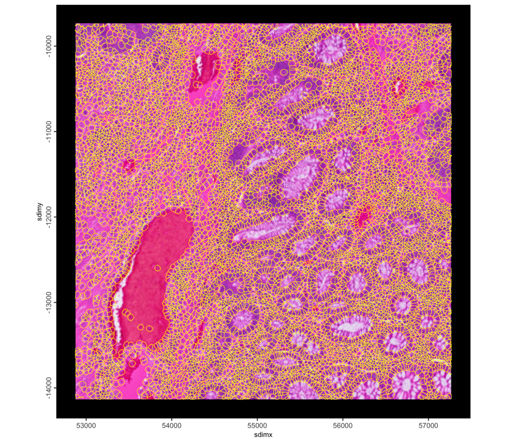
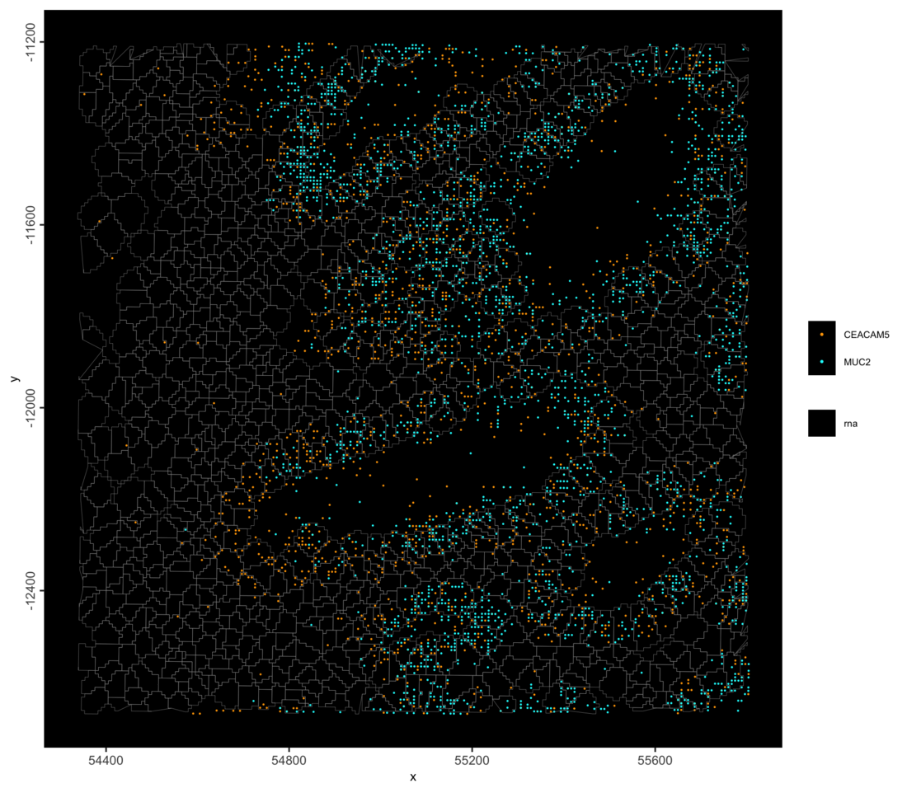
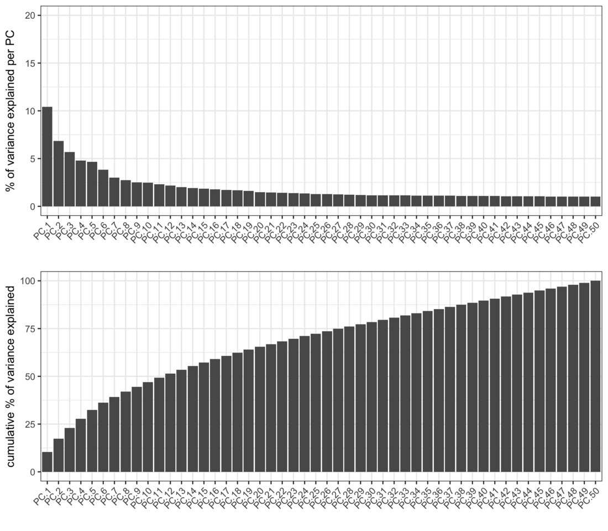
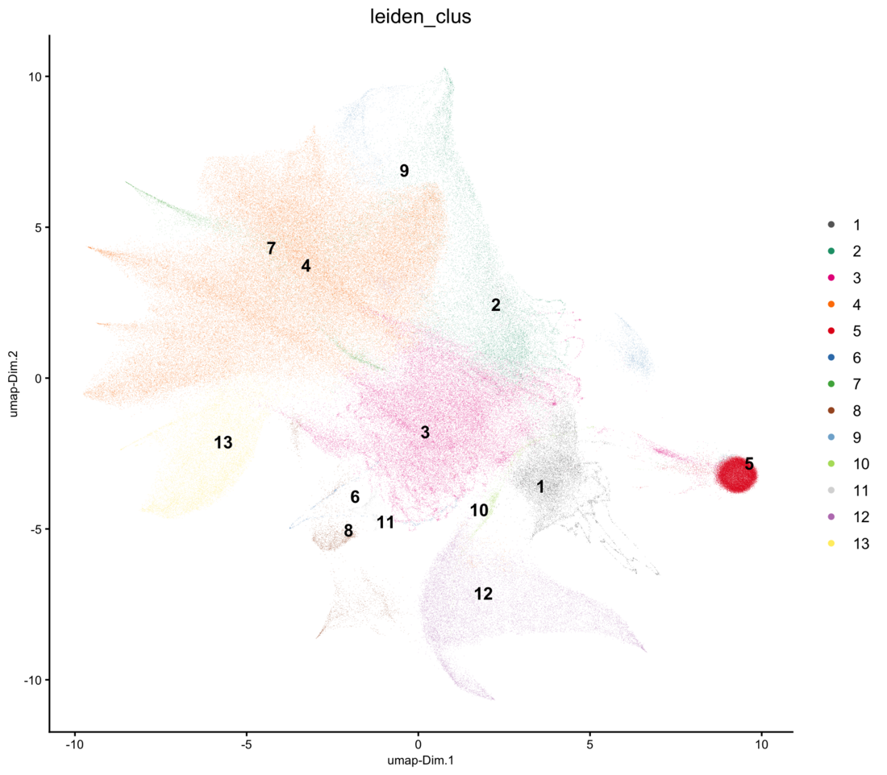
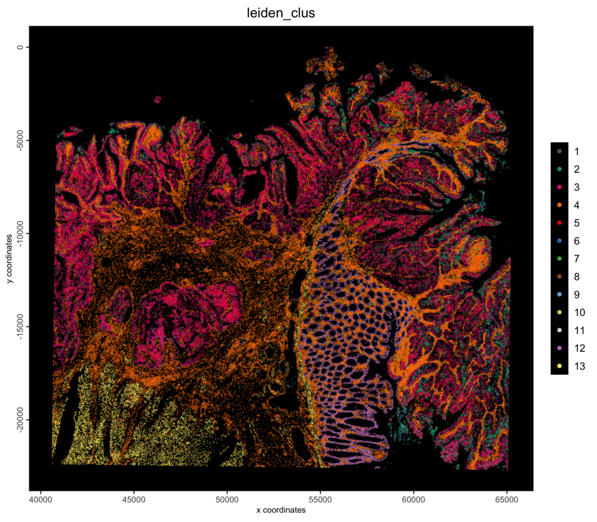
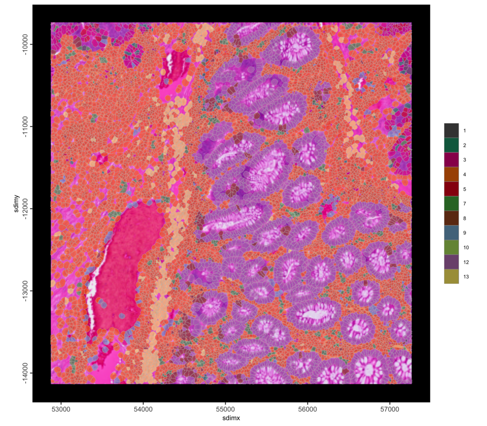
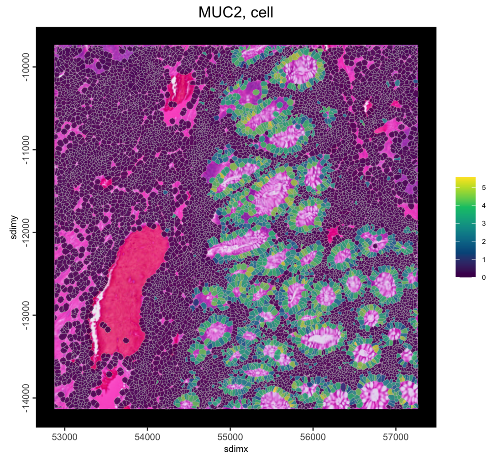
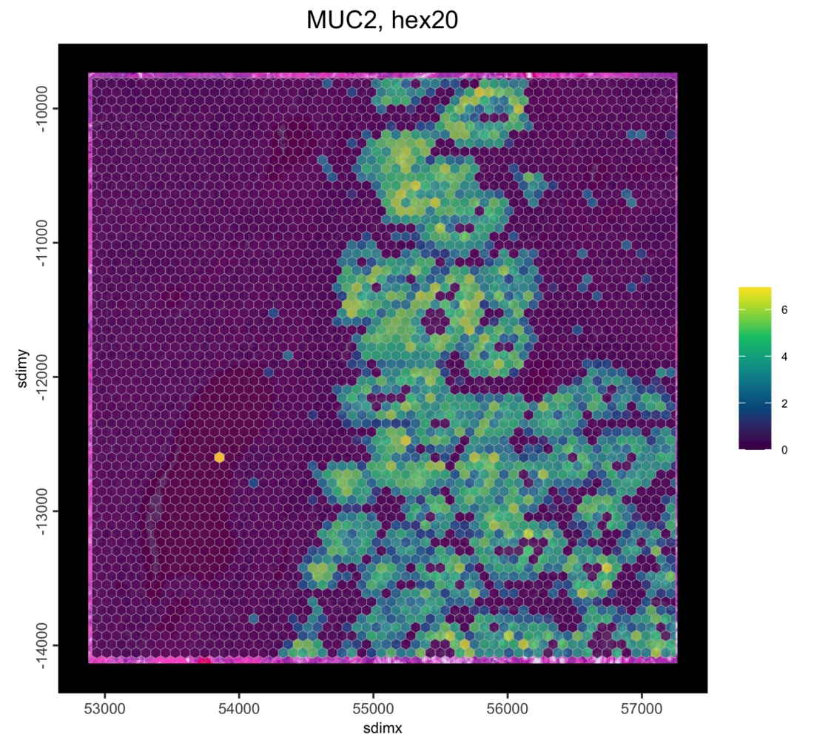
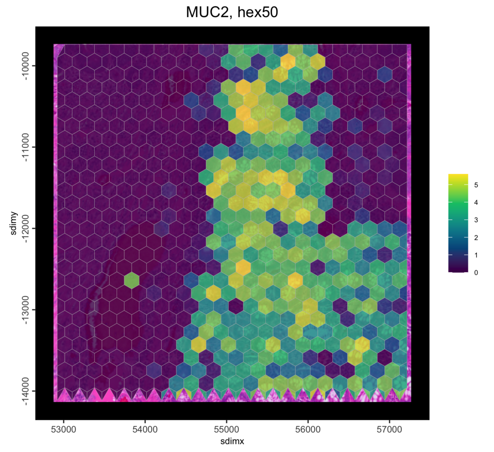

# Visium HD Human Colorectal Cancer: 2 µm Bins into Your Own Polygons

## 1 Overview

This tutorial starts from the finest Visium HD grid, the 2 µm bins, and
sums them into polygons of your own: a segmentation you made, regions
you drew, or any other set of shapes. It then filters, normalizes,
clusters and plots the result in an on-disk GiottoDisk project.

Here Space Ranger’s own cell segmentation stands in for “your polygons”,
so the result can be checked against Space Ranger’s cell matrix. Two
related tutorials start from the [segmented
cells](https://giottosuite.com/dev/articles/visiumhd_crc_cells_giottodisk.md)
and from the [8 µm
bins](https://giottosuite.com/dev/articles/visiumhd_crc_bins_giottodisk.md).

## 2 Install extra packages

This tutorial uses GiottoDisk for on-disk processing. These are preview
dev builds off the dev and gsource Giotto package branches. If
GiottoDisk has not been installed yet, use the following:

``` r

# GiottoDisk install; also installs arrow (with zstd support) and tilework
remotes::install_github("giotto-suite/GiottoUtils", ref = "dev")
GiottoUtils::suite_install("GiottoDisk", install_arrow = TRUE)
# Optional for matrix maths speedup:
install.packages("GiottoKernels",
    repos = c("https://giotto-suite.r-universe.dev", "https://cloud.r-project.org")
)
```

## 3 Dataset explanation

10x Genomics’ [Visium HD Spatial Gene Expression Library, Human
Colorectal Cancer
(FFPE)](https://www.10xgenomics.com/datasets/visium-hd-cytassist-gene-expression-libraries-of-human-crc-v4),
processed with Space Ranger 4.0.1. The binned outputs hold the 2 µm
bins; the segmented outputs hold Space Ranger’s cell outlines, used here
as the polygons.

### 3.1 Download links

`curl` links from 10x Genomics

    base=https://cf.10xgenomics.com/samples/spatial-exp/4.0.1/Visium_HD_Human_Colon_Cancer/Visium_HD_Human_Colon_Cancer
    mkdir outs && cd outs
    curl -O ${base}_binned_outputs.tar.gz      # 15.9 GB
    curl -O ${base}_segmented_outputs.tar.gz   #  9.5 GB, for the cell outlines
    tar -xzf Visium_HD_Human_Colon_Cancer_binned_outputs.tar.gz
    tar -xzf Visium_HD_Human_Colon_Cancer_segmented_outputs.tar.gz

  

With your own polygons, only the binned outputs are needed.

## 4 Setup

``` r

library(arrow) # this must be libraried before terra or GiottoClass
library(Giotto)
library(GiottoDisk)

data_dir    <- "path/to/outs"
project_dir <- "path/to/visiumhd_crc_polygons_project"
polygons    <- file.path(data_dir, "segmented_outputs", "cell_segmentations.geojson")

# parallel workers for writing the 2 um bins; each holds about as much
# memory as this R session, so use fewer on a laptop
future::plan(future::multisession, workers = 2)
# GiottoDisk sizes its working memory to a fraction of the free RAM (0.25 by
# default). Lower it on a busy machine; raise it on a dedicated one.
options(giottodisk.chunk_ram_frac = 0.25)
```

## 5 Read the 2 µm bins

`sourceCreate()` sets up a `gDirSource`: a managed project directory
that holds the object on disk. `setArtifactDumpDir()` points the
expression and spatial writes at it.

``` r

# declare a Giotto directory backend to use
gdsrc <- GiottoDisk::sourceCreate(project_dir, type = "gDirSource")
# point data content writes to the backend's artifact subdirectory
GiottoDisk::setArtifactDumpDir(gdsrc)
```

[`createGiottoVisiumHDObjectBin()`](https://giottosuite.com/dev/reference/createGiottoVisiumHDObjectBin.md)
with `load_transcripts = TRUE` reads the 2 µm bins as points: one point
per bin with counts, kept on disk together with the bins’ gene counts.
No 2 µm spatial unit is created, because the points are summed into the
polygons below.

``` r

g <- createGiottoVisiumHDObjectBin(file.path(data_dir, "binned_outputs"),
    bin = 2,
    load_transcripts = TRUE, # the 2 um bins as points
    load_expression  = FALSE,
    load_spatlocs    = FALSE,
    load_metadata    = FALSE,
    backend = gdsrc          # creates the object as a backed project
)
g
```

    An object of class giotto 
    >Active feat_type:  rna
    dimensions    : 18982, NA (features, cells)
    [SUBCELLULAR INFO]
    features      : rna 
    [AGGREGATE INFO]
    attached images ------------------
    images      : image 


    Use objHistory() to see steps and params used

The bins are written, so the workers can go: the steps below run in this
session, and stopping the workers frees their memory.

``` r

future::plan(future::sequential)
```

## 6 Add your polygons

Any file
[`terra::vect()`](https://rspatial.github.io/terra/reference/vect.html)
reads works here (GeoJSON, shapefile, GeoPackage). Two things to check
for your own polygons:

- the ID column must be character; Space Ranger’s `cell_id` is an
  integer, so it is renamed like Space Ranger’s cell barcodes;
- the polygons must use the same coordinates as the bins. Space Ranger
  writes full-resolution pixels with y counting down, and Giotto’s
  Visium HD readers flip y to negative, so the polygons are flipped the
  same way.

``` r

sv <- terra::vect(polygons)
sv$cell_id <- sprintf("cellid_%09d-1", as.integer(sv$cell_id))

cells <- createGiottoPolygon(sv, name = "cell", verbose = FALSE)
cells <- flip(cells, y0 = 0)

# the polygon centroids become the spatial locations of the new unit
g <- setGiotto(g, cells, centroids_to_spatlocs = TRUE, verbose = FALSE)
cat(format(length(spatIDs(cells)), big.mark = ","), "polygons\n")
```

    220,704 polygons

The polygons over the H&E image, zoomed in:

``` r

sl <- getSpatialLocations(g, spat_unit = "cell", output = "data.table")
roi_x <- stats::median(sl$sdimx)
roi_y <- stats::median(sl$sdimy)
half <- 2200 # pixels; about 0.6 mm at 0.27 um per pixel

spatInSituPlotPoints(g,
    show_image = TRUE,
    feats = NULL,
    show_polygon = TRUE,
    polygon_feat_type = "cell",
    polygon_color = "yellow",
    polygon_alpha = 0,
    polygon_line_size = 0.2,
    xlim = c(roi_x - half, roi_x + half),
    ylim = c(roi_y - half, roi_y + half)
)
```



The 2 µm bins of two marker genes in part of the same region: CEACAM5
marks tumor epithelium, MUC2 goblet cells.

``` r

spatInSituPlotPoints(g,
    feats = list(rna = c("CEACAM5", "MUC2")),
    feats_color_code = c(CEACAM5 = "orange", MUC2 = "cyan"),
    use_overlap = FALSE,
    point_size = 0.3,
    show_polygon = TRUE,
    polygon_feat_type = "cell",
    polygon_color = "grey60",
    polygon_alpha = 0,
    polygon_line_size = 0.1,
    xlim = c(roi_x - half / 3, roi_x + half / 3),
    ylim = c(roi_y - half / 3, roi_y + half / 3)
)
```



## 7 Aggregate

[`calculateOverlap()`](https://giotto-suite.github.io/GiottoClass/reference/calculateOverlap.html)
finds the polygon each 2 µm bin falls in, and
[`overlapToMatrix()`](https://giotto-suite.github.io/GiottoClass/reference/overlapToMatrix.html)
sums the bins’ counts per polygon into a new expression matrix for the
`cell` unit.

``` r

g <- calculateOverlap(g, spat_info = "cell", feat_info = "rna")
g <- overlapToMatrix(g, poly_info = "cell", feat_info = "rna", name = "raw")
g
```

    An object of class giotto 
    >Active spat_unit:  cell 
    >Active feat_type:  rna 
    dimensions    : 18982, 220704 (features, cells)
    [SUBCELLULAR INFO]
    polygons      : cell 
    features      : rna 
    [AGGREGATE INFO]
    expression -----------------------
      [cell][rna] raw
    spatial locations ----------------
      [cell] raw
    attached images ------------------
    images      : image 


    Use objHistory() to see steps and params used

``` r

# The return value is needed since saveGiotto makes changes during the write
g <- saveGiotto(g, name = "aggregated")
```

      backend : `gDirSource`
      path    : path/to/visiumhd_crc_polygons_project

## 8 Quality control and filtering

``` r

g <- addStatistics(g, spat_unit = "cell", expression_values = "raw")
cx <- pDataDT(g, spat_unit = "cell")
cat(sprintf("%s cells | median %d counts, %d features per cell\n",
    format(nrow(cx), big.mark = ","),
    median(cx$total_expr), median(cx$nr_feats))
)
```

    220,704 cells | median 779 counts, 590 features per cell

Because the polygons here are Space Ranger’s, the per-cell totals can be
checked against Space Ranger’s own cell matrix. They agree except for
bins on a cell boundary: here a bin goes to the polygon its center falls
in, while Space Ranger assigns bins with its own rule.

``` r

m_sr <- get10Xmatrix_h5(file.path(data_dir, "segmented_outputs",
                                  "raw_feature_cell_matrix.h5"))[[1]]
sr_total <- Matrix::colSums(m_sr)[cx$cell_ID]
cat(sprintf("%s of %s cells differ from Space Ranger's total; all counts: %s here, %s in Space Ranger\n",
    format(sum(cx$total_expr != sr_total), big.mark = ","),
    format(nrow(cx), big.mark = ","),
    format(sum(cx$total_expr), big.mark = ","),
    format(sum(sr_total), big.mark = ",")))
```

    2 of 220,704 cells differ from Space Ranger's total; all counts: 244,415,501 here, 244,415,408 in Space Ranger

``` r

g <- filterGiotto(g,
    spat_unit = "cell",
    expression_threshold   = 1,
    feat_det_in_min_cells  = 10,
    min_det_feats_per_cell = 50,
    verbose = FALSE
)
cat(sprintf("%s cells x %s features retained\n",
    format(length(spatIDs(g, spat_unit = "cell")), big.mark = ","),
    format(nrow(fDataDT(g, spat_unit = "cell")), big.mark = ","))
)
```

    218,779 cells x 18,847 features retained

## 9 Normalize, reduce and cluster

``` r

g <- normalizeGiotto(g,
    spat_unit = "cell",
    scalefactor = 1e4,
    logbase = exp(1),
    log_offset = 1,
    scale_feats = FALSE,
    scale_cells = FALSE,
    verbose = FALSE
)
g <- calculateHVF(g,
    spat_unit = "cell",
    method = "cov_loess",
    n_top_feats = 2000,
    verbose = FALSE
)
g <- runPCA(g,
    spat_unit = "cell",
    feats_to_use = "hvf",
    ncp = 50,
    scale_unit = TRUE,
    center = TRUE,
    verbose = FALSE
)
screePlot(g, spat_unit = "cell", ncp = 50)
```



The kNN network is built first.
[`runUMAP()`](https://giottosuite.com/dev/reference/runUMAP.md) then
reuses it instead of searching for neighbors again, and Leiden clusters
on the same network.

``` r

dims_to_use <- 1:15

g <- createNearestNetwork(g,
    spat_unit = "cell",
    type = "kNN",
    dimensions_to_use = dims_to_use,
    k = 30,
    engine = "hnsw",
    verbose = FALSE
)
g <- runUMAP(g,
    spat_unit = "cell",
    dimensions_to_use = dims_to_use,
    n_neighbors = 30,
    min_dist = 0.3,
    verbose = FALSE
)
g <- doLeidenCluster(g,
    spat_unit = "cell",
    nn_network_to_use = "kNN",
    network_name = "kNN.pca",
    resolution = 0.3,
    n_iterations = 20,
    objective_function = "modularity",
    verbose = FALSE
)
clusters <- sort(unique(pDataDT(g, spat_unit = "cell")$leiden_clus))
cat(length(clusters), "clusters\n")
# one color per cluster, shared by the plots below
clus_colors <- stats::setNames(getDistinctColors(length(clusters)), clusters)

g <- saveGiotto(g, name = "clustered")
```

    13 clusters
      backend : `gDirSource`
      path    : path/to/visiumhd_crc_polygons_project

``` r

plotUMAP(g,
    spat_unit = "cell",
    cell_color = "leiden_clus",
    color_as_factor = TRUE,
    cell_color_code = clus_colors,
    point_border_stroke = 0,
    point_size = 0.1
)
```



``` r

spatPlot2D(g,
    spat_unit = "cell",
    cell_color = "leiden_clus",
    color_as_factor = TRUE,
    cell_color_code = clus_colors,
    point_border_stroke = 0,
    point_size = 0.3,
    background_color = "black"
)
```



``` r

spatInSituPlotPoints(g,
    show_image = TRUE,
    feats = NULL,
    show_polygon = TRUE,
    polygon_feat_type = "cell",
    polygon_fill = "leiden_clus",
    polygon_fill_as_factor = TRUE,
    polygon_fill_code = clus_colors,
    polygon_line_size = 0.1,
    polygon_alpha = 0.6,
    xlim = c(roi_x - half, roi_x + half),
    ylim = c(roi_y - half, roi_y + half)
)
```



The object is saved to the project directory and can be reloaded with
`loadGiotto(project_dir, name = "clustered")`.

## 10 Re-aggregate into a grid

Any set of polygons can be aggregated from the same 2 µm bins, not only
cells.
[`tessellate()`](https://giotto-suite.github.io/GiottoClass/reference/tessellate.html)
makes a grid of hexagons (or squares or triangles) over the bins. Each
grid becomes a new spatial unit next to `cell`, so the bins can be
re-aggregated at any size without reading the data again.

Space Ranger records the pixel size, so the grid can be set in µm.
`shape_size` is the width of one hexagon, in the same pixel units as the
bins:

``` r

scalefactors <- jsonlite::fromJSON(file.path(
    data_dir, "binned_outputs", "square_002um", "spatial", "scalefactors_json.json"
))
um_to_px <- 1 / scalefactors$microns_per_pixel
```

``` r

bins_ext <- ext(getFeatureInfo(g, feat_type = "rna", return_giottoPoints = TRUE))

for (size_um in c(20, 50)) {
    unit <- paste0("hex", size_um)
    hex <- tessellate(
        extent = bins_ext,
        shape = "hexagon",
        shape_size = size_um * um_to_px,
        name = unit
    )
    g <- setGiotto(g, hex, centroids_to_spatlocs = TRUE, verbose = FALSE)
    g <- calculateOverlap(g, spat_info = unit, feat_info = "rna")
    g <- overlapToMatrix(g, spat_info = unit, feat_info = "rna", name = "raw")
    g <- normalizeGiotto(g,
        spat_unit = unit,
        scale_feats = FALSE,
        scale_cells = FALSE,
        verbose = FALSE
    )
    cat(unit, ":", format(length(spatIDs(g, spat_unit = unit)), big.mark = ","),
        "hexagons\n")
}
```

    hex20 : 132,353 hexagons
    hex50 : 21,060 hexagons

The extent comes from the bins rather than from `g`, because the extent
of `g` also covers the whole H&E image.

MUC2 in the cells and in both grids, in the zoom region from above:

``` r

for (unit in c("cell", "hex20", "hex50")) {
    print(spatInSituPlotPoints(g,
        show_image = TRUE,
        feats = NULL,
        show_polygon = TRUE,
        polygon_feat_type = unit,
        polygon_fill = "MUC2",
        expression_values = "normalized",
        polygon_fill_as_factor = FALSE,
        polygon_fill_gradient_style = "sequential",
        polygon_line_size = 0.1,
        polygon_alpha = 0.8,
        xlim = c(roi_x - half, roi_x + half),
        ylim = c(roi_y - half, roi_y + half),
        show_plot = FALSE,
        return_plot = TRUE
    ) + ggplot2::ggtitle(paste("MUC2,", unit)))
}
```



``` r

g <- saveGiotto(g, name = "grid")
```

      backend : `gDirSource`
      path    : path/to/visiumhd_crc_polygons_project

## 11 Further reading

- [Visium HD colorectal cancer: segmented
  cells](https://giottosuite.com/dev/articles/visiumhd_crc_cells_giottodisk.md),
  with cell typing from a cluster tree
- [Visium HD colorectal cancer: 8 µm
  bins](https://giottosuite.com/dev/articles/visiumhd_crc_bins_giottodisk.md)
- The in-memory [Visium HD colorectal cancer
  tutorial](https://giottosuite.com/dev/articles/VisiumHD_Human_Colorectal_Cancer.md),
  which also finds spatially variable genes and co-expression modules on
  a hexagon grid

## 12 Session info

``` r

sessionInfo()
```

    R version 4.5.3 (2026-03-11)
    Platform: aarch64-apple-darwin20
    Running under: macOS Tahoe 26.6.2

    Matrix products: default
    BLAS:   /Library/Frameworks/R.framework/Versions/4.5-arm64/Resources/lib/libRblas.0.dylib 
    LAPACK: /Library/Frameworks/R.framework/Versions/4.5-arm64/Resources/lib/libRlapack.dylib;  LAPACK version 3.12.1

    locale:
    [1] C.UTF-8/C.UTF-8/C.UTF-8/C/C.UTF-8/C.UTF-8

    time zone: America/New_York
    tzcode source: internal

    attached base packages:
    [1] stats     graphics  grDevices utils     datasets  methods   base     

    other attached packages:
    [1] GiottoDisk_0.0.0.5 Giotto_4.3.3       GiottoClass_0.7.15 arrow_23.0.1.2    

    loaded via a namespace (and not attached):
      [1] DBI_1.3.0                   colorRamp2_0.1.0           
      [3] gridExtra_2.3               rlang_1.3.0                
      [5] magrittr_2.0.4              otel_0.2.0                 
      [7] GiottoUtils_0.2.7           matrixStats_1.5.0          
      [9] compiler_4.5.3              vctrs_0.7.2                
     [11] hdf5r_1.3.12                wk_0.9.5                   
     [13] pkgconfig_2.0.3             SpatialExperiment_1.20.0   
     [15] fastmap_1.2.0               dbplyr_2.5.2               
     [17] backports_1.5.0             magick_2.9.1               
     [19] XVector_0.50.0              labeling_0.4.3             
     [21] ggraph_2.2.2                rmarkdown_2.31             
     [23] purrr_1.2.1                 bit_4.6.0                  
     [25] bluster_1.20.0              xfun_0.57                  
     [27] cachem_1.1.0                beachmat_2.26.0            
     [29] jsonlite_2.0.0              blob_1.3.0                 
     [31] DelayedArray_0.36.0         BiocParallel_1.44.0        
     [33] tweenr_2.0.3                terra_1.9-11               
     [35] cluster_2.1.8.2             irlba_2.3.7                
     [37] parallel_4.5.3              R6_2.6.1                   
     [39] bslib_0.10.0                RColorBrewer_1.1-3         
     [41] parallelly_1.47.0           GenomicRanges_1.62.1       
     [43] jquerylib_0.1.4             scattermore_1.2            
     [45] Rcpp_1.1.1                  Seqinfo_1.0.0              
     [47] assertthat_0.2.1            SummarizedExperiment_1.40.0
     [49] knitr_1.51                  future.apply_1.20.2        
     [51] R.utils_2.13.0              IRanges_2.44.0             
     [53] Matrix_1.7-5                igraph_2.2.2               
     [55] tidyselect_1.2.1            dichromat_2.0-0.1          
     [57] abind_1.4-8                 yaml_2.3.12                
     [59] viridis_0.6.5               codetools_0.2-20           
     [61] listenv_0.10.1              lattice_0.22-9             
     [63] tibble_3.3.1                Biobase_2.70.0             
     [65] withr_3.0.2                 S7_0.2.1                   
     [67] evaluate_1.0.5              future_1.70.0              
     [69] polyclip_1.10-7             filelock_1.0.3             
     [71] pillar_1.11.1               MatrixGenerics_1.22.0      
     [73] checkmate_2.3.4             stats4_4.5.3               
     [75] plotly_4.12.0               generics_0.1.4             
     [77] RcppHNSW_0.6.0              S4Vectors_0.48.0           
     [79] ggplot2_4.0.2               scales_1.4.0               
     [81] globals_0.19.1              gtools_3.9.5               
     [83] glue_1.8.0                  lazyeval_0.2.2             
     [85] tools_4.5.3                 tilework_1.0.0             
     [87] GiottoVisuals_0.2.16        BiocNeighbors_2.4.0        
     [89] data.table_1.18.2.1         ScaledMatrix_1.18.0        
     [91] graphlayouts_1.2.3          tidygraph_1.3.1            
     [93] cowplot_1.2.0               grid_4.5.3                 
     [95] tidyr_1.3.2                 colorspace_2.1-2           
     [97] SingleCellExperiment_1.32.0 duckdb_1.5.1               
     [99] BiocSingular_1.26.1         ggforce_0.5.0              
    [101] rsvd_1.0.5                  cli_3.6.5                  
    [103] S4Arrays_1.10.1             viridisLite_0.4.3          
    [105] dplyr_1.2.0                 uwot_0.2.4                 
    [107] gtable_0.3.6                R.methodsS3_1.8.2          
    [109] sass_0.4.10                 digest_0.6.39              
    [111] progressr_0.18.0            BiocGenerics_0.56.0        
    [113] SparseArray_1.10.9          ggrepel_0.9.8              
    [115] rjson_0.2.23                htmlwidgets_1.6.4          
    [117] farver_2.1.2                R.oo_1.27.1                
    [119] memoise_2.0.1               htmltools_0.5.9            
    [121] lifecycle_1.0.5             httr_1.4.8                 
    [123] bit64_4.6.0-1               MASS_7.3-65

NA \`\`\`
