```{r, include=FALSE}
knitr::opts_chunk$set(eval = FALSE)
```

# Overview

This tutorial reads the 10x Atera whole-transcriptome preview dataset of human
invasive breast carcinoma into an on-disk GiottoDisk project. It then filters,
clusters and names the cells, and looks at the tissue's spatial organization:
spatially variable genes, co-expression modules, signature enrichment and the
cell types that sit next to each other.

The ingestion loads the individual transcripts and aggregates them into cells.
Both steps can be skipped in favor of the qv >= 20 expression matrix that 10x
provides.

*Note that currently transcript loading is needed for GiottoLens compatibility,
but this is expected to change in the future.*

# Install extra packages

## _arrow_ installation

Atera datasets require arrow with ZSTD support to work with parquet files.

```{r install-arrow}
has_arrow <- requireNamespace("arrow", quietly = TRUE)
zstd <- TRUE
if (has_arrow) {
    # check arrow_info() to see that zstd support should be TRUE
    # See https://arrow.apache.org/docs/r/articles/install.html for details
    zstd <- arrow::arrow_info()$capabilities[["zstd"]]
}
if (!has_arrow || !zstd) {
    # install with compression library needed for 10x parquet files
    # this may take a while
    Sys.setenv(ARROW_WITH_ZSTD = "ON")
    install.packages("arrow", repos = c("https://apache.r-universe.dev"), type = "source")
}
```

## _SedonaDB_ and _DuckDB_ installation

GiottoDisk runs spatial joins, such as the aggregation of transcripts into
cells below, in SedonaDB when it is installed, and in DuckDB otherwise. Both
are optional; without them it falls back to tiled terra operations, which are
much slower at this scale.

```{r install-spatial-engines}
install.packages("sedonadb",
    repos = c("https://apache.r-universe.dev", "https://cloud.r-project.org")
)
install.packages("duckdb")
```

Loading SedonaDB can print messages about PROJ or GDAL data directories it did
not find. They do not affect the steps in this tutorial.

## _smotif_ installation

The cell-cell interaction section at the end uses smotif and its Rust backend
smotifrs to count cell type motifs:

```{r install-smotif}
install.packages(c("smotif", "smotifrs"),
    repos = c("https://drieslab.r-universe.dev", "https://cloud.r-project.org")
)
```

## Giotto extensions

This tutorial uses GiottoDisk for on-disk processing. These are preview dev
builds off the dev and gsource Giotto package branches. If GiottoDisk has not
been installed yet, use the following:

```{r install-giottodisk}
# GiottoDisk install
GiottoUtils::suite_install("GiottoDisk")
# Optional for matrix maths speedup:
install.packages("GiottoKernels",
    repos = c("https://giotto-suite.r-universe.dev", "https://cloud.r-project.org")
)
```

# Dataset explanation

This tutorial uses 10x Genomics'
[FFPE Human Breast Cancer preview dataset](https://www.10xgenomics.com/datasets/atera-wta-ffpe-human-breast-cancer)
from their _Atera In Situ_ platform. The data were generated with a
pre-commercial version of the Atera Whole Transcriptome Assay (WTA) on an FFPE
section of human breast cancer. The panel targets 18,028 genes, and 170,057
cells are segmented.

## Why the Xenium reader

10x converted this preview dataset to the Xenium Onboard Analysis output
format. The folder has an `experiment.xenium` manifest, a `morphology_focus/`
image folder, and `transcripts.parquet`, `cell_boundaries.parquet` and
`cell_feature_matrix.h5` files, all laid out like a Xenium run. It is read
here with `createGiottoXeniumObject()`.

`createGiottoAteraObject()` is meant for the output of the commercial Atera
instrument (Atera v1), which ships its data as zarr archives instead. See the
Atera kidney tutorial for that layout.

## Download links

The files are available from the
[10x Genomics dataset page](https://www.10xgenomics.com/datasets/atera-wta-ffpe-human-breast-cancer).

<details><summary>`curl` link from 10x genomics</summary>
```
# Output Files
curl -O https://s3-us-west-2.amazonaws.com/10x.files/samples/atera/dev/WTA_Preview_FFPE_Breast_Cancer/WTA_Preview_FFPE_Breast_Cancer_outs.zip
```

</details>

<br>

The zipped outputs are large (about 55 GB, most of it `transcripts.parquet`,
`transcripts.zarr.zip` and `morphology.ome.tif`). The GiottoDisk project built
below takes another 26 GB.

# Setup

This workflow uses the on-disk backend from GiottoDisk.

```{r libs}
library(arrow) # this must be libraried before terra or GiottoClass
library(Giotto)
library(GiottoDisk)

data_dir    <- "path/to/WTA_Preview_FFPE_Breast_Cancer_outs"
project_dir <- "path/to/atera_project"

# set an appropriate amount of parallel workers for your computer
future::plan(future.mirai::mirai_multisession, workers = 8)
```

The timings quoted below come from a run with 8 workers on an Apple silicon
Mac. Reading the transcripts was the most memory-intensive step of ingestion,
at about 24 GB.

# Read the data

Atera data is too large to process in memory. We will be using a GiottoDisk
disk-backed project to handle it.

First we set up a `gDirSource` object using `sourceCreate()` as a handle for a
Giotto file directory disk backend. A backend defines the storage architecture
and the preferred write formats for each data type. Currently, the only option
available is a managed project directory via `gDirSource`, but other solutions
are planned.

Next, using `setArtifactDumpDir()`, we point GiottoDisk writes of content such
as expression matrices and spatial information directly at the backend.
*This is mostly precautionary to avoid more work later that would have to pull
scattered files into the backend when the object is saved.*

```{r backend}
# declare a Giotto directory backend to use
gdsrc <- GiottoDisk::sourceCreate(project_dir, type = "gDirSource")
# point data content writes to the backend's artifact subdirectory
GiottoDisk::setArtifactDumpDir(gdsrc)
```

`createGiottoXeniumObject()` creates a Giotto object from the output
directory. Passing the `gDirSource` object to the `backend` param sets the
object up as a disk-backed project.

Besides genes, the transcripts include several kinds of control probes. The
reader separates them into their own feature types by matching keywords in
their names (`split_keyword`). In this dataset the genomic control probes are
named `Intergenic_Region_*` rather than `GenomicControl*`, so that name is
added to the last keyword set. Without it, 62 control probes would end up
among the genes.

```{r read}
# convenience function load defaults:
# * transcripts (qv >= 20)
# * cell and nucleus polygons
# * 10x expression matrix
# * morphology_focus images
#
# not loaded by default:
# * cell metadata (load_cellmeta = TRUE)
# * aligned images (load_aligned_images, needs an alignment matrix)
g <- createGiottoXeniumObject(data_dir,
    backend = gdsrc, # creates the object as a backed project
    split_keyword = list(
        "NegControlProbe",
        "UnassignedCodeword",
        "NegControlCodeword",
        c("GenomicControl", "Intergenic_Region")
    )
    # load_transcripts = FALSE # skip the transcripts, see Aggregate below
)
# items to load can be controlled via `load_*` params
g
```

```
An object of class giotto
>Active spat_unit:  cell
>Active feat_type:  rna
dimensions    : 18028, 170057 (features, cells)
[SUBCELLULAR INFO]
polygons      : cell nucleus
features      : rna NegControlProbe UnassignedCodeword NegControlCodeword GenomicControl
[AGGREGATE INFO]
expression -----------------------
  [cell][rna] raw
  [cell][NegControlProbe] raw
  [cell][GenomicControl] raw
  [cell][NegControlCodeword] raw
  [cell][UnassignedCodeword] raw
spatial locations ----------------
  [cell] raw
  [nucleus] raw
attached images ------------------
images      : 4 items...


Use objHistory() to see steps and params used
```

Reading the 624 million transcripts takes most of the 10 minutes this step
needs. The preview dataset has no `gene_panel.json`, so the reader warns
`panel not detected in Xenium directory`; this only means no gene metadata
such as Ensembl IDs is attached.

```{r poly}
# preview the cell polygons
getPolygonInfo(g, "cell") |>
    plot()
```

```{r poly-fig, eval = TRUE, echo = FALSE, out.width = "100%"}
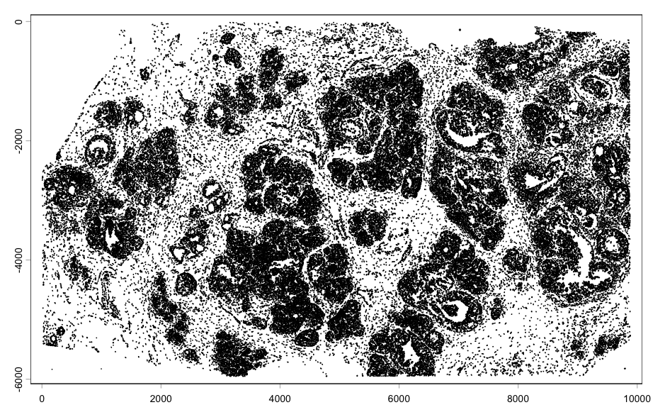
```

```{r tx}
# transcript density
getFeatureInfo(g, "rna") |>
    plot()
```

```{r tx-fig, eval = TRUE, echo = FALSE, out.width = "100%"}
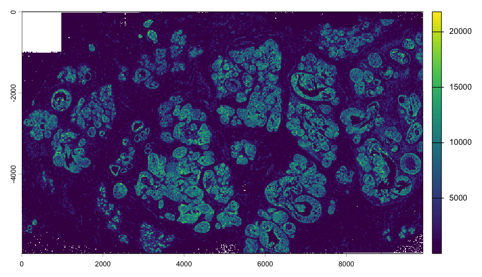
```

## Save

Backed Giotto projects write snapshots of analysis state to the project
directory. Save and load operations are faster than in-memory ones and can be
treated as checkpoints.

```{r save-ingest}
# name param (optional) assigns the snapshot a name
# The return value is needed since saveGiotto makes changes during the write
# Either use the returned value or immediately load with `loadGiotto()`
g <- saveGiotto(g, name = "ingest")
```

## Aggregate

Aggregate the spatial transcripts with the default polygon layer (the cell
outlines). This replaces the 10x expression matrix with one Giotto computes
from the transcripts, and takes under a minute.

<p style="color:#c0392b; font-weight:bold;">This step can be skipped: the 10x
expression matrix read above is used otherwise.</p>

Reading the transcripts makes creating the object take a while, but it is a
one-time step: the project directory keeps them, and `loadGiotto()` reopens
the saved object in seconds. `load_transcripts = FALSE` skips them, which also
means individual transcripts cannot be plotted or re-aggregated later.

```{r aggregate}
g <- aggregateFeatures(g)
g <- saveGiotto(g, name = "aggregated")
```

# Quality control and filtering

```{r stats}
g <- addStatistics(g, expression_values = "raw")
cx <- pDataDT(g)
cat(sprintf("%s cells | median %d counts, %d features per cell\n",
    format(nrow(cx), big.mark = ","),
    as.integer(median(cx$total_expr)), as.integer(median(cx$nr_feats)))
)
```

```
170,057 cells | median 2045 counts, 1501 features per cell
```

With about 2,000 counts per cell, the whole-transcriptome panel is far deeper
than a targeted one. A low threshold of 50 detected genes removes only empty
or fragmented outlines.

```{r filter}
g <- filterGiotto(g,
    expression_threshold   = 1,
    feat_det_in_min_cells  = 1,
    min_det_feats_per_cell = 50,
    verbose = FALSE
)
cat(sprintf("%s cells x %s features retained\n",
    format(nrow(pDataDT(g)), big.mark = ","),
    format(nrow(fDataDT(g, feat_type = "rna")), big.mark = ","))
)
```

```
169,418 cells x 18,028 features retained
```

# Normalize and select features

```{r normalize}
g <- normalizeGiotto(g,
    scalefactor = 1e4,
    logbase = exp(1),
    log_offset = 1,
    scale_feats = FALSE,
    scale_cells = FALSE,
    verbose = FALSE
)

g <- calculateHVF(g,
    method = "cov_loess",
    n_top_feats = 2000,
    verbose = FALSE
)
hvf <- fDataDT(g, feat_type = "rna")[hvf == "yes"]$feat_ID
cat(length(hvf), "highly variable features\n")

g <- saveGiotto(g, name = "normalized")
```

```
2000 highly variable features
```

# Dimension reduction

`scale_unit = TRUE` scales to unit variance on the fly, so no dense z-scored
matrix is ever written.

```{r scree}
g <- runPCA(g,
    feats_to_use = "hvf",
    ncp = 50,
    method = "auto",
    scale_unit = TRUE,
    center = TRUE,
    verbose = FALSE
)

screePlot(g)
```

```{r scree-fig, eval = TRUE, echo = FALSE, out.width = "100%"}
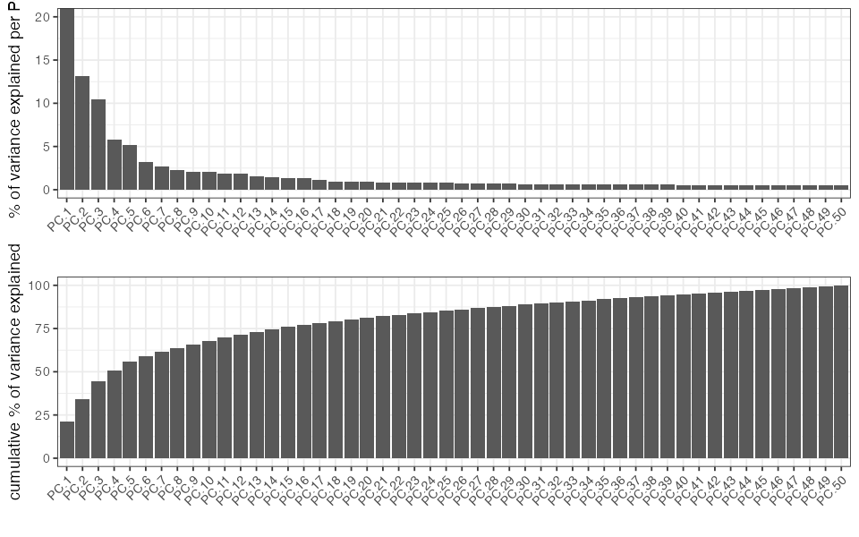
```

The kNN network is built first. `runUMAP()` reuses it instead of searching for
neighbors again, which also makes the UMAP reproducible, and Leiden clusters
on the same network.

```{r umap-run}
dims_to_use <- 1:30 # use the top 30 PCs for UMAP and clustering

g <- createNearestNetwork(g,
    type = "kNN",
    dimensions_to_use = dims_to_use,
    k = 30,
    engine = "hnsw",
    verbose = FALSE
)
g <- runUMAP(g,
    dimensions_to_use = dims_to_use,
    n_neighbors = 30,
    min_dist = 0.3
)
```

```
runUMAP: using the stored kNN 'kNN.pca' (29 neighbours per cell)
```

# Clustering

The [cell typing tutorial](cell_typing_cluster_tree.html) builds a cluster
tree and a per-cluster specificity measure that sort genuine cell types from
fragments, so it is better to split too much than too little. Here we name the
clusters directly from their markers.

```{r cluster}
leiden_res <- 0.8

g <- doLeidenCluster(g,
    nn_network_to_use = "kNN",
    network_name = "kNN.pca",
    resolution = leiden_res,
    n_iterations = 20,
    objective_function = "modularity",
    verbose = FALSE
)

clusters <- GiottoUtils::mixedsort(unique(as.character(pDataDT(g)$leiden_clus)))
cat(length(clusters), "clusters at resolution", leiden_res, "\n")
# one color per cluster, shared by the plots below
clus_colors <- stats::setNames(getDistinctColors(length(clusters)), clusters)
```

```
18 clusters at resolution 0.8
```

```{r save-clustered}
g <- saveGiotto(g, name = "clustered")
```

The object is saved to the project directory and can be reloaded with
`loadGiotto(project_dir, name = "clustered")`.

```{r umap-leiden}
plotUMAP(g,
    cell_color = "leiden_clus",
    color_as_factor = TRUE,
    cell_color_code = clus_colors,
    point_border_stroke = 0,
    point_size = 0.1
)
```

```{r umap-fig, eval = TRUE, echo = FALSE, out.width = "100%"}
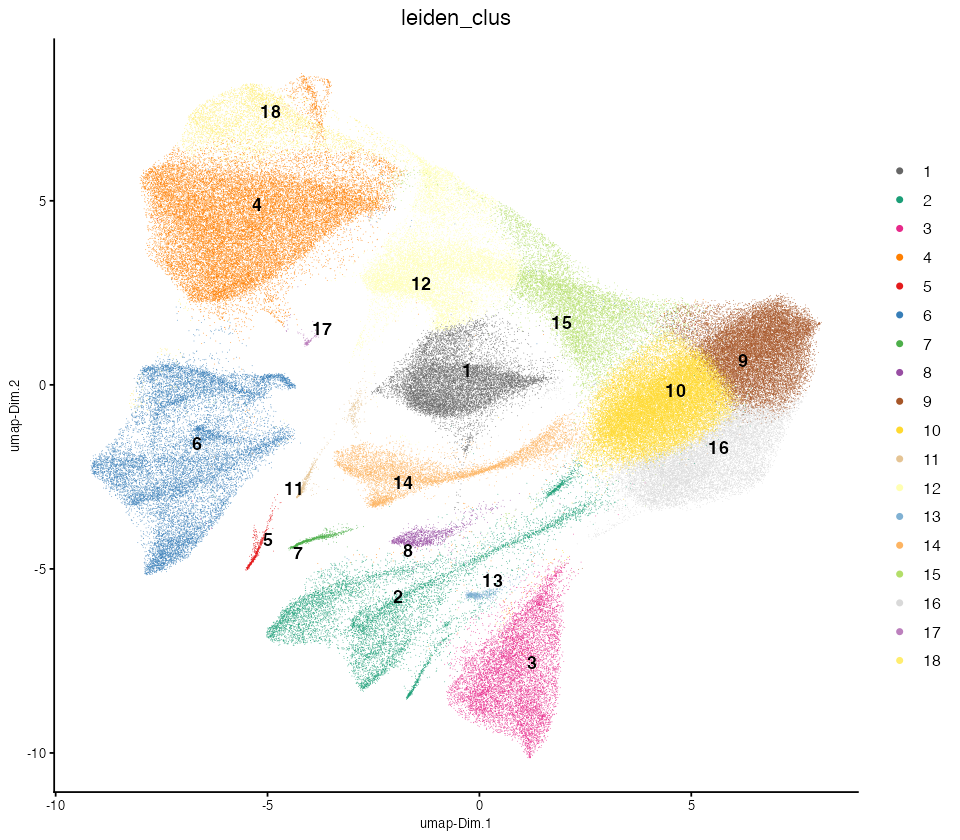
```

```{r centroids-global}
spatPlot2D(g,
    cell_color = "leiden_clus",
    color_as_factor = TRUE,
    cell_color_code = clus_colors,
    point_border_stroke = 0,
    point_size = 0.2,
    background_color = "black"
)
```

```{r centroids-fig, eval = TRUE, echo = FALSE, out.width = "100%"}
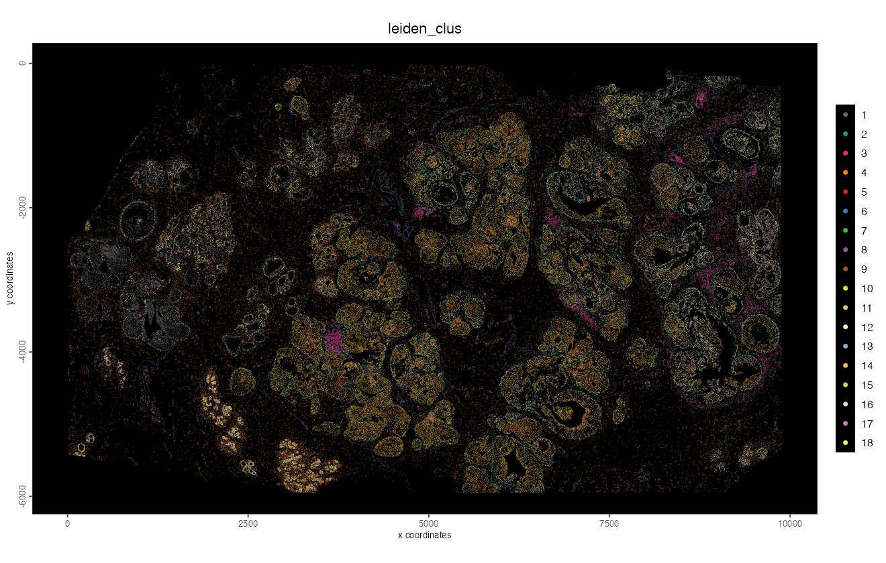
```

Establish an ROI and get a zoomed in plot with the polygons.

```{r sissp-roi}
roi <- c(2500, 3500, -4500, -3500) # xmin/xmax/ymin/ymax
g <- crop(g, roi, view = "roi")

spatInSituPlotPoints(g,
    polygon_fill = "leiden_clus",
    polygon_fill_as_factor = TRUE,
    polygon_fill_code = clus_colors,
    polygon_line_size = 0,
    view = "roi"
)
```

```{r roi-fig, eval = TRUE, echo = FALSE, out.width = "100%"}
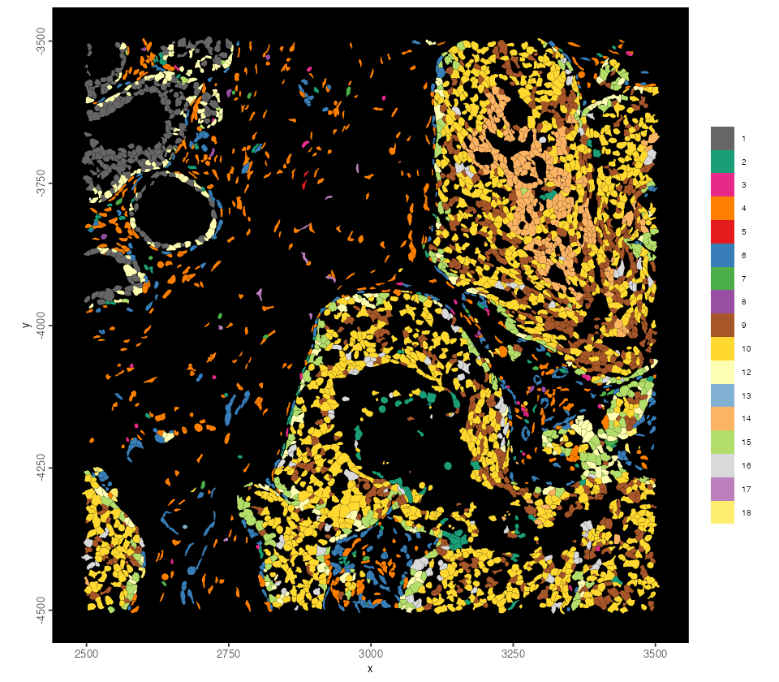
```

```{r sissp-roi-refine}
# refine the ROI region and plot with dapi (default) image
spatInSituPlotPoints(g,
    polygon_fill = "leiden_clus",
    polygon_fill_as_factor = TRUE,
    polygon_fill_code = clus_colors,
    polygon_line_size = 0.2,
    polygon_alpha = 0.3,
    xlim = c(3000, 3400),
    ylim = c(-4250, -4000),
    view = "roi",
    show_image = TRUE
)
```

```{r roi-refine-fig, eval = TRUE, echo = FALSE, out.width = "100%"}
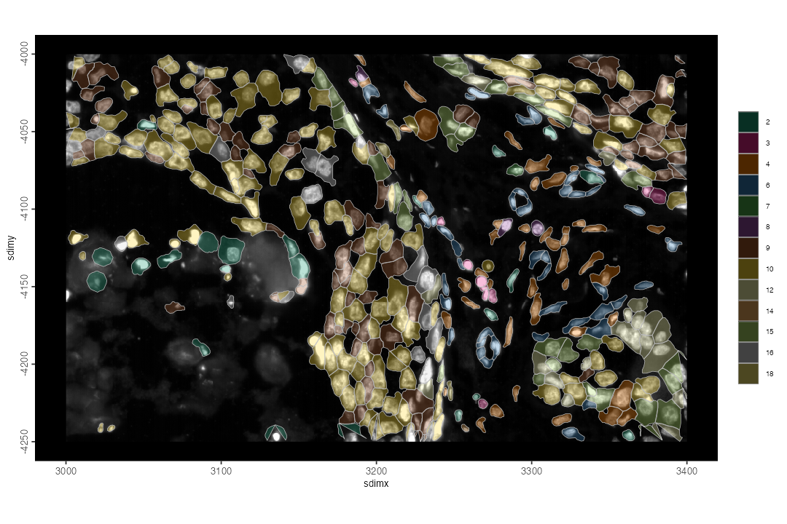
```

# Cell types from cluster markers

`findMarkers_one_vs_all()` ranks the genes that set each Leiden cluster apart
from the others. The top eight per cluster:

```{r markers}
markers <- findMarkers_one_vs_all(g,
    method = "scran",
    cluster_column = "leiden_clus",
    min_feats = 5,
    verbose = FALSE
)
top_markers <- markers[, .(top = paste(head(feats, 8), collapse = ", ")),
    by = "cluster"]
top_markers[order(as.integer(cluster))]
```

```
    cluster                                                         top
     <char>                                                      <char>
 1:       1   NHERF1, NIBAN1, ANKRD30A, BMPR1B, PREX1, STC2, MUC1, MDM2
 2:       2        LAPTM5, ITGB2, FCGR2A, CSF1R, CTSS, C1QA, CYBB, C1QC
 3:       3          TRAC, CD3E, CD52, WIPF1, ITGB2, B2M, LAPTM5, TRBC2
 4:       4        CXCL12, LAMB1, LRP1, ABCA6, COL6A1, GEM, COL6A2, LUM
 5:       5      MMRN1, TGFBR2, FLT4, PROX1, TFPI, LYVE1, PKHD1L1, TBX1
 6:       6     EPAS1, VWF, PECAM1, HSPG2, TGFBR2, SPARCL1, ENG, COL4A1
 7:       7         KIT, CTSG, IL1RL1, CPA3, MS4A2, GATA2, VWA5A, NDST2
 8:       8      MZB1, PIM2, IGKC, JCHAIN, HERPUD1, SEC11C, DERL3, PDK1
 9:       9 CCND1, NHERF1, ELAPOR1, XBP1, TBC1D9, PLAT, PRPF19, STARD10
10:      10     CCND1, ELAPOR1, PLAT, TBC1D9, NHERF1, XBP1, GATA3, MLPH
11:      11        MYBPC1, ANKRD30A, TAT, FASN, XBP1, PIP, LRIG1, TFPI2
12:      12    TNS4, TAGLN, MYLK, LTBP2, FBXO32, SEMA3C, BHLHE41, SFRP1
13:      13       MS4A1, CD52, BANK1, OR4F17, RIPOR2, LTB, CD37, LAPTM5
14:      14      GABRP, CCL28, PROM1, KIT, SFRP1, EHF, GUCY1A1, SLC12A2
15:      15     CCND1, TFF1, TFF3, NHERF1, DSP, ELAPOR1, TBC1D9, RASSF3
16:      16    CCND1, NHERF1, GATA3, RASSF3, VAV3, PRPF19, XBP1, TBC1D9
17:      17         PLIN1, PLIN4, ADIPOQ, ALDH2, LPL, ACSL1, GPAM, CD36
18:      18   COL3A1, POSTN, AEBP1, COL5A2, COL5A1, COL6A1, LUM, COL6A2
```

Each cluster is named from its markers and where it sits in the tissue:

* Four clusters (9, 10, 15, 16) share the luminal tumor program (CCND1, XBP1,
  GATA3, TFF1) and are kept as one type.
* Cluster 1 is a luminal tumor population marked by ANKRD30A and MUC1, and
  cluster 11 an apocrine-like one marked by PIP, MYBPC1 and FASN.
* Cluster 12 expresses TP63, KRT5 and KRT17 further down its marker list and
  lines the ducts: myoepithelial cells.
* Cluster 14 (KIT, GABRP, PROM1, KRT15) is the luminal progenitor population.
* Cluster 4 (CXCL12, PDGFRA, ABCA6) are fibroblasts, cluster 18 (POSTN,
  CTHRC1, FAP, COL5A1) cancer-associated fibroblasts.

*Leiden cluster numbers can change between package versions or numbers of
workers. Check the markers before reusing this mapping on your own run.*

```{r cell-types}
cell_types <- c(
    "1" = "tumor, ANKRD30A+",
    "9" = "tumor, luminal", "10" = "tumor, luminal",
    "15" = "tumor, luminal", "16" = "tumor, luminal",
    "11" = "tumor, PIP+",
    "14" = "luminal progenitors",
    "12" = "myoepithelial cells",
    "4" = "fibroblasts", "18" = "CAFs",
    "6" = "endothelial cells", "5" = "lymphatic endothelial cells",
    "3" = "T cells", "13" = "B cells", "8" = "plasma cells",
    "2" = "macrophages", "7" = "mast cells", "17" = "adipocytes"
)
g <- annotateGiotto(g,
    annotation_vector = cell_types,
    cluster_column = "leiden_clus",
    name = "cell_type"
)
# one color per cell type, shared by the plots below
type_colors <- c(
    "tumor, luminal" = "#c51b7d", "tumor, ANKRD30A+" = "#f1b6da",
    "tumor, PIP+" = "#7a0177", "luminal progenitors" = "#ff7f00",
    "myoepithelial cells" = "#e6ab02",
    "fibroblasts" = "#33a02c", "CAFs" = "#b2df8a",
    "endothelial cells" = "#e31a1c", "lymphatic endothelial cells" = "#fb9a99",
    "T cells" = "#17becf", "B cells" = "#1f78b4", "plasma cells" = "#a6cee3",
    "macrophages" = "#6a3d9a", "mast cells" = "#b15928", "adipocytes" = "#ffff99"
)
sort(table(pDataDT(g)$cell_type), decreasing = TRUE)
```

```
             tumor, luminal                 fibroblasts           endothelial cells
                      67329                       27258                       16361
        myoepithelial cells            tumor, ANKRD30A+                 macrophages
                      12533                       11707                        9783
                    T cells         luminal progenitors                        CAFs
                       9545                        6862                        4169
               plasma cells                  mast cells                 tumor, PIP+
                       1283                         717                         651
lymphatic endothelial cells                     B cells                  adipocytes
                        542                         539                         139
```

```{r spatial-cell-types}
spatPlot2D(g,
    cell_color = "cell_type",
    color_as_factor = TRUE,
    cell_color_code = type_colors,
    point_border_stroke = 0,
    point_size = 0.2,
    background_color = "black"
)
```

```{r spatial-cell-types-fig, eval = TRUE, echo = FALSE, out.width = "100%"}
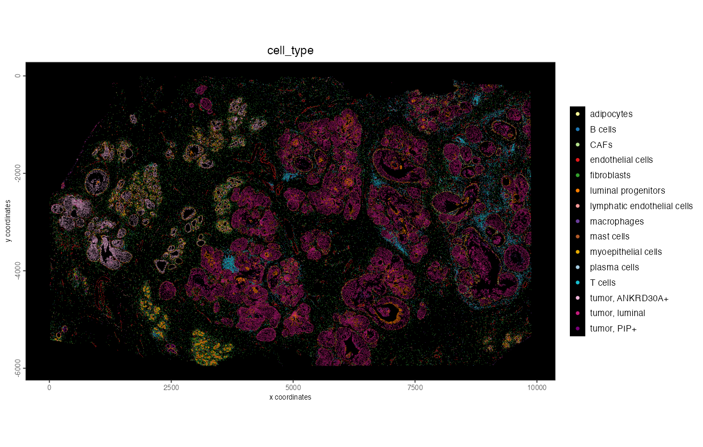
```

In the ROI, the myoepithelial cells outline the ducts, a cluster of luminal
progenitors sits inside one tumor nest, and fibroblasts and vessels fill the
stroma between them:

```{r roi-cell-types}
spatInSituPlotPoints(g,
    polygon_fill = "cell_type",
    polygon_fill_as_factor = TRUE,
    polygon_fill_code = type_colors,
    polygon_line_size = 0,
    view = "roi"
)
```

```{r roi-cell-types-fig, eval = TRUE, echo = FALSE, out.width = "100%"}
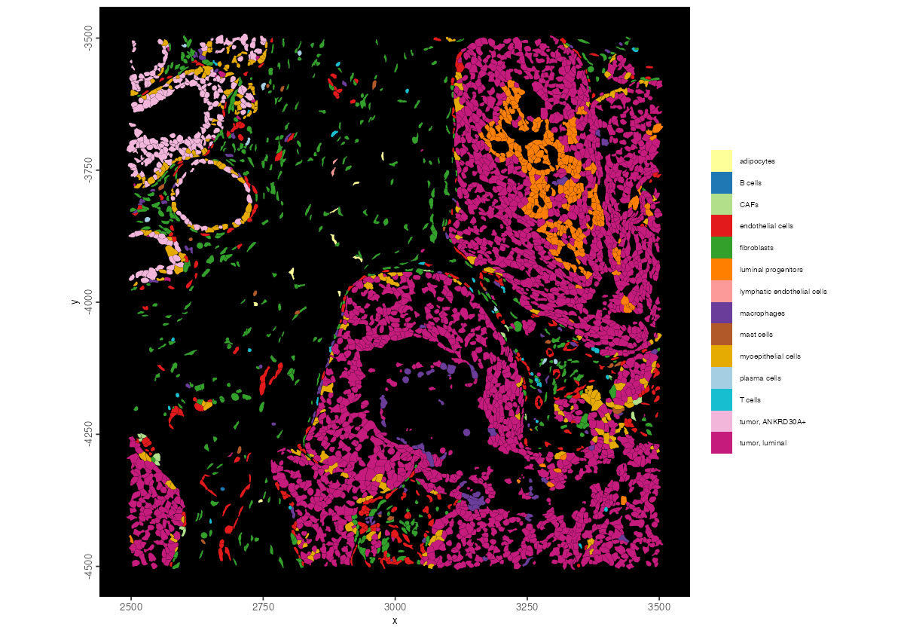
```

```{r save-annotated}
g <- saveGiotto(g, name = "annotated")
```

# Spatially variable genes

A spatial network links each cell to its neighbors. The Delaunay network
connects every cell to the cells that share an edge of the triangulation of
the cell centers.

```{r spatial-network}
g <- createSpatialNetwork(g,
    method = "Delaunay",
    delaunay_method = "delaunayn_geometry",
    verbose = FALSE
)
```

Moran's I measures whether a gene's expression is more similar between
neighboring cells than expected by chance. `spatialAutoCor()` computes it for
all 18,028 genes on the disk-backed expression in about 10 seconds.

```{r moran}
moran <- spatialAutoCor(g,
    method = "moran",
    spatial_network_name = "Delaunay_network",
    return_gobject = FALSE
)
head(moran[, .(feats, statistic, z, adj.p.value)], 10)
```

```
      feats statistic        z adj.p.value
     <char>     <num>    <num>       <num>
 1:   CCND1 0.6934436 474.5931           0
 2:  NHERF1 0.6852831 469.0080           0
 3: ELAPOR1 0.6785076 464.3708           0
 4:    MSMB 0.6624656 453.3966           0
 5:    XBP1 0.6336424 433.6654           0
 6: STARD10 0.6212348 425.1737           0
 7:   GATA3 0.6209205 424.9585           0
 8:    TFF1 0.6157652 421.4311           0
 9:  TBC1D9 0.6092279 416.9563           0
10:    TFF3 0.6091648 416.9144           0
```

The genes with the highest Moran's I are all part of the luminal tumor
program, the largest and most compact compartment of this section:

```{r moran-top}
spatFeatPlot2D(g,
    expression_values = "normalized",
    feats = moran$feats[1:6],
    gradient_style = "sequential",
    point_size = 0.2,
    point_border_stroke = 0,
    background_color = "black",
    cow_n_col = 2
)
```

```{r moran-top-fig, eval = TRUE, echo = FALSE, out.width = "100%"}
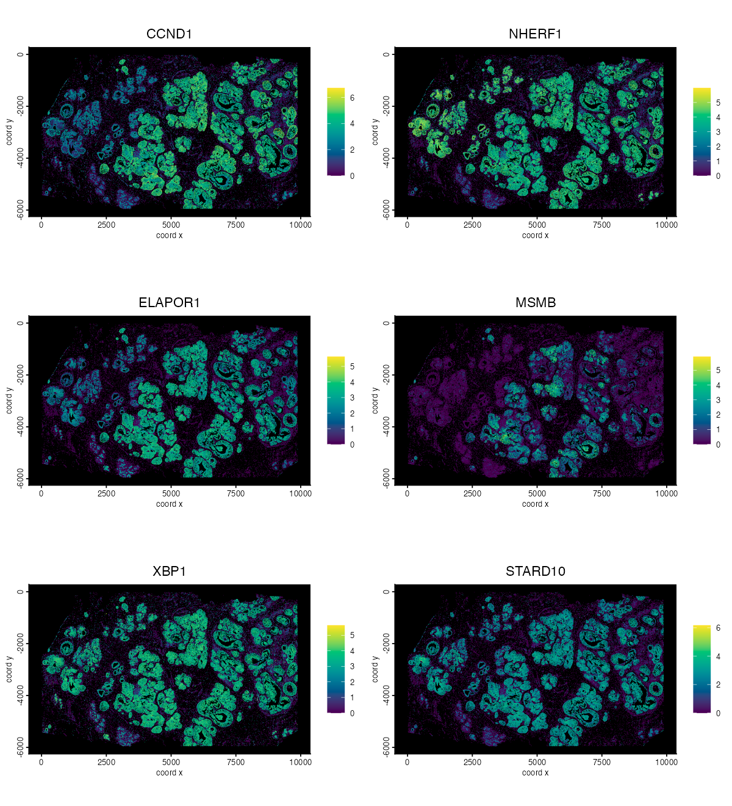
```

# Spatial co-expression modules

`spatialCoexpression()` averages each cell's expression with its neighbors' in
the spatial network, correlates the genes on these smoothed values, and
clusters the correlation into modules. It runs on the 500 genes with the
highest Moran's I.

```{r coexpression}
spatial_genes <- moran$feats[1:500]

coexpr <- spatialCoexpression(g,
    feats = spatial_genes,
    spatial_network_name = "Delaunay_network",
    n_modules = 12,
    return_gobject = FALSE
)
coexpr$summary
```

```
    module  size within_cor between_cor      score
     <int> <int>      <num>       <num>      <num>
 1:     10    24 0.48658359 -0.34059207 0.48658359
 2:     12    15 0.42605743 -0.27962385 0.40008147
 3:     11     8 0.38986133 -0.06374923 0.28193101
 4:      9    11 0.34914690 -0.14220437 0.27988045
 5:      6    13 0.39533533  0.01806930 0.25354382
 6:      2   214 0.62338634  0.27263228 0.24111066
 7:      4    33 0.33589003  0.09998138 0.18790580
 8:      1    79 0.62735500  0.36000119 0.18783432
 9:      7    44 0.54614852  0.35714032 0.16508301
10:      3    40 0.41691558  0.28860478 0.15459361
11:      8    12 0.32361456  0.20659439 0.14653706
12:      5     7 0.09562919 -0.05725352 0.06853375
```

The summary ranks the modules: a high `within_cor` and a low `between_cor`
mean a module is coherent and distinct from the others. Most of the 500 genes
fall into large, mutually correlated tumor modules (2, 1, 7); the small
stromal and immune modules rank highest because they are the most distinct.

```{r coexpression-heatmap}
heatmapCoexpression(g, coexpr)
```

```{r coexpression-heatmap-fig, eval = TRUE, echo = FALSE, out.width = "100%"}
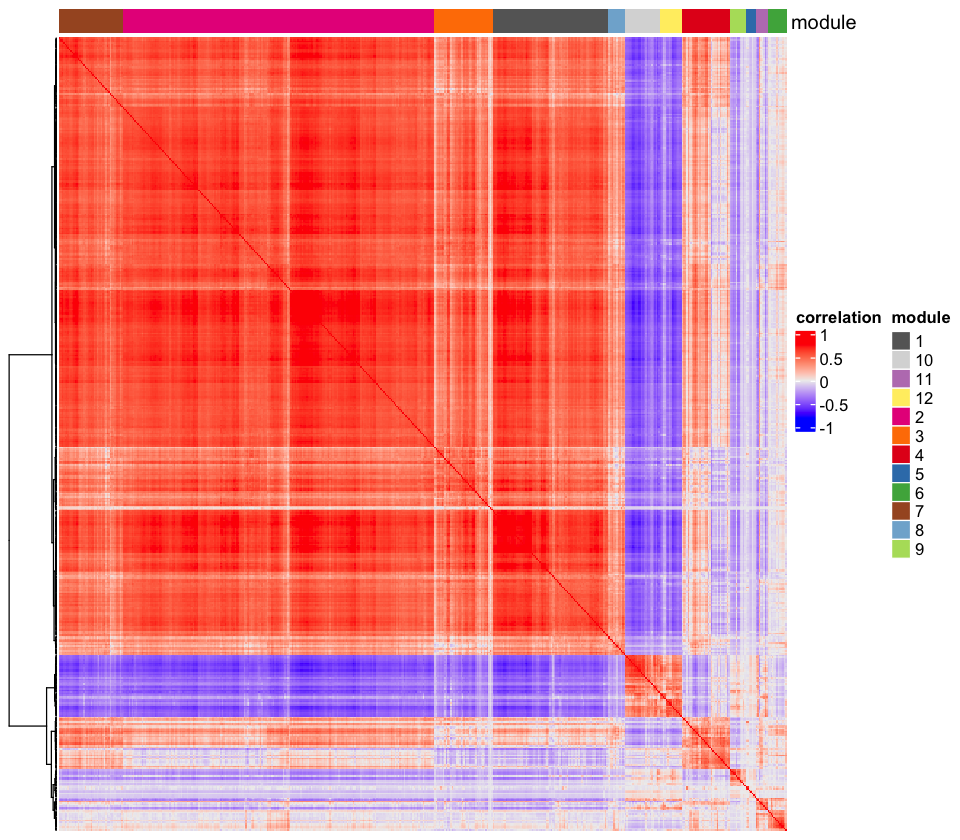
```

The genes that best represent each of the four top-ranked modules:

```{r coexpression-genes}
top_modules <- coexpr$summary$module[1:4]
coexpr$feats[module %in% top_modules][
    order(match(module, top_modules), -module_cor),
    head(.SD, 5), by = "module"
]
```

```
    module feat_ID module_cor
     <int>  <char>      <num>
 1:     10   LAMB1  0.6013472
 2:     10  CXCL12  0.5911660
 3:     10  COL6A2  0.5769407
 4:     10    LRP1  0.5745794
 5:     10  COL6A1  0.5694322
 6:     12   HSPG2  0.5284842
 7:     12  COL4A1  0.4930708
 8:     12  TGFBR2  0.4692459
 9:     12   EPAS1  0.4635048
10:     12     ENG  0.4617396
11:     11    TNS4  0.4795486
12:     11    MYLK  0.4532510
13:     11  FBXO32  0.4487561
14:     11   TAGLN  0.3841451
15:     11    NFIB  0.3490831
16:      9    CD52  0.4688161
17:      9    TRAC  0.4546557
18:      9   ITGB2  0.4376084
19:      9  LAPTM5  0.4202442
20:      9    CD3E  0.4201818
```

They match the cell types named above: fibroblast stroma (module 10),
vessels (12), the myoepithelial layer (11) and T cell infiltrates (9).

The same call with the default `return_gobject = TRUE` adds the module scores
to the object, one per cell and module:

```{r coexpression-scores}
g <- spatialCoexpression(g,
    feats = spatial_genes,
    spatial_network_name = "Delaunay_network",
    n_modules = 12
)
```

Each module's color scale is capped at the 99th percentile of its non-zero
scores, so a few high-scoring cells do not wash out the rest:

```{r coexpression-spatial}
module_scores <- getSpatialEnrichment(g, name = "spatial_module",
    output = "data.table")

for (m in as.character(top_modules)) {
    v <- module_scores[[m]]
    spatCellPlot2D(g,
        spat_enr_names = "spatial_module",
        cell_annotation_values = m,
        gradient_style = "sequential",
        gradient_limits = c(0, stats::quantile(v[v > 0], 0.99)),
        point_size = 0.2,
        point_border_stroke = 0,
        background_color = "black"
    )
}
```

```{r coexpression-spatial-fig, eval = TRUE, echo = FALSE, out.width = "50%", fig.show = "hold"}
knitr::include_graphics(sprintf(
    "images/atera_human_breast_cancer/12_module_%d.png", 1:4))
```

# Spatial enrichment

PAGE scores each cell for a set of marker genes per cell type, here short
signatures for the main cell types of breast tissue. It runs on the
disk-backed expression without loading it into memory.

```{r page}
signatures <- list(
    luminal = c("EPCAM", "KRT8", "KRT18", "KRT19", "ESR1", "GATA3", "FOXA1"),
    myoepithelial = c("KRT5", "KRT14", "KRT17", "TP63", "OXTR", "MYLK"),
    fibroblast = c("COL1A1", "COL1A2", "COL3A1", "DCN", "LUM", "PDGFRA", "FBLN1"),
    endothelial = c("PECAM1", "VWF", "CDH5", "CLDN5", "PLVAP", "KDR"),
    T_NK = c("CD3E", "CD3D", "CD2", "TRAC", "NKG7", "GZMA", "CD8A"),
    B_plasma = c("MS4A1", "CD79A", "JCHAIN", "MZB1", "IGKC"),
    myeloid = c("CD68", "CD163", "LYZ", "C1QA", "C1QB", "CSF1R", "AIF1"),
    mast = c("TPSAB1", "CPA3", "KIT", "MS4A2"),
    adipocyte = c("ADIPOQ", "PLIN1", "LEP", "FABP4")
)
sign_matrix <- makeSignMatrixPAGE(names(signatures), signatures)

g <- runPAGEEnrich(g,
    sign_matrix = sign_matrix,
    expression_values = "normalized",
    min_overlap_genes = 3, # the mast and adipocyte signatures have 4 genes
    verbose = FALSE
)
```

As for the modules, each signature's color scale is capped, here at the 1st
and 99th percentile of its scores:

```{r page-spatial}
page_scores <- getSpatialEnrichment(g, name = "PAGE", output = "data.table")

for (sig in c("luminal", "myoepithelial", "fibroblast", "endothelial",
              "T_NK", "myeloid")) {
    v <- page_scores[[sig]]
    spatCellPlot2D(g,
        spat_enr_names = "PAGE",
        cell_annotation_values = sig,
        gradient_style = "sequential",
        gradient_limits = stats::quantile(v, c(0.01, 0.99)),
        point_size = 0.2,
        point_border_stroke = 0,
        background_color = "black"
    )
}
```

```{r page-spatial-fig, eval = TRUE, echo = FALSE, out.width = "50%", fig.show = "hold"}
knitr::include_graphics(sprintf(
    "images/atera_human_breast_cancer/13_page_%d.png", 1:6))
```

The highest-scoring signature per cell type checks the marker-based names
against an independent gene set:

```{r page-vs-types}
page <- merge(page_scores, pDataDT(g)[, .(cell_ID, cell_type)], by = "cell_ID")
scored <- intersect(names(signatures), names(page))
page_mean <- page[, lapply(.SD, mean), by = "cell_type", .SDcols = scored]
page_mean[, .(cell_type, top_signature = scored[max.col(as.matrix(.SD))]),
    .SDcols = scored][order(cell_type)]
```

```
                      cell_type top_signature
                         <char>        <char>
 1:                     B cells      B_plasma
 2:                        CAFs    fibroblast
 3:                     T cells          T_NK
 4:                  adipocytes     adipocyte
 5:           endothelial cells   endothelial
 6:                 fibroblasts    fibroblast
 7:         luminal progenitors          mast
 8: lymphatic endothelial cells   endothelial
 9:                 macrophages       myeloid
10:                  mast cells          mast
11:         myoepithelial cells myoepithelial
12:                plasma cells      B_plasma
13:            tumor, ANKRD30A+       luminal
14:                 tumor, PIP+          mast
15:              tumor, luminal       luminal
```

Thirteen of the fifteen types agree. The two exceptions show a limit of short
signatures: the luminal progenitors express KIT, one of only four genes in the
mast signature, and that is enough to outscore the luminal signature. Longer
or more specific gene sets avoid this.

```{r save-spatial}
g <- saveGiotto(g, name = "spatial")
```

# Cell-cell interactions

`cellProximityMotifs()` counts which cell types are neighbors in the spatial
network more or less often than expected when the labels are shuffled. Pairs
of neighbors (`size = 2`) give the classic proximity enrichment:

```{r motifs-pairs}
pairs <- cellProximityMotifs(g,
    spatial_network_name = "Delaunay_network",
    cluster_column = "cell_type",
    size = 2L,
    n_perm = 1000L
)
```

```{r motifs-pairs-plot}
plotMotifEnrichment(g, pairs)
```

```{r motifs-pairs-fig, eval = TRUE, echo = FALSE, out.width = "100%"}
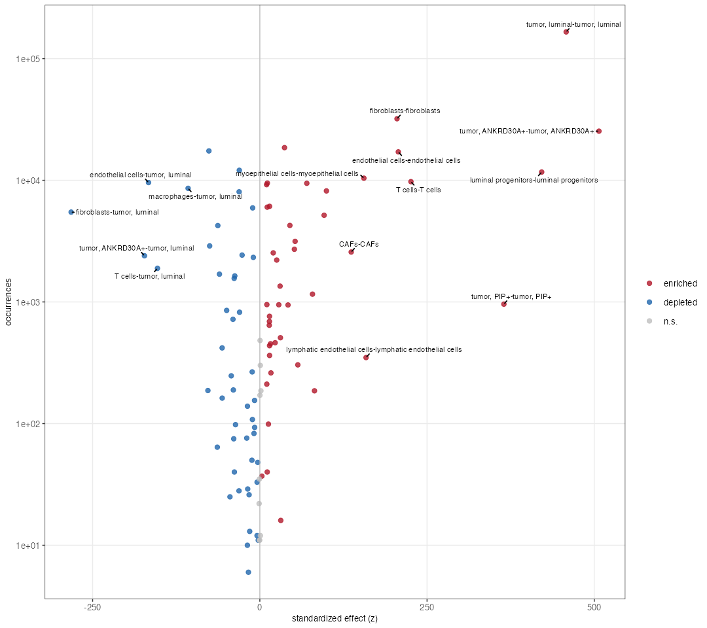
```

Each cell type is most enriched next to its own kind, as expected for tumor
nests, ducts and stroma. Contacts between the stroma and the tumor
(fibroblasts, endothelial cells, T cells next to luminal tumor cells) are
depleted, because the tumor cells sit in compact nests.

Motifs of three cells (`size = 3`) with the conditional null hold the observed
pairs fixed, so a triplet that is still enriched is enriched beyond what its
pairs already explain:

```{r motifs-triplets}
triplets <- cellProximityMotifs(g,
    spatial_network_name = "Delaunay_network",
    cluster_column = "cell_type",
    size = 3L,
    null = "conditional",
    n_perm = 1000L
)
head(triplets[order(-z), .(motif_id, observed, expected, fold, p_adj)], 10)
```

```
                                                             motif_id observed expected     fold       p_adj
                                                               <char>    <num>    <num>    <num>       <num>
 1:                         size3_open_tumor, luminal-T cells-T cells      311   73.874 4.209871 0.008589671
 2:              size3_open_macrophages-tumor, luminal-tumor, luminal     6791 4787.419 1.418510 0.008589671
 3: size3_open_tumor, luminal-myoepithelial cells-myoepithelial cells     3298 2036.807 1.619201 0.008589671
 4:                                  size3_open_fibroblasts-CAFs-CAFs      260   56.240 4.623044 0.008589671
 5:                        size3_open_fibroblasts-CAFs-tumor, luminal      907  328.566 2.760480 0.008589671
 6:               size3_closed_macrophages-macrophages-tumor, luminal     1484  974.486 1.522854 0.008589671
 7:                      size3_closed_CAFs-fibroblasts-tumor, luminal      434  206.977 2.096851 0.008589671
 8:                 size3_open_tumor, luminal-fibroblasts-fibroblasts     1158  536.493 2.158462 0.008589671
 9:                                size3_closed_CAFs-CAFs-fibroblasts      270  118.566 2.277213 0.008589671
10: size3_closed_endothelial cells-myoepithelial cells-tumor, luminal     2316 1544.338 1.499672 0.008589671
```

In an open motif the first cell type listed is the center that links the
other two. The glyphs draw the top-ranked triplets:

```{r motifs-triplets-plot}
plotMotifGlyphs(g, triplets, cell_color_code = type_colors)
```

```{r motifs-triplets-fig, eval = TRUE, echo = FALSE, out.width = "100%"}
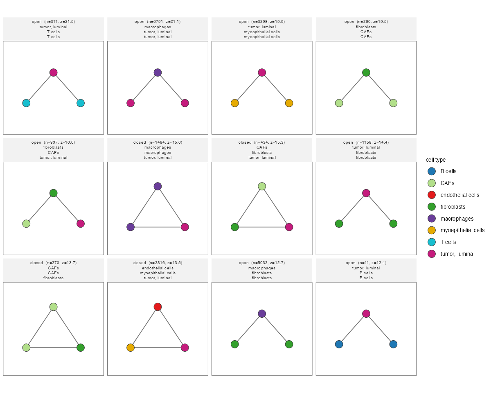
```

The most enriched triplet is a luminal tumor cell with two T cells on either
side, four times more often than its pairs predict. It marks the places
where T cells penetrate the tumor nests:

```{r motifs-spatial}
top_triplet <- triplets[order(-z)]$motif_id[1]
spatMotifPlot(g,
    motif_id = top_triplet,
    cluster_column = "cell_type",
    spatial_network_name = "Delaunay_network"
)
```

```{r motifs-spatial-fig, eval = TRUE, echo = FALSE, out.width = "100%"}
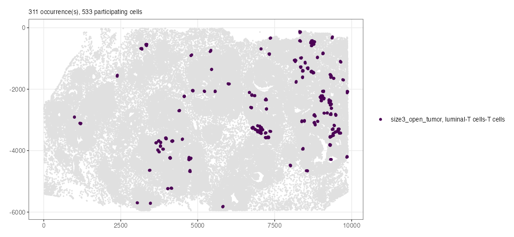
```

```{r save-analyzed}
g <- saveGiotto(g, name = "analyzed")
```

# Further reading

Suggested further topics:

* Continue with [Cell typing with a cluster tree](cell_typing_cluster_tree.html)
  for a more systematic annotation than the cluster markers above
* GiottoLens for [interactive visualization and annotation](giottolens.html)

# Session info

```{r session}
sessionInfo()
```

```
R version 4.5.1 (2025-06-13)
Platform: aarch64-apple-darwin20
Running under: macOS Sonoma 14.5

Matrix products: default
BLAS:   /Library/Frameworks/R.framework/Versions/4.5-arm64/Resources/lib/libRblas.0.dylib
LAPACK: /Library/Frameworks/R.framework/Versions/4.5-arm64/Resources/lib/libRlapack.dylib;  LAPACK version 3.12.1

locale:
[1] en_US/en_US/en_US/C/en_US/en_US

time zone: America/New_York
tzcode source: internal

attached base packages:
[1] stats     graphics  grDevices utils     datasets  methods   base

other attached packages:
[1] GiottoDisk_0.0.0.6 Giotto_4.3.5       GiottoClass_0.7.18 arrow_23.0.1.2

loaded via a namespace (and not attached):
  [1] colorRamp2_0.1.0            gridExtra_2.3               rlang_1.1.7                 magrittr_2.0.4
  [5] otel_0.2.0                  GiottoUtils_0.2.7           matrixStats_1.5.0           compiler_4.5.1
  [9] systemfonts_1.3.2           vctrs_0.7.2                 pkgconfig_2.0.3             SpatialExperiment_1.20.0
 [13] crayon_1.5.3                fastmap_1.2.0               backports_1.5.1             magick_2.9.1
 [17] XVector_0.48.0              labeling_0.4.3              ggraph_2.2.2                UCSC.utils_1.4.0
 [21] ragg_1.5.2                  purrr_1.2.1                 bit_4.6.0                   bluster_1.18.0
 [25] cachem_1.1.0                beachmat_2.24.0             GenomeInfoDb_1.44.3         jsonlite_2.0.0
 [29] DelayedArray_0.34.1         smotif_0.2.0                BiocParallel_1.42.2         tweenr_2.0.3
 [33] terra_1.9-11                cluster_2.1.8.3             irlba_2.3.7                 parallel_4.5.1
 [37] R6_2.6.1                    RColorBrewer_1.1-3          smotifrs_0.2.0              parallelly_1.46.1
 [41] GenomicRanges_1.60.0        scattermore_1.2             Rcpp_1.1.2                  Seqinfo_1.0.0
 [45] assertthat_0.2.1            SummarizedExperiment_1.38.1 R.utils_2.13.0              IRanges_2.42.0
 [49] Matrix_1.7-3                igraph_2.2.2                tidyselect_1.2.1            abind_1.4-8
 [53] viridis_0.6.5               codetools_0.2-20            listenv_0.10.1              lattice_0.22-7
 [57] tibble_3.3.1                Biobase_2.68.0              withr_3.0.2                 S7_0.2.1
 [61] future.mirai_1.0.0          future_1.70.0               polyclip_1.10-7             filelock_1.0.3
 [65] pillar_1.11.1               MatrixGenerics_1.20.0       checkmate_2.3.4             stats4_4.5.1
 [69] plotly_4.12.0               generics_0.1.4              RcppHNSW_0.7.0              nanoarrow_0.9.0
 [73] S4Vectors_0.48.1            ggplot2_4.0.2               mirai_2.7.2                 scales_1.4.0
 [77] globals_0.19.1              gtools_3.9.5                glue_1.8.0                  lazyeval_0.2.2
 [81] tools_4.5.1                 tilework_1.0.0              GiottoVisuals_0.2.16        BiocNeighbors_2.2.0
 [85] data.table_1.18.2.1         ScaledMatrix_1.16.0         graphlayouts_1.2.3          tidygraph_1.3.1
 [89] cowplot_1.2.0               grid_4.5.1                  tidyr_1.3.2                 colorspace_2.1-2
 [93] SingleCellExperiment_1.30.1 GenomeInfoDbData_1.2.14     BiocSingular_1.24.0         ggforce_0.5.0
 [97] cli_3.6.5                   rsvd_1.0.5                  textshaping_1.0.5           S4Arrays_1.8.1
[101] viridisLite_0.4.3           dplyr_1.2.0                 gtable_0.3.6                R.methodsS3_1.8.2
[105] digest_0.6.39               BiocGenerics_0.54.1         SparseArray_1.8.1           ggrepel_0.9.8
[109] nanonext_1.10.2             rjson_0.2.23                htmlwidgets_1.6.4           farver_2.1.2
[113] R.oo_1.27.1                 memoise_2.0.1               htmltools_0.5.9             lifecycle_1.0.5
[117] httr_1.4.8                  bit64_4.6.0-1               MASS_7.3-65
```
