```{r, include=FALSE}
knitr::opts_chunk$set(eval = FALSE)
```

# Overview

This tutorial reads a 10x Atera whole-transcriptome run of non-diseased human
kidney into an on-disk GiottoDisk project. It then filters, clusters and names
the cells, and looks at the tissue's spatial organization: spatially variable
genes, co-expression modules, signature enrichment and the cell types that sit
next to each other.

The data are the output of the commercial Atera instrument (Atera v1), which
ships its data as zarr archives. They are read with
`createGiottoAteraObject()`. For the Atera preview data that 10x converted to
the Xenium layout, see the
[Atera Human Breast Cancer](atera_human_breast_cancer.html) tutorial.

<div style="border-left: 4px solid #2c7fb8; padding: 0.5em 1em; background: rgba(44,127,184,0.08);">
**Reading the data is the longest step, and you only do it once.** It streams
more than a billion transcripts, the cell outlines and the expression matrix
into the project directory. After that, the saved object reopens in seconds
with `loadGiotto()`, and every step below runs quickly on a personal
computer. How quickly depends on the number of cores and the amount of memory
available: GiottoDisk reads the data in pieces sized to the memory it finds
free.

*Hardware:* the analysis after reading runs on a computer with 16 GB of
memory; PAGE enrichment is the step closest to that limit. Reading the data is
the most demanding step, so more memory and cores help most there.
`GiottoDisk::storeChunkInfo()` shows how the pieces are sized on your
machine, and `options(giottodisk.chunk_ram_frac = 0.1)` makes every piece
smaller on a busy one.
</div>

# Install extra packages

## _arrow_ installation

GiottoDisk stores the data as parquet files, which requires arrow with ZSTD
support.

```{r install-arrow}
has_arrow <- requireNamespace("arrow", quietly = TRUE)
zstd <- TRUE
if (has_arrow) {
    # check arrow_info() to see that zstd support should be TRUE
    # See https://arrow.apache.org/docs/r/articles/install.html for details
    zstd <- arrow::arrow_info()$capabilities[["zstd"]]
}
if (!has_arrow || !zstd) {
    # install with compression library needed for parquet files
    # this may take a while
    Sys.setenv(ARROW_WITH_ZSTD = "ON")
    install.packages("arrow", repos = c("https://apache.r-universe.dev"), type = "source")
}
```

## Zarr readers

Atera v1 output is a set of zipped zarr archives. GiottoDisk reads them with
the help of _Rarr_ (Bioconductor) and _zip_:

```{r install-zarr}
if (!requireNamespace("BiocManager", quietly = TRUE)) {
    install.packages("BiocManager")
}
BiocManager::install("Rarr")
install.packages("zip")
```

## _SedonaDB_ and _DuckDB_ installation

GiottoDisk runs spatial joins, such as the aggregation of transcripts into
cells below, in SedonaDB when it is installed, and in DuckDB otherwise. Both
are optional; without them it falls back to tiled terra operations, which are
much slower at this scale.

```{r install-spatial-engines}
install.packages("sedonadb",
    repos = c("https://apache.r-universe.dev", "https://cloud.r-project.org")
)
install.packages("duckdb")
```

Loading SedonaDB can print messages about PROJ or GDAL data directories it did
not find. They do not affect the steps in this tutorial.

## _smotif_ installation

The cell-cell interaction section at the end uses smotif and its Rust backend
smotifrs to count cell type motifs:

```{r install-smotif}
install.packages(c("smotif", "smotifrs"),
    repos = c("https://drieslab.r-universe.dev", "https://cloud.r-project.org")
)
```

## Giotto extensions

This tutorial uses GiottoDisk for on-disk processing. These are preview dev
builds off the dev and gsource Giotto package branches. If GiottoDisk has not
been installed yet, use the following:

```{r install-giottodisk}
# GiottoDisk install
GiottoUtils::suite_install("GiottoDisk")
# Optional for matrix maths speedup:
install.packages("GiottoKernels",
    repos = c("https://giotto-suite.r-universe.dev", "https://cloud.r-project.org")
)
```

# Dataset explanation

This tutorial uses a 10x Genomics _Atera In Situ_ run of an FFPE section of
non-diseased human kidney, measured with the Atera Human Whole Transcriptome
Gene Expression panel. The panel targets 18,049 genes; the section has 399,120
segmented cells and 1.08 billion high-quality transcripts.

## Atera v1 output

An Atera v1 output folder holds its data in zipped zarr archives rather than
the parquet and h5 files of a Xenium run:

* `transcripts.zarr.zip`: every decoded transcript, with its position and
  quality score
* `cells.zarr.zip`: the cell and nucleus outlines and the cell metadata
* `cell_feature_matrix.zarr.zip`: the cell by gene matrix
* `morphology_2d/`: the DAPI and cell segmentation stain images
* `experiment.spatial`: run metadata, including the image pixel size

The folder also holds archives for the 10x viewer (`binned_transcripts`,
`csc_cell_feature_matrix`) that Giotto does not need.

`createGiottoAteraObject()` streams the archives straight into an on-disk
project, so it needs a GiottoDisk backend. There is no in-memory Atera reader:
at this size the data would not fit in memory anyway.

# Setup

```{r libs}
library(arrow) # this must be libraried before terra or GiottoClass
library(Giotto)
library(GiottoDisk)

data_dir    <- "path/to/Atera_v1_WTA_Kidney_non_diseased_FFPE_outs"
project_dir <- "path/to/atera_kidney_project"

# set an appropriate amount of parallel workers for your computer
future::plan(future.mirai::mirai_multisession, workers = 8)
```

# Read the data

First we set up a `gDirSource` object using `sourceCreate()` as a handle for a
Giotto file directory disk backend. A backend defines the storage architecture
and the preferred write formats for each data type. Currently, the only option
available is a managed project directory via `gDirSource`, but other solutions
are planned.

Next, using `setArtifactDumpDir()`, we point GiottoDisk writes of content such
as expression matrices and spatial information directly at the backend.
*This is mostly precautionary to avoid more work later that would have to pull
scattered files into the backend when the object is saved.*

```{r backend}
# declare a Giotto directory backend to use
gdsrc <- GiottoDisk::sourceCreate(project_dir, type = "gDirSource")
# point data content writes to the backend's artifact subdirectory
GiottoDisk::setArtifactDumpDir(gdsrc)
```

`createGiottoAteraObject()` creates the Giotto object from the output folder
and the backend.

```{r read}
# convenience function load defaults:
# * transcripts (qv >= 20)
# * cell and nucleus polygons
# * 10x expression matrix
# * morphology_2d images
#
# not loaded by default:
# * cell metadata (load_cellmeta = TRUE)
g <- createGiottoAteraObject(data_dir,
    backend = gdsrc # creates the object as a backed project
    # load_transcripts = FALSE # skip the transcripts, see Aggregate below
)
# items to load can be controlled via `load_*` params
g
```

```
An object of class giotto
>Active spat_unit:  cell
>Active feat_type:  rna
dimensions    : 18049, 399120 (features, cells)
[SUBCELLULAR INFO]
polygons      : cell nucleus
features      : rna NegControlProbe UnassignedCodeword NegControlCodeword GenomicControl
 DeprecatedCodeword
[AGGREGATE INFO]
expression -----------------------
  [cell][rna] raw
  [cell][NegControlProbe] raw
  [cell][GenomicControl] raw
  [cell][NegControlCodeword] raw
  [cell][UnassignedCodeword] raw
  [cell][DeprecatedCodeword] raw
spatial locations ----------------
  [cell] raw
  [nucleus] raw
attached images ------------------
images      : 4 items...


Use objHistory() to see steps and params used
```

Besides the 18,049 genes, the transcripts include several kinds of control
probes. The reader puts each kind in its own feature type, so they stay out of
the gene expression: negative control probes and codewords, unassigned
codewords, genomic control probes (named `Intergenic_Region_*` in this panel)
and a deprecated codeword.

```{r poly}
# preview the cell polygons
getPolygonInfo(g, "cell") |>
    plot()
```

```{r poly-fig, eval = TRUE, echo = FALSE, out.width = "100%"}
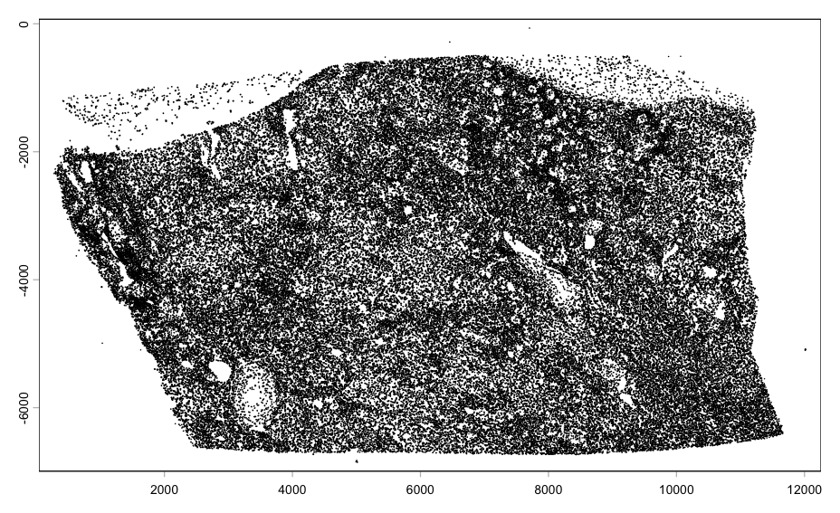
```

```{r tx}
# transcript density
getFeatureInfo(g, "rna") |>
    plot()
```

```{r tx-fig, eval = TRUE, echo = FALSE, out.width = "100%"}
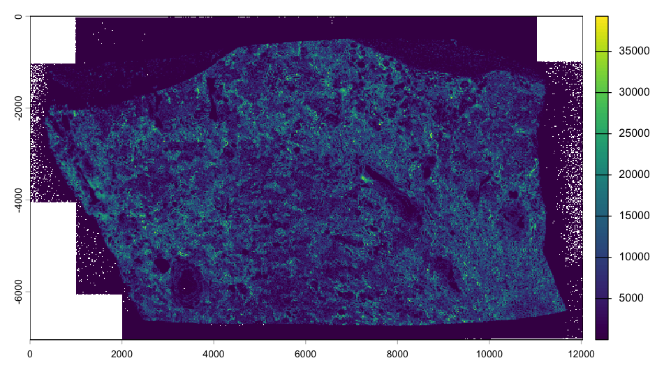
```

## Save

Backed Giotto projects write snapshots of analysis state to the project
directory. Save and load operations are faster than in-memory ones and can be
treated as checkpoints. From here on, `loadGiotto(project_dir, name =
"ingest")` reopens the object in seconds, so the reading above never has to be
repeated.

```{r save-ingest}
# name param (optional) assigns the snapshot a name
# The return value is needed since saveGiotto makes changes during the write
# Either use the returned value or immediately load with `loadGiotto()`
g <- saveGiotto(g, name = "ingest")
```

## Aggregate

Aggregate the spatial transcripts with the default polygon layer (the cell
outlines). This replaces the 10x expression matrix with one Giotto computes
from the transcripts.

<p style="color:#c0392b; font-weight:bold;">This step can be skipped: the 10x
expression matrix read above is used otherwise.</p>

`load_transcripts = FALSE` above skips reading the transcripts, which shortens
the one-time reading step. It also means individual transcripts cannot be
plotted or re-aggregated later.

```{r aggregate}
g <- aggregateFeatures(g)
g <- saveGiotto(g, name = "aggregated")
```

# Quality control and filtering

```{r stats}
g <- addStatistics(g, expression_values = "raw")
cx <- pDataDT(g)
cat(sprintf("%s cells | median %d counts, %d features per cell\n",
    format(nrow(cx), big.mark = ","),
    as.integer(median(cx$total_expr)), as.integer(median(cx$nr_feats)))
)
```

```
399,120 cells | median 1550 counts, 1191 features per cell
```

A threshold of 50 detected genes removes only empty or fragmented outlines.

```{r filter}
g <- filterGiotto(g,
    expression_threshold   = 1,
    feat_det_in_min_cells  = 1,
    min_det_feats_per_cell = 50,
    verbose = FALSE
)
cat(sprintf("%s cells x %s features retained\n",
    format(nrow(pDataDT(g)), big.mark = ","),
    format(nrow(fDataDT(g, feat_type = "rna")), big.mark = ","))
)
```

```
395,606 cells x 18,049 features retained
```

# Normalize and select features

```{r normalize}
g <- normalizeGiotto(g,
    scalefactor = 1e4,
    logbase = exp(1),
    log_offset = 1,
    scale_feats = FALSE,
    scale_cells = FALSE,
    verbose = FALSE
)

g <- calculateHVF(g,
    method = "cov_loess",
    n_top_feats = 2000,
    verbose = FALSE
)
hvf <- fDataDT(g, feat_type = "rna")[hvf == "yes"]$feat_ID
cat(length(hvf), "highly variable features\n")

g <- saveGiotto(g, name = "normalized")
```

```
2000 highly variable features
```

# Dimension reduction

`scale_unit = TRUE` scales to unit variance on the fly, so no dense z-scored
matrix is ever written.

```{r scree}
g <- runPCA(g,
    feats_to_use = "hvf",
    ncp = 50,
    method = "auto",
    scale_unit = TRUE,
    center = TRUE,
    verbose = FALSE
)

screePlot(g)
```

```{r scree-fig, eval = TRUE, echo = FALSE, out.width = "100%"}
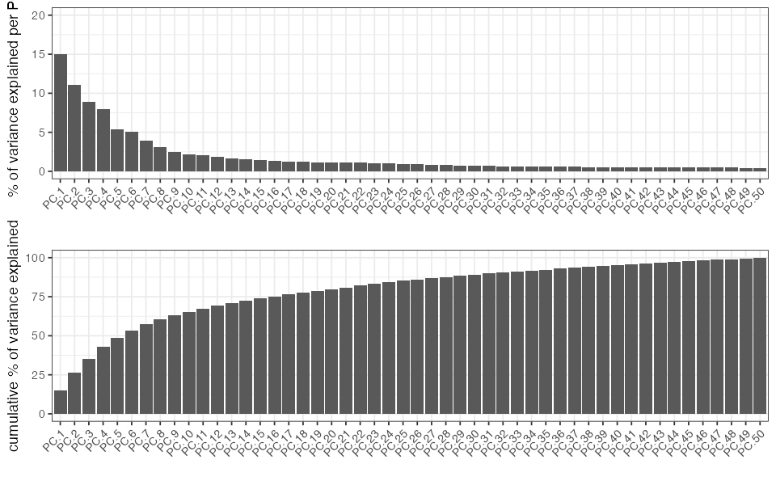
```

The kNN network is built first. `runUMAP()` reuses it instead of searching for
neighbors again, which also makes the UMAP reproducible, and Leiden clusters
on the same network.

```{r umap-run}
dims_to_use <- 1:30 # use the top 30 PCs for UMAP and clustering

g <- createNearestNetwork(g,
    type = "kNN",
    dimensions_to_use = dims_to_use,
    k = 30,
    engine = "hnsw",
    verbose = FALSE
)
g <- runUMAP(g,
    dimensions_to_use = dims_to_use,
    n_neighbors = 30,
    min_dist = 0.3
)
```

```
runUMAP: using the stored kNN 'kNN.pca' (29 neighbours per cell)
```

# Clustering

```{r cluster}
leiden_res <- 0.8

g <- doLeidenCluster(g,
    nn_network_to_use = "kNN",
    network_name = "kNN.pca",
    resolution = leiden_res,
    n_iterations = 20,
    objective_function = "modularity",
    verbose = FALSE
)

clusters <- GiottoUtils::mixedsort(unique(as.character(pDataDT(g)$leiden_clus)))
cat(length(clusters), "clusters at resolution", leiden_res, "\n")
# one color per cluster, shared by the plots below
clus_colors <- stats::setNames(getDistinctColors(length(clusters)), clusters)
```

```
28 clusters at resolution 0.8
```

```{r save-clustered}
g <- saveGiotto(g, name = "clustered")
```

The object is saved to the project directory and can be reloaded with
`loadGiotto(project_dir, name = "clustered")`.

```{r umap-leiden}
plotUMAP(g,
    cell_color = "leiden_clus",
    color_as_factor = TRUE,
    cell_color_code = clus_colors,
    point_border_stroke = 0,
    point_size = 0.1
)
```

```{r umap-fig, eval = TRUE, echo = FALSE, out.width = "100%"}
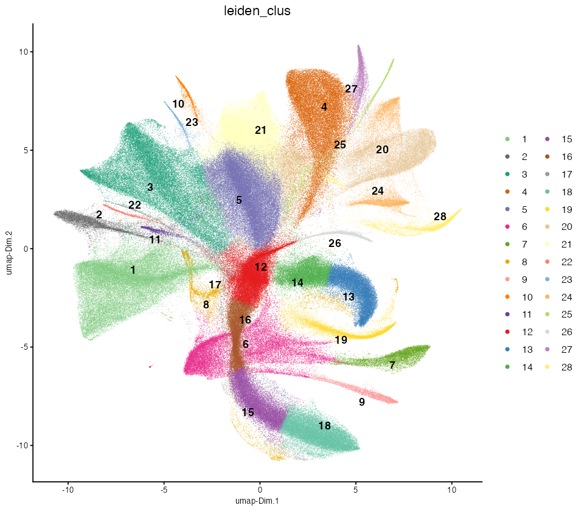
```

```{r centroids-global}
spatPlot2D(g,
    cell_color = "leiden_clus",
    color_as_factor = TRUE,
    cell_color_code = clus_colors,
    point_border_stroke = 0,
    point_size = 0.2,
    background_color = "black"
)
```

```{r centroids-fig, eval = TRUE, echo = FALSE, out.width = "100%"}
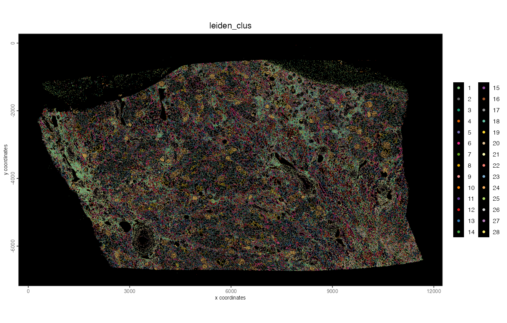
```

Establish an ROI around a group of glomeruli and get a zoomed in plot with the
polygons.

```{r sissp-roi}
roi <- c(6700, 7700, -2300, -1300) # xmin/xmax/ymin/ymax
g <- crop(g, roi, view = "roi")

spatInSituPlotPoints(g,
    polygon_fill = "leiden_clus",
    polygon_fill_as_factor = TRUE,
    polygon_fill_code = clus_colors,
    polygon_line_size = 0,
    view = "roi"
)
```

```{r roi-fig, eval = TRUE, echo = FALSE, out.width = "100%"}
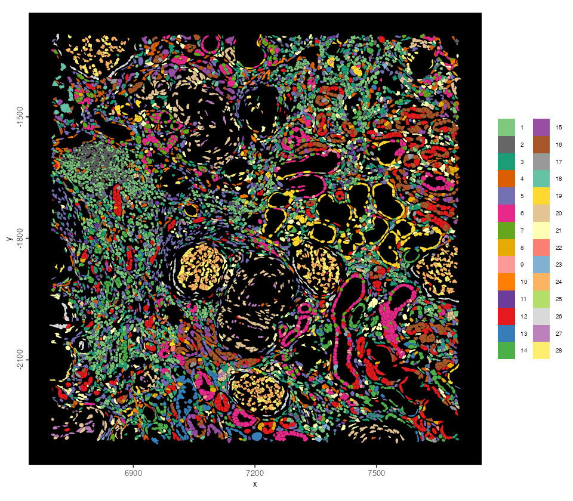
```

# Cell types from cluster markers

`findMarkers_one_vs_all()` ranks the genes that set each Leiden cluster apart
from the others. The top eight per cluster:

```{r markers}
markers <- findMarkers_one_vs_all(g,
    method = "scran",
    cluster_column = "leiden_clus",
    min_feats = 5,
    verbose = FALSE
)
top_markers <- markers[, .(top = paste(head(feats, 8), collapse = ", ")),
    by = "cluster"]
top_markers[order(as.integer(cluster))]
```

```
    cluster                                                               top
      <int>                                                            <char>
 1:       1                CD53, TRAC, EVL, WIPF1, PIK3IP1, CXCR4, CD3E, TMC8
 2:       2              MS4A1, CD53, LAPTM5, CD37, BANK1, CD79A, SMAP2, CD52
 3:       3              CD163, C1QC, C1QA, STAB1, LAPTM5, CD14, VSIG4, HCLS1
 4:       4          PECAM1, HSPG2, EPAS1, EGFL7, SHANK3, TGFBR2, PLAT, RAMP3
 5:       5        C7, CALD1, RIPOR3, NFASC, PHLDB1, TSPYL2, COL6A2, CRISPLD2
 6:       6             AQP2, HSD11B2, CALB1, CDH16, MUC1, MAL, SPTBN2, EPCAM
 7:       7 SLC4A1, ATP6V1C2, SLC26A7, CA12, ATP6V0D2, TMEM213, ATP6V0A4, MAL
 8:       8             ATP1A1, FARP1, CDH16, PAX8, ECHS1, SPP1, BICDL1, CD24
 9:       9      CA12, KRT7, SLC26A4, ATP6V0A4, SLC4A9, IGFBP5, TMEM213, HMX2
10:      10          MMRN1, PKHD1L1, FABP4, TBX1, TGFBR2, FLT4, PROX1, LAPTM5
11:      11         TXNDC5, JCHAIN, MZB1, IGKC, XBP1, TP53INP1, IGHG1, SEL1L3
12:      12             CRYAB, PAX8, CLTRN, TNFSF10, CD24, ANPEP, AQP1, FARP1
13:      13        UMOD, SLC12A1, ATP1A1, MUC1, SERPINA5, SFRP1, EFHD1, KCNJ1
14:      14           SLC12A1, MUC1, ATP1A1, MAL, CDH16, TFCP2L1, CD24, EFHD1
15:      15           ANPEP, PCK1, ALDOB, SLC5A12, SMIM24, APOE, CRYAB, CLTRN
16:      16             ANPEP, CLTRN, SMIM24, CRYAB, LRP2, AQP1, GATM, IL17RB
17:      17         ANPEP, LRP2, CLTRN, IL17RB, CRYAB, TNFSF10, SLC17A1, CUBN
18:      18             SLC5A12, ALDOB, PCK1, PAH, ANPEP, APOE, LRP2, SLC22A8
19:      19      SLC12A3, SFRP1, CA12, TMEM52B, SERPINA5, ATP1A1, SPP1, ACSL4
20:      20               RGS5, NOTCH3, TAGLN, MFGE8, TPM2, EPAS1, MCAM, MYL9
21:      21              C7, C1R, AEBP1, COL6A2, TAGLN, FBLN5, PDGFRA, COL4A1
22:      22               KIT, IL1RL1, RGS2, PNMT, GATA2, SYTL3, IL18R1, RHEX
23:      23            CDH19, SCN7A, LGI4, SAMHD1, PRIMA1, GAS7, GPM6B, ITGB4
24:      24             IL1RL1, EPAS1, EMCN, SYNE1, NHERF2, CLIC5, TIMP3, KDR
25:      25                  C1R, IGF2, COL6A2, MFGE8, C3, MGP, PLA2G2A, GAS1
26:      26          SLC4A11, ITGB3, TNNT2, CCN2, CCDC198, CFH, RAPGEF3, PAWR
27:      27        PECAM1, EPAS1, TIMP3, NHERF2, TM4SF1, HSPG2, KCTD12, PODXL
28:      28             PODXL, NPHS2, CLIC5, PLA2R1, MME, NPNT, VEGFA, IGFBP2
```

Each cluster is named from its markers, read further down the list where the
top eight are not enough, and from where it sits in the tissue:

* The nephron, from glomerulus to collecting duct: podocytes (28: PODXL,
  NPHS1, NPHS2), parietal epithelial cells of Bowman's capsule (26: CFH,
  CLDN1, VCAM1, WT1), proximal tubule (15–18: LRP2, CUBN, SLC5A12, ALDOB),
  thick ascending limb (13, 14: UMOD, SLC12A1), distal convoluted tubule (19:
  SLC12A3), principal cells (6: AQP2, HSD11B2) and type A and B intercalated
  cells (7: SLC4A1, SLC26A7; 9: SLC26A4, SLC4A9).
* Cluster 12 is proximal tubule that has lost part of its program and gained
  VCAM1, HAVCR1 (KIM-1) and PROM1, the signature of injured tubule cells.
  Cluster 8 mixes proximal and distal tubule markers and is kept apart as
  "tubule, mixed".
* Vessels: glomerular endothelium (24: EMCN, EHD3, CLIC5), peritubular
  capillaries (4: PECAM1, PLVAP), arterial endothelium (27: SEMA3G),
  lymphatics (10: PROX1, FLT4, MMRN1), and pericytes and smooth muscle cells
  (20: RGS5, NOTCH3, MYH11).
* Stroma and nerves: interstitial fibroblasts (5, 21: C7, PDGFRA), a
  MFAP5+/PLA2G2A+ fibroblast population (25) and Schwann cells (23: CDH19,
  SCN7A).
* Immune cells: T cells (1), B cells (2), plasma cells (11), macrophages (3)
  and mast cells (22).

*Leiden cluster numbers can change between package versions or numbers of
workers. Check the markers before reusing this mapping on your own run.*

```{r cell-types}
cell_types <- c(
    "15" = "proximal tubule", "16" = "proximal tubule",
    "17" = "proximal tubule", "18" = "proximal tubule",
    "12" = "proximal tubule, VCAM1+",
    "8" = "tubule, mixed",
    "13" = "thick ascending limb", "14" = "thick ascending limb",
    "19" = "distal convoluted tubule",
    "6" = "principal cells",
    "7" = "intercalated cells, type A", "9" = "intercalated cells, type B",
    "28" = "podocytes", "26" = "parietal epithelial cells",
    "24" = "glomerular endothelium", "4" = "endothelial cells",
    "27" = "arterial endothelium", "10" = "lymphatic endothelium",
    "20" = "pericytes and VSMC",
    "5" = "fibroblasts", "21" = "fibroblasts", "25" = "fibroblasts, MFAP5+",
    "23" = "Schwann cells",
    "1" = "T cells", "2" = "B cells", "11" = "plasma cells",
    "3" = "macrophages", "22" = "mast cells"
)
g <- annotateGiotto(g,
    annotation_vector = cell_types,
    cluster_column = "leiden_clus",
    name = "cell_type"
)
# one color per cell type, shared by the plots below
type_colors <- c(
    "proximal tubule" = "#1f78b4", "proximal tubule, VCAM1+" = "#a6cee3",
    "tubule, mixed" = "#8c8c8c",
    "thick ascending limb" = "#33a02c", "distal convoluted tubule" = "#b2df8a",
    "principal cells" = "#ff7f00",
    "intercalated cells, type A" = "#fdbf6f",
    "intercalated cells, type B" = "#b15928",
    "podocytes" = "#e31a1c", "parietal epithelial cells" = "#fb9a99",
    "glomerular endothelium" = "#ffff33", "endothelial cells" = "#c51b7d",
    "arterial endothelium" = "#7a0177", "lymphatic endothelium" = "#f1b6da",
    "pericytes and VSMC" = "#e6ab02",
    "fibroblasts" = "#66c2a5", "fibroblasts, MFAP5+" = "#1b9e77",
    "Schwann cells" = "#bf812d",
    "T cells" = "#17becf", "B cells" = "#3f51b5", "plasma cells" = "#9e9ac8",
    "macrophages" = "#6a3d9a", "mast cells" = "#d9d9d9"
)
sort(table(pDataDT(g)$cell_type), decreasing = TRUE)
```

```
               fibroblasts            proximal tubule                    T cells                macrophages
                     66777                      57867                      38594                      36844
         endothelial cells       thick ascending limb    proximal tubule, VCAM1+            principal cells
                     32410                      31084                      26315                      23719
        pericytes and VSMC     glomerular endothelium   distal convoluted tubule                    B cells
                     20529                       9386                       8101                       6770
intercalated cells, type A                  podocytes              tubule, mixed       arterial endothelium
                      6690                       5018                       4982                       4083
intercalated cells, type B        fibroblasts, MFAP5+  parietal epithelial cells      lymphatic endothelium
                      3524                       2965                       2923                       1950
             Schwann cells               plasma cells                 mast cells
                      1872                       1806                       1397
```

```{r spatial-cell-types}
spatPlot2D(g,
    cell_color = "cell_type",
    color_as_factor = TRUE,
    cell_color_code = type_colors,
    point_border_stroke = 0,
    point_size = 0.2,
    background_color = "black"
)
```

```{r spatial-cell-types-fig, eval = TRUE, echo = FALSE, out.width = "100%"}
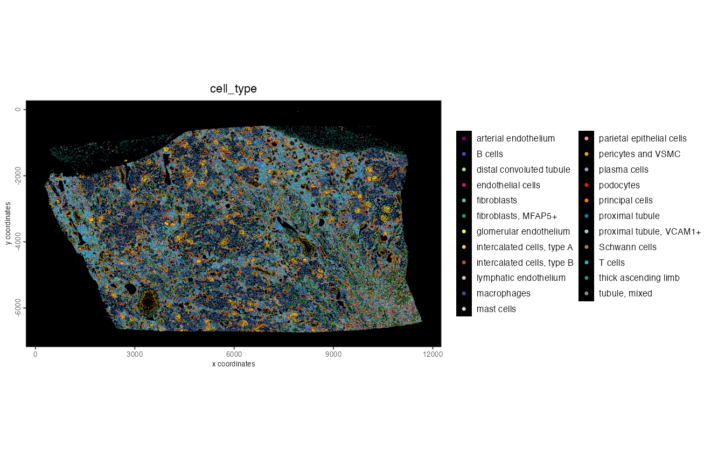
```

In the ROI, each glomerulus shows podocytes (red) around glomerular
endothelium (yellow), lined by parietal epithelial cells, among proximal
tubules, thick ascending limbs and collecting ducts. A large T cell aggregate
sits in the upper left.

```{r roi-cell-types}
spatInSituPlotPoints(g,
    polygon_fill = "cell_type",
    polygon_fill_as_factor = TRUE,
    polygon_fill_code = type_colors,
    polygon_line_size = 0,
    view = "roi"
)
```

```{r roi-cell-types-fig, eval = TRUE, echo = FALSE, out.width = "100%"}
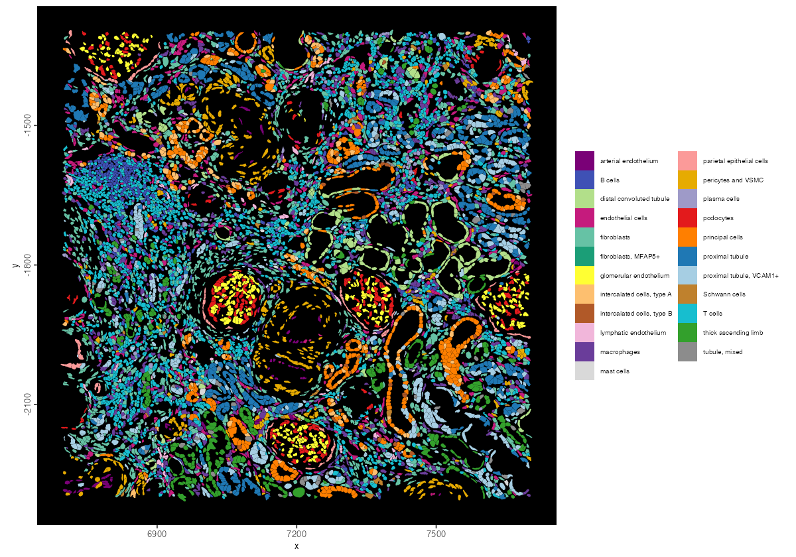
```

Zooming in on two glomeruli with the DAPI image (default) underneath:

```{r sissp-roi-refine}
spatInSituPlotPoints(g,
    polygon_fill = "cell_type",
    polygon_fill_as_factor = TRUE,
    polygon_fill_code = type_colors,
    polygon_line_size = 0.2,
    polygon_alpha = 0.5,
    xlim = c(6950, 7400),
    ylim = c(-2050, -1800),
    view = "roi",
    show_image = TRUE
)
```

```{r roi-refine-fig, eval = TRUE, echo = FALSE, out.width = "100%"}
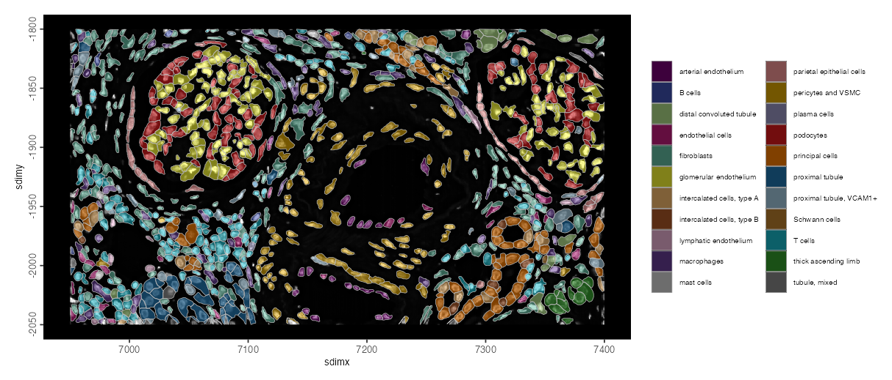
```

```{r save-annotated}
g <- saveGiotto(g, name = "annotated")
```

# Spatially variable genes

A spatial network links each cell to its neighbors. The Delaunay network
connects every cell to the cells that share an edge of the triangulation of
the cell centers.

```{r spatial-network}
g <- createSpatialNetwork(g,
    method = "Delaunay",
    delaunay_method = "delaunayn_geometry",
    verbose = FALSE
)
```

Moran's I measures whether a gene's expression is more similar between
neighboring cells than expected by chance. `spatialAutoCor()` computes it for
all 18,049 genes on the disk-backed expression.

```{r moran}
moran <- spatialAutoCor(g,
    method = "moran",
    spatial_network_name = "Delaunay_network",
    return_gobject = FALSE
)
head(moran[, .(feats, statistic, z, adj.p.value)], 10)
```

```
      feats statistic        z adj.p.value
     <char>     <num>    <num>       <num>
 1:    AQP2 0.5339408 566.1267           0
 2:   CALB1 0.5183201 549.5648           0
 3:    UMOD 0.5049344 535.3727           0
 4: SLC12A1 0.4964804 526.4062           0
 5:    FGF1 0.4902072 519.7773           0
 6:   ALDOB 0.4821898 511.2525           0
 7: SLC12A3 0.4811448 510.1625           0
 8: HSD11B2 0.4786166 507.4630           0
 9:   CLIC5 0.4673300 495.5066           0
10:   CLTRN 0.4548890 482.3049           0
```

The genes with the highest Moran's I each mark one segment of the nephron:
the collecting duct (AQP2, HSD11B2), the connecting and distal tubule (CALB1,
SLC12A3), the thick ascending limb (UMOD, SLC12A1), the proximal tubule
(ALDOB, CLTRN) and the glomeruli (FGF1, CLIC5).

```{r moran-top}
spatFeatPlot2D(g,
    expression_values = "normalized",
    feats = moran$feats[1:6],
    gradient_style = "sequential",
    point_size = 0.2,
    point_border_stroke = 0,
    background_color = "black",
    cow_n_col = 2
)
```

```{r moran-top-fig, eval = TRUE, echo = FALSE, out.width = "100%"}
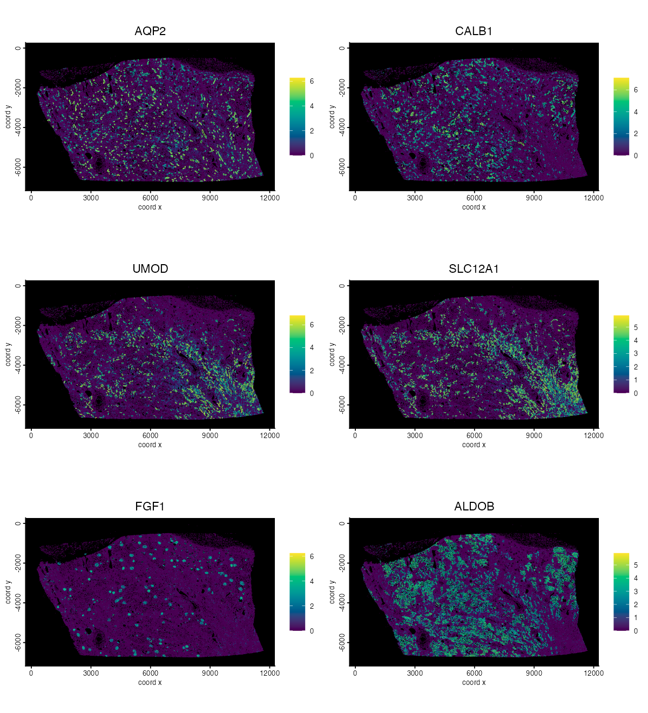
```

# Spatial co-expression modules

`spatialCoexpression()` averages each cell's expression with its neighbors' in
the spatial network, correlates the genes on these smoothed values, and
clusters the correlation into modules. It runs on the 500 genes with the
highest Moran's I.

```{r coexpression}
spatial_genes <- moran$feats[1:500]

coexpr <- spatialCoexpression(g,
    feats = spatial_genes,
    spatial_network_name = "Delaunay_network",
    n_modules = 12,
    return_gobject = FALSE
)
coexpr$summary
```

```
    module  size within_cor between_cor      score
     <int> <int>      <num>       <num>      <num>
 1:     12    12 0.62705008 -0.17025979 0.62705008
 2:      7   115 0.62879799  0.11470150 0.44961490
 3:      3    33 0.49288059 -0.07894577 0.44787368
 4:      4    50 0.64587865  0.15433565 0.43622939
 5:      1    39 0.53897550  0.04609605 0.42236500
 6:      9    39 0.44261863 -0.12305499 0.42172490
 7:      2    25 0.53569295  0.07285556 0.40545777
 8:      6    66 0.52176309  0.08132353 0.39049620
 9:      5    10 0.46331126  0.06878825 0.35255761
10:      8    63 0.54757807  0.22116485 0.33324252
11:     10    30 0.40866457  0.17244987 0.26861127
12:     11    18 0.07054889  0.03393341 0.05614329
```

The summary ranks the modules: a high `within_cor` and a low `between_cor`
mean a module is coherent and distinct from the others.

```{r coexpression-heatmap}
heatmapCoexpression(g, coexpr)
```

```{r coexpression-heatmap-fig, eval = TRUE, echo = FALSE, out.width = "100%"}
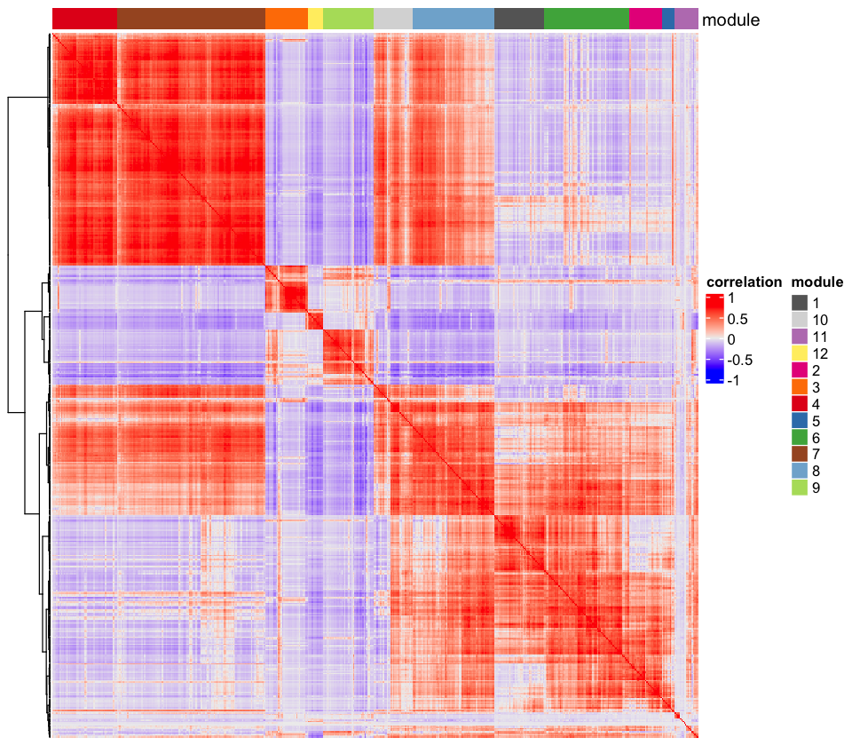
```

The genes that best represent each of the four top-ranked modules:

```{r coexpression-genes}
top_modules <- coexpr$summary$module[1:4]
coexpr$feats[module %in% top_modules][
    order(match(module, top_modules), -module_cor),
    head(.SD, 5), by = "module"
]
```

```
    module feat_ID module_cor
     <int>  <char>      <num>
 1:     12    CD53  0.6731775
 2:     12   CXCR4  0.6714477
 3:     12   ACAP1  0.6577427
 4:     12    TMC8  0.6560036
 5:     12   IKZF1  0.6555216
 6:      7    LRP2  0.7393227
 7:      7   GLYAT  0.7381796
 8:      7   ANPEP  0.7376737
 9:      7    CUBN  0.7356980
10:      7  IL17RB  0.7326995
11:      3   NPHS2  0.6527897
12:      3   NPHS1  0.6348552
13:      3   CLIC5  0.6243521
14:      3    FGF1  0.6226819
15:      3    NDNF  0.6208675
16:      4 SLC5A12  0.7693958
17:      4   ALDOB  0.7587531
18:      4 SLC22A6  0.7461151
19:      4    DPYS  0.7413423
20:      4  UGT1A9  0.7319696
```

The top module is the lymphocyte infiltrates (module 12). Module 3 is the
glomeruli. Modules 7 and 4 split the proximal tubule into two programs: one
for endocytic uptake (LRP2, CUBN) and one for gluconeogenesis and organic
anion transport (ALDOB, SLC5A12, SLC22A6).

The same call with the default `return_gobject = TRUE` adds the module scores
to the object, one per cell and module:

```{r coexpression-scores}
g <- spatialCoexpression(g,
    feats = spatial_genes,
    spatial_network_name = "Delaunay_network",
    n_modules = 12
)
```

Each module's color scale is capped at the 99th percentile of its non-zero
scores, so a few high-scoring cells do not wash out the rest:

```{r coexpression-spatial}
module_scores <- getSpatialEnrichment(g, name = "spatial_module",
    output = "data.table")

for (m in as.character(top_modules)) {
    v <- module_scores[[m]]
    spatCellPlot2D(g,
        spat_enr_names = "spatial_module",
        cell_annotation_values = m,
        gradient_style = "sequential",
        gradient_limits = c(0, stats::quantile(v[v > 0], 0.99)),
        point_size = 0.2,
        point_border_stroke = 0,
        background_color = "black"
    )
}
```

```{r coexpression-spatial-fig, eval = TRUE, echo = FALSE, out.width = "50%", fig.show = "hold"}
knitr::include_graphics(sprintf(
    "images/atera_human_kidney/12_module_%d.png", 1:4))
```

# Spatial enrichment

PAGE scores each cell for a set of marker genes per cell type, here short
signatures for the nephron segments and the main other cell types of the
kidney.

```{r page}
signatures <- list(
    proximal_tubule = c("LRP2", "CUBN", "SLC34A1", "SLC5A12", "ALDOB", "PCK1"),
    loop_of_henle = c("UMOD", "SLC12A1", "KCNJ1", "CLDN16", "CASR"),
    distal_tubule = c("SLC12A3", "CALB1", "TRPM6", "PVALB"),
    collecting_duct = c("AQP2", "AQP3", "SCNN1G", "FXYD4", "HSD11B2"),
    intercalated = c("ATP6V1B1", "ATP6V0D2", "SLC4A1", "SLC26A4", "FOXI1"),
    podocyte = c("NPHS1", "NPHS2", "PODXL", "PTPRO", "CLIC5", "WT1"),
    endothelial = c("PECAM1", "VWF", "CDH5", "EMCN", "PLVAP", "KDR"),
    stromal = c("PDGFRB", "COL1A1", "COL3A1", "DCN", "C7", "RGS5"),
    T_NK = c("CD3E", "CD3D", "CD2", "TRAC", "NKG7", "GZMA"),
    myeloid = c("CD68", "CD163", "C1QA", "C1QB", "CSF1R", "AIF1")
)
sign_matrix <- makeSignMatrixPAGE(names(signatures), signatures)

g <- runPAGEEnrich(g,
    sign_matrix = sign_matrix,
    expression_values = "normalized",
    min_overlap_genes = 3, # the distal tubule signature has 4 genes
    verbose = FALSE
)
```

Each signature's color scale is capped at the 1st and 99th percentile of its
scores:

```{r page-spatial}
page_scores <- getSpatialEnrichment(g, name = "PAGE", output = "data.table")

for (sig in c("proximal_tubule", "loop_of_henle", "collecting_duct",
              "podocyte", "stromal", "T_NK")) {
    v <- page_scores[[sig]]
    spatCellPlot2D(g,
        spat_enr_names = "PAGE",
        cell_annotation_values = sig,
        gradient_style = "sequential",
        gradient_limits = stats::quantile(v, c(0.01, 0.99)),
        point_size = 0.2,
        point_border_stroke = 0,
        background_color = "black"
    )
}
```

```{r page-spatial-fig, eval = TRUE, echo = FALSE, out.width = "50%", fig.show = "hold"}
knitr::include_graphics(sprintf(
    "images/atera_human_kidney/13_page_%d.png", 1:6))
```

To check the marker-based names against these independent gene sets, ask, for
each signature, which cell type scores highest on average:

```{r page-vs-types}
page <- merge(page_scores, pDataDT(g)[, .(cell_ID, cell_type)], by = "cell_ID")
scored <- intersect(names(signatures), names(page))
page_mean <- page[, lapply(.SD, mean), by = "cell_type", .SDcols = scored]
data.table::data.table(
    signature = scored,
    top_cell_type = vapply(scored, function(s) {
        page_mean$cell_type[which.max(page_mean[[s]])]
    }, character(1L)),
    second = vapply(scored, function(s) {
        page_mean$cell_type[order(-page_mean[[s]])[2]]
    }, character(1L))
)
```

```
          signature              top_cell_type                     second
             <char>                     <char>                     <char>
 1: proximal_tubule            proximal tubule              tubule, mixed
 2:   loop_of_henle       thick ascending limb   distal convoluted tubule
 3:   distal_tubule   distal convoluted tubule            principal cells
 4: collecting_duct            principal cells intercalated cells, type B
 5:    intercalated intercalated cells, type A intercalated cells, type B
 6:        podocyte                  podocytes     glomerular endothelium
 7:     endothelial          endothelial cells       arterial endothelium
 8:         stromal                fibroblasts         pericytes and VSMC
 9:            T_NK                    T cells                    B cells
10:         myeloid                macrophages                    T cells
```

Every signature scores highest in the cell type it describes, and the second
is a neighboring segment or a related type. Reading the table the other way,
by the best signature per cell type, would not work here. Cell types without
a signature of their own, such as B cells or Schwann cells, are then assigned
whichever signature they score least badly on.

```{r save-spatial}
g <- saveGiotto(g, name = "spatial")
```

# Cell-cell interactions

`cellProximityMotifs()` counts which cell types are neighbors in the spatial
network more or less often than expected when the labels are shuffled. Pairs
of neighbors (`size = 2`) give the classic proximity enrichment:

```{r motifs-pairs}
pairs <- cellProximityMotifs(g,
    spatial_network_name = "Delaunay_network",
    cluster_column = "cell_type",
    size = 2L,
    n_perm = 1000L
)
```

```{r motifs-pairs-plot}
plotMotifEnrichment(g, pairs)
```

```{r motifs-pairs-fig, eval = TRUE, echo = FALSE, out.width = "100%"}
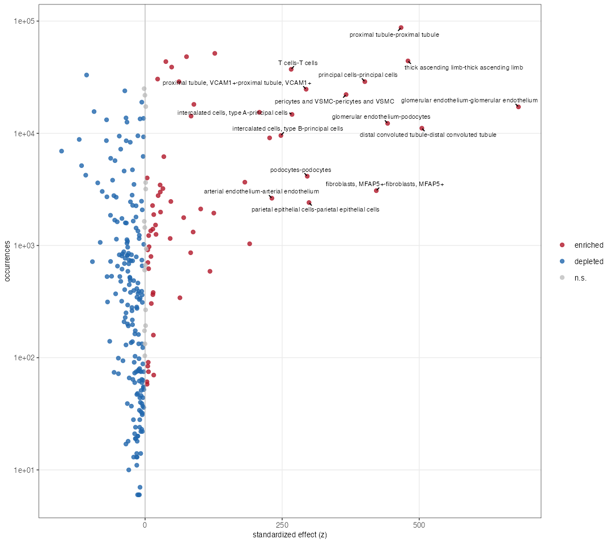
```

Each cell type is most enriched next to its own kind, as expected for tubules
and glomeruli. Glomerular endothelium next to podocytes is one of the most
enriched pairs between two different types.

Motifs of three cells (`size = 3`) with the conditional null hold the observed
pairs fixed, so a triplet that is still enriched is enriched beyond what its
pairs already explain:

```{r motifs-triplets}
triplets <- cellProximityMotifs(g,
    spatial_network_name = "Delaunay_network",
    cluster_column = "cell_type",
    size = 3L,
    null = "conditional",
    n_perm = 1000L
)
head(triplets[order(-z), .(motif_id, observed, expected, fold, p_adj)], 10)
```

```
                                                                      motif_id observed  expected     fold      p_adj
                                                                        <char>    <num>     <num>    <num>      <num>
 1:                             size3_open_fibroblasts-fibroblasts-fibroblasts    50212 43814.039 1.146025 0.01002828
 2:                 size3_open_proximal tubule-proximal tubule, VCAM1+-T cells     3056  1624.740 1.880916 0.01002828
 3: size3_open_proximal tubule-proximal tubule, VCAM1+-proximal tubule, VCAM1+     5259  3340.192 1.574460 0.01002828
 4:         size3_open_tubule, mixed-thick ascending limb-thick ascending limb     2025  1185.039 1.708805 0.01002828
 5:                              size3_open_pericytes and VSMC-T cells-T cells     1321   748.024 1.765986 0.01002828
 6:         size3_open_proximal tubule, VCAM1+-proximal tubule-proximal tubule     9896  7699.868 1.285217 0.01002828
 7:                             size3_open_macrophages-fibroblasts-fibroblasts    19037 17168.147 1.108856 0.01002828
 8:                   size3_open_fibroblasts-endothelial cells-proximal tubule    13238 11231.294 1.178671 0.01002828
 9:                                     size3_open_fibroblasts-T cells-T cells    15902 11088.096 1.434151 0.01002828
10:                     size3_open_fibroblasts, MFAP5+-fibroblasts-fibroblasts      386   192.563 2.004539 0.01002828
```

In an open motif the first cell type listed is the center that links the
other two. The glyphs draw the top-ranked triplets:

```{r motifs-triplets-plot}
plotMotifGlyphs(g, triplets, cell_color_code = type_colors)
```

```{r motifs-triplets-fig, eval = TRUE, echo = FALSE, out.width = "100%"}
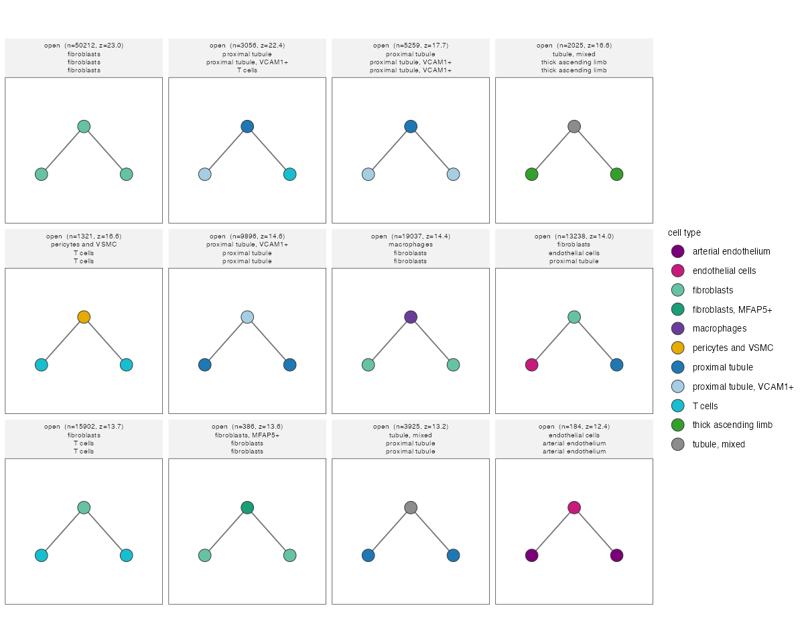
```

The top triplet is fibroblasts in a row, the large interstitial areas of the
section. The second is more specific: a proximal tubule cell between an
injured, VCAM1+ tubule cell and a T cell, almost twice as often as its pairs
predict. It marks where T cells sit against injured tubules:

```{r motifs-spatial}
spatMotifPlot(g,
    motif_id = "size3_open_proximal tubule-proximal tubule, VCAM1+-T cells",
    cluster_column = "cell_type",
    spatial_network_name = "Delaunay_network"
)
```

```{r motifs-spatial-fig, eval = TRUE, echo = FALSE, out.width = "100%"}
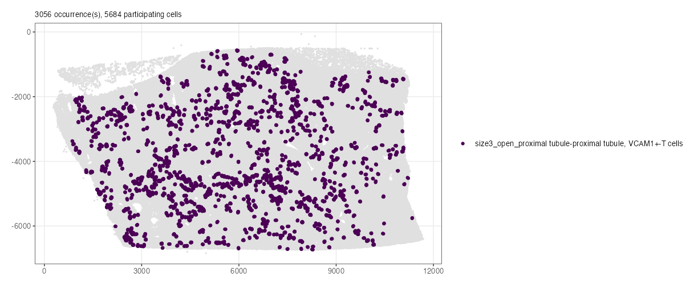
```

```{r save-analyzed}
g <- saveGiotto(g, name = "analyzed")
```

# Further reading

Suggested further topics:

* [Atera Human Breast Cancer](atera_human_breast_cancer.html), for Atera
  preview data in the Xenium layout
* Continue with [Cell typing with a cluster tree](cell_typing_cluster_tree.html)
  for a more systematic annotation than the cluster markers above
* GiottoLens for [interactive visualization and annotation](giottolens.html)

# Session info

```{r session}
sessionInfo()
```

```
R version 4.5.1 (2025-06-13)
Platform: aarch64-apple-darwin20
Running under: macOS Sonoma 14.5

Matrix products: default
BLAS:   /Library/Frameworks/R.framework/Versions/4.5-arm64/Resources/lib/libRblas.0.dylib 
LAPACK: /Library/Frameworks/R.framework/Versions/4.5-arm64/Resources/lib/libRlapack.dylib;  LAPACK version 3.12.1

locale:
[1] en_US/en_US/en_US/C/en_US/en_US

time zone: America/New_York
tzcode source: internal

attached base packages:
[1] stats     graphics  grDevices utils     datasets  methods   base     

other attached packages:
[1] GiottoDisk_0.0.0.6 Giotto_4.3.5       GiottoClass_0.7.18 arrow_23.0.1.2    

loaded via a namespace (and not attached):
  [1] RColorBrewer_1.1-3          shape_1.4.6.1               jsonlite_2.0.0              wk_0.9.5                   
  [5] magrittr_2.0.4              magick_2.9.1                farver_2.1.2                GlobalOptions_0.1.4        
  [9] ragg_1.5.2                  vctrs_0.7.2                 Cairo_1.7-0                 memoise_2.0.1              
 [13] GiottoUtils_0.2.7           terra_1.9-11                htmltools_0.5.9             S4Arrays_1.8.1             
 [17] future.mirai_1.0.0          BiocNeighbors_2.2.0         SparseArray_1.8.1           parallelly_1.46.1          
 [21] htmlwidgets_1.6.4           plotly_4.12.0               cachem_1.1.0                igraph_2.2.2               
 [25] lifecycle_1.0.5             iterators_1.0.14            pkgconfig_2.0.3             rsvd_1.0.5                 
 [29] Matrix_1.7-3                R6_2.6.1                    fastmap_1.2.0               clue_0.3-68                
 [33] GenomeInfoDbData_1.2.14     MatrixGenerics_1.20.0       future_1.70.0               magic_1.6-1                
 [37] digest_0.6.39               colorspace_2.1-2            S4Vectors_0.48.1            irlba_2.3.7                
 [41] textshaping_1.0.5           GenomicRanges_1.60.0        beachmat_2.24.0             filelock_1.0.3             
 [45] labeling_0.4.3              httr_1.4.8                  polyclip_1.10-7             abind_1.4-8                
 [49] compiler_4.5.1              smotif_0.2.0                bit64_4.6.0-1               withr_3.0.2                
 [53] doParallel_1.0.17           smotifrs_0.2.0              S7_0.2.1                    backports_1.5.1            
 [57] BiocParallel_1.42.2         viridis_0.6.5               ggforce_0.5.0               R.utils_2.13.0             
 [61] sedonadb_0.5.0.9000         MASS_7.3-65                 DelayedArray_0.34.1         rjson_0.2.23               
 [65] bluster_1.18.0              gtools_3.9.5                GiottoVisuals_0.2.16        tools_4.5.1                
 [69] otel_0.2.0                  R.oo_1.27.1                 glue_1.8.0                  grid_4.5.1                 
 [73] checkmate_2.3.4             cluster_2.1.8.3             generics_0.1.4              gtable_0.3.6               
 [77] R.methodsS3_1.8.2           tidyr_1.3.2                 data.table_1.18.2.1         BiocSingular_1.24.0        
 [81] tidygraph_1.3.1             ScaledMatrix_1.16.0         XVector_0.48.0              BiocGenerics_0.54.1        
 [85] tilework_1.0.0              ggrepel_0.9.8               foreach_1.5.2               pillar_1.11.1              
 [89] nanoarrow_0.9.0             RcppHNSW_0.7.0              circlize_0.4.18             dplyr_1.2.0                
 [93] tweenr_2.0.3                lattice_0.22-7              bit_4.6.0                   tidyselect_1.2.1           
 [97] ComplexHeatmap_2.26.1       SingleCellExperiment_1.30.1 gridExtra_2.3               IRanges_2.42.0             
[101] Seqinfo_1.0.0               SummarizedExperiment_1.38.1 scattermore_1.2             stats4_4.5.1               
[105] graphlayouts_1.2.3          Biobase_2.68.0              matrixStats_1.5.0           UCSC.utils_1.4.0           
[109] lazyeval_0.2.2              GiottoKernels_0.3.0         codetools_0.2-20            ggraph_2.2.2               
[113] tibble_3.3.1                colorRamp2_0.1.0            cli_3.6.5                   geometry_0.5.2             
[117] systemfonts_1.3.2           mirai_2.7.2                 Rcpp_1.1.2                  GenomeInfoDb_1.44.3        
[121] globals_0.19.1              png_0.1-9                   nanonext_1.10.2             parallel_4.5.1             
[125] ggplot2_4.0.2               assertthat_0.2.1            listenv_0.10.1              SpatialExperiment_1.20.0   
[129] geoarrow_0.4.4              viridisLite_0.4.3           scales_1.4.0                purrr_1.2.1                
[133] crayon_1.5.3                GetoptLong_1.1.1            rlang_1.1.7                 cowplot_1.2.0              
```
