```{r setup, include=FALSE, eval = FALSE}
knitr::opts_chunk$set(echo = TRUE, class.message = "message", class.warning = "warning",
                      fig.align = "center", dpi = 150, fig.retina = 1,
                      fig.path = "figures/")
```

# Overview

This tutorial builds a disk-backed Giotto object from the full slide of the
[CosMx Human Whole Transcriptome colon dataset](https://brukerspatialbiology.com/products/cosmx-spatial-molecular-imager/ffpe-dataset/cosmx-human-whole-transcriptome-colon-dataset/),
about half a million cells, and takes it through
quality control, clustering and cell type annotation without holding the
expression matrix in memory. It then finds spatially variable genes, groups
them into spatial co-expression modules and scores curated tissue programs.
The result is a cell-type map of the whole slide, together with maps of where
each gene module and tissue program is active. For the same specimen at a size
that runs anywhere, see the one-FOV
[CosMx mini tutorial](cosmx_mini_colon_wtx.html).

The whole tutorial took about 11 minutes with 4 parallel workers on a 64 GB
computer, and about 13 minutes with the 16 GB setup in
[Using less memory](#using-less-memory);
[Run time and memory](#run-time-and-memory) shows the time and memory of each
step for both.

# Install packages

```r
install.packages(c("remotes", "GiottoUtils"),
    repos = c("https://giotto-suite.r-universe.dev", "https://cloud.r-project.org"))
GiottoUtils::suite_install(ref = "disk_full", install_arrow = TRUE) # Giotto 4.3.7 or later
install.packages(c("BiocManager", "RcppHNSW"))
BiocManager::install(c("scran", "ComplexHeatmap"))
```

`ref = "disk_full"` also installs **cosmxscan**, which reads the count matrix
with a Rust byte scanner, and **GiottoKernels**, compiled kernels that speed up
PCA and spatial statistics. r-universe ships both prebuilt for macOS, Windows
and Linux, so no Rust toolchain is needed. cosmxscan is only used to build the
vault, not to read one that already exists.

# Dataset explanation

The [CosMx Human Whole Transcriptome colon dataset](https://brukerspatialbiology.com/products/cosmx-spatial-molecular-imager/ffpe-dataset/cosmx-human-whole-transcriptome-colon-dataset/)
from Bruker Spatial Biology (NanoString): **CosMx Whole Transcriptome (WTx)**,
human colon, slide S0, ~400 fields of view. The donor is a 56-year-old woman with a G1, stage
**IVA T3N0M1a** primary sigmoid adenocarcinoma, so one section carries normal
mucosa with intact crypts, the tumor mass, the desmoplastic stroma around it,
and uninvaded muscularis propria.

The panel is 20,378 features: **18,935 RNA targets**, 50 negative probes and
1,393 SystemControl probes. 493,834 cells are measured; 489,453 survive
segmentation and filtering. The export comes from AtoMx Spatial Informatics
Platform 3.10.5: cells are segmented by the vendor pipeline, and the
cell x gene matrix ships with the export, so this tutorial reads it rather than
rebuilding it from transcripts.

| vendor file | what it holds | size |
|---|---|---|
| `S0_exprMat_file.csv.gz` | cell x gene counts, 18.75 GB raw | 880 MB |
| `S0-polygons.csv.gz` | one segmentation ring per cell | 117 MB |
| `S0_metadata_file.csv.gz` | per-cell centroid, area, counts | 39 MB |
| `S0_fov_positions_file.csv.gz` | FOV origins on the slide | 4 KB |

From the command line:

```{bash download, eval=FALSE}
curl --create-dirs --output-dir cosmx_colon_wtx -O "https://objects.liquidweb.services/smi-public/wtx_manuscript/colon_discovery/{S0_exprMat_file.csv.gz,S0-polygons.csv.gz,S0_metadata_file.csv.gz,S0_fov_positions_file.csv.gz}"
```

Or by clicking through: Bruker Spatial Biology's
[CosMx Human Whole Transcriptome colon dataset](https://brukerspatialbiology.com/products/cosmx-spatial-molecular-imager/ffpe-dataset/cosmx-human-whole-transcriptome-colon-dataset/)
page > **Download Data** > complete the form > **Download Files**, which opens
the index of files.

Start R in the folder you downloaded into, so the default paths below find the
data, or set `COSMX_DIR` to where the files are.

# Packages and setup

```{r config, message=FALSE, eval = FALSE}
Sys.setenv(ARROW_DEFAULT_MEMORY_POOL = "system")
suppressMessages({
  library(arrow)
  library(Giotto); library(GiottoDisk)
  library(data.table)
})

COSMX_DIR      <- Sys.getenv("COSMX_DIR", "cosmx_colon_wtx")   # the vendor .gz files, read only
VAULT          <- Sys.getenv("GIOTTO_VAULT", "vault")          # the GiottoDisk store
results_folder <- "results"                                    # Giotto figures, saved as PNGs

# set an appropriate amount of parallel workers for your computer
WORKERS <- 4
# on a 16 GB computer, uncomment these two lines (see Using less memory below)
# WORKERS <- 2
# options(giotto.cores = 4)
future::plan(future::multisession, workers = WORKERS)

instructions <- createGiottoInstructions(save_dir = results_folder,
                                         save_plot = TRUE, show_plot = TRUE,
                                         return_plot = FALSE)

# a managed project directory to hold the object on disk
giotto_source <- sourceCreate(VAULT, type = "gDirSource")
# send expression and spatial writes there instead of a temp folder
setArtifactDumpDir(giotto_source)
```

`sourceCreate()` makes the vault, a managed project folder that holds the
object on disk. `setArtifactDumpDir()` sends every expression and spatial
write into it, so saving later has nothing to gather from temporary folders.
`ARROW_DEFAULT_MEMORY_POOL = "system"` has to be set before `arrow` loads: Arrow
then hands the memory it frees back to the system instead of keeping it for
reuse, which lowers the peak while the data are read.

## Using less memory

Each worker is a separate R session holding its own share of the work, so the
worker count above is the setting to lower on a smaller machine; the tiled
steps then run more slowly. On a 16 GB computer, uncomment the two lines under
`WORKERS <- 4` above, for 2 workers and 4 cores; `options(giotto.cores = 4)`
has to come after `library(Giotto)`, which resets it. The workers keep the
memory they used to read the data until they are restarted, which
[Read the data](#read-the-data) does after saving the first snapshot.
[Run time and memory](#run-time-and-memory) shows the 16 GB setup beside this
one.

# Read the data

```{r create, eval = FALSE}
g_cosmx <- createGiottoCosMxObject(
  cosmx_dir        = COSMX_DIR,
  backend          = giotto_source,
  version          = "v6",
  poly_pref        = "csv",
  # on disk (backend): load_expression reads the vendor's cell x gene matrix
  # with cosmxscan, which keeps only the nonzero counts, into a parquet store
  load_expression  = TRUE,
  # load_transcripts = TRUE would read the transcript file (not downloaded
  # above) into a points layer, and aggregateFeatures() could then count them
  # inside each polygon to build the matrix yourself instead of using the
  # vendor's
  load_transcripts = FALSE,
  feat_type        = c("rna", "negprobes", "falsecode"),
  split_keyword    = list("^Negative", "^SystemControl"),
  instructions     = instructions)
g_cosmx
```

```
An object of class giotto 
>Active spat_unit:  cell 
>Active feat_type:  rna 
dimensions    : 18935, 493834 (features, cells)
[SUBCELLULAR INFO]
polygons      : cell 
[AGGREGATE INFO]
expression -----------------------
  [cell][rna] raw
  [cell][negprobes] raw
  [cell][falsecode] raw
spatial locations ----------------
  [cell] raw


Use objHistory() to see steps and params used
```

The polygon file also holds 135 polygons whose cells have no expression or
metadata row; the reader leaves them out with a warning.

A backed project writes named snapshots into the project directory.
`saveGiotto()` returns the object with its stores registered in the vault, so
keep the result.

```{r save-ingest, results="hide", warning=FALSE, message=FALSE, eval = FALSE}
g_cosmx <- saveGiotto(g_cosmx, name = "ingest", overwrite = TRUE, verbose = FALSE)
# restart the workers: they keep the memory they used to read the data, new ones start empty
future::plan(future::sequential)
future::plan(future::multisession, workers = WORKERS)
```

# Quality control and filtering

```{r stats, eval = FALSE}
g_cosmx <- addStatistics(g_cosmx, stats = "cell", expression_values = "raw")
```

`addStatistics()` writes per-cell counts, genes detected and total expression
into the cell metadata.

```{r spatial-overview, fig.cap="Every cell on the slide, colored by genes detected (1st to 99th percentile). Cell centroids come from the segmentation polygons.", fig.height=7, eval = FALSE}
spatPlot2D(g_cosmx, cell_color = "nr_feats", color_as_factor = FALSE,
           gradient_style = "sequential",
           gradient_limits = quantile(pDataDT(g_cosmx)$nr_feats, c(0.01, 0.99)),
           point_size = 0.25, point_shape = "border", point_border_stroke = 0,
           coord_fix_ratio = 1, background_color = "white",
           save_param = list(save_name = "slide_genes_per_cell"))
```

```{r spatial-overview-fig, echo = FALSE, out.width = "100%"}
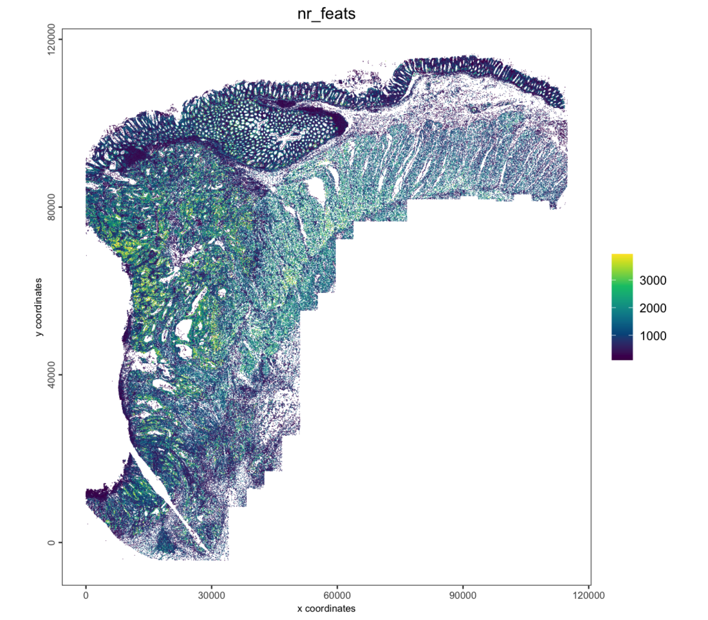
```

```{r qc-counts, fig.cap="Counts per cell before filtering.", fig.height=3.4, eval = FALSE}
filterDistributions(g_cosmx, detection = "cells", method = "sum",
                    nr_bins = 90, scale_axis = "log10",
                    save_param = list(save_name = "qc_counts"))
```

```{r qc-counts-fig, echo = FALSE, out.width = "100%"}
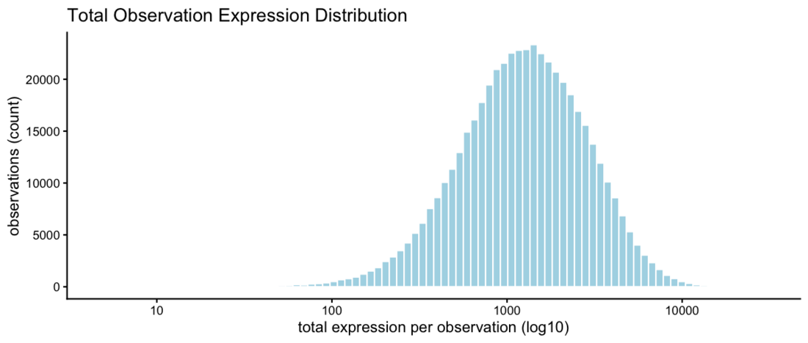
```

```{r qc-genes, fig.cap="Genes detected per cell before filtering, with the 100-gene threshold drawn.", fig.height=3.4, eval = FALSE}
filterDistributions(g_cosmx, detection = "cells", method = "threshold",
                    expression_threshold = 1, nr_bins = 90,
                    show_plot = FALSE, return_plot = TRUE, save_plot = FALSE) +
  ggplot2::geom_vline(xintercept = 100, color = "#C44E52", linetype = "dashed")
```

```{r qc-genes-fig, echo = FALSE, out.width = "100%"}
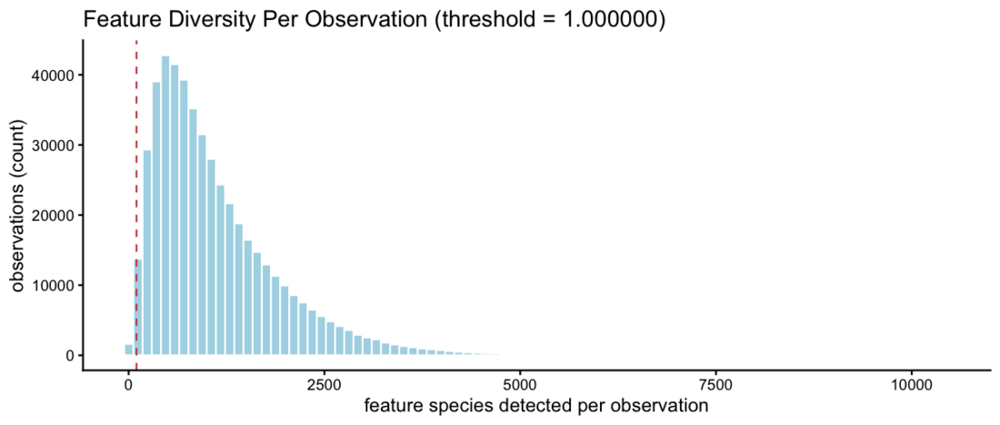
```

```{r qc-summary, eval = FALSE}
cell_metadata <- pDataDT(g_cosmx)
cat(sprintf("%s cells | median %s counts and %s genes per cell | %s cells under 100 genes\n",
            format(nrow(cell_metadata), big.mark = ","),
            median(cell_metadata$nCount_RNA), median(cell_metadata$nr_feats),
            format(sum(cell_metadata$nr_feats < 100), big.mark = ",")))
```

```
493,834 cells | median 1258 counts and 895 genes per cell | 4,381 cells under 100 genes
```

```{r filter, eval = FALSE}
g_cosmx <- filterGiotto(g_cosmx,
                        expression_threshold    = 1,
                        feat_det_in_min_cells   = 100,
                        min_det_feats_per_cell  = 100,
                        verbose                 = FALSE)
g_cosmx
```

```
An object of class giotto 
>Active spat_unit:  cell 
>Active feat_type:  rna 
dimensions    : 18935, 489453 (features, cells)
[SUBCELLULAR INFO]
polygons      : cell 
[AGGREGATE INFO]
expression -----------------------
  [cell][rna] raw
  [cell][negprobes] raw
  [cell][falsecode] raw
spatial locations ----------------
  [cell] raw


Use objHistory() to see steps and params used
```

# Normalization and feature selection

This is a whole-transcriptome panel, so feature selection is needed: most of
the 18,935 genes vary little between cells, and the 2,000 most variable ones
are kept for the dimension reduction.

```{r normalize, eval = FALSE}
g_cosmx <- normalizeGiotto(g_cosmx, scale_feats = FALSE, scale_cells = FALSE,
                           scalefactor = 6000)

g_cosmx <- addStatistics(g_cosmx, stats = c("cell", "feature"))

g_cosmx <- calculateHVF(g_cosmx, method = "cov_groups",
                        nr_expression_groups = 20, zscore_threshold = 1.1,
                        n_top_feats = 2000, show_plot = FALSE,
                        save_plot = FALSE, return_plot = FALSE,
                        verbose = FALSE)

hvf_ids <- fDataDT(g_cosmx)[hvf == "yes", feat_ID]
cat(sprintf("%s highly variable genes, e.g. %s\n",
            format(length(hvf_ids), big.mark = ","), paste(head(hvf_ids), collapse = ", ")))
```

```
2,000 highly variable genes, e.g. A4GNT, AAAS, AAGAB, ABAT, ABCA10, ABCA12
```

`scale_feats` and `scale_cells` stay `FALSE` because scaling densifies;
`scale_unit = TRUE` inside `runPCA()` below standardizes without materializing.

# Dimension reduction

```{r pca, eval = FALSE}
SEED <- 1234

g_cosmx <- runPCA(g_cosmx, feats_to_use = "hvf", scale_unit = TRUE,
                  center = TRUE, ncp = 20, method = "auto", set_seed = TRUE,
                  seed_number = SEED, verbose = FALSE)
```

```{r save-pca, results="hide", warning=FALSE, message=FALSE, eval = FALSE}
g_cosmx <- saveGiotto(g_cosmx, name = "pca", overwrite = TRUE, verbose = FALSE)
```

```{r scree, fig.cap="Variance per principal component. Percentages are of the variance in the components computed.", fig.height=6, eval = FALSE}
screePlot(g_cosmx, ncp = 20, verbose = FALSE,
          save_param = list(save_name = "scree"))
```

```{r scree-fig, echo = FALSE, out.width = "100%"}
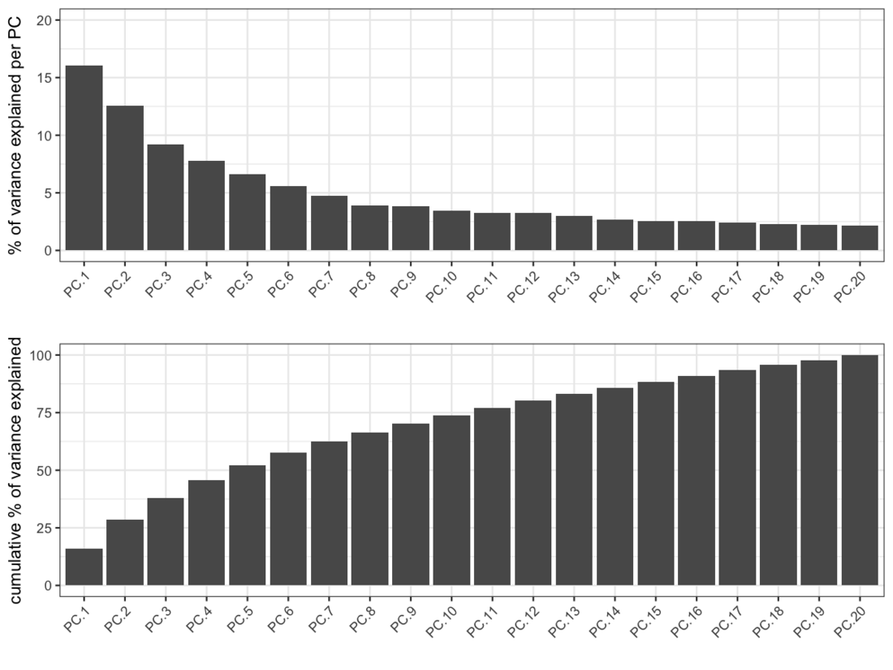
```

```{r pc-depth, fig.cap="Absolute correlation of each PC with log10 raw counts per cell. The dashed line is the 0.5 threshold used to decide whether PC1 is a depth axis.", fig.height=4.2, eval = FALSE}
plotDimCovariateCor(g_cosmx, covariates = "nCount_RNA", dimensions_to_use = 1:20,
                    threshold = 0.5, # |r| >= 0.5 means depth explains at least a quarter of a PC's variance
                    save_param = list(save_name = "pc_depth_correlation"))

# drop PC1 only if it is a depth axis
PCS_USE <- 2:20
```

```{r pc-depth-fig, echo = FALSE, out.width = "100%"}
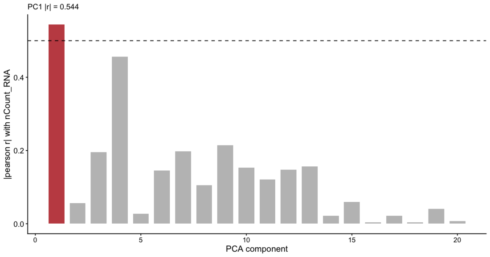
```

PC1 is the only component above the 0.5 line, so it is treated as a depth
axis and left out: `PCS_USE` is **2:20**.

# Clustering

The neighbor graph is built once and both steps below use it: UMAP lays out
the cells from the kNN that `createNearestNetwork()` keeps, and Leiden
partitions the sNN built from that kNN.

```{r nn-network, eval = FALSE}
g_cosmx <- createNearestNetwork(g_cosmx, type = "sNN", k = 30,
                                dimensions_to_use = PCS_USE,
                                engine = "hnsw", ef = 400, keep_knn = TRUE,
                                verbose = FALSE)
```

```{r umap, eval = FALSE}
g_cosmx <- runUMAP(g_cosmx, dimensions_to_use = PCS_USE, min_dist = 0.3,
                   spread = 1, n_sgd_threads = 0, nn_engine = "giotto",
                   set_seed = TRUE, seed_number = SEED, verbose = FALSE)
```

```{r cluster, eval = FALSE}
g_cosmx <- doLeidenCluster(g_cosmx, name = "leiden_clus", resolution = 1,
                           n_iterations = 20, set_seed = TRUE,
                           seed_number = SEED)
```

```{r save-processed, results="hide", warning=FALSE, message=FALSE, eval = FALSE}
g_cosmx <- saveGiotto(g_cosmx, name = "processed", overwrite = TRUE, verbose = FALSE)
```

```{r cluster-summary, eval = FALSE}
cell_metadata <- pDataDT(g_cosmx)
cluster_sizes <- cell_metadata[, .N, by = leiden_clus]
cat(sprintf("%d clusters | %s to %s cells each\n", nrow(cluster_sizes),
            format(min(cluster_sizes$N), big.mark = ","),
            format(max(cluster_sizes$N), big.mark = ",")))
```

```
24 clusters | 5,128 to 55,316 cells each
```

```{r umap-clusters, fig.cap="Every cell in UMAP space by Leiden cluster.", eval = FALSE}
plotUMAP(g_cosmx, cell_color = "leiden_clus",
         point_size = 0.25, point_alpha = 0.4,
         point_shape = "border", point_border_stroke = 0,
         legend_symbol_size = 3,
         save_param = list(save_name = "umap_clusters"))
```

```{r umap-clusters-fig, echo = FALSE, out.width = "100%"}
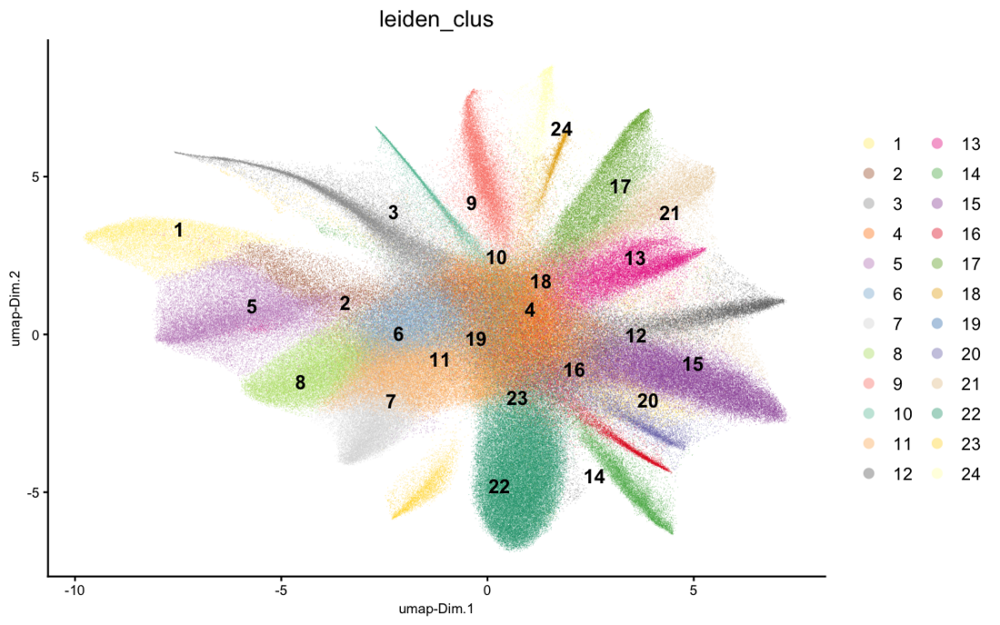
```

```{r umap-genes, fig.cap="The same embedding colored by genes detected (1st to 99th percentile).", eval = FALSE}
plotUMAP(g_cosmx, cell_color = "nr_feats", color_as_factor = FALSE,
         gradient_style = "sequential",
         gradient_limits = quantile(cell_metadata$nr_feats, c(0.01, 0.99)),
         point_size = 0.25, point_alpha = 0.4,
         point_shape = "border", point_border_stroke = 0,
         save_param = list(save_name = "umap_genes"))
```

```{r umap-genes-fig, echo = FALSE, out.width = "100%"}
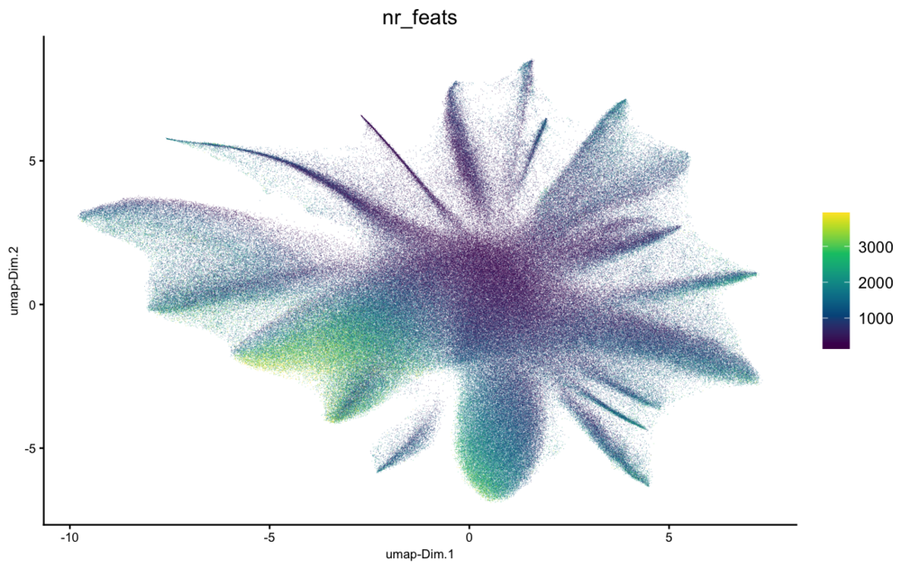
```

# Cell type annotation

## Markers

`findScranMarkers_one_vs_all()` compares each cluster against the pooled
remainder and returns a `ranking` column, which orders the genes within each
cluster.

```{r markers, warning=FALSE, eval = FALSE}
scran_markers <- findScranMarkers_one_vs_all(g_cosmx,
                                             cluster_column = "leiden_clus",
                                             expression_values = "normalized",
                                             verbose = FALSE)
```

```{r tidy-markers, eval = FALSE}
markers_de <- scran_markers[
  , .(feats, cluster = as.character(cluster), logFC, p_value = p.value, FDR,
      ranking)]
markers_de <- markers_de[logFC >= 0.25 & FDR <= 0.05][order(cluster, ranking)]

cat(sprintf("%s marker genes across %d of %d clusters\n",
            format(nrow(markers_de), big.mark = ","),
            uniqueN(markers_de$cluster), nrow(cluster_sizes)))
```

```
2,053 marker genes across 23 of 24 clusters
```

<details>
<summary><strong>Top 10 markers per cluster</strong></summary>

```{r top-markers, eval = FALSE}
top_markers <- markers_de[order(ranking), .(top = paste(head(feats, 10), collapse = ", ")),
                          by = "cluster"]
top_markers[order(as.integer(cluster))]
```

```
cluster  top                                                                        
1        KRT8, CKB, FABP1, LGALS4, PIGR, SLC26A3, PHGR1, ITM2C, KRT20, B2M          
2        PIGR, KRT8, LGALS4, CKB, ITM2C, FABP1, C15orf48, PHGR1, LGALS3, MUC2       
3        KIR3DL1, DEF6, BRPF1, CSF2, BAAT, RERGL, IGF2BP3, DAPP1, KIAA0825, SULT1A2 
5        MUC2, PIGR, LGALS4, KRT8, ITM2C, ITLN1, B2M, FCGBP, REG4, SPINK4           
6        PIGR, CEACAM5, RPS19, RPS18, EPCAM, RPL37A, RPS21, RPLP2, RPS27, RPS29     
7        CEACAM5, MMP7, TMSB10, KRT8, CLDN4, S100A6, RPS19, LCN2, RPS18, EPCAM      
8        PIGR, CEACAM5, RPS18, RPS19, EPCAM, H4C11, RPL37A, RPLP2, PTMA, RPS21      
9        IGHA1, IGKC, JCHAIN, GRP, DPYSL4, SMIM41, TSC22D3, SMCO3, MZB1, DERL3      
10       CXCL8, HCAR3, HCAR2, MPV17L, PLEK, DUX4, IL1B, TAF11L3, PTGS2, PLAUR       
11       OR10H5, CEACAM5, MPV17L, PIGR, RPS19, RPS18, ZNF91, EPCAM, RPS21, RPL36    
12       MGP, C3, COL6A3, COL3A1, FBLN1, COL1A1, C7, COL1A2, MMP2, SERPINF1         
13       MPV17L, PTPRC, CXCR4, HLA-DRB1, IL7R, ZNF91, CD74, TRBC1, ARHGEF1, EVL     
14       PECAM1, PLVAP, COL4A1, SPARC, IGFBP7, VIM, SHANK3, VWF, EGFL7, A2M         
15       COL1A1, COL1A2, COL3A1, SPARC, FN1, MMP11, COL6A3, AEBP1, COL6A2, MMP14    
16       PRIMA1, CLU, LGI4, CDH19, VIM, SPARC, GPX3, KCNMB4, MYH11, PMP22           
17       HLA-DRB1, CD74, HLA-DRA, C1QC, HLA-DQB1, CD163, C1QA, STAB1, HLA-DPA1, CTSB
18       TPSB2, IL1RL1, CPA3, KIT, HDC, SLC18A2, ALOX5, IL18R1, RGS1, MS4A2         
19       IGHG1, PRKAG3, HTR3C, GCDH, EVA1A, NCAPH                                   
20       NOTCH3, IGFBP7, COL4A1, COL18A1, SPARC, COL1A1, COL3A1, A2M, VIM, COL6A2   
21       APOE, HLA-DRB1, CTSB, CD74, CTSD, HLA-DRA, SPP1, C1QC, RNASE1, HLA-DQB1    
22       ACTG2, MYH11, DES, TPM2, FLNA, CNN1, MYLK, CSRP1, MYL9, TPM1               
23       COL1A1, COL3A1, MMP1, MT2A, CXCL5, CXCL8, MMP2, SOD2, MMP3, COL1A2         
24       IGHG1, IGKC, GCDH, PRKAG3, PRMT8, EVA1A, HTR3C, NCAPH, XBP1, JCHAIN        
```

</details>

Each cluster is annotated based on the differentially expressed markers found
above, and its QC profile: counts, genes and area. The table shows the five
clusters with the fewest counts per cell. The dot plot below adds a third
check, using curated marker genes that were chosen independently of this
clustering.

```{r cluster-qc, eval = FALSE}
cluster_qc <- cell_metadata[
  , .(cells           = .N,
      median_counts   = as.numeric(median(nCount_RNA)),
      median_genes    = as.numeric(median(nr_feats)),
      median_area_um2 = as.numeric(round(median(Area.um2, na.rm = TRUE), 1))),
  by = .(cluster = leiden_clus)]
head(cluster_qc[order(median_counts)], 5)
```

```
cluster  cells  median_counts  median_genes  median_area_um2
4        30528  505            378.0         64.9           
10       13399  563            408.0         64.7           
19       8034   708            525.5         74.8           
9        20322  740            496.0         72.7           
3        21518  742            586.0         77.0           
```

Cluster 4, first in the table, is the **lowest of all 24 clusters on counts
and genes detected**, so it's possible these are low-quality cells rather than
a cell type.

## Curated marker panels

One curated gene set per broad cell type, used to read the clusters and to pick
the genes drawn in the dot plot.

```{r panels-data, eval = FALSE}
colon_markers_l1 <- list(
  immune_myeloid = c("CD68", "CD14", "CSF1R", "AIF1", "TYROBP", "FCER1G",
                     "ITGAM", "MNDA"),
  immune_mast = c("TPSB2", "CPA3", "KIT", "MS4A2", "HDC", "SLC18A2", "GATA2"),
  immune_nk_t = c("IL7R", "TRBC1", "PTPRC", "CXCR4", "CD3D", "CD3E", "TRAC",
                  "CD2", "CD7", "CD8A", "NKG7", "GNLY", "KLRD1", "KLRF1"),
  immune_granulocyte = c("HCAR2", "HCAR3", "CXCL8", "IL1B", "PTGS2", "G0S2",
                         "PLEK"),
  immune_b = c("MS4A1", "CD79A", "CD79B", "CD19", "BANK1", "TNFRSF13C",
               "CR2", "FCRL1"),
  immune_plasma = c("IGHA1", "IGHG1", "IGKC", "JCHAIN", "MZB1", "DERL3",
                    "XBP1"),
  fibroblast_CAF = c("COL1A1", "COL1A2", "COL3A1", "DCN", "LUM", "PDGFRB",
                     "THY1"),
  myofibroblast_SMC = c("MYH11", "DES", "ACTG2", "CNN1", "MYLK", "TAGLN",
                        "MYL9"),
  pericyte = c("NOTCH3", "RGS5", "KCNJ8", "HIGD1B", "CSPG4", "ACTA2", "ANPEP"),
  endothelial = c("PECAM1", "CDH5", "CLDN5", "VWF", "EGFL7", "RAMP2", "ERG"),
  epithelial_colonocyte = c("EPCAM", "KRT8", "KRT18", "KRT19", "CDH1", "ELF3",
                            "CLDN7"),
  epithelial_secretory = c("MUC2", "ITLN1", "SPINK4", "REG4", "CLCA1", "FCGBP"),
  tumor = c("CEACAM5", "CEACAM6", "S100P", "TESC", "ETV4", "AXIN2", "NKD1",
            "CLDN2"),
  neural_nerve = c("PLP1", "S100B", "SOX10", "MPZ", "PMP22", "NRXN1", "GFRA3")
)
```

## Naming the clusters

Manually assign cell-type annotations per leiden cluster. Leiden cluster
numbers can change between package versions or numbers of workers, so check
the markers before reusing this mapping on your own run.

```{r label-map, eval = FALSE}
broad_palette <- c(
  epithelial_colonocyte  = "#238B45", epithelial_secretory   = "#74C476",
  tumor                  = "#B2182B", immune_myeloid         = "#E08214",
  immune_granulocyte     = "#D94801", immune_mast            = "#FDB863",
  immune_nk_t            = "#2166AC", immune_plasma          = "#67A9CF",
  immune_mixed           = "#8073AC", fibroblast_CAF         = "#8C510A",
  myofibroblast_SMC      = "#BCBD22", pericyte               = "#7B3294",
  endothelial            = "#00BFC4", neural_nerve           = "#C51B7D",
  QC_lowdetection        = "gray72",  QC_unassigned          = "gray70",
  ambient_immunoglobulin = "#8FA5B3", ambient_lowspecificity = "gray45",
  unassigned             = "gray85")

BROAD <- c(
  "1"  = "epithelial_colonocyte",   "2"  = "epithelial_colonocyte",
  "3"  = "immune_mixed",            "4"  = "QC_lowdetection",
  "5"  = "epithelial_secretory",    "6"  = "tumor",
  "7"  = "tumor",                   "8"  = "tumor",
  "9"  = "immune_plasma",           "10" = "immune_granulocyte",
  "11" = "tumor",                   "12" = "fibroblast_CAF",
  "13" = "immune_nk_t",             "14" = "endothelial",
  "15" = "fibroblast_CAF",          "16" = "neural_nerve",
  "17" = "immune_myeloid",          "18" = "immune_mast",
  "19" = "ambient_immunoglobulin",  "20" = "pericyte",
  "21" = "immune_myeloid",          "22" = "myofibroblast_SMC",
  "23" = "fibroblast_CAF",          "24" = "immune_plasma")
```

```{r annotate, eval = FALSE}
g_cosmx <- annotateGiotto(g_cosmx, annotation_vector = BROAD,
                          cluster_column = "leiden_clus",
                          name = "cell_type_broad")

cell_metadata <- pDataDT(g_cosmx)

CELL_TYPES       <- names(broad_palette)[names(broad_palette) %in%
                                         cell_metadata$cell_type_broad]
CELL_TYPE_COLORS <- broad_palette[CELL_TYPES]
```

```{r save-annotated, results="hide", warning=FALSE, message=FALSE, eval = FALSE}
g_cosmx <- saveGiotto(g_cosmx, name = "annotated", overwrite = TRUE, verbose = FALSE)
```

```{r dot-broad, fig.cap="Up to three curated panel genes per cell type: color is mean normalized expression, size is the percent of cells detecting the gene.", fig.height=7, eval = FALSE}
panel_feats <- featIDs(g_cosmx)
dot_genes <- unique(unlist(lapply(
  colon_markers_l1[intersect(CELL_TYPES, names(colon_markers_l1))],
  function(genes) head(genes[genes %in% panel_feats], 3)),
  use.names = FALSE))

dot_values <- spatValues(g_cosmx, feats = dot_genes,
                         expression_values = "normalized", verbose = FALSE)
dot_means <- melt(dot_values, id.vars = "cell_ID", variable.name = "feat")[
  cell_metadata[, .(cell_ID, cell_type_broad)], on = "cell_ID"][
  , .(m = mean(value)), by = .(feat, cell_type_broad)]$m
dot_limits <- round(as.numeric(quantile(dot_means, c(0.05, 0.95),
                                        na.rm = TRUE)), 3)

dotPlot(g_cosmx, feats = dot_genes,
        cluster_column       = "cell_type_broad",
        cluster_custom_order = CELL_TYPES,
        expression_values    = "normalized",
        gradient_style       = "sequential",
        gradient_limits      = dot_limits,
        dot_scale            = 7,
        axis_text            = 6,
        theme_param = list(axis.text.x = ggplot2::element_text(angle = 45, hjust = 1)),
        save_param  = list(save_name = "celltype_dotplot"))
```

```{r dot-broad-fig, echo = FALSE, out.width = "100%"}
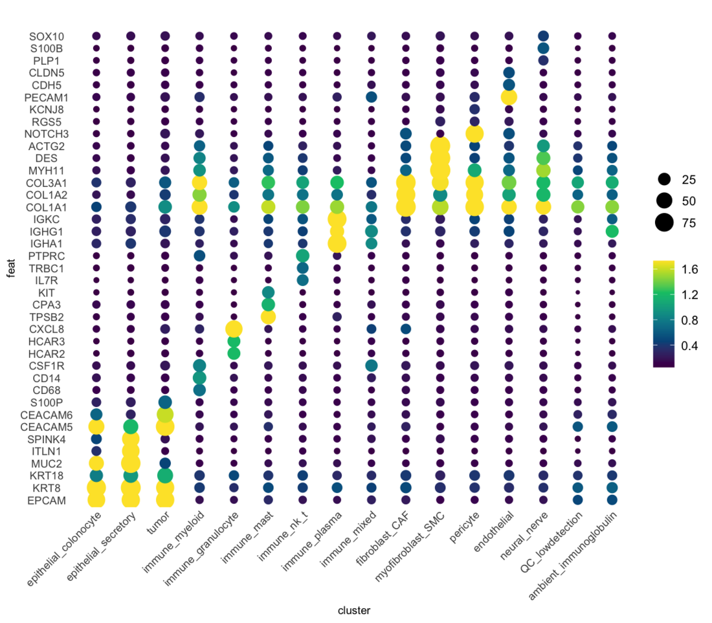
```

```{r marker-heatmap, fig.cap="The top two de novo markers of each cluster, averaged per cell type, z-scored across cell types and rescaled.", fig.height=8, eval = FALSE}
heat_genes <- unique(markers_de[order(cluster, ranking)][
  , head(.SD, 2), by = cluster]$feats)

plotMetaDataHeatmap(g_cosmx, metadata_cols = "cell_type_broad",
                    selected_feats = heat_genes,
                    expression_values = "normalized",
                    show_values = "zscores_rescaled",
                    custom_cluster_order = CELL_TYPES,
                    x_text_angle = 45, x_text_size = 8,
                    y_text_size = 9,
                    save_param = list(save_name = "marker_heatmap"))
```

```{r marker-heatmap-fig, echo = FALSE, out.width = "100%"}
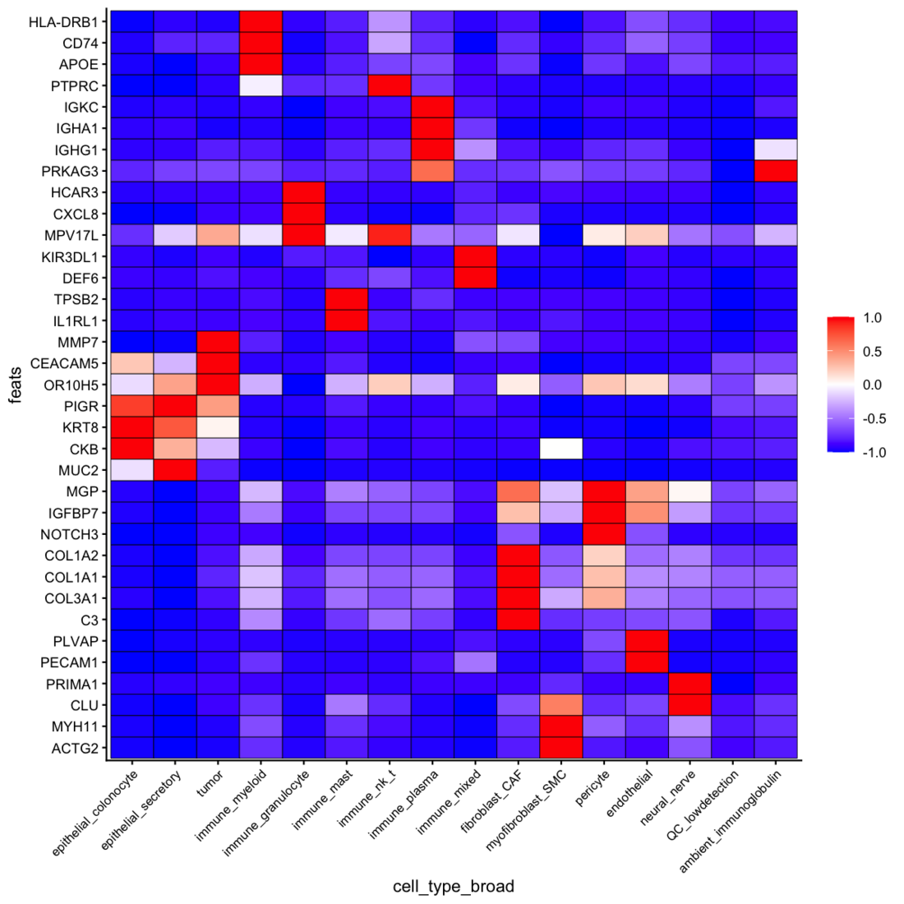
```

```{r celltype-counts, eval = FALSE}
cell_type_props <- calculateLabelProportions(g_cosmx, labels = "cell_type_broad",
                                             groups = data.frame(group = "all", cell_ID = spatIDs(g_cosmx)),
                                             column_group_id = "group", output = "data.table")
cell_type_props <- melt(cell_type_props, id.vars = "group",
                        variable.name = "cell_type", value.name = "proportion")
cell_type_props[order(-proportion),
                .(cell_type, cells = round(proportion * length(spatIDs(g_cosmx))),
                  percent = round(100 * proportion, 1))]
```

```
cell_type               cells   percent
tumor                   104618  21.4   
fibroblast_CAF          70773   14.5   
myofibroblast_SMC       55316   11.3   
immune_myeloid          34285   7.0    
QC_lowdetection         30528   6.2    
epithelial_secretory    27857   5.7    
immune_plasma           25450   5.2    
epithelial_colonocyte   24725   5.1    
immune_nk_t             22993   4.7    
immune_mixed            21518   4.4    
immune_mast             14974   3.1    
endothelial             13687   2.8    
immune_granulocyte      13399   2.7    
neural_nerve            12404   2.5    
pericyte                8892    1.8    
ambient_immunoglobulin  8034    1.6    
```

# Cell types in the tissue

## Full annotated slide

```{r umap-celltype, fig.cap="The same embedding as in Clustering, now in the curated cell type colors.", eval = FALSE}
plotUMAP(g_cosmx, cell_color = "cell_type_broad",
         cell_color_code = CELL_TYPE_COLORS,
         point_size = 0.25, point_alpha = 0.4,
         point_shape = "border", point_border_stroke = 0,
         show_center_label = FALSE, legend_symbol_size = 3,
         save_param = list(save_name = "umap_celltype"))
```

```{r umap-celltype-fig, echo = FALSE, out.width = "100%"}
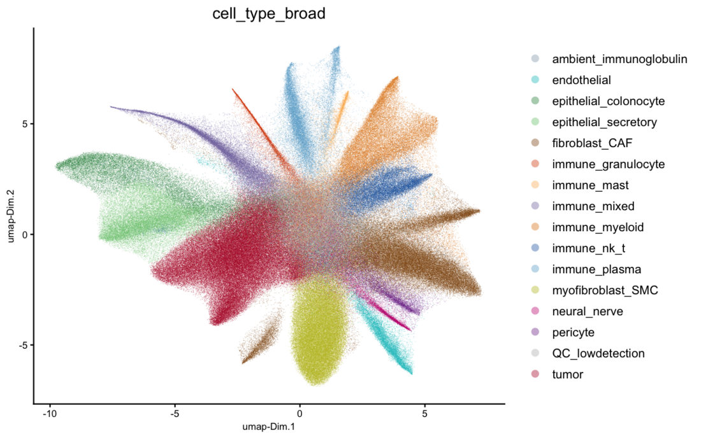
```

```{r spatial-celltype, fig.cap="The whole slide by cell type.", fig.height=6.8, eval = FALSE}
spatPlot2D(
  g_cosmx, cell_color = "cell_type_broad",
  cell_color_code = CELL_TYPE_COLORS,
  point_size = 0.25, point_shape = "border",
  point_border_stroke = 0, coord_fix_ratio = 1,
  title = sprintf("%s cells | %d clusters | %d cell types",
                  format(nrow(cell_metadata), big.mark = ","),
                  uniqueN(cell_metadata$leiden_clus), length(CELL_TYPES)),
  background_color = "white",
  save_param = list(save_name = "slide_celltype"))
```

```{r spatial-celltype-fig, echo = FALSE, out.width = "100%"}
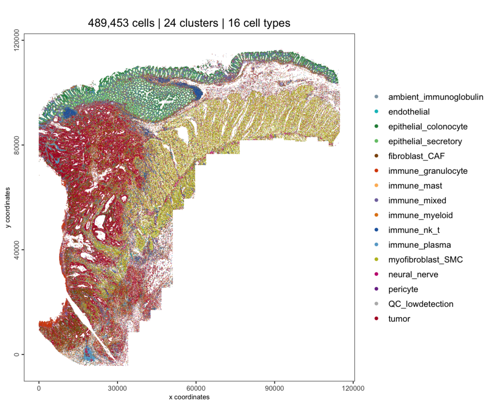
```

The annotation was never given spatial information, so the histology above is an
independent check on it.

```{r spatial-facets, fig.cap="One panel per cell type, every other cell in gray behind it.", fig.height=7.5, eval = FALSE}
cell_type_plots <- lapply(CELL_TYPES, function(cell_type)
  spatPlot2D(g_cosmx, cell_color = "cell_type_broad",
             cell_color_code = CELL_TYPE_COLORS,
             select_cell_groups = cell_type, show_other_cells = TRUE,
             other_cell_color = "#ECECEC", other_point_size = 0.06,
             point_size = 0.18, point_shape = "border",
             point_border_stroke = 0, coord_fix_ratio = 1,
             show_legend = FALSE, title = cell_type, background_color = "white",
             axis_text = 5, axis_title = 6,
             theme_param = list(plot.title = ggplot2::element_text(size = 8)),
             show_plot = FALSE, return_plot = TRUE, save_plot = FALSE))
cowplot::plot_grid(plotlist = cell_type_plots, ncol = 5)
```

```{r spatial-facets-fig, echo = FALSE, out.width = "100%"}
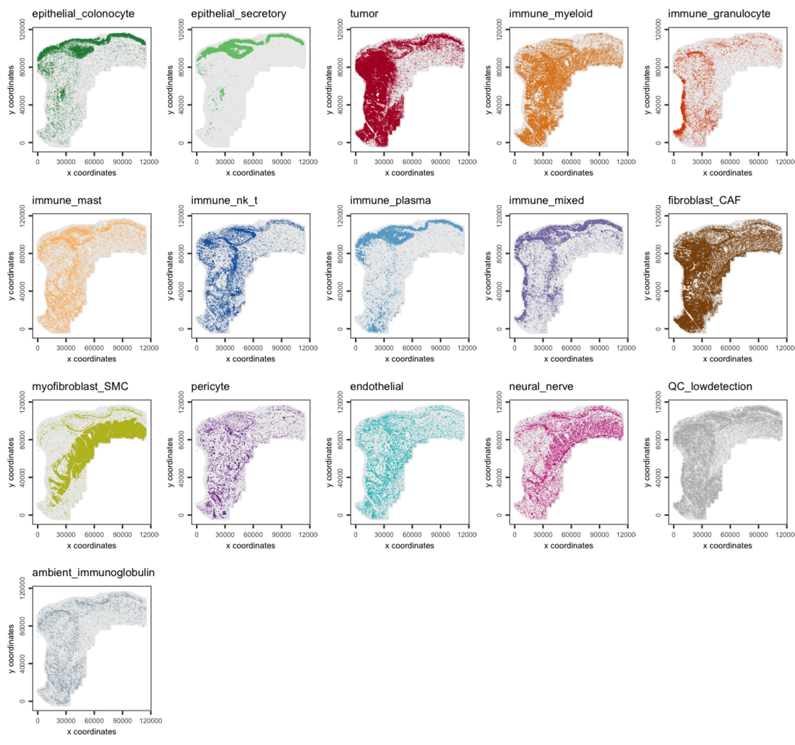
```

## Segmentation boundaries

The window below is the most cell-dense square of a 1,024 x 1,024 um grid laid
over the slide, given in pixels (0.12028 um per pixel).

```{r polygons, fig.cap="A 1,024 x 1,024 um window of CosMx segmentation boundaries, filled by cell type.", fig.height=6.8, warning=FALSE, eval = FALSE}
g_zoom <- subsetGiottoLocs(g_cosmx, x_min = 8513, x_max = 17027,
                           y_min = 85135, y_max = 93648, verbose = FALSE)

spatInSituPlotPoints(
  g_zoom,
  polygon_feat_type      = "cell",
  show_polygon           = TRUE,
  polygon_fill           = "cell_type_broad",
  polygon_fill_as_factor = TRUE,
  polygon_fill_code      = CELL_TYPE_COLORS,
  polygon_color          = "gray30",
  polygon_line_size      = 0.06,
  legend_text            = 9,
  background_color       = "white",
  save_param             = list(save_name = "polygons_zoom"))
```

```{r polygons-fig, echo = FALSE, out.width = "100%"}
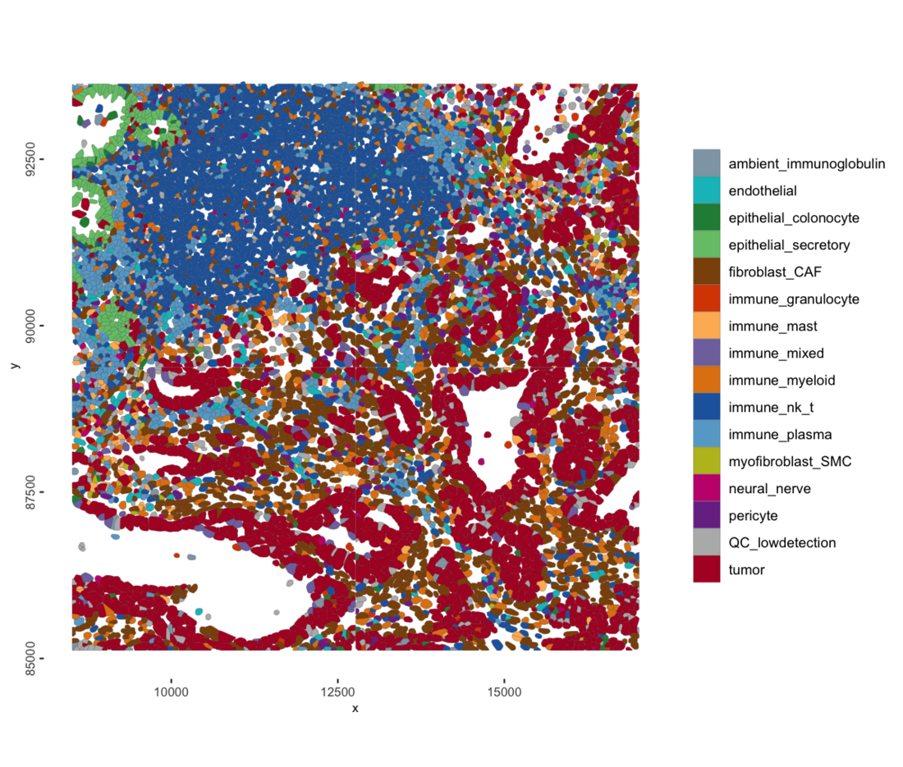
```

# Spatially variable genes

The spatial analyses below use a **Delaunay** network, which links each cell to
its nearest surrounding cells (about six on average). The `geometry` backend
triangulates the whole slide in seconds.

```{r spatial-network, eval = FALSE}
g_cosmx <- createSpatialNetwork(g_cosmx, name = "Delaunay_network",
                                method = "Delaunay",
                                delaunay_method = "delaunayn_geometry",
                                verbose = FALSE)
```

`spatialAutoCor()` scores each gene with **Moran's I**: how much more alike
neighboring cells are than random pairs. Ribosomal and mitochondrial genes are
left out, and the covariate null conditions on library size, because total
counts vary across the slide. Nearly every gene is significant at this cell
count, so the top 200 by Moran's I are carried forward.

```{r svg-moran, eval = FALSE}
svg_moran <- spatialAutoCor(g_cosmx, method = "moran",
                            feats = grep("^RP[SL]|^MT-", featIDs(g_cosmx),
                                         value = TRUE, invert = TRUE),
                            null = "covariate", covariate = "libsize",
                            return_gobject = FALSE)
setorder(svg_moran, -statistic)
svg_top <- head(svg_moran$feats, 200)

cat(sprintf("Tested %s genes; %s at adjusted p <= 0.01. Kept the top 200 (Moran's I >= %.3f).\n",
            format(nrow(svg_moran), big.mark = ","),
            format(sum(svg_moran$adj.p.value <= 0.01, na.rm = TRUE), big.mark = ","),
            svg_moran$statistic[200]))
head(svg_moran[, .(feats, moran_I = round(statistic, 3), z = round(z, 1),
                   adj.p.value = signif(adj.p.value, 2))], 10)
```

```
Tested 18,837 genes; 18,821 at adjusted p <= 0.01. Kept the top 200 (Moran's I >= 0.148).
feats    moran_I  z      adj.p.value
DES      0.660    776.1  0          
MYH11    0.657    772.6  0          
PIGR     0.621    729.9  0          
ACTG2    0.617    725.2  0          
FABP1    0.542    637.2  0          
CEACAM5  0.534    627.5  0          
CNN1     0.511    600.4  0          
IGHA1    0.503    590.6  0          
COL1A1   0.501    588.9  0          
LGALS4   0.491    577.4  0          
```

```{r save-svg, results="hide", warning=FALSE, message=FALSE, eval = FALSE}
g_cosmx <- saveGiotto(g_cosmx, name = "svg", overwrite = TRUE, verbose = FALSE)
```

```{r svg-plots, fig.cap="The six genes with the highest Moran's I.", fig.height=4.8, eval = FALSE}
spatFeatPlot2D(g_cosmx, feats = head(svg_top, 6), expression_values = "normalized",
               point_size = 0.15, point_shape = "border", point_border_stroke = 0,
               coord_fix_ratio = 1, cow_n_col = 3, gradient_style = "sequential",
               background_color = "white",
               save_param = list(save_name = "svg_top6", base_width = 12, base_height = 7))
```

```{r svg-plots-fig, echo = FALSE, out.width = "100%"}
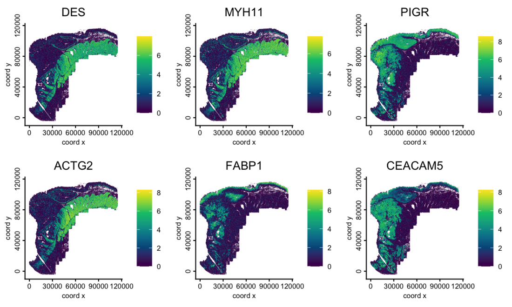
```

# Spatial co-expression

`spatialCoexpression()` averages each cell's expression with its Delaunay
neighbors', correlates the 200 spatial genes on the smoothed values and
clusters them into **modules**. Each module gets a score per cell: the mean of
its genes.

## Choosing the number of modules

Each number of modules from 4 to 14 is scored by its mean **silhouette
width**: how much better a gene fits its own module than the next closest one.
The highest is used.

```{r coexp-k, fig.cap="Mean silhouette width of the module partition for each number of modules.", fig.height=3.6, eval = FALSE}
coexp_tree <- spatialCoexpression(g_cosmx, feats = svg_top, return_gobject = FALSE)

k_plot <- sweepClusterK(g_cosmx, x = coexp_tree, k_range = 4:14, return_plot = TRUE,
                        save_param = list(save_name = "coexpression_k"))
MODULE_K <- k_plot$data[selected == TRUE, k]
```

```{r coexp-k-fig, echo = FALSE, out.width = "100%"}
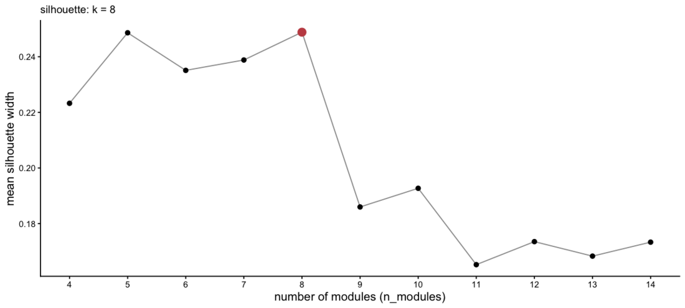
```

## Modules

```{r coexpression, eval = FALSE}
coexp <- spatialCoexpression(g_cosmx, feats = svg_top, n_modules = MODULE_K,
                             return_gobject = FALSE)
coexp$summary

g_cosmx <- spatialCoexpression(g_cosmx, feats = svg_top, n_modules = MODULE_K)
MODULES <- as.character(coexp$summary$module)
```

```
module  size  within_cor  between_cor  score    
1       29    0.6753155   -0.0391181   0.6673041
2       53    0.5308899   0.0434325    0.4807666
5       36    0.4414068   -0.0390091   0.4361222
3       30    0.4967987   0.0793919    0.4320295
4       6     0.4093550   -0.0509814   0.4093550
6       17    0.3764131   0.0695040    0.3310608
8       16    0.2120174   0.0979123    0.1804494
7       13    0.0973820   0.0146081    0.0909947
```

A high `within_cor` and a low `between_cor` mean a module is coherent and
distinct from the others.

<details>
<summary><strong>All genes in each module</strong></summary>

Genes are listed most central first, by their mean correlation with the rest
of their module.

```{r coexpression-genes, eval = FALSE}
coexp$feats[order(module, -module_cor),
            .(genes = .N, all_genes = paste(feat_ID, collapse = ", ")),
            by = module][match(MODULES, as.character(module))]
```

```
module  genes  all_genes                                                                                                                                                                                                                                                                                                                                                                                  
1       29     ACTG2, MYH11, DES, CNN1, MYLK, MYL9, TPM2, CSRP1, FLNA, TAGLN, SYNM, ACTA2, SYNPO2, TPM1, HSPB8, CALD1, CHRDL2, TNS1, LMOD1, ITGA5, SORBS1, RBPMS, MYL6, PPP1R12B, SPARCL1, IGFBP4, HSPB1, C4B-2, CLU                                                                                                                                                                                      
2       53     CEACAM5, EPCAM, CD24, PIGR, CLDN3, SPINT2, CLDN4, ATP1B1, S100A6, CEACAM6, CD9, S100A10, IGFBP2, LSR, SPINK1, ELF3, ST14, TMSB10, LGALS3BP, PABPC1, TXN, TMEM54, EEF1G, ETS2, GPX2, ATP10B, CFL1, RACK1, PRDX5, MYH14, IFI27, SLC12A2, PTMA, LEFTY1, SLC25A5, APP, GGH, LCN2, TSPAN8, MUC13, H4C11, CDH17, TSPAN1, C19orf33, GDF15, H2AC11, H3C15, H4C14, SCD, H3C2, CEACAM1, CCL20, CYP3A5
5       36     COL3A1, COL1A2, COL1A1, SPARC, COL6A3, LUM, COL6A2, TIMP2, AEBP1, IGFBP7, MMP2, SULF1, COL12A1, MMP14, COL5A1, FN1, BGN, COL6A1, VIM, POSTN, LGALS1, C1S, C1R, THBS2, MMP11, COL4A1, COL4A2, TNC, THBS1, TIMP3, GREM1, C11orf96, A2M, SFRP2, MGP, SOD2                                                                                                                                     
3       30     PHGR1, LGALS4, KRT8, FABP1, KRT20, CLDN7, ITM2C, KRT19, LGALS3, FXYD3, CKB, C15orf48, MUC12, ATP1A1, PLAC8, MALL, CA2, SLC26A3, CA1, RBM47, CARD11, CEACAM7, HSD11B2, MS4A12, ZG16, TFF1, GUCA2A, SELENBP1, SELENOP, SLC26A2                                                                                                                                                               
4       6      IGKC, JCHAIN, IGHA1, PRMT8, IGHG1, IGHM                                                                                                                                                                                                                                                                                                                                                    
6       17     MUC2, REG4, ITLN1, SPINK4, FCGBP, PLA2G2A, AGR2, NXPE1, PDXDC1, MT1G, ST6GALNAC6, PCK1, CES2, CLCA1, MT1X, OLFM4, MT2A                                                                                                                                                                                                                                                                     
8       16     CTSB, HLA-B, TGFBI, TMSB4X, B2M, CST3, FIS1, CD74, TIMP1, LAMC2, MMP7, EGR1, FOS, SPP1, APOE, HLA-DRB1                                                                                                                                                                                                                                                                                     
7       13     MMP3, CXCL5, MEX3C, MMP1, GRP, SMIM41, RIMBP3B, DPYSL4, OR10H5, REG1A, REG1B, CXCL8, MPV17L                                                                                                                                                                                                                                                                                                
```

</details>

```{r coexpression-heatmap, fig.cap="Correlation of the smoothed expression of the top spatially variable genes, ordered and annotated by module.", fig.height=7, eval = FALSE}
heatmapCoexpression(g_cosmx, coexpression = coexp,
                    save_param = list(save_name = "coexpression_heatmap",
                                      base_width = 8, base_height = 7.5))
```

```{r coexpression-heatmap-fig, echo = FALSE, out.width = "100%"}
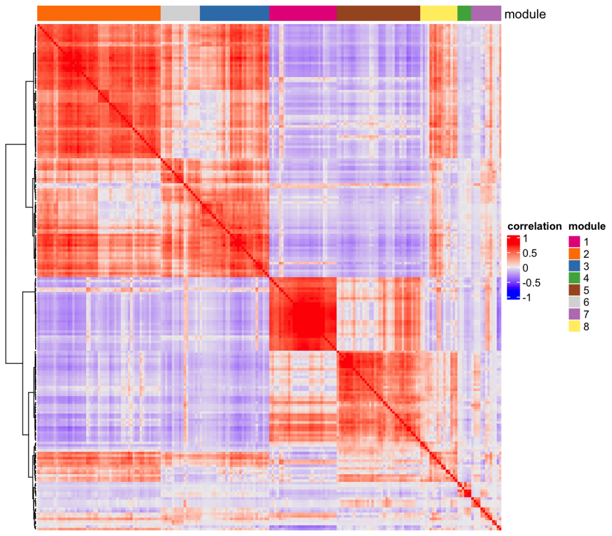
```

## Module scores by location and cell type

Where each module is strongest on the slide, and which cell types carry it.

```{r coexpression-maps, fig.cap="Scores of the three top-ranked modules across the slide.", fig.height=6.8, eval = FALSE}
module_scores <- getSpatialEnrichment(g_cosmx, name = "spatial_module", output = "data.table")
for (m in head(MODULES, 3)) {
  v <- module_scores[[m]]
  spatCellPlot2D(g_cosmx, spat_enr_names = "spatial_module",
                 cell_annotation_values = m,
                 gradient_style = "sequential",
                 # cap each module's color scale at the 99th percentile of its non-zero scores
                 gradient_limits = c(0, quantile(v[v > 0], 0.99)),
                 point_size = 0.25, point_shape = "border", point_border_stroke = 0,
                 coord_fix_ratio = 1, background_color = "white",
                 save_param = list(save_name = paste0("coexpression_module_", m),
                                   base_width = 7, base_height = 6))
}
```

```{r coexpression-maps-fig, echo = FALSE, out.width = "100%"}
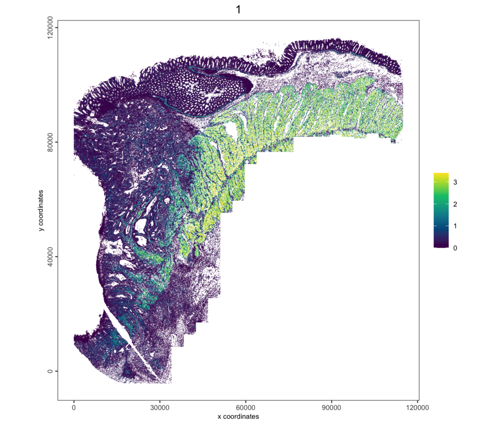
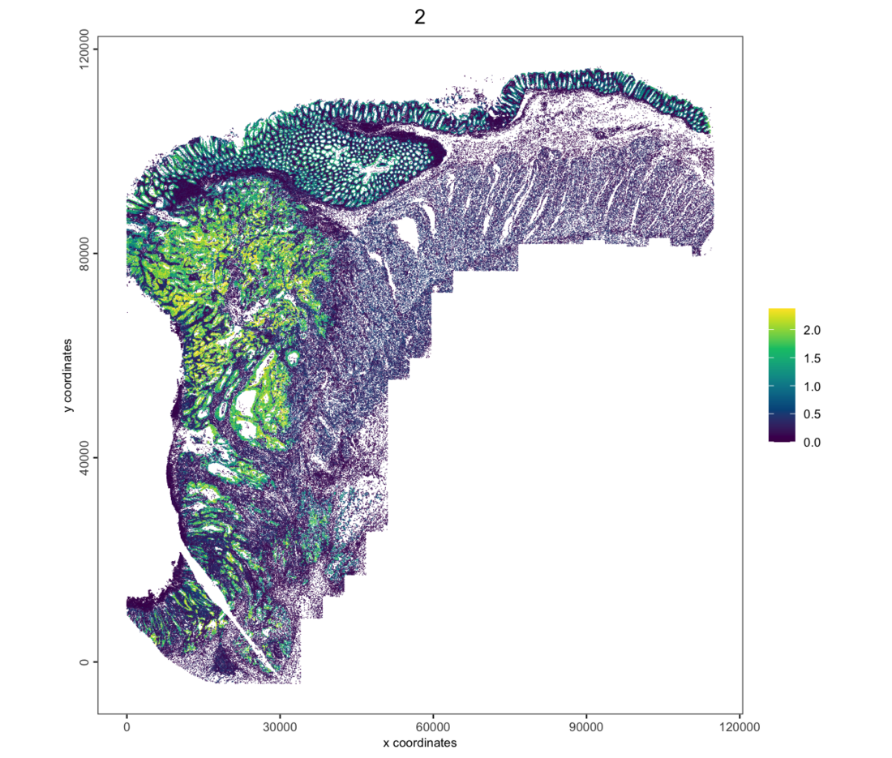
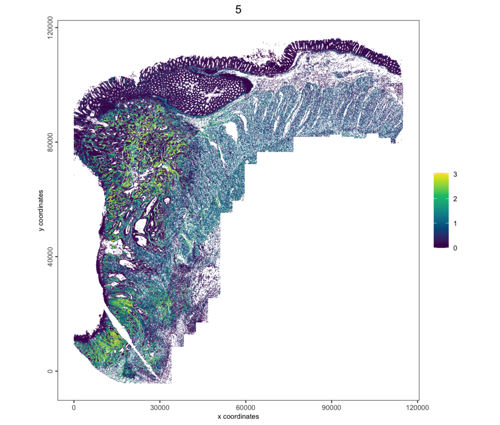
```

```{r coexpression-celltype, fig.cap="Module scores per cell type, z-scored and rescaled within each module.", fig.height=6, eval = FALSE}
plotMetaDataCellsHeatmap(g_cosmx, metadata_cols = "cell_type_broad",
                         spat_enr_names = "spatial_module", value_cols = MODULES,
                         show_values = "zscores_rescaled",
                         y_axis_title = "module",
                         x_text_angle = 45, x_text_size = 8, y_text_size = 8,
                         save_param = list(save_name = "coexpression_by_celltype",
                                           base_width = 8, base_height = 6))
```

```{r coexpression-celltype-fig, echo = FALSE, out.width = "100%"}
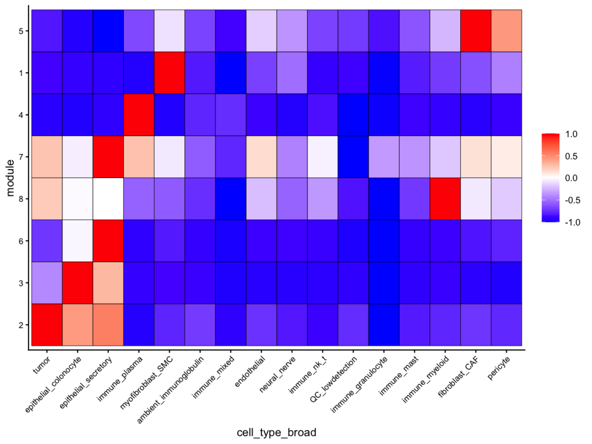
```

```{r save-coexpression, results="hide", warning=FALSE, message=FALSE, eval = FALSE}
g_cosmx <- saveGiotto(g_cosmx, name = "coexpression", overwrite = TRUE, verbose = FALSE)
```

# Tissue programs

**Tissue programs** in this tutorial are curated gene sets, core MSigDB
Hallmark genes plus established markers, for processes such as hypoxia and
proliferation. **PAGE** scores each cell for each program by comparing how far
the program's genes sit above their slide-wide average with how far all genes
do. In a tumor, EMT mostly marks cancer-associated fibroblasts.

```{r programs-sets, eval = FALSE}
PROGRAMS <- list(
  hypoxia          = c("VEGFA", "CA9", "SLC2A1", "LDHA", "PGK1", "BNIP3", "NDRG1",
                       "ADM", "P4HA1", "EGLN3", "ANKRD37", "PDK1", "ERO1A", "ALDOA"),
  proliferation    = c("MKI67", "TOP2A", "CCNB1", "CDK1", "BIRC5", "CENPF", "UBE2C",
                       "TYMS", "MCM2", "PCNA", "CCNA2", "AURKA", "RRM2", "FOXM1"),
  EMT              = c("VIM", "FN1", "SNAI2", "ZEB1", "ZEB2", "TWIST1", "CDH2",
                       "SPARC", "COL1A1", "COL3A1", "POSTN", "TGFBI", "MMP2", "ACTA2"),
  interferon_gamma = c("STAT1", "IRF1", "CXCL9", "CXCL10", "CXCL11", "GBP1", "GBP4",
                       "IDO1", "CD274", "PSMB9", "TAP1", "HLA-DRA"),
  inflammation     = c("CXCL8", "IL1B", "CXCL1", "CXCL2", "PTGS2", "NFKBIA",
                       "TNFAIP3", "CCL20", "SOD2", "IL6", "ICAM1"),
  WNT_stemness     = c("LGR5", "AXIN2", "ASCL2", "OLFM4", "SOX9", "NKD1", "RNF43",
                       "ZNRF3", "SMOC2", "EPHB2"),
  angiogenesis     = c("ESM1", "ANGPT2", "KDR", "APLN", "PGF", "PLVAP", "NID2",
                       "COL4A1", "COL4A2", "FLT1"))
```

```{r programs-page, eval = FALSE}
program_matrix <- makeSignMatrixPAGE(sign_names = names(PROGRAMS),
                                     sign_list  = PROGRAMS)

g_cosmx <- runPAGEEnrich(g_cosmx, sign_matrix = program_matrix,
                         output_enrichment = "zscore", p_value = TRUE,
                         name = "programs", verbose = FALSE)

program_padj <- melt(getSpatialEnrichment(g_cosmx, name = "programs_padj", output = "data.table"),
                     id.vars = "cell_ID", variable.name = "program", value.name = "padj")
program_padj[, .(pct_cells_enriched = round(100 * mean(padj <= 0.05), 1)),
             by = program][order(-pct_cells_enriched)]
```

```
program           pct_cells_enriched
EMT               8.0               
angiogenesis      3.0               
hypoxia           2.8               
WNT_stemness      2.6               
inflammation      2.6               
proliferation     2.0               
interferon_gamma  1.7               
```

Scores are z-scored within each program, so one color range fits all of them:
from 0 (average) up to the 95th percentile of the positive scores.

```{r programs-maps, fig.cap="Tissue program scores across the slide (PAGE, z-scored within each program).", fig.height=13, eval = FALSE}
program_scores <- getSpatialEnrichment(g_cosmx, name = "programs", output = "data.table")
v <- unlist(program_scores[, names(PROGRAMS), with = FALSE])

spatCellPlot2D(g_cosmx, spat_enr_names = "programs",
               cell_annotation_values = names(PROGRAMS),
               cell_color_gradient = viridisLite::magma(10, begin = 0.2),
               gradient_style = "sequential",
               gradient_limits = c(0, quantile(v[v > 0], 0.95)),
               point_size = 0.12, point_shape = "border", point_border_stroke = 0,
               coord_fix_ratio = 1, cow_n_col = 2, background_color = "white",
               axis_text = 6, axis_title = 7, legend_text = 6,
               save_param = list(save_name = "programs_maps",
                                 base_width = 10, base_height = 16))
```

```{r programs-maps-fig, echo = FALSE, out.width = "100%"}
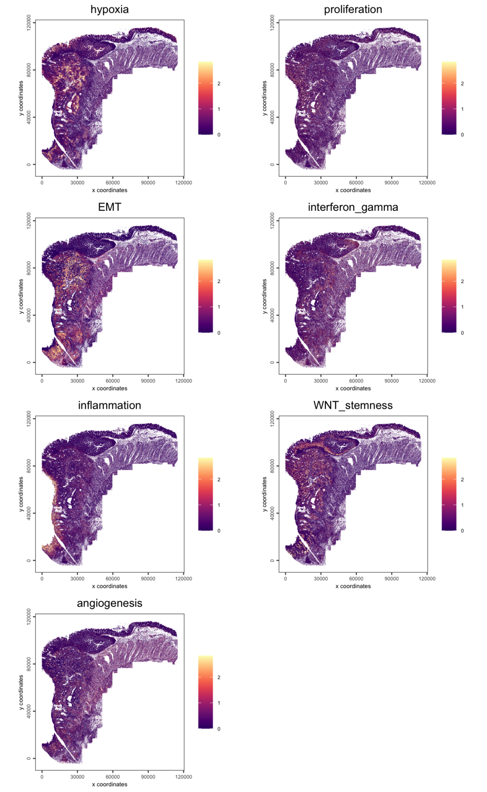
```

How the data-driven modules relate to the curated programs: the correlation of
module and program scores across cells.

```{r programs-modules, eval = FALSE}
mp <- merge(module_scores, program_scores, by = "cell_ID")
module_program <- cor(as.matrix(mp[, ..MODULES]),
                      as.matrix(mp[, names(PROGRAMS), with = FALSE]))
round(t(module_program), 2)
```

```
                     1     2     5     3     4     6     8     7
hypoxia           0.01  0.40  0.02  0.30 -0.08  0.14  0.30  0.10
proliferation    -0.10  0.14 -0.11  0.00 -0.01 -0.02 -0.01 -0.03
EMT               0.25 -0.30  0.92 -0.32 -0.07 -0.22  0.19  0.01
interferon_gamma -0.03 -0.14  0.08 -0.12  0.00 -0.09  0.19 -0.02
inflammation     -0.04 -0.06  0.13 -0.12 -0.05 -0.10  0.04  0.13
WNT_stemness     -0.13  0.41 -0.18  0.14 -0.06  0.15  0.13  0.10
angiogenesis      0.20 -0.27  0.44 -0.23 -0.01 -0.16 -0.01 -0.03
```

The module and program that overlap most, one after the other:

```{r programs-highest-pair, fig.cap="The highest-correlated module and tissue program.", fig.height=5.5, eval = FALSE}
highest_correlation <- which(module_program == max(module_program), arr.ind = TRUE)[1, ]
top_module  <- rownames(module_program)[highest_correlation[1]]
top_program <- colnames(module_program)[highest_correlation[2]]
cat(sprintf("module %s and %s, r = %.2f\n", top_module, top_program, max(module_program)))

v <- module_scores[[top_module]]
spatCellPlot2D(g_cosmx, spat_enr_names = "spatial_module",
               cell_annotation_values = top_module,
               gradient_style = "sequential",
               gradient_limits = c(0, quantile(v[v > 0], 0.95)),
               point_size = 0.15, point_shape = "border", point_border_stroke = 0,
               coord_fix_ratio = 1, background_color = "white",
               save_param = list(save_name = "highest_pair_module"))

v <- program_scores[[top_program]]
spatCellPlot2D(g_cosmx, spat_enr_names = "programs",
               cell_annotation_values = top_program,
               cell_color_gradient = viridisLite::magma(10, begin = 0.2),
               gradient_style = "sequential",
               gradient_limits = c(0, quantile(v[v > 0], 0.95)),
               point_size = 0.15, point_shape = "border", point_border_stroke = 0,
               coord_fix_ratio = 1, background_color = "white",
               save_param = list(save_name = "highest_pair_program"))
```

```
module 5 and EMT, r = 0.92
```

```{r programs-highest-pair-fig, echo = FALSE, out.width = "100%"}
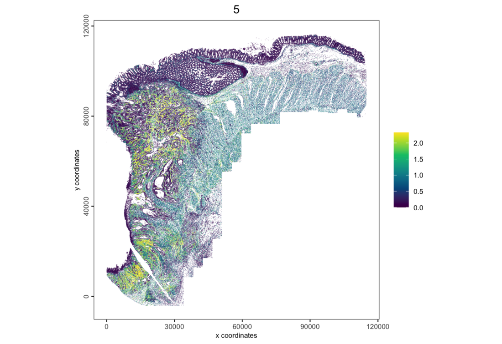
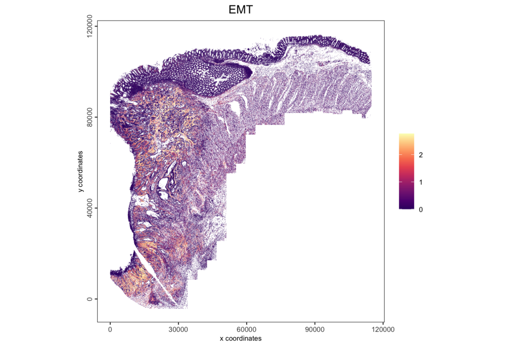
```

```{r save-programs, results="hide", warning=FALSE, message=FALSE, eval = FALSE}
g_cosmx <- saveGiotto(g_cosmx, name = "programs", overwrite = TRUE, verbose = FALSE)
```

**Each snapshot saved in this tutorial can be reloaded by name:** `ingest`,
`pca`, `processed`, `annotated`, `svg`, `coexpression` and `programs`. A
snapshot records only the R-side object; the matrix, polygons and networks stay
as parquet in the vault, so a reload re-attaches them rather than rebuilding.

```{r reload, eval = FALSE}
# uncomment below to reload the last snapshot
# g_cosmx <- loadGiotto(VAULT, name = "programs", verbose = FALSE)
```

# Further reading

- [CosMx mini tutorial](cosmx_mini_colon_wtx.html): the same specimen cut to
  one FOV, small enough to run in memory on any machine.

# Run time and memory

This page was built on a computer with 18 cores and 64 GB of memory. The time
and peak memory of each section were measured in two setups:

- **4 workers, 64 GB** (blue): the tutorial as written, with the workers set
  in [Packages and setup](#packages-and-setup), run with 4 cores. About 11
  minutes in total.
- **2 workers and 4 cores, 16 GB** (orange): the setup from
  [Using less memory](#using-less-memory), simulated on the same computer.
  GiottoDisk was told only the memory a 16 GB laptop has free, and the run
  would have been stopped past 16 GB. About 13 minutes in total.

Reading the data takes 1.4 and 1.5 minutes: the expression file is one
compressed stream, read from start to end by a single process. Clustering
takes 2.6 minutes in both. Most of the extra time in the 16 GB setup is in the
spatially variable genes, 2.9 minutes instead of 1.3, and in the cell type
annotation, 1.1 minutes instead of 29 s. Peak memory is 14 GB with 4 workers,
while the data are read, and 12 GB with 2. Both runs gave
identical results. A 16 GB computer usually has about 12 GB free once the
system and other programs are running, so expect the later sections to be
slower there while the system swaps or compresses memory.

```{r run-cost-fig, echo = FALSE, out.width = "100%"}
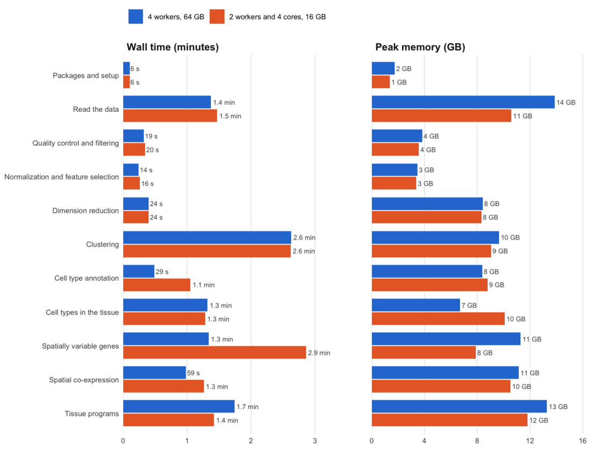
```

Memory is the physical memory of the R session and its parallel workers
together, as a task manager reports it, sampled once a second; each bar is
the highest value during that section.

<details>
<summary><strong>Time and memory per section</strong></summary>

| Section | Time, 64 GB | Peak memory, 64 GB | Time, 16 GB | Peak memory, 16 GB |
|---|---:|---:|---:|---:|
| Packages and setup | 6 s | 2 GB | 6 s | 1 GB |
| Read the data | 1.4 min | 14 GB | 1.5 min | 11 GB |
| Quality control and filtering | 19 s | 4 GB | 20 s | 4 GB |
| Normalization and feature selection | 14 s | 3 GB | 16 s | 3 GB |
| Dimension reduction | 24 s | 8 GB | 24 s | 8 GB |
| Clustering | 2.6 min | 10 GB | 2.6 min | 9 GB |
| Cell type annotation | 29 s | 8 GB | 1.1 min | 9 GB |
| Cell types in the tissue | 1.3 min | 7 GB | 1.3 min | 10 GB |
| Spatially variable genes | 1.3 min | 11 GB | 2.9 min | 8 GB |
| Spatial co-expression | 59 s | 11 GB | 1.3 min | 10 GB |
| Tissue programs | 1.7 min | 13 GB | 1.4 min | 12 GB |
| **Total** | **10.9 min** | **14 GB** | **13.1 min** | **12 GB** |

</details>

# Session information

```{r session, eval = FALSE}
future::plan(future::sequential)

sessionInfo()
```

```
R version 4.6.1 (2026-06-24)
Platform: aarch64-apple-darwin23
Running under: macOS Golden Gate 27.0.1

Matrix products: default
BLAS:   /Library/Frameworks/R.framework/Versions/4.6/Resources/lib/libRblas.0.dylib 
LAPACK: /Library/Frameworks/R.framework/Versions/4.6/Resources/lib/libRlapack.dylib;  LAPACK version 3.12.1

locale:
[1] C.UTF-8/C.UTF-8/C.UTF-8/C/C.UTF-8/C.UTF-8

time zone: America/New_York
tzcode source: internal

attached base packages:
[1] stats     graphics  grDevices utils     datasets  methods   base     

other attached packages:
[1] data.table_1.18.6.1 GiottoDisk_0.0.0.8  Giotto_4.3.7       
[4] GiottoClass_0.8.0   arrow_26.0.1.1     

loaded via a namespace (and not attached):
  [1] RColorBrewer_1.1-3          shape_1.4.6.1              
  [3] jsonlite_2.0.0              wk_0.9.5                   
  [5] magrittr_2.0.5              farver_2.1.2               
  [7] rmarkdown_2.32              GlobalOptions_0.1.4        
  [9] vctrs_0.7.3                 memoise_2.0.1              
 [11] GiottoUtils_0.2.10          terra_1.9-60               
 [13] htmltools_0.5.9             S4Arrays_1.12.1            
 [15] BiocNeighbors_2.6.0         SparseArray_1.12.3         
 [17] sass_0.5.0                  parallelly_1.50.0          
 [19] bslib_0.12.0                htmlwidgets_1.6.4          
 [21] plotly_4.12.1               cachem_1.1.0               
 [23] igraph_2.3.4                iterators_1.0.14           
 [25] lifecycle_1.0.5             pkgconfig_2.0.3            
 [27] rsvd_2.0.0                  Matrix_1.7-5               
 [29] R6_2.6.1                    fastmap_1.2.0              
 [31] clue_0.3-68                 MatrixGenerics_1.24.0      
 [33] future_1.82.0               magic_1.6-1-1              
 [35] digest_0.6.39               colorspace_2.1-4           
 [37] S4Vectors_0.50.3            dqrng_0.4.1                
 [39] irlba_2.4.1                 GenomicRanges_1.64.0       
 [41] beachmat_2.28.0             labeling_0.4.3             
 [43] progressr_1.1.0             httr_1.4.9                 
 [45] polyclip_1.10-7             abind_1.4-8                
 [47] compiler_4.6.1              doParallel_1.0.17          
 [49] bit64_4.8.6                 withr_3.0.3                
 [51] S7_1.0.0                    backports_1.5.1            
 [53] BiocParallel_1.46.0         viridis_0.6.5              
 [55] ggforce_0.5.0               R.utils_2.13.0             
 [57] MASS_7.3-65                 DelayedArray_0.38.2        
 [59] rjson_0.2.23                cosmxscan_0.1.0            
 [61] bluster_1.22.0              gtools_3.9.5               
 [63] GiottoVisuals_0.2.16        tools_4.6.1                
 [65] otel_0.3.0                  future.apply_1.21.0        
 [67] R.oo_1.27.1                 glue_1.8.1                 
 [69] dbscan_1.3.0                grid_4.6.1                 
 [71] checkmate_2.3.4             cluster_2.1.8.2            
 [73] generics_0.1.4              gtable_0.3.6               
 [75] R.methodsS3_1.8.2           tidyr_1.3.2                
 [77] BiocSingular_1.28.1         tidygraph_1.3.1            
 [79] ScaledMatrix_1.20.0         metapod_1.20.0             
 [81] XVector_0.52.0              BiocGenerics_0.58.1        
 [83] tilework_1.0.0.9000         foreach_1.5.2              
 [85] ggrepel_0.9.8               pillar_1.11.1              
 [87] nanoarrow_0.9.0             RcppHNSW_0.7.0             
 [89] limma_3.68.5                circlize_0.4.18            
 [91] dplyr_1.2.1                 tweenr_2.0.3               
 [93] lattice_0.22-9              bit_4.6.0                  
 [95] tidyselect_1.2.1            ComplexHeatmap_2.28.0      
 [97] SingleCellExperiment_1.34.0 locfit_1.5-9.12            
 [99] scuttle_1.22.0              knitr_1.52                 
[101] gridExtra_2.3.1             IRanges_2.46.0             
[103] Seqinfo_1.2.0               edgeR_4.10.7               
[105] SummarizedExperiment_1.42.0 scattermore_1.2            
[107] stats4_4.6.1                xfun_0.62                  
[109] graphlayouts_1.2.5          Biobase_2.72.0             
[111] statmod_1.5.2               matrixStats_1.5.0          
[113] yaml_2.3.12                 GiottoKernels_0.3.0        
[115] evaluate_1.0.5              codetools_0.2-20           
[117] ggraph_2.2.2                tibble_3.3.1               
[119] colorRamp2_0.1.1            cli_3.6.6                  
[121] uwot_0.2.5                  geometry_0.5.2             
[123] jquerylib_0.1.4             Rcpp_1.1.2                 
[125] globals_0.20.0              png_0.1-9                  
[127] parallel_4.6.1              ggplot2_4.0.4              
[129] assertthat_0.2.1            scran_1.40.0               
[131] listenv_1.1.0               viridisLite_0.4.3          
[133] scales_1.4.0                crayon_1.5.3               
[135] purrr_1.2.2                 GetoptLong_1.1.1           
[137] rlang_1.3.0                 cowplot_1.2.0
```
