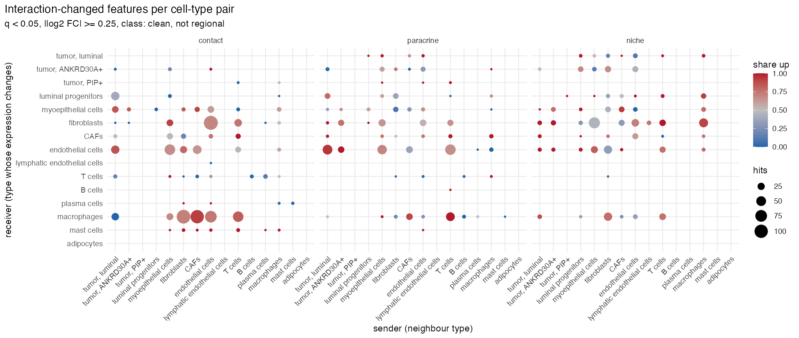
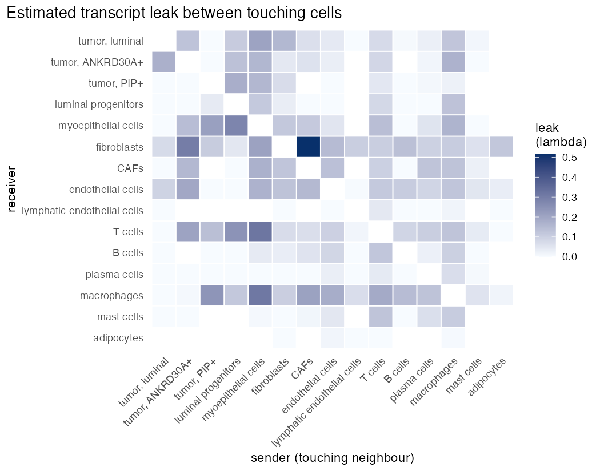
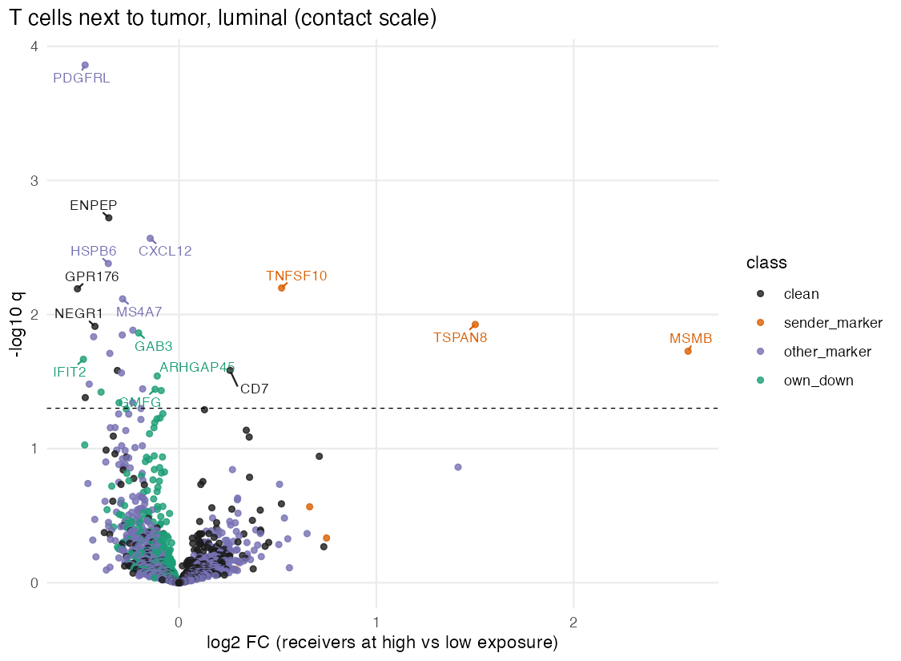
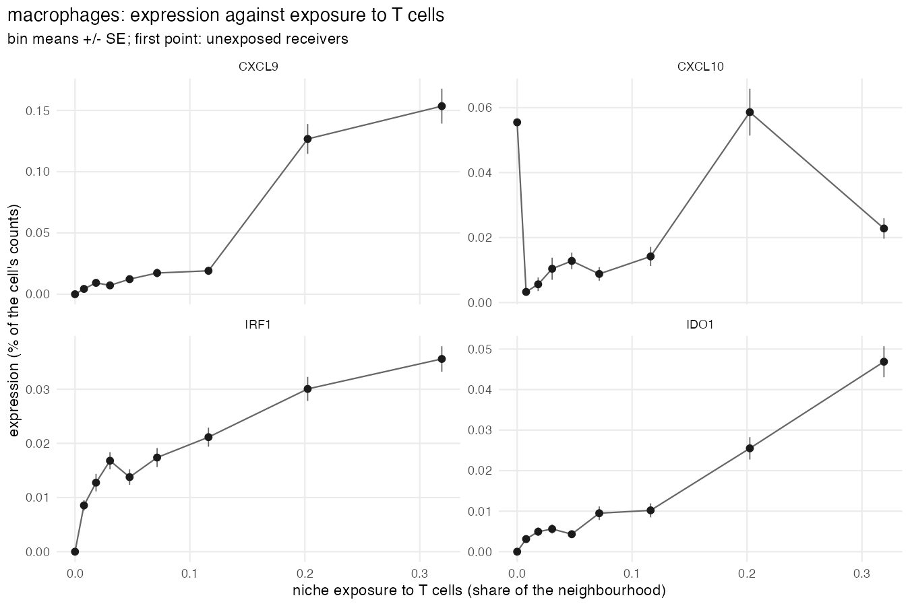
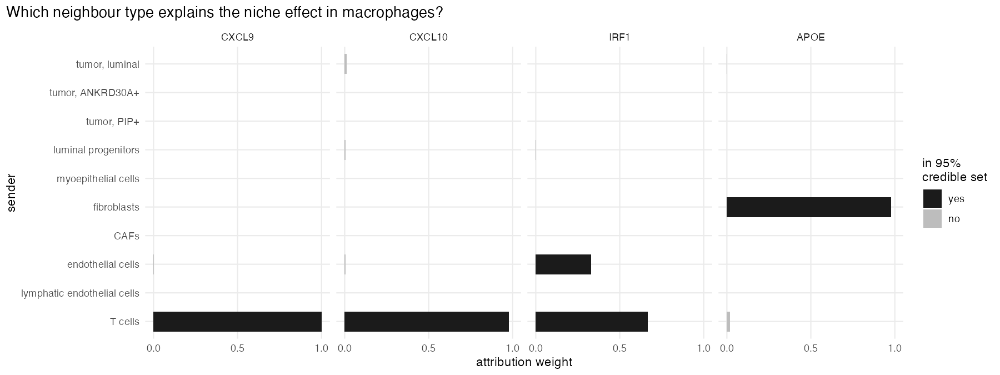

<!-- DRAFT (branch tutorials/cell-interactions). edgeicg and edgeicgrs are still
     private repositories: the install chunk works once they are public. -->

```{r, include = FALSE}
knitr::opts_chunk$set(eval = FALSE)
```

# Overview

A cell's expression depends partly on its neighbours. An immune cell next to a
tumour cell, or a macrophage among T cells, may switch genes on or off.
`findInteractionChangedFeats()` looks for these **interaction-changed
features** (ICF): genes whose expression in one cell type, the *receiver*,
changes with its exposure to another cell type, the *sender*.

In imaging-based data this question has a trap. Transcripts leak across cell
boundaries, and segmentation is never perfect, so a T cell that touches a
tumour cell picks up some of the tumour cell's transcripts. A naive test then
reports tumour genes as "induced" in T cells. `method = "edgeicg"`, the default since
Giotto 4.3.6 (from the [edgeicg](https://github.com/drieslab/edgeicg)
package), is built around this:

- it estimates, for every pair of cell types, how much of a touching
  neighbour's expression leaks into a cell, and removes that leak cell by cell
  before testing;
- it tests three scales of exposure: touching cells (**contact**), the
  neighbours within about 75 µm (**paracrine**) and the regional neighbourhood
  of about 450 µm (**niche**);
- it calibrates the niche scale against spatially shifted copies of the tissue,
  and attributes each niche hit to the sender type that explains it best;
- it labels every hit by how likely it is to be an artefact, for example a gene
  that marks the sender.

The engine works on sums over cells, reads a GiottoDisk expression store in
spatial windows without loading it, and runs in parallel.

This tutorial continues from the
[Atera Human Breast Cancer](atera_human_breast_cancer.html) example: a whole
section of 170,000 cells with an 18,000-gene panel, its cell types, and the
motif analysis that found T cells deep inside tumour nests.

# Setup

```{r install}
# edgeicg, and edgeicgrs for its compiled (Rust) kernels, which are optional but
# about 20 times faster
pak::pak(c("drieslab/edgeicg", "drieslab/edgeicgrs"))
# a gene set used below
install.packages("msigdbr")
```

```{r libs}
library(arrow) # load before terra or GiottoClass
library(Giotto)
library(GiottoDisk)
library(data.table)

project_dir <- "path/to/atera_project" # the project of the Atera breast example
```

Load the annotated object of the breast example:

```{r load}
g <- loadGiotto(project_dir, name = "annotated")
```

<div class="alert alert-info">
The results on this page were computed from the 10x expression matrix: the
optional **Aggregate** step of the breast example was skipped. With that
matrix, Leiden clustering gives 19 clusters instead of 18, which were mapped to
the same 15 cell types (clusters 12 and 18 are both myoepithelial cells). The
10x matrix assigns transcripts with 10x's own segmentation, whereas
`aggregateFeatures()` assigns them by the cell outlines, so about 2–3% of the
counts per cell differ. If you aggregated, your numbers will differ somewhat
from the ones shown here.
</div>

# Choose the features

edgeicg can test every gene; on this section all 17,000 detected genes take
about 10 minutes with 8 workers, but about 40 GB of memory. A focused set
is faster and lighter. We take the 2,000 highly variable features of the
breast example and add the 200 genes of the MSigDB Hallmark *interferon-γ
response*: the motif analysis found T cells among tumour cells, and
interferon-γ is what activated T cells release.

The gene set matters here. Genes that are switched on in a few cells, such as
the chemokines CXCL9 and CXCL10, are rarely among the highly variable features,
which favour genes that separate cell types.

```{r feats}
hvf <- fDataDT(g)[hvf == "yes", feat_ID]
ifng <- unique(subset(
    msigdbr::msigdbr(species = "Homo sapiens", collection = "H"),
    gs_name == "HALLMARK_INTERFERON_GAMMA_RESPONSE"
)$gene_symbol)
feats <- intersect(union(hvf, ifng), fDataDT(g)$feat_ID)
length(feats)
```

```
[1] 2123
```

# Run

```{r run}
icf <- findInteractionChangedFeats(g,
    cluster_column = "cell_type",
    method = "edgeicg",
    selected_feats = feats,
    spatial_covariates = TRUE,
    workers = 8
)
icf$edgeicg
```

```
EdgeICG: 169528 cells, 15 types, 2101 genes, 210 pairs (pass1 53 s, pass2 43 s, pass3 4 s)
  hits: q < 0.05 and |log2 FC| >= 0.25 (q < 0.05 alone)
  contact   3166 (5600)
  paracrine 1309 (1984)
  niche     1455 (1626), screen
            attributed (receiver, gene): 931
```

This takes about 2 minutes with 8 workers, with a peak of about 19 GB of
memory. The expression is read from the GiottoDisk store in spatial windows;
fewer `workers` use less memory. What the settings do:

- `cluster_column`: the cell types. Every ordered pair of types is a receiver
  and sender pair (210 here).
- `selected_feats`: the features to test. The leak is estimated across the
  tested features, so it shifts somewhat with the panel; niche results are
  stable.
- `spatial_covariates = TRUE`: adjusts the niche scale for smooth trends across
  the section (tissue zones), which otherwise produce niche hits of their own.
  It adds about 10% to the run time.
- `min_lfc` (default 0.25): a hit must also change by at least this log2 fold
  change. On a whole section even tiny, confounded differences become
  significant; the floor keeps effects that are large enough to matter.
- `workers`: parallel workers. Results do not depend on their number.

The full fit is kept in `icf$edgeicg`; the table of hits is `icf$ICFscores`.

# Results

`icf$ICFscores` has one row per receiver, sender, scale and feature with
q < 0.1:

- `cell_type`, `int_cell_type`: receiver and sender;
- `scale`: contact, paracrine or niche;
- `log2fc`: the fold change between receivers at high (90th percentile) and low
  (10th percentile) exposure to the sender;
- `z`, `p.value`, `p.adj`: the test, adjusted within each scale;
- `class`: how the hit could arise without an interaction;
- `regional`: a niche hit that recurs in three or more receiver types, more
  likely a tissue zone than an interaction;
- `top_sender`, `alpha`: for niche hits, the sender type the effect is
  attributed to and the share of the evidence it explains.

The classes are, in order of precedence:

| class | the gene ... | read it as |
|---|---|---|
| `sender_marker` | is much higher in the sender than in the receiver | leaked or mis-assigned transcripts that the leak model did not fully remove |
| `other_marker` | marks a third cell type | the same, from a third type nearby |
| `own_down` | is a receiver gene going down next to a sender that expresses it much less | mixed or mis-segmented cells, or dilution |
| `clean` | none of these | a candidate interaction |

```{r classes}
sc <- icf$ICFscores
dcast(sc[p.adj < 0.05], scale ~ class, fun.aggregate = length,
    value.var = "feats")
```

```
       scale clean other_marker own_down sender_marker
      <char> <int>        <int>    <int>         <int>
1:   contact   980          863     1018           305
2:     niche   623          389      296           147
3: paracrine   522          343      337           107
```

At contact scale, more than two thirds of the significant hits are of an
artefact class. That is the leak problem in numbers; the rest of this tutorial
uses the `clean` hits.

## Overview

`plotICFOverview()` counts the clean hits for every receiver and sender pair at
each scale. Dot size is the number of hits, colour the share that go up.

```{r overview}
type_order <- c("tumor, luminal", "tumor, ANKRD30A+", "tumor, PIP+",
    "luminal progenitors", "myoepithelial cells", "fibroblasts", "CAFs",
    "endothelial cells", "lymphatic endothelial cells", "T cells", "B cells",
    "plasma cells", "macrophages", "mast cells", "adipocytes")
plotICFOverview(g, icf, cell_order = type_order)
```

```{r overview-fig, eval = TRUE, echo = FALSE, out.width = "100%"}

```

Stromal and immune cells change most with their neighbours: macrophages next to
fibroblasts, CAFs, endothelial cells and T cells, endothelial cells and
fibroblasts in the tumour's neighbourhood. Tumour cells change little at
contact and more at niche scale.

## The leak, and why the classes matter

`plotICFLeak()` shows the estimated leak: the share of a touching sender's
expression that turns up in the receiver.

```{r leak}
plotICFLeak(g, icf, cell_order = type_order)
```

```{r leak-fig, eval = TRUE, echo = FALSE, out.width = "70%"}

```

Small cells with large neighbours, such as T cells and macrophages next to
epithelial cells, pick up the most. The largest value, fibroblasts next to
CAFs, also reflects that the two types grade into each other.

`plotICFPair()` shows every feature tested for one pair at one scale. For T
cells touching luminal tumour cells:

```{r pair}
plotICFPair(g, icf, receiver = "T cells", sender = "tumor, luminal",
    scale = "contact")
```

```{r pair-fig, eval = TRUE, echo = FALSE, out.width = "80%"}

```

The strongest increases (MSMB, TSPAN8, TNFSF10) are tumour genes, flagged
`sender_marker`: the leak model removes most, but not all, of the transcripts a
T cell picks up from a tumour cell it touches. Many decreases are genes of
other stromal types (`other_marker`) or the T cell's own genes going down
(`own_down`). Few clean hits remain, all small. T cells touching tumour cells
look much like the other T cells.

# Interferon response near T cells

The macrophages tell a different story. Their clean hits next to T cells:

```{r macrophages}
sc[cell_type == "macrophages" & int_cell_type == "T cells" &
    class == "clean" & !regional & p.adj < 0.05][order(p.adj)][
    1:12, .(feats, scale, log2fc, z, p.adj, top_sender, alpha)]
```

```
      feats     scale log2fc     z   p.adj top_sender alpha
     <char>    <char>  <num> <num>   <num>     <char> <num>
 1:    FGL2 paracrine   0.93   7.9 1.9e-11       <NA>    NA
 2:   CXCL9     niche   4.25   7.6 7.8e-11    T cells  1.00
 3:   CIITA   contact   0.70   7.1 1.1e-09       <NA>    NA
 4:    CD74   contact   0.48   6.5 5.3e-08       <NA>    NA
 5:    TAP1     niche   2.11   6.6 6.2e-08    T cells  0.96
 6:    FGL2   contact   0.60   6.3 1.0e-07       <NA>    NA
 7: CLEC10A   contact   0.84   6.1 4.3e-07       <NA>    NA
 8:    IRF1     niche   2.62   6.0 1.5e-06    T cells  0.67
 9:   WARS1     niche   1.88   5.9 3.4e-06    T cells  0.92
10:  LAPTM5   contact  -0.50  -5.6 6.5e-06       <NA>    NA
11:   DAPP1   contact   1.17   5.6 7.9e-06       <NA>    NA
12:  SAMHD1 paracrine   0.64   5.7 9.9e-06       <NA>    NA
```

Two programmes stand out. In T-cell-rich niches, macrophages switch on the
interferon-γ response: the chemokines CXCL9 and CXCL10, which attract more T
cells, the transcription factor IRF1, the antigen-processing gene TAP1 and
WARS1. Where they touch T cells, they raise MHC class II (CIITA, the master
regulator, and CD74). Both are what macrophages do when activated T cells
release interferon-γ. `log2fc` is capped at ±4.25; CXCL9 is close to absent in
macrophages away from T cells.

## Expression against exposure

A hit is a slope. `plotICFExposure()` shows the data behind it: receivers
binned by their exposure to the sender, and their mean expression (as a share
of the cell's counts) in each bin. The first point holds the unexposed cells.

```{r exposure}
plotICFExposure(g, icf, receiver = "macrophages", sender = "T cells",
    feats = c("CXCL9", "CXCL10", "IRF1", "IDO1"), scale = "niche")
```

```{r exposure-fig, eval = TRUE, echo = FALSE, out.width = "85%"}

```

CXCL9, IRF1 and IDO1 rise steadily with the share of T cells around a
macrophage. CXCL10 rises too, but it is also high in macrophages with no T
cells nearby, so another source drives it there as well.

## Where it happens

A 600 µm window around the macrophages with the most T cells nearby. The cell
types, and the macrophages coloured by their CXCL9 counts:

```{r zoom}
roi <- c(8454, 9054, -3209, -2609) # xmin, xmax, ymin, ymax
gz <- subsetGiottoLocs(g,
    x_min = roi[1], x_max = roi[2], y_min = roi[3], y_max = roi[4])

# one color per cell type, as in the breast example
type_colors <- c(
    "tumor, luminal" = "#c51b7d", "tumor, ANKRD30A+" = "#f1b6da",
    "tumor, PIP+" = "#7a0177", "luminal progenitors" = "#ff7f00",
    "myoepithelial cells" = "#e6ab02",
    "fibroblasts" = "#33a02c", "CAFs" = "#b2df8a",
    "endothelial cells" = "#e31a1c", "lymphatic endothelial cells" = "#fb9a99",
    "T cells" = "#17becf", "B cells" = "#1f78b4", "plasma cells" = "#a6cee3",
    "macrophages" = "#6a3d9a", "mast cells" = "#b15928", "adipocytes" = "#ffff99"
)
spatPlot2D(gz, cell_color = "cell_type", color_as_factor = TRUE,
    cell_color_code = type_colors, point_size = 1.4)

# CXCL9 counts of the macrophages, as a cell metadata column
mac <- pDataDT(g)[cell_type == "macrophages", cell_ID]
raw <- getExpression(g, values = "raw", output = "exprObj")[]
cxcl9 <- storeRead(raw["CXCL9", mac], output = "dgcmatrix",
    max_rows = Inf, max_cols = Inf)
g <- addCellMetadata(g,
    new_metadata = data.frame(cell_ID = mac,
        CXCL9_macrophage = pmin(as.numeric(cxcl9["CXCL9", mac]), 5)),
    by_column = TRUE, column_cell_ID = "cell_ID"
)
gz <- subsetGiottoLocs(g,
    x_min = roi[1], x_max = roi[2], y_min = roi[3], y_max = roi[4])
spatPlot2D(gz, cell_color = "CXCL9_macrophage", color_as_factor = FALSE,
    gradient_style = "sequential", point_size = 1.6)
```

```{r zoom-fig, eval = TRUE, echo = FALSE, out.width = "49%", fig.show = "hold"}
knitr::include_graphics(c(
    "images/interaction_changed_features/05_zoom_types.png",
    "images/interaction_changed_features/05_zoom_cxcl9.png"
))
```

The CXCL9-high macrophages (yellow, right) sit in the dense patch of T cells
(cyan, left) at the lower right of the window; macrophages in the tumour and
stroma above have none.

## Which neighbour explains a niche effect?

Neighbourhoods overlap: a T-cell-rich niche also holds stromal and endothelial
cells. For niche hits, edgeicg weighs the candidate sender types against each
other. `plotICFAttribution()` shows the share of the evidence each sender
explains; black bars form the 95% credible set.

```{r attribution}
plotICFAttribution(g, icf, receiver = "macrophages",
    feats = c("CXCL9", "CXCL10", "IRF1", "APOE"), cell_order = type_order)
```

```{r attribution-fig, eval = TRUE, echo = FALSE, out.width = "100%"}

```

The interferon genes are attributed to T cells. APOE, which macrophages also
change with their niche, is attributed to fibroblasts instead: a different
neighbourhood, and likely a different macrophage state.

## Beyond macrophages

The same response shows up, more weakly, in stromal cells near T cells:

```{r stroma}
ifn <- c("CXCL9", "CXCL10", "IRF1", "STAT1", "GBP1", "TAP1", "IDO1")
sc[int_cell_type == "T cells" & feats %in% ifn & class == "clean" &
    p.adj < 0.05][order(cell_type, p.adj),
    .(cell_type, feats, scale, log2fc, p.adj)]
```

```
            cell_type  feats     scale log2fc   p.adj
               <char> <char>    <char>  <num>   <num>
 1:              CAFs   IRF1 paracrine   1.41 1.5e-03
 2:              CAFs   TAP1 paracrine   1.08 1.3e-02
 3: endothelial cells  STAT1   contact   0.31 8.5e-04
 4:       fibroblasts  STAT1   contact   0.36 2.3e-07
 5:       fibroblasts  STAT1 paracrine   0.33 1.1e-04
 6:       fibroblasts  STAT1     niche   0.46 8.9e-04
 7:       fibroblasts   GBP1   contact   0.37 6.6e-03
 8:       fibroblasts   IRF1   contact   0.42 7.2e-03
 9:       fibroblasts   GBP1 paracrine   0.35 9.4e-03
10:       fibroblasts   IRF1 paracrine   0.57 1.5e-02
```

# Reading the results with care

- **Use the clean hits, and look at the data.** The classes flag the likely
  artefacts, but no rule catches all of them. `plotICFExposure()` shows whether
  a hit follows exposure or rests on a few cells.
- **Cell types that grade into each other.** Luminal progenitors next to
  luminal tumour cells have many hits, including tumour genes going up. Cells
  at the border of two clusters share features of both, so part of this is the
  labels rather than an interaction. The same holds for fibroblasts and CAFs.
- **Effects that are too uniform.** Exposure varies little for some receivers,
  such as myoepithelial cells, which line every duct and are always next to
  tumour cells. Their power is low.
- **Associations, not causes.** A hit says expression changes with exposure.
  It does not say the sender causes it; both may follow a third factor. The
  attribution helps choose between sender types, not between sender and
  something unmeasured.
- **What was checked.** On this section, with these cell types and 3,000
  genes, effects planted into real counts were found in 97% (contact), 88%
  (paracrine) and 78% (niche) of cases with `spatial_covariates = TRUE`, and
  genes without a planted effect were called in 2.8% of cases. Without the
  spatial covariates, niche recall was 85% but genes without an effect were
  called in 6.1% of cases, mostly at niche scale. Splitting the T cells at
  random into two halves gave almost no hits between the halves (0.3% of tests
  with |z| > 3 at every scale).

# Settings

Settings are passed to `findInteractionChangedFeats()` or collected with
`icfParam("edgeicg", ...)`:

| setting | default | what it does |
|---|---|---|
| `expression_values` | `"raw"` | counts to model; edgeicg needs raw counts |
| `use_polygons` | `TRUE` | touching cells from the cell outlines; otherwise nearest neighbours |
| `min_lfc` | 0.25 | effect-size floor for the reported hits |
| `report_q` | 0.1 | entries with q below this go into `ICFscores` |
| `spatial_covariates` | `FALSE` | adjust the niche scale for smooth spatial trends |
| `calibrate`, `min_shift` | `TRUE`, 450 | the spatial calibration of the niche scale (shift in µm) |
| `workers` | 0 | parallel workers (mirai); 0 runs sequentially |
| `backend` | `"auto"` | the Rust kernels of edgeicgrs when installed |
| `block_genes`, `window_cells` | 500, auto | memory per task: genes per block and cells per spatial window |

`method = "classic"` runs the original permutation test, the default before
Giotto 4.3.6. It does not model the leak and loads the full expression matrix, and
it is kept for comparison only.

# Session info

```{r session}
sessionInfo()
```
