# Introduction

Giotto facilitates seamless interoperability with various tools, including Seurat. The conversion between Giotto and Seurat relies on two functions from [GiottoConnect](https://github.com/giotto-suite/GiottoConnect): `seuratToGiotto()` and `giottoToSeurat()`. They work with Seurat v3/v4 and v5 objects alike: the converter recognises the layout of the object (assays, images, reductions, graphs) instead of depending on the Seurat version.

## Conversion of Seurat to Giotto

In this section, we outline the steps to convert a Seurat object to Giotto.

### Load required Libraries 

To start, we load the required libraries.

```{r, eval=FALSE}
library(data.table)
library(Giotto)
library(GiottoData)
library(GiottoConnect)
library(Seurat)
library(SeuratData)
```

### Load Seurat object

We begin by loading a sample Seurat object named "stxBrain" with the type specified as "anterior1".

```{r, eval=FALSE}
brain <- LoadData("stxBrain", type = "anterior1")
```

### Convert Seurat object to Giotto

To convert the Seurat object to a Giotto object, we use the function `seuratToGiotto()`. The counts of the `Spatial` assay become the `raw` expression values of the feature type `rna`, the Visium spot positions are converted from image pixels to microns, and the tissue image (and any reductions and nearest neighbour graphs) are carried over.

```{r, eval=FALSE}
brainG <- seuratToGiotto(brain)
```

`mappingProvenance()` lists what was converted and what could not be carried over or was estimated, such as the micron-per-pixel scale:

```{r, eval=FALSE}
mappingProvenance(brainG)$losses
```

### Print Giotto object

```{r, eval=FALSE}
brainG
```

### Downstream Analysis using Giotto Object

The downstream analysis of the giotto object being created by seurat object is given below.

#### High Efficiency Data Processing

```{r, eval=FALSE}
brainG <- processGiotto(
    brainG,
    filter_params = list(expression_threshold = 1,
                         feat_det_in_min_cells = 100,
                         min_det_feats_per_cell = 10),
    norm_params = list(norm_methods = "standard",
                       scale_feats = TRUE,
                       scalefactor = 6000),
    stat_params = list(expression_values = "normalized"),
    adjust_params = list(expression_values = c("normalized"),
                         covariate_columns = "nr_feats")
)
```

#### Dimension Reduction and PCA

First, we find HVF (highly varialble features) using the loess regression prediction model.

```{r, eval=FALSE}
brainG <- calculateHVF(gobject = brainG, method = "cov_loess")
```

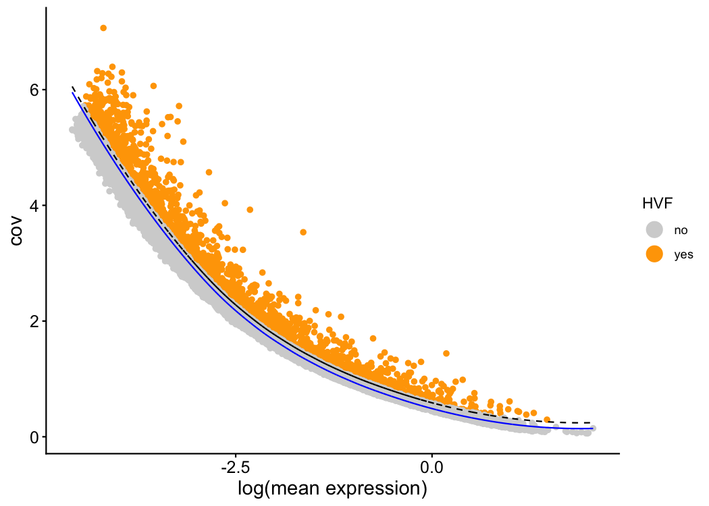
then use HVF to compute the reduced dimensions using PCA.

```{r, eval=FALSE}
## Select genes highly variable genes that fit specified statistics
# These are both found within feature metadata
feature_metadata <- getFeatureMetadata(brainG)[]
featgenes <- feature_metadata[hvf == "yes" & perc_cells > 4 & mean_expr_det > 0.5]$feat_ID

## run PCA on expression values (default)
brainG <- Giotto::runPCA(gobject = brainG, 
                         feats_to_use = featgenes, 
                         scale_unit = FALSE, 
                         center = FALSE)

Giotto::plotPCA(brainG,
                save_plot = TRUE)
```

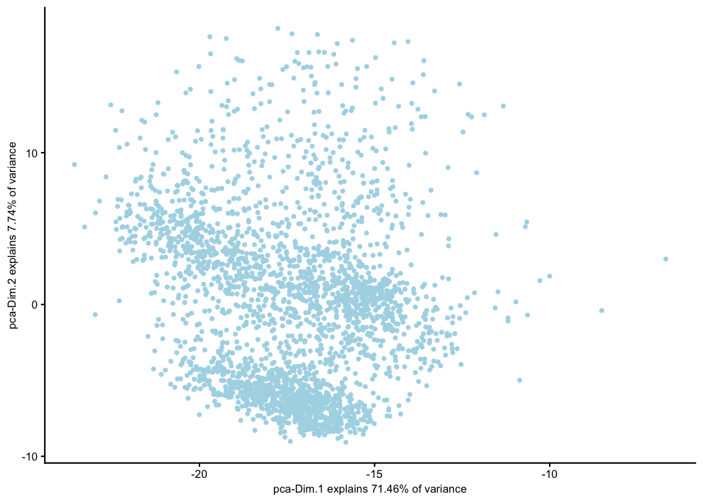

Here, we'll proceed with running UMAP based on PCA dimension reduction and visualize the pre-clustering UMAP.

```{r, eval=FALSE}
brainG <- Giotto::runUMAP(brainG, dimensions_to_use = 1:15)
graph1 <- Giotto::plotUMAP(gobject = brainG)

```

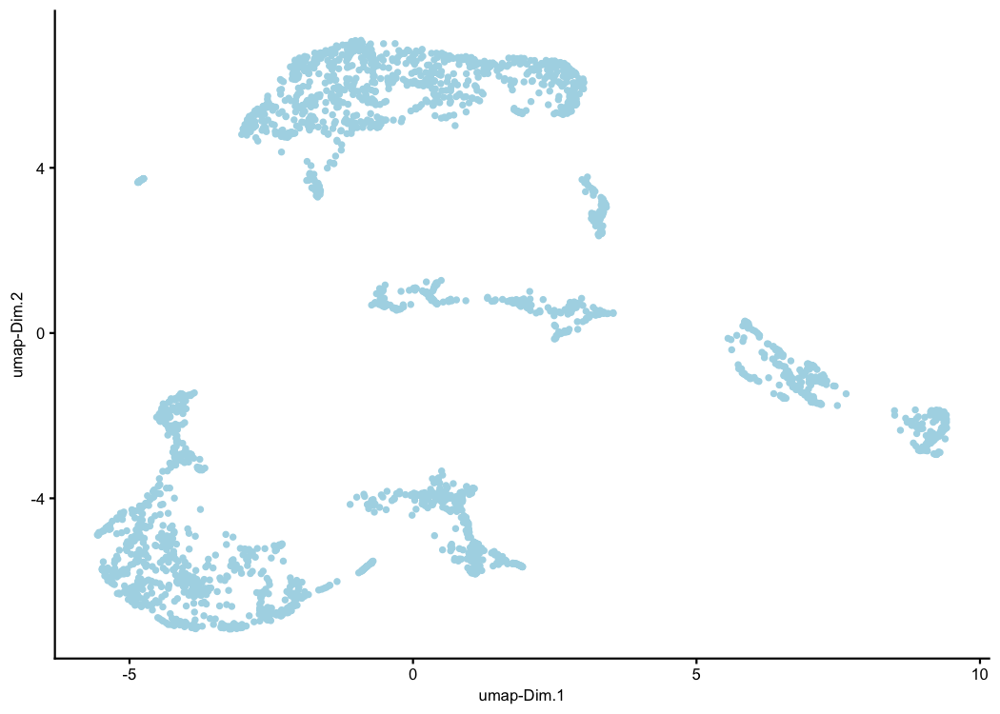

#### Clustering

Before proceeding with clustering cells based on their expression profiles, ensure that the Giotto Object has undergone PCA dimension reduction and includes either t-SNE or UMAP dimension reduction, as well as a defined neighbor network.

To initialize the clustering process, create a shared nearest neighbor network (sNN) with a specified number of nearest neighbors ("k"):

```{r, eval=FALSE}
brainG <- createNearestNetwork(gobject = brainG, 
                               type = "sNN", 
                               dimensions_to_use = 1:15, 
                               k = 15)
```

In Giotto, various clustering algorithms are available, such as k-means, Leiden, or Louvain. These algorithms automatically store cluster information within cell metadata, typically following default naming conventions. However, you can easily customize the cluster name by specifying the "name" argument.

```{r, eval=FALSE}
## k-means clustering
brainG <- doKmeans(gobject = brainG, dim_reduction_to_use = "pca")

#Plot UMAP post-clustering to visualize kmeans
graph2 <- Giotto::plotUMAP(
    gobject = brainG,
    cell_color = "kmeans",
    show_NN_network = TRUE,
    point_size = 2.5
)
```

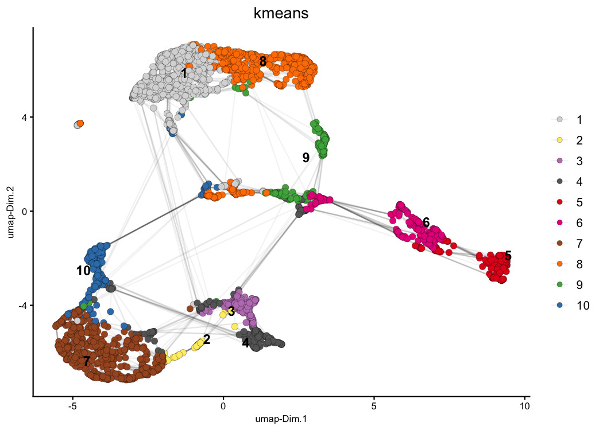

#### Spatial co-expression

Using the spatial network previously established, we can employ the binSpect method to identify spatially variable genes.

```{r, eval=FALSE}
brainG <- Giotto::createSpatialDelaunayNetwork(gobject = brainG)
showGiottoSpatNetworks(brainG)

ranktest = binSpect(
    brainG, 
    bin_method = "rank",
    calc_hub = TRUE, 
    hub_min_int = 5,
    spatial_network_name = "Delaunay_network"
)
```

Here, we narrow the analysis down to the top 300 spatial genes from binSpect and group them into spatial co-expression modules with `spatialCoexpression()`. It smooths each spot's expression with its neighbours', correlates the genes on the smoothed values, clusters the correlation into modules and scores every module in every spot.

```{r, eval=FALSE}
ext_spatial_genes <- ranktest[1:300, ]$feats

brainG <- spatialCoexpression(brainG,
    feats = ext_spatial_genes,
    spatial_network_name = "Delaunay_network",
    n_modules = 7
)

# the modules, their genes and correlations as a list
coexpr <- spatialCoexpression(brainG,
    feats = ext_spatial_genes,
    spatial_network_name = "Delaunay_network",
    n_modules = 7,
    return_gobject = FALSE
)
coexpr$summary
```

The heatmap shows the gene-gene correlation, ordered and annotated by module:

```{r, eval=FALSE}
heatmapCoexpression(brainG, coexpr)
```

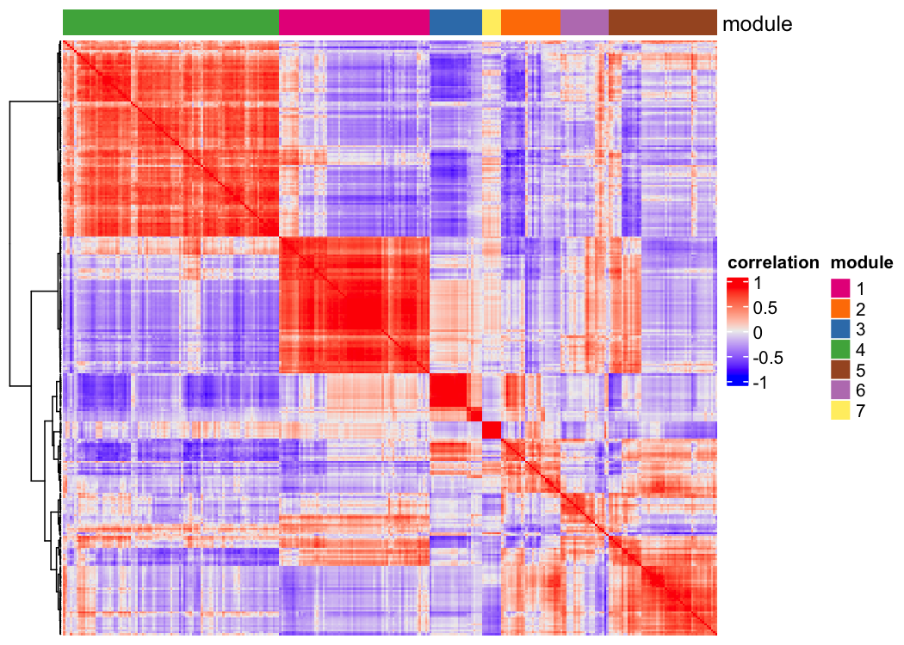

The module scores are stored as the spatial enrichment `spatial_module`:

```{r, eval=FALSE}
spatCellPlot(brainG,
    spat_enr_names = "spatial_module",
    cell_annotation_values = as.character(1:7),
    point_size = 1,
    cow_n_col = 3
)
```

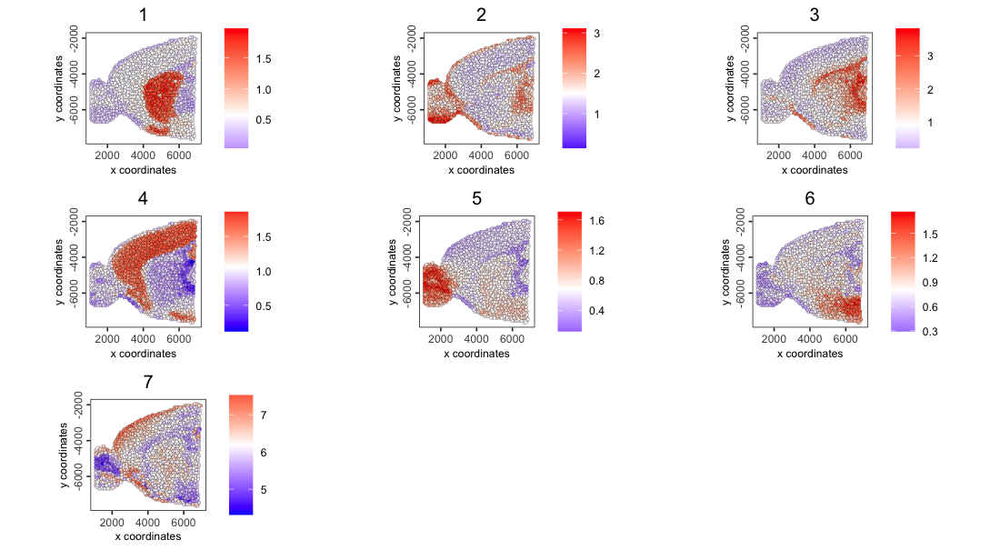

See the [spatial co-expression modules](spatial_coexpression_modules.html) tutorial for more options.

## Conversion of Giotto to Seurat

The `giottoToSeurat()` function converts a Giotto object to a Seurat v5 object.

### Reverting GiottoObj to Seurat

In this step, we revert the Giotto object, previously converted from Seurat, back to its original Seurat format:

```{r, eval=FALSE}
brain2 <- giottoToSeurat(brainG)
```

One spatial unit and feature type is converted at a time (the active ones by default; see the `spat_unit` and `feat_type` arguments). The feature type becomes the assay (`rna`) with the raw counts in its `counts` layer and the normalized values in `data`. Reductions (with the PCA loadings), every nearest neighbour network and the cell metadata are carried over, and the spots and tissue image become a Visium image named `fov`, so Seurat's spatial plots show the tissue.

### Print Seurat Object

```{r, eval=FALSE}
brain2
```

### Downstream Analysis of the converted Seurat object

Following the conversion of Giotto to Seurat, downstream analysis can be conducted as outlined below:

#### Load libraries

Load Required Libraries

```{r, eval=FALSE}
library(Seurat)
library(SeuratData)
library(ggplot2)
library(patchwork)
library(dplyr)
```

#### Visualization of Cell Counts Distribution
 
Visualize the distribution of cell counts using violin plots and spatial feature plots:

```{r, eval=FALSE}
plot1 <- VlnPlot(brain2, features = "nCount_rna", pt.size = 0.1) + NoLegend()

plot2 <- SpatialFeaturePlot(brain2, features = "nCount_rna") + theme(legend.position = "right")
wrap_plots(plot1, plot2)

```

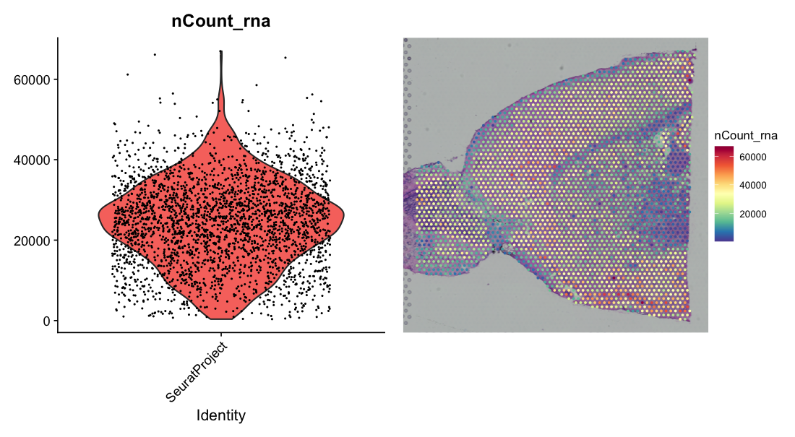

####  Data Transformation

To enhance the analysis, we apply SCTransform to perform data transformation on the RNA assay:

```{r, eval=FALSE}
brain2 <- SCTransform(brain2, assay = "rna", verbose = FALSE)
```

#### Dimensionality Reduction and Clustering

Following data transformation, we proceed with dimensionality reduction and clustering. This involves conducting PCA, identifying neighbors, performing clustering, and running UMAP for dimensionality reduction:

```{r, eval=FALSE}
brain2 <- RunPCA(brain2, assay = "SCT", verbose = FALSE)
brain2 <- FindNeighbors(brain2, reduction = "pca", dims = 1:30)
brain2 <- FindClusters(brain2, verbose = FALSE)
brain2 <- RunUMAP(brain2, reduction = "pca", dims = 1:30)
```

#### Visualization of Clusters on UMAP

To visualize clusters on UMAP, we generate dimensional plots with cluster labels for better interpretation:

```{r, eval=FALSE}
p1 <- DimPlot(brain2, reduction = "umap", label = TRUE)
p2 <- SpatialDimPlot(brain2, label = TRUE, label.size = 3)
p1 + p2
```

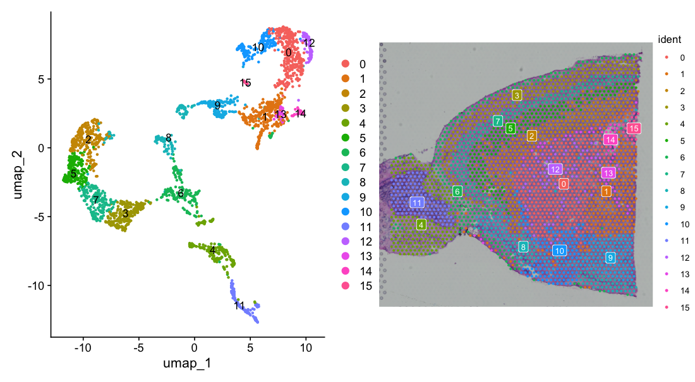
Additionally, we can highlight specific cell populations within the spatial dimensional plot:

```{r, eval=FALSE}
SpatialDimPlot(brain2, 
               cells.highlight = CellsByIdentities(object = brain2, idents = c(2, 1, 4, 3,
    5, 8)), facet.highlight = TRUE, ncol = 3)
```

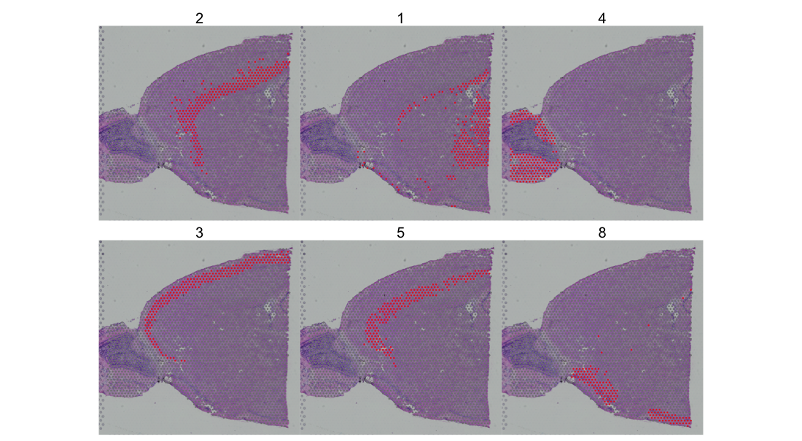

#### Identification of Spatially Variable Features

To identify spatially variable features between clusters, the FindMarkers function is employed. Subsequently, we visualize the top spatially variable features using SpatialFeaturePlot:

```{r, eval=FALSE}
de_markers <- FindMarkers(brain2, ident.1 = 5, ident.2 = 6)
SpatialFeaturePlot(object = brain2, features = rownames(de_markers)[1:3], alpha = c(0.1, 1), ncol = 3)
```

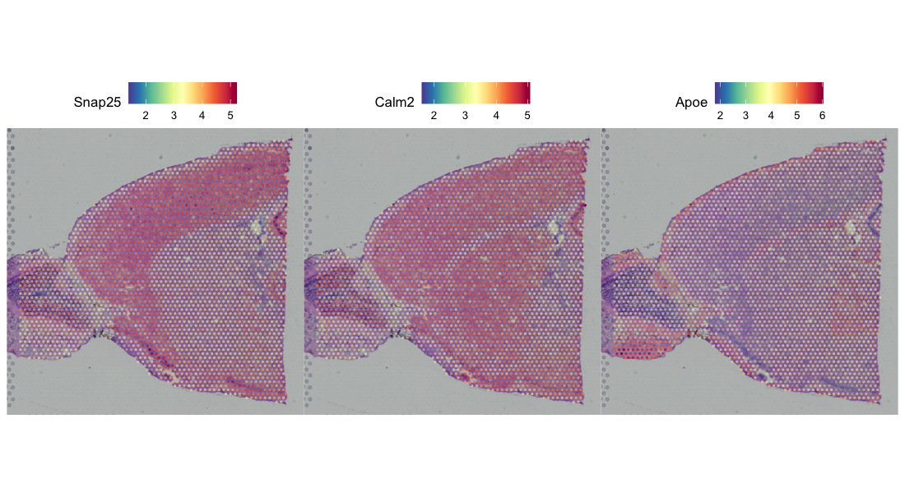

we identify spatially variable features within the spatial data. This is achieved through the `FindSpatiallyVariableFeatures` function, which calculates spatial statistics to determine the variability of features across spatial locations. In the following code chunk, we focus on the top 1000 variable features selected from the SCT assay using the Moransi selection method.

```{r, eval=FALSE}
brain2 <- FindSpatiallyVariableFeatures(brain2, 
                                        assay = "SCT", 
                                        features = head(VariableFeatures(brain2), 1000),
                                        selection.method = "moransi")
```

#### Subset out anatomical regions

This section focuses on subsetting anatomical regions from the dataset and visualizing them using spatial dimensional plots.

```{r, eval=FALSE}
cortex <- subset(brain2, idents = c(1, 2, 3, 4, 6, 7))
p1 <- SpatialDimPlot(cortex, crop = TRUE, label = TRUE)
p2 <- SpatialDimPlot(cortex, crop = FALSE, label = TRUE, pt.size.factor = 1, label.size = 3)
p1 + p2
```

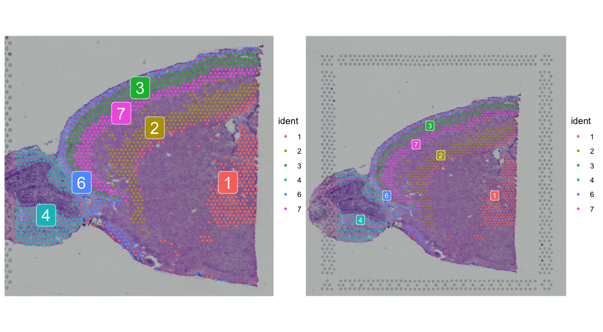

#### Working with multiple slices in Seurat

To incorporate data from multiple slices in our analysis, we first load and transform the posterior slice:

```{r, eval=FALSE}
brainP <- LoadData("stxBrain", type = "posterior1")
brainP <- SCTransform(brainP, assay = "Spatial", verbose = FALSE)
```

Next, we merge the datasets obtained from the anterior and posterior slices:

```{r, eval=FALSE}

brain.merge <- merge(brain2, brainP)
```

We set the default assay to "SCT" and combine variable features from both datasets:

```{r, eval=FALSE}
DefaultAssay(brain.merge) <- "SCT"
VariableFeatures(brain.merge) <- c(VariableFeatures(brain2), VariableFeatures(brainP))
brain.merge <- RunPCA(brain.merge, verbose = FALSE)
brain.merge <- FindNeighbors(brain.merge, dims = 1:30)
brain.merge <- FindClusters(brain.merge, verbose = FALSE)
brain.merge <- RunUMAP(brain.merge, dims = 1:30)
```

After performing PCA, identifying neighbors, clustering, and running UMAP, we visualize the results:

```{r, eval=FALSE}
DimPlot(brain.merge, reduction = "umap", group.by = c("ident", "orig.ident"))
```
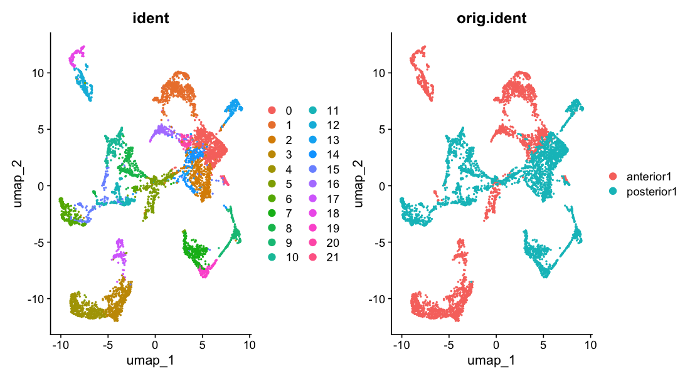

```{r, eval=FALSE}
SpatialDimPlot(brain.merge)
```
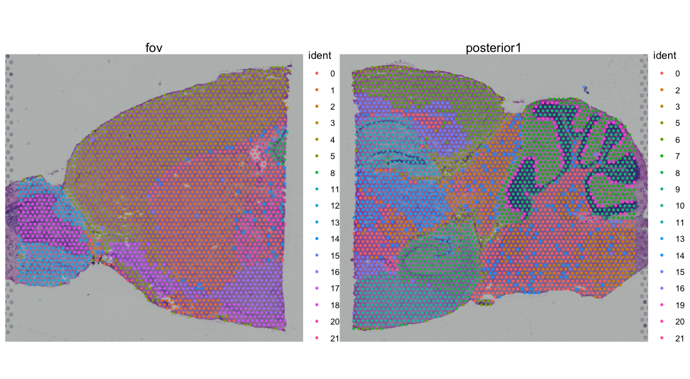

```{r, eval=FALSE}
SpatialFeaturePlot(brain.merge, features = c("Hpca", "Plp1"))
```
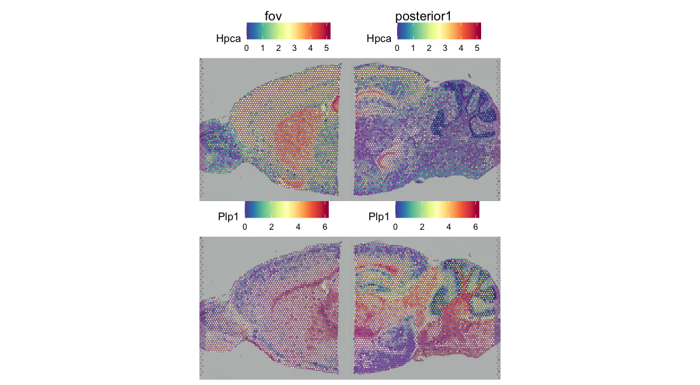

```{r, eval=FALSE}
sessionInfo()
```

```{r, eval=FALSE}
R version 4.5.3 (2026-03-11)
Platform: aarch64-apple-darwin20
Running under: macOS Tahoe 26.7.3

Matrix products: default
BLAS:   /Library/Frameworks/R.framework/Versions/4.5-arm64/Resources/lib/libRblas.0.dylib 
LAPACK: /Library/Frameworks/R.framework/Versions/4.5-arm64/Resources/lib/libRlapack.dylib;  LAPACK version 3.12.1

locale:
[1] C.UTF-8/C.UTF-8/C.UTF-8/C/C.UTF-8/C.UTF-8

time zone: America/New_York
tzcode source: internal

attached base packages:
[1] stats     graphics  grDevices utils     datasets  methods   base     

other attached packages:
 [1] future_1.82.0             dplyr_1.2.1               patchwork_1.3.2          
 [4] ggplot2_4.0.4             stxBrain.SeuratData_0.1.2 SeuratData_0.2.2.9002    
 [7] Seurat_6.0.0              SeuratObject_5.4.0        sp_2.2-1                 
[10] GiottoConnect_0.1.0       GiottoData_0.3.8          Giotto_4.3.6             
[13] GiottoClass_0.8.0         data.table_1.18.6.1      

loaded via a namespace (and not attached):
  [1] RcppAnnoy_0.0.23            splines_4.5.3               tibble_3.3.1               
  [4] R.oo_1.27.1                 polyclip_1.10-7             fastDummies_1.7.6          
  [7] lifecycle_1.0.5             sf_1.1-1                    doParallel_1.0.17          
 [10] globals_0.20.0              lattice_0.22-9              hdf5r_1.3.12               
 [13] MASS_7.3-65                 backports_1.5.1             magrittr_2.0.5             
 [16] limma_3.66.0                plotly_4.12.1               yaml_2.3.12                
 [19] otel_0.3.0                  glmGamPoi_1.22.0            sctransform_0.4.3          
 [22] spam_2.11-3                 cowplot_1.2.0               pbapply_1.7-5              
 [25] DBI_1.3.0                   RColorBrewer_1.1-3          abind_1.4-8                
 [28] Rtsne_0.17                  GenomicRanges_1.62.1        purrr_1.2.2                
 [31] R.utils_2.13.0              ggraph_2.2.2                BiocGenerics_0.56.0        
 [34] tweenr_2.0.3                rappdirs_0.3.4              circlize_0.4.18            
 [37] IRanges_2.44.0              S4Vectors_0.48.1            ggrepel_0.9.8              
 [40] irlba_2.4.1                 listenv_1.1.0               terra_1.9-11               
 [43] units_1.0-1                 RSpectra_0.16-2             parallelly_1.50.0          
 [46] DelayedMatrixStats_1.32.0   colorRamp2_0.1.0            codetools_0.2-20           
 [49] DelayedArray_0.36.0         ggforce_0.5.0               shape_1.4.6.1              
 [52] tidyselect_1.2.1            farver_2.1.2                ScaledMatrix_1.18.0        
 [55] viridis_0.6.5               matrixStats_1.5.0           stats4_4.5.3               
 [58] Seqinfo_1.0.0               jsonlite_2.0.0              GetoptLong_1.1.1           
 [61] BiocNeighbors_2.4.0         e1071_1.7-17                tidygraph_1.3.1            
 [64] progressr_0.18.0            ggridges_0.5.7              iterators_1.0.14           
 [67] systemfonts_1.3.4           foreach_1.5.2               dbscan_1.2.4               
 [70] tools_4.5.3                 ragg_1.5.2                  ica_1.0-3                  
 [73] Rcpp_1.1.2                  glue_1.8.1                  gridExtra_2.3.1            
 [76] SparseArray_1.10.9          MatrixGenerics_1.22.0       withr_3.0.3                
 [79] fastmap_1.2.0               bluster_1.20.0              digest_0.6.39              
 [82] rsvd_1.0.5                  R6_2.6.1                    textshaping_1.1.0          
 [85] colorspace_2.1-4            scattermore_1.2             gtools_3.9.5               
 [88] dichromat_2.0-0.1           R.methodsS3_1.8.2           tidyr_1.3.2                
 [91] generics_0.1.4              pls_2.9-0                   class_7.3-23               
 [94] graphlayouts_1.2.3          httr_1.4.9                  htmlwidgets_1.6.4          
 [97] S4Arrays_1.10.1             uwot_0.2.4                  pkgconfig_2.0.3            
[100] gtable_0.3.6                ComplexHeatmap_2.26.1       GiottoVisuals_0.2.16       
[103] S7_1.0.0                    SingleCellExperiment_1.32.0 XVector_0.50.0             
[106] htmltools_0.5.9             dotCall64_1.2               clue_0.3-68                
[109] scales_1.4.0                Biobase_2.70.0              GiottoUtils_0.2.10         
[112] png_0.1-9                   SpatialExperiment_1.20.0    geometry_0.5.2             
[115] reshape2_1.4.5              rjson_0.2.23                nlme_3.1-168               
[118] checkmate_2.3.4             magic_1.6-1                 GlobalOptions_0.1.4        
[121] proxy_0.4-29                cachem_1.1.0                stringr_1.6.0              
[124] KernSmooth_2.23-26          vipor_0.4.7                 parallel_4.5.3             
[127] ggrastr_1.0.2               pillar_1.11.1               grid_4.5.3                 
[130] vctrs_0.7.3                 RANN_2.6.2                  BiocSingular_1.26.1        
[133] beachmat_2.26.0             cluster_2.1.8.2             beeswarm_0.4.0             
[136] magick_2.9.1                cli_3.6.6                   compiler_4.5.3             
[139] rlang_1.3.0                 crayon_1.5.3                future.apply_1.21.0        
[142] labeling_0.4.3              classInt_0.4-11             ggbeeswarm_0.7.3           
[145] plyr_1.8.9                  stringi_1.8.9               viridisLite_0.4.3          
[148] BiocParallel_1.44.0         Matrix_1.7-5                RcppHNSW_0.6.0             
[151] sparseMatrixStats_1.22.0    bit64_4.6.0-1               statmod_1.5.2              
[154] SummarizedExperiment_1.40.0 igraph_2.3.4                memoise_2.0.1              
[157] bit_4.6.0                   ape_5.8-1                  
```
