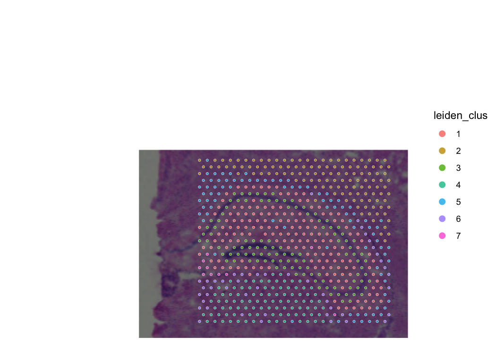
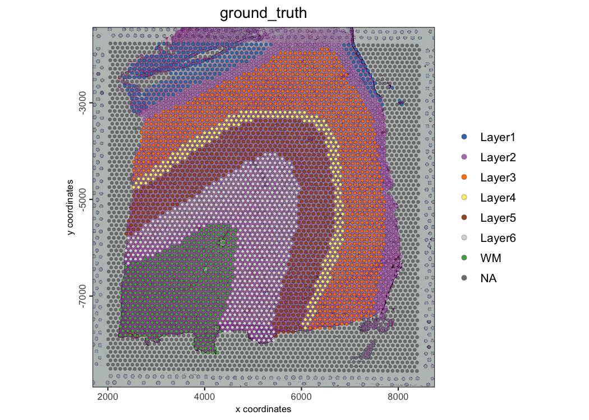

# Introduction

[GiottoConnect](https://github.com/giotto-suite/GiottoConnect) converts between
Giotto and Bioconductor's SpatialExperiment with `giottoToSpatialExperiment()`
and `spatialExperimentToGiotto()`. SpatialFeatureExperiment objects, which add
geometries such as cell polygons, are converted the same way.

This tutorial converts a Visium dataset in each direction and checks that the
result can be used on the other side. For analysis with Bioconductor packages,
see their own documentation.

```{r, eval=FALSE}
library(Giotto)
library(GiottoData)
library(GiottoConnect)
library(SpatialExperiment)
library(STexampleData)
library(ggspavis)
```

# Giotto to SpatialExperiment

We start from the mini Visium mouse brain object in GiottoData.

```{r, eval=FALSE}
g <- loadGiottoMini(dataset = "visium")

spe <- giottoToSpatialExperiment(g, sfe = "no")
spe
```

```
class: SpatialExperiment 
dim: 634 624 
metadata(1): giottoConnect
assays(3): counts logcounts scaled
rownames(634): Gna12 Ccnd2 ... 9630013A20Rik 2900040C04Rik
rowData names(6): nr_cells perc_cells ... mean_expr_det hvf
colnames(624): AAAGGGATGTAGCAAG-1 AAATGGCATGTCTTGT-1 ... TTGTGGCCCTGACAGT-1
  TTGTTCAGTGTGCTAC-1
colData names(7): in_tissue nr_feats ... custom_leiden sample_id
reducedDimNames(5): PCA custom_pca UMAP custom_umap TSNE
mainExpName: NULL
altExpNames(0):
spatialCoords names(2) : x y
imgData names(4): sample_id image_id data scaleFactor
```

One spatial unit and feature type is converted at a time (the active ones by
default; see the `spat_unit` and `feat_type` arguments). The raw counts become
the `counts` assay and the normalized values `logcounts`. Reductions are named
as in scater (`PCA`, `UMAP`, `TSNE`), nearest neighbour networks become
`colPairs` and the tissue image goes to `imgData`. By default, an object with
polygons or spatial networks (such as this one) becomes a
SpatialFeatureExperiment, which also holds the spot polygons and spatial
networks. Here we ask for a plain SpatialExperiment with `sfe = "no"`, the
class ggspavis draws.

The Giotto clusters are part of `colData`, so they can be shown on the tissue
with ggspavis:

```{r, eval=FALSE}
spe$leiden_clus <- factor(spe$leiden_clus)
plotVisium(spe, annotate = "leiden_clus")
```



`readbackCheck()` compares the SpatialExperiment with the Giotto object, part
by part:

```{r, eval=FALSE}
readbackCheck(g, spe)
```

```
<giottoReadback> PASS: 42 MATCH, 0 DECLARED, 0 UNDECLARED
```

# SpatialExperiment to Giotto

The human DLPFC Visium sample from STexampleData comes with manually annotated
cortical layers.

```{r, eval=FALSE}
spe <- Visium_humanDLPFC()

g2 <- spatialExperimentToGiotto(spe)
g2
```

```
An object of class giotto 
>Active spat_unit:  cell 
>Active feat_type:  rna 
dimensions    : 33538, 4992 (features, cells)
[SUBCELLULAR INFO]
[AGGREGATE INFO]
expression -----------------------
  [cell][rna] raw
spatial locations ----------------
  [cell] raw
attached images ------------------
images      : hires 


Use objHistory() to see steps and params used
```

The counts become the `raw` expression values of the feature type `rna`, the
`colData` becomes the cell metadata, the Visium spot positions are converted
from image pixels to microns, and reductions and the tissue image are carried
over. `mappingProvenance()` lists what could not be carried over or was
estimated:

```{r, eval=FALSE}
mappingProvenance(g2)$losses
```

```
  part_id                      kind field
1    locs recovered_from_parameters units
                                                                note   source
1 0.72991 um per px (100 um spot pitch / measured spacing 137.00 px) recorded
```

The annotated layers can be shown on the tissue with Giotto:

```{r, eval=FALSE}
spatPlot2D(g2,
    show_image = TRUE,
    cell_color = "ground_truth",
    point_size = 1.2
)
```



# Session Info

```{r, eval=FALSE}
sessionInfo()
```

```{r, eval=FALSE}
R version 4.5.3 (2026-03-11)
Platform: aarch64-apple-darwin20
Running under: macOS Tahoe 26.7.3

Matrix products: default
BLAS:   /Library/Frameworks/R.framework/Versions/4.5-arm64/Resources/lib/libRblas.0.dylib 
LAPACK: /Library/Frameworks/R.framework/Versions/4.5-arm64/Resources/lib/libRlapack.dylib;  LAPACK version 3.12.1

locale:
[1] C.UTF-8/C.UTF-8/C.UTF-8/C/C.UTF-8/C.UTF-8

time zone: America/New_York
tzcode source: internal

attached base packages:
[1] stats4    stats     graphics  grDevices utils     datasets  methods   base     

other attached packages:
 [1] ggspavis_1.16.0             ggplot2_4.0.4               STexampleData_1.18.0       
 [4] ExperimentHub_3.0.0         AnnotationHub_4.0.0         BiocFileCache_3.0.0        
 [7] dbplyr_2.5.2                SpatialExperiment_1.20.0    SingleCellExperiment_1.32.0
[10] SummarizedExperiment_1.40.0 Biobase_2.70.0              GenomicRanges_1.62.1       
[13] Seqinfo_1.0.0               IRanges_2.44.0              S4Vectors_0.48.1           
[16] BiocGenerics_0.56.0         generics_0.1.4              MatrixGenerics_1.22.0      
[19] matrixStats_1.5.0           GiottoConnect_0.1.0         GiottoData_0.3.8           
[22] Giotto_4.3.7                GiottoClass_0.8.0          

loaded via a namespace (and not attached):
  [1] RColorBrewer_1.1-3   jsonlite_2.0.0       magrittr_2.0.5       magick_2.9.1        
  [5] farver_2.1.2         vctrs_0.7.3          memoise_2.0.1        GiottoUtils_0.2.10  
  [9] terra_1.9-11         htmltools_0.5.9      S4Arrays_1.10.1      curl_8.1.0          
 [13] BiocNeighbors_2.4.0  SparseArray_1.10.9   sctransform_0.4.3    parallelly_1.50.0   
 [17] KernSmooth_2.23-26   ica_1.0-3            htmlwidgets_1.6.4    plyr_1.8.9          
 [21] httr2_1.3.0          plotly_4.12.1        cachem_1.1.0         igraph_2.3.4        
 [25] lifecycle_1.0.5      ggside_0.4.1         pkgconfig_2.0.3      rsvd_1.0.5          
 [29] Matrix_1.7-5         R6_2.6.1             fastmap_1.2.0        future_1.82.0       
 [33] digest_0.6.39        colorspace_2.1-4     patchwork_1.3.2      AnnotationDbi_1.72.0
 [37] Seurat_6.0.0         RSpectra_0.16-2      irlba_2.4.1          RSQLite_2.4.6       
 [41] beachmat_2.26.0      labeling_0.4.3       filelock_1.0.3       progressr_0.18.0    
 [45] httr_1.4.9           polyclip_1.10-7      abind_1.4-8          compiler_4.5.3      
 [49] proxy_0.4-29         bit64_4.6.0-1        withr_3.0.3          S7_1.0.0            
 [53] backports_1.5.1      BiocParallel_1.44.0  viridis_0.6.5        DBI_1.3.0           
 [57] fastDummies_1.7.6    ggforce_0.5.0        MASS_7.3-65          rappdirs_0.3.4      
 [61] DelayedArray_0.36.0  classInt_0.4-11      rjson_0.2.23         bluster_1.20.0      
 [65] gtools_3.9.5         units_1.0-1          GiottoVisuals_0.2.16 tools_4.5.3         
 [69] otel_0.3.0           future.apply_1.21.0  glue_1.8.1           sf_1.1-1            
 [73] grid_4.5.3           Rtsne_0.17           checkmate_2.3.4      reshape2_1.4.5      
 [77] cluster_2.1.8.2      hdf5r_1.3.12         gtable_0.3.6         class_7.3-23        
 [81] tidyr_1.3.2          data.table_1.18.6.1  BiocSingular_1.26.1  tidygraph_1.3.1     
 [85] ScaledMatrix_1.18.0  sp_2.2-1             XVector_0.50.0       RcppAnnoy_0.0.23    
 [89] tilework_1.0.0       stringr_1.6.0        RANN_2.6.2           ggrepel_0.9.8       
 [93] BiocVersion_3.22.0   pillar_1.11.1        RcppHNSW_0.6.0       spam_2.11-3         
 [97] dplyr_1.2.1          tweenr_2.0.3         lattice_0.22-9       bit_4.6.0           
[101] tidyselect_1.2.1     pbapply_1.7-5        Biostrings_2.78.0    gridExtra_2.3.1     
[105] scattermore_1.2      pls_2.9-0            graphlayouts_1.2.3   stringi_1.8.9       
[109] yaml_2.3.12          codetools_0.2-20     ggraph_2.2.2         tibble_3.3.1        
[113] BiocManager_1.30.27  colorRamp2_0.1.0     cli_3.6.6            uwot_0.2.4          
[117] dichromat_2.0-0.1    Rcpp_1.1.2           globals_0.20.0       png_0.1-9           
[121] parallel_4.5.3       blob_1.3.0           dotCall64_1.2        listenv_1.1.0       
[125] viridisLite_0.4.3    e1071_1.7-17         ggridges_0.5.7       scales_1.4.0        
[129] SeuratObject_5.4.0   purrr_1.2.2          crayon_1.5.3         rlang_1.3.0         
[133] cowplot_1.2.0        KEGGREST_1.50.0
```
