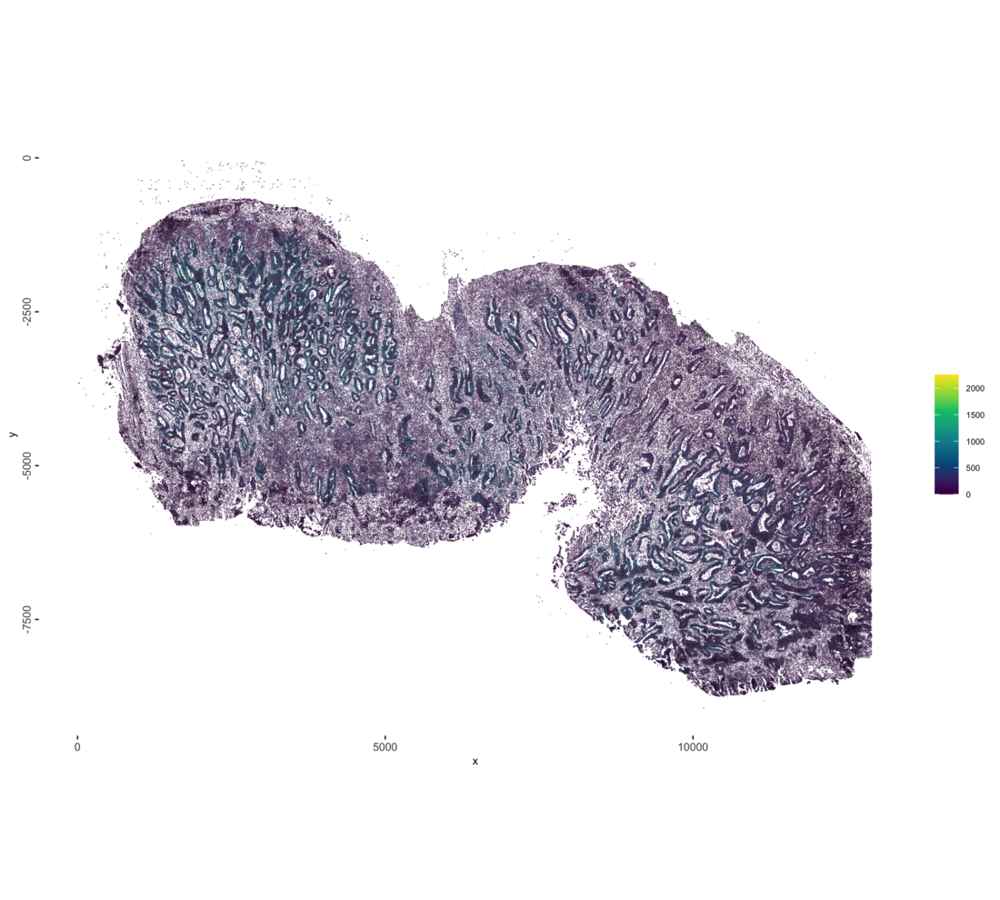
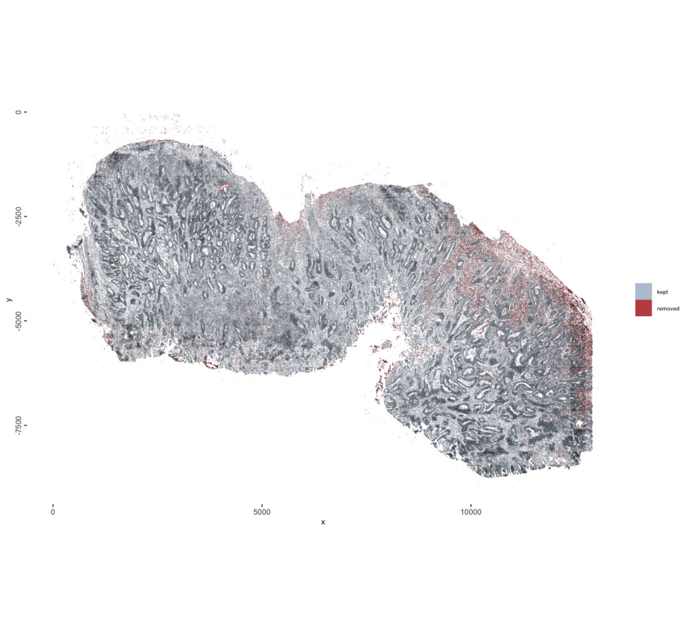
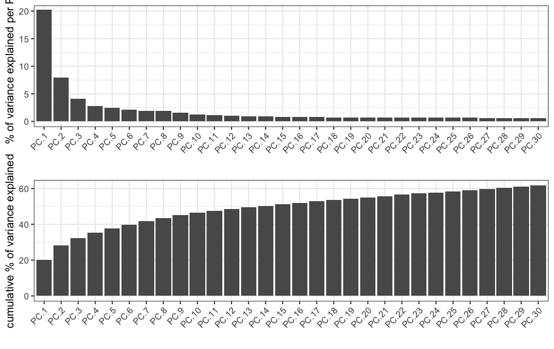
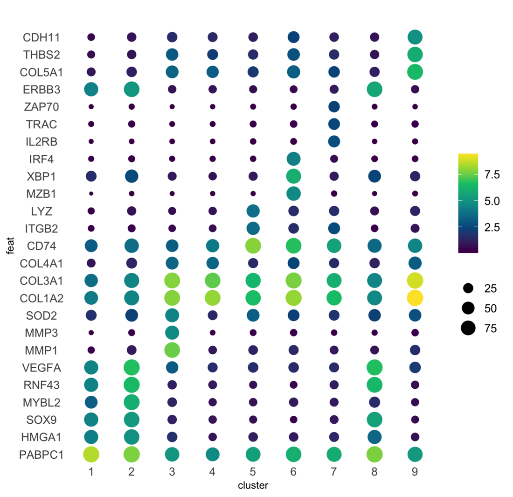
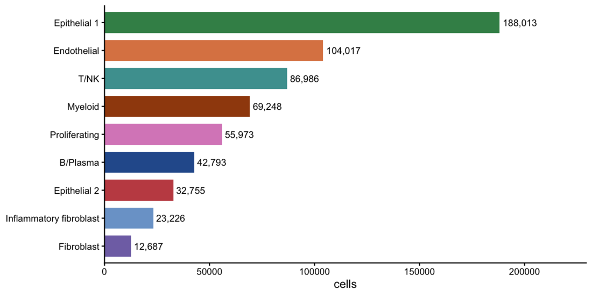
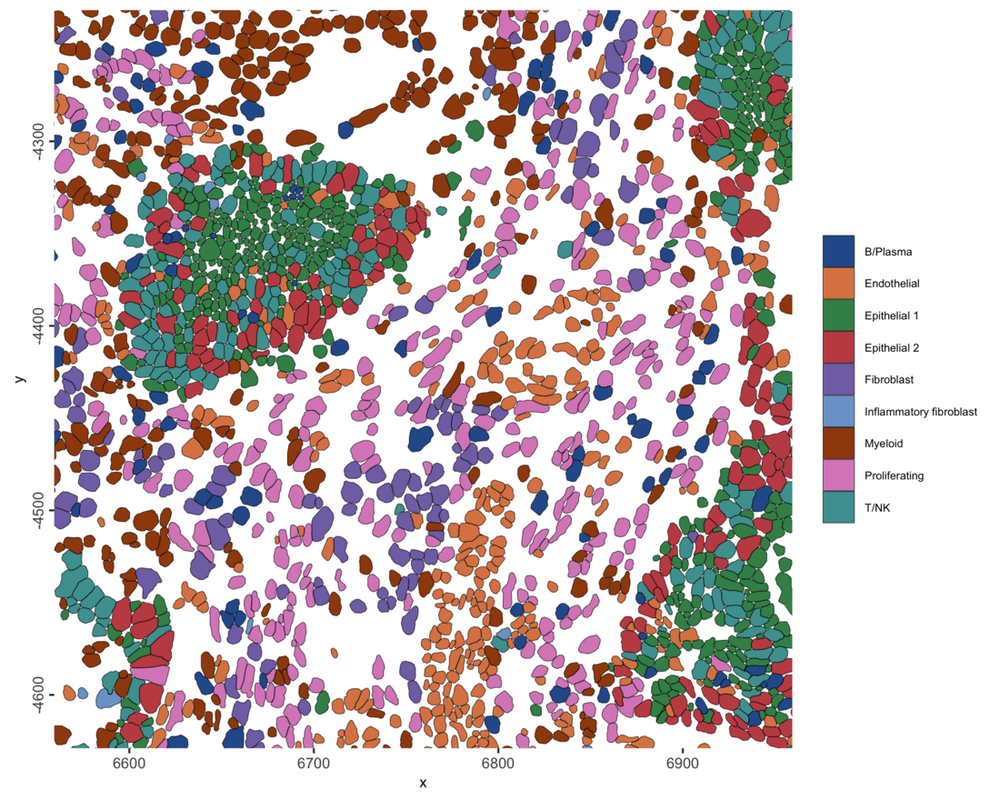
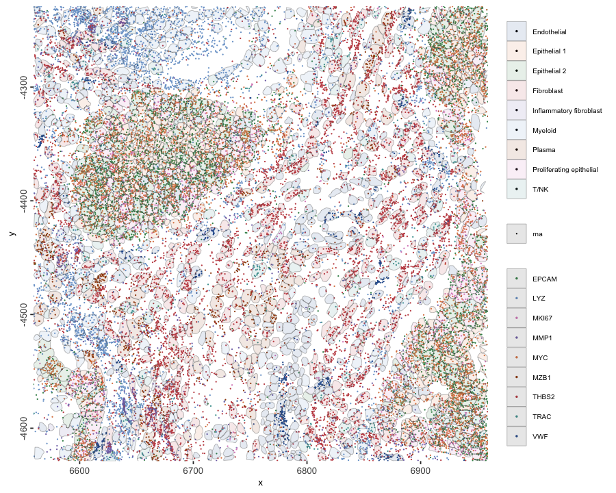
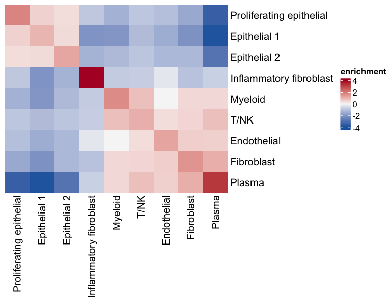

```{r setup, include=FALSE, eval = FALSE}
knitr::opts_chunk$set(
    echo = TRUE, message = FALSE, warning = FALSE, fig.align = "center",
    dpi = 120, cache = FALSE, fig.path = "figures_rmd/")
options(progressr.enable = FALSE)
```

# The dataset

Vizgen MERSCOPE, human colon cancer, FFPE, region R1 of
`202502261437_HuColonCan-FFPE-D2M1883-V2-UltraSm-ST_VMSC18810`
([data release](https://info.vizgen.com/merfish-2.0-data-release-form)). Panel:
815 gene targets, 85 `Blank` barcodes. 151,017,583 transcripts, 703,879
segmented cells. Export 33 GB.

| vendor file | size | contents |
|---|---|---|
| `detected_transcripts.parquet` | 3.3 GB | transcript, x, y, z, cell |
| `detected_transcripts.csv` | 17 GB | same table as text, not read |
| `cell_boundaries.parquet` | 1.9 GB | polygons, seven z-planes per cell |
| `cell_by_gene.csv` | 1.2 GB | vendor cell x gene matrix |
| `cell_metadata.csv` | 237 MB | centroid, volume, counts |
| `cell_numeric_categories.csv` | 25 MB | numeric annotations |
| `cell_categories.csv` | 14 MB | categorical annotations |
| `*.vzg2`, `*.h5ad` | 7.1 GB, 2.4 GB | viewer bundle, AnnData export, not read |

Inputs read: `detected_transcripts.parquet`, `cell_boundaries.parquet`,
`cell_by_gene.csv`, `cell_metadata.csv`. Exports that ship only
`detected_transcripts.csv` work too: the reader converts the CSV to parquet once
and caches it in the vault.

# Packages

```{r install, eval = FALSE}
remotes::install_github("giotto-suite/GiottoUtils", ref = "dev")
GiottoUtils::suite_install("GiottoDisk", install_arrow = TRUE)
BiocManager::install(c("scran", "ComplexHeatmap"))
install.packages(c("RcppHNSW", "wk"))
```

`suite_install()` installs arrow (built with zstd support, only when it is
missing or lacks it), tilework and the Giotto packages in the order GiottoDisk
needs. The last two lines add the packages for marker detection, the
neighborhood heatmap, the approximate nearest-neighbor search and the
MERSCOPE polygon reader.

```{r version-guard, include=FALSE, eval = FALSE}
if (!exists("importMerscopeDisk", asNamespace("GiottoDisk")))
  stop("GiottoDisk has no MERSCOPE disk reader; see section 2.", call. = FALSE)
if (!isTRUE(arrow::arrow_info()$capabilities[["zstd"]]))
  stop("arrow lacks zstd support; see section 2.", call. = FALSE)
for (p in c("scran", "ComplexHeatmap", "RcppHNSW", "wk"))
  if (!requireNamespace(p, quietly = TRUE))
    stop(p, " is not installed; see section 2.", call. = FALSE)
```

# Setup

```{r libraries, eval = FALSE}
suppressMessages({
  library(arrow) # before Giotto and terra
  library(Giotto); library(GiottoClass); library(GiottoDisk)
  library(data.table); library(ggplot2); library(cowplot)
  library(Matrix); library(terra)
})

# no Python needed: skip Giotto's Python environment check
options(giotto.use_conda = FALSE, giotto.no_python_warn = TRUE)

# MERSCOPE region directory (the folder containing cell_by_gene.csv)
MERSCOPE <- "data/region_R1"
# GiottoDisk vault directory, outside any cloud-synced folder
VAULT    <- "vault"
dir.create(VAULT, showWarnings = FALSE, recursive = TRUE)
stopifnot(dir.exists(MERSCOPE))

setArtifactDumpDir(VAULT)
th <- theme_classic(base_size = 9)
set.seed(42)

CLUS_COLS <- c("#2B5C9B", "#DD8452", "#3E8E57", "#C44E52", "#8172B3",
               "#7BA3D0", "#A0490D", "#DA8BC3", "#4C9F9F", "#5A5A5A",
               "#9E3D6B", "#1B7F79")
clus_palette <- function(x) {
    lev <- levels(factor(x))
    setNames(CLUS_COLS[seq_along(lev)], lev)
}
```

# Ingest

```{r create, eval = FALSE}
src <- sourceCreate(VAULT)
g <- createGiottoMerscopeObject(
    merscope_dir = MERSCOPE,
    backend      = src)
instructions(g) <- createGiottoInstructions(
    save_plot = FALSE, show_plot = TRUE, return_plot = FALSE)
g
```

```
## An object of class giotto 
## >Active spat_unit:  cell 
## >Active feat_type:  rna 
## dimensions    : 815, 703879 (features, cells)
## [SUBCELLULAR INFO]
## polygons      : cell 
## features      : rna neg_probe 
## [AGGREGATE INFO]
## expression -----------------------
##   [cell][rna] raw
##   [cell][neg_probe] raw
## spatial locations ----------------
##   [cell] raw
## 
## 
## Use objHistory() to see steps and params used
```

Setting `backend` builds the object on disk. The transcripts go into a tiled
parquet point store, the segmentation polygons into a tiled parquet geometry
store, and the cell x gene matrix from `cell_by_gene.csv` into a parquet
expression store. Only the per-cell tables, cell metadata and spatial
locations, are held in memory. `Blank` barcodes become their own `neg_probe`
feature type, both as transcripts and as the `[cell][neg_probe]` expression
layer. The y coordinates are negated on load, so plots have the orientation of
the Vizgen images.

On an Apple M2 Ultra (24 cores, 192 GB), building this object took 31 minutes
and at most 9 GB of memory, and left a 6.8 GB vault. Nearly all of that time
is spent writing the 151 million transcripts into spatial tiles; the default
sequential `future` plan was used.

Set `load_transcripts = FALSE` to skip the transcripts when only the cell-level
analysis is needed; the other layers are built the same way.

```{r aggregate, eval = FALSE}
g <- addStatistics(g, expression_values = "raw")
snapshotSave(src, g, name = "aggregated", overwrite = TRUE)
```

```
##   backend : `gDirSource`
##   path    : vault
```

```{r ingest-summary, eval = FALSE}
cells <- as.data.table(pDataDT(g))
feats <- as.data.table(fDataDT(g))
data.table(item  = c("cells", "gene targets", "median transcripts / cell",
                     "median genes / cell"),
           value = c(format(nrow(cells), big.mark = ","),
                     format(nrow(feats), big.mark = ","),
                     median(cells$total_expr), median(cells$nr_feats)))
```

| item | value |
|:------|------:|
| cells | 703,879 |
| gene targets | 815 |
| median transcripts / cell | 102 |
| median genes / cell | 66 |

# Quality control and filtering

<details>
<summary><strong>QC plots</strong></summary>

```{r qc-spatial, fig.cap="Transcripts per cell in tissue space.", fig.width=10, fig.height=9, eval = FALSE}
spatInSituPlotPoints(g, show_polygon = TRUE, polygon_fill = "total_expr",
                     polygon_fill_as_factor = FALSE,
                     polygon_fill_gradient_style = "sequential",
                     polygon_color = "black", polygon_line_size = 0.01,
                     background_color = "white")
```

```{r qc-spatial-fig, echo = FALSE, out.width = "100%"}

```

```{r qc-histograms, fig.cap="Transcripts per cell, genes per cell with the detection floor drawn, and cells per gene.", fig.width=10.6, fig.height=3.1, eval = FALSE}
# transcripts per cell
p_tx <- filterDistributions(g, method = "sum", detection = "cells",
                            scale_axis = "log10", nr_bins = 90,
                            show_plot = FALSE, return_plot = TRUE) +
    labs(title = NULL, x = "transcripts per cell", y = "cells") + th

# genes detected per cell, with the detection floor
p_genes <- filterDistributions(g, method = "threshold", detection = "cells",
                               nr_bins = 90,
                               show_plot = FALSE, return_plot = TRUE) +
    geom_vline(xintercept = 15, color = "#C44E52", linetype = "dashed") +
    labs(title = NULL, x = "genes detected per cell", y = "cells") + th

# cells per gene
p_cells <- filterDistributions(g, method = "threshold", detection = "feats",
                               scale_axis = "log10", nr_bins = 90,
                               show_plot = FALSE, return_plot = TRUE) +
    labs(title = NULL, x = "cells per gene", y = "genes") + th

plot_grid(p_tx, p_genes, p_cells, nrow = 1)
```

```{r qc-histograms-fig, echo = FALSE, out.width = "100%"}
knitr::include_graphics("images/merscope_human_colon_cancer_giottodisk/02_qc-histograms.png")
```

```{r qc-flag, fig.cap="Cells below the detection floor, in tissue space.", fig.width=10, fig.height=9, eval = FALSE}
cells <- as.data.table(pDataDT(g))
g <- addCellMetadata(g, new_metadata = data.table(
         cell_ID = cells$cell_ID,
         qc_fail = ifelse(cells$nr_feats < 15, "removed", "kept")),
     by_column = TRUE, column_cell_ID = "cell_ID")
spatInSituPlotPoints(g, show_polygon = TRUE, polygon_fill = "qc_fail",
                     polygon_fill_as_factor = TRUE,
                     polygon_fill_code = c(kept = "#B9C6D6", removed = "#C44E52"),
                     polygon_color = "black", polygon_line_size = 0.01,
                     background_color = "white")
```

```{r qc-flag-fig, echo = FALSE, out.width = "100%"}

```

</details>

Raising `min_det_feats_per_cell` discards more poorly segmented and low-signal
cells at the cost of losing real cells with sparse expression; lowering it keeps
those cells but admits fragments and near-empty polygons into the clustering.

```{r filter, eval = FALSE}
g <- filterGiotto(g, expression_threshold = 1, feat_det_in_min_cells = 10,
                  min_det_feats_per_cell = 15, verbose = TRUE)
```

```
## 
## Feature type:  rna 
## Number of cells removed:  88181  out of  703879 
## Number of feats removed:  0  out of  815
```

# Normalization and dimension reduction

Normalization puts cells on a comparable scale so that differences in total
counts per cell, which track cell size and detection efficiency, do not dominate
the distances used for clustering.

```{r normalize, eval = FALSE}
g <- normalizeGiotto(g, norm_methods = "standard", scale_feats = FALSE,
                     scale_cells = FALSE)
g <- addStatistics(g, expression_values = "normalized")
g <- runPCA(g, expression_values = "normalized", ncp = 100)
```

```{r scree, fig.cap="Variance per principal component and cumulative.", fig.width=7.6, fig.height=4.8, eval = FALSE}
screePlot(g, ncp = 30)
```

```{r scree-fig, echo = FALSE, out.width = "100%"}

```

# Neighbors, UMAP, clustering

```{r embed, eval = FALSE}
g <- createNearestNetwork(g, dim_reduction_to_use = "pca",
                          dimensions_to_use = 2:15, k = 30, type = "sNN",
                          minimum_shared = 5, engine = "hnsw")
g <- doLeidenCluster(g, resolution = 0.25, n_iterations = 100)
g <- runUMAP(g, dim_reduction_to_use = "pca", dimensions_to_use = 2:15,
             n_neighbors = 30, min_dist = 0.01)
```

```{r clusters-umap, fig.cap="Leiden clusters in UMAP space.", fig.width=6.8, fig.height=4.6, eval = FALSE}
PAL_CLUS <- clus_palette(pDataDT(g)$leiden_clus)
plotUMAP(g, cell_color = "leiden_clus", cell_color_code = PAL_CLUS, point_size = 0.03,
         point_shape = "no_border")
```

```{r clusters-umap-fig, echo = FALSE, out.width = "100%"}
knitr::include_graphics("images/merscope_human_colon_cancer_giottodisk/05_clusters-umap.png")
```

# Markers

```{r markers, eval = FALSE}
mk <- findMarkers_one_vs_all(g, method = "scran", expression_values = "normalized",
                             cluster_column = "leiden_clus", min_feats = 3)
setorder(mk, cluster, ranking)
top <- mk[, .(top_genes = paste(head(feats, 6), collapse = ", ")), by = cluster]
top[]
```

```
## start with cluster  1start with cluster  2start with cluster  3start with cluster  4start with cluster  5start with cluster  6start with cluster  7start with cluster  8start with cluster  9
```

<details>
<summary><strong>Top marker genes per cluster</strong></summary>

| cluster | top_genes |
|------:|:---------------------------------------------------------------|
| 1 | PABPC1, HMGA1, SOX9, MYC, ERBB3, EPCAM |
| 2 | MYBL2, RNF43, VEGFA, E2F1, CDCA7, MKI67 |
| 3 | MMP1, MMP3, SOD2, COL3A1, COL1A2, CXCL8 |
| 4 | COL1A2, COL3A1, COL4A1, VWF, PLVAP, EGFL7 |
| 5 | CD74, ITGB2, LYZ, CIITA, CYBB, C1QC |
| 6 | MZB1, XBP1, IRF4, POU2AF1, DERL3, PRDM1 |
| 7 | IL2RB, TRAC, ZAP70, CD2, FYN, ITGB2 |
| 8 | RNF43, VEGFA, ERBB3, RBM39, SOX9, EPCAM |
| 9 | COL5A1, THBS2, CDH11, COL1A2, PDGFRB, COL3A1 |

</details>

```{r dotplot, fig.cap="Top markers per cluster. Color is mean expression, dot size the percentage of cells expressing.", fig.width=6.2, fig.height=6.0, eval = FALSE}
sel <- unique(mk[, head(feats, 3), by = cluster]$V1)
dotPlot(g, feats = sel, cluster_column = "leiden_clus")
```

```{r dotplot-fig, echo = FALSE, out.width = "100%"}

```

# Cell types

Each Leiden cluster is named from its top markers in section 8.

```{r labels, eval = FALSE}
LABELS <- c("1" = "Epithelial 1", "2" = "Proliferating epithelial",
            "3" = "Inflammatory fibroblast", "4" = "Endothelial",
            "5" = "Myeloid", "6" = "Plasma", "7" = "T/NK",
            "8" = "Epithelial 2", "9" = "Fibroblast")
g <- annotateGiotto(g, annotation_vector = LABELS,
                    cluster_column = "leiden_clus", name = "cell_type")
cells <- as.data.table(pDataDT(g))
PAL <- clus_palette(cells$cell_type)
```

```{r type-counts, eval = FALSE}
ct <- cells[, .(cells = .N), by = .(cell_type)]
ct[, pct := round(100 * cells / sum(cells), 1)][order(-cells)]
```

| cell_type | cells | pct |
|:------|------:|------:|
| Epithelial 1 | 188013 | 30.5 |
| Endothelial | 104017 | 16.9 |
| Epithelial 2 | 86986 | 14.1 |
| Myeloid | 69248 | 11.2 |
| Fibroblast | 55973 | 9.1 |
| T/NK | 42793 | 7.0 |
| Proliferating epithelial | 32755 | 5.3 |
| Inflammatory fibroblast | 23226 | 3.8 |
| Plasma | 12687 | 2.1 |

```{r cells-per-type, fig.cap="Cells per cell type.", fig.width=6.4, fig.height=3.2, eval = FALSE}
setorder(ct, -cells); ct[, cell_type := factor(cell_type, levels = rev(cell_type))]
ggplot(ct, aes(cell_type, cells, fill = cell_type)) +
    geom_col(width = 0.75) +
    scale_fill_manual(values = PAL, guide = "none") +
    coord_flip() +
    geom_text(aes(label = formatC(cells, big.mark = ",", format = "d")),
              hjust = -0.1, size = 2.6) +
    scale_y_continuous(expand = expansion(mult = c(0, 0.22))) +
    labs(x = NULL, y = "cells") + th
```

```{r cells-per-type-fig, echo = FALSE, out.width = "100%"}

```

```{r snapshot, eval = FALSE}
snapshotSave(src, g, name = "clustered", overwrite = TRUE)
```

```
##   backend : `gDirSource`
##   path    : vault
```

# The slide

```{r slide, fig.cap="Cell types across the section.", fig.width=10, fig.height=9, eval = FALSE}
spatInSituPlotPoints(g, show_polygon = TRUE, polygon_fill = "cell_type",
                     polygon_fill_as_factor = TRUE, polygon_fill_code = PAL,
                     polygon_color = "black", polygon_line_size = 0.01,
                     background_color = "white")
```

```{r slide-fig, echo = FALSE, out.width = "100%"}
knitr::include_graphics("images/merscope_human_colon_cancer_giottodisk/08_slide.png")
```

```{r spatial-facets, fig.cap="One panel per cell type, a sample of all cells in gray behind it.", fig.width=11, fig.height=9, eval = FALSE}
# segmentation polygons filled by cell type
p_facets <- spatInSituPlotPoints(g, show_polygon = TRUE, polygon_fill = "cell_type",
                                 polygon_fill_as_factor = TRUE, polygon_fill_code = PAL,
                                 polygon_color = NA, background_color = "white",
                                 show_legend = FALSE, show_plot = FALSE, return_plot = TRUE)

# 40,000 cells in gray behind every panel
bgv <- p_facets$layers[[1]]$data[poly_ID %in% sample(unique(poly_ID), min(uniqueN(poly_ID), 40000L)),
                                 .(x, y, poly_ID)]
p_facets$layers <- c(geom_polygon(data = bgv, aes(x, y, group = poly_ID),
                                  fill = "#E8E8E8", color = NA, inherit.aes = FALSE),
                     p_facets$layers)

# one panel per cell type
p_facets + facet_wrap(~cell_type, ncol = 3) +
    theme(strip.background = element_blank(),
          strip.text = element_text(size = 13, face = "bold"),
          panel.spacing = unit(10, "pt"))
```

```{r spatial-facets-fig, echo = FALSE, out.width = "100%"}
knitr::include_graphics("images/merscope_human_colon_cancer_giottodisk/09_spatial-facets.png")
```

# Cells and transcripts in a 400 um window

```{r polygons, fig.cap="Segmentation polygons filled by cell type in a 400 x 400 um window at the center of the section.", fig.width=7.5, fig.height=6, eval = FALSE}
# 400 um window at the center of the section
sl  <- as.data.table(getSpatialLocations(g, output = "data.table"))
ctr <- c(median(sl$sdimx), median(sl$sdimy))
XL  <- ctr[1] + c(-200, 200)
YL  <- ctr[2] + c(-200, 200)

# segmentation polygons filled by cell type
p_types <- spatInSituPlotPoints(g, show_polygon = TRUE, polygon_fill = "cell_type",
                                polygon_fill_as_factor = TRUE, polygon_fill_code = PAL,
                                polygon_color = "black", polygon_line_size = 0.12,
                                background_color = "white", xlim = XL, ylim = YL,
                                show_plot = FALSE, return_plot = TRUE)
p_types + coord_fixed(xlim = XL, ylim = YL, expand = FALSE)
```

```{r polygons-fig, echo = FALSE, out.width = "100%"}

```

The transcripts are on disk too. `xlim` and `ylim` crop inside the point
store, so only the window's transcripts are read, not the 151 million on the
slide. One marker gene per cell type, colored like its cell type, over the same
polygons:

```{r transcripts, fig.cap="Transcripts of one marker gene per cell type over the segmentation polygons, same window.", fig.width=7.5, fig.height=6, eval = FALSE}
# one marker per cell type (from the marker table), colored like the cell type
MARKERS <- c(MYC = "Epithelial 1", MKI67 = "Proliferating epithelial",
             MMP1 = "Inflammatory fibroblast", VWF = "Endothelial",
             LYZ = "Myeloid", MZB1 = "Plasma", TRAC = "T/NK",
             EPCAM = "Epithelial 2", THBS2 = "Fibroblast")
p_tx <- spatInSituPlotPoints(g, feats = list(rna = names(MARKERS)),
                             feats_color_code = setNames(PAL[MARKERS], names(MARKERS)),
                             use_overlap = FALSE, point_size = 0.3,
                             show_polygon = TRUE, polygon_fill = "cell_type",
                             polygon_fill_as_factor = TRUE, polygon_fill_code = PAL,
                             polygon_alpha = 0.12, polygon_color = "grey35",
                             polygon_line_size = 0.1, background_color = "white",
                             xlim = XL, ylim = YL,
                             show_plot = FALSE, return_plot = TRUE)
p_tx + coord_fixed(xlim = XL, ylim = YL, expand = FALSE)
```

```{r transcripts-fig, echo = FALSE, out.width = "100%"}

```

# Spatial neighborhood composition

Each cell is linked to its twenty nearest neighbors. `cellProximityEnrichment()`
counts the links between each pair of cell types and compares the counts with
1,000 random relabelings of the cells, so a log2 enrichment above 0 means the
pairing is more common than chance. The clustering used no spatial information,
so this tests whether the expression-defined populations are spatially organized.

```{r neighbours, eval = FALSE}
g <- createSpatialNetwork(g, method = "kNN", k = 20, name = "kNN20")
cpe <- cellProximityEnrichment(g, cluster_column = "cell_type",
                               spatial_network_name = "kNN20",
                               number_of_simulations = 1000)
head(cpe$enrichm_res[type_int == "hetero"][order(-enrichm)], 8)[
    , .(pair = unified_int, enrichment = round(enrichm, 2), p.adj_higher)]
```

| pair | enrichment | p.adj_higher |
|:------|------:|------:|
| Fibroblast–Plasma | 1.10 | 0.000999 |
| Myeloid–T/NK | 0.84 | 0.000999 |
| Plasma–T/NK | 0.83 | 0.000999 |
| Endothelial–Fibroblast | 0.59 | 0.000999 |
| Endothelial–Plasma | 0.57 | 0.000999 |
| Epithelial 1–Proliferating epithelial | 0.52 | 0.000999 |
| Fibroblast–T/NK | 0.49 | 0.000999 |
| Fibroblast–Myeloid | 0.44 | 0.000999 |

```{r neighbour-heatmap, fig.cap="log2 enrichment of links between each pair of cell types.", fig.width=6.4, fig.height=5, eval = FALSE}
cellProximityHeatmap(g, CPscore = cpe, order_cell_types = TRUE, scale = FALSE)
```

```{r neighbour-heatmap-fig, echo = FALSE, out.width = "100%"}

```

# Session

```{r session-info, eval = FALSE}
sessionInfo()
```

```
## R version 4.5.1 (2025-06-13)
## Platform: aarch64-apple-darwin20
## Running under: macOS Sonoma 14.5
## 
## Matrix products: default
## BLAS:   /Library/Frameworks/R.framework/Versions/4.5-arm64/Resources/lib/libRblas.0.dylib 
## LAPACK: /Library/Frameworks/R.framework/Versions/4.5-arm64/Resources/lib/libRlapack.dylib;  LAPACK version 3.12.1
## 
## locale:
## [1] en_US/en_US/en_US/C/en_US/en_US
## 
## time zone: America/New_York
## tzcode source: internal
## 
## attached base packages:
## [1] stats     graphics  grDevices utils     datasets  methods   base     
## 
## other attached packages:
##  [1] future_1.70.0       terra_1.9-11        Matrix_1.7-3       
##  [4] cowplot_1.2.0       ggplot2_4.0.2       data.table_1.18.2.1
##  [7] GiottoDisk_0.0.0.6  Giotto_4.3.5        GiottoClass_0.7.18 
## [10] arrow_23.0.1.2     
## 
## loaded via a namespace (and not attached):
##   [1] RColorBrewer_1.1-3          shape_1.4.6.1              
##   [3] jsonlite_2.0.0              wk_0.9.5                   
##   [5] magrittr_2.0.4              magick_2.9.1               
##   [7] farver_2.1.2                rmarkdown_2.31             
##   [9] GlobalOptions_0.1.4         vctrs_0.7.2                
##  [11] Cairo_1.7-0                 memoise_2.0.1              
##  [13] GiottoUtils_0.2.7           htmltools_0.5.9            
##  [15] S4Arrays_1.8.1              BiocNeighbors_2.2.0        
##  [17] SparseArray_1.8.1           sass_0.4.10                
##  [19] parallelly_1.46.1           bslib_0.10.0               
##  [21] htmlwidgets_1.6.4           plotly_4.12.0              
##  [23] cachem_1.1.0                igraph_2.2.2               
##  [25] iterators_1.0.14            lifecycle_1.0.5            
##  [27] pkgconfig_2.0.3             rsvd_1.0.5                 
##  [29] R6_2.6.1                    fastmap_1.2.0              
##  [31] clue_0.3-68                 GenomeInfoDbData_1.2.14    
##  [33] MatrixGenerics_1.20.0       digest_0.6.39              
##  [35] colorspace_2.1-2            S4Vectors_0.48.1           
##  [37] dqrng_0.4.1                 irlba_2.3.7                
##  [39] GenomicRanges_1.60.0        beachmat_2.24.0            
##  [41] filelock_1.0.3              labeling_0.4.3             
##  [43] progressr_0.19.0            httr_1.4.8                 
##  [45] polyclip_1.10-7             abind_1.4-8                
##  [47] compiler_4.5.1              doParallel_1.0.17          
##  [49] bit64_4.6.0-1               withr_3.0.2                
##  [51] S7_0.2.1                    backports_1.5.1            
##  [53] BiocParallel_1.42.2         viridis_0.6.5              
##  [55] ggforce_0.5.0               R.utils_2.13.0             
##  [57] sedonadb_0.5.0.9000         MASS_7.3-65                
##  [59] DelayedArray_0.34.1         rjson_0.2.23               
##  [61] bluster_1.18.0              gtools_3.9.5               
##  [63] GiottoVisuals_0.2.16        tools_4.5.1                
##  [65] otel_0.2.0                  future.apply_1.20.2        
##  [67] R.oo_1.27.1                 glue_1.8.0                 
##  [69] dbscan_1.2.4                grid_4.5.1                 
##  [71] checkmate_2.3.4             cluster_2.1.8.3            
##  [73] generics_0.1.4              gtable_0.3.6               
##  [75] R.methodsS3_1.8.2           tidyr_1.3.2                
##  [77] metapod_1.18.0              BiocSingular_1.24.0        
##  [79] tidygraph_1.3.1             ScaledMatrix_1.16.0        
##  [81] XVector_0.48.0              BiocGenerics_0.54.1        
##  [83] tilework_1.0.0.9000         foreach_1.5.2              
##  [85] ggrepel_0.9.8               pillar_1.11.1              
##  [87] limma_3.64.3                nanoarrow_0.9.0            
##  [89] RcppHNSW_0.7.0              circlize_0.4.18            
##  [91] dplyr_1.2.0                 tweenr_2.0.3               
##  [93] lattice_0.22-7              bit_4.6.0                  
##  [95] tidyselect_1.2.1            ComplexHeatmap_2.26.1      
##  [97] locfit_1.5-9.12             SingleCellExperiment_1.30.1
##  [99] scuttle_1.20.0              knitr_1.51                 
## [101] gridExtra_2.3               IRanges_2.42.0             
## [103] Seqinfo_1.0.0               edgeR_4.6.3                
## [105] SummarizedExperiment_1.38.1 scattermore_1.2            
## [107] stats4_4.5.1                xfun_0.61                  
## [109] graphlayouts_1.2.3          Biobase_2.68.0             
## [111] statmod_1.5.1               matrixStats_1.5.0          
## [113] UCSC.utils_1.4.0            lazyeval_0.2.2             
## [115] yaml_2.3.12                 GiottoKernels_0.3.0        
## [117] evaluate_1.0.5              codetools_0.2-20           
## [119] ggraph_2.2.2                tibble_3.3.1               
## [121] colorRamp2_0.1.0            cli_3.6.5                  
## [123] uwot_0.2.4                  jquerylib_0.1.4            
## [125] Rcpp_1.1.2                  GenomeInfoDb_1.44.3        
## [127] globals_0.19.1              png_0.1-9                  
## [129] parallel_4.5.1              assertthat_0.2.1           
## [131] scran_1.38.1                listenv_0.10.1             
## [133] SpatialExperiment_1.20.0    geoarrow_0.4.4             
## [135] viridisLite_0.4.3           scales_1.4.0               
## [137] purrr_1.2.1                 crayon_1.5.3               
## [139] GetoptLong_1.1.1            rlang_1.1.7
```
