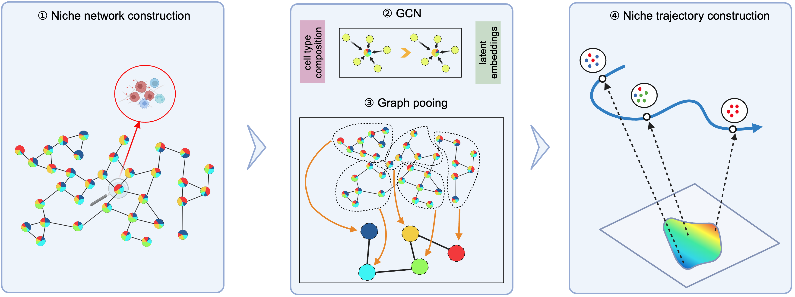
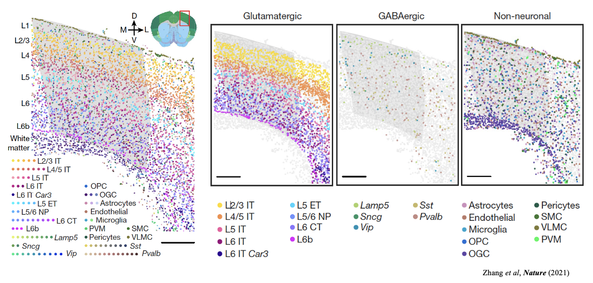
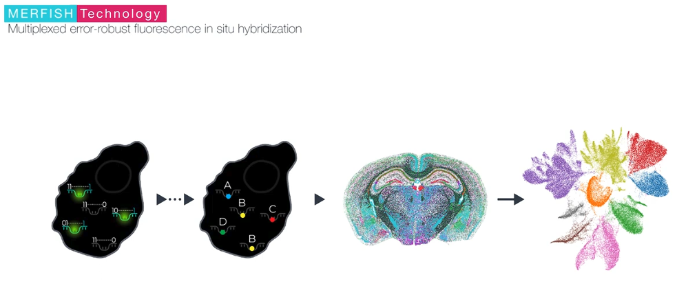
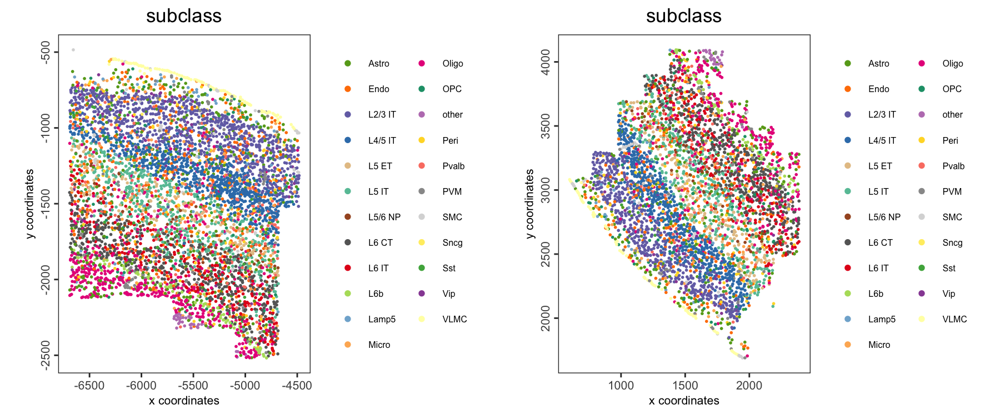

# Overview of ONTraC

ONTraC (Ordered Niche Trajectory Construction) is a niche-centered, machine learning
method for constructing spatially continuous trajectories. ONTraC differs from existing tools in that it treats a niche, rather than an individual cell, as the basic unit for spatial trajectory analysis. In this context, we define niche as a multicellular, spatially localized region where different cell types may coexist and interact with each other.  ONTraC seamlessly integrates cell-type composition and spatial information by using the graph neural network modeling framework. Its output, which is called the niche trajectory, can be viewed as a one dimensional representation of the tissue microenvironment continuum. By disentangling cell-level and niche-level properties, niche trajectory analysis provides a coherent framework to study coordinated responses from all the cells in association with continuous tissue microenvironment variations.

```{r, echo=FALSE, out.width="80%", fig.align="center"}

```

[ONTraC paper](https://www.biorxiv.org/content/10.1101/2024.04.23.590827v1)

[ONTraC GitHub repository](https://github.com/gyuanlab/ONTraC)

# Dataset Description

In this tutorial, we ues a MERFISH mouse motor cortex dataset comprising 61 tissue sections and containing approximately 280,000 cells characterised by a 258-gene panel. The study identified 3 classes of cells, glutamatergic, GABAergic and non-neuronal cell groups, and further clustered into 23 annotated plus 1 other subclass-level cell types.

```{r, echo=FALSE, out.width="100%", fig.align="center"}

```

MERFISH is a massively multiplexed single-molecule imaging technology for spatially resolved transcriptomics capable of simultaneously measuring the copy number and spatial distribution of hundreds to tens of thousands of RNA species in individual cells. For further information, please visit the official [website](https://vizgen.com/technology/#merfish).

```{r, echo=FALSE, out.width="100%", fig.align="center"}

```

# Setup

We need `R>=4.4` for this tutorial. To install Giotto, follow the
[installation tutorial](installation.html).

ONTraC is a Python package. `GiottoConnect::runONTraC()` installs it in an
environment of its own the first time it runs, so there is nothing to set up;
see [Python in Giotto Suite](python.html).

## Configuring Data and Results Paths

```{r, eval=FALSE}
options(timeout=Inf) # In case of network interrupt

data_path <- "/path/to/data"
dir.create(data_path, recursive=T)

results_folder <- "/path/to/results"
dir.create(results_folder, recursive=T)
```

# Downloading Dataset

The MERFISH mouse motor cortex data to run this tutorial can be found [here](https://doi.brainimagelibrary.org/doi/10.35077/g.21)

You need to download the processed expression, metadata, and cell segmentation information by running these commands:

Note 1: there are 61 slices here, we run on two of them to save the time.
Note 2: due to the instability of network, download processing may be interrupt.

We recommend to download these data in advance or download the processing giotto object from [Zenodo](https://zenodo.org/records/13713948).

```{r, eval = FALSE}
download.file(url = "https://download.brainimagelibrary.org/cf/1c/cf1c1a431ef8d021/processed_data/counts.h5ad",
              destfile = file.path(data_path,"counts.h5ad"))

download.file(url = "https://download.brainimagelibrary.org/cf/1c/cf1c1a431ef8d021/processed_data/cell_labels.csv",
              destfile = file.path(data_path,"cell_labels.csv"))

download.file(url = "https://download.brainimagelibrary.org/cf/1c/cf1c1a431ef8d021/processed_data/segmented_cells_mouse2sample1.csv",
              destfile = file.path(data_path,"segmented_cells_mouse2sample1.csv"))

download.file(url = "https://download.brainimagelibrary.org/cf/1c/cf1c1a431ef8d021/processed_data/segmented_cells_mouse2sample6.csv",
              destfile = file.path(data_path,"segmented_cells_mouse2sample6.csv"))
```

# Data Analysis

## Creating the Giotto Object

There are two options for creating the giotto object.
Option 1 is create the giotto object step by step.
Option 2 is load the pre-constructed giotto object from [Zenodo](https://zenodo.org/records/13713948).

### Option 1

```{r, eval=FALSE}
library(Giotto)
library(GiottoConnect)
## Create Giotto object from expression counts. This file contains 61 slices here.
giotto_all_slices_obj <- anndataToGiotto(file.path(data_path, "counts.h5ad"))

## Load meta_data
meta_df <- read.csv(file.path(data_path, "cell_labels.csv"),
                    colClasses = "character") # as the cell IDs are 30 digit numbers, set the type as character to avoid the limitation of R in handling larger integers
colnames(meta_df)[[1]] <- "cell_ID"

### We use two slices here to speed up
slice1_cells <- meta_df[meta_df$slice_id == "mouse2_slice229",]$cell_ID
slice2_cells <- meta_df[meta_df$slice_id == "mouse2_slice300",]$cell_ID
selected_cells <- c(slice1_cells, slice2_cells)

## Subset giotto obj by cell ID
giotto_slice1_obj <- subsetGiotto(gobject = giotto_all_slices_obj,
                                  cell_ids = slice1_cells)

giotto_slice2_obj <- subsetGiotto(gobject = giotto_all_slices_obj,
                                  cell_ids = slice2_cells)

## Add cell metadata
giotto_slice1_obj <- addCellMetadata(gobject = giotto_slice1_obj,
                                     new_metadata = meta_df,
                                     by_column = TRUE,
                                     column_cell_ID = 'cell_ID')

giotto_slice2_obj <- addCellMetadata(gobject = giotto_slice2_obj,
                                     new_metadata = meta_df,
                                     by_column = TRUE,
                                     column_cell_ID = 'cell_ID')

## Cell segmentation. Calculate center (median of vertices) of each cell.
segments_1_df <- read.csv(file.path(data_path, "segmented_cells_mouse2sample1.csv"), 
                          row.names=1, colClasses = "character") # as the cell IDs are 30 digit numbers, set the type as character to avoid the limitation of R in handling larger integers

segments_2_df <- read.csv(file.path(data_path, "segmented_cells_mouse2sample6.csv"), 
                          row.names=1, colClasses = "character") # as the cell IDs are 30 digit numbers, set the type as character to avoid the limitation of R in handling larger integers

segments_df <- rbind(segments_1_df, segments_2_df)

loc.use <- segments_df[selected_cells,]
loc.x <- grep("boundaryX_",colnames(loc.use),value = T)
loc.y <- grep("boundaryY_",colnames(loc.use),value = T)

centr.x <- apply(loc.use[,loc.x],1,function(x){
  temp <- lapply(x,function(y){
    as.numeric(unlist(strsplit(y,", ")))
  })
  return (median(unname(unlist(temp))))
})

centr.y <- apply(loc.use[,loc.y],1,function(x){
  temp <- lapply(x,function(y){
    as.numeric(unlist(strsplit(y,", ")))
  })
  return (median(unname(unlist(temp))))
})

## create spatial locations object
spatial_locs_df <- data.frame(cell_ID = selected_cells,
                              sdimx = centr.x,
                              sdimy = centr.y)

spatial_locs_slice1_df <- spatial_locs_df[slice1_cells,]
spatial_locs_slice2_df <- spatial_locs_df[slice2_cells,]

spat_locs_slice1_obj <- readSpatLocsData(data_list = spatial_locs_slice1_df)
spat_locs_slice2_obj <- readSpatLocsData(data_list = spatial_locs_slice2_df)

## add spatial location info
giotto_slice1_obj <- setSpatialLocations(gobject = giotto_slice1_obj,
                                         x = spat_locs_slice1_obj)

giotto_slice2_obj <- setSpatialLocations(gobject = giotto_slice2_obj,
                                         x = spat_locs_slice2_obj)

## merge two giotto objects together
giotto_obj <- joinGiottoObjects(gobject_list = list(giotto_slice1_obj,
                                                    giotto_slice2_obj),
                               gobject_names = c("mouse2_slice229",
                                                 "mouse2_slice300"),  # name for each samples
                               join_method = "z_stack")

## save giotto obj
# saveGiotto
saveGiotto(gobject = giotto_obj, foldername = "gobject", dir=results_folder)
```

### Option 2

If you facing network issue when downloading the raw dataset. Please download the processing giotto obj from [Zenodo](https://zenodo.org/records/13713948), unzip and move it to `results` folder.

```{r, eval=FALSE}
library(Giotto)
library(GiottoConnect)

giotto_obj <- loadGiotto(path_to_folder = file.path(results_folder, "gobject"))
```

## Spatial distribution of cell type

```{r, eval=FALSE}
spatPlot2D(giotto_obj,
           group_by = "slice_id",
           cell_color = "subclass",
           point_size = 1,
           point_border_stroke = NA,
           legend_text = 6)
```

```{r, echo=FALSE, out.width="100%", fig.align="center"}

```

## Run ONTraC

`runONTraC()` builds ONTraC's input from the cell types and spatial
locations, runs it, and stores the results in the object. `sample_column`
keeps the two slices apart. To run on an NVIDIA GPU, use
`ontracParam(device = "cuda")`.

```{r, eval=FALSE}
giotto_obj <- runONTraC(giotto_obj,
    cell_type = "subclass",
    sample_column = "list_ID",
    param = ontracParam(k = 6L, seed = 42L)
)
```

It adds:

- cell metadata `ontrac_NTScore` (the niche trajectory score of each cell)
  and `ontrac_niche_cluster` (its most likely niche cluster, ordered by NT
  score);
- a spatial enrichment `ontrac` with each cell's niche cluster probabilities.

If you use ONTraC, please cite
[Wang et al. 2025](https://github.com/gyuanlab/ONTraC).

# Visualization

```{r, eval=FALSE}
niche_clusters <- levels(pDataDT(giotto_obj)$ontrac_niche_cluster)
```

## Niche cluster probability

```{r, eval=FALSE}
spatCellPlot2D(giotto_obj,
    spat_enr_names = "ontrac",
    cell_annotation_values = niche_clusters,
    gradient_limits = c(0, 1),
    point_size = 0.5,
    cow_n_col = 3
)
```

## Niche cluster of each cell

```{r, eval=FALSE}
spatPlot2D(giotto_obj,
    group_by = "list_ID",
    cell_color = "ontrac_niche_cluster",
    point_size = 1,
    point_border_stroke = NA
)
```

## Niche cluster connectivity

```{r, eval=FALSE}
plotONTraCConnectivity(giotto_obj)
```

## NT (niche trajectory) score

```{r, eval=FALSE}
spatPlot2D(giotto_obj,
    group_by = "list_ID",
    cell_color = "ontrac_NTScore",
    color_as_factor = FALSE,
    cell_color_gradient = "turbo",
    point_size = 1,
    point_border_stroke = NA
)
```

```{r, eval=FALSE}
ridgePlot(giotto_obj,
    feats = "ontrac_NTScore",
    group_by = "subclass",
    group_order = "median"
)
```

## Cell type composition of the niche clusters

```{r, eval=FALSE}
plotLabelComposition(giotto_obj,
    groups = "ontrac_niche_cluster",
    labels = "subclass"
)
```

# Session info

```{r, eval=FALSE}
sessionInfo()
```

```{r, eval=FALSE}
# R version 4.4.0 (2024-04-24)
# Platform: aarch64-apple-darwin20
# Running under: macOS Ventura 13.6.6
# 
# Matrix products: default
# BLAS:   /System/Library/Frameworks/Accelerate.framework/Versions/A/Frameworks/vecLib.framework/Versions/A/libBLAS.dylib 
# LAPACK: /Library/Frameworks/R.framework/Versions/4.4-arm64/Resources/lib/libRlapack.dylib;  LAPACK version 3.12.0
# 
# locale:
# [1] en_US.UTF-8/en_US.UTF-8/en_US.UTF-8/C/en_US.UTF-8/en_US.UTF-8
# 
# time zone: America/New_York
# tzcode source: internal
# 
# attached base packages:
# [1] stats     graphics  grDevices utils     datasets  methods   base     
# 
# other attached packages:
# [1] ggraph_2.2.1.9000 ggplot2_3.5.1     Giotto_4.1.3      GiottoClass_0.4.0
# 
# loaded via a namespace (and not attached):
#  [1] gtable_0.3.5        xfun_0.44           htmlwidgets_1.6.4   ggrepel_0.9.5      
#  [5] lattice_0.22-6      vctrs_0.6.5         tools_4.4.0         generics_0.1.3     
#  [9] parallel_4.4.0      tibble_3.2.1        fansi_1.0.6         colorRamp2_0.1.0   
# [13] pkgconfig_2.0.3     R.oo_1.26.0         Matrix_1.7-0        data.table_1.15.4  
# [17] checkmate_2.3.2     RColorBrewer_1.1-3  lifecycle_1.0.4     compiler_4.4.0     
# [21] farver_2.1.2        deldir_2.0-4        GiottoUtils_0.1.12  munsell_0.5.1      
# [25] ggforce_0.4.2       terra_1.7-78        graphlayouts_1.1.1  codetools_0.2-20   
# [29] scattermore_1.2     htmltools_0.5.8.1   yaml_2.3.8          lazyeval_0.2.2     
# [33] plotly_4.10.4       pillar_1.9.0        tidyr_1.3.1         MASS_7.3-60.2      
# [37] R.utils_2.12.3      cachem_1.1.0        dbscan_1.2-0        viridis_0.6.5      
# [41] magick_2.8.4        gtools_3.9.5        tidyselect_1.2.1    digest_0.6.35      
# [45] dplyr_1.1.4         purrr_1.0.2         labeling_0.4.3      polyclip_1.10-6    
# [49] cowplot_1.1.3       fastmap_1.2.0       grid_4.4.0          colorspace_2.1-0   
# [53] cli_3.6.3           magrittr_2.0.3      tidygraph_1.3.1     utf8_1.2.4         
# [57] withr_3.0.1         scales_1.3.0        backports_1.5.0     sp_2.1-4           
# [61] rmarkdown_2.27      httr_1.4.7          matrixStats_1.3.0   igraph_2.0.3       
# [65] gridExtra_2.3       reticulate_1.38.0   GiottoVisuals_0.2.5 png_0.1-8          
# [69] R.methodsS3_1.8.2   memoise_2.0.1       evaluate_0.24.0     knitr_1.47         
# [73] viridisLite_0.4.2   rlang_1.1.4         Rcpp_1.0.13         glue_1.7.0         
# [77] tweenr_2.0.3        rstudioapi_0.16.0   jsonlite_1.8.8      R6_2.5.1    
```
