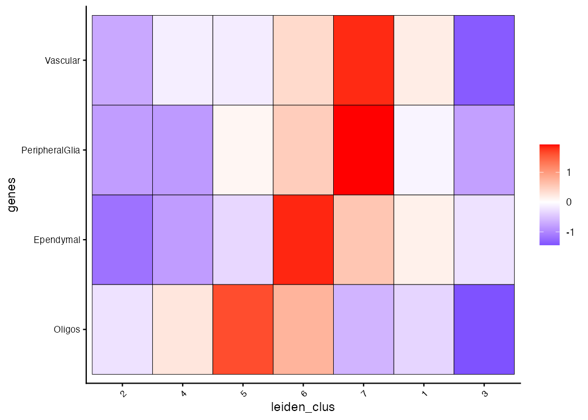
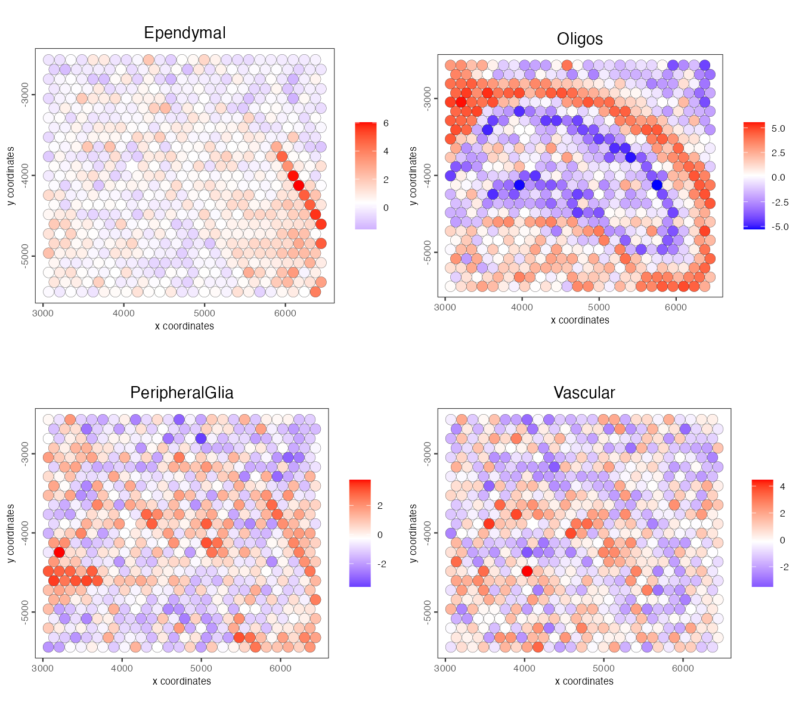
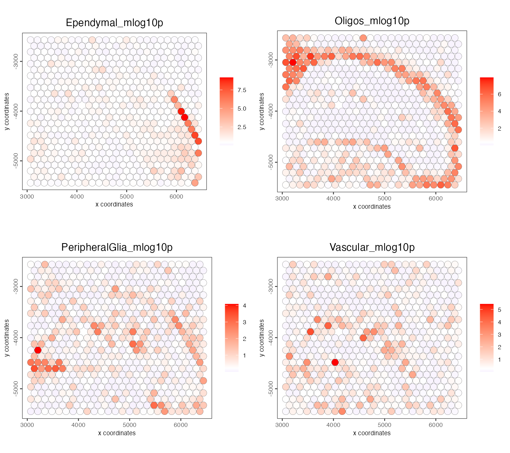
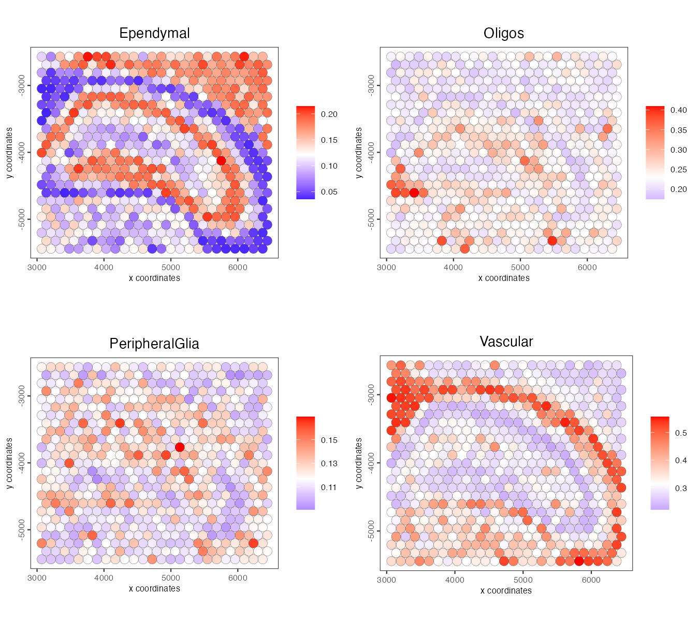
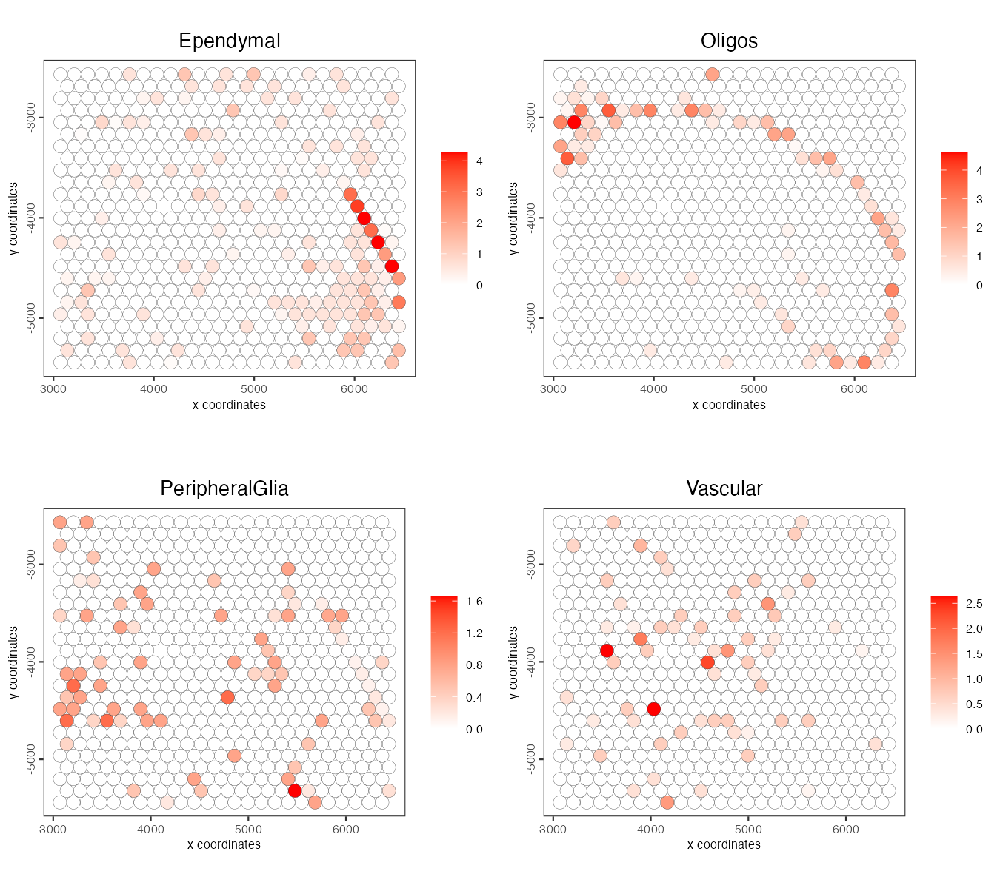

Visium spatial transcriptomics does not provide single-cell resolution, making cell type annotation a harder problem. Giotto scores each spot for cell type signatures taken from a single-cell reference, with three methods:

- **PAGE** (Parametric Analysis of Gene Set Enrichment): a z-score for how far a cell type's marker genes sit above the spot's average fold change.
- **Rank**: compares the rank of every gene in the spot with its rank in each cell type of the reference.
- **Hypergeometric**: tests whether a cell type's markers are over-represented among the spot's most highly expressed genes.

All three return one score per spot and cell type. With `p_value = TRUE` they return p-values instead.

# Setup and load example dataset

```{r, eval=FALSE}
# Ensure Giotto Suite is installed
if(!"Giotto" %in% installed.packages()) {
  pak::pkg_install("giotto-suite/Giotto")
}

# Ensure Giotto Data is installed
if(!"GiottoData" %in% installed.packages()) {
  pak::pkg_install("giotto-suite/GiottoData")
}

library(Giotto)

# Ensure the Python environment for Giotto has been installed
genv_exists <- checkGiottoEnvironment()

if(!genv_exists){
  # The following command need only be run once to install the Giotto environment
  installGiottoEnvironment()
}
```

```{r, eval=FALSE}
# load the object
g <- GiottoData::loadGiottoMini("visium")
```

# Download the single-cell dataset

```{r, eval=FALSE}
# downloads into data/scRNA_mouse_brain/
GiottoData::getSpatialDataset(dataset = "scRNA_mouse_brain", 
                              directory = "data")
```

# Create the single-cell object and run the normalization step

```{r, eval=FALSE}
results_folder <- "path/to/results"

python_path <- NULL

instructions <- createGiottoInstructions(
    save_dir = results_folder,
    save_plot = TRUE,
    show_plot = FALSE,
    python_path = python_path
)

sc_expression <- "data/scRNA_mouse_brain/brain_sc_expression_matrix.txt.gz"
sc_metadata <- data.table::fread("data/scRNA_mouse_brain/brain_sc_metadata.csv")

giotto_SC <- createGiottoObject(expression = sc_expression,
                                instructions = instructions)

giotto_SC <- addCellMetadata(giotto_SC, 
                             new_metadata = sc_metadata[,2:129])

giotto_SC <- normalizeGiotto(giotto_SC)
```

# Calculate the cell type markers

```{r, eval=FALSE}
markers_scran <- findMarkers_one_vs_all(gobject = giotto_SC, 
                                        method = "scran",
                                        expression_values = "normalized",
                                        cluster_column = "Class", 
                                        min_feats = 3)

top_markers <- markers_scran[, head(.SD, 10), by = "cluster"]
```

# Create the signature matrix

```{r, eval=FALSE}
celltypes <- levels(factor(markers_scran$cluster)) 

sign_list <- list()

for (i in 1:length(celltypes)){
  sign_list[[i]] = top_markers[which(top_markers$cluster == celltypes[i]),]$feats
}

sign_matrix <- makeSignMatrixPAGE(sign_names = celltypes,
                                  sign_list = sign_list)
```

# Run the enrichment test with PAGE

```{r, eval=FALSE}
g <- runPAGEEnrich(gobject = g, 
                   sign_matrix = sign_matrix,
                   min_overlap_genes = 1)
```

# Visualize

Create a heatmap showing the enrichment of cell types (from the single-cell data annotation) in the spatial dataset clusters.

```{r, eval=FALSE}
cell_types_PAGE <- colnames(sign_matrix)

plotMetaDataCellsHeatmap(gobject = g,
                         metadata_cols = "leiden_clus",
                         value_cols = cell_types_PAGE,
                         spat_enr_names = "PAGE",
                         x_text_size = 8,
                         y_text_size = 8)
```

```{r, echo=FALSE, out.width="60%", fig.align='center'}

```

Plot the spatial distribution of the cell types.

```{r, eval=FALSE}
spatCellPlot2D(gobject = g,
               spat_enr_names = "PAGE",
               cell_annotation_values = cell_types_PAGE,
               cow_n_col = 2,
               coord_fix_ratio = 1, 
               point_size = 4, 
               show_legend = TRUE)
```

```{r, echo=FALSE, out.width="80%", fig.align='center'}

```

# P-values

PAGE p-values test each spot against random gene sets of the same size. They are computed exactly, so they cost no more than the scores.

```{r, eval=FALSE}
g <- runPAGEEnrich(gobject = g, 
                   sign_matrix = sign_matrix,
                   min_overlap_genes = 1,
                   p_value = TRUE,
                   name = "PAGE_p")

pvalues <- getSpatialEnrichment(g, name = "PAGE_p", output = "data.table")
cell_types_kept <- setdiff(names(pvalues), "cell_ID")

# spots enriched at p < 0.05, per cell type
colSums(as.matrix(pvalues[, -"cell_ID"]) < 0.05)
```

```{r, eval=FALSE}
     Ependymal         Oligos PeripheralGlia       Vascular 
            44            178             55             69 
```

Cell types with too few marker genes in the spatial data are left out (see `min_overlap_genes`), which is why only four of the seven appear here. To plot the p-values on the tissue, add them to the cell metadata as `-log10(p)`:

```{r, eval=FALSE}
mlog10p <- pvalues[, lapply(.SD, function(p) -log10(p)), by = cell_ID]
data.table::setnames(mlog10p, cell_types_kept, paste0(cell_types_kept, "_mlog10p"))

g <- addCellMetadata(g, 
                     new_metadata = mlog10p, 
                     by_column = TRUE, 
                     column_cell_ID = "cell_ID")

spatCellPlot2D(gobject = g,
               cell_annotation_values = paste0(cell_types_kept, "_mlog10p"),
               cow_n_col = 2,
               coord_fix_ratio = 1, 
               point_size = 4, 
               show_legend = TRUE)
```

```{r, echo=FALSE, out.width="80%", fig.align='center'}

```

# Rank enrichment

Rank enrichment needs a different signature matrix: instead of a short list of markers per cell type, it uses the whole single-cell expression profile.

```{r, eval=FALSE}
rank_matrix <- makeSignMatrixRank(
    sc_matrix = getExpression(giotto_SC, values = "normalized", output = "matrix"),
    sc_cluster_ids = pDataDT(giotto_SC)$Class)

colnames(rank_matrix) <- levels(factor(pDataDT(giotto_SC)$Class))

g <- runRankEnrich(gobject = g, 
                   sign_matrix = rank_matrix,
                   expression_values = "normalized")

spatCellPlot2D(gobject = g,
               spat_enr_names = "rank",
               cell_annotation_values = cell_types_kept,
               cow_n_col = 2,
               coord_fix_ratio = 1, 
               point_size = 4, 
               show_legend = TRUE)
```

```{r, echo=FALSE, out.width="80%", fig.align='center'}

```

Because it compares whole profiles, rank enrichment works best when the spatial data measures most of the transcriptome. On this small subset of genes the marker-based methods give sharper maps.

# Hypergeometric enrichment

The hypergeometric test takes, for each spot, the genes in its top 5% (`top_percentage`) of fold changes and asks whether a cell type's markers are over-represented among them. It uses the same signature matrix as PAGE.

```{r, eval=FALSE}
g <- runHyperGeometricEnrich(gobject = g, 
                             sign_matrix = sign_matrix,
                             expression_values = "normalized")

spatCellPlot2D(gobject = g,
               spat_enr_names = "hypergeometric",
               cell_annotation_values = cell_types_kept,
               cow_n_col = 2,
               coord_fix_ratio = 1, 
               point_size = 4, 
               show_legend = TRUE)
```

```{r, echo=FALSE, out.width="80%", fig.align='center'}

```

The scores are `-log10(p)`, so they are never negative. The ependymal layer and the oligodendrocyte tracts stand out as they do with PAGE.

# Large datasets

All three methods score spots in blocks, so memory stays bounded on large datasets. On disk-backed objects from [GiottoDisk](https://giotto-suite.github.io/GiottoDisk/), PAGE (with or without p-values) and the hypergeometric test run without loading the expression matrix into memory. Rank enrichment needs the whole matrix in memory.

# Session info

```{r, eval=FALSE}
sessionInfo()
```

```{r, eval=FALSE}
R version 4.5.3 (2026-03-11)
Platform: aarch64-apple-darwin20
Running under: macOS Tahoe 26.6.2

Matrix products: default
BLAS:   /Library/Frameworks/R.framework/Versions/4.5-arm64/Resources/lib/libRblas.0.dylib 
LAPACK: /Library/Frameworks/R.framework/Versions/4.5-arm64/Resources/lib/libRlapack.dylib;  LAPACK version 3.12.1

locale:
[1] C.UTF-8/C.UTF-8/C.UTF-8/C/C.UTF-8/C.UTF-8

time zone: America/New_York
tzcode source: internal

attached base packages:
[1] stats     graphics  grDevices utils     datasets  methods   base     

other attached packages:
[1] Giotto_4.3.5       GiottoClass_0.7.16

loaded via a namespace (and not attached):
 [1] tidyselect_1.2.1            viridisLite_0.4.3          
 [3] dplyr_1.2.0                 farver_2.1.2               
 [5] GiottoVisuals_0.2.16        viridis_0.6.5              
 [7] S7_0.2.1                    ggraph_2.2.2               
 [9] fastmap_1.2.0               SingleCellExperiment_1.32.0
[11] lazyeval_0.2.2              bluster_1.20.0             
[13] tweenr_2.0.3                rsvd_1.0.5                 
[15] digest_0.6.39               lifecycle_1.0.5            
[17] cluster_2.1.8.2             terra_1.9-11               
[19] magrittr_2.0.4              compiler_4.5.3             
[21] rlang_1.3.0                 tools_4.5.3                
[23] igraph_2.2.2                data.table_1.18.2.1        
[25] S4Arrays_1.10.1             graphlayouts_1.2.3         
[27] htmlwidgets_1.6.4           DelayedArray_0.36.0        
[29] RColorBrewer_1.1-3          BiocParallel_1.44.0        
[31] abind_1.4-8                 withr_3.0.2                
[33] purrr_1.2.1                 BiocGenerics_0.56.0        
[35] grid_4.5.3                  polyclip_1.10-7            
[37] stats4_4.5.3                beachmat_2.26.0            
[39] colorspace_2.1-2            ggplot2_4.0.2              
[41] scales_1.4.0                gtools_3.9.5               
[43] MASS_7.3-65                 dichromat_2.0-0.1          
[45] SummarizedExperiment_1.40.0 cli_3.6.5                  
[47] generics_0.1.4              httr_1.4.8                 
[49] rjson_0.2.23                cachem_1.1.0               
[51] ggforce_0.5.0               parallel_4.5.3             
[53] XVector_0.50.0              matrixStats_1.5.0          
[55] vctrs_0.7.2                 Matrix_1.7-5               
[57] jsonlite_2.0.0              BiocSingular_1.26.1        
[59] BiocNeighbors_2.4.0         IRanges_2.44.0             
[61] S4Vectors_0.48.0            ggrepel_0.9.8              
[63] irlba_2.3.7                 scattermore_1.2            
[65] magick_2.9.1                GiottoUtils_0.2.8          
[67] plotly_4.12.0               tidyr_1.3.2                
[69] glue_1.8.0                  codetools_0.2-20           
[71] cowplot_1.2.0               gtable_0.3.6               
[73] GenomicRanges_1.62.1        ScaledMatrix_1.18.0        
[75] tibble_3.3.1                pillar_1.11.1              
[77] htmltools_0.5.9             Seqinfo_1.0.0              
[79] R6_2.6.1                    tidygraph_1.3.1            
[81] lattice_0.22-9              Biobase_2.70.0             
[83] backports_1.5.0             SpatialExperiment_1.20.0   
[85] memoise_2.0.1               Rcpp_1.1.1                 
[87] gridExtra_2.3               SparseArray_1.10.9         
[89] checkmate_2.3.4             colorRamp2_0.1.0           
[91] MatrixGenerics_1.22.0       pkgconfig_2.0.3
```
