# Start Giotto

```{r, eval=FALSE}
# Ensure Giotto Suite is installed.
if (!"Giotto" %in% installed.packages()) {
    pak::pkg_install("giotto-suite/Giotto")
}

# Ensure GiottoData, a small, helper module for tutorials, is installed.
if (!"GiottoData" %in% installed.packages()) {
    pak::pkg_install("giotto-suite/GiottoData")
}
```


# Dataset Explanation

Several fields - containing 100's of cells - in the mouse cortex and subventricular zone were imaged for seqFISH+. The coordinates of the cells within each field are independent of each other, so in order to visualize and process all cells together imaging fields will be stitched together by providing x and y-offset values specific to each field.

These offset values are known or estimates based on the original raw
image:

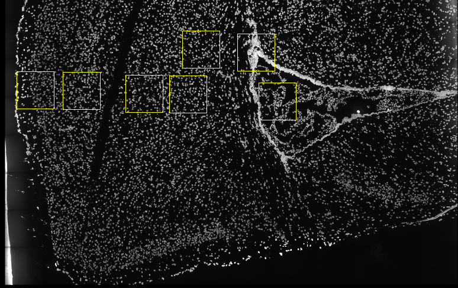

# Download Data

```{r, eval=FALSE}
library(Giotto)

# returns the folder with the downloaded files
data_path <- GiottoData::getSpatialDataset(dataset = "seqfish_SS_cortex",
                                           directory = "/path/to/data/")
```

# Giotto Instructions and Preparation

```{r, eval=FALSE}
#  set Giotto instructions
results_folder <- "/path/to/results/"

instructions <- createGiottoInstructions(
    save_plot = TRUE,
    show_plot = FALSE,
    return_plot = FALSE,
    save_dir = results_folder
)

# create giotto object from provided paths ####
expr_path <- file.path(data_path, "cortex_svz_expression.txt")
loc_path <- file.path(data_path, "cortex_svz_centroids_coord.txt")
meta_path <- file.path(data_path, "cortex_svz_centroids_annot.txt")

# This dataset contains multiple field of views which need to be stitched together
# first merge location and additional metadata
SS_locations <- data.table::fread(loc_path)
cortex_fields <- data.table::fread(meta_path)
SS_loc_annot <- data.table::merge.data.table(SS_locations, 
                                             cortex_fields, 
                                             by = "ID")
SS_loc_annot[, ID := factor(ID, levels = paste0("cell_", 1:913))]
data.table::setorder(SS_loc_annot, ID)

# create file with offset information
my_offset_file <- data.table::data.table(
    field = c(0, 1, 2, 3, 4, 5, 6),
    x_offset = c(0, 1654.97, 1750.75, 1674.35, 675.5, 2048, 675),
    y_offset = c(0, 0, 0, 0, -1438.02, -1438.02, 0)
)

# create a stitch file
stitch_file <- stitchFieldCoordinates(
    location_file = SS_loc_annot,
    offset_file = my_offset_file,
    cumulate_offset_x = TRUE,
    cumulate_offset_y = FALSE,
    field_col = "FOV",
    reverse_final_x = FALSE,
    reverse_final_y = TRUE
)

stitch_file <- stitch_file[, .(ID, X_final, Y_final)]
stitch_file$ID <- as.character(stitch_file$ID)
my_offset_file <- my_offset_file[, .(field, x_offset_final, y_offset_final)]
```

# Create Giotto object & process data

```{r, eval=FALSE}
# create Giotto object
SS_seqfish <- createGiottoObject(expression = expr_path,
                                 spatial_locs = stitch_file,
                                 offset_file = my_offset_file,
                                 instructions = instructions
)

# add additional annotation if wanted
SS_seqfish <- addCellMetadata(SS_seqfish,
                              new_metadata = cortex_fields,
                              by_column = TRUE,
                              column_cell_ID = "ID"
)

# subset data to the cortex field of views
cell_metadata <- pDataDT(SS_seqfish)
cortex_cell_ids <- cell_metadata[FOV %in% 0:4]$cell_ID
SS_seqfish <- subsetGiotto(SS_seqfish, cell_ids = cortex_cell_ids)

# filter
SS_seqfish <- filterGiotto(gobject = SS_seqfish,
                           expression_threshold = 1,
                           feat_det_in_min_cells = 10,
                           min_det_feats_per_cell = 10,
                           expression_values = "raw",
                           verbose = TRUE
)

# normalize
SS_seqfish <- normalizeGiotto(gobject = SS_seqfish, 
                              scalefactor = 6000, 
                              verbose = TRUE)

# add gene & cell statistics
SS_seqfish <- addStatistics(gobject = SS_seqfish)

# adjust expression matrix for technical or known variables
SS_seqfish <- adjustGiottoMatrix(gobject = SS_seqfish, 
                                 expression_values = "normalized",
                                 covariate_columns = c("nr_feats", "total_expr"),
                                 return_gobject = TRUE,
                                 update_slot = "custom"
)

# visualize
spatPlot(gobject = SS_seqfish)
```

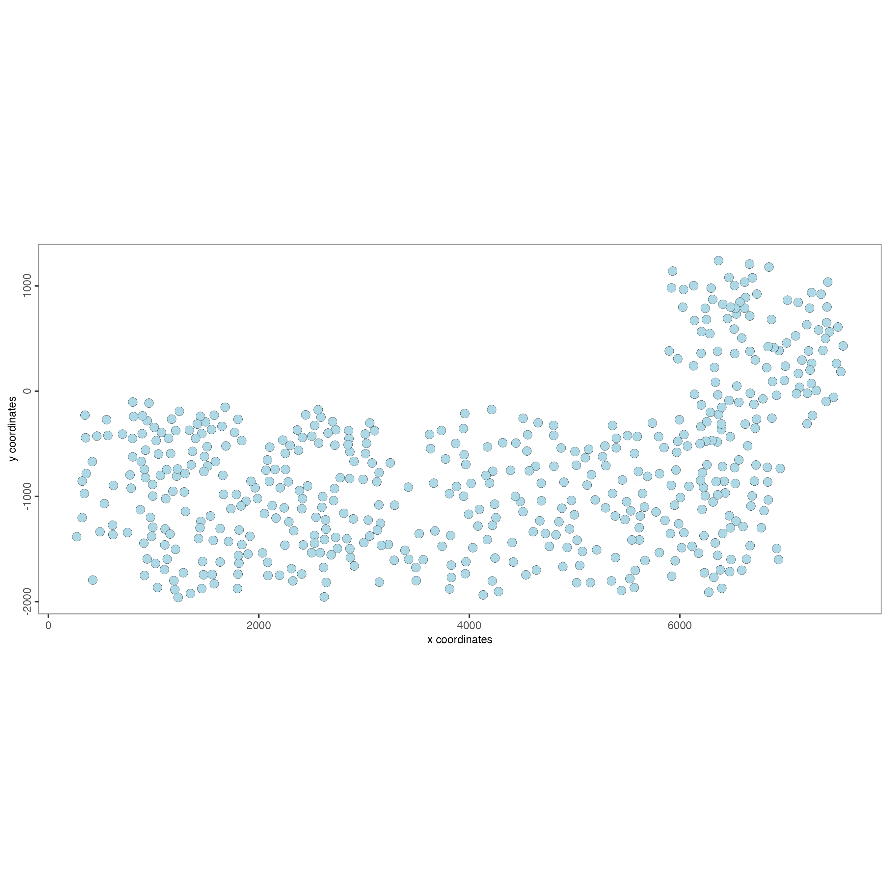

# Dimension Reduction

```{r, eval=FALSE}
## highly variable features (HVF)
SS_seqfish <- calculateHVF(gobject = SS_seqfish,
                           save_plot = TRUE)
```

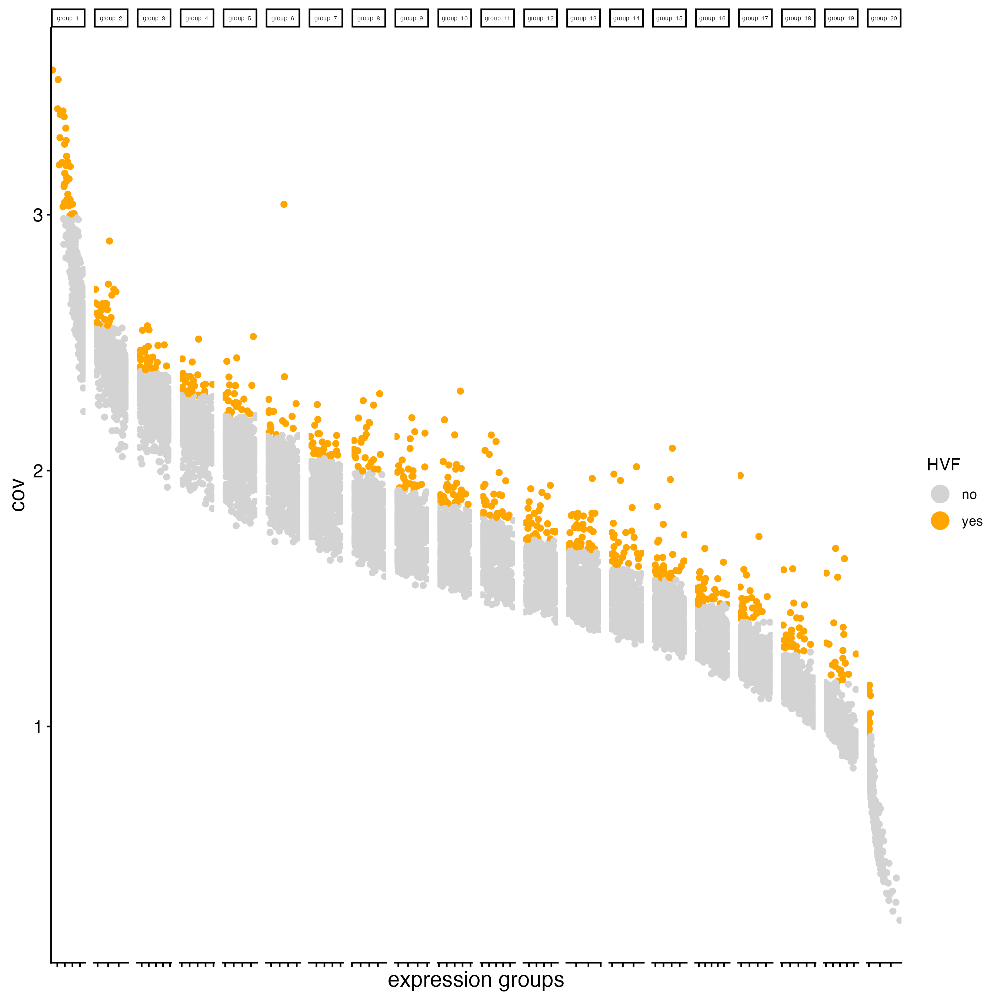

```{r, eval=FALSE}
## select genes based on highly variable features and gene statistics, both found in feature (gene) metadata
gene_metadata <- fDataDT(SS_seqfish)
featgenes <- gene_metadata[hvf == "yes" & perc_cells > 4 & mean_expr_det > 0.5]$feat_ID

## run PCA on expression values (default)
SS_seqfish <- runPCA(gobject = SS_seqfish, 
                     genes_to_use = featgenes, 
                     scale_unit = FALSE, 
                     center = FALSE)

screePlot(SS_seqfish)
```

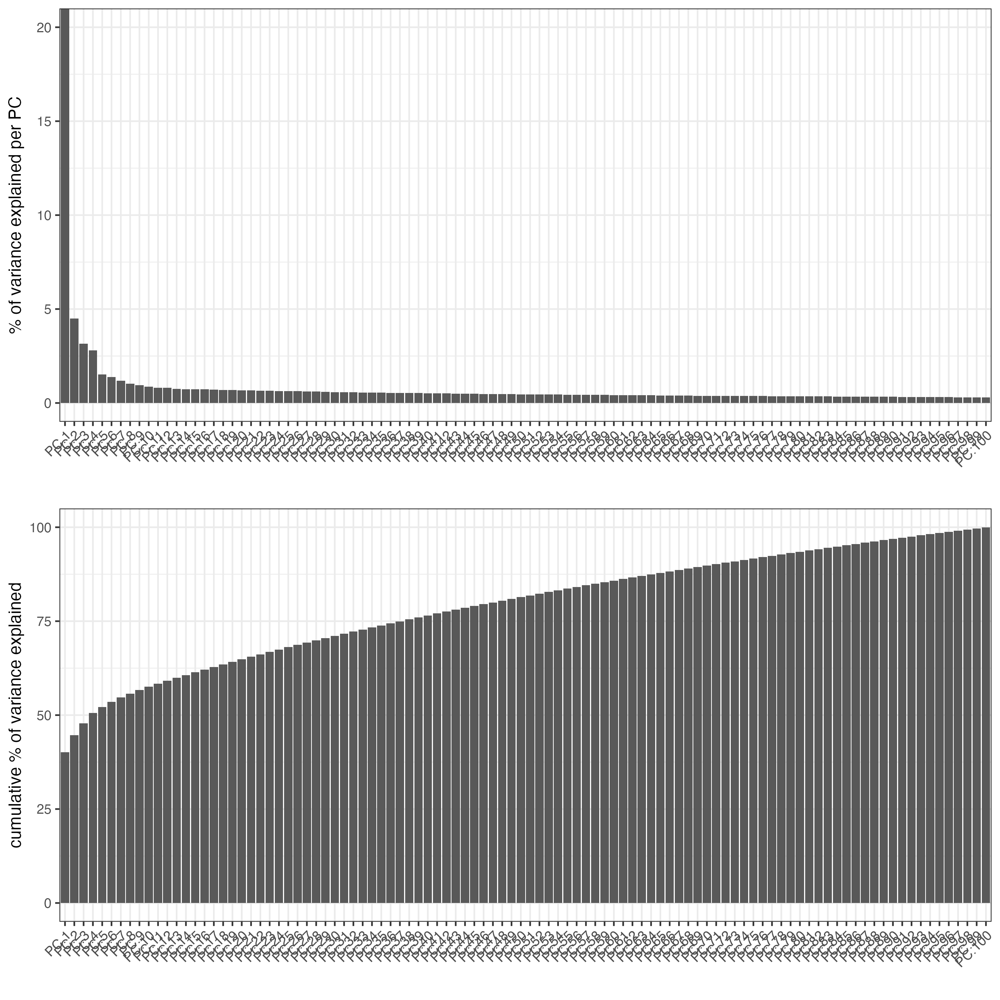

```{r, eval=FALSE}
plotPCA(gobject = SS_seqfish)
```

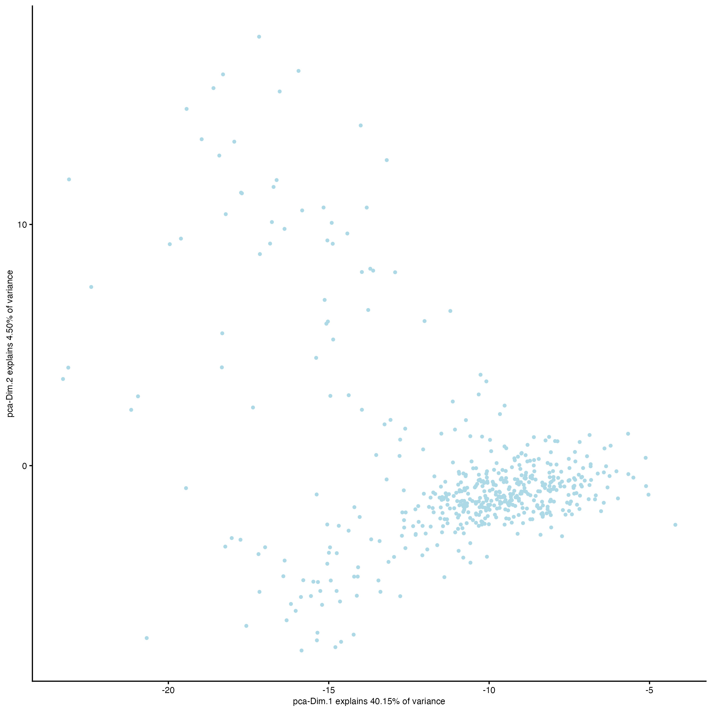

```{r, eval=FALSE}
SS_seqfish <- runUMAP(SS_seqfish, 
                      dimensions_to_use = 1:15, 
                      n_threads = 10)

plotUMAP(gobject = SS_seqfish)
```

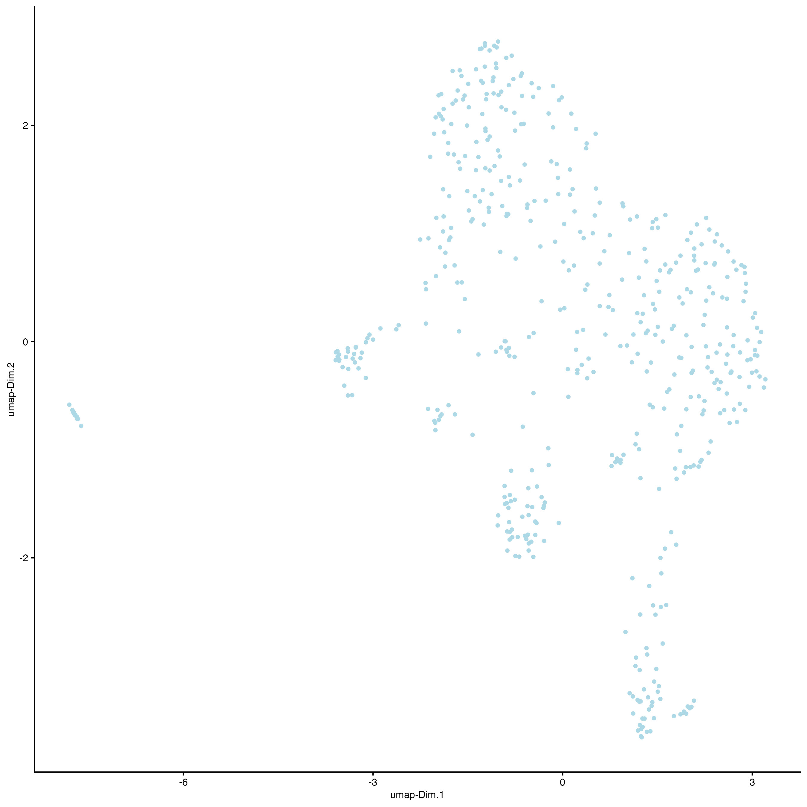

```{r, eval=FALSE}
SS_seqfish <- runtSNE(SS_seqfish, 
                      dimensions_to_use = 1:15)

plotTSNE(gobject = SS_seqfish)
```

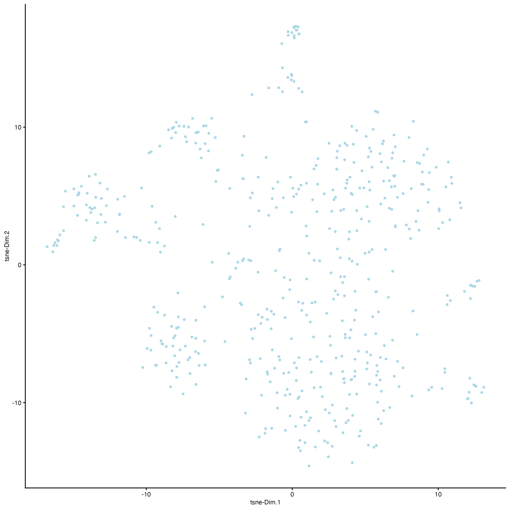

# Cluster

```{r, eval=FALSE}
## sNN network (default)
SS_seqfish <- createNearestNetwork(gobject = SS_seqfish,
                                   dimensions_to_use = 1:15,
                                   k = 15
)

## Leiden clustering
SS_seqfish <- doLeidenCluster(gobject = SS_seqfish,
                              resolution = 0.4,
                              n_iterations = 1000
)

plotUMAP(gobject = SS_seqfish,
         cell_color = "leiden_clus",
         show_NN_network = TRUE,
         point_size = 2.5
)
```

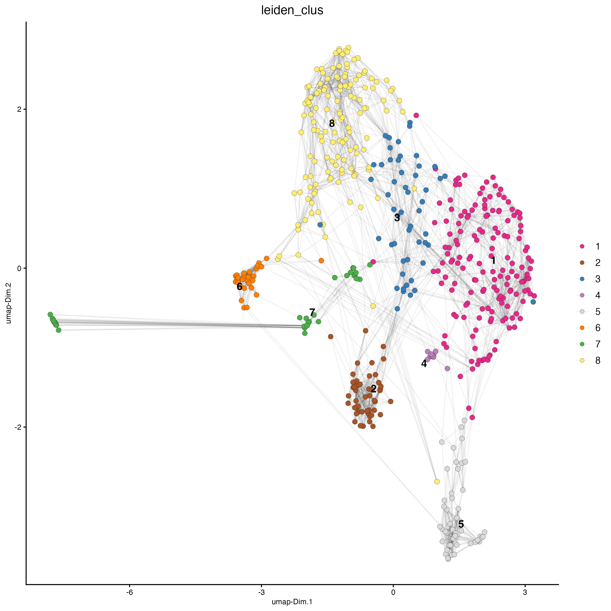

```{r, eval=FALSE}
## Leiden subclustering for specified clusters
SS_seqfish <- doLeidenSubCluster(gobject = SS_seqfish,
                                 cluster_column = "leiden_clus",
                                 resolution = 0.2, 
                                 k_neighbors = 10,
                                 pca_param = list(expression_values = "normalized", 
                                                  scale_unit = FALSE),
                                 nn_param = list(dimensions_to_use = 1:5),
                                 selected_clusters = c(2, 7),
                                 name = "sub_leiden_clus_select"
)

## set colors for clusters
subleiden_order <- c(
    1.1, 2.1, 2.2, 3.1, 4.1, 5.1,
    6.1, 7.1, 7.2, 8.1
)

giotto_colors <- getDistinctColors(length(subleiden_order))
names(giotto_colors) <- subleiden_order

plotUMAP(gobject = SS_seqfish,
         cell_color = "sub_leiden_clus_select", 
         cell_color_code = giotto_colors,
         show_NN_network = TRUE, 
         point_size = 2.5, 
         show_center_label = FALSE,
         legend_text = 12, 
         legend_symbol_size = 3
)
```

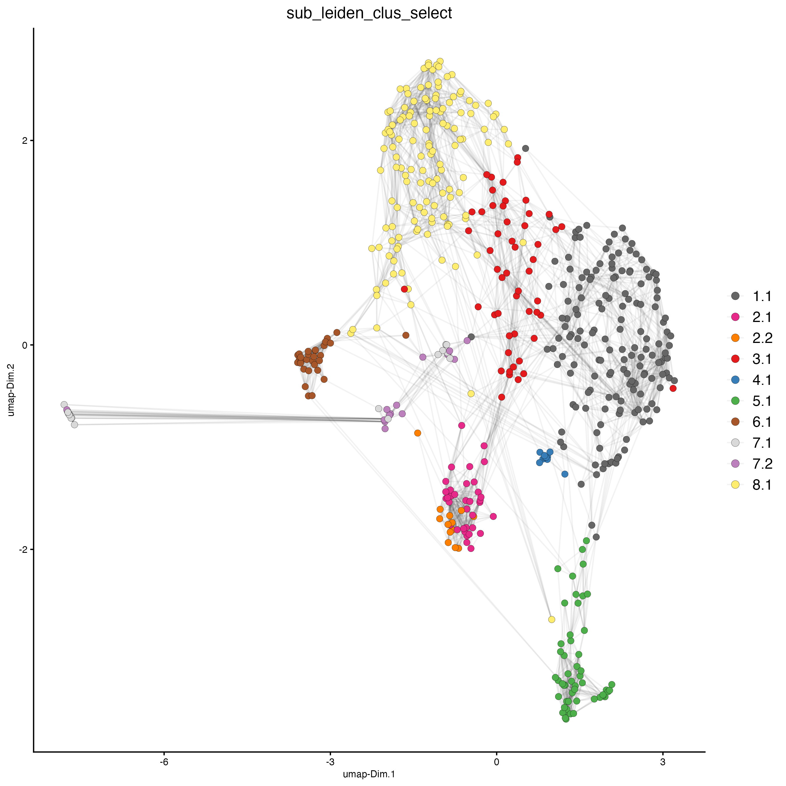

```{r, eval=FALSE}
## show cluster relationships
showClusterHeatmap(gobject = SS_seqfish, 
                   cluster_column = "sub_leiden_clus_select",
                   row_names_gp = grid::gpar(fontsize = 9), 
                   column_names_gp = grid::gpar(fontsize = 9)
)
```

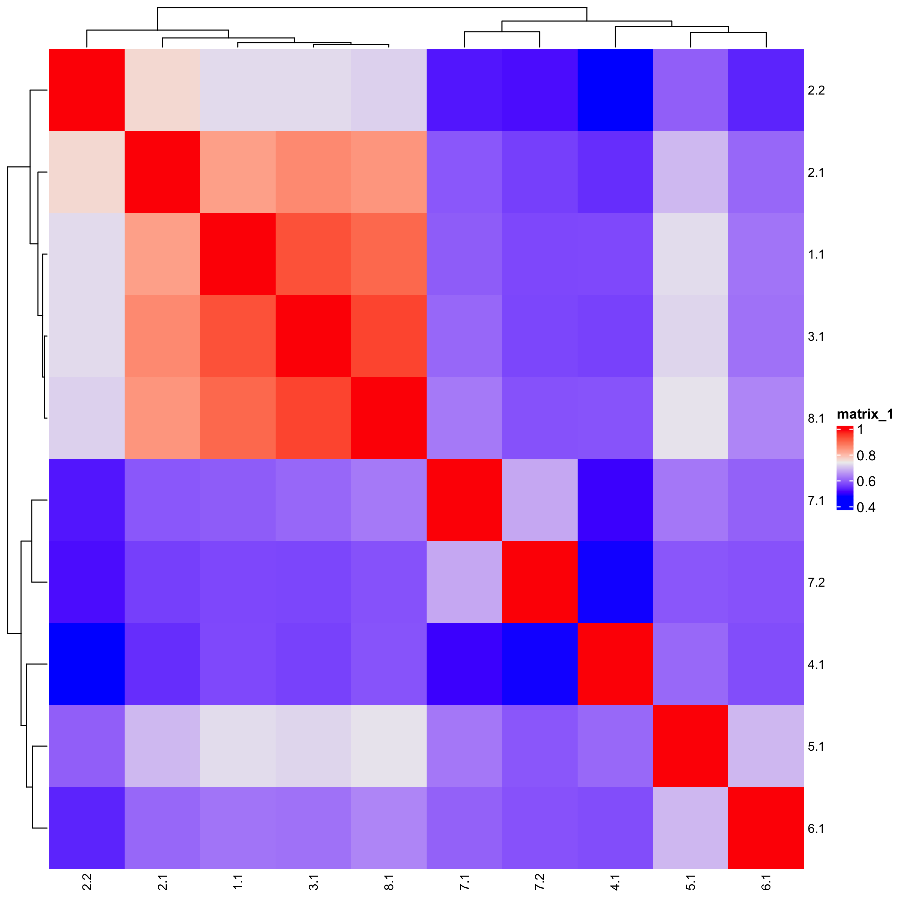

The following step requires the installation of {ggdendro}.

```{r, eval=FALSE}
# install.packages('ggdendro')
library(ggdendro)
showClusterDendrogram(SS_seqfish, 
                      h = 0.5, 
                      rotate = TRUE, 
                      cluster_column = "sub_leiden_clus_select")
```

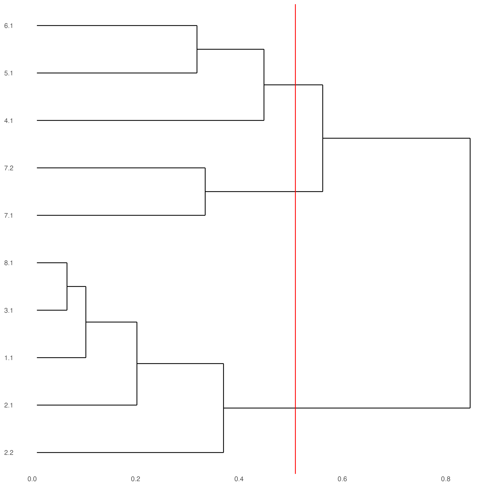

# Visualize Spatial and Expression Space

```{r, eval=FALSE}
# expression and spatial
spatDimPlot(gobject = SS_seqfish, 
            cell_color = "sub_leiden_clus_select",
            cell_color_code = giotto_colors,
            dim_point_size = 2, 
            spat_point_size = 2
)
```

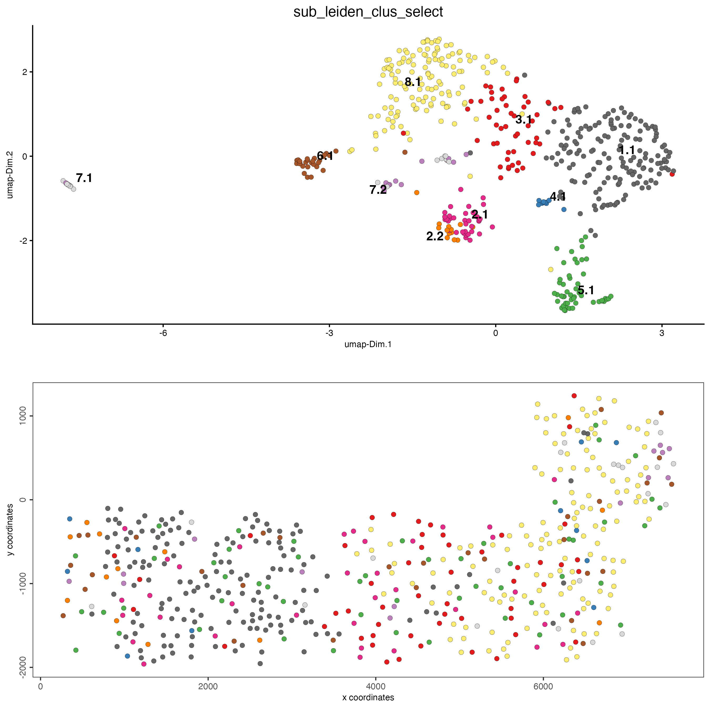

```{r, eval=FALSE}
# selected groups and provide new colors
groups_of_interest <- c(4.1, 6.1, 7.1, 7.2)
group_colors <- c("red", "green", "blue", "purple")
names(group_colors) <- groups_of_interest

spatDimPlot(gobject = SS_seqfish, 
            cell_color = "sub_leiden_clus_select",
            dim_point_size = 2, 
            spat_point_size = 2,
            select_cell_groups = groups_of_interest, 
            cell_color_code = group_colors
)
```

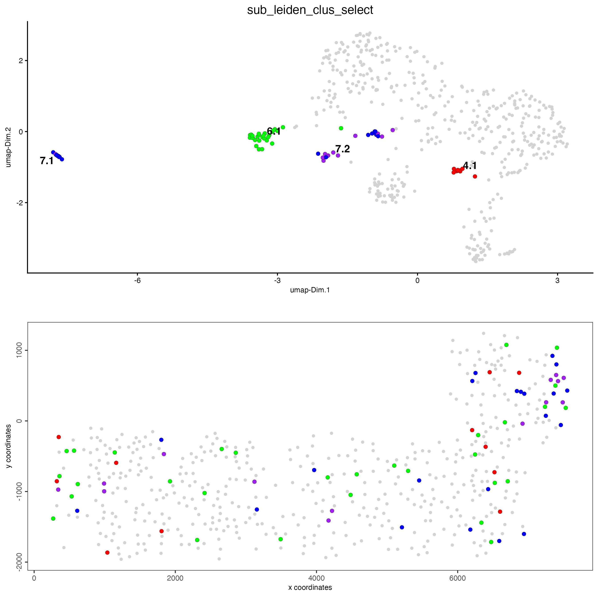

# Cell Type Marker Gene Detection

```{r, eval=FALSE}
## gini
markers_gini <- findMarkers_one_vs_all(gobject = SS_seqfish,
                                       method = "gini",
                                       expression_values = "normalized",
                                       cluster_column = "sub_leiden_clus_select",
                                       min_feats = 20,
                                       min_expr_gini_score = 0.5,
                                       min_det_gini_score = 0.5
)

topgenes_gini <- markers_gini[, head(.SD, 2), by = "cluster"]

## violin plot
violinPlot(SS_seqfish,
           feats = unique(topgenes_gini$feats), 
           cluster_column = "sub_leiden_clus_select",
           strip_text = 8, 
           strip_position = "right", 
           cluster_custom_order = unique(topgenes_gini$cluster)
)
```

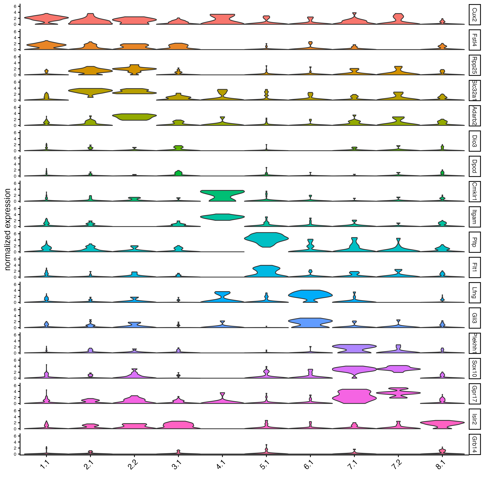

```{r, eval=FALSE}
# cluster heatmap
topgenes_gini <- markers_gini[, head(.SD, 6), by = "cluster"]

plotMetaDataHeatmap(SS_seqfish,
                    selected_feats = unique(topgenes_gini$feats),
                    custom_feat_order = unique(topgenes_gini$feats),
                    custom_cluster_order = unique(topgenes_gini$cluster),
                    metadata_cols = "sub_leiden_clus_select", 
                    x_text_size = 10, y_text_size = 10
)
```

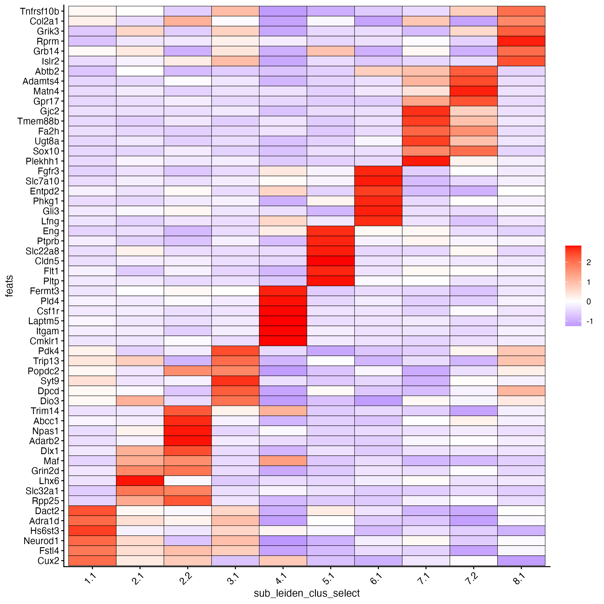

# Cell Type Annotation

```{r, eval=FALSE}
## general cell types
## create vector with names
clusters_cell_types <- c("1.1" = "L4 eNeuron",
                         "2.1" = "Lhx6 iNeuron",
                         "2.2" = "Adarb2 iNeuron",
                         "3.1" = "L5 eNeuron",
                         "4.1" = "microglia",
                         "5.1" = "endothelial",
                         "6.1" = "astrocytes",
                         "7.1" = "Olig",
                         "7.2" = "OPC",
                         "8.1" = "L6 eNeuron"
)

SS_seqfish <- annotateGiotto(gobject = SS_seqfish, 
                             annotation_vector = clusters_cell_types,
                             cluster_column = "sub_leiden_clus_select",
                             name = "cell_types"
)

# cell type order and colors
cell_type_order <- c(
    "L4 eNeuron", "L5 eNeuron", "L6 eNeuron",
    "astrocytes", "Olig", "OPC", "Adarb2 iNeuron", "Lhx6 iNeuron",
    "endothelial", "microglia"
)

cell_type_colors <- giotto_colors
names(cell_type_colors) <- clusters_cell_types[names(giotto_colors)]
cell_type_colors <- cell_type_colors[cell_type_order]

## violin plot
violinPlot(gobject = SS_seqfish, 
           feats = unique(topgenes_gini$feats),
           strip_text = 7, 
           strip_position = "right",
           cluster_custom_order = cell_type_order,
           cluster_column = "cell_types", 
           color_violin = "cluster"
)
```

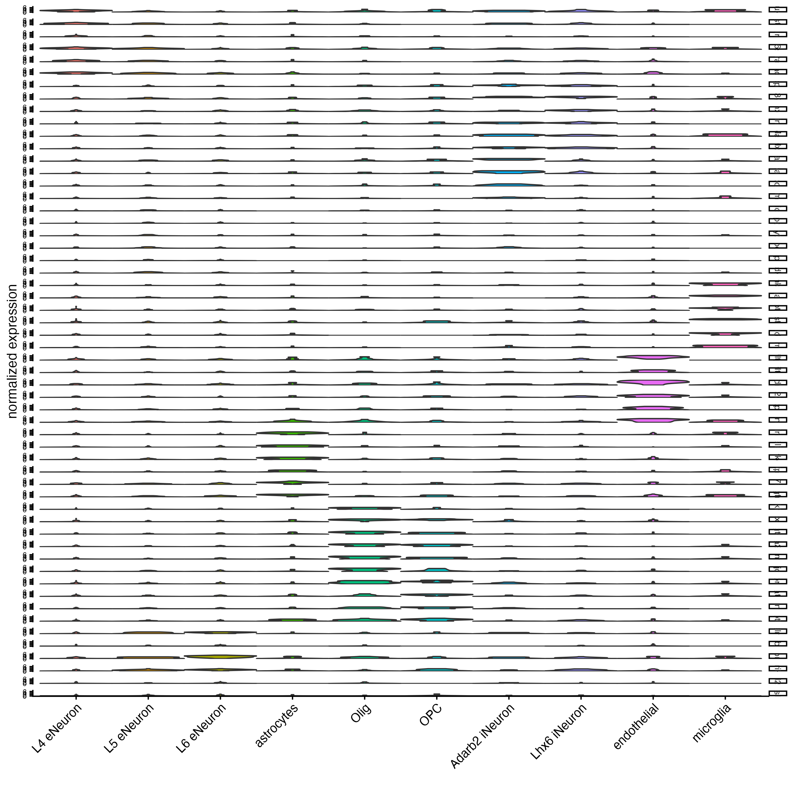

```{r, eval=FALSE}
# co-visualization
spatDimPlot(gobject = SS_seqfish, 
            cell_color = "cell_types",
            dim_point_size = 2, 
            spat_point_size = 2, 
            dim_show_cluster_center = FALSE,
            dim_show_center_label = TRUE
)
```

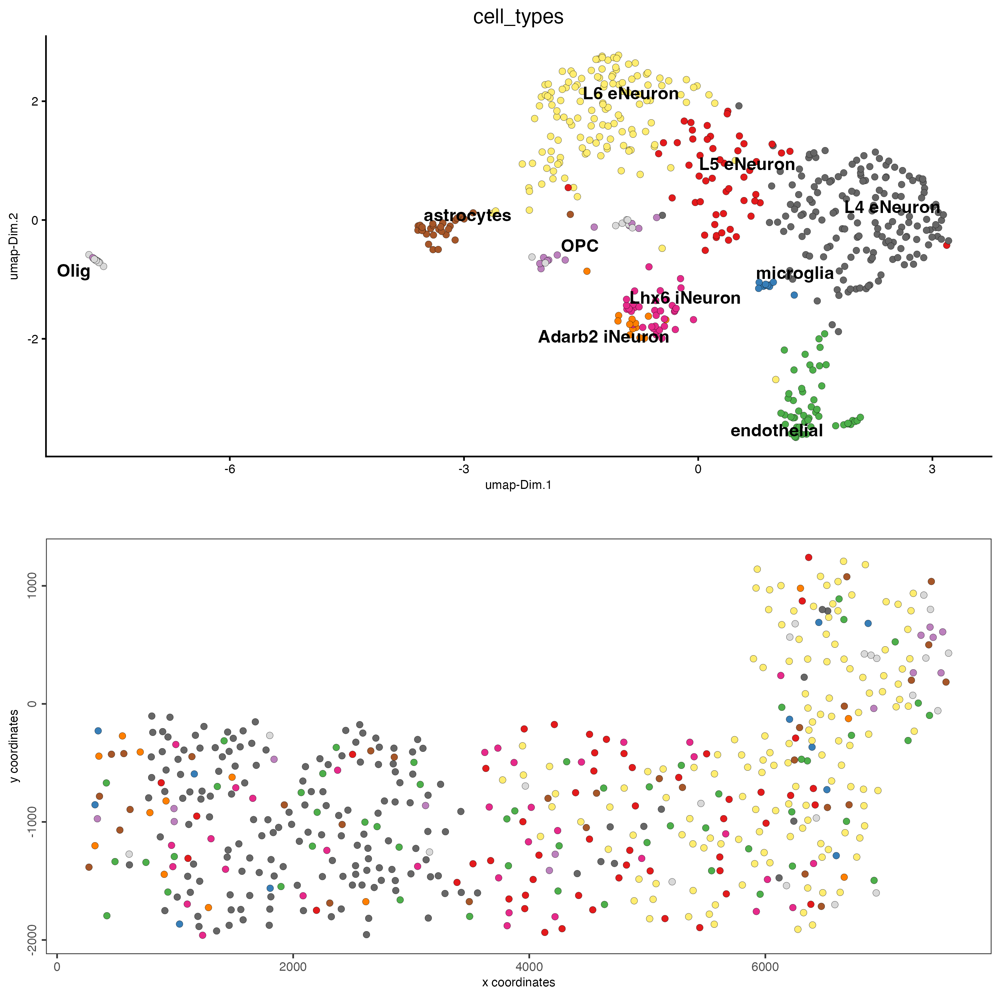

```{r, eval=FALSE}
## heatmap genes vs cells
markers_gini[, cell_types := clusters_cell_types[cluster]]
markers_gini[, cell_types := factor(cell_types, cell_type_order)]
data.table::setorder(markers_gini, cell_types)

plotHeatmap(gobject = SS_seqfish,
            feats = markers_gini[, head(.SD, 3), by = "cell_types"]$feats,
            feat_order = "custom",
            feat_custom_order = unique(markers_gini[, head(.SD, 3), by = "cluster"]$feats),
            cluster_column = "cell_types", cluster_order = "custom",
            cluster_custom_order = unique(markers_gini[, head(.SD, 3), by = "cell_types"]$cell_types),
            legend_nrows = 2
)
```

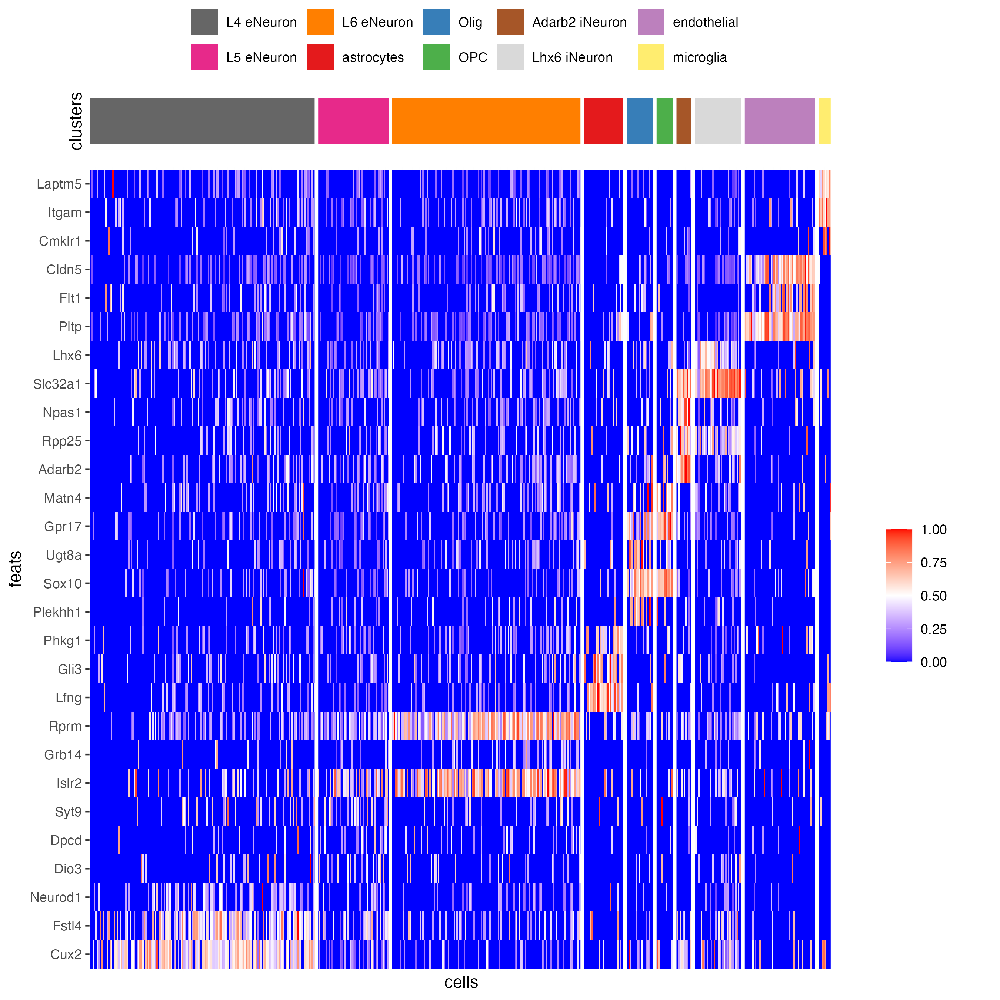

```{r, eval=FALSE}
plotHeatmap(gobject = SS_seqfish,
            feats = markers_gini[, head(.SD, 6), by = "cell_types"]$feats,
            feat_order = "custom",
            feat_label_selection = markers_gini[, head(.SD, 2), by = "cluster"]$feats,
            feat_custom_order = unique(markers_gini[, head(.SD, 6), by = "cluster"]$feats),
            cluster_column = "cell_types", cluster_order = "custom",
            cluster_custom_order = unique(markers_gini[, head(.SD, 3), by = "cell_types"]$cell_types),
            legend_nrows = 2
)
```

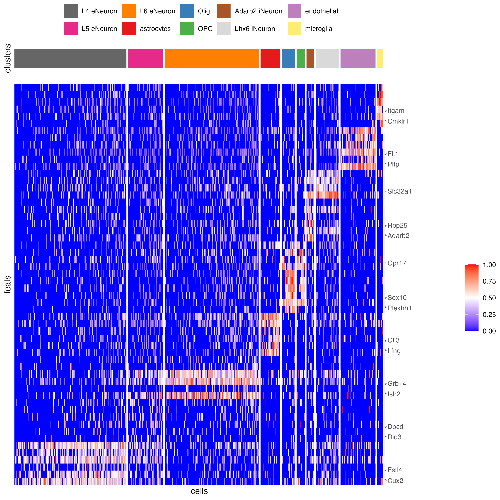

# Spatial Grid

```{r, eval=FALSE}
SS_seqfish <- createSpatialGrid(gobject = SS_seqfish,
                                sdimx_stepsize = 500,
                                sdimy_stepsize = 500,
                                minimum_padding = 50
)

spatPlot(gobject = SS_seqfish, 
         show_grid = TRUE, 
         point_size = 1.5)
```

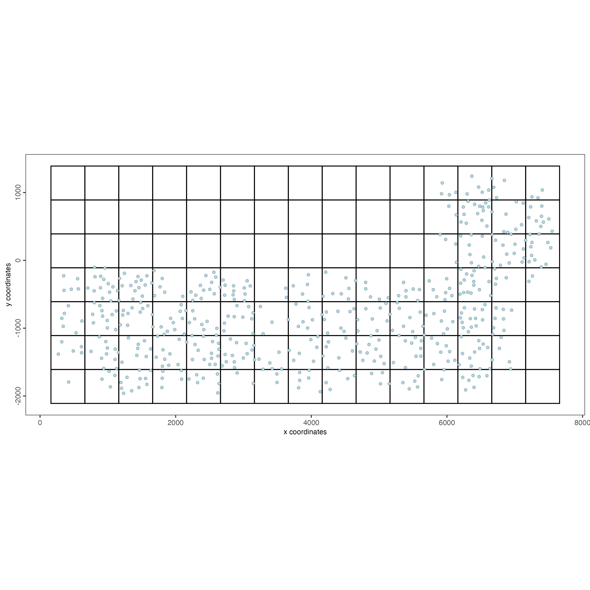

# Spatial Network

```{r, eval=FALSE}
## delaunay network: stats + creation
plotStatDelaunayNetwork(gobject = SS_seqfish, 
                        maximum_distance = 400)
```

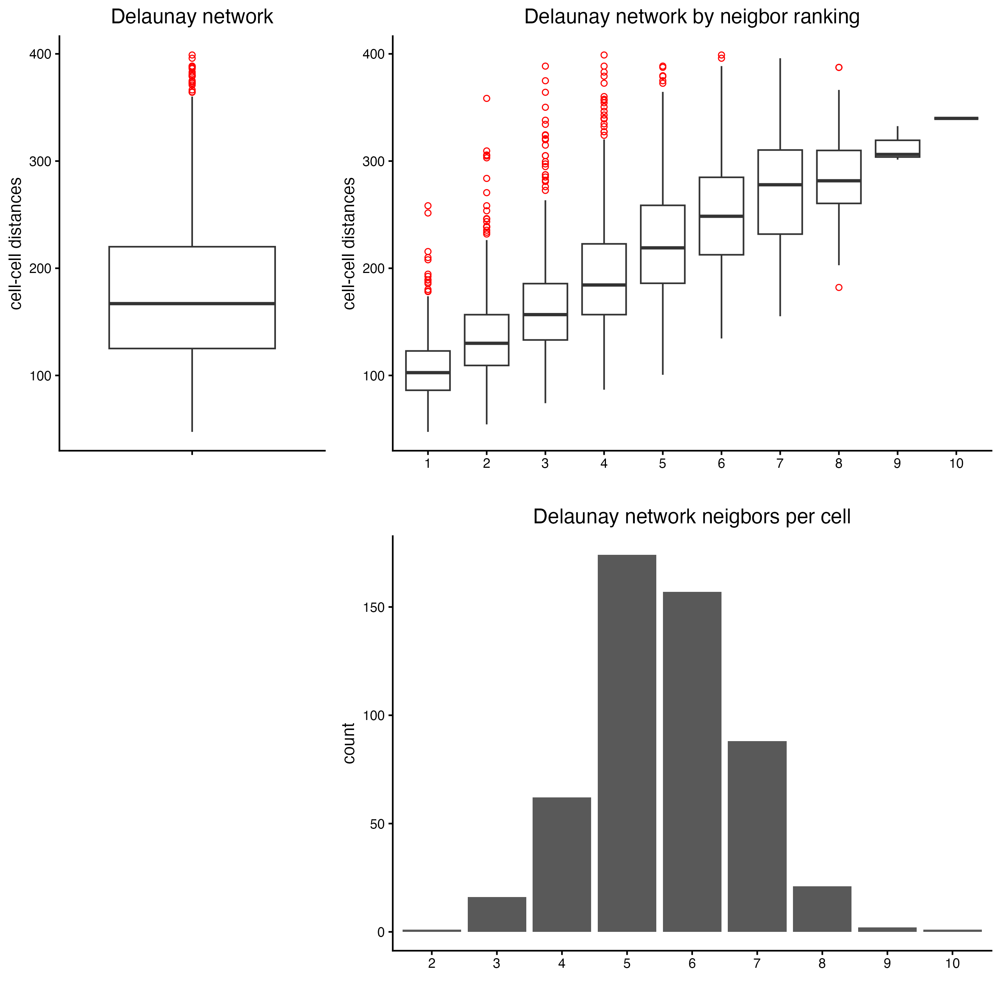

```{r, eval=FALSE}
SS_seqfish <- createSpatialNetwork(gobject = SS_seqfish,
                                   minimum_k = 2, 
                                   maximum_distance_delaunay = 400)

## create spatial networks based on k and/or distance from centroid
SS_seqfish <- createSpatialNetwork(gobject = SS_seqfish, 
                                   method = "kNN", 
                                   k = 5, 
                                   name = "spatial_network")

SS_seqfish <- createSpatialNetwork(gobject = SS_seqfish, 
                                   method = "kNN", 
                                   k = 10, 
                                   name = "large_network")

SS_seqfish <- createSpatialNetwork(gobject = SS_seqfish, 
                                   method = "kNN", 
                                   k = 100,
                                   maximum_distance_knn = 200, 
                                   minimum_k = 2, 
                                   name = "distance_network"
)

## visualize different spatial networks on first field (~ layer 1)
cell_metadata <- pDataDT(SS_seqfish)
field1_ids <- cell_metadata[FOV == 0]$cell_ID

subSS_seqfish <- subsetGiotto(SS_seqfish, 
                              cell_ids = field1_ids)

spatPlot(gobject = subSS_seqfish, 
         show_network = TRUE,
         network_color = "blue", 
         spatial_network_name = "Delaunay_network",
         point_size = 2.5, 
         cell_color = "cell_types"
)
```

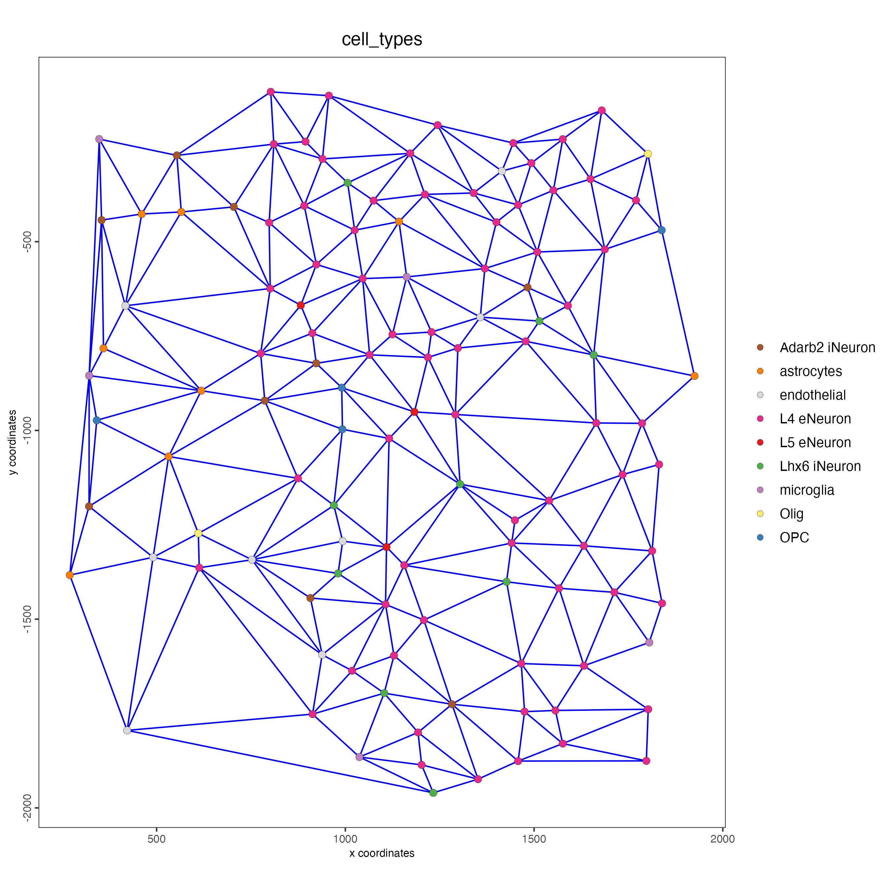

```{r, eval=FALSE}
spatPlot(gobject = subSS_seqfish, 
         show_network = TRUE,
         network_color = "blue", 
         spatial_network_name = "spatial_network",
         point_size = 2.5, 
         cell_color = "cell_types"
)
```

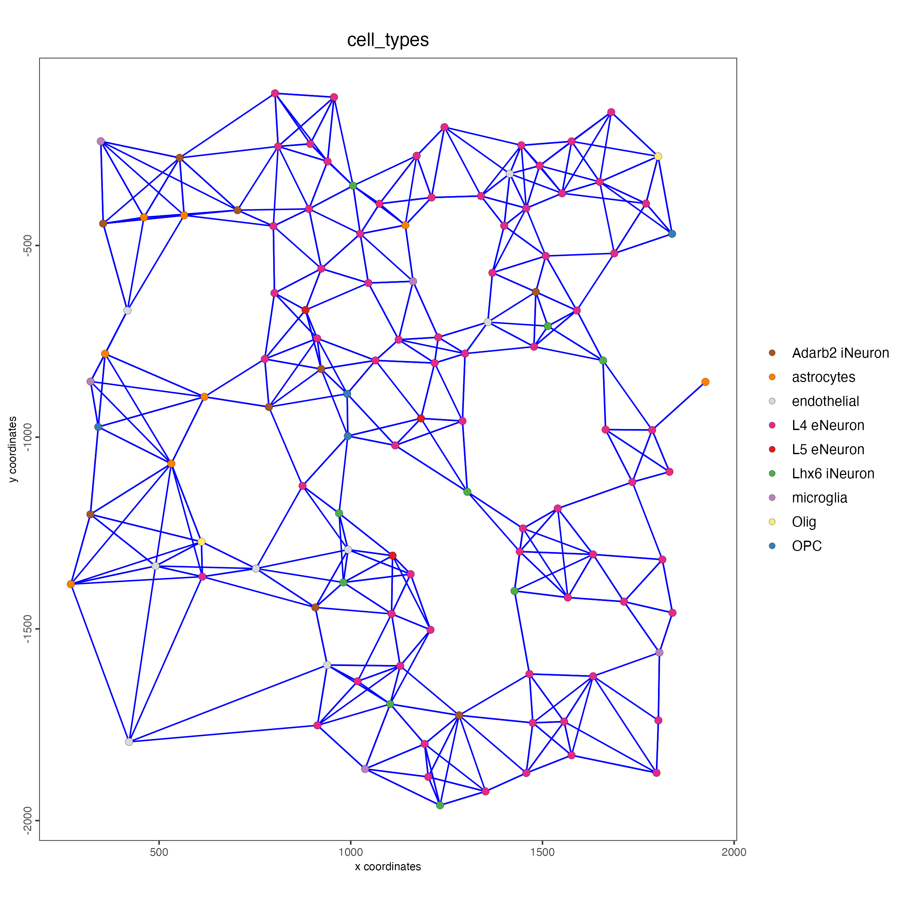

```{r, eval=FALSE}
spatPlot(gobject = subSS_seqfish, 
         show_network = TRUE,
         network_color = "blue", 
         spatial_network_name = "large_network",
         point_size = 2.5, 
         cell_color = "cell_types"
)
```

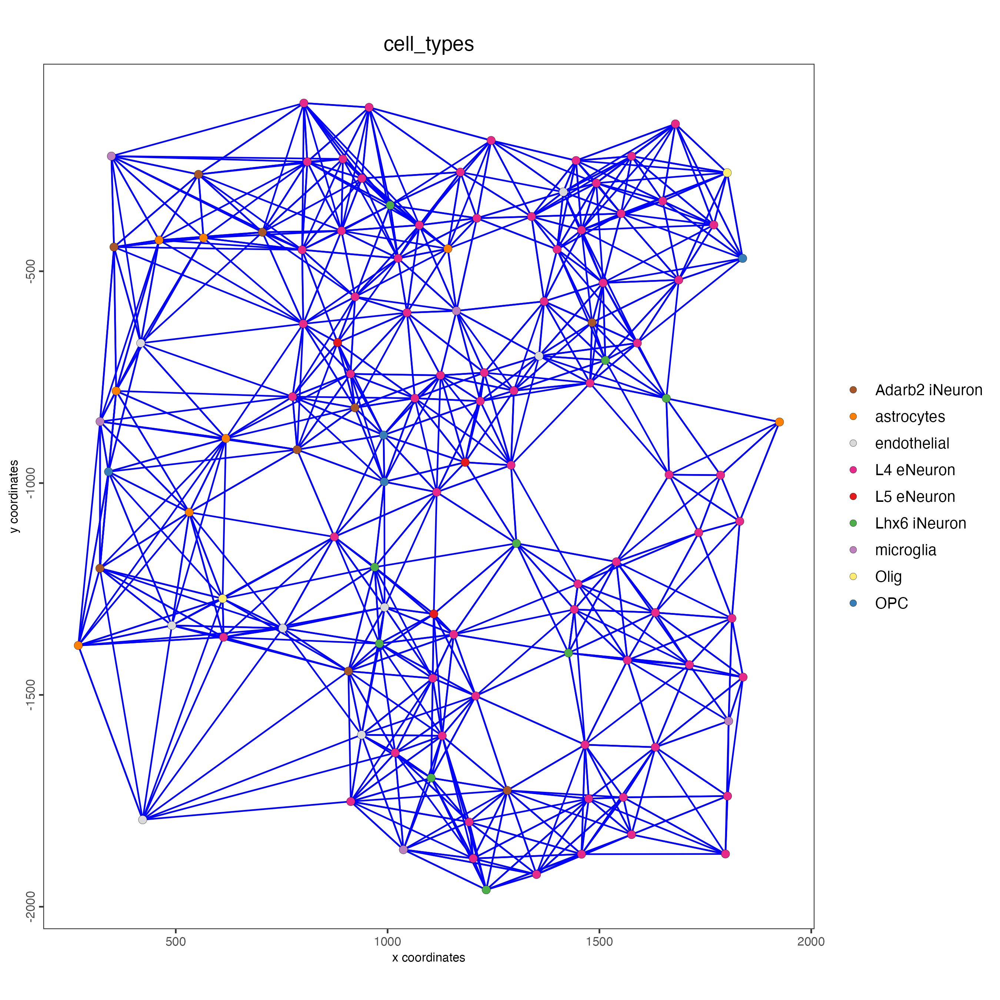

```{r, eval=FALSE}
spatPlot(gobject = subSS_seqfish, 
         show_network = TRUE,
         network_color = "blue", 
         spatial_network_name = "distance_network",
         point_size = 2.5, 
         cell_color = "cell_types"
)
```

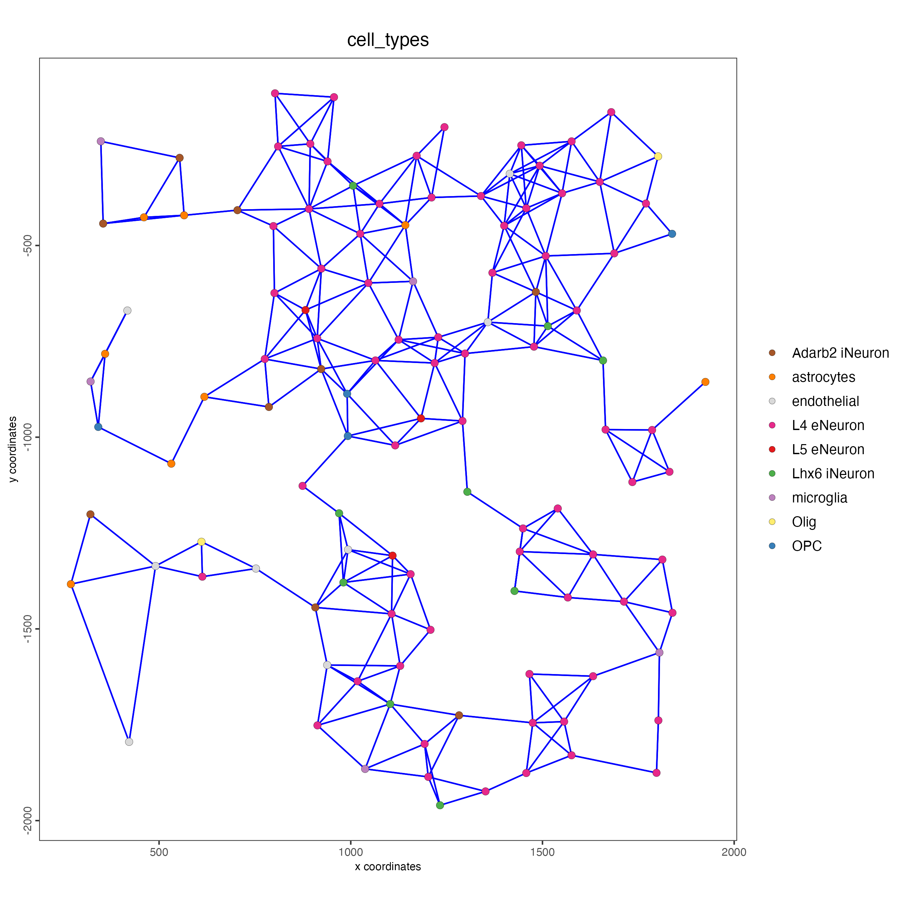

# Spatial Genes

## Individual spatial genes


```{r, eval=FALSE}
## identify spatial genes
km_spatialfeats <- binSpect(SS_seqfish)

spatFeatPlot2D(SS_seqfish,
               expression_values = "scaled", 
               feats = km_spatialfeats[1:4]$feats,
               point_shape = "border", 
               point_border_stroke = 0.1,
               show_network = FALSE, 
               network_color = "lightgrey", 
               point_size = 2.5,
               cow_n_col = 2
)
```

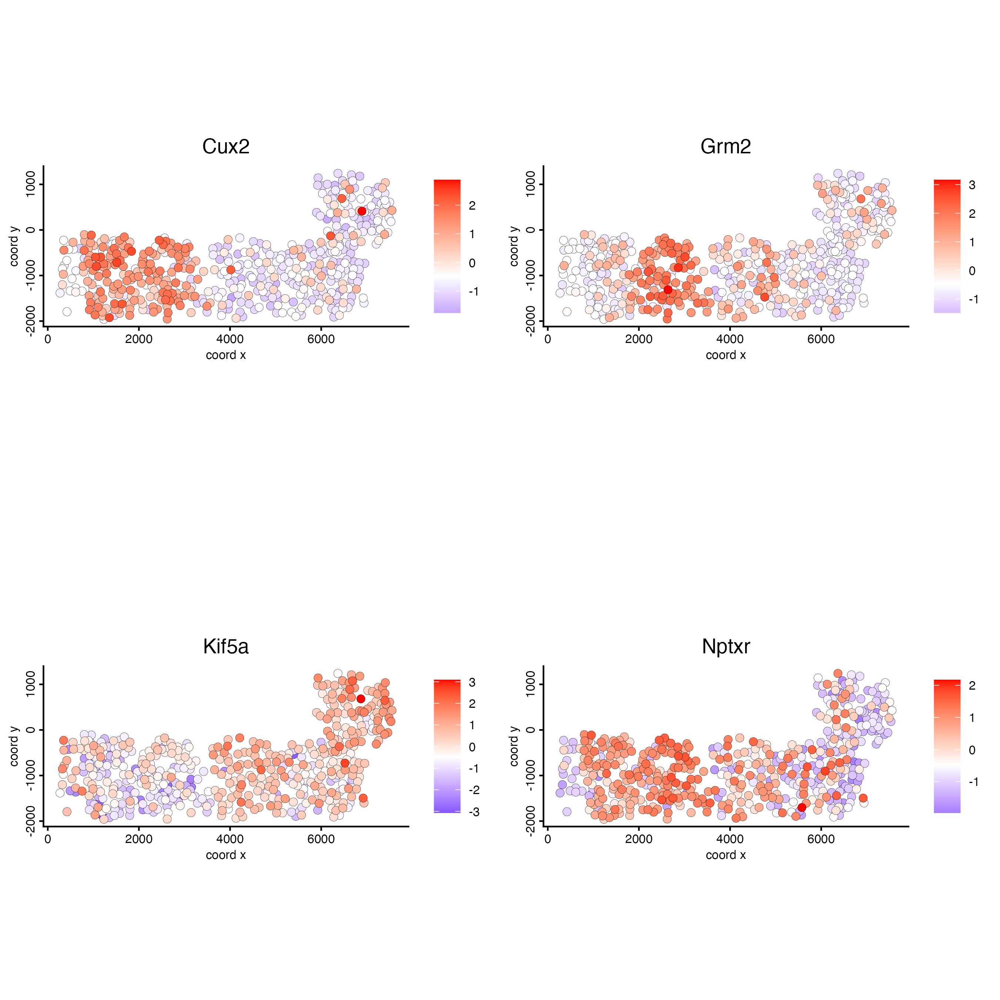

## Spatial Genes Co-Expression Modules

Identify spatial co-expression modules: groups of spatial genes whose expression is correlated across neighbouring cells in the spatial network. See the [spatial co-expression modules](spatial_coexpression_modules.html) tutorial for details.

```{r, eval=FALSE}
ext_spatial_genes <- km_spatialfeats[1:500]$feats

coexpr <- spatialCoexpression(SS_seqfish,
                              feats = ext_spatial_genes,
                              spatial_network_name = "Delaunay_network",
                              n_modules = 8,
                              return_gobject = FALSE)
coexpr$summary

heatmapCoexpression(SS_seqfish, coexpr)
```

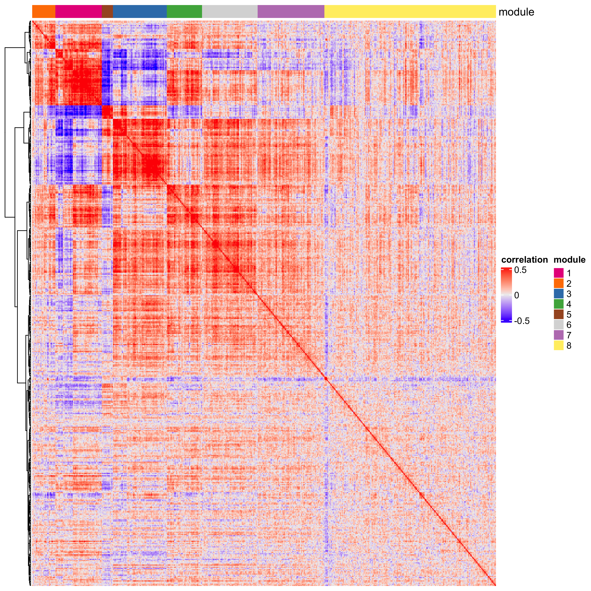

Store the modules in the giotto object: each gene's module is added to the feature metadata and a score per module and cell as the spatial enrichment "spatial_module".

```{r, eval=FALSE}
SS_seqfish <- spatialCoexpression(SS_seqfish,
                                  feats = ext_spatial_genes,
                                  spatial_network_name = "Delaunay_network",
                                  n_modules = 8)

spatCellPlot(SS_seqfish,
             spat_enr_names = "spatial_module",
             cell_annotation_values = as.character(coexpr$summary$module),
             point_size = 1.5, 
             cow_n_col = 3
)
```

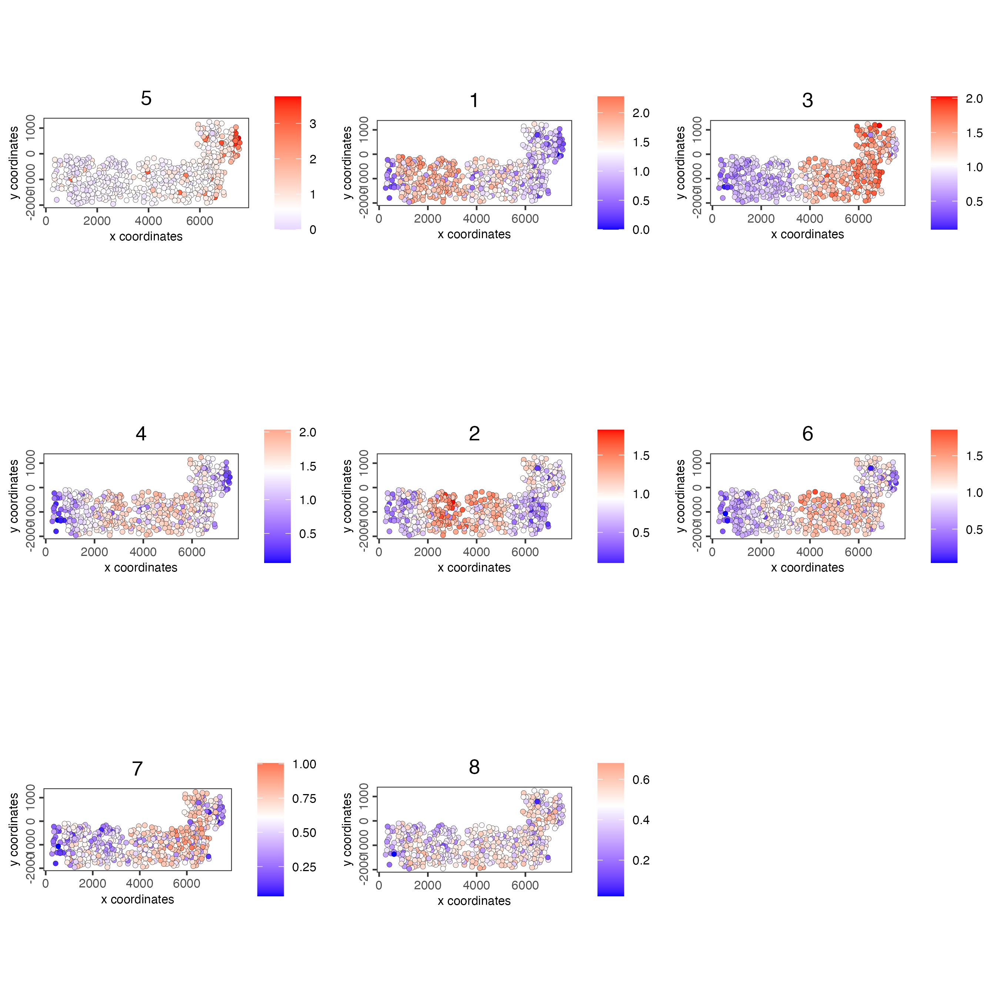

# HMRF Spatial Domains

Find spatial domains with a hidden Markov random field (HMRF). HMRF works best on a few spatially informed values per cell, here the co-expression module scores from above. `runHMRF()` fits several `betas` (the strength of the spatial smoothing) in one call; `hmrfSummary()` compares them: a higher `beta` gives more coherent domains, until small domains disappear. See the [spatial domains](spatial_domains.html) tutorial for details.

```{r, eval=FALSE}
SS_seqfish <- runHMRF(SS_seqfish,
                      spat_enr_name = "spatial_module",
                      spatial_network_name = "Delaunay_network",
                      k = 9,
                      betas = c(0, 2, 5, 10))
hmrfSummary(SS_seqfish)

## visualize the domains for beta = 5
spatPlot(
    gobject = SS_seqfish,
    cell_color = "hmrf_k9_b5",
    point_size = 3,
    coord_fix_ratio = 1
)
```

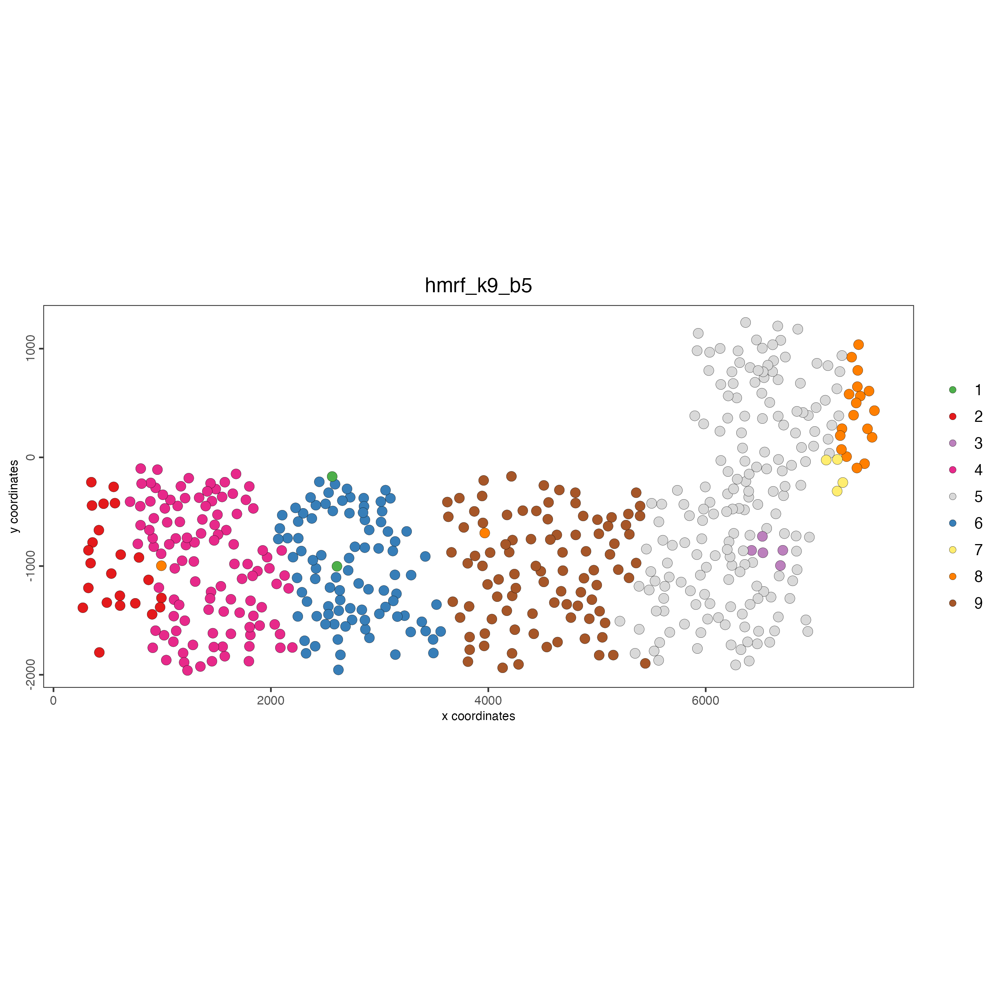

# Cell Neighborhood: Cell-Type/Cell-Type Interactions

`cellProximityMotifs()` counts how often two cell types are neighbors in the
spatial network, against the counts expected when the labels are shuffled.
Pairs of neighbors (`size = 2`) give the proximity enrichment; see the
[Atera breast cancer tutorial](atera_human_breast_cancer.html) for larger
motifs.

```{r, eval=FALSE}
cell_proximities <- cellProximityMotifs(SS_seqfish,
                                        spatial_network_name = "Delaunay_network",
                                        cluster_column = "cell_types",
                                        size = 2L,
                                        n_perm = 1000L
)

head(cell_proximities[order(-z), .(motif_id, observed, expected, fold, p_adj)], 10)

plotMotifEnrichment(SS_seqfish, cell_proximities)
```

Neurons of the same layer are enriched next to each other, as are L5
eNeurons and Lhx6 iNeurons.

```{r, eval=FALSE}
## visualization of specific cell types
# Option 1
spec_interaction <- "astrocytes--Olig"

cellProximitySpatPlot2D(gobject = SS_seqfish,
                        interaction_name = spec_interaction,
                        show_network = TRUE,
                        cluster_column = "cell_types",
                        cell_color = "cell_types",
                        cell_color_code = c(astrocytes = "lightblue", Olig = "red"),
                        point_size_select = 4, 
                        point_size_other = 2
)
```

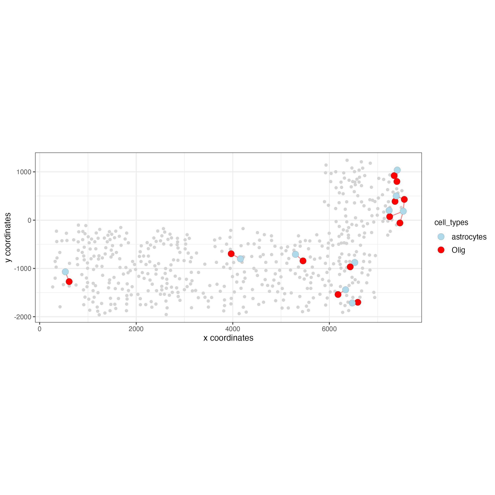

```{r, eval=FALSE}
# Option 2: create additional metadata
SS_seqfish <- addCellIntMetadata(SS_seqfish,
                                 spatial_network = "spatial_network",
                                 cluster_column = "cell_types",
                                 cell_interaction = spec_interaction,
                                 name = "astro_olig_ints"
)

spatPlot(SS_seqfish,
         cell_color = "astro_olig_ints",
         select_cell_groups = c("other_astrocytes", "other_Olig", "select_astrocytes", "select_Olig"),
         legend_symbol_size = 3
)
```

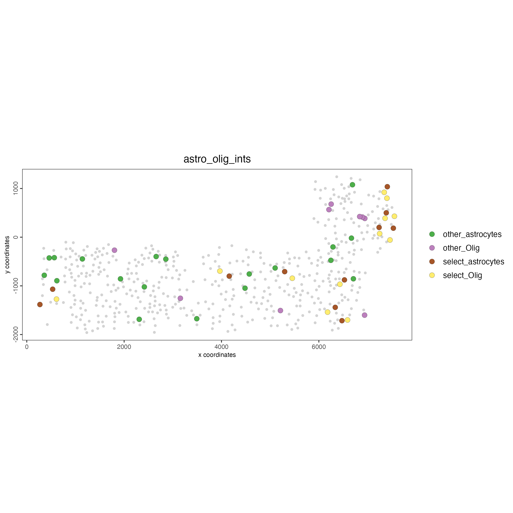

# Cell Neighborhood: Interaction Changed Features

`findInteractionChangedFeats()` finds genes whose expression in one cell type
changes with its exposure to another (edgeICG), at three scales: direct
contact, the paracrine range and the wider niche. See
[interaction changed features](interaction_changed_features.html) for the
method and its plots.

```{r, eval=FALSE}
icf <- findInteractionChangedFeats(SS_seqfish,
                                   cluster_column = "cell_types")
icf$edgeicg
```

```
EdgeICG: 523 cells, 10 types, 10000 genes, 18 pairs
  hits: q < 0.05 and |log2 FC| >= 0.25 (q < 0.05 alone)
  contact   0 (0)
  paracrine 0 (0)
  niche     1 (1), screen
```

Only 18 receiver and sender pairs have enough cells to test. One gene changes:
Casp2 is lower in L6 eNeurons with more L5 eNeurons in their niche.

```{r, eval=FALSE}
icf$ICFscores[p.adj < 0.05, .(feats, cell_type, int_cell_type, scale, log2fc, p.adj)]

plotICFOverview(SS_seqfish, icf, scale = "niche")

plotICFPair(SS_seqfish, icf,
            receiver = "L6 eNeuron",
            sender = "L5 eNeuron",
            scale = "niche")
```

# Cell Neighborhood: Ligand-Receptor Cell-Cell Communication

```{r, eval=FALSE}
## LR expression
## LR activity changes
LR_data <- data.table::fread(system.file("extdata", "mouse_ligand_receptors.txt", package = "GiottoData"))

LR_data[, ligand_det := ifelse(LR_data$mouseLigand %in% SS_seqfish@feat_ID$rna, TRUE, FALSE)]

LR_data[, receptor_det := ifelse(LR_data$mouseReceptor %in% SS_seqfish@feat_ID$rna, TRUE, FALSE)]

LR_data_det <- LR_data[ligand_det == TRUE & receptor_det == TRUE]

select_ligands <- LR_data_det$mouseLigand

select_receptors <- LR_data_det$mouseReceptor

## get statistical significance of gene pair expression changes based on expression
expr_only_scores <- exprCellCellcom(gobject = SS_seqfish,
                                    cluster_column = "cell_types",
                                    random_iter = 1000,
                                    feat_set_1 = select_ligands,
                                    feat_set_2 = select_receptors,
                                    verbose = FALSE
)

## get statistical significance of gene pair expression changes upon cell-cell interaction
spatial_all_scores <- spatCellCellcom(SS_seqfish,
                                      spatial_network_name = "spatial_network",
                                      cluster_column = "cell_types",
                                      random_iter = 1000,
                                      feat_set_1 = select_ligands,
                                      feat_set_2 = select_receptors,
                                      adjust_method = "fdr",
                                      do_parallel = TRUE,
                                      cores = 4,
                                      verbose = "a little"
)

## select top LR ##
selected_spat <- spatial_all_scores[p.adj <= 0.01 & abs(log2fc) > 0.25 & lig_nr >= 4 & rec_nr >= 4]

data.table::setorder(selected_spat, -PI)

top_LR_ints <- unique(selected_spat[order(-abs(PI))]$LR_comb)[1:33]

top_LR_cell_ints <- unique(selected_spat[order(-abs(PI))]$LR_cell_comb)[1:33]

plotCCcomDotplot(gobject = SS_seqfish,
                 comScores = spatial_all_scores,
                 selected_LR = top_LR_ints,
                 selected_cell_LR = top_LR_cell_ints,
                 cluster_on = "PI"
)
```

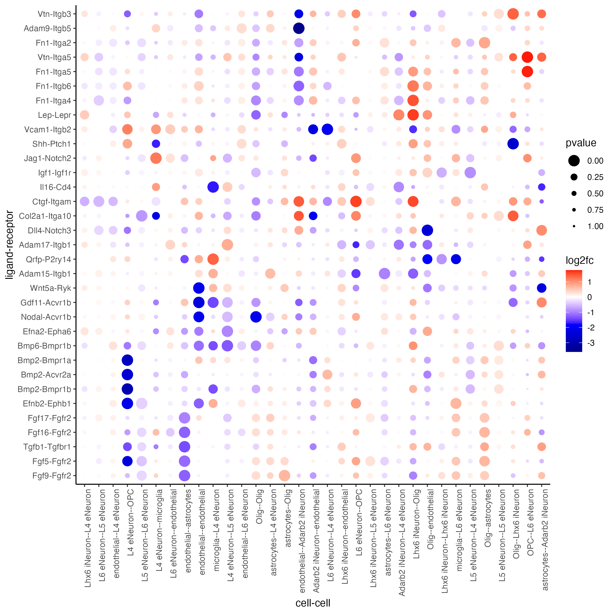

```{r, eval=FALSE}
## spatial vs rank ####
comb_comm <- combCCcom(
    spatialCC = spatial_all_scores,
    exprCC = expr_only_scores
)

## highest levels of ligand and receptor prediction
## top differential activity levels for ligand receptor pairs
plotRankSpatvsExpr(gobject = SS_seqfish,
                   comb_comm,
                   expr_rnk_column = "LR_expr_rnk",
                   spat_rnk_column = "LR_spat_rnk",
                   gradient_midpoint = 10
)
```

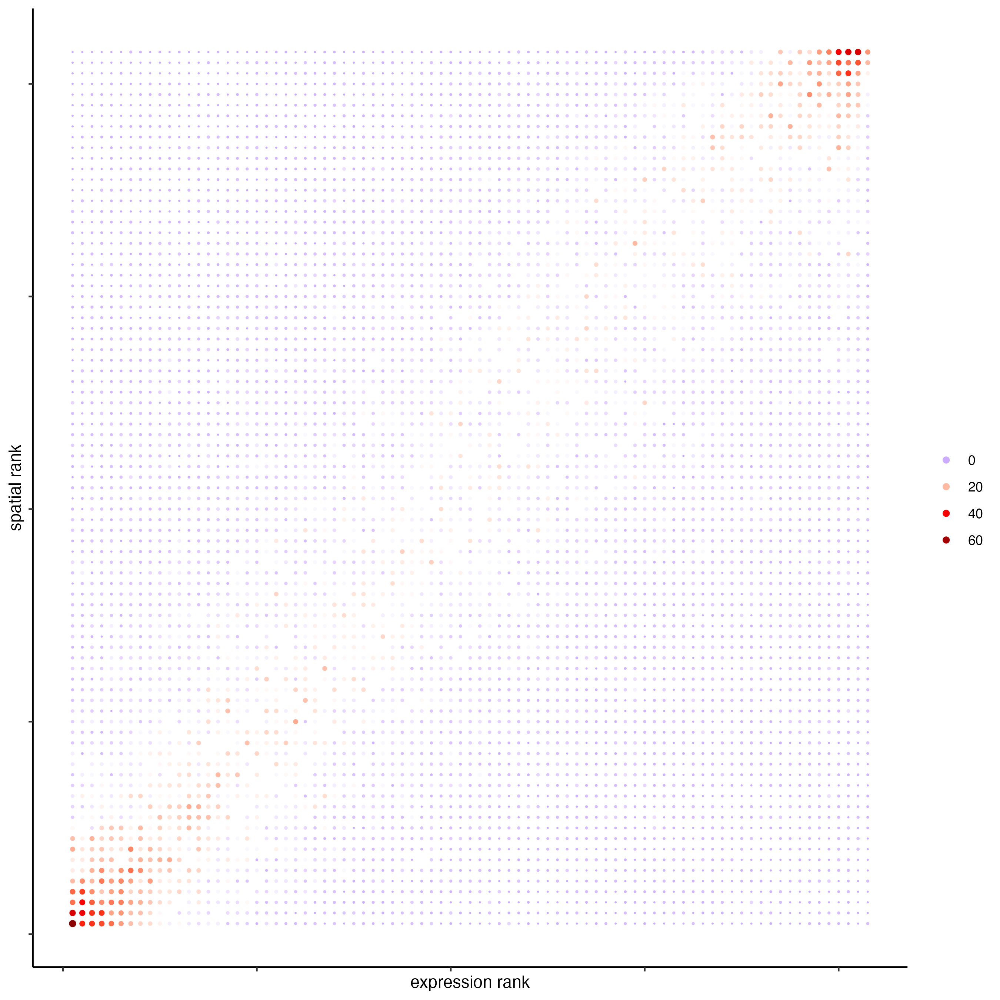

```{r, eval=FALSE}
## recovery
plotRecovery(gobject = SS_seqfish,
             comb_comm,
             expr_rnk_column = "LR_expr_rnk",
             spat_rnk_column = "LR_spat_rnk",
             ground_truth = "spatial"
)
```

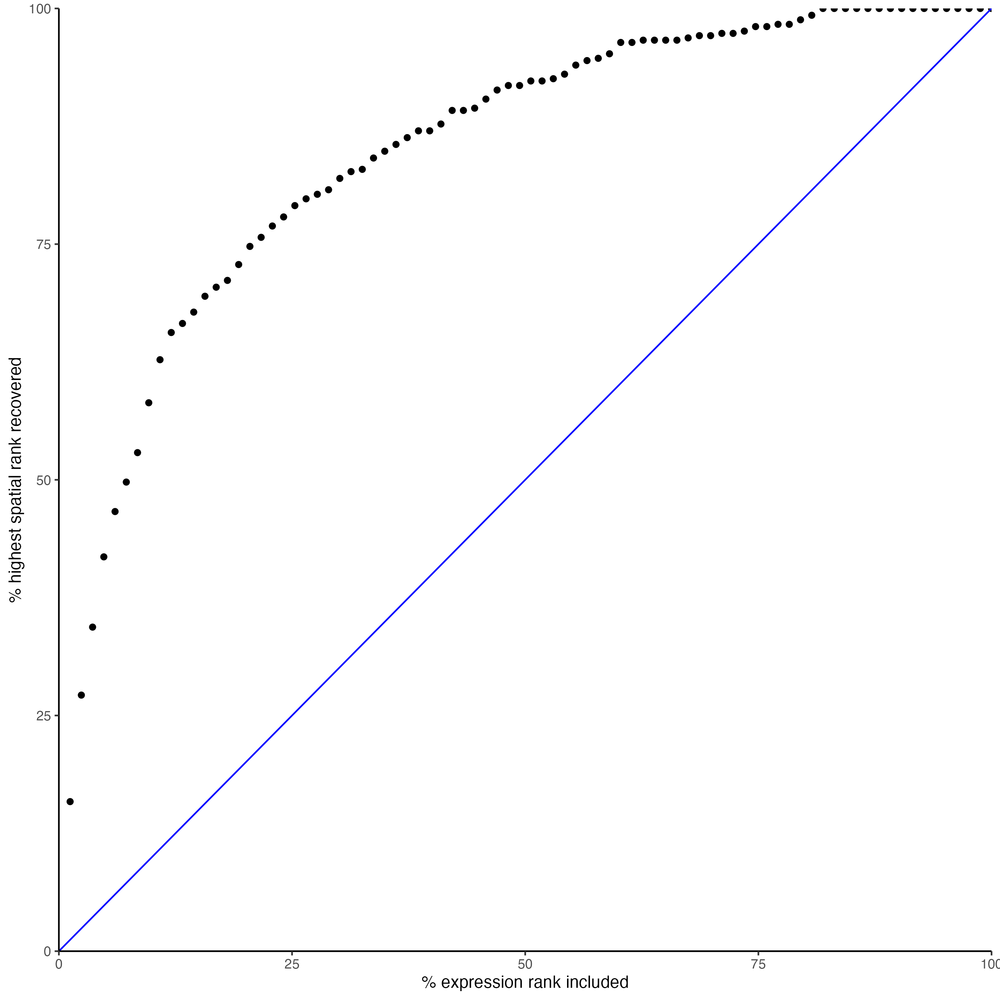

# Session info

```{r, eval=FALSE}
sessionInfo()
```

```{r, eval=FALSE}
R version 4.4.1 (2024-06-14)
Platform: x86_64-apple-darwin20
Running under: macOS Sonoma 14.6.1

Matrix products: default
BLAS:   /System/Library/Frameworks/Accelerate.framework/Versions/A/Frameworks/vecLib.framework/Versions/A/libBLAS.dylib 
LAPACK: /Library/Frameworks/R.framework/Versions/4.4-x86_64/Resources/lib/libRlapack.dylib;  LAPACK version 3.12.0

locale:
[1] en_US.UTF-8/en_US.UTF-8/en_US.UTF-8/C/en_US.UTF-8/en_US.UTF-8

time zone: America/New_York
tzcode source: internal

attached base packages:
[1] stats     graphics  grDevices utils     datasets  methods   base     

other attached packages:
[1] future_1.34.0     ggdendro_0.2.0    Giotto_4.1.3      GiottoClass_0.4.0

loaded via a namespace (and not attached):
  [1] RColorBrewer_1.1-3          rstudioapi_0.16.0          
  [3] jsonlite_1.8.8              shape_1.4.6.1              
  [5] magrittr_2.0.3              magick_2.8.4               
  [7] farver_2.1.2                rmarkdown_2.28             
  [9] GlobalOptions_0.1.2         zlibbioc_1.50.0            
 [11] ragg_1.3.2                  vctrs_0.6.5                
 [13] memoise_2.0.1               Cairo_1.6-2                
 [15] GiottoUtils_0.1.12          terra_1.7-78               
 [17] htmltools_0.5.8.1           S4Arrays_1.4.1             
 [19] SparseArray_1.4.8           parallelly_1.38.0          
 [21] htmlwidgets_1.6.4           cachem_1.1.0               
 [23] plotly_4.10.4               igraph_2.0.3               
 [25] lifecycle_1.0.4             iterators_1.0.14           
 [27] pkgconfig_2.0.3             rsvd_1.0.5                 
 [29] Matrix_1.7-0                R6_2.5.1                   
 [31] fastmap_1.2.0               GenomeInfoDbData_1.2.12    
 [33] MatrixGenerics_1.16.0       clue_0.3-65                
 [35] digest_0.6.37               colorspace_2.1-1           
 [37] S4Vectors_0.42.1            irlba_2.3.5.1              
 [39] textshaping_0.4.0           GenomicRanges_1.56.1       
 [41] beachmat_2.20.0             labeling_0.4.3             
 [43] progressr_0.14.0            fansi_1.0.6                
 [45] polyclip_1.10-7             httr_1.4.7                 
 [47] abind_1.4-5                 compiler_4.4.1             
 [49] withr_3.0.1                 doParallel_1.0.17          
 [51] backports_1.5.0             BiocParallel_1.38.0        
 [53] viridis_0.6.5               ggforce_0.4.2              
 [55] R.utils_2.12.3              MASS_7.3-60.2              
 [57] DelayedArray_0.30.1         rjson_0.2.22               
 [59] gtools_3.9.5                GiottoVisuals_0.2.5        
 [61] tools_4.4.1                 future.apply_1.11.2        
 [63] R.oo_1.26.0                 glue_1.7.0                 
 [65] dbscan_1.2-0                grid_4.4.1                 
 [67] checkmate_2.3.2             Rtsne_0.17                 
 [69] cluster_2.1.6               generics_0.1.3             
 [71] gtable_0.3.5                R.methodsS3_1.8.2          
 [73] tidyr_1.3.1                 data.table_1.16.0          
 [75] tidygraph_1.3.1             BiocSingular_1.20.0        
 [77] ScaledMatrix_1.12.0         sp_2.1-4                   
 [79] utf8_1.2.4                  XVector_0.44.0             
 [81] BiocGenerics_0.50.0         ggrepel_0.9.6              
 [83] foreach_1.5.2               pillar_1.9.0               
 [85] limma_3.60.4                circlize_0.4.16            
 [87] tweenr_2.0.3                dplyr_1.1.4                
 [89] lattice_0.22-6              FNN_1.1.4                  
 [91] deldir_2.0-4                tidyselect_1.2.1           
 [93] ComplexHeatmap_2.20.0       SingleCellExperiment_1.26.0
 [95] knitr_1.48                  gridExtra_2.3              
 [97] IRanges_2.38.1              SummarizedExperiment_1.34.0
 [99] scattermore_1.2             stats4_4.4.1               
[101] xfun_0.47                   graphlayouts_1.1.1         
[103] Biobase_2.64.0              statmod_1.5.0              
[105] matrixStats_1.4.1           UCSC.utils_1.0.0           
[107] lazyeval_0.2.2              yaml_2.3.10                
[109] evaluate_0.24.0             codetools_0.2-20           
[111] ggraph_2.2.1                GiottoData_0.2.13          
[113] tibble_3.2.1                colorRamp2_0.1.0           
[115] cli_3.6.3                   uwot_0.2.2                 
[117] reticulate_1.39.0           systemfonts_1.1.0          
[119] munsell_0.5.1               Rcpp_1.0.13                
[121] GenomeInfoDb_1.40.1         globals_0.16.3             
[123] png_0.1-8                   parallel_4.4.1             
[125] ggplot2_3.5.1               listenv_0.9.1              
[127] SpatialExperiment_1.14.0    viridisLite_0.4.2          
[129] scales_1.3.0                purrr_1.0.2                
[131] crayon_1.5.3                GetoptLong_1.0.5           
[133] rlang_1.1.4                 cowplot_1.1.3 
```


