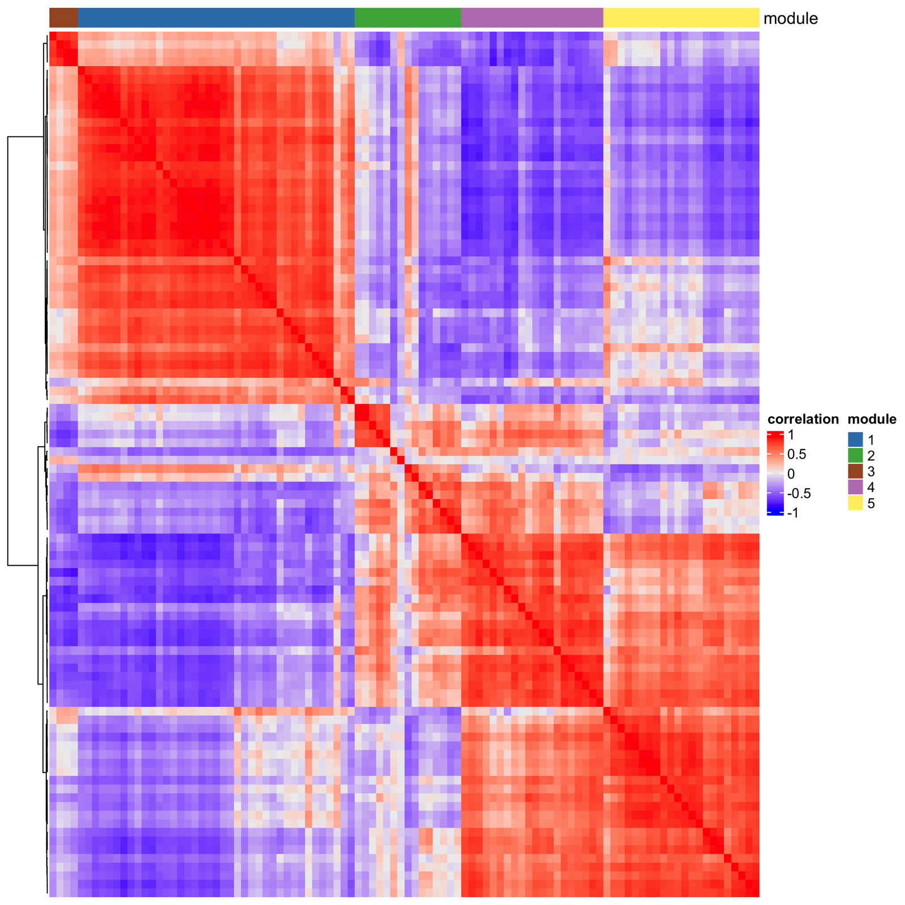
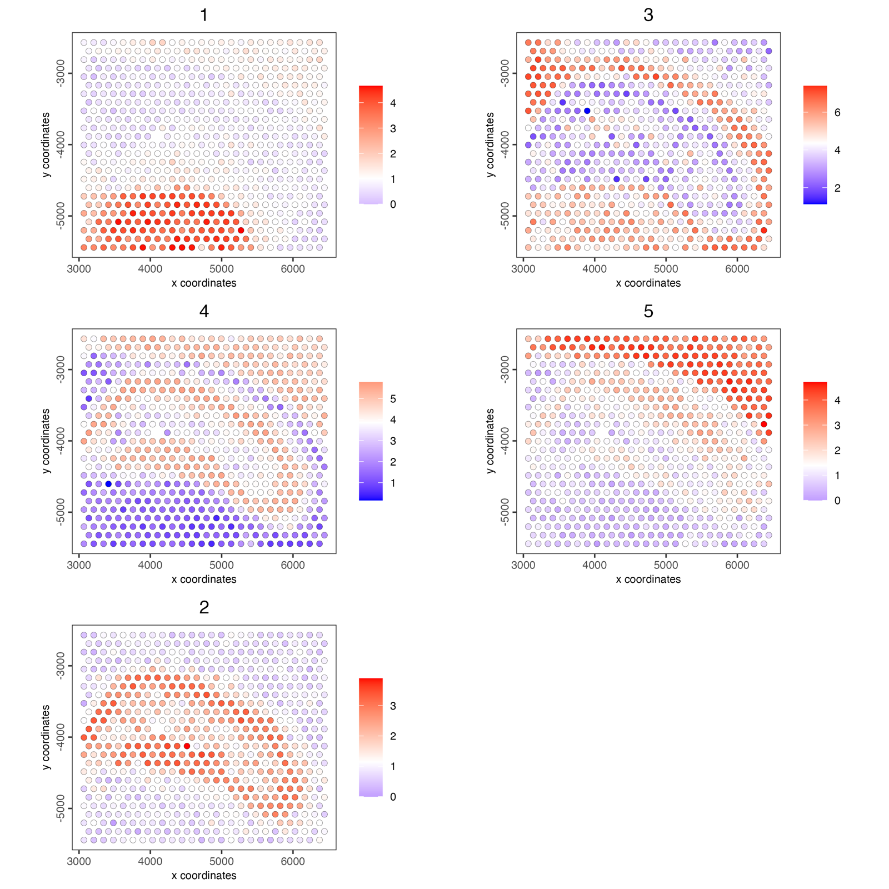

```{r setup, include=FALSE}
knitr::opts_chunk$set(eval = FALSE, fig.align = "center")
```

Spatially variable genes often share a pattern: genes of one cell type or
tissue region rise and fall together across the section. A *spatial
co-expression module* is such a group. `spatialCoexpression()` finds them
in one step:

1. each cell's expression is averaged with its neighbours' in a spatial
   network, which keeps the spatial pattern and smooths out cell-to-cell noise;
2. the genes are correlated on the smoothed values;
3. the correlation is clustered into modules;
4. each module gets one score per cell, the mean expression of its genes.

The same command runs on disk-backed (GiottoDisk) objects; see
[Detection of spatially variable genes](spatial_genes.html).

# Setup and load example dataset

```{r install}
# Ensure Giotto Suite is installed
if (!"Giotto" %in% installed.packages()) {
  pak::pkg_install("giotto-suite/Giotto")
}
# Ensure Giotto Data is installed
if (!"GiottoData" %in% installed.packages()) {
  pak::pkg_install("giotto-suite/GiottoData")
}
library(Giotto)
```

```{r load}
g <- GiottoData::loadGiottoMini("visium")
```

# Select spatially variable genes

Modules are built from genes that are spatial to begin with. Rank the genes
with binSpect's join-count test and keep the top 100 (see
[Detection of spatially variable genes](spatial_genes.html) for the methods):

```{r rank}
ranktest <- spatialAutoCor(g,
  method = "binspect",
  spatial_network_name = "spatial_network",
  return_gobject = FALSE
)
spatial_genes <- ranktest$feats[1:100]
```

# Find the modules

```{r modules}
g <- spatialCoexpression(g,
  feats = spatial_genes,
  spatial_network_name = "spatial_network",
  n_modules = 5
)
```

Each gene's module is now in the feature metadata, with `spatial_module_cor`,
its mean correlation with the rest of its module (how firmly it belongs):

```{r modules-fdata}
modules <- fDataDT(g)[!is.na(spatial_module),
  .(feat_ID, spatial_module, spatial_module_cor)]
head(modules[order(spatial_module, -spatial_module_cor)], 8)
```

```
##    feat_ID spatial_module spatial_module_cor
##     <char>          <int>              <num>
## 1:   Shox2              1          0.8094911
## 2:   Rgs16              1          0.8081125
## 3:    Lef1              1          0.8029107
## 4:  Synpo2              1          0.7969906
## 5: Slc17a6              1          0.7967425
## 6:   Ntng1              1          0.7924487
## 7:    Grm4              1          0.7892326
## 8:  Amotl1              1          0.7878026
```

`smoothing` sets how much a cell's neighbours count (by default about as much
as the cell itself), and `smoothing = 0` correlates the unsmoothed values.

# Inspect the modules

With `return_gobject = FALSE` the command returns the correlation matrix, the
modules and a summary per module instead:

```{r modules-list}
coexpr <- spatialCoexpression(g,
  feats = spatial_genes,
  spatial_network_name = "spatial_network",
  n_modules = 5,
  return_gobject = FALSE
)
coexpr$summary
```

```
##    module  size within_cor between_cor     score
##     <int> <int>      <num>       <num>     <num>
## 1:      1    39  0.7149600 -0.31448533 0.7149600
## 2:      3     4  0.8421133 -0.12399741 0.6817009
## 3:      4    20  0.7310168 -0.08401100 0.5625362
## 4:      5    22  0.7196101 -0.05392370 0.5321073
## 5:      2    15  0.3621740 -0.09061745 0.2810949
```

`within_cor` is the mean correlation between a module's genes and
`between_cor` their mean correlation with the other modules; `score` ranks
the coherent, distinct modules first.

```{r heatmap}
heatmapCoexpression(g, coexpr)
```

```{r, echo=FALSE, eval=TRUE, out.width="80%"}

```

# Module scores in the tissue

The module scores are stored as the spatial enrichment `spatial_module`:

```{r module-scores}
spatCellPlot(g,
  spat_enr_names = "spatial_module",
  cell_annotation_values = as.character(coexpr$summary$module),
  point_size = 2,
  cow_n_col = 2
)
```

```{r, echo=FALSE, eval=TRUE, out.width="100%"}

```

# Top genes per module

For downstream analyses such as
[spatially informed clusters](spatial_informed_clusters.html) or
[spatial domains with HMRF](hmrf.html), take the genes that belong most
firmly to each module. In a full-size dataset, about 30 genes per module is
a common choice.

```{r top-genes}
top_genes <- fDataDT(g)[!is.na(spatial_module)][
  order(-spatial_module_cor), head(.SD, 10), by = spatial_module]
spatial_genes <- top_genes$feat_ID
```

# Session Info

```{r session-info}
sessionInfo()
```

```
## R version 4.5.3 (2026-03-11)
## Platform: aarch64-apple-darwin20
## Running under: macOS Tahoe 26.6.2
##
## Matrix products: default
## BLAS:   /Library/Frameworks/R.framework/Versions/4.5-arm64/Resources/lib/libRblas.0.dylib
## LAPACK: /Library/Frameworks/R.framework/Versions/4.5-arm64/Resources/lib/libRlapack.dylib;  LAPACK version 3.12.1
##
## locale:
## [1] C.UTF-8/C.UTF-8/C.UTF-8/C/C.UTF-8/C.UTF-8
##
## time zone: America/New_York
## tzcode source: internal
##
## attached base packages:
## [1] stats     graphics  grDevices utils     datasets  methods   base
##
## other attached packages:
## [1] Giotto_4.3.4       GiottoClass_0.7.16
##
## loaded via a namespace (and not attached):
##   [1] colorRamp2_0.1.0            gridExtra_2.3               rlang_1.3.0
##   [4] magrittr_2.0.4              clue_0.3-68                 GetoptLong_1.1.1
##   [7] GiottoUtils_0.2.8           matrixStats_1.5.0           compiler_4.5.3
##  [10] systemfonts_1.3.2           png_0.1-9                   vctrs_0.7.2
##  [13] shape_1.4.6.1               crayon_1.5.3                pkgconfig_2.0.3
##  [16] SpatialExperiment_1.20.0    fastmap_1.2.0               backports_1.5.0
##  [19] magick_2.9.1                XVector_0.50.0              labeling_0.4.3
##  [22] ggraph_2.2.2                ragg_1.5.2                  purrr_1.2.1
##  [25] bluster_1.20.0              cachem_1.1.0                beachmat_2.26.0
##  [28] jsonlite_2.0.0              DelayedArray_0.36.0         BiocParallel_1.44.0
##  [31] tweenr_2.0.3                terra_1.9-11                irlba_2.3.7
##  [34] parallel_4.5.3              cluster_2.1.8.2             R6_2.6.1
##  [37] RColorBrewer_1.1-3          GenomicRanges_1.62.1        scattermore_1.2
##  [40] Rcpp_1.1.1                  Seqinfo_1.0.0               SummarizedExperiment_1.40.0
##  [43] iterators_1.0.14            IRanges_2.44.0              Matrix_1.7-5
##  [46] igraph_2.2.2                tidyselect_1.2.1            dichromat_2.0-0.1
##  [49] abind_1.4-8                 viridis_0.6.5               doParallel_1.0.17
##  [52] codetools_0.2-20            lattice_0.22-9              tibble_3.3.1
##  [55] Biobase_2.70.0              withr_3.0.2                 S7_0.2.1
##  [58] polyclip_1.10-7             circlize_0.4.18             pillar_1.11.1
##  [61] MatrixGenerics_1.22.0       checkmate_2.3.4             foreach_1.5.2
##  [64] stats4_4.5.3                plotly_4.12.0               generics_0.1.4
##  [67] GiottoDisk_0.0.0.5          S4Vectors_0.48.0            ggplot2_4.0.2
##  [70] scales_1.4.0                GiottoData_0.3.8            gtools_3.9.5
##  [73] glue_1.8.0                  lazyeval_0.2.2              tools_4.5.3
##  [76] GiottoVisuals_0.2.16        tilework_1.0.0              BiocNeighbors_2.4.0
##  [79] data.table_1.18.2.1         ScaledMatrix_1.18.0         graphlayouts_1.2.3
##  [82] tidygraph_1.3.1             cowplot_1.2.0               grid_4.5.3
##  [85] tidyr_1.3.2                 colorspace_2.1-2            SingleCellExperiment_1.32.0
##  [88] BiocSingular_1.26.1         ggforce_0.5.0               cli_3.6.5
##  [91] rsvd_1.0.5                  textshaping_1.0.5           S4Arrays_1.10.1
##  [94] viridisLite_0.4.3           ComplexHeatmap_2.26.1       dplyr_1.2.0
##  [97] gtable_0.3.6                digest_0.6.39               BiocGenerics_0.56.0
## [100] SparseArray_1.10.9          ggrepel_0.9.8               rjson_0.2.23
## [103] htmlwidgets_1.6.4           farver_2.1.2                memoise_2.0.1
## [106] htmltools_0.5.9             lifecycle_1.0.5             httr_1.4.8
## [109] GlobalOptions_0.1.4         MASS_7.3-65
```
