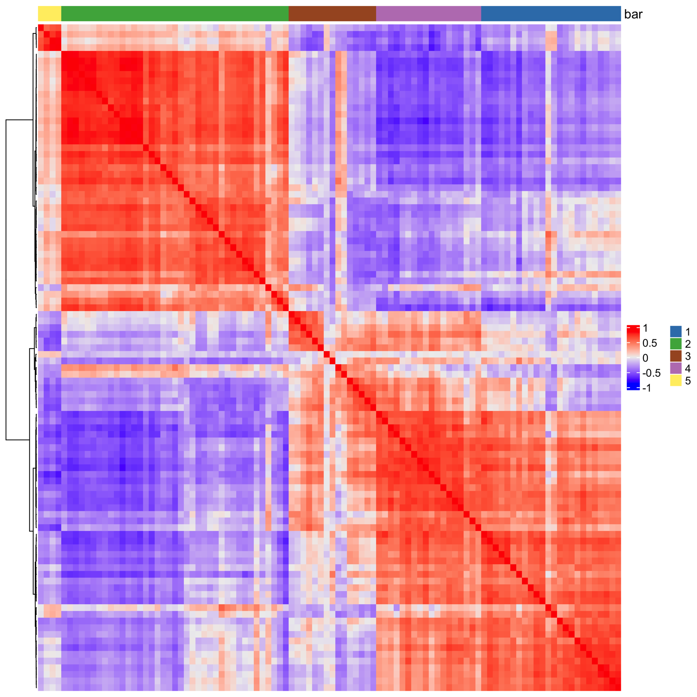
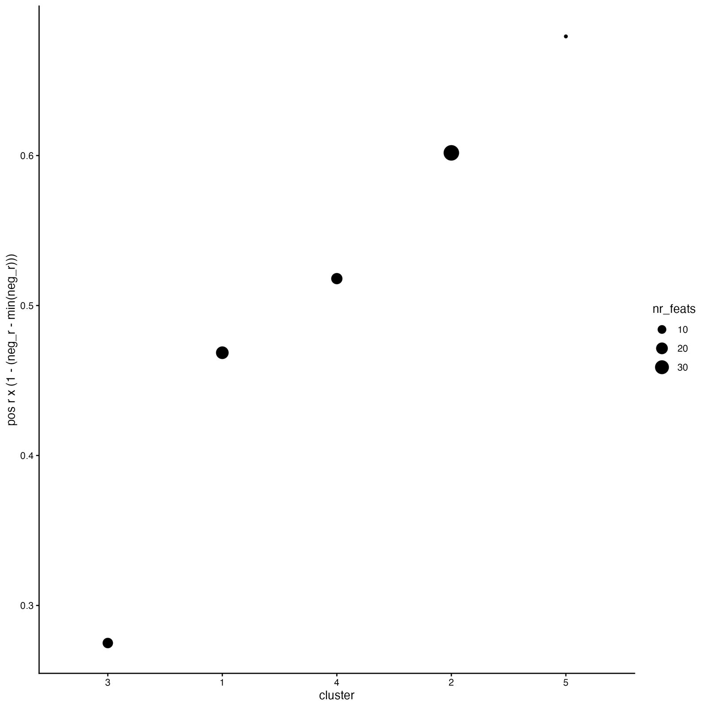
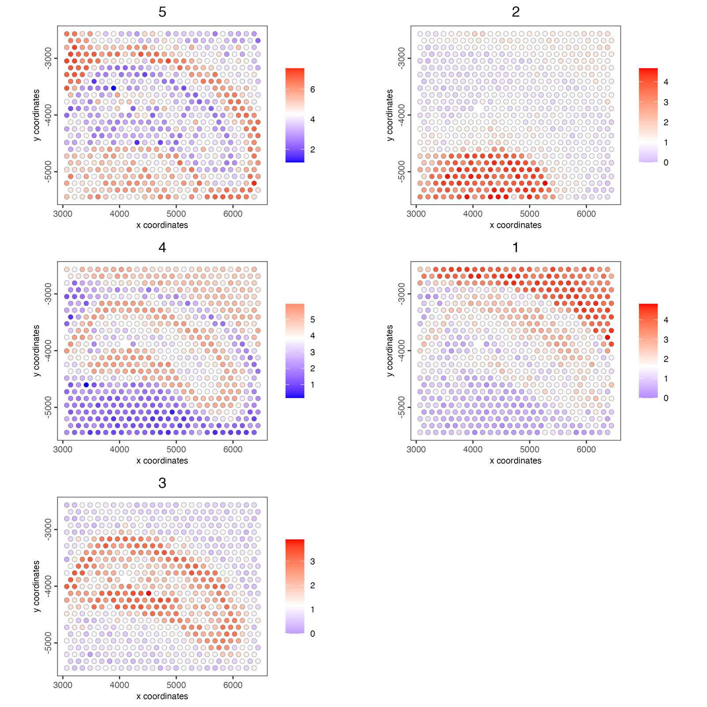

Once you have found Finding genes or features that follow spatial patterns in their expression, you can group them to find clusters with similar expression patterns that create co-expression modules.

# Setup and load example dataset

```{r, eval=FALSE}
# Ensure Giotto Suite is installed
if(!"Giotto" %in% installed.packages()) {
  pak::pkg_install("giotto-suite/Giotto")
}

# Ensure Giotto Data is installed
if(!"GiottoData" %in% installed.packages()) {
  pak::pkg_install("giotto-suite/GiottoData")
}

library(Giotto)

# Ensure the Python environment for Giotto has been installed
genv_exists <- checkGiottoEnvironment()

if(!genv_exists){
  # The following command need only be run once to install the Giotto environment
  installGiottoEnvironment()
}
```

```{r, eval=FALSE}
# load the object
g <- GiottoData::loadGiottoMini("visium")
```

# Select the top spatial genes

Rank the genes by how spatially coherent their expression is, here with
binSpect's join-count test, and keep the top 100. See
[Detection of spatially variable genes](spatial_genes.html) for the methods
and their options.

```{r, eval=FALSE}
ranktest <- spatialAutoCor(g,
    method = "binspect",
    spatial_network_name = "spatial_network",
    return_gobject = FALSE
)
ext_spatial_genes <- ranktest[1:100, ]$feats
```

# Calculate pairwise distances between genes.

```{r, eval=FALSE}
spat_cor_netw_DT <- detectSpatialCorFeats(
    g,
    method = "network",
    spatial_network_name = "spatial_network",
    subset_feats = ext_spatial_genes)
```

# Cluster the top spatial genes into 5 clusters

```{r, eval=FALSE}
spat_cor_netw_DT <- clusterSpatialCorFeats(spat_cor_netw_DT, 
                                           name = "spat_netw_clus", 
                                           k = 5)
```

# Plot the correlation of the top spatial genes with their assigned cluster.

```{r, eval=FALSE}
heatmSpatialCorFeats(g,
                     spatCorObject = spat_cor_netw_DT,
                     use_clus_name = "spat_netw_clus",
                     heatmap_legend_param = list(title = NULL))
```

```{r, echo=FALSE, out.width="80%", fig.align='center'}

```

## Rank spatial correlated clusters and show genes for selected clusters

```{r, eval=FALSE}
netw_ranks <- rankSpatialCorGroups(g,
                                   spatCorObject = spat_cor_netw_DT, 
                                   use_clus_name = "spat_netw_clus")
```

```{r, echo=FALSE, out.width="70%", fig.align='center'}

```

## Create the metagene enrichment score per co-expression cluster

```{r, eval=FALSE}
cluster_genes_DT <- showSpatialCorFeats(spat_cor_netw_DT, 
                                        use_clus_name = "spat_netw_clus", 
                                        show_top_feats = 1)

cluster_genes <- cluster_genes_DT$clus 
names(cluster_genes) <- cluster_genes_DT$feat_ID

g <- createMetafeats(g, 
                     feat_clusters = cluster_genes, 
                     name = "cluster_metagene")
```

Plot the spatial distribution of the metagene enrichment scores of each spatial co-expression cluster.

```{r, eval=FALSE}
spatCellPlot(g,
             spat_enr_names = "cluster_metagene",
             cell_annotation_values = netw_ranks$clusters,
             point_size = 2, 
             cow_n_col = 2)
```

```{r, echo=FALSE, out.width="100%", fig.align='center'}

```

# Get the top genes per spatial co-expression module

Run this code for downstream analysis, such as calculation of spatially informed clusters or calculation of spatial domains with HMRF. 

In a real-size dataset, usually you want to extract the top ~30 genes per co-expression module, but this number is variable depending on the number of features available in your dataset.

```{r, eval=FALSE}
coexpr_dt <- data.table::data.table(
  genes = names(spat_cor_netw_DT$cor_clusters$spat_netw_clus),
  cluster = spat_cor_netw_DT$cor_clusters$spat_netw_clus)

data.table::setorder(coexpr_dt, cluster)

top10_coexpr_dt <- coexpr_dt[, head(.SD, 10) , by = cluster]

spatial_genes <- top10_coexpr_dt$genes
```

# Session Info

```{r, eval=FALSE}
sessionInfo()
```

```{r, eval=FALSE}
R version 4.5.3 (2026-03-11)
Platform: aarch64-apple-darwin20
Running under: macOS Tahoe 26.6.2

Matrix products: default
BLAS:   /Library/Frameworks/R.framework/Versions/4.5-arm64/Resources/lib/libRblas.0.dylib 
LAPACK: /Library/Frameworks/R.framework/Versions/4.5-arm64/Resources/lib/libRlapack.dylib;  LAPACK version 3.12.1

locale:
[1] C.UTF-8/C.UTF-8/C.UTF-8/C/C.UTF-8/C.UTF-8

time zone: America/New_York
tzcode source: internal

attached base packages:
[1] stats     graphics  grDevices utils     datasets  methods   base     

other attached packages:
[1] Giotto_4.3.3       GiottoClass_0.7.15

loaded via a namespace (and not attached):
  [1] colorRamp2_0.1.0            gridExtra_2.3               rlang_1.3.0                
  [4] magrittr_2.0.4              clue_0.3-68                 GetoptLong_1.1.1           
  [7] GiottoUtils_0.2.8           matrixStats_1.5.0           compiler_4.5.3             
 [10] systemfonts_1.3.2           png_0.1-9                   vctrs_0.7.2                
 [13] shape_1.4.6.1               crayon_1.5.3                pkgconfig_2.0.3            
 [16] SpatialExperiment_1.20.0    fastmap_1.2.0               backports_1.5.0            
 [19] magick_2.9.1                XVector_0.50.0              labeling_0.4.3             
 [22] ggraph_2.2.2                ragg_1.5.2                  purrr_1.2.1                
 [25] bluster_1.20.0              cachem_1.1.0                beachmat_2.26.0            
 [28] jsonlite_2.0.0              DelayedArray_0.36.0         BiocParallel_1.44.0        
 [31] tweenr_2.0.3                terra_1.9-11                irlba_2.3.7                
 [34] parallel_4.5.3              cluster_2.1.8.2             R6_2.6.1                   
 [37] RColorBrewer_1.1-3          GenomicRanges_1.62.1        scattermore_1.2            
 [40] Rcpp_1.1.1                  Seqinfo_1.0.0               SummarizedExperiment_1.40.0
 [43] iterators_1.0.14            IRanges_2.44.0              Matrix_1.7-5               
 [46] igraph_2.2.2                tidyselect_1.2.1            dichromat_2.0-0.1          
 [49] abind_1.4-8                 viridis_0.6.5               doParallel_1.0.17          
 [52] codetools_0.2-20            lattice_0.22-9              tibble_3.3.1               
 [55] Biobase_2.70.0              withr_3.0.2                 S7_0.2.1                   
 [58] polyclip_1.10-7             circlize_0.4.18             pillar_1.11.1              
 [61] MatrixGenerics_1.22.0       checkmate_2.3.4             foreach_1.5.2              
 [64] stats4_4.5.3                plotly_4.12.0               generics_0.1.4             
 [67] GiottoDisk_0.0.0.5          S4Vectors_0.48.0            ggplot2_4.0.2              
 [70] scales_1.4.0                GiottoData_0.3.8            gtools_3.9.5               
 [73] glue_1.8.0                  lazyeval_0.2.2              tools_4.5.3                
 [76] GiottoVisuals_0.2.16        tilework_1.0.0              BiocNeighbors_2.4.0        
 [79] data.table_1.18.2.1         ScaledMatrix_1.18.0         graphlayouts_1.2.3         
 [82] tidygraph_1.3.1             cowplot_1.2.0               grid_4.5.3                 
 [85] tidyr_1.3.2                 colorspace_2.1-2            SingleCellExperiment_1.32.0
 [88] BiocSingular_1.26.1         ggforce_0.5.0               cli_3.6.5                  
 [91] rsvd_1.0.5                  textshaping_1.0.5           S4Arrays_1.10.1            
 [94] viridisLite_0.4.3           ComplexHeatmap_2.26.1       dplyr_1.2.0                
 [97] gtable_0.3.6                digest_0.6.39               BiocGenerics_0.56.0        
[100] SparseArray_1.10.9          ggrepel_0.9.8               rjson_0.2.23               
[103] htmlwidgets_1.6.4           farver_2.1.2                memoise_2.0.1              
[106] htmltools_0.5.9             lifecycle_1.0.5             httr_1.4.8                 
[109] GlobalOptions_0.1.4         MASS_7.3-65
```
