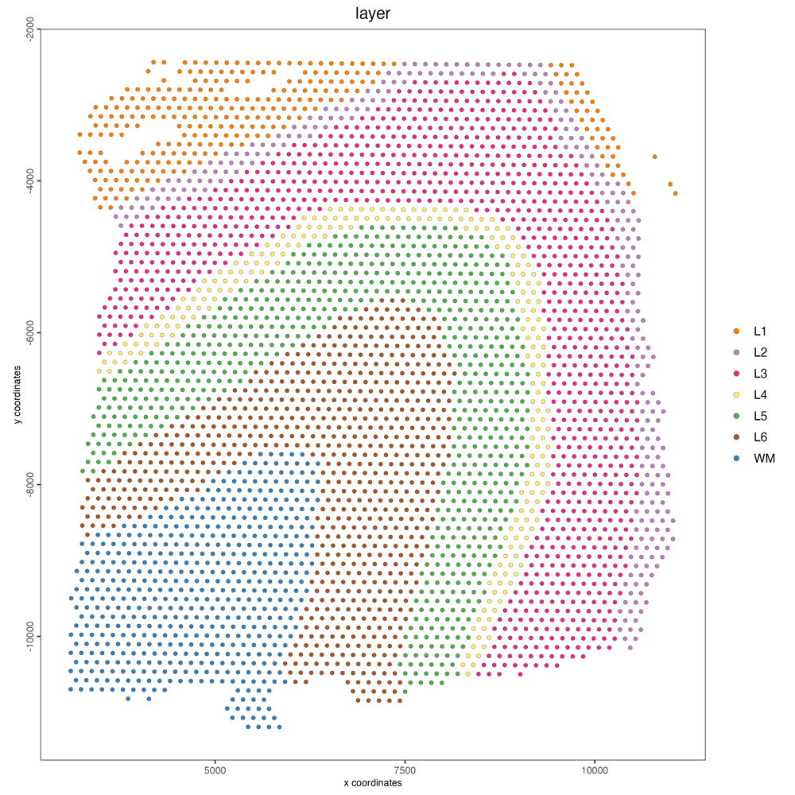
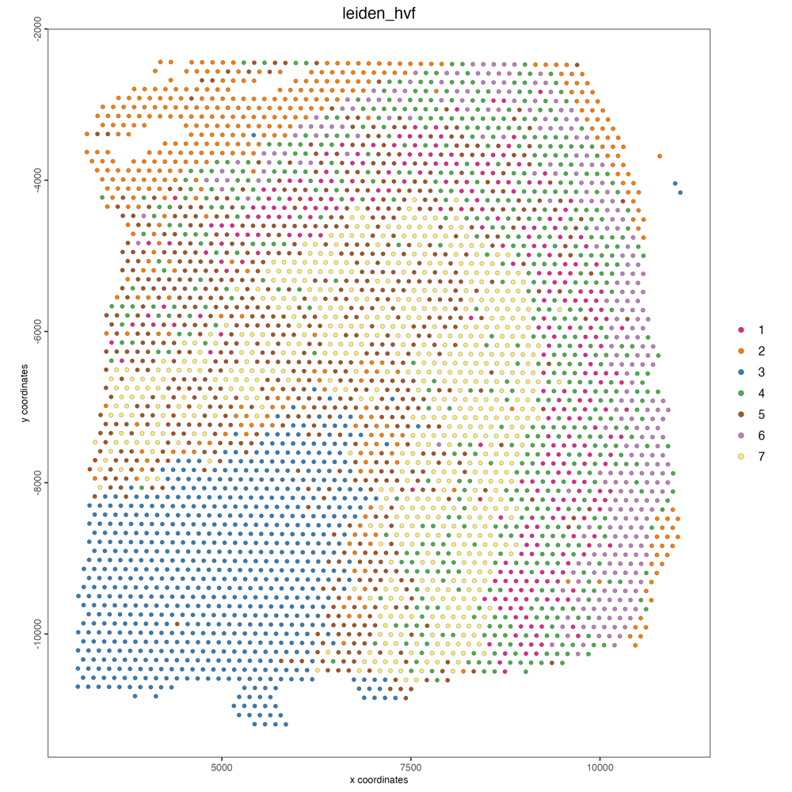
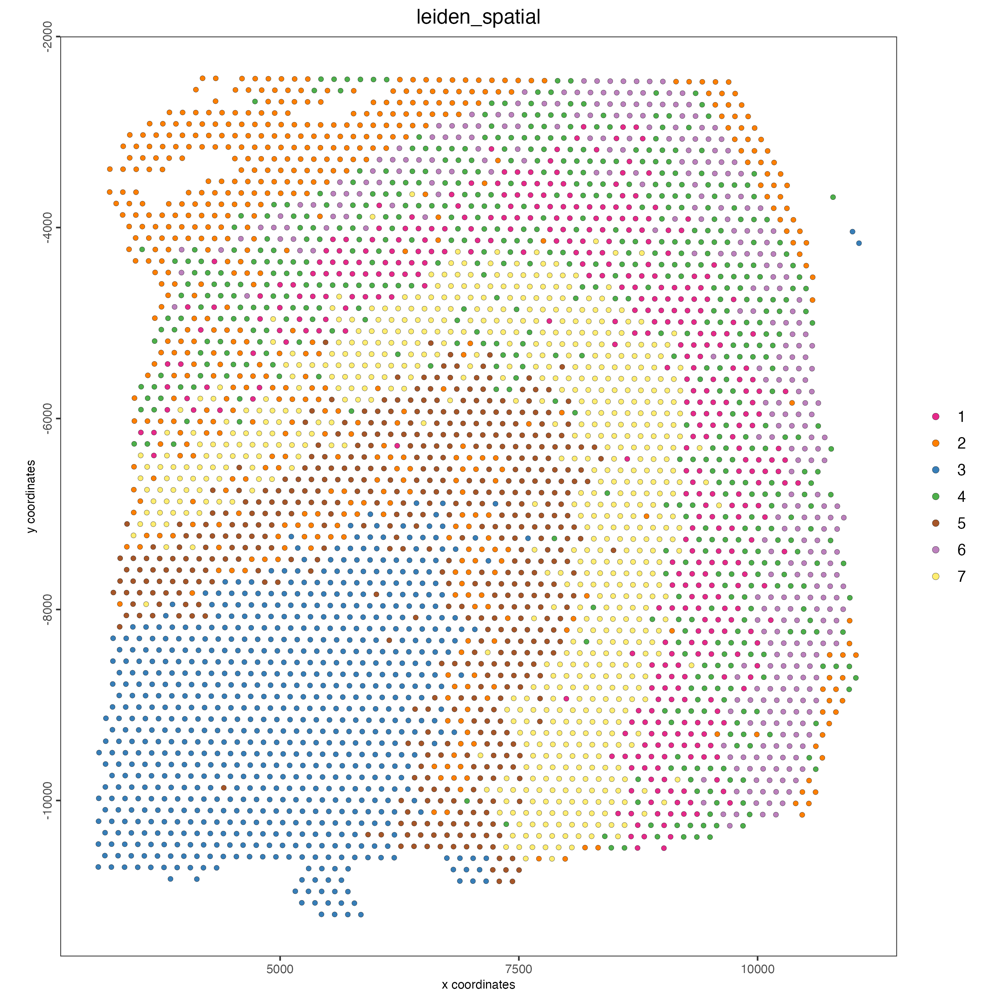
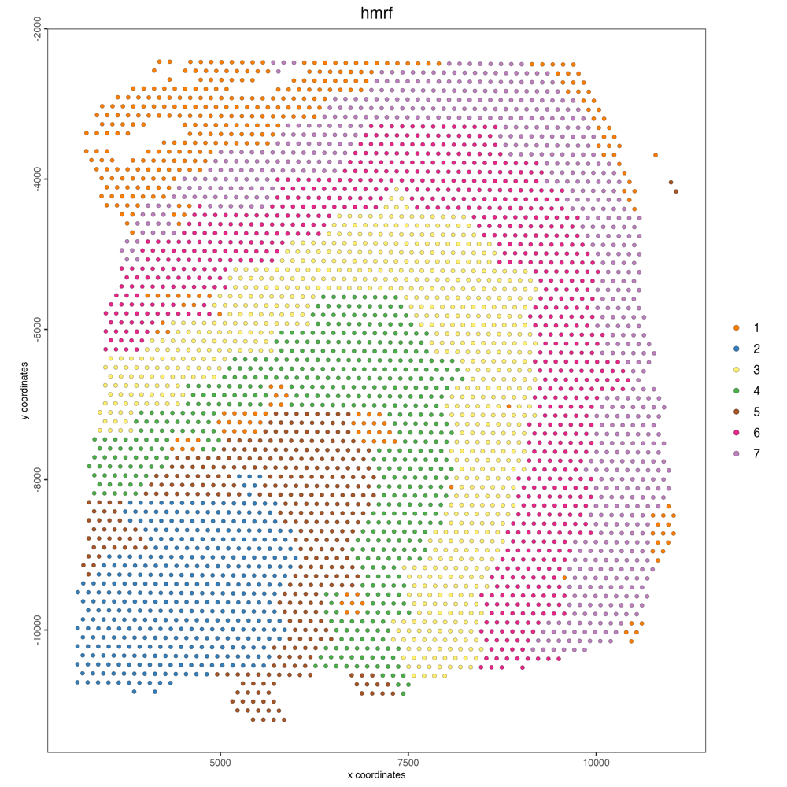
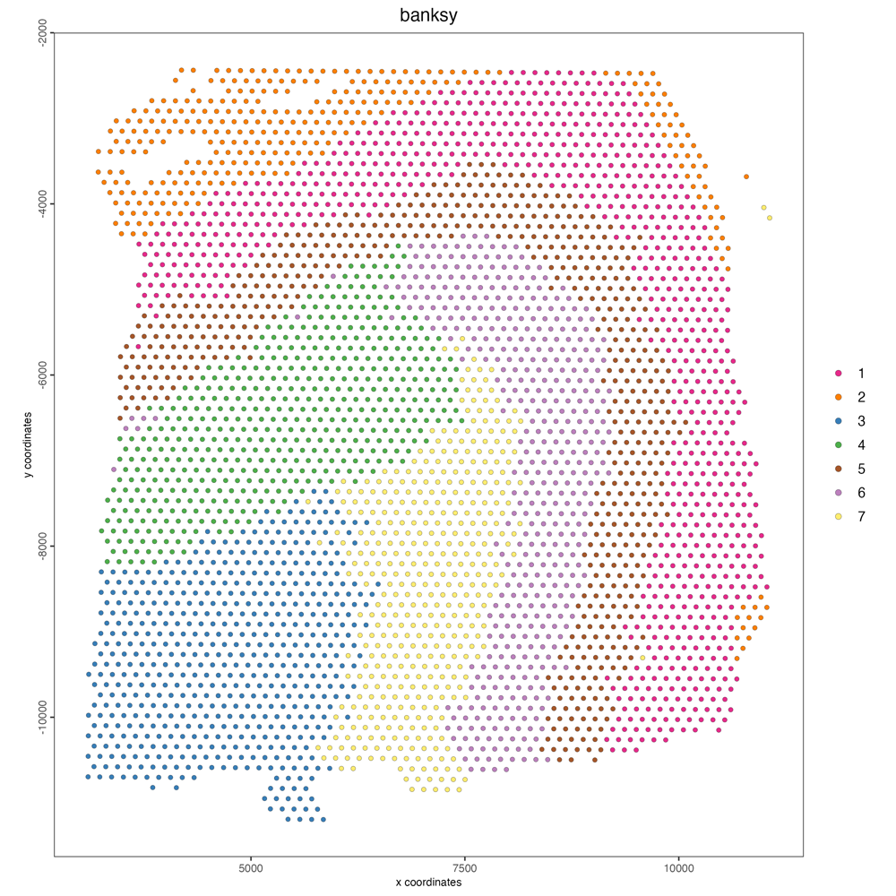
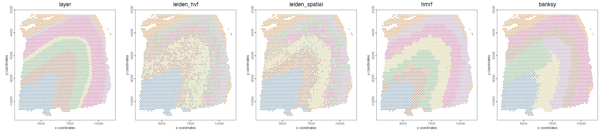

```{r setup, include=FALSE}
knitr::opts_chunk$set(eval = FALSE, fig.align = "center")
```

Spatial domains are regions of tissue with a shared expression profile.
`findSpatialDomains()` finds them with two native methods:

- `"neighborhood"`: the BANKSY embedding (Singhal et al. 2024), each spot's
  expression together with its neighbours' mean and gradient, clustered with
  Leiden;
- `"hmrf"`: the hidden Markov random field (Zhu et al. 2018), a Gaussian
  mixture with a prior that neighbouring spots share a domain.

This tutorial runs them on the human dorsolateral prefrontal cortex (DLPFC)
slice 151673 (Visium, Maynard et al. 2021) and compares them with its manual
annotation of the six cortical layers and the white matter. It builds up in
four steps, to show what each spatial ingredient adds:

1. the standard clustering workflow, which does not use space;
2. the same workflow on spatially variable genes;
3. HMRF, which adds a spatial prior;
4. BANKSY, which adds each spot's neighbourhood to its expression.

# Download the data

The counts come from the spatialLIBD bucket; the spot positions, image and
layer annotation from the [HumanPilot](https://github.com/LieberInstitute/HumanPilot)
repository.

```{r}
library(Giotto)

data_dir <- file.path(tempdir(), "dlpfc_151673")
dir.create(file.path(data_dir, "spatial"), recursive = TRUE,
    showWarnings = FALSE)
libd <- "https://raw.githubusercontent.com/LieberInstitute/HumanPilot/master/10X"
files <- c(
    "151673_filtered_feature_bc_matrix.h5" = "https://spatial-dlpfc.s3.us-east-2.amazonaws.com/h5/151673_filtered_feature_bc_matrix.h5",
    "spatial/tissue_positions_list.csv" = file.path(libd, "151673/tissue_positions_list.txt"),
    "spatial/scalefactors_json.json" = file.path(libd, "151673/scalefactors_json.json"),
    "spatial/tissue_lowres_image.png" = file.path(libd, "151673/tissue_lowres_image.png"),
    "layers.tsv" = file.path(libd, "barcode_level_layer_map.tsv"))
for (f in names(files)) {
    dest <- file.path(data_dir, f)
    if (!file.exists(dest)) download.file(files[[f]], dest, mode = "wb")
}
```

# Create and process the object

```{r}
g <- createGiottoVisiumObject(expr_data = "filter",
    h5_visium_path = file.path(data_dir, "151673_filtered_feature_bc_matrix.h5"),
    h5_tissue_positions_path = file.path(data_dir, "spatial/tissue_positions_list.csv"),
    h5_image_png_path = file.path(data_dir, "spatial/tissue_lowres_image.png"),
    h5_json_scalefactors_path = file.path(data_dir, "spatial/scalefactors_json.json"))

# keep the annotated spots and add their layer
layers <- data.table::fread(file.path(data_dir, "layers.tsv"), header = FALSE,
    col.names = c("cell_ID", "sample", "layer"))[sample == 151673]
g <- subsetGiotto(g, cell_ids = intersect(spatIDs(g), layers$cell_ID))
g <- addCellMetadata(g, new_metadata = layers[, c("cell_ID", "layer")],
    by_column = TRUE, column_cell_ID = "cell_ID")

g <- filterGiotto(g, expression_threshold = 1, feat_det_in_min_cells = 10,
    min_det_feats_per_cell = 100)
g <- normalizeGiotto(g)  # log-normalized values
g <- createSpatialNetwork(g, method = "Delaunay")

spatPlot2D(g, cell_color = "layer", point_size = 1.5)
```

```{r, echo=FALSE, eval=TRUE, out.width="60%"}

```

# Clustering without space

The standard workflow clusters the spots on their expression alone: the most
variable genes, PCA, a shared nearest neighbour network and Leiden.

```{r}
g <- calculateHVF(g, method = "var", n_top_feats = 2000)
g <- runPCA(g, feats_to_use = "hvf", ncp = 30)
g <- createNearestNetwork(g, dimensions_to_use = 1:30, k = 30)
g <- doLeidenCluster(g, resolution = 0.7, name = "leiden_hvf")

spatPlot2D(g, cell_color = "leiden_hvf", point_size = 1.5)
```

```{r, echo=FALSE, eval=TRUE, out.width="60%"}

```

The white matter and the outer layer are found, but the inner layers mix.
`method = "var"` ranks genes by variance; the default `calculateHVF()`
method picks genes that separate these layers poorly (ARI 0.15 on three
slices, against 0.32).

# Clustering on spatially variable genes

The same workflow on the 1,000 most spatially variable genes. The clustering
still ignores where the spots are, but the genes now carry the layer
structure. HMRF below starts from the same genes.

```{r}
# any spatialAutoCor() method works, for example Moran's I or Geary's C
sv <- spatialAutoCor(g, method = "binspect", return_gobject = FALSE)
spatial_genes <- head(sv$feats, 1000)

g <- runPCA(g, feats_to_use = spatial_genes, ncp = 30, name = "pca_spatial")
g <- createNearestNetwork(g, dim_reduction_name = "pca_spatial",
    dimensions_to_use = 1:30, k = 30, name = "sNN_spatial")
g <- doLeidenCluster(g, network_name = "sNN_spatial", resolution = 0.65,
    name = "leiden_spatial")

spatPlot2D(g, cell_color = "leiden_spatial", point_size = 1.5)
```

```{r, echo=FALSE, eval=TRUE, out.width="60%"}

```

The layers appear as bands, but with ragged borders and spots of one layer
scattered in the next.

# HMRF

HMRF clusters the spots with a Gaussian mixture and a prior that neighbouring
spots share a domain, set by `beta`. It runs on a few values per spot: here
NMF factors of the same spatially variable genes. Few inputs make its
k-means start fast and stable, and each step is a separate function, so any
dimension reduction can be used.

```{r}
# NMF factors of the spatially variable genes, stored as the dimension
# reduction "spatial_nmf"; NMF starts from random values, so set its seed
g <- runNMF(g, feats_to_use = spatial_genes, k = 10, seed_number = 1234,
    name = "spatial_nmf")

# HMRF on the factors
g <- findSpatialDomains(g, method = "hmrf", dim_reduction_to_use = "nmf",
    dim_reduction_name = "spatial_nmf", k = 7, beta = 5, name = "hmrf")

spatPlot2D(g, cell_color = "hmrf", point_size = 1.5)
```

```{r, echo=FALSE, eval=TRUE, out.width="60%"}

```

# BANKSY

BANKSY adds to each spot the weighted mean expression of its neighbours,
weighted by `lambda`, runs PCA, and clusters the spots with Leiden. This
follows the BANKSY paper's settings for DLPFC: values normalized to the
median library size without log (BANKSY works best on other values than the
steps above; see [normalization and features](#choosing-the-features)), the
2,000 most variable genes, `lambda` 0.2 and the 18 nearest spots (the first
two rings of the Visium grid).

```{r}
g <- processExpression(g, normParam("library", scalefactor = "median"),
    name = "medlib")
g <- calculateHVF(g, expression_values = "medlib", method = "var",
    n_top_feats = 2000, HVFname = "hvf_medlib")
g <- createSpatialNetwork(g, method = "kNN", k = 18, name = "kNN18")

g <- findSpatialDomains(g, method = "neighborhood",
    expression_values = "medlib", feats_to_use = "hvf_medlib",
    lambda = 0.2, npcs = 20, k_neighbors = 50,
    spatial_network_name = "kNN18", resolution = 0.5, name = "banksy")

spatPlot2D(g, cell_color = "banksy", point_size = 1.5)
```

```{r, echo=FALSE, eval=TRUE, out.width="60%"}

```

`resolution = 0.5` is the smallest resolution that gives 7 domains on this
slice, as are 0.7 and 0.65 for the two Leiden steps above; with other data,
choose it for the number of domains you expect.

# Compare with the layers

```{r}
meta <- pDataDT(g)
domains <- c("leiden_hvf", "leiden_spatial", "hmrf", "banksy")
sapply(domains, function(d) mclust::adjustedRandIndex(meta[[d]], meta$layer))
```

```
    leiden_hvf leiden_spatial           hmrf         banksy
          0.30           0.41           0.53           0.53
```

```{r, echo=FALSE, eval=TRUE, out.width="100%"}

```

The adjusted Rand index (ARI) measures agreement with the manual annotation.
Spatially variable genes improve clustering without space, and the spatial
models then recover the layers as stacked bands. HMRF and BANKSY do so to
the same degree and agree with each other (ARI 0.56). On three DLPFC slices
(151507, 151673, 151674) the mean ARI was:

| | mean ARI |
|---|---|
| Leiden on highly variable genes | 0.32 |
| Leiden on spatially variable genes | 0.39 |
| HMRF | 0.52 |
| BANKSY | 0.53 |

Each step took a few seconds on this slice: about 5 s for the spatially
variable genes, 2 s for NMF and HMRF, 1 s for BANKSY.

<details>
<summary>Choosing the HMRF settings</summary>

`runHMRF()` fits several `k` and `beta` in one call and `hmrfSummary()`
compares them: `coherence` is the share of neighbouring spots in the same
domain, and `smallest_domain` near 0 means `k` is too large.

```{r}
g <- runHMRF(g, dim_reduction_to_use = "nmf",
    dim_reduction_name = "spatial_nmf", k = 7, betas = c(0, 2, 5, 10))
hmrfSummary(g)
```

```
       setting     k  beta     loglik confidence coherence smallest_domain
1:  hmrf_k7_b0     7     0 -183715.27      0.919     0.710           0.092
2:  hmrf_k7_b2     7     2 -154455.80      0.984     0.901           0.101
3:  hmrf_k7_b5     7     5 -108236.28      0.990     0.922           0.094
4: hmrf_k7_b10     7    10  -30957.56      0.991     0.925           0.096
```

Each setting is stored as a cell metadata column (`hmrf_k7_b5`, ...) and its
domain probabilities as a spatial enrichment of the same name.

The input matters more than `beta`. On three DLPFC slices (151507, 151673,
151674) the mean ARI was:

| HMRF input | mean ARI |
|---|---|
| 10 NMF factors of 1,000 spatial genes | 0.52 |
| 20 PCs of 1,000 spatial genes, scaled (`zscore = "feature"`) | 0.51 |
| expression of 100-300 spatial genes | 0.28-0.36 |

HMRF also runs on any spatial enrichment (`spat_enr_name`), for example the
scores of [spatial co-expression modules](spatial_coexpression_modules.html).
How the spatial genes are picked (binSpect, Moran's I or Geary's C; 500 to
2,000 genes) changed the mean ARI by about 0.03. NMF factors are used as
given (`zscore = "none"`, the default for a dimension reduction); PCs work
better scaled, so that the first PCs do not dominate. More domains than
layers (`k = 8` or `9`) split layers into patches rather than sharpen their
borders (mean ARI 0.49 and 0.47).

</details>

<details>
<summary>Choosing the BANKSY settings</summary>

`lambda` weights the neighbourhood: near 0 the domains follow cell types,
near 1 they follow the neighbourhood. `resolution` sets the number of
domains; the BANKSY paper tried resolutions from 0.1 to 1.5 and kept those
giving the annotated number of layers. `findSpatialDomains()` passes other
arguments to `runNeighborhoodPCA()`, for example `npcs` or
`compute_agf = TRUE` for BANKSY's gradient features (off by default, as in
the paper). The embedding is also available on its own with
`runNeighborhoodPCA()`, to cluster it differently.

</details>

<details>
<summary id="choosing-the-features">Normalization and features</summary>

The normalization and features matter more than the methods' settings. On
the three slices:

| | mean ARI |
|---|---|
| BANKSY, median library size, highest-variance genes (above) | 0.53 |
| BANKSY, median library size, Seurat's `vst` genes (as in the paper) | 0.56 |
| BANKSY, log-normalized values, Seurat's `vst` genes | 0.52 |
| BANKSY, median library size, `calculateHVF(method = "cov_loess")` genes | 0.14 |
| BANKSY, log values, `lambda` 0.8 with gradient features | 0.46 |
| HMRF, log-normalized values (above) | 0.52 |
| HMRF, median library size without log | 0.38 |

`normParam()` steps can be chained in `processExpression()` for other
normalizations, for example `list(normParam("library", scalefactor =
"median"), normParam("log"))`.

</details>

# Citation

If you use these methods, please cite the original papers:

- Singhal V, Chou N, Lee J, et al. BANKSY unifies cell typing and tissue
  domain segmentation for scalable spatial omics data analysis. *Nature
  Genetics* 56, 431–441 (2024). <https://doi.org/10.1038/s41588-024-01664-3>
- Zhu Q, Shah S, Dries R, Cai L, Yuan GC. Identification of spatially
  associated subpopulations by combining scRNAseq and sequential fluorescence
  in situ hybridization data. *Nature Biotechnology* 36, 1183–1190 (2018).
  <https://doi.org/10.1038/nbt.4260>
- Maynard KR, Collado-Torres L, Weber LM, et al. Transcriptome-scale spatial
  gene expression in the human dorsolateral prefrontal cortex. *Nature
  Neuroscience* 24, 425–436 (2021). <https://doi.org/10.1038/s41593-020-00787-0>
