```{r setup, include=FALSE}
knitr::opts_chunk$set(eval = FALSE, fig.align = "center")
```

A gene is *spatially variable* when where it is expressed in the tissue is not
random: neighbouring cells look more alike than cells picked at random. This
tutorial finds such genes with `spatialAutoCor()`, a single command for three
classic statistics. Everything runs on **disk-backed** objects (GiottoDisk),
so the same code scales from these small crops to whole slides.

| method | asks | good at |
|---|---|---|
| `"moran"` (Moran's I) | do neighbours have correlated expression levels? | broad gradients and domains |
| `"geary"` (Geary's C) | how different are neighbours, on average? | sharp local differences |
| `"binspect"` (binSpect, also `"joincount"`) | after calling each cell *on* or *off*, do *on* cells touch each other more than chance? | sparse or patchy genes, rare cell types |

Two things make this fast and well calibrated:

- **Analytic significance.** P-values come from the closed-form randomisation
  null of each statistic, not from shuffling the tissue hundreds of times.
- **A covariate null.** `null = "covariate"` tests each gene against cells
  with similar sequencing depth (or the same cell type), so genes that only
  follow depth or cell composition stop looking spatial.

The tutorial uses two public datasets: a **Xenium** lung cancer crop (single
cells, section 3–4) and a **Visium HD** colorectal cancer crop (8 µm bins,
section 5).

# Setup

```{r install}
# Giotto Suite with GiottoDisk; GiottoKernels is optional and speeds up the
# edge sums on large data
remotes::install_github("giotto-suite/GiottoUtils", ref = "dev")
GiottoUtils::suite_install("GiottoDisk", install_arrow = TRUE)
```

```{r config}
suppressMessages({
  library(Giotto); library(GiottoClass); library(GiottoDisk)
  library(data.table); library(ggplot2)
})

# run GiottoDisk's tiled steps on 4 parallel workers and hide progress bars
future::plan(future::multisession, workers = 4)
options(progressr.enable = FALSE)
# GiottoDisk sizes its memory use from one setting: the fraction of free RAM
# it may use (default 0.25)
options(giotto.memory_frac = 0.25)

data_dir       <- "data"      # downloads go here
project_dir    <- "projects"  # GiottoDisk projects (one per dataset)
results_folder <- "results"   # every figure is saved here as a PNG
dir.create(project_dir, showWarnings = FALSE)
dir.create(results_folder, showWarnings = FALSE)

instructions <- createGiottoInstructions(
  save_dir = results_folder, save_plot = TRUE,
  show_plot = TRUE, return_plot = FALSE
)
```

# Quick start: a Xenium lung cancer crop

## Create a disk-backed object

The crop is a 425 × 425 µm window of the 10x Xenium human lung cancer FFPE
sample (Human Multi-Tissue and Cancer panel, 377 genes), with its
transcripts, cell and nucleus boundaries and morphology images.

```{r xen-data}
xen_dir <- GiottoData::getSpatialDataset("xenium_mini_lung_ffpe",
                                         directory = data_dir)

xen_source <- sourceCreate(file.path(project_dir, "xenium"),
                           type = "gDirSource")
setArtifactDumpDir(xen_source)

g_xen <- createGiottoXeniumObject(
  xenium_dir       = xen_dir,
  backend          = xen_source,   # creates the object as a disk-backed project
  load_transcripts = TRUE,
  load_expression  = TRUE,
  load_cellmeta    = TRUE,
  load_images      = "focus",
  instructions     = instructions
)
```

The expression matrix and, below, the spatial network are stores on disk.
The statistics read them in chunks, so memory stays bounded however large the
dataset is.

```{r xen-stores}
class(getExpression(g_xen, values = "raw", output = "matrix"))
```

```
## [1] "parquetExprStore"
## attr(,"package")
## [1] "GiottoDisk"
```

## Filter, normalize and build a spatial network

```{r xen-prep}
g_xen <- addStatistics(g_xen, expression_values = "raw")
g_xen <- filterGiotto(g_xen,
  expression_threshold   = 1,
  feat_det_in_min_cells  = 10,
  min_det_feats_per_cell = 10
)
g_xen <- normalizeGiotto(g_xen, scale_feats = FALSE, scale_cells = FALSE)

# the Delaunay network joins each cell to its natural neighbours
g_xen <- createSpatialNetwork(g_xen, method = "Delaunay")
```

```{r xen-network-plot}
g_zoom <- crop(g_xen, c(150, 250, -300, -200), view = "roi")
spatPlot2D(g_zoom,
  show_network = TRUE, network_color = "#4FC3F7",
  spatial_network_name = "Delaunay_network",
  point_size = 1.5, point_alpha = 1, background_color = "black",
  view = "roi",
  save_param = list(save_name = "01-delaunay-network")
)
```

```{r, echo=FALSE, eval=TRUE, out.width="60%"}
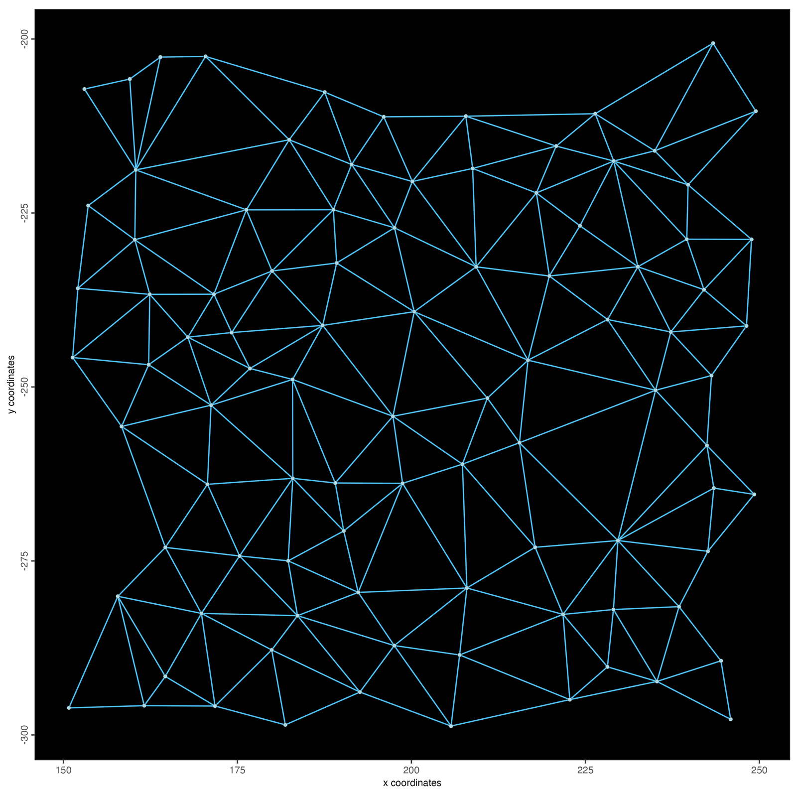
```

## Find spatial genes

```{r xen-binspect}
bs_xen <- spatialAutoCor(g_xen, method = "binspect", return_gobject = FALSE)
bs_xen[1:8, .(feats, statistic, expected, z, adj.p.value, n_on, odds_ratio)]
```

```
##     feats statistic   expected        z   adj.p.value  n_on odds_ratio
##    <char>     <num>      <num>    <num>         <num> <num>      <num>
## 1:  MARCO       268   68.58911 26.75583 1.721670e-155   188  12.552041
## 2: MCEMP1       251   64.97977 25.56765 2.848251e-142   183  11.136574
## 3:   MALL      1870 1407.93413 22.91926 1.622512e-114   850   7.020221
## 4:  EPCAM      1683 1234.62742 22.45591 4.565162e-110   796   6.735536
## 5: GPRC5A      1262  871.88318 20.65363  2.952181e-93   669   5.053945
## 6: CYP2B6      1094  729.53873 20.10209  1.922036e-88   612   4.942007
## 7: CYP4B1       956  615.11299 19.67081  8.932170e-85   562   4.677609
## 8: STEAP4       894  567.85604 19.25584  2.569590e-81   540   4.409562
```

Each row is a gene. For binSpect, `statistic` counts network edges whose two
cells are both *on*, `expected` is that count under the randomisation null,
and `z` is the standardised difference. `n_on` is how many cells were called
*on*, and `odds_ratio` is the odds ratio of the 2 × 2 table of edges by the
on/off state of their two cells (the `estimate` of earlier binSpect
versions). The table is sorted by `z`.

With `return_gobject = TRUE` (the default), the results are written to the
feature metadata instead, as `binspect.z`, `binspect.p` and `binspect.padj`
(and `binSpect.pval`, which `doHMRF()` reads):

```{r xen-binspect-gobject}
g_xen <- spatialAutoCor(g_xen, method = "binspect")
fDataDT(g_xen)[order(-binspect.z)][1:4, .(feat_ID, binspect.z, binspect.padj)]
```

```
##    feat_ID binspect.z binspect.padj
##     <char>      <num>         <num>
## 1:   MARCO   26.75583 1.721670e-155
## 2:  MCEMP1   25.56765 2.848251e-142
## 3:    MALL   22.91926 1.622512e-114
## 4:   EPCAM   22.45591 4.565162e-110
```

The top genes, plotted as their transcripts over the cell boundaries:

```{r xen-top-insitu}
top4 <- bs_xen$feats[1:4]
spatInSituPlotPoints(g_xen,
  show_image = TRUE, image_name = "bound1",  # morphology_focus_0000: DAPI
  feats = list(rna = top4), feat_type = "rna", use_overlap = FALSE,
  feats_color_code = c("#FFD54F", "#FF7043", "#4FC3F7", "#AED581"),
  point_size = 0.4, plot_last = "points",
  show_polygon = TRUE, polygon_feat_type = "cell",
  polygon_color = "grey60", polygon_line_size = 0.05, polygon_alpha = 0,
  background_color = "black",
  save_param = list(save_name = "02-binspect-top-insitu")
)
```

```{r, echo=FALSE, eval=TRUE, out.width="90%"}
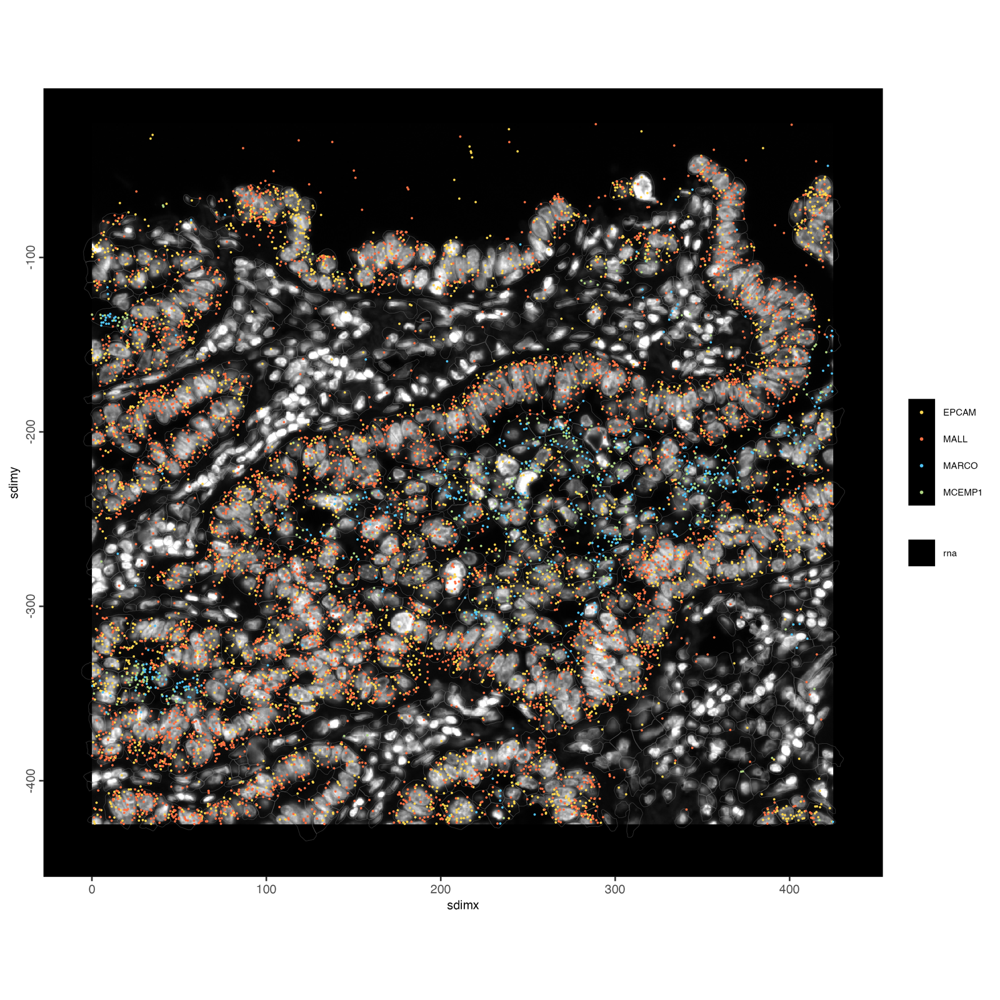
```

## What binSpect counts

binSpect first calls every cell *on* or *off* for a gene. The default rule,
`bin_method = "kmeans"`, splits the gene's values into two groups with an
exact one-dimensional 2-means (Otsu's threshold). `histThreshold()` exposes
that rule, so we can redraw what the test sees for the top gene and for a gene
with no pattern:

```{r xen-binspect-explained}
genes <- c(bs_xen$feats[1], "ACTG2")
vals  <- spatValues(g_xen, feats = genes, expression_values = "normalized")
locs  <- getSpatialLocations(g_xen, output = "data.table")
edges <- getSpatialNetwork(g_xen, name = "Delaunay_network",
                           output = "networkDT")

panel <- function(gene) {
  v   <- vals[[gene]]
  tab <- table(v)
  thr <- histThreshold(as.numeric(names(tab)), as.numeric(tab))
  on  <- setNames(v > thr, vals$cell_ID)
  e   <- edges[, .(from, to, both_on = on[from] & on[to])]
  e[locs, on = .(from = cell_ID), `:=`(x0 = i.sdimx, y0 = i.sdimy)]
  e[locs, on = .(to = cell_ID), `:=`(x1 = i.sdimx, y1 = i.sdimy)]
  pts <- merge(locs, data.table(cell_ID = names(on), on = on), by = "cell_ID")
  ggplot() +
    geom_segment(data = e[both_on == FALSE],
      aes(x0, y0, xend = x1, yend = y1),
      colour = "grey30", linewidth = 0.15) +
    geom_segment(data = e[both_on == TRUE],
      aes(x0, y0, xend = x1, yend = y1),
      colour = "#FFD54F", linewidth = 0.5) +
    geom_point(data = pts, aes(sdimx, sdimy, colour = on), size = 0.6) +
    scale_colour_manual(values = c(`FALSE` = "grey45", `TRUE` = "#FF7043"),
                        labels = c("off", "on"), name = NULL) +
    coord_fixed() + theme_void(base_size = 10) +
    theme(plot.background = element_rect(fill = "black", colour = NA),
          plot.margin = margin(10, 10, 10, 10),
          text = element_text(colour = "white")) +
    labs(title = sprintf("%s: %d on cells, %d on-on edges (%.0f expected)",
                         gene, sum(on), sum(e$both_on),
                         bs_xen[feats == gene, expected]))
}
p <- cowplot::plot_grid(panel(genes[1]), panel(genes[2]), ncol = 2)
ggsave(file.path(results_folder, "03-binspect-explained.png"), p,
       width = 11, height = 5, dpi = 150)
```

```{r, echo=FALSE, eval=TRUE, out.width="100%"}
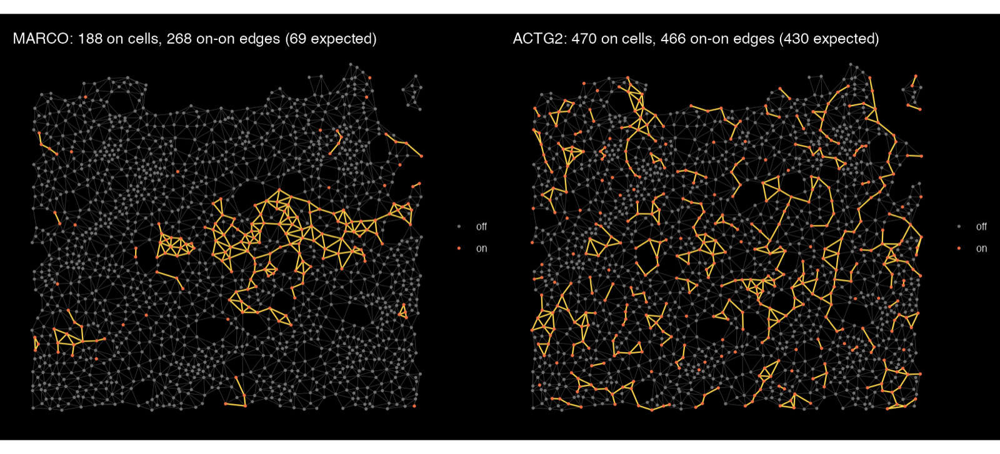
```

Yellow edges join two *on* cells. MARCO, a marker of alveolar macrophages, is
*on* in only 188 cells, but they sit together: 268 edges join two *on* cells
where about 69 are expected if the same cells were scattered at random.
ACTG2 is *on* in more cells, but its *on*-*on* edges (466) are close to what
chance gives (430).

## Compare the three statistics

All three methods take the same arguments. Running them side by side:

```{r xen-compare}
res <- lapply(c(moran = "moran", geary = "geary", binspect = "binspect"),
  function(m) spatialAutoCor(g_xen, method = m, return_gobject = FALSE))

z <- Reduce(function(a, b) merge(a, b, by = "feats"),
  lapply(names(res), function(m)
    setnames(res[[m]][, .(feats, z)], "z", paste0("z_", m))))
cor(z[, -1], method = "spearman", use = "complete.obs")
```

```
##              z_moran   z_geary z_binspect
## z_moran    1.0000000 0.9198885  0.9924898
## z_geary    0.9198885 1.0000000  0.9055192
## z_binspect 0.9924898 0.9055192  1.0000000
```

```{r xen-compare-plot}
label <- c("TFPI", "TCIM", "CD163", "MRC1", "CPA3", "AQP9", "ACTG2",
           bs_xen$feats[1:2], z[order(-z_moran), feats][1:3])
p <- ggplot(z, aes(z_moran, z_binspect)) +
  geom_abline(colour = "grey70", linetype = 2) +
  geom_point(aes(colour = z_geary), size = 1.6) +
  ggrepel::geom_text_repel(data = z[feats %in% label], aes(label = feats),
                           size = 3.2, min.segment.length = 0) +
  scale_colour_viridis_c(name = "Geary z") +
  labs(x = "Moran's I z-score", y = "binSpect z-score") +
  theme_classic(base_size = 11)
ggsave(file.path(results_folder, "04-moran-vs-binspect.png"), p,
       width = 6.5, height = 5.5, dpi = 150)
```

```{r, echo=FALSE, eval=TRUE, out.width="70%"}
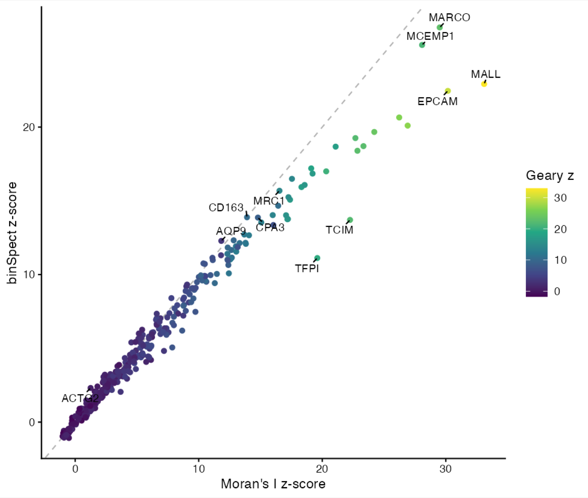
```

The methods agree on most genes; where they differ, it is informative. Genes
above the diagonal are favoured by binSpect, below it by Moran's I:

```{r xen-compare-maps}
# fill each cell by a value (here a gene's normalized expression); the
# colour scale is capped at the 95th percentile of the cells above 0, so a
# few very high cells do not wash out the pattern
fill_map <- function(gobject, feat, title = feat, ...) {
  v <- spatValues(gobject, feats = feat, ...)
  cap <- quantile(v[[feat]][v[[feat]] > 0], 0.95)
  v <- data.table(cell_ID = v$cell_ID, expression = pmin(v[[feat]], cap))
  gobject <- addCellMetadata(gobject, new_metadata = v,
                             by_column = TRUE, column_cell_ID = "cell_ID")
  spatInSituPlotPoints(gobject,
    polygon_feat_type = "cell", show_polygon = TRUE,
    polygon_fill = "expression", polygon_fill_gradient_style = "sequential",
    polygon_color = "grey15", polygon_line_size = 0.05, polygon_alpha = 1,
    background_color = "black", show_legend = FALSE, show_axes = FALSE,
    show_plot = FALSE, save_plot = FALSE, return_plot = TRUE) +
    ggtitle(title) +
    theme(plot.background = element_rect(fill = "black", colour = NA),
          plot.title = element_text(colour = "white", size = 14, hjust = 0.5))
}
p <- cowplot::plot_grid(plotlist = lapply(c("TFPI", "CD163", "ACTG2"),
                                          fill_map, gobject = g_xen,
                                          expression_values = "normalized"),
                        nrow = 1)
ggsave(file.path(results_folder, "05-method-maps.png"), p,
       width = 13, height = 4.6, dpi = 150)
```

```{r, echo=FALSE, eval=TRUE, out.width="100%"}
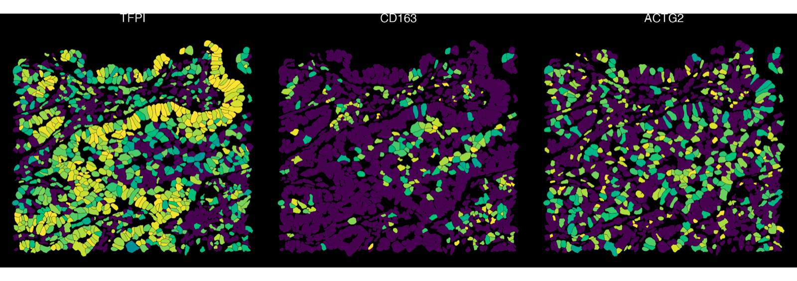
```

TFPI is expressed throughout the epithelium at levels that fade towards the
stroma: a broad gradient, which Moran's I, working on the expression level,
scores higher than binSpect. CD163, a macrophage marker, is high in few cells
that cluster together, which binSpect ranks higher. ACTG2 shows no pattern
under any of the three.

# Spatial co-expression modules

Spatial genes often share a pattern: the genes of one cell type or region
rise and fall together. `spatialCoexpression()` groups them into modules. It
smooths each cell's expression with its neighbours', correlates the genes on
the smoothed values, clusters the correlation, and scores every module in
every cell. On this disk-backed object the smoothing and the correlation run
on the stores.

```{r xen-coexpression}
top_genes <- bs_xen$feats[1:80]
g_xen <- spatialCoexpression(g_xen,
  feats = top_genes,
  spatial_network_name = "Delaunay_network",
  n_modules = 6
)
coexpr <- spatialCoexpression(g_xen,
  feats = top_genes,
  spatial_network_name = "Delaunay_network",
  n_modules = 6,
  return_gobject = FALSE
)
coexpr$summary
```

```
##    module  size within_cor  between_cor     score
##     <int> <int>      <num>        <num>     <num>
## 1:      2    26  0.5565854 -0.260558067 0.5565854
## 2:      1    14  0.5528519 -0.030621812 0.4257312
## 3:      5     7  0.5500639  0.008921023 0.4018332
## 4:      4    12  0.4166297 -0.081124593 0.3418724
## 5:      3    13  0.4064160 -0.081006461 0.3334434
## 6:      6     8  0.3181477 -0.037948786 0.2473251
```

Each module's genes are in the feature metadata (`spatial_module`), and its
scores per cell are the spatial enrichment `spatial_module`. The heatmap
shows the gene-gene correlation, ordered and annotated by module:

```{r xen-coexpression-heatmap}
heatmapCoexpression(g_xen, coexpr,
  save_param = list(save_name = "12-coexpression-heatmap"))
```

```{r, echo=FALSE, eval=TRUE, out.width="75%"}
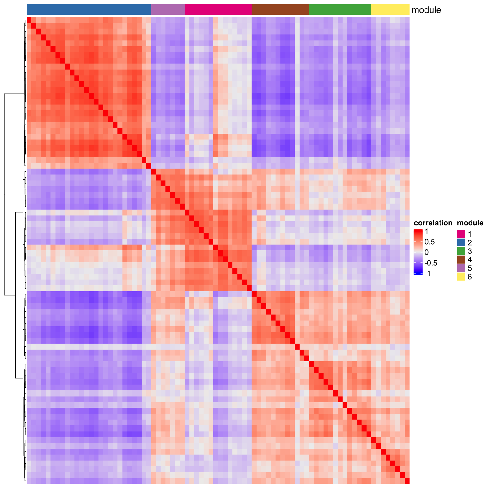
```

The three most distinct modules in the tissue, each titled with its genes
that belong to it most firmly:

```{r xen-module-maps}
module_title <- function(m) {
  genes <- coexpr$feats[module == m][order(-module_cor), feat_ID]
  sprintf("module %s: %s", m, paste(head(genes, 3), collapse = ", "))
}
mods <- head(coexpr$summary$module, 3)
p <- cowplot::plot_grid(plotlist = lapply(mods, function(m)
  fill_map(g_xen, as.character(m), title = module_title(m),
           spat_enr_name = "spatial_module")), nrow = 1)
ggsave(file.path(results_folder, "13-module-maps.png"), p,
       width = 13, height = 4.6, dpi = 150)
```

```{r, echo=FALSE, eval=TRUE, out.width="100%"}
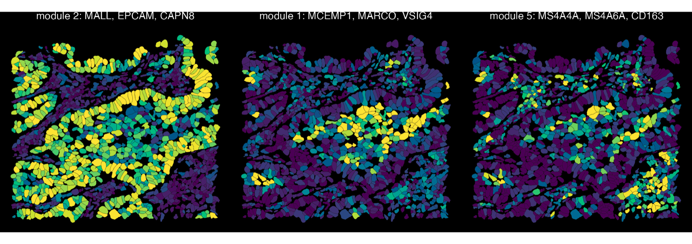
```

The epithelial module (MALL, EPCAM, CAPN8) covers the airway and tumour
epithelium. The two macrophage modules separate alveolar macrophages
(MCEMP1, MARCO, VSIG4) in the airspaces from CD163-high interstitial
macrophages (MS4A4A, MS4A6A, CD163) in the stroma, a distinction no single
gene ranking makes.

See [Detection of spatial co-expression modules](spatial_coexpression_modules.html)
for the options.

# Spatial genes within cell types

A cell-type marker is spatial almost by definition: the cell type sits
somewhere in the tissue. To find genes that vary *within* a cell type,
condition the null on the cell type itself. First, quick clusters:

```{r xen-clusters}
g_xen <- runPCA(g_xen, feats_to_use = NULL, ncp = 20)
g_xen <- createNearestNetwork(g_xen, dimensions_to_use = 1:15, k = 15)
g_xen <- doLeidenClusterIgraph(g_xen, resolution = 0.4, name = "leiden_clus")

spatInSituPlotPoints(g_xen,
  polygon_feat_type = "cell", show_polygon = TRUE,
  polygon_fill = "leiden_clus", polygon_fill_as_factor = TRUE,
  polygon_color = "grey20", polygon_line_size = 0.05, polygon_alpha = 1,
  background_color = "black",
  save_param = list(save_name = "06-clusters")
)
```

```{r, echo=FALSE, eval=TRUE, out.width="70%"}
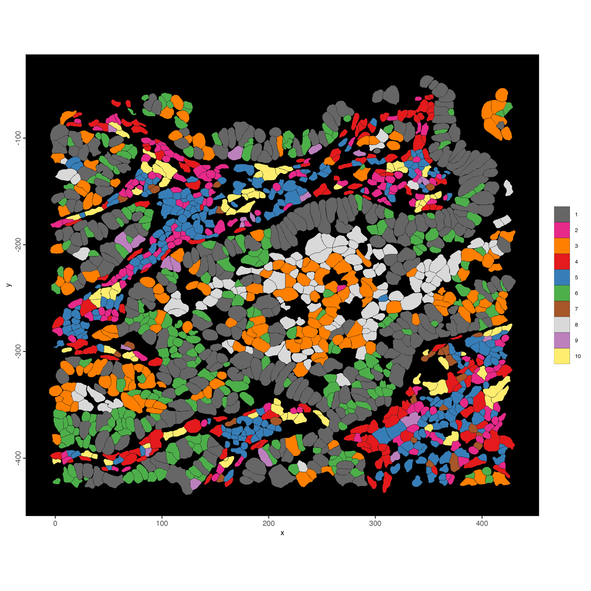
```

`null = "covariate"` with `covariate = "leiden_clus"` compares each cell only
with cells of the same cluster:

```{r xen-within}
within <- spatialAutoCor(g_xen, method = "moran", null = "covariate",
                         covariate = "leiden_clus", return_gobject = FALSE)
w <- merge(res$moran[, .(feats, z_tissue = z)],
           within[, .(feats, z_within = z)], by = "feats")
```

```{r xen-within-plot}
label <- c("EGFR", "PPARG", "KRT7", "STEAP4", "CXCL9", "PCSK2", "CPA3", "MALL")
p <- ggplot(w, aes(z_tissue, z_within)) +
  geom_abline(colour = "grey70", linetype = 2) +
  geom_point(colour = "grey40", size = 1.4) +
  geom_point(data = w[feats %in% label], colour = "#E64A19", size = 2) +
  ggrepel::geom_text_repel(data = w[feats %in% label], aes(label = feats),
                           size = 3.2, min.segment.length = 0) +
  labs(x = "Moran z (permutation null)",
       y = "Moran z (within clusters)") +
  theme_classic(base_size = 11)
ggsave(file.path(results_folder, "07-within-clusters.png"), p,
       width = 6.5, height = 5.5, dpi = 150)
```

```{r, echo=FALSE, eval=TRUE, out.width="70%"}
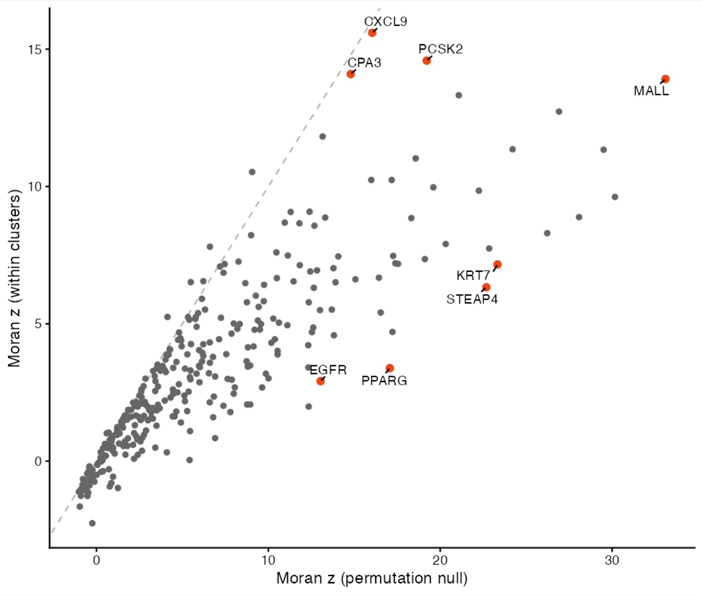
```

```{r xen-within-maps}
p <- cowplot::plot_grid(plotlist = lapply(c("KRT7", "PPARG", "PCSK2", "CXCL9"),
                                          fill_map, gobject = g_xen,
                                          expression_values = "normalized"),
                        nrow = 1)
ggsave(file.path(results_folder, "08-within-maps.png"), p,
       width = 16, height = 4.6, dpi = 150)
```

```{r, echo=FALSE, eval=TRUE, out.width="100%"}
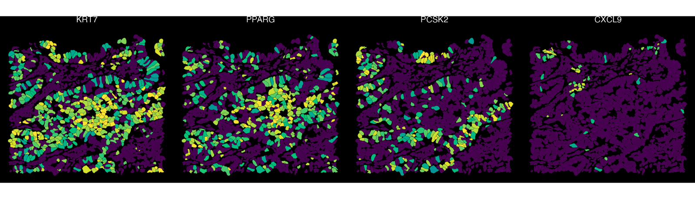
```

Markers of a cell type drop sharply: KRT7 and PPARG cover the epithelial
clusters wholesale, so once each cell is compared only with cells of its own
cluster, little pattern is left. Genes that keep a high score vary *within*
their cell type: PCSK2 is high in only part of the epithelium, and CXCL9 in a
single small focus.

# Sequencing depth: a Visium HD crop

On sequencing-based data, the number of molecules captured per spot or bin
varies across the tissue, and many genes simply follow it. Under the
permutation null those genes look spatial. This crop is a 400 × 400 µm window
of the 10x Visium HD colorectal cancer sample, at the tissue edge.

```{r vhd-data}
vhd_dir <- GiottoData::getSpatialDataset("visiumhd_mini_crc",
                                         directory = data_dir)

vhd_source <- sourceCreate(file.path(project_dir, "visiumhd"),
                           type = "gDirSource")
setArtifactDumpDir(vhd_source)

g_vhd <- createGiottoVisiumHDObjectBin(
  file.path(vhd_dir, "binned_outputs"),
  bin          = 8,
  backend      = vhd_source,
  instructions = instructions
)
g_vhd <- addStatistics(g_vhd, expression_values = "raw")
g_vhd <- filterGiotto(g_vhd,
  expression_threshold   = 1,
  feat_det_in_min_cells  = 20,
  min_det_feats_per_cell = 20
)
g_vhd <- normalizeGiotto(g_vhd, scale_feats = FALSE, scale_cells = FALSE)
g_vhd <- addStatistics(g_vhd, expression_values = "raw")

# the 8 nearest bins
g_vhd <- createSpatialNetwork(g_vhd, method = "kNN", k = 8,
                              name = "kNN_network")
```

```{r vhd-depth-plot}
spatPlot2D(g_vhd,
  show_image = TRUE, image_name = "image",
  cell_color = "total_expr", color_as_factor = FALSE,
  cell_color_gradient = "viridis", point_size = 1.6, point_alpha = 0.9,
  save_param = list(save_name = "09-vhd-depth")
)
```

```{r, echo=FALSE, eval=TRUE, out.width="60%"}
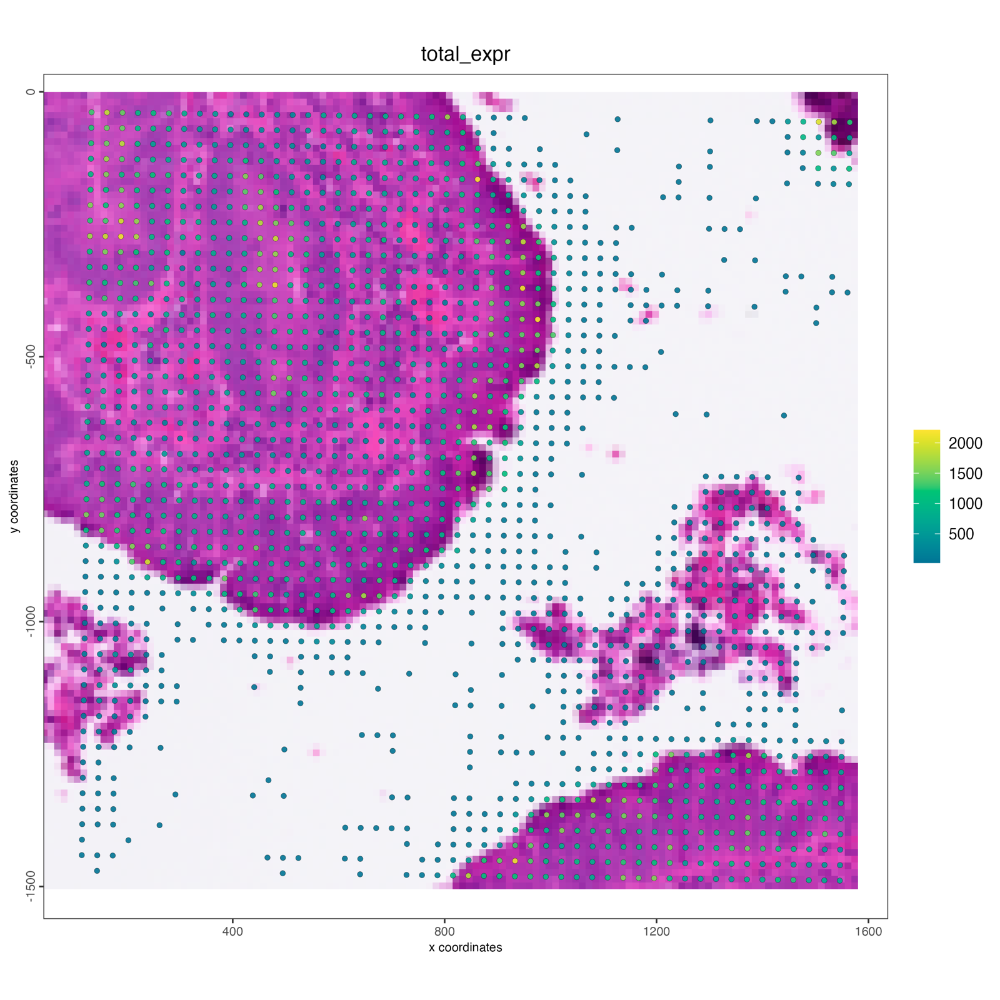
```

Run Moran's I with both nulls. `covariate = "libsize"` (the default) cuts
the bins into `n_groups` (default 10) quantile groups of total counts and
tests each gene against bins of similar depth:

```{r vhd-nulls}
perm <- spatialAutoCor(g_vhd, method = "moran",
                       spatial_network_name = "kNN_network",
                       return_gobject = FALSE)
cov  <- spatialAutoCor(g_vhd, method = "moran", null = "covariate",
                       covariate = "libsize",
                       spatial_network_name = "kNN_network",
                       return_gobject = FALSE)
c(permutation = sum(perm$adj.p.value < 0.01, na.rm = TRUE),
  covariate   = sum(cov$adj.p.value  < 0.01, na.rm = TRUE))
```

```
## permutation   covariate 
##        3617         917 
```

```{r vhd-nulls-plot}
v <- merge(perm[, .(feats, z_perm = z)], cov[, .(feats, z_cov = z)],
           by = "feats")
label <- c("ACTB", "OAZ1", "TMSB4X", "MT-CO1", "FTL",
           "IGHA1", "JCHAIN", "VIM", "COL3A1", "LYZ")
p <- ggplot(v, aes(z_perm, z_cov)) +
  geom_abline(colour = "grey70", linetype = 2) +
  geom_point(colour = "grey50", size = 0.6, alpha = 0.5) +
  geom_point(data = v[feats %in% label], colour = "#E64A19", size = 1.8) +
  ggrepel::geom_text_repel(data = v[feats %in% label], aes(label = feats),
                           size = 3.2, min.segment.length = 0) +
  labs(x = "Moran z (permutation null)",
       y = "Moran z (covariate null, library size)") +
  theme_classic(base_size = 11)
ggsave(file.path(results_folder, "10-vhd-nulls.png"), p,
       width = 6.5, height = 5.5, dpi = 150)
```

```{r, echo=FALSE, eval=TRUE, out.width="70%"}
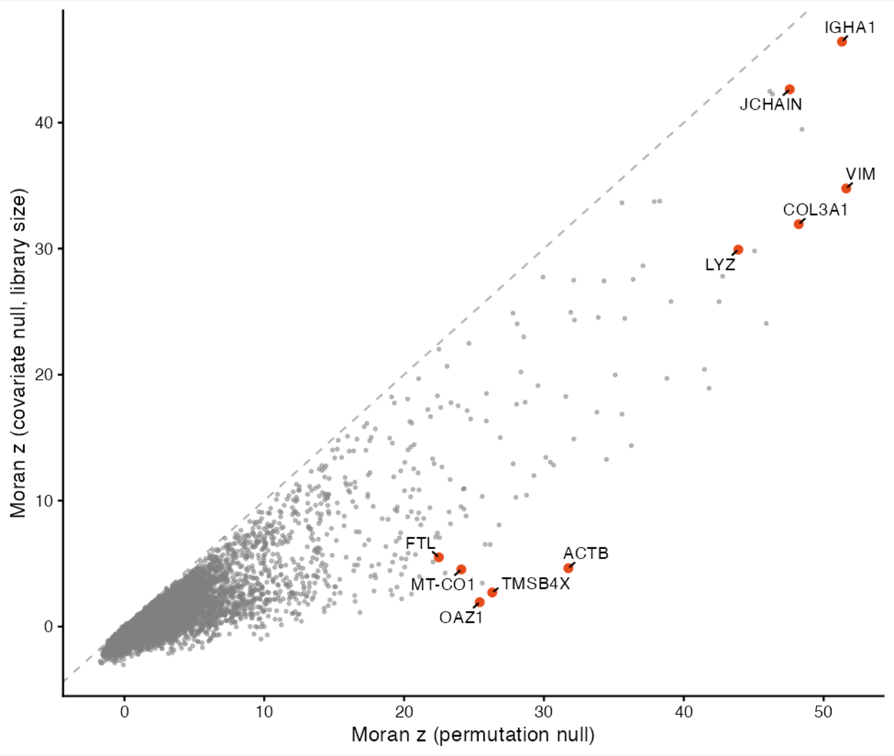
```

```{r vhd-maps}
spatFeatPlot2D(g_vhd,
  feats = c("ACTB", "OAZ1", "IGHA1", "COL3A1"),
  expression_values = "normalized",
  cell_color_gradient = "viridis", point_size = 1.2,
  cow_n_col = 2,
  save_param = list(save_name = "11-vhd-maps")
)
```

```{r, echo=FALSE, eval=TRUE, out.width="80%"}
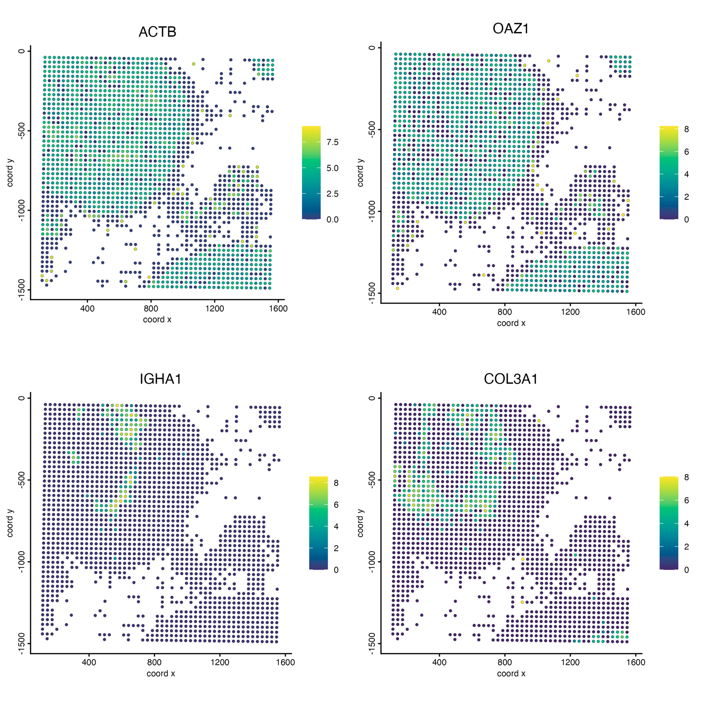
```

Under the permutation null 3,617 of 9,143 genes are significant at a 1% false
discovery rate; conditioned on library size, 917 are. Housekeeping and
mitochondrial genes (ACTB, OAZ1, TMSB4X, MT-CO1, FTL) fall from the top 100
to below rank 300: their maps trace the dense epithelium, where more
molecules are captured per bin. Immunoglobulins (IGHA1, JCHAIN), VIM, COL3A1
and LYZ keep their scores; they follow plasma cells, stroma and myeloid cells
rather than depth.

The same works for binSpect (`spatialAutoCor(g_vhd, method = "binspect",
null = "covariate")`). Geary's C has no covariate null.

# Choosing a method and using the results

| you want | use |
|---|---|
| a robust default ranking | `method = "moran"` |
| sparse genes, rare cell types, or a binary on/off view | `method = "binspect"` |
| genes with sharp local boundaries | `method = "geary"` |
| sequencing-based data (Visium, Visium HD, Stereo-seq) | add `null = "covariate"` |
| genes that vary within cell types | `null = "covariate", covariate = "<cell type column>"` |

Some details:

- `feats =` tests only the given genes; the multiple-testing correction then
  counts only those genes.
- `weighted = TRUE` uses the network's edge weights (Moran's I and Geary's C);
  the default treats every edge alike.
- Genes with the same value in every cell cannot be tested and get `NA`.
- The same call works on in-memory objects, and on a matrix or GiottoDisk
  store directly through `analyzeData(x, spatAutoCorParam(...), network = )`.

## binSpect()

`binSpect()` runs the same join-count test as
`spatialAutoCor(method = "binspect")` and keeps its familiar arguments
(`bin_method = "rank"`, `percentage_rank`, `subset_feats`, ...). The previous
implementation, with a Fisher test per gene, is available as
`binSpect(implementation = "data.table")`, and is chosen automatically when
you use options only it has (`calc_hub = TRUE`, `spatial_network_k`,
`bin_matrix`, `do_fisher_test = FALSE`).

## Next steps

Spatial genes are the input to several downstream analyses:

- [Spatial co-expression modules](spatial_coexpression_modules.html): more
  on `spatialCoexpression()` and its options.
- [Spatial domains with HMRF](hmrf.html) reads `binSpect.pval` from the
  feature metadata.
- [Spatially informed clusters](spatial_informed_clusters.html): cluster cells
  on spatial genes only.

# Session Info

```{r session-info}
sessionInfo()
```

```
## R version 4.5.3 (2026-03-11)
## Platform: aarch64-apple-darwin20
## Running under: macOS Tahoe 26.6.2
##
## Matrix products: default
## BLAS:   /Library/Frameworks/R.framework/Versions/4.5-arm64/Resources/lib/libRblas.0.dylib
## LAPACK: /Library/Frameworks/R.framework/Versions/4.5-arm64/Resources/lib/libRlapack.dylib;  LAPACK version 3.12.1
##
## locale:
## [1] C.UTF-8/C.UTF-8/C.UTF-8/C/C.UTF-8/C.UTF-8
##
## time zone: America/New_York
## tzcode source: internal
##
## attached base packages:
## [1] stats     graphics  grDevices utils     datasets  methods   base
##
## other attached packages:
## [1] ggplot2_4.0.2       data.table_1.18.2.1 GiottoDisk_0.0.0.5  Giotto_4.3.4
## [5] GiottoClass_0.7.16
##
## loaded via a namespace (and not attached):
##   [1] RColorBrewer_1.1-3          jsonlite_2.0.0              wk_0.9.5
##   [4] shape_1.4.6.1               magrittr_2.0.4              magick_2.9.1
##   [7] farver_2.1.2                GlobalOptions_0.1.4         ragg_1.5.2
##  [10] vctrs_0.7.2                 memoise_2.0.1               GiottoUtils_0.2.8
##  [13] terra_1.9-11                htmltools_0.5.9             S4Arrays_1.10.1
##  [16] BiocNeighbors_2.4.0         SparseArray_1.10.9          parallelly_1.47.0
##  [19] htmlwidgets_1.6.4           plotly_4.12.0               cachem_1.1.0
##  [22] igraph_2.2.2                lifecycle_1.0.5             iterators_1.0.14
##  [25] pkgconfig_2.0.3             rsvd_1.0.5                  Matrix_1.7-5
##  [28] R6_2.6.1                    fastmap_1.2.0               MatrixGenerics_1.22.0
##  [31] future_1.70.0               clue_0.3-68                 digest_0.6.39
##  [34] colorspace_2.1-2            S4Vectors_0.48.0            irlba_2.3.7
##  [37] textshaping_1.0.5           GenomicRanges_1.62.1        beachmat_2.26.0
##  [40] labeling_0.4.3              progressr_0.18.0            httr_1.4.8
##  [43] polyclip_1.10-7             abind_1.4-8                 compiler_4.5.3
##  [46] bit64_4.6.0-1               withr_3.0.2                 doParallel_1.0.17
##  [49] S7_0.2.1                    backports_1.5.0             BiocParallel_1.44.0
##  [52] viridis_0.6.5               ggforce_0.5.0               R.utils_2.13.0
##  [55] MASS_7.3-65                 DelayedArray_0.36.0         rjson_0.2.23
##  [58] bluster_1.20.0              gtools_3.9.5                GiottoVisuals_0.2.16
##  [61] tools_4.5.3                 future.apply_1.20.2         R.oo_1.27.1
##  [64] glue_1.8.0                  dbscan_1.2.4                grid_4.5.3
##  [67] checkmate_2.3.4             cluster_2.1.8.2             generics_0.1.4
##  [70] hdf5r_1.3.12                gtable_0.3.6                R.methodsS3_1.8.2
##  [73] tidyr_1.3.2                 BiocSingular_1.26.1         tidygraph_1.3.1
##  [76] ScaledMatrix_1.18.0         xml2_1.5.2                  XVector_0.50.0
##  [79] BiocGenerics_0.56.0         tilework_1.0.0              ggrepel_0.9.8
##  [82] foreach_1.5.2               pillar_1.11.1               nanoarrow_0.9.0
##  [85] circlize_0.4.18             dplyr_1.2.0                 tweenr_2.0.3
##  [88] lattice_0.22-9              bit_4.6.0                   deldir_2.0-4
##  [91] tidyselect_1.2.1            ComplexHeatmap_2.26.1       SingleCellExperiment_1.32.0
##  [94] gridExtra_2.3               IRanges_2.44.0              Seqinfo_1.0.0
##  [97] SummarizedExperiment_1.40.0 scattermore_1.2             stats4_4.5.3
## [100] graphlayouts_1.2.3          Biobase_2.70.0              matrixStats_1.5.0
## [103] lazyeval_0.2.2              GiottoKernels_0.3.0         codetools_0.2-20
## [106] ggraph_2.2.2                GiottoData_0.3.8            tibble_3.3.1
## [109] colorRamp2_0.1.0            cli_3.6.5                   arrow_23.0.1.2
## [112] systemfonts_1.3.2           dichromat_2.0-0.1           Rcpp_1.1.1
## [115] globals_0.19.1              png_0.1-9                   parallel_4.5.3
## [118] assertthat_0.2.1            listenv_0.10.1              SpatialExperiment_1.20.0
## [121] viridisLite_0.4.3           scales_1.4.0                purrr_1.2.1
## [124] crayon_1.5.3                GetoptLong_1.1.1            rlang_1.3.0
## [127] cowplot_1.2.0
## Warning messages:
## 1: Skipping empty giottoPoints (0 features) for feat_type: GenomicControl
## 2: The `polygon_name` argument of `getPolygonInfo()` is deprecated as of GiottoClass 0.5.2.
## ℹ Please use the `name` argument instead.
## ℹ The deprecated feature was likely used in the GiottoClass package.
##   Please report the issue at <https://github.com/giotto-suite/Giotto/issues>.
## 3: In doTryCatch(return(expr), name, parentenv, handler) :
##   You need to select features (feats) and modify feature
##  types (feat_type) if you want to show individual features
##  (e.g. transcripts)
##  This warning is shown once per session
## 4: 008um_outputs.tar not detected in visiumHD directory
## 5: 002um_outputs.tar not detected in visiumHD directory
```
