# Overview

This tutorial starts from the cells that STOmics' SAW pipeline segmented on a
Stereo-seq section of human colon. It reads them into an on-disk GiottoDisk
project, clusters them, and names the clusters with a cluster tree. It then
sums the 0.5 µm spots into hexagonal bins of about 10 and 40 cells and finds
larger spatial domains in two ways: by clustering the bins' expression, and by
grouping the bins on their mix of cell types. The whole tutorial runs in about
5.5 minutes with 8 parallel workers;
[Run time and memory](#run-time-and-memory) shows the time and memory of each
step.

On a disk-backed object the expression matrix and the cell polygons live as
parquet files in a project directory, so the same Giotto commands run on data
larger than memory. The
[Stereo-seq mouse testis](stereoseq_testis_cells_giottodisk.html) tutorial
does the same on a fresh frozen section.

# Install extra packages

This tutorial uses GiottoDisk for on-disk processing. These are preview dev
builds off the dev and gsource Giotto package branches. If GiottoDisk has not
been installed yet, use the following:

```{r install, eval = FALSE}
# GiottoDisk install
GiottoUtils::suite_install("GiottoDisk")
# Optional for matrix maths speedup:
install.packages("GiottoKernels",
    repos = c("https://giotto-suite.r-universe.dev", "https://cloud.r-project.org")
)
```

# Dataset explanation

A formalin-fixed paraffin-embedded (FFPE) section of human colon on a
Stereo-seq chip (Y02357D814), made with the Stereo-seq N FFPE V1.1 kit, stained
for single-stranded DNA (ssDNA) and processed with SAW 8.2. Stereo-seq captures
transcripts on spots 0.5 µm apart; SAW sums them into square bins of 1 to 200
spots and, separately, into cells.

SAW segments the nuclei in the ssDNA image and assigns the spots to cells.
`Y02357D814.cellbin.gef` holds that segmentation, and
`Y02357D814.adjusted.cellbin.gef` the result of SAW's cell correction, which
refines which spots belong to each cell. This tutorial uses the adjusted cells,
the default of the Giotto readers: 101,479 cells with a median of 518 counts
and 354 genes each. The section shows normal colon mucosa: neither the cells
nor the spatial domains below show a tumor signature. The spatial domains at
the end are built from the spots themselves, read from
`Y02357D814.tissue.gef`. SAW also ships a microorganism
count matrix for this chip, which is not used here.

| File | Size | Contents |
|:-----|-----:|:---------|
| `Y02357D814.adjusted.cellbin.gef` | 650 MB | cell by gene counts, cell outlines |
| `Y02357D814.tissue.gef` | 3.8 GB | spot by gene counts under the tissue, and square bins |
| `Y02357D814_ssDNA_regist.tif` | 295 MB | ssDNA image, registered to the chip |

## Download links

This dataset is not publicly available yet. It can be requested through
Complete Genomics.

The Giotto Stereo-seq readers take this folder as downloaded, with the files
side by side, as well as a SAW `outs/` directory with `feature_expression/` and
`image/` subdirectories.

# Setup

```{r libs, message = FALSE, warning = FALSE, eval = FALSE}
library(arrow) # this must be libraried before terra or GiottoClass
library(Giotto)
library(GiottoDisk)

data_dir    <- Sys.getenv("COLON_DATA_DIR", "path/to/Y02357D814")
project_dir <- Sys.getenv("COLON_PROJECT_DIR", "path/to/stereoseq_colon_cells_project")

# set an appropriate amount of parallel workers for your computer
future::plan(future::multisession, workers = 8)
```

# Read the data

`sourceCreate()` sets up a `gDirSource`: a managed project directory that holds
the object on disk. `setArtifactDumpDir()` points the expression and spatial
writes at it.

```{r backend, eval = FALSE}
# declare a Giotto directory backend to use
gdsrc <- GiottoDisk::sourceCreate(project_dir, type = "gDirSource")
# point data content writes to the backend's artifact subdirectory
GiottoDisk::setArtifactDumpDir(gdsrc)
```

`createGiottoStereoSeqObjectCell()` reads the adjusted cellbin GEF: the cell by
gene counts, the cell centers and outlines, and the registered ssDNA image.
Passing the backend to `backend` creates the object as a disk-backed project.

```{r read, message = FALSE, warning = FALSE, eval = FALSE}
g <- createGiottoStereoSeqObjectCell(data_dir,
    gef_type = "adjusted_cellbin",
    backend = gdsrc # creates the object as a backed project
)
g
```

```
An object of class giotto 
>Active spat_unit:  cell 
>Active feat_type:  rna 
dimensions    : 38765, 101479 (features, cells)
[SUBCELLULAR INFO]
polygons      : cell 
[AGGREGATE INFO]
expression -----------------------
  [cell][rna] raw
spatial locations ----------------
  [cell] raw
attached images ------------------
images      : image 


Use objHistory() to see steps and params used
```

The expression matrix and the polygons are disk stores:

```{r stores, eval = FALSE}
class(getExpression(g, output = "exprObj")[])
class(getPolygonInfo(g, "cell", return_giottoPolygon = TRUE)[])
```

```
[1] "parquetExprStore"
attr(,"package")
[1] "GiottoDisk"
[1] "parquetGeomStore"
attr(,"package")
[1] "GiottoDisk"
```

The cell outlines over the ssDNA image, in a region with crypts and a lymphoid
follicle:

```{r polygons-roi, message = FALSE, eval = FALSE}
roi_x <- 6700
roi_y <- -9900
half <- 500 # spots; 0.25 mm at 0.5 um per spot

spatInSituPlotPoints(g,
    show_image = TRUE,
    feats = NULL,
    show_polygon = TRUE,
    polygon_feat_type = "cell",
    polygon_color = "yellow",
    polygon_alpha = 0,
    polygon_line_size = 0.2,
    xlim = c(roi_x - half, roi_x + half),
    ylim = c(roi_y - half, roi_y + half)
)
```

```{r polygons-roi-fig, echo = FALSE, out.width = "100%"}
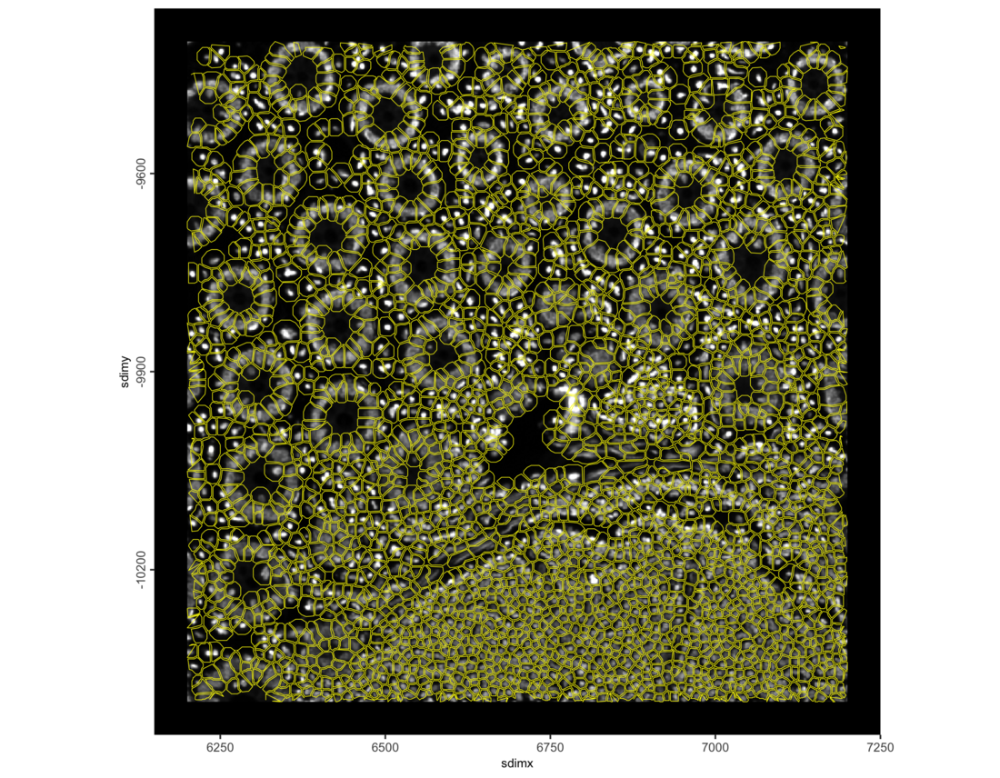
```

## Save

Backed Giotto projects write named snapshots of the analysis state to the
project directory, which can be treated as checkpoints.

```{r save-ingest, message = FALSE, eval = FALSE}
# The return value is needed since saveGiotto makes changes during the write
g <- saveGiotto(g, name = "ingest")
```

```
  backend : `gDirSource`
  path    : path/to/stereoseq_colon_cells_project
```

# Quality control and filtering

```{r stats, message = FALSE, eval = FALSE}
g <- addStatistics(g, expression_values = "raw")
cx <- pDataDT(g)
cat(sprintf("%s cells | median %d counts, %d features per cell\n",
    format(nrow(cx), big.mark = ","),
    median(cx$total_expr), median(cx$nr_feats))
)
```

```
101,479 cells | median 518 counts, 354 features per cell
```

Besides the mitochondrial transcripts, the most widely detected genes include
the immunoglobulins IGKC and JCHAIN, found in nearly every cell. The colon
mucosa is full of plasma cells, and their abundant transcripts spread to the
cells around them. Expect them among the markers of many clusters below.

```{r top-genes, eval = FALSE}
head(fDataDT(g)[order(-perc_cells), .(feat_ID, perc_cells)], 8)
```

```
   feat_ID perc_cells
    <char>      <num>
1:  MT-CO3   99.54178
2:    IGKC   98.94559
3:  MT-ND4   96.74317
4: MT-RNR2   95.99129
5:  MT-CYB   94.88071
6:     B2M   94.60085
7:  JCHAIN   92.20824
8:  MT-ND3   91.04741
```

A gene has to be detected in at least 100 cells to be kept. Genes found in
only a handful of the 100,000 cells otherwise get the same weight as any other
in the scaled PCA below, and Leiden then splits off small clusters held
together by a few rare transcripts.

```{r filter, eval = FALSE}
g <- filterGiotto(g,
    expression_threshold   = 1,
    feat_det_in_min_cells  = 100,
    min_det_feats_per_cell = 50,
    verbose = FALSE
)
cat(sprintf("%s cells x %s features retained\n",
    format(length(spatIDs(g)), big.mark = ","),
    format(nrow(fDataDT(g)), big.mark = ","))
)
```

```
100,837 cells x 15,985 features retained
```

# Normalize and select features

This is whole-transcriptome data, so highly variable features are selected
before the PCA.

```{r normalize, eval = FALSE}
g <- normalizeGiotto(g,
    scalefactor = 1e4,
    logbase = exp(1),
    log_offset = 1,
    scale_feats = FALSE,
    scale_cells = FALSE,
    verbose = FALSE
)
g <- calculateHVF(g,
    method = "var_p_resid",
    n_top_feats = 2000,
    verbose = FALSE
)
```

The highly variable features are chosen by Pearson residuals
(`method = "var_p_resid"`), which work on the raw counts and suit data with a
few hundred counts per cell.

# Dimension reduction

```{r pca, eval = FALSE}
g <- runPCA(g,
    feats_to_use = "hvf",
    ncp = 50,
    scale_unit = TRUE,
    center = TRUE,
    verbose = FALSE
)
screePlot(g, ncp = 50)
```

```{r pca-fig, echo = FALSE, out.width = "100%"}
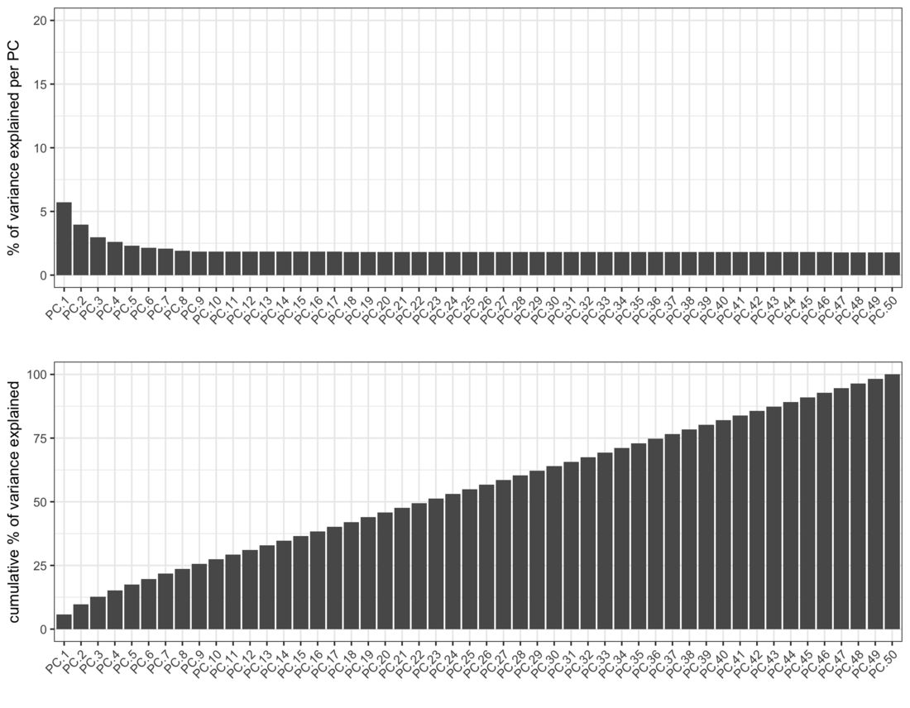
```

The scree plot flattens after about 15 PCs, so those are used below.

# Clustering

The kNN network is built first. `runUMAP()` then reuses it instead of
searching for neighbors again, and Leiden clusters on the same network. The
resolution is set on the high side: the cluster tree below groups the clusters
again, so it is better to split too much than too little.

```{r cluster, eval = FALSE}
dims_to_use <- 1:15

g <- createNearestNetwork(g,
    type = "kNN",
    dimensions_to_use = dims_to_use,
    k = 30,
    engine = "hnsw",
    verbose = FALSE
)
g <- runUMAP(g,
    dimensions_to_use = dims_to_use,
    n_neighbors = 30,
    min_dist = 0.3,
    verbose = FALSE
)
g <- doLeidenCluster(g,
    nn_network_to_use = "kNN",
    network_name = "kNN.pca",
    resolution = 2,
    n_iterations = 20,
    objective_function = "modularity",
    verbose = FALSE
)
table(pDataDT(g)$leiden_clus)
clusters <- GiottoUtils::mixedsort(unique(as.character(pDataDT(g)$leiden_clus)))
# one color per cluster, shared by the plots below
clus_colors <- stats::setNames(getDistinctColors(length(clusters)), clusters)

g <- saveGiotto(g, name = "clustered")
```

```

   1    2    3    4    5    6    7    8    9   10   11   12   13   14   15   16 
3896 4087 5664 6828 5247 3676 4761 2430 3556 4119 3995 3296 2026 5174 3514 5920 
  17   18   19   20   21   22   23   24 
4225 3304 7038 3849 2985 4886 6188  173
  backend : `gDirSource`
  path    : path/to/stereoseq_colon_cells_project
```

```{r umap, eval = FALSE}
plotUMAP(g,
    cell_color = "leiden_clus",
    color_as_factor = TRUE,
    cell_color_code = clus_colors,
    point_border_stroke = 0,
    point_size = 0.8
)
```

```{r umap-fig, echo = FALSE, out.width = "100%"}
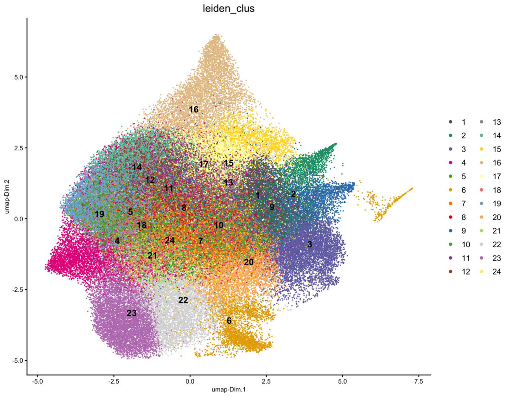
```

```{r spatial-clusters, fig.height = 8, eval = FALSE}
spatPlot2D(g,
    cell_color = "leiden_clus",
    color_as_factor = TRUE,
    cell_color_code = clus_colors,
    point_border_stroke = 0,
    point_size = 0.3,
    background_color = "black"
)
```

```{r spatial-clusters-fig, echo = FALSE, out.width = "100%"}
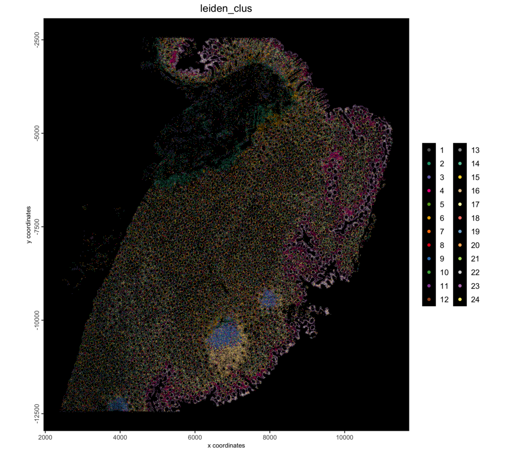
```

# Cell typing with a cluster tree

The clusters are grouped into a tree by how similar their expression is. Each
cluster and each branch of the tree then gets markers, and a language model
names them from those markers. Cutting the tree at a few levels gives cell type
labels from tissue compartments down to cell types.

## Build the cluster tree

```{r tree, fig.width = 11, fig.height = 6, eval = FALSE}
CLUS <- "leiden_clus"
hvf  <- fDataDT(g)[hvf == "yes"]$feat_ID

tree <- calculateClusterTree(g,
    cluster_column = CLUS,
    feats = hvf,
    cor = "pearson",
    distance = "average"
)
plot(tree, hang = -1)
```

```{r tree-fig, echo = FALSE, out.width = "100%"}
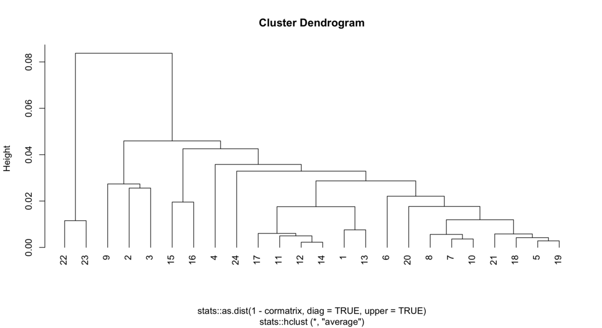
```

## Markers

```{r markers, eval = FALSE}
mk <- findMarkers_one_vs_all(g,
    method = "scran",
    cluster_column = CLUS,
    min_feats = 10,
    verbose = FALSE
)
gi <- findGiniMarkers_one_vs_all(g,
    cluster_column = CLUS,
    min_feats = 10,
    verbose = FALSE
)
nm <- findClusterTreeMarkers(g,
    cluster_column = CLUS,
    tree = tree,
    method = "scran",
    verbose = FALSE
)
```

## Assemble the annotation prompt

`writeClusterTreeQuery()` writes the tree, the per-cluster markers and the
markers of each split into one prompt for a language model, together with a
description of the sample.

```{r query, eval = FALSE}
prompt_file <- file.path(tempdir(), "stereoseq_colon_celltyping_prompt.txt")

q <- writeClusterTreeQuery(g,
    cluster_column = CLUS,
    tree = tree,
    markers = mk,
    gini_markers = gi,
    node_markers = nm,
    context = list(
        tissue = "human colon, FFPE section",
        assay = "Stereo-seq N FFPE whole-transcriptome, SAW 8.2 adjusted cellbin from ssDNA segmentation"
    ),
    file_name = prompt_file
)
cat(length(q), "lines\n")
```

```
399 lines
```

## Apply the annotation

The model answers with a cell type for each cluster and a short name for each
node of the tree. Its answer, checked against the markers above and against
where each cluster sits in the tissue, is written out below as `labels`. Leiden
cluster numbers can change between package versions or numbers of workers, so
check the markers before reusing these labels on your own run.

The first split of the tree separates the surface colonocytes, and the next
ones the lymphoid follicles with the smooth muscle around them, the IgG plasma
cells and the macrophages. Below that, the crypt epithelium and the lamina
propria between the crypts split into many clusters, and within each of these
two groups the clusters differ by less than 2%. Segmented cells pick up counts
from their neighbors, and in the mucosa every crypt cell borders IgA plasma
cells, so these clusters are gradients
rather than separate cell types. Cluster 24 (173 cells) has no recognizable
markers and is left unresolved.

`annotateClusterTree()` turns the tree into cell type columns at several
levels of detail: `k` is the number of groups at each level. Here the tree is
annotated at 5 groups, for the tissue compartments, and at 12 groups, for the
cell types.

```{r annotate, eval = FALSE}
labels <- list(
    # a cell type for each Leiden cluster
    clusters = c(
        "1"  = "lamina propria",
        "2"  = "smooth muscle",
        "3"  = "follicle lymphocytes",
        "4"  = "macrophages",
        "5"  = "crypt epithelium",
        "6"  = "Paneth-like cells",
        "7"  = "lower crypt epithelium",
        "8"  = "lower crypt epithelium",
        "9"  = "follicle B cells",
        "10" = "lower crypt epithelium",
        "11" = "lamina propria with smooth muscle",
        "12" = "IgA plasma cells",
        "13" = "lamina propria",
        "14" = "IgA plasma cells",
        "15" = "IgG plasma cells, mixed",
        "16" = "IgG plasma cells",
        "17" = "IgA plasma cells",
        "18" = "upper crypt epithelium",
        "19" = "crypt epithelium",
        "20" = "colonocytes, high mitochondrial",
        "21" = "transit colonocytes",
        "22" = "surface colonocytes",
        "23" = "absorptive colonocytes",
        "24" = "unresolved (CALHM6+)"
    ),
    # a short name for each node of the tree
    nodes = c(
        "23" = "all cells",
        "22" = "crypts, lamina propria and lymphoid tissue",
        "21" = "crypts, plasma cells and myeloid",
        "20" = "crypts, lamina propria and myeloid",
        "19" = "crypts and lamina propria",
        "18" = "crypts and lamina propria",
        "17" = "follicle and muscle",
        "16" = "follicle lymphocytes and smooth muscle",
        "15" = "crypt epithelium",
        "14" = "IgG plasma cells",
        "13" = "crypt epithelium",
        "12" = "lamina propria, IgA plasma cells",
        "11" = "crypt epithelium",
        "10" = "surface colonocytes",
        "9"  = "lamina propria",
        "8"  = "lamina propria, IgA plasma cells",
        "7"  = "upper crypt",
        "6"  = "lower crypt",
        "5"  = "lamina propria, IgA plasma cells",
        "4"  = "crypt epithelium",
        "3"  = "lower crypt",
        "2"  = "crypt epithelium",
        "1"  = "IgA plasma cells"
    )
)
lvls <- GiottoUtils::mixedsort(unique(as.character(pDataDT(g)[[CLUS]])))

g <- annotateClusterTree(g,
    tree = tree,
    labels = labels,
    cluster_column = CLUS,
    k = c(5, 12, length(lvls))
)
table(g$cell_types_k12)
```

```

 colonocytes, high mitochondrial                 crypt epithelium 
                            3849                            29884 
                follicle B cells             follicle lymphocytes 
                            3556                             5664 
                IgG plasma cells          IgG plasma cells, mixed 
                            5920                             3514 
lamina propria, IgA plasma cells                      macrophages 
                           22612                             6828 
               Paneth-like cells                    smooth muscle 
                            3676                             4087 
             surface colonocytes             unresolved (CALHM6+) 
                           11074                              173
```

```{r tree-annotated, fig.width = 14, fig.height = 10, eval = FALSE}
GiottoVisuals::plotClusterTree(g,
    cluster_column = CLUS,
    tree = tree,
    labels = labels,
    k = c(5, 12),
    gini_markers = gi,
    node_labels = FALSE
)
```

```{r tree-annotated-fig, echo = FALSE, out.width = "100%"}
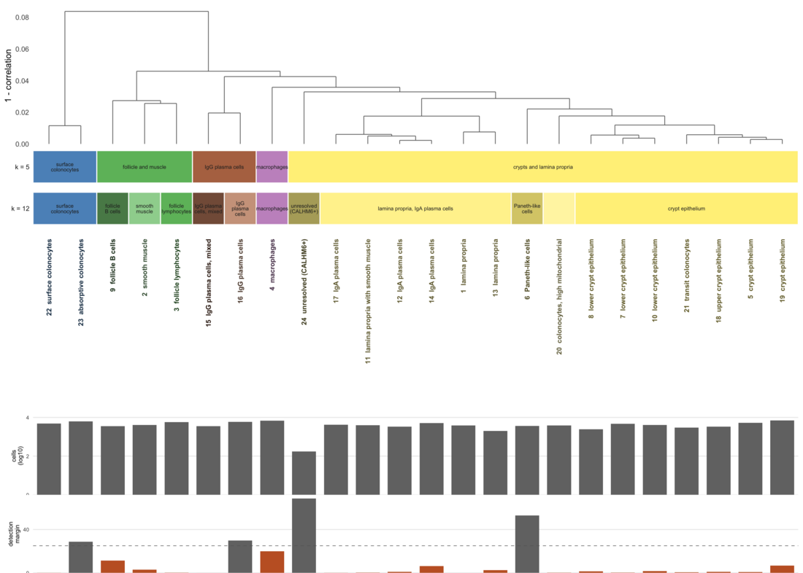
```

# Results

```{r spatial-k5, fig.width = 11, fig.height = 8, eval = FALSE}
# one hue per tissue compartment; the cell types below use shades of it
k5_colors <- c(
    "crypts and lamina propria" = "#146ff2",
    "follicle and muscle"       = "#0de5d0",
    "IgG plasma cells"          = "#e85f0e",
    "macrophages"               = "#b25b8d",
    "surface colonocytes"       = "#f2c23d"
)

spatPlot2D(g,
    color_as_factor = TRUE,
    cell_color = "cell_types_k5",
    cell_color_code = k5_colors,
    point_border_stroke = 0,
    point_size = 0.5,
    background_color = "black",
    theme_param = list(legend.position = "right")
)
```

```{r spatial-k5-fig, echo = FALSE, out.width = "100%"}
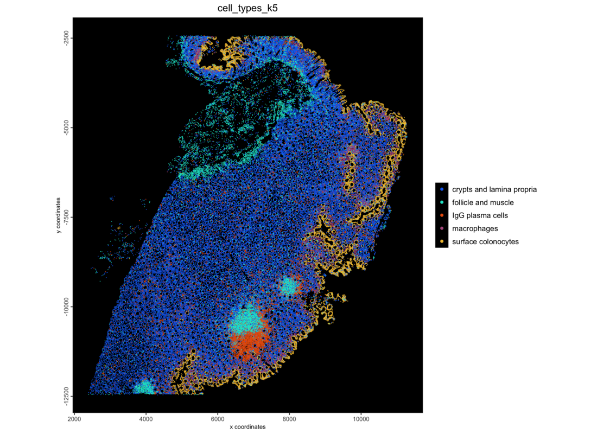
```

The cell types take shades of their compartment's color, reused in the zoom
below:

```{r spatial-k12, fig.width = 11, fig.height = 8, eval = FALSE}
k12_colors <- c(
    # crypts and lamina propria: blues
    "crypt epithelium"                 = "#146ff2",
    "colonocytes, high mitochondrial"  = "#62a0ff",
    "Paneth-like cells"                = "#4b3fd9",
    "lamina propria, IgA plasma cells" = "#b8d6ff",
    "unresolved (CALHM6+)"             = "#8c8c8c",
    # follicle and muscle: teals
    "follicle B cells"                 = "#0de5d0",
    "follicle lymphocytes"             = "#a2f7ee",
    "smooth muscle"                    = "#0b6b63",
    # IgG plasma cells: oranges
    "IgG plasma cells"                 = "#e85f0e",
    "IgG plasma cells, mixed"          = "#b3410a",
    "macrophages"                      = "#b25b8d",
    "surface colonocytes"              = "#f2c23d"
)

spatPlot2D(g,
    color_as_factor = TRUE,
    cell_color = "cell_types_k12",
    cell_color_code = k12_colors,
    point_border_stroke = 0,
    point_size = 0.5,
    background_color = "black",
    theme_param = list(legend.position = "right")
)
```

```{r spatial-k12-fig, echo = FALSE, out.width = "100%"}
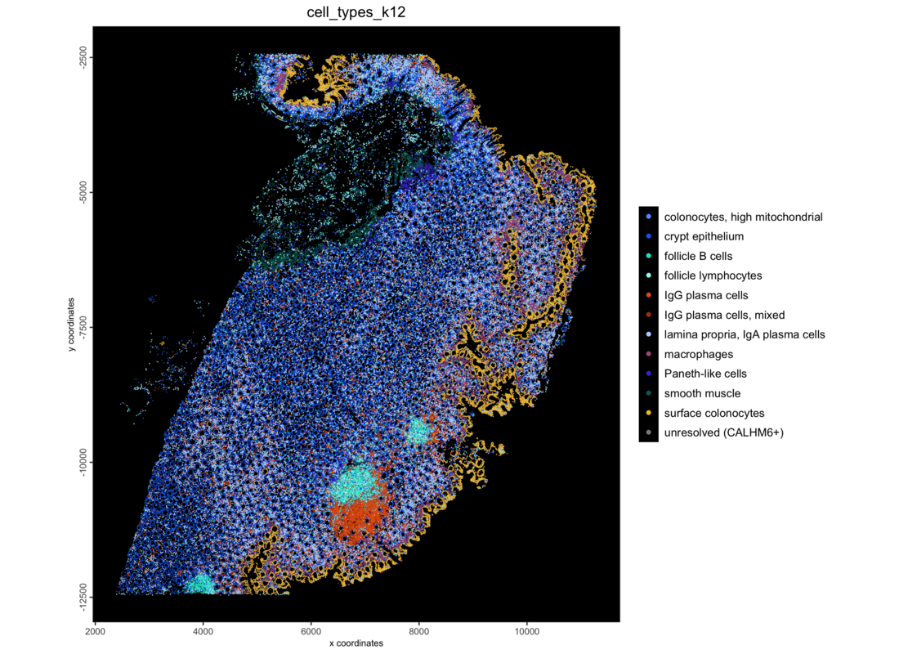
```

Zoom into the region from the start, with the cell polygons filled by cell
type over the ssDNA image:

```{r roi, fig.width = 10, fig.height = 7, eval = FALSE}
spatInSituPlotPoints(g,
    show_image = TRUE,
    feats = NULL,
    show_polygon = TRUE,
    polygon_feat_type = "cell",
    polygon_fill = "cell_types_k12",
    polygon_fill_as_factor = TRUE,
    polygon_fill_code = k12_colors,
    polygon_line_size = 0.1,
    polygon_alpha = 0.7,
    xlim = c(roi_x - half, roi_x + half),
    ylim = c(roi_y - half, roi_y + half)
)
```

```{r roi-fig, echo = FALSE, out.width = "100%"}
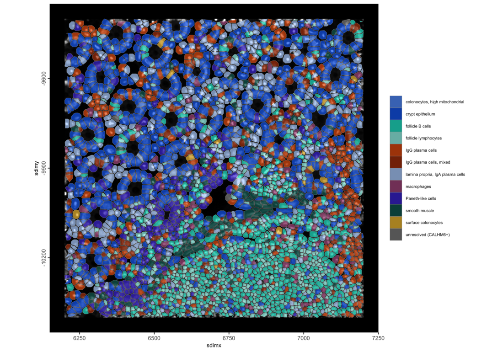
```

The same region, with the cells filled by the normalized expression of marker
genes: surface colonocytes (CEACAM7), the crypt epithelium (OLFM4), Paneth-like
cells at the crypt bases (DEFA5), IgA plasma cells (IGHA1), follicle B cells
(MS4A1) and smooth muscle (ACTA2):

```{r roi-genes, fig.width = 6, fig.height = 5.5, eval = FALSE}
marker_genes <- c("CEACAM7", "OLFM4", "DEFA5", "IGHA1", "MS4A1", "ACTA2")

for (gene in marker_genes) {
    print(spatInSituPlotPoints(g,
        show_image = TRUE,
        feats = NULL,
        show_polygon = TRUE,
        polygon_feat_type = "cell",
        polygon_fill = gene,
        expression_values = "normalized",
        polygon_fill_as_factor = FALSE,
        polygon_fill_gradient_style = "sequential",
        polygon_line_size = 0.1,
        polygon_alpha = 0.8,
        xlim = c(roi_x - half, roi_x + half),
        ylim = c(roi_y - half, roi_y + half),
        show_plot = FALSE,
        return_plot = TRUE
    ) + ggplot2::ggtitle(gene))
}
```

```{r roi-genes-fig, echo = FALSE, out.width = "100%"}
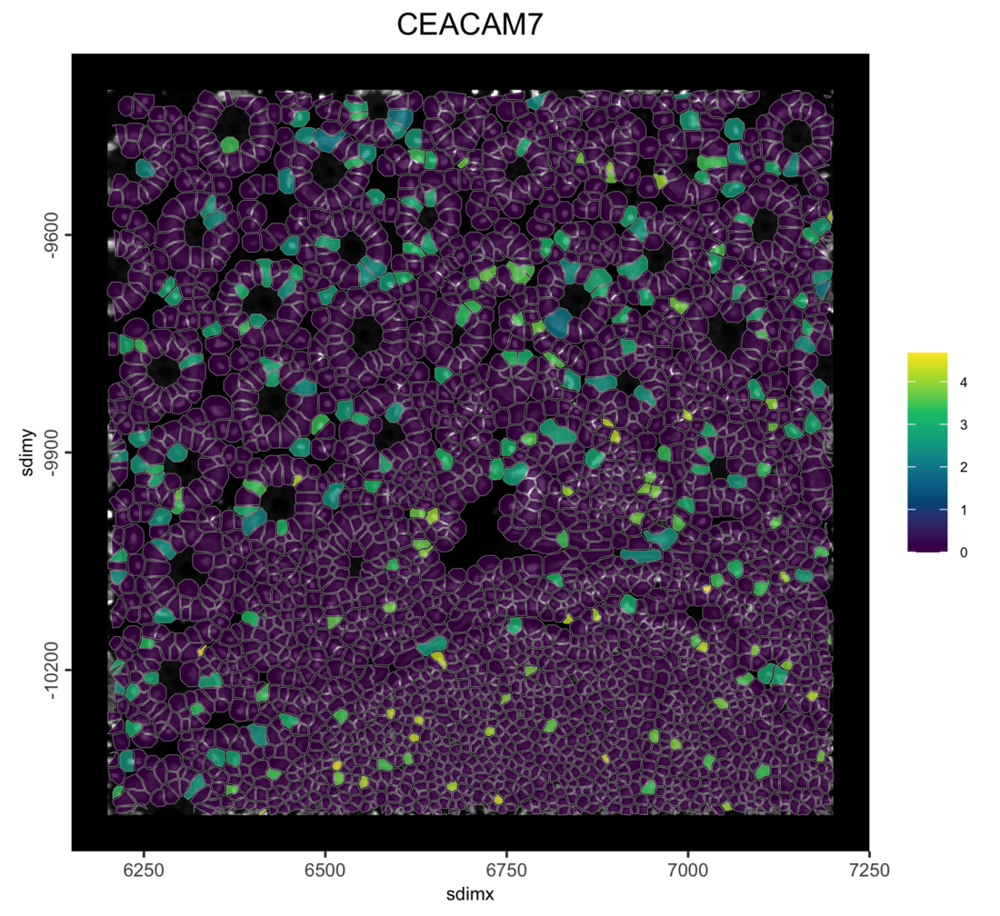
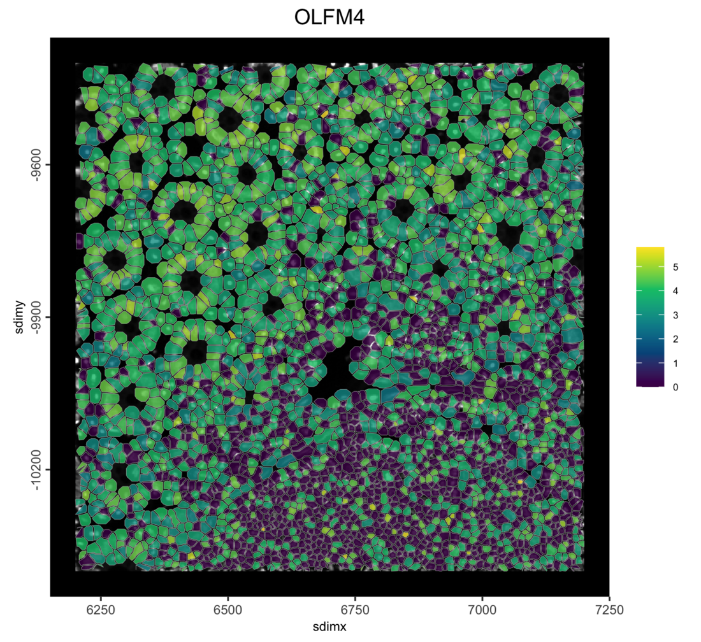
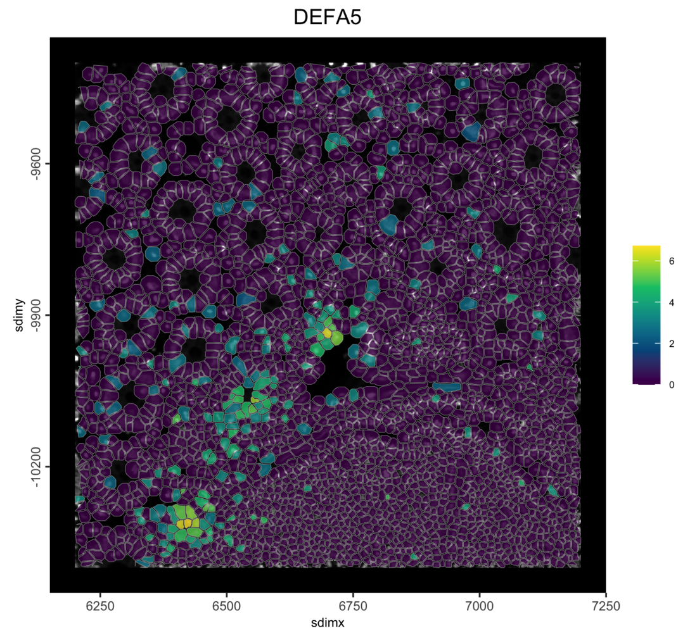
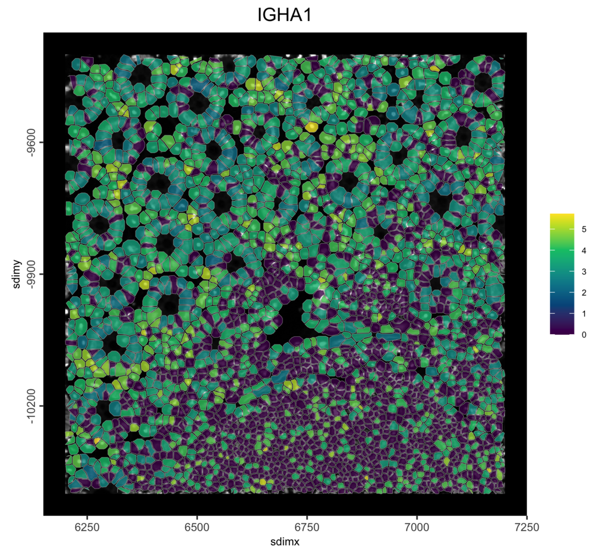
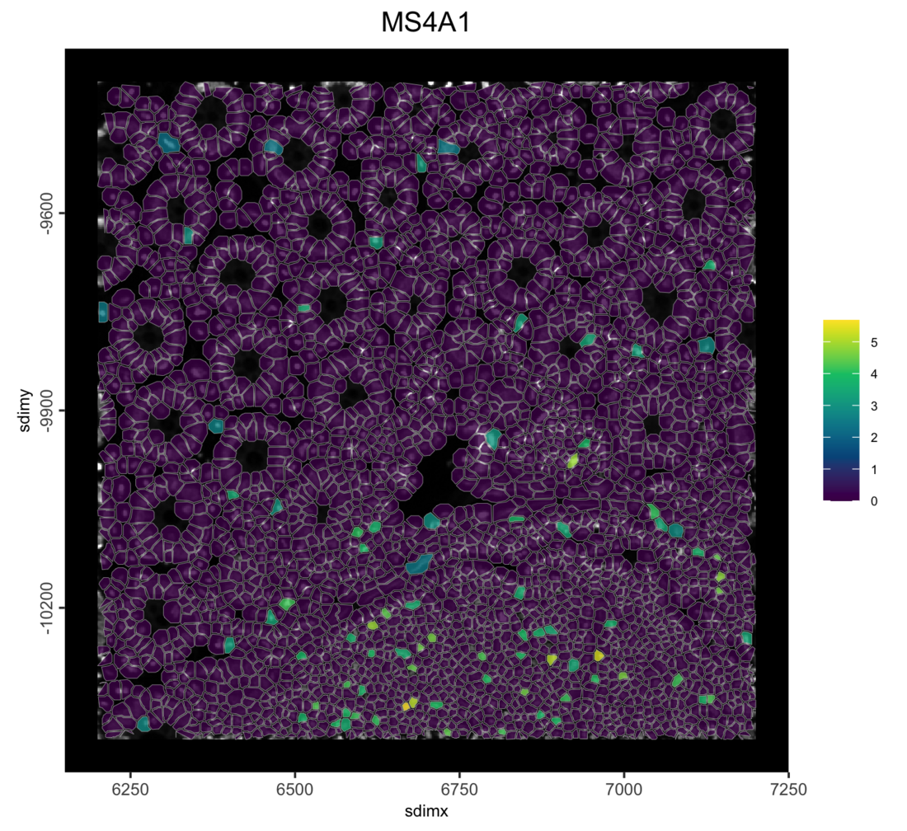
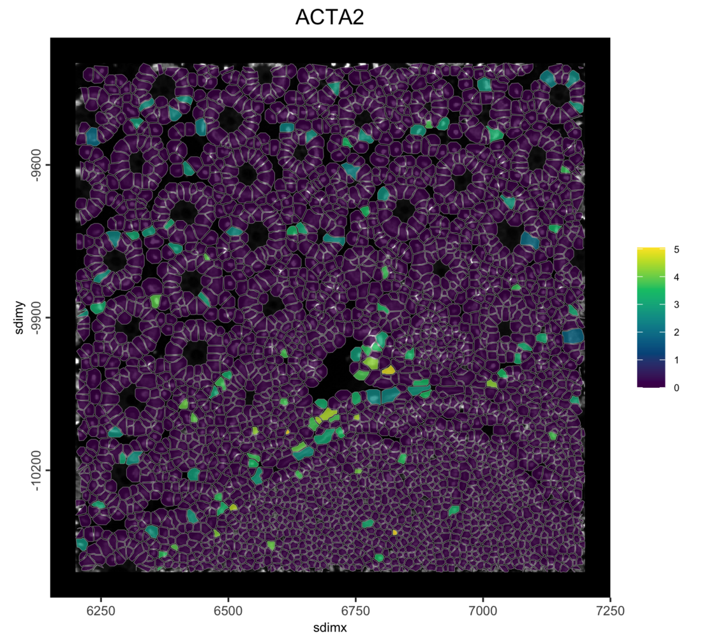
```

```{r save-annotated, message = FALSE, eval = FALSE}
g <- saveGiotto(g, name = "annotated")
```

```
  backend : `gDirSource`
  path    : path/to/stereoseq_colon_cells_project
```

The object is saved to the project directory and can be reloaded with
`loadGiotto(project_dir, name = "annotated")`.

# Spatial domains from hexagonal bins

Cells show which cell types are where. Larger units show how they are
organized: the epithelium, the lamina propria between the crypts, lymphoid
follicles and the muscle layers. Any set of polygons can become a spatial unit
in Giotto, so a grid of hexagons a few cells wide can be filled with the same
spots the cells were built from and analyzed with the same functions.

## Read the spots

The cellbin GEF holds counts per cell only. The spots are in the tissue GEF,
which the reader for cells can also load: `importStereoSeq()` returns a reader
whose `load_binpoints()` reads the spots, one point per spot with its gene
counts. `setGiotto()` adds them to the object as the `rna` features and
writes them to the project directory. This is the largest step of the
tutorial: the 70 million gene counts of 21.7 million spots are read into memory once before they are
written, which peaks at about 28 GB here.

```{r read-spots, message = FALSE, warning = FALSE, eval = FALSE}
reader <- importStereoSeq(data_dir, type = "cell", gef_type = "adjusted_cellbin")
spots <- reader$load_binpoints()
spots

g <- setGiotto(g, spots, verbose = FALSE)
# the spots are on disk now; free the in-memory copy
rm(spots)
invisible(gc())
```

```
An object of class giottoBinPoints
feat_type : "rna"
dimensions : 70502825, 2
compact    : TRUE
   feat_ID count
    <char> <num>
1:    BTG1     1
2:    MAOA     1
3:    MCM9     1
4:  MT-ND2     1
5:   SF3B2     1
6:  SLC7A1     1
```

The GEF records the distance between spots (`resolution`, in nm), so the grid
can be sized in µm:

```{r grid-scale, eval = FALSE}
gef_attr <- rhdf5::h5readAttributes(
    file.path(data_dir, "Y02357D814.tissue.gef"), "geneExp/bin1/expression"
)
um_to_px <- 1000 / as.numeric(gef_attr$resolution)
um_to_px
```

```
[1] 2
```

## Choose the bin size

`tessellate()` makes a grid of hexagons; `shape_size` is the width of one
hexagon, in spots. How many cells a hexagon holds depends on the tissue, so it
is worth counting before choosing. `terra::relate()` finds the hexagon each
cell center falls in:

```{r hex-size, message = FALSE, eval = FALSE}
# the spots' extent; the extent of g also covers the whole ssDNA image
spots_ext <- ext(getFeatureInfo(g, feat_type = "rna", return_giottoPoints = TRUE))

cell_locs <- getSpatialLocations(g, spat_unit = "cell", output = "data.table")
cell_pts <- terra::vect(as.data.frame(cell_locs), geom = c("sdimx", "sdimy"))

# which cells fall in which hexagon, for hexagons size_um wide
hex_members <- function(size_um) {
    hex <- tessellate(spots_ext,
        shape = "hexagon",
        shape_size = size_um * um_to_px,
        name = paste0("hex", size_um)
    )
    pairs <- terra::relate(hex[], cell_pts, "contains", pairs = TRUE)
    data.table::data.table(
        hex_ID = hex[]$poly_ID[pairs[, 1]],
        cell_ID = cell_locs$cell_ID[pairs[, 2]]
    )
}

size_table <- data.table::rbindlist(lapply(c(30, 40, 50, 60, 80, 100), function(size_um) {
    n <- hex_members(size_um)[, .N, by = hex_ID]$N
    data.table::data.table(
        width_um = size_um,
        hexagons_with_cells = length(n),
        median_cells = median(n),
        q25 = quantile(n, 0.25),
        q75 = quantile(n, 0.75)
    )
}))
size_table
```

```
   width_um hexagons_with_cells median_cells   q25   q75
      <num>               <int>        <num> <num> <num>
1:       30               17267            6     4     7
2:       40               10099           10     7    13
3:       50                6611           15    11    19
4:       60                4672           22    16    27
5:       80                2689           39    27    48
6:      100                1752           60    42    74
```

Hexagons 40 µm wide hold about 10 cells and hexagons 80 µm wide about 40,
which covers the 10 to 50 cells wanted here. Both are made below.

## Aggregate the spots

`calculateOverlap()` finds the hexagon each spot falls in, and
`overlapToMatrix()` sums the spots' counts per hexagon into a new expression
matrix. The grid covers the whole chip, so hexagons with fewer than 500 genes
detected, on the tissue edge or off the tissue, are dropped with
`subsetGiotto()`.

```{r hex-aggregate, message = FALSE, eval = FALSE}
hex_units <- c(hex40 = 40, hex80 = 80)

for (unit in names(hex_units)) {
    hex <- tessellate(spots_ext,
        shape = "hexagon",
        shape_size = hex_units[[unit]] * um_to_px,
        name = unit
    )
    g <- setGiotto(g, hex, centroids_to_spatlocs = TRUE, verbose = FALSE)
    g <- calculateOverlap(g, spat_info = unit, feat_info = "rna")
    g <- overlapToMatrix(g, spat_info = unit, feat_info = "rna", name = "raw")

    # keep the hexagons on the tissue
    g <- addStatistics(g, spat_unit = unit, expression_values = "raw", verbose = FALSE)
    on_tissue <- pDataDT(g, spat_unit = unit)[nr_feats >= 500, cell_ID]
    g <- subsetGiotto(g,
        spat_unit = unit,
        cell_ids = on_tissue,
        poly_info = unit,
        verbose = FALSE
    )
    cat(unit, ":", format(length(on_tissue), big.mark = ","), "hexagons on the tissue\n")
}
```

```
hex40 : 10,329 hexagons on the tissue
hex80 : 2,685 hexagons on the tissue
```

The hexagons over the crypts, the follicle and the muscle in a wider region
around the zoom from above, filled with the counts of OLFM4 (crypt epithelium)
and MS4A1 (follicle B cells):

```{r hex-roi, fig.width = 6, fig.height = 5.5, eval = FALSE}
half_wide <- 1500 # spots; 0.75 mm

for (unit in names(hex_units)) {
    for (gene in c("OLFM4", "MS4A1")) {
        print(spatInSituPlotPoints(g,
            show_image = TRUE,
            feats = NULL,
            show_polygon = TRUE,
            polygon_feat_type = unit,
            polygon_fill = gene,
            expression_values = "raw",
            polygon_fill_as_factor = FALSE,
            polygon_fill_gradient_style = "sequential",
            polygon_line_size = 0.1,
            polygon_alpha = 0.8,
            xlim = c(roi_x - half_wide, roi_x + half_wide),
            ylim = c(roi_y - half_wide, roi_y + half_wide),
            show_plot = FALSE,
            return_plot = TRUE
        ) + ggplot2::ggtitle(paste0(gene, ", ", unit)))
    }
}
```

```{r hex-roi-fig, echo = FALSE, out.width = "100%"}
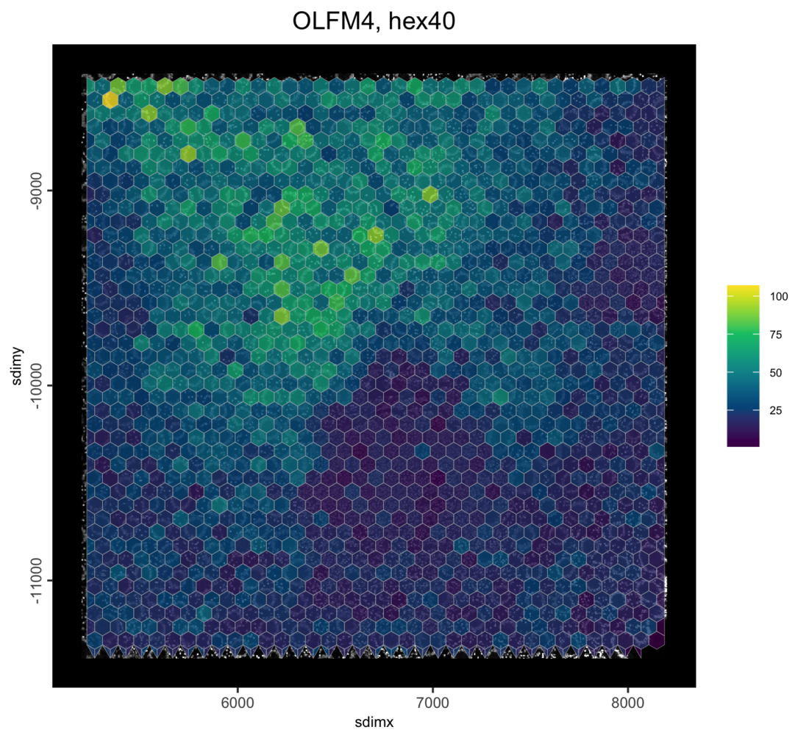
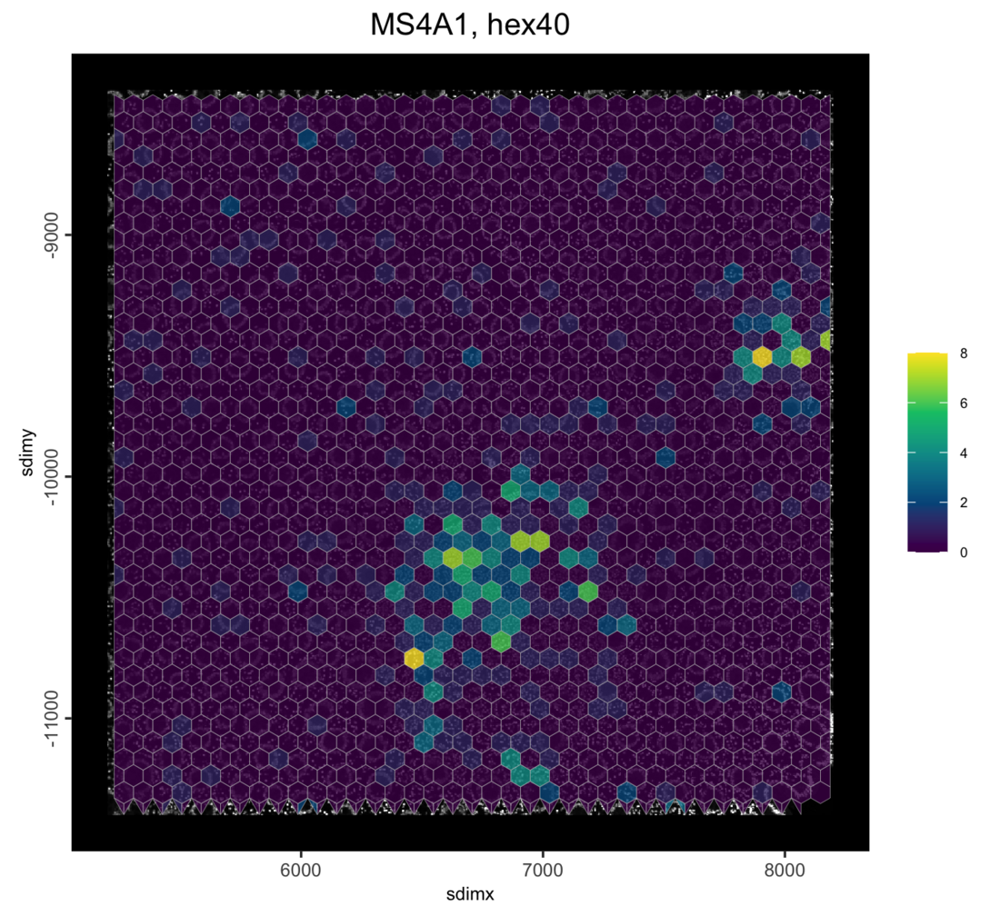
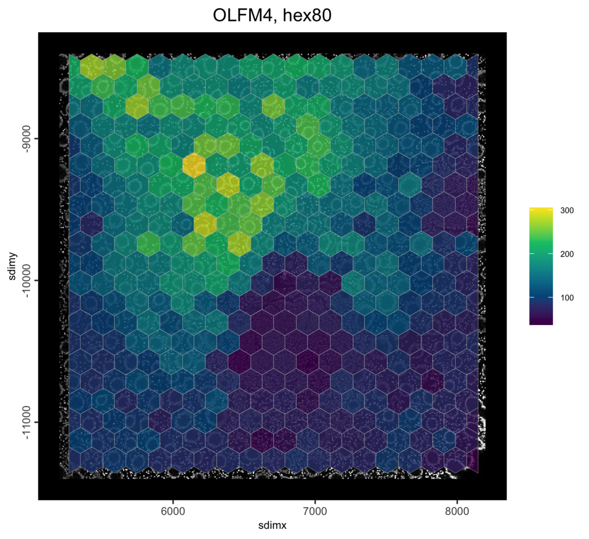
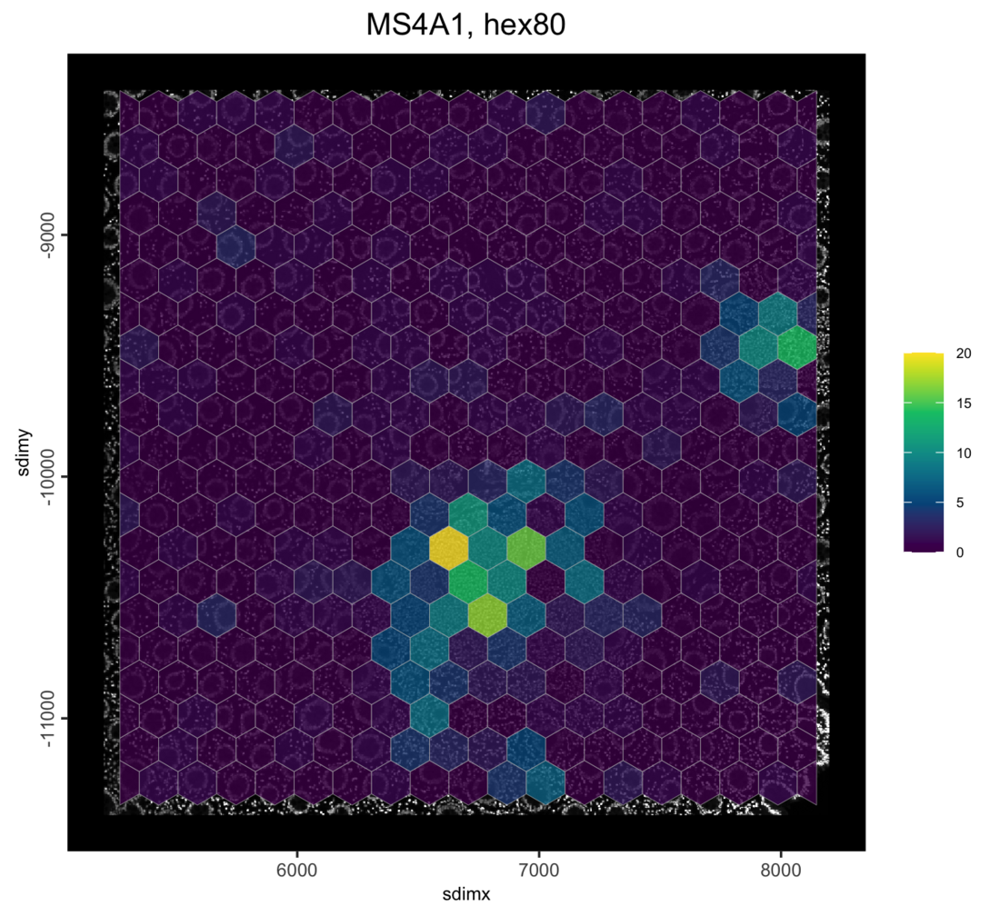
```

## Domains from expression

The hexagons go through the same steps as the cells: normalization, highly
variable features, PCA, a kNN network and Leiden clustering, each with
`spat_unit` set to the grid. A hexagon averages over its cells, so a lower
resolution than for the cells gives a few large domains.

```{r hex-domains, eval = FALSE}
for (unit in names(hex_units)) {
    g <- normalizeGiotto(g,
        spat_unit = unit,
        scalefactor = 1e4,
        scale_feats = FALSE,
        scale_cells = FALSE,
        verbose = FALSE
    )
    g <- calculateHVF(g,
        spat_unit = unit,
        method = "var_p_resid",
        n_top_feats = 2000,
        show_plot = FALSE,
        return_plot = FALSE
    )
    g <- runPCA(g,
        spat_unit = unit,
        feats_to_use = "hvf",
        ncp = 30,
        scale_unit = TRUE,
        center = TRUE
    )
    g <- createNearestNetwork(g,
        spat_unit = unit,
        type = "kNN",
        dimensions_to_use = 1:15,
        k = 15,
        engine = "hnsw",
        verbose = FALSE
    )
    g <- doLeidenCluster(g,
        spat_unit = unit,
        nn_network_to_use = "kNN",
        network_name = "kNN.pca",
        resolution = 0.8,
        n_iterations = 20,
        objective_function = "modularity",
        name = "domain",
        verbose = FALSE
    )
}
table(pDataDT(g, spat_unit = "hex40")$domain)
table(pDataDT(g, spat_unit = "hex80")$domain)
```

```

   1    2    3    4    5    6    7    8 
1673 2112 1685 1549  539 1105  922  744

  1   2   3   4   5   6   7   8 
594  99 415 188 229 446 492 222
```

```{r hex-domains-plot, fig.width = 9, fig.height = 8, eval = FALSE}
for (unit in names(hex_units)) {
    print(spatPlot2D(g,
        spat_unit = unit,
        cell_color = "domain",
        color_as_factor = TRUE,
        point_shape = "no_border",
        point_size = if (unit == "hex40") 0.6 else 1.6,
        background_color = "black",
        show_plot = FALSE,
        return_plot = TRUE
    ) + ggplot2::ggtitle(paste("Expression domains,", unit)))
}
```

```{r hex-domains-plot-fig, echo = FALSE, out.width = "100%"}
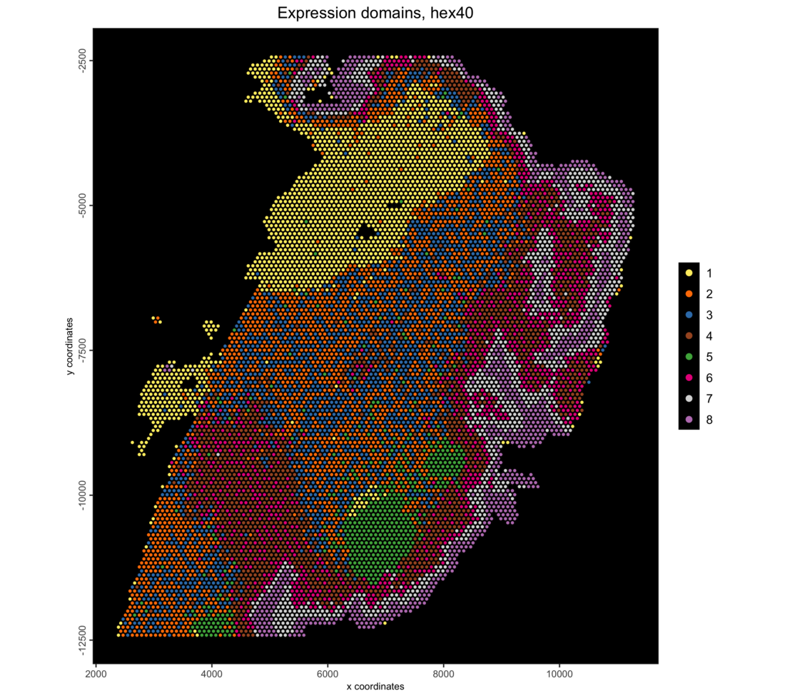
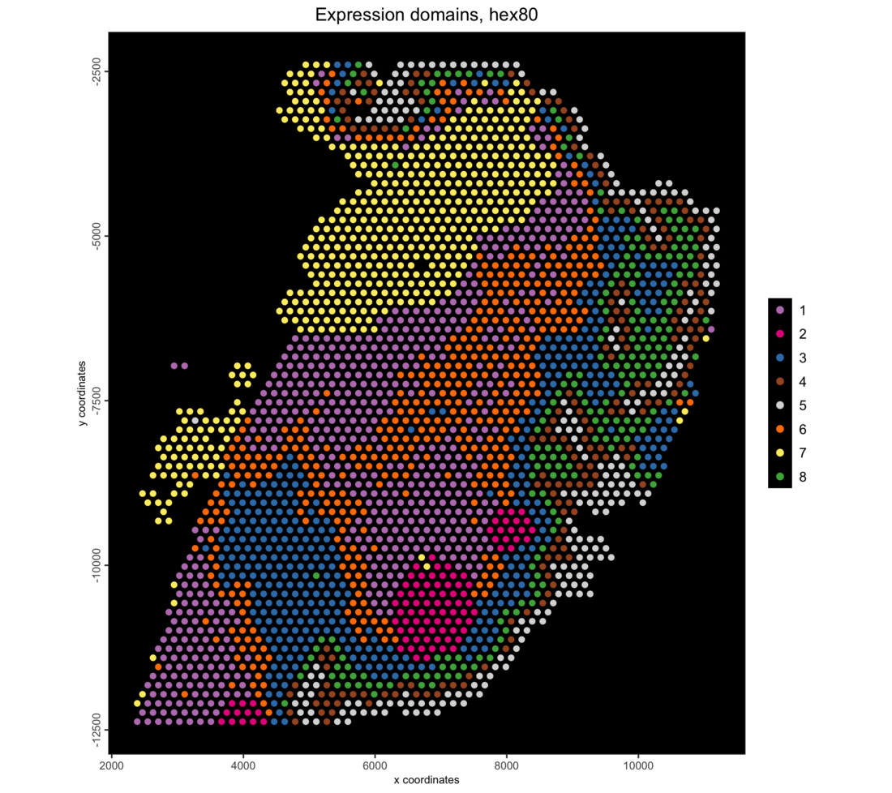
```

The top markers of each domain in the 80 µm grid:

```{r hex-domain-markers, fig.width = 8, fig.height = 9, eval = FALSE}
dom_markers <- findMarkers_one_vs_all(g,
    spat_unit = "hex80",
    method = "scran",
    cluster_column = "domain",
    min_feats = 5,
    verbose = FALSE
)
top_dom <- unique(dom_markers[, head(feats, 4), by = cluster]$V1)

plotMetaDataHeatmap(g,
    spat_unit = "hex80",
    expression_values = "normalized",
    metadata_cols = "domain",
    selected_feats = top_dom,
    return_plot = FALSE
)
```

```{r hex-domain-markers-fig, echo = FALSE, out.width = "100%"}
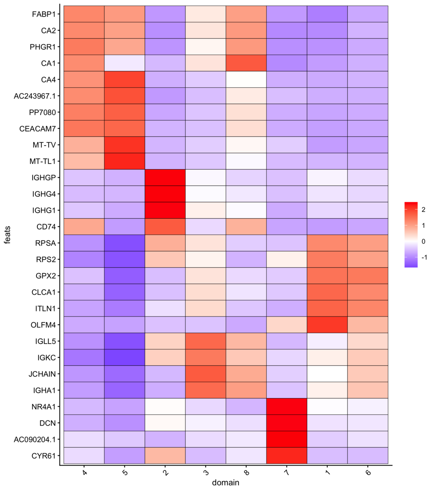
```

The domains follow the layers of the mucosa. From the lumen inwards:

* domains 4 and 5: surface epithelium (FABP1, CA2, CEACAM7, CA4)
* domain 8: upper crypts (CA1, FABP1)
* domains 1 and 6: crypts (OLFM4, GPX2, CLCA1, ITLN1)
* domain 3: lamina propria with IgA plasma cells (IGKC, JCHAIN, IGHA1)
* domain 2: the lymphoid follicle and IgG plasma cells (IGHG1, CD74)
* domain 7: submucosa and muscle (DCN, NR4A1, CYR61)

## Niches from cell types

The second view groups the hexagons on which cell types they hold. The cell to
hexagon table from `hex_members()` gives the groups, and
`calculateLabelProportions()` counts the cell types of each group. k-means on
those proportions gives the niches:

```{r hex-niches, eval = FALSE}
members <- hex_members(80)
members <- members[hex_ID %in% spatIDs(g, spat_unit = "hex80")]

props <- calculateLabelProportions(g,
    labels = "cell_types_k12",
    groups = members,
    column_group_id = "hex_ID",
    spat_unit = "cell",
    output = "matrix"
)

set.seed(1234)
km <- kmeans(props, centers = 8, nstart = 20)
niches <- data.table::data.table(cell_ID = rownames(props), niche = factor(km$cluster))
g <- addCellMetadata(g,
    spat_unit = "hex80",
    new_metadata = niches,
    by_column = TRUE,
    column_cell_ID = "cell_ID"
)
```

The mix of cell types in each niche:

```{r hex-niche-composition, fig.width = 9, fig.height = 5, eval = FALSE}
niche_mix <- data.table::as.data.table(as.table(km$centers))
data.table::setnames(niche_mix, c("niche", "cell_type", "fraction"))

ggplot2::ggplot(niche_mix, ggplot2::aes(cell_type, niche, fill = fraction)) +
    ggplot2::geom_tile() +
    ggplot2::geom_text(ggplot2::aes(label = round(fraction, 2)), size = 3) +
    ggplot2::scale_fill_gradient(low = "white", high = "darkred") +
    ggplot2::theme_minimal() +
    ggplot2::theme(axis.text.x = ggplot2::element_text(angle = 45, hjust = 1)) +
    ggplot2::labs(x = NULL, y = "niche")
```

```{r hex-niche-composition-fig, echo = FALSE, out.width = "100%"}
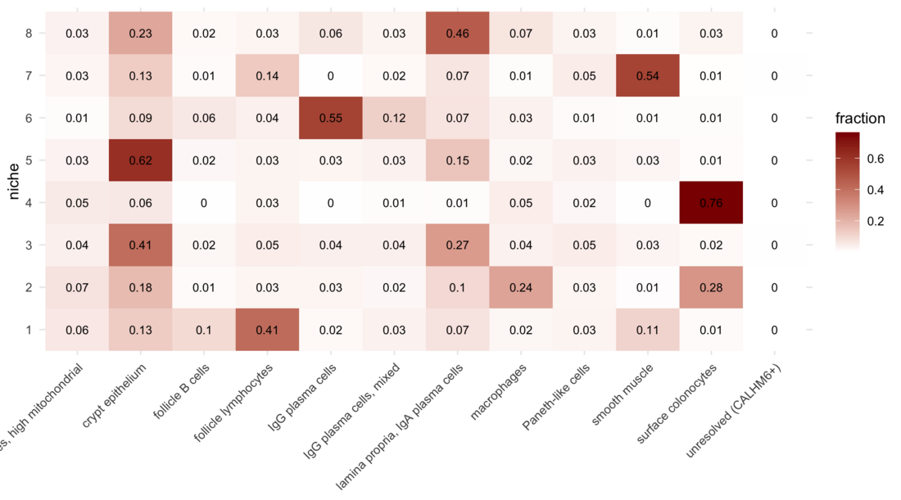
```

```{r hex-niches-plot, fig.width = 9, fig.height = 8, eval = FALSE}
spatPlot2D(g,
    spat_unit = "hex80",
    cell_color = "niche",
    color_as_factor = TRUE,
    point_shape = "no_border",
    point_size = 1.6,
    background_color = "black",
    show_plot = FALSE,
    return_plot = TRUE
) + ggplot2::ggtitle("Cell type niches, hex80")
```

```{r hex-niches-plot-fig, echo = FALSE, out.width = "100%"}
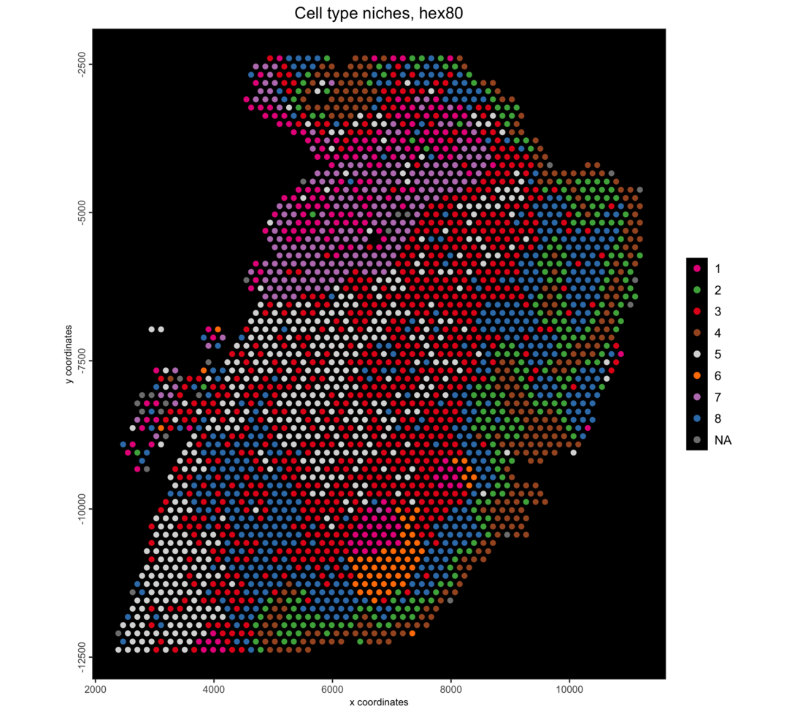
```

## Compare the two

Each hexagon now has an expression domain and a niche. Hexagons without
annotated cells have no niche. The share of each domain's hexagons in each
niche:

```{r hex-compare, fig.width = 7, fig.height = 5, eval = FALSE}
hex80_meta <- pDataDT(g, spat_unit = "hex80")
overlap_tab <- hex80_meta[!is.na(niche), .N, by = .(domain, niche)]
overlap_tab[, share := N / sum(N), by = domain]

ggplot2::ggplot(overlap_tab, ggplot2::aes(niche, factor(domain), fill = share)) +
    ggplot2::geom_tile() +
    ggplot2::geom_text(ggplot2::aes(label = N, color = share > 0.6), size = 3) +
    ggplot2::scale_color_manual(values = c("black", "white"), guide = "none") +
    ggplot2::scale_fill_gradient(low = "white", high = "darkblue") +
    ggplot2::theme_minimal() +
    ggplot2::labs(x = "niche", y = "expression domain")
```

```{r hex-compare-fig, echo = FALSE, out.width = "100%"}
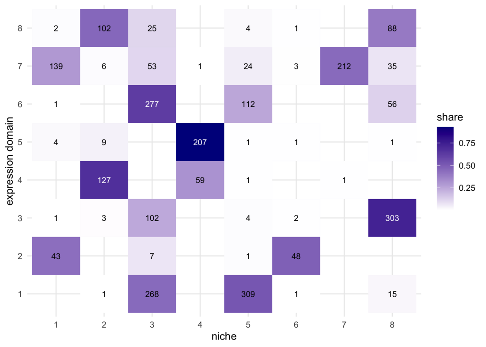
```

The two views agree where one cell type dominates:

* the surface epithelium (domain 5 is niche 4)
* the lamina propria with IgA plasma cells (domain 3 is mostly niche 8)
* the follicle with its IgG plasma cells (domain 2 is niches 1 and 6)

They differ in two places:

* **The crypts.** Expression splits them into domains 1 and 6, which hold the
  same cell types (niches 3 and 5). The hexagons differ in how much OLFM4 and
  goblet cell genes their crypt cells express, which one crypt epithelium type
  does not resolve.
* **The submucosa.** Domain 7 holds two niches, smooth muscle (niche 7) and
  lymphocyte aggregates (niche 1). The stromal genes dominate both in the
  summed expression, while the cell types tell them apart.

Expression domains need no cell segmentation and keep the spots between
cells. Niches depend on the cell typing and are easier to name. Used together,
each one points to where the other needs a closer look.

```{r save-hexbins, message = FALSE, eval = FALSE}
g <- saveGiotto(g, name = "hexbins")
```

```
  backend : `gDirSource`
  path    : path/to/stereoseq_colon_cells_project
```

The object is saved to the project directory and can be reloaded with
`loadGiotto(project_dir, name = "hexbins")`.

# Further reading

* [Stereo-seq mouse testis: segmented cells](stereoseq_testis_cells_giottodisk.html),
  the same steps on a fresh frozen section
* [Stereo-seq mouse testis: your own polygons](stereoseq_testis_own_polygons_giottodisk.html),
  which aggregates the spots into any polygons, from cells to a grid
* [Stereo-seq Data Import](stereoseq_importer.html), which covers the readers
  and the files in a SAW output directory

# Run time and memory

How long each section of this tutorial took and the most memory it used, on a
run of this tutorial on an Apple M2 Ultra with 24 cores and 192 GB of memory,
with the 8 workers set in [Setup](#setup). The data were read from an external
SSD and the project written to the internal disk. The whole tutorial took
about 5.5 minutes. The cell analysis peaks at 4.8 GB while reading the data;
reading the spots for the hexagonal bins raises the peak to 28 GB, and the
memory R takes for it stays with the session until it ends.

```{r runcost-fig, echo = FALSE, out.width = "100%"}
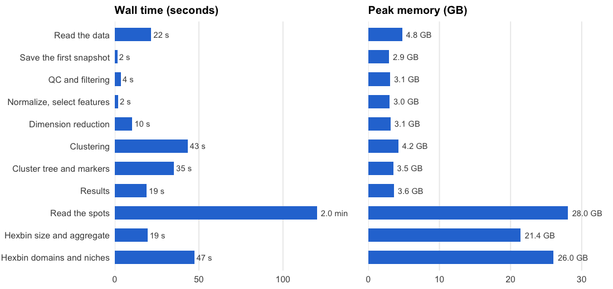
```

Memory is what macOS counts for the R session and its workers together (the
Memory column of Activity Monitor), sampled once a second; each bar is the
highest value during that section. Fewer workers in [Setup](#setup) lower it.

<details>
<summary>Time and memory per section</summary>

| Section | Time | Memory |
|:--------|-----:|-----:|
| Read the data | 22 s | 4.8 GB |
| Save the first snapshot | 2 s | 2.9 GB |
| QC and filtering | 4 s | 3.1 GB |
| Normalize, select features | 2 s | 3.0 GB |
| Dimension reduction | 10 s | 3.1 GB |
| Clustering | 43 s | 4.2 GB |
| Cluster tree and markers | 35 s | 3.5 GB |
| Results | 19 s | 3.6 GB |
| Read the spots | 2.0 min | 28.0 GB |
| Hexbin size and aggregate | 19 s | 21.4 GB |
| Hexbin domains and niches | 47 s | 26.0 GB |

</details>

# Session info

```{r session, eval = FALSE}
sessionInfo()
```

```
R version 4.5.1 (2025-06-13)
Platform: aarch64-apple-darwin20
Running under: macOS Sonoma 14.5

Matrix products: default
BLAS:   /Library/Frameworks/R.framework/Versions/4.5-arm64/Resources/lib/libRblas.0.dylib 
LAPACK: /Library/Frameworks/R.framework/Versions/4.5-arm64/Resources/lib/libRlapack.dylib;  LAPACK version 3.12.1

locale:
[1] en_US/C/en_US/C/en_US/en_US

time zone: America/New_York
tzcode source: internal

attached base packages:
[1] stats     graphics  grDevices utils     datasets  methods   base     

other attached packages:
[1] GiottoDisk_0.0.0.6 Giotto_4.3.5       GiottoClass_0.7.26 arrow_23.0.1.2    

loaded via a namespace (and not attached):
  [1] RColorBrewer_1.1-3          ggdendro_0.2.0             
  [3] jsonlite_2.0.0              wk_0.9.5                   
  [5] magrittr_2.0.4              magick_2.9.1               
  [7] farver_2.1.2                rmarkdown_2.31             
  [9] vctrs_0.7.2                 memoise_2.0.1              
 [11] GiottoUtils_0.2.9           terra_1.9-11               
 [13] htmltools_0.5.9             S4Arrays_1.8.1             
 [15] BiocNeighbors_2.2.0         Rhdf5lib_1.30.0            
 [17] SparseArray_1.8.1           rhdf5_2.52.1               
 [19] sass_0.4.10                 parallelly_1.46.1          
 [21] bslib_0.10.0                htmlwidgets_1.6.4          
 [23] plotly_4.12.0               cachem_1.1.0               
 [25] igraph_2.2.2                lifecycle_1.0.5            
 [27] pkgconfig_2.0.3             rsvd_1.0.5                 
 [29] Matrix_1.7-3                R6_2.6.1                   
 [31] fastmap_1.2.0               GenomeInfoDbData_1.2.14    
 [33] MatrixGenerics_1.20.0       future_1.70.0              
 [35] digest_0.6.39               colorspace_2.1-2           
 [37] S4Vectors_0.48.1            dqrng_0.4.1                
 [39] irlba_2.3.7                 GenomicRanges_1.60.0       
 [41] beachmat_2.24.0             filelock_1.0.3             
 [43] labeling_0.4.3              progressr_0.19.0           
 [45] httr_1.4.8                  polyclip_1.10-7            
 [47] abind_1.4-8                 compiler_4.5.1             
 [49] bit64_4.6.0-1               withr_3.0.2                
 [51] S7_0.2.1                    backports_1.5.1            
 [53] BiocParallel_1.42.2         DBI_1.3.0                  
 [55] viridis_0.6.5               ggforce_0.5.0              
 [57] R.utils_2.13.0              duckdb_1.5.6               
 [59] sedonadb_0.5.0.9000         MASS_7.3-65                
 [61] DelayedArray_0.34.1         rjson_0.2.23               
 [63] bluster_1.18.0              gtools_3.9.5               
 [65] GiottoVisuals_0.2.16        tools_4.5.1                
 [67] otel_0.2.0                  future.apply_1.20.2        
 [69] R.oo_1.27.1                 glue_1.8.0                 
 [71] rhdf5filters_1.20.0         grid_4.5.1                 
 [73] checkmate_2.3.4             cluster_2.1.8.3            
 [75] generics_0.1.4              gtable_0.3.6               
 [77] R.methodsS3_1.8.2           tidyr_1.3.2                
 [79] data.table_1.18.2.1         metapod_1.18.0             
 [81] BiocSingular_1.24.0         tidygraph_1.3.1            
 [83] ScaledMatrix_1.16.0         XVector_0.48.0             
 [85] BiocGenerics_0.54.1         tilework_1.0.0             
 [87] ggrepel_0.9.8               pillar_1.11.1              
 [89] limma_3.64.3                RcppHNSW_0.7.0             
 [91] nanoarrow_0.9.0             dplyr_1.2.0                
 [93] tweenr_2.0.3                lattice_0.22-7             
 [95] bit_4.6.0                   tidyselect_1.2.1           
 [97] locfit_1.5-9.12             SingleCellExperiment_1.30.1
 [99] scuttle_1.20.0              knitr_1.51                 
[101] gridExtra_2.3               IRanges_2.42.0             
[103] Seqinfo_1.0.0               edgeR_4.6.3                
[105] SummarizedExperiment_1.38.1 scattermore_1.2            
[107] stats4_4.5.1                xfun_0.61                  
[109] graphlayouts_1.2.3          Biobase_2.68.0             
[111] statmod_1.5.1               matrixStats_1.5.0          
[113] UCSC.utils_1.4.0            lazyeval_0.2.2             
[115] yaml_2.3.12                 GiottoKernels_0.3.0        
[117] evaluate_1.0.5              codetools_0.2-20           
[119] ggraph_2.2.2                tibble_3.3.1               
[121] colorRamp2_0.1.0            cli_3.6.5                  
[123] uwot_0.2.4                  reticulate_1.45.0          
[125] jquerylib_0.1.4             Rcpp_1.1.2                 
[127] GenomeInfoDb_1.44.3         globals_0.19.1             
[129] dbplyr_2.5.2                png_0.1-9                  
[131] parallel_4.5.1              ggplot2_4.0.2              
[133] assertthat_0.2.1            scran_1.38.1               
[135] listenv_0.10.1              SpatialExperiment_1.20.0   
[137] geoarrow_0.4.4              viridisLite_0.4.3          
[139] scales_1.4.0                purrr_1.2.1                
[141] crayon_1.5.3                rlang_1.1.7                
[143] cowplot_1.2.0
```
