# Overview

This tutorial analyzes the 925,850 cells that STOmics' SAW pipeline segmented
on a whole mouse embryo section, the
STOmics [Mouse Embryo Y40056J8K9](https://en.stomics.tech/col2028) demo dataset on a 2 × 2 cm
chip. It reads the cells into an on-disk GiottoDisk project, clusters them and
names the clusters with a cluster tree. It then finds spatial domains by
smoothing each cell's expression with that of its neighbors, without loading
the 0.5 µm spots. The whole tutorial runs in about 26 minutes with 8
parallel workers and peaks at about 57 GB of memory;
[Run time and memory](#run-time-and-memory) shows each step.

The [Stereo-seq human colon](stereoseq_human_colon_cells_giottodisk.html)
tutorial runs the same cell analysis on a smaller section, and builds its
spatial domains from the spots instead.

# Install extra packages

This tutorial uses GiottoDisk for on-disk processing. These are preview dev
builds off the dev and gsource Giotto package branches. If GiottoDisk has not
been installed yet, use the following:

```{r install, eval = FALSE}
# GiottoDisk install
GiottoUtils::suite_install("GiottoDisk")
# Optional for matrix maths speedup:
install.packages("GiottoKernels",
    repos = c("https://giotto-suite.r-universe.dev", "https://cloud.r-project.org")
)
```

# Dataset explanation

A formalin-fixed paraffin-embedded (FFPE) sagittal section of a whole mouse
embryo on a 2 × 2 cm Stereo-seq chip (Y40056J8K9), made with the Stereo-seq N
FFPE V1.1 kit, stained for single-stranded DNA (ssDNA) and processed with SAW
8.3. It is the STOmics [Mouse Embryo Y40056J8K9](https://en.stomics.tech/col2028) demo dataset. Stereo-seq captures transcripts
on spots 0.5 µm apart; SAW sums them into square bins and, separately, into
cells.

SAW segments the nuclei in the ssDNA image and assigns the spots to cells.
`Y40056J8K9.adjusted.cellbin.gef` holds the result of SAW's cell correction,
which refines which spots belong to each cell. This tutorial uses these
adjusted cells, the default of the Giotto readers: 925,850 cells with a median
of 849 counts and 623 genes each. The uncorrected `Y40056J8K9.cellbin.gef`
has half as many counts per cell. The spots themselves, in
`Y40056J8K9.tissue.gef` (17 GB), are not needed here.

| File | Size | Contents |
|:-----|-----:|:---------|
| `Y40056J8K9.adjusted.cellbin.gef` | 4.2 GB | cell by gene counts, cell outlines |
| `Y40056J8K9_ssDNA_regist.tif` | 598 MB | ssDNA image, registered to the chip |

## Download links

The [dataset page](https://en.stomics.tech/col2028) lists all the files of this chip. The two used
here can also be fetched directly from the STOmics demo server; put them in
one folder:

```{bash download, eval = FALSE}
base=https://demo.stomicsdb.tech/Y40056J8K9_Mouse_Embryo_Stereo-seq_FFPE_LCD_V1.1_ssDNA/outs
curl -C - -O $base/Y40056J8K9.adjusted.cellbin.gef
curl -C - -O $base/Y40056J8K9_ssDNA_regist.tif
```

The Giotto Stereo-seq readers take this folder as downloaded, with the files
side by side, as well as a SAW `outs/` directory with `feature_expression/` and
`image/` subdirectories.

# Setup

```{r libs, message = FALSE, warning = FALSE, eval = FALSE}
library(arrow) # this must be libraried before terra or GiottoClass
library(Giotto)
library(GiottoDisk)

data_dir    <- Sys.getenv("EMBRYO_DATA_DIR", "path/to/Y40056J8K9")
project_dir <- Sys.getenv("EMBRYO_PROJECT_DIR", "path/to/stereoseq_embryo_cells_project")

# set an appropriate amount of parallel workers for your computer
future::plan(future::multisession, workers = 8)
```

# Read the data

`sourceCreate()` sets up a `gDirSource`: a managed project directory that holds
the object on disk. `setArtifactDumpDir()` points the expression and spatial
writes at it.

```{r backend, eval = FALSE}
# declare a Giotto directory backend to use
gdsrc <- GiottoDisk::sourceCreate(project_dir, type = "gDirSource")
# point data content writes to the backend's artifact subdirectory
GiottoDisk::setArtifactDumpDir(gdsrc)
```

`createGiottoStereoSeqObjectCell()` reads the adjusted cellbin GEF: the cell by
gene counts, the cell centers and outlines, and the registered ssDNA image.
Passing the backend to `backend` creates the object as a disk-backed project.

```{r read, message = FALSE, warning = FALSE, eval = FALSE}
g <- createGiottoStereoSeqObjectCell(data_dir,
    gef_type = "adjusted_cellbin",
    backend = gdsrc # creates the object as a backed project
)
g
```

```
An object of class giotto 
>Active spat_unit:  cell 
>Active feat_type:  rna 
dimensions    : 29143, 925850 (features, cells)
[SUBCELLULAR INFO]
polygons      : cell 
[AGGREGATE INFO]
expression -----------------------
  [cell][rna] raw
spatial locations ----------------
  [cell] raw
attached images ------------------
images      : image 


Use objHistory() to see steps and params used
```

The cell outlines over the ssDNA image, in a 0.4 mm window over the heart:

```{r polygons-roi, message = FALSE, eval = FALSE}
roi_x <- 23600
roi_y <- -24600
half <- 400 # spots; 0.2 mm at 0.5 um per spot

spatInSituPlotPoints(g,
    show_image = TRUE,
    feats = NULL,
    show_polygon = TRUE,
    polygon_feat_type = "cell",
    polygon_color = "yellow",
    polygon_alpha = 0,
    polygon_line_size = 0.2,
    xlim = c(roi_x - half, roi_x + half),
    ylim = c(roi_y - half, roi_y + half)
)
```

```{r polygons-roi-fig, echo = FALSE, out.width = "100%"}
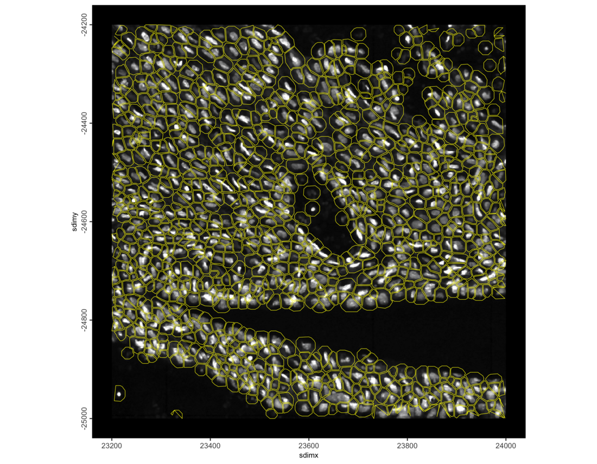
```

## Save

Backed Giotto projects write named snapshots of the analysis state to the
project directory.

```{r save-ingest, message = FALSE, eval = FALSE}
# The return value is needed since saveGiotto makes changes during the write
g <- saveGiotto(g, name = "ingest")
```

```
  backend : `gDirSource`
  path    : path/to/stereoseq_embryo_cells_project
```

# Quality control and filtering

```{r stats, message = FALSE, eval = FALSE}
g <- addStatistics(g, expression_values = "raw")
cx <- pDataDT(g)
cat(sprintf("%s cells | median %d counts, %d features per cell\n",
    format(nrow(cx), big.mark = ","),
    median(cx$total_expr), median(cx$nr_feats))
)
```

```
925,850 cells | median 849 counts, 623 features per cell
```

The most widely detected genes are the hemoglobins, the mitochondrial
transcripts and, further down, the liver's albumin and alpha-fetoprotein. The
fetal liver makes blood at this stage, and its abundant transcripts reach
cells across the whole section. Expect them among the markers of many
clusters below.

```{r top-genes, eval = FALSE}
head(fDataDT(g)[order(-perc_cells), .(feat_ID, perc_cells)], 8)
fDataDT(g)[feat_ID %in% c("Alb", "Afp"), .(feat_ID, perc_cells)]
```

```
   feat_ID perc_cells
    <char>      <num>
1:  Hbb-bs   99.78225
2:  mt-Co1   98.79181
3:  mt-Co3   98.69169
4:  mt-Nd4   97.76713
5:  Eef1a1   97.05514
6:  mt-Co2   96.75271
7:  Hbb-bt   96.51563
8: mt-Atp6   96.37252
   feat_ID perc_cells
    <char>      <num>
1:     Afp   66.68953
2:     Alb   91.63731
```

A gene has to be detected in at least 100 cells to be kept, and a cell needs
at least 100 detected genes.

```{r filter, eval = FALSE}
g <- filterGiotto(g,
    expression_threshold   = 1,
    feat_det_in_min_cells  = 100,
    min_det_feats_per_cell = 100,
    verbose = FALSE
)
cat(sprintf("%s cells x %s features retained\n",
    format(length(spatIDs(g)), big.mark = ","),
    format(nrow(fDataDT(g)), big.mark = ","))
)
```

```
922,035 cells x 23,130 features retained
```

# Normalize and select features

This is whole-transcriptome data, so highly variable features are selected
before the PCA. They are chosen by Pearson residuals
(`method = "var_p_resid"`), which work on the raw counts.

```{r normalize, eval = FALSE}
g <- normalizeGiotto(g,
    scalefactor = 1e4,
    logbase = exp(1),
    log_offset = 1,
    scale_feats = FALSE,
    scale_cells = FALSE,
    verbose = FALSE
)
g <- calculateHVF(g,
    method = "var_p_resid",
    n_top_feats = 2000,
    verbose = FALSE
)
```

# Dimension reduction

```{r pca, eval = FALSE}
g <- runPCA(g,
    feats_to_use = "hvf",
    ncp = 50,
    scale_unit = TRUE,
    center = TRUE,
    verbose = FALSE
)
screePlot(g, ncp = 50)
```

```{r pca-fig, echo = FALSE, out.width = "100%"}
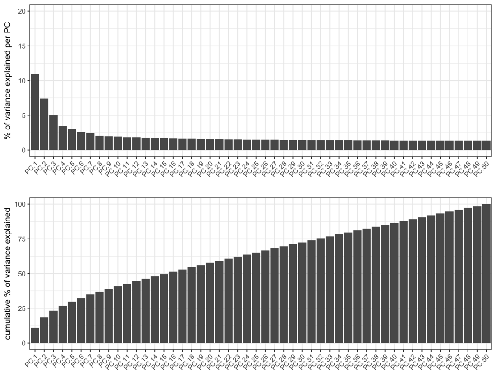
```

The first PCs explain the most, but the curve keeps falling slowly: a whole
embryo holds many tissues, each needing a few PCs. The first 30 are used
below.

# Clustering

The kNN network is built first. `runUMAP()` then reuses it instead of
searching for neighbors again, and Leiden clusters on the same network.

```{r cluster, eval = FALSE}
dims_to_use <- 1:30
g <- createNearestNetwork(g,
    type = "kNN",
    dimensions_to_use = dims_to_use,
    k = 30,
    engine = "hnsw",
    verbose = FALSE
)
g <- runUMAP(g,
    dimensions_to_use = dims_to_use,
    n_neighbors = 30,
    min_dist = 0.3,
    verbose = FALSE
)
g <- doLeidenCluster(g,
    nn_network_to_use = "kNN",
    network_name = "kNN.pca",
    resolution = 1,
    n_iterations = 20,
    objective_function = "modularity",
    verbose = FALSE
)
table(pDataDT(g)$leiden_clus)

clusters <- GiottoUtils::mixedsort(unique(as.character(pDataDT(g)$leiden_clus)))
# one color per cluster, shared by the plots below
clus_colors <- stats::setNames(getDistinctColors(length(clusters)), clusters)

g <- saveGiotto(g, name = "clustered")
```

```

     1      2      3      4      5      6      7      8      9     10     11 
 31365  88199  11903  54647  38612 101201  53195  25159  19470  25172  69473 
    12     13     14     15     16     17     18     19     20     21     22 
 34488  44040  13437  24536  14406  26725  37746  30146  12385  15646    223 
    23     24     25     26     27     28     29     30     31     32 
  2369  23285  16032  12485   1336   6097  78622    382   4099   5154
  backend : `gDirSource`
  path    : path/to/stereoseq_embryo_cells_project
```

```{r umap, eval = FALSE}
plotUMAP(g,
    cell_color = "leiden_clus",
    color_as_factor = TRUE,
    cell_color_code = clus_colors,
    point_border_stroke = 0,
    point_size = 0.1
)
```

```{r umap-fig, echo = FALSE, out.width = "100%"}
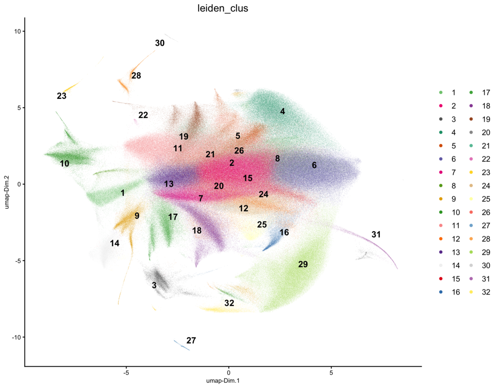
```

```{r spatial-clusters, fig.width = 10, fig.height = 9, eval = FALSE}
spatPlot2D(g,
    cell_color = "leiden_clus",
    color_as_factor = TRUE,
    cell_color_code = clus_colors,
    point_border_stroke = 0,
    point_size = 0.15,
    background_color = "black"
)
```

```{r spatial-clusters-fig, echo = FALSE, out.width = "100%"}
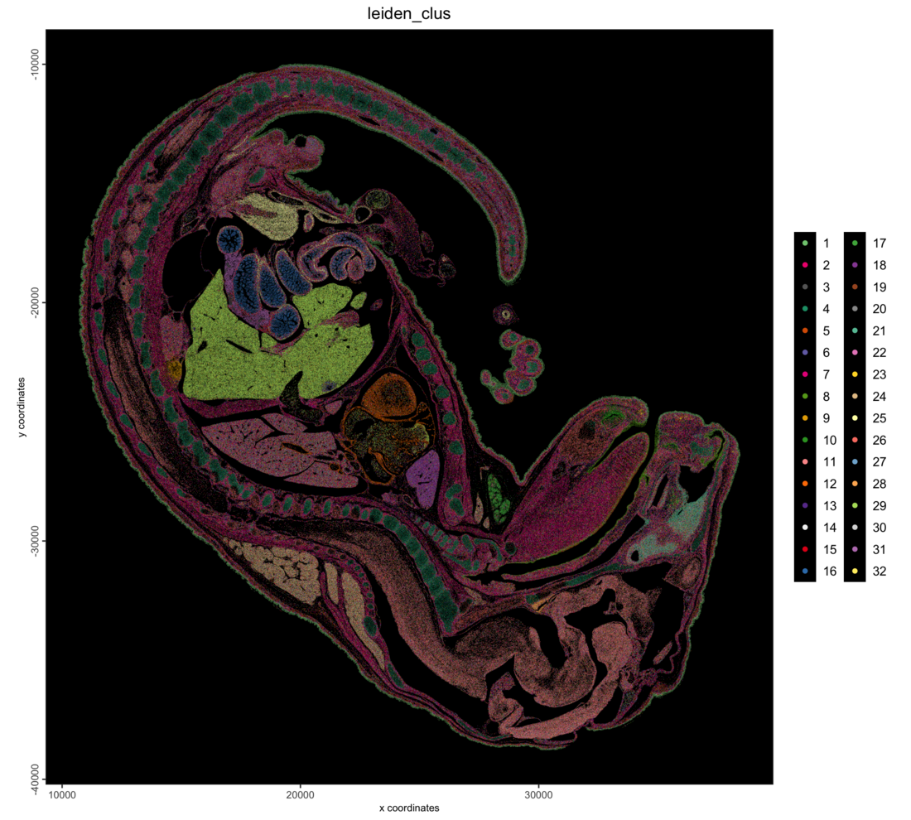
```

# Cell typing with a cluster tree

The clusters are grouped into a tree by how similar their expression is. Each
cluster and each branch of the tree then gets markers, and a language model
names them from those markers. Cutting the tree gives cell type labels at
coarser levels.

## Build the cluster tree

```{r tree, fig.width = 11, fig.height = 6, eval = FALSE}
CLUS <- "leiden_clus"
hvf  <- fDataDT(g)[hvf == "yes"]$feat_ID

tree <- calculateClusterTree(g,
    cluster_column = CLUS,
    feats = hvf,
    cor = "pearson",
    distance = "average"
)
plot(tree, hang = -1)
```

```{r tree-fig, echo = FALSE, out.width = "100%"}
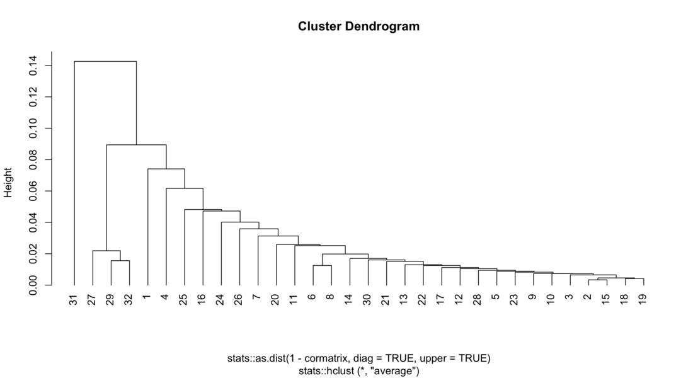
```

## Markers

```{r markers, eval = FALSE}
mk <- findMarkers_one_vs_all(g,
    method = "scran",
    cluster_column = CLUS,
    min_feats = 10,
    verbose = FALSE
)
gi <- findGiniMarkers_one_vs_all(g,
    cluster_column = CLUS,
    min_feats = 10,
    verbose = FALSE
)
nm <- findClusterTreeMarkers(g,
    cluster_column = CLUS,
    tree = tree,
    method = "scran",
    verbose = FALSE
)
```

## Assemble the annotation prompt

`writeClusterTreeQuery()` writes the tree, the per-cluster markers and the
markers of each split into one prompt for a language model, together with a
description of the sample.

```{r query, eval = FALSE}
prompt_file <- file.path(tempdir(), "stereoseq_embryo_celltyping_prompt.txt")

q <- writeClusterTreeQuery(g,
    cluster_column = CLUS,
    tree = tree,
    markers = mk,
    gini_markers = gi,
    node_markers = nm,
    context = list(
        tissue = "whole mouse embryo, sagittal FFPE section, late gestation",
        assay = "Stereo-seq N FFPE V1.1 whole-transcriptome, SAW 8.3 adjusted cellbin from ssDNA segmentation"
    ),
    file_name = prompt_file
)
cat(length(q), "lines\n")
```

```
520 lines
```

## Scattered clusters

Before naming the clusters, check where they are. About half of them do not
sit in one tissue but are spread over the whole section, even though each is
defined by the genes of one organ. Two examples: cluster 18, defined
by T cell genes (Rag1, Trbc1), and cluster 17, defined by salivary
gland genes (Smgc, Pip):

```{r scattered, fig.width = 10, fig.height = 9, eval = FALSE}
for (cl in c("18", "17")) {
    print(spatPlot2D(g,
        cell_color = CLUS,
        color_as_factor = TRUE,
        select_cell_groups = cl,
        cell_color_code = stats::setNames("#ffd23f", cl),
        other_cell_color = "grey15",
        point_border_stroke = 0,
        point_size = 0.15,
        other_point_size = 0.05,
        background_color = "black",
        show_plot = FALSE,
        return_plot = TRUE
    ) + ggplot2::ggtitle(paste("cluster", cl)))
}
```

```{r scattered-fig, echo = FALSE, out.width = "100%"}
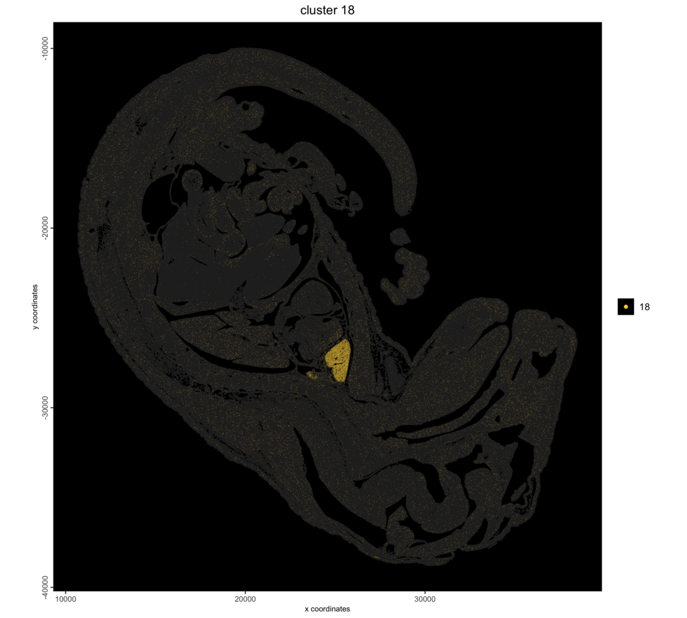
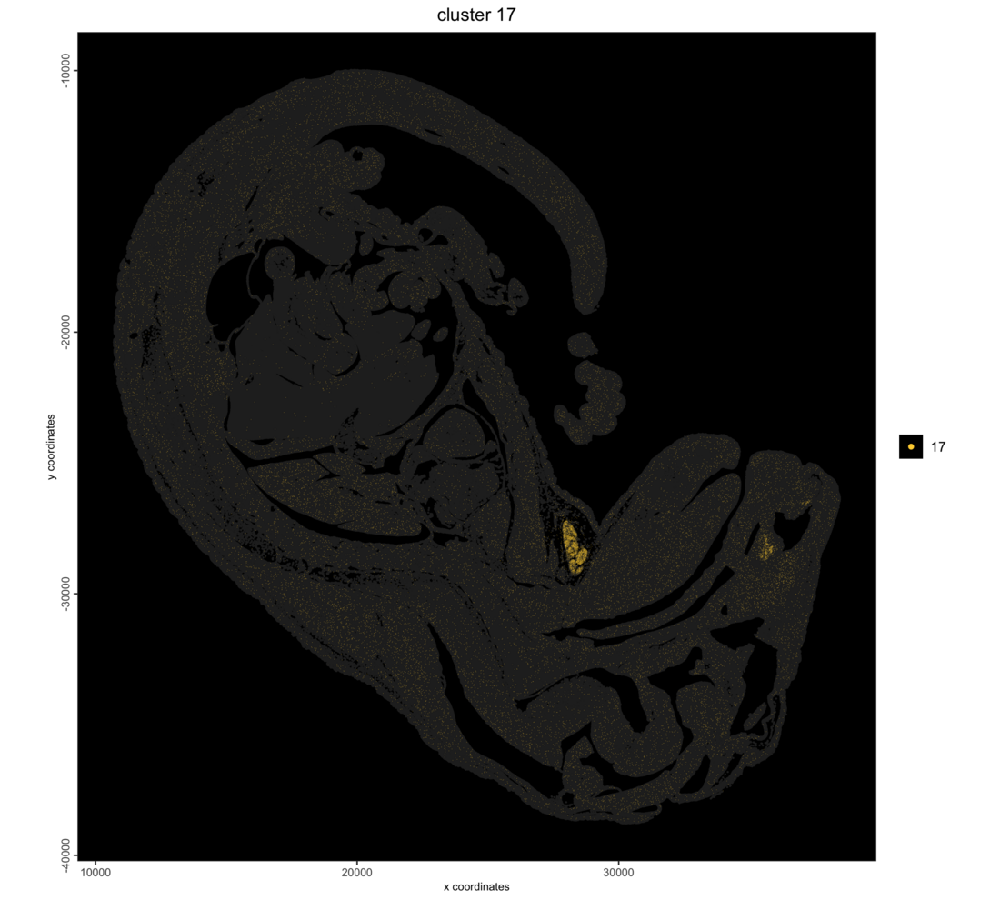
```

Both have a dense spot at their organ, the thymus and the salivary gland, and
thousands of cells everywhere else. These cells have as many counts as any
other, so they are not low-quality cells that a stricter filter would remove.
They carry transcripts of an organ they are far from, and their identity
cannot be read from their markers. The annotation below names them by the
signal they carry and marks them as scattered.

## Apply the annotation

The model answers with a cell type for each cluster and a short name for each
node of the tree. Its answer, checked against the markers above and against
where each cluster sits in the tissue, is written out below as `labels`.
Leiden cluster numbers can change between package versions or numbers of
workers, so check the markers before reusing these labels on your own run.

The tree splits off one tissue at a time. From the top: the pancreatic
acinar cells, the liver (hepatocytes and the blood cells it makes at this
stage), the epidermis, cartilage, smooth muscle of the gut wall, the gut
epithelium, brown fat, bone, skeletal muscle, the lung epithelium and the
neural tissue of the brain and spinal cord. Each of these sits together in
space. Everything below is one group: the mesenchyme and the scattered
clusters, which differ from each other in a few organ genes but hardly in
anything else. Cluster 6 has the fewest counts per cell (median about 400)
and no clear markers; clusters 14, 22 and 30 are left unresolved, the last
two being a few hundred cells held together by unnamed `Gm` genes.

`annotateClusterTree()` turns the tree into cell type columns at several
levels of detail: `k` is the number of groups at each level. Cut at 12 groups,
the tree separates the eleven tissues whose clusters sit together in space
from one large group holding the mesenchyme and the scattered clusters.

```{r annotate, eval = FALSE}
labels <- list(
    # a cell type for each Leiden cluster; "scattered" marks clusters spread
    # over the whole section
    clusters = c(
        "1"  = "epidermis",
        "2"  = "mesenchyme",
        "3"  = "scattered, islet hormone signal",
        "4"  = "cartilage",
        "5"  = "scattered, mast cell signal",
        "6"  = "low-count cells",
        "7"  = "skeletal muscle",
        "8"  = "scattered, squamous epithelium signal",
        "9"  = "scattered, adrenal cortex signal",
        "10" = "scattered, tooth enamel signal",
        "11" = "neural",
        "12" = "cardiomyocytes, partly scattered",
        "13" = "mesenchyme, high counts",
        "14" = "unresolved",
        "15" = "scattered, pancreatic acinar signal",
        "16" = "gut epithelium",
        "17" = "scattered, salivary gland signal",
        "18" = "scattered, thymus T cell signal",
        "19" = "scattered, hair keratin signal",
        "20" = "lung epithelium",
        "21" = "olfactory epithelium, partly scattered",
        "22" = "unresolved",
        "23" = "scattered, hair follicle signal",
        "24" = "brown fat",
        "25" = "smooth muscle",
        "26" = "bone",
        "27" = "hepatocytes",
        "28" = "scattered, pituitary hormone signal",
        "29" = "liver, hepatocytes and blood",
        "30" = "unresolved",
        "31" = "pancreatic acinar cells",
        "32" = "hepatocytes"
    ),
    # a short name for each node of the tree
    nodes = c(
        "31" = "all cells",
        "30" = "all but pancreas",
        "29" = "all but pancreas and liver",
        "28" = "all but epidermis",
        "27" = "all but cartilage",
        "26" = "all but smooth muscle",
        "25" = "all but gut epithelium",
        "24" = "all but brown fat",
        "23" = "all but bone",
        "22" = "all but skeletal muscle",
        "21" = "all but lung",
        "20" = "liver",
        "19" = "mesenchyme and scattered cells",
        "18" = "mesenchyme and scattered cells",
        "17" = "mesenchyme and scattered cells",
        "16" = "liver",
        "15" = "mesenchyme and scattered cells",
        "14" = "mesenchyme and scattered cells",
        "13" = "mesenchyme and scattered cells",
        "12" = "low-count and squamous signal",
        "11" = "mesenchyme and scattered cells",
        "10" = "mesenchyme and scattered cells",
        "9"  = "mesenchyme and scattered cells",
        "8"  = "mesenchyme and scattered cells",
        "7"  = "mesenchyme and scattered cells",
        "6"  = "mesenchyme and scattered cells",
        "5"  = "mesenchyme and scattered cells",
        "4"  = "mesenchyme and scattered cells",
        "3"  = "mesenchyme and scattered cells",
        "2"  = "scattered T cell and hair signal",
        "1"  = "mesenchyme"
    )
)
lvls <- GiottoUtils::mixedsort(unique(as.character(pDataDT(g)[[CLUS]])))

g <- annotateClusterTree(g,
    tree = tree,
    labels = labels,
    cluster_column = CLUS,
    k = c(12, length(lvls))
)
table(g$cell_types_k12)
```

```

                          bone                      brown fat 
                         12485                          23285 
                     cartilage                      epidermis 
                         54647                          31365 
                gut epithelium                          liver 
                         14406                          85112 
               lung epithelium mesenchyme and scattered cells 
                         12385                         545551 
                        neural        pancreatic acinar cells 
                         69473                           4099 
               skeletal muscle                  smooth muscle 
                         53195                          16032
```

```{r tree-annotated, fig.width = 14, fig.height = 11, eval = FALSE}
GiottoVisuals::plotClusterTree(g,
    cluster_column = CLUS,
    tree = tree,
    labels = labels,
    k = 12,
    gini_markers = gi,
    node_labels = FALSE
)
```

```{r tree-annotated-fig, echo = FALSE, out.width = "100%"}
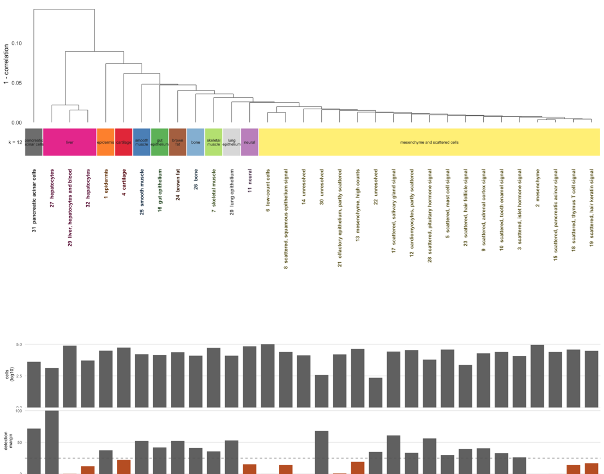
```

# Results

Eight colors are about as many as a map can keep apart. The eight largest
tissues get one each; bone, lung and the pancreas share a light gray, and the
mesenchyme with the scattered clusters a dark gray.

```{r spatial-k12, fig.width = 11, fig.height = 9, eval = FALSE}
other_organs <- c("bone", "lung epithelium", "pancreatic acinar cells")
g$tissue <- ifelse(g$cell_types_k12 %in% other_organs, "other organs", g$cell_types_k12)

tissue_colors <- c(
    "neural"                         = "#3987e5",
    "skeletal muscle"                = "#d95926",
    "cartilage"                      = "#199e70",
    "epidermis"                      = "#c98500",
    "brown fat"                      = "#d55181",
    "gut epithelium"                 = "#008300",
    "smooth muscle"                  = "#9085e9",
    "liver"                          = "#e66767",
    "other organs"                   = "#c3c2b7",
    "mesenchyme and scattered cells" = "#5a5a5a"
)

spatPlot2D(g,
    cell_color = "tissue",
    color_as_factor = TRUE,
    cell_color_code = tissue_colors,
    point_border_stroke = 0,
    point_size = 0.15,
    background_color = "black",
    theme_param = list(legend.position = "right")
)
```

```{r spatial-k12-fig, echo = FALSE, out.width = "100%"}
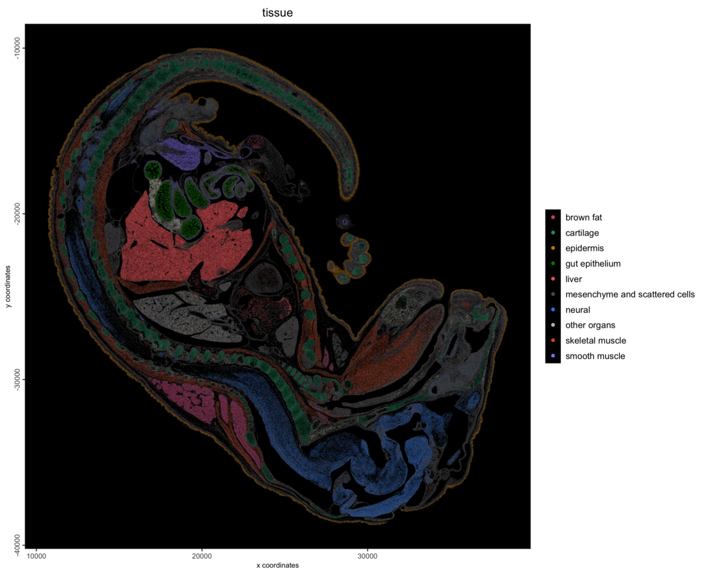
```

The organs that share the gray, and the heart, are easiest to see by their
marker genes: Myh6 (heart), Sftpc (lung), Alb (liver), Col2a1 (cartilage),
Fabp2 (gut) and Rag1 (thymus). Alb also shows how far the liver's
transcripts reach: every tissue carries some.

```{r organ-genes, fig.width = 12, fig.height = 8, eval = FALSE}
spatFeatPlot2D(g,
    expression_values = "normalized",
    feats = c("Myh6", "Sftpc", "Alb", "Col2a1", "Fabp2", "Rag1"),
    cow_n_col = 3,
    point_border_stroke = 0,
    point_size = 0.12,
    background_color = "black",
    gradient_style = "sequential",
    order = TRUE
)
```

```{r organ-genes-fig, echo = FALSE, out.width = "100%"}
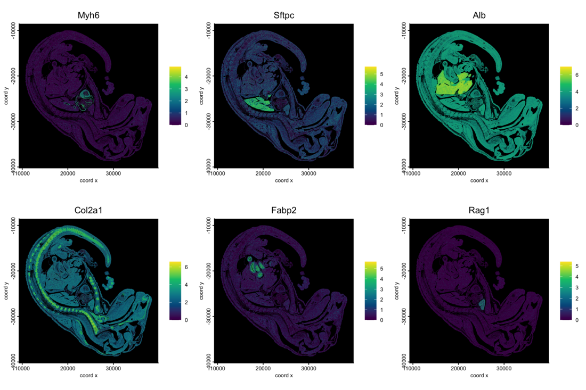
```

```{r save-annotated, message = FALSE, eval = FALSE}
g <- saveGiotto(g, name = "annotated")
```

```
  backend : `gDirSource`
  path    : path/to/stereoseq_embryo_cells_project
```

The object is saved to the project directory and can be reloaded with
`loadGiotto(project_dir, name = "annotated")`.

# Spatial domains

A spatial domain is a region of tissue with its own mix of expression. Here
each cell's expression is averaged with that of the cells around it, so a cell
describes its neighborhood rather than itself, and the averaged cells are
clustered. This needs only the cells, not the spots.

## Smooth expression over a spatial network

`createSpatialNetwork()` connects each cell to its 10 nearest cells.
`spatialSmoothParam()` replaces each cell's values with the average of its own
and its neighbors'; `hops = 4` repeats this four times, so the average reaches
cells up to four steps away, a few dozen cells around each. On a disk-backed
object, `processData()` streams the smoothing through the project and writes
the result as a new expression matrix, `smoothed`. A smoothed cell holds every
gene that any of its neighbors has, so the matrix is much denser than the
counts; only the 2,000 highly variable genes are smoothed.

```{r smooth, message = FALSE, eval = FALSE}
g <- createSpatialNetwork(g,
    method = "kNN",
    k = 10,
    name = "knn10",
    verbose = FALSE
)

g <- processData(g,
    spatialSmoothParam(hops = 4, name = "smoothed"),
    spatial_network_name = "knn10",
    expression_values = "normalized",
    feats = hvf
)
```

## Cluster the smoothed cells

The smoothed values go through PCA, a kNN network and Leiden, as the cells
did. Smoothing removes most of the cell to cell noise, so a low resolution is
enough.

```{r domains, eval = FALSE}
g <- runPCA(g,
    expression_values = "smoothed",
    feats_to_use = NULL,
    ncp = 30,
    scale_unit = TRUE,
    center = TRUE,
    name = "pca_smoothed",
    verbose = FALSE
)
g <- createNearestNetwork(g,
    type = "kNN",
    dim_reduction_name = "pca_smoothed",
    dimensions_to_use = 1:20,
    k = 15,
    engine = "hnsw",
    name = "knn_smoothed",
    verbose = FALSE
)
g <- doLeidenCluster(g,
    nn_network_to_use = "kNN",
    network_name = "knn_smoothed",
    resolution = 0.1,
    n_iterations = 20,
    objective_function = "modularity",
    name = "domain",
    verbose = FALSE
)
table(pDataDT(g)$domain)
```

```

     1      2      3      4      5      6      7      8      9     10     11 
115858 113196 165782  10888  20880 107609  15757  24734  50236  12162  83638 
    12     13     14     15     16     17     18     19     20 
 12022     16  92356     41  15760  43909  33843   3265     83
```

```{r domains-plot, fig.width = 11, fig.height = 9, eval = FALSE}
domains <- GiottoUtils::mixedsort(unique(as.character(pDataDT(g)$domain)))
domain_colors <- stats::setNames(getDistinctColors(length(domains)), domains)

spatPlot2D(g,
    cell_color = "domain",
    color_as_factor = TRUE,
    cell_color_code = domain_colors,
    point_border_stroke = 0,
    point_size = 0.15,
    background_color = "black"
)
```

```{r domains-plot-fig, echo = FALSE, out.width = "100%"}
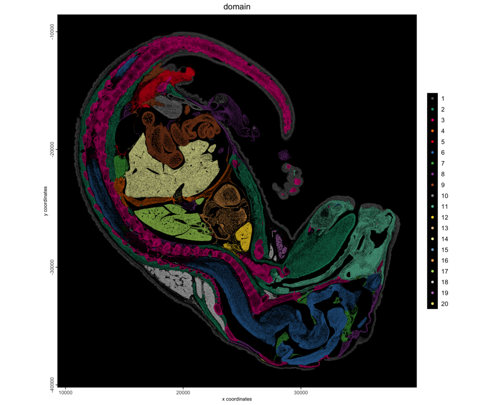
```

Twenty domains, most of them organs or tissue layers. By their markers below
and their place in the section: the skin (domain 1), skeletal muscle of the
body wall, the tongue and the diaphragm (2 and 4), the cartilage of the spine and the skull
(3), the brain and spinal cord (6), with the choroid plexus in the ventricles
as its own domain (7, Ttr), the dermis and connective tissue (8), the gut (9)
and the smooth muscle of its wall (10), bone and the nasal region (11), the
thymus (12), the liver (14), the heart (16), the lung (17), brown fat (18) and
the salivary glands (19). Domains 13, 15 and 20 hold fewer than 100 cells
each. Domain numbers, like cluster numbers, can change between runs.

## Domain markers

The top markers of each domain, from the unsmoothed expression:

```{r domain-markers, fig.width = 9, fig.height = 12, eval = FALSE}
dom_markers <- findMarkers_one_vs_all(g,
    method = "scran",
    cluster_column = "domain",
    min_feats = 3,
    verbose = FALSE
)
top_dom <- unique(dom_markers[, head(feats, 3), by = cluster]$V1)

plotMetaDataHeatmap(g,
    expression_values = "normalized",
    metadata_cols = "domain",
    selected_feats = top_dom,
    return_plot = FALSE
)
```

```{r domain-markers-fig, echo = FALSE, out.width = "100%"}
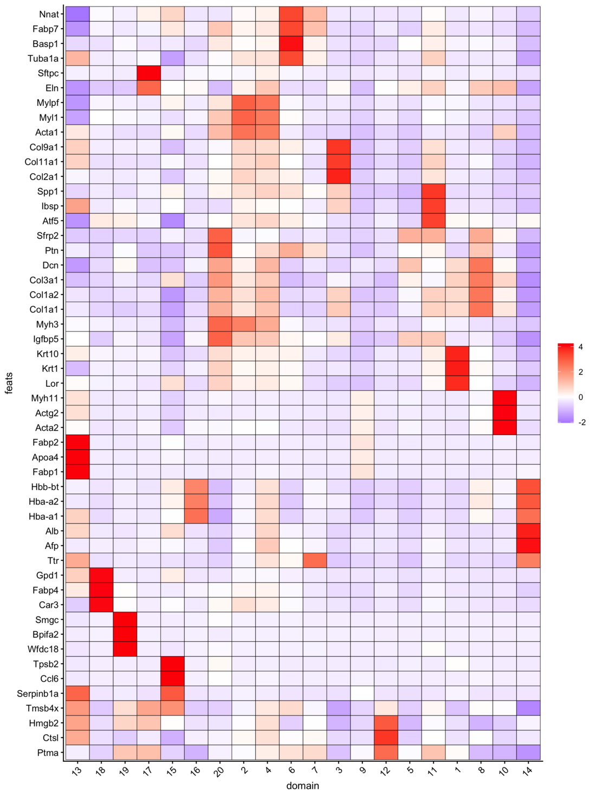
```

## Domains and cell types

The share of each domain's cells in each of the 12 cell type groups. Some
domains are mostly one organ's cells: the gut, the liver, smooth muscle, brown
fat and the brain. In most others, the largest share is the group holding the
mesenchyme and the scattered clusters, since those cells are found everywhere.
Their domain says more about where they are than their cluster does.

```{r domain-composition, fig.width = 10, fig.height = 8, eval = FALSE}
dom_tab <- pDataDT(g)[, .N, by = .(domain, cell_types_k12)]
dom_tab[, share := N / sum(N), by = domain]
dom_tab[, domain := factor(domain, levels = domains)]

ggplot2::ggplot(dom_tab, ggplot2::aes(cell_types_k12, domain, fill = share)) +
    ggplot2::geom_tile() +
    ggplot2::scale_fill_gradient(low = "white", high = "#1c5cab", labels = scales::percent) +
    ggplot2::labs(x = NULL, y = "domain", fill = "share of\ndomain") +
    ggplot2::theme_minimal() +
    ggplot2::theme(
        panel.grid = ggplot2::element_blank(),
        axis.text.x = ggplot2::element_text(angle = 45, hjust = 1)
    )
```

```{r domain-composition-fig, echo = FALSE, out.width = "100%"}
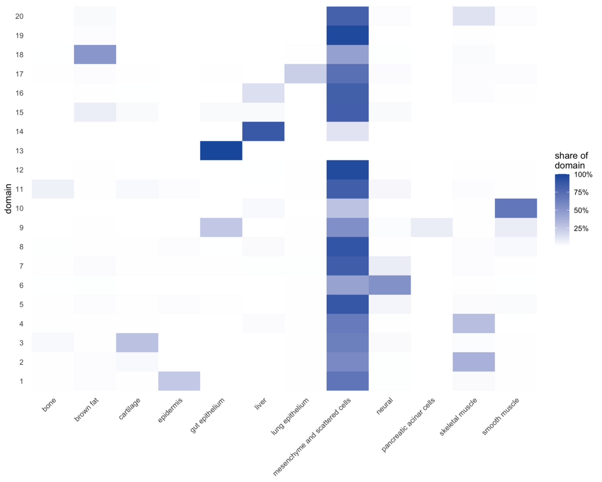
```

```{r save-domains, message = FALSE, eval = FALSE}
g <- saveGiotto(g, name = "domains")
```

```
  backend : `gDirSource`
  path    : path/to/stereoseq_embryo_cells_project
```


The object is saved to the project directory and can be reloaded with
`loadGiotto(project_dir, name = "domains")`.

# Further reading

* [Stereo-seq human colon: segmented cells](stereoseq_human_colon_cells_giottodisk.html),
  the same cell analysis, with spatial domains built from the spots in
  hexagonal bins instead of from smoothed cells
* [Stereo-seq mouse testis: segmented cells](stereoseq_testis_cells_giottodisk.html),
  the same steps on a fresh frozen section
* [Stereo-seq Data Import](stereoseq_importer.html), which covers the readers
  and the files in a SAW output directory

# Run time and memory

How long each section of this tutorial took and the most memory it used, on a
run of this tutorial on an Apple M2 Ultra with 24 cores and 192 GB of memory,
with the 8 workers set in [Setup](#setup). The data were read from an external
SSD and the project written to the internal disk. The whole tutorial took
about 26 minutes. Reading the cells peaks at 36 GB. The spatial domains take
the longest and the most memory, 11 minutes and 57 GB: after four rounds of
smoothing every cell holds nearly all 2,000 genes, so the smoothed matrix is
close to dense, and its PCA takes about 4 minutes. Smoothing fewer genes or
fewer hops lowers both. In the clustering, the kNN network and Leiden take
about 4 and 3 minutes. The memory R takes stays with the session until it
ends.

```{r runcost-fig, echo = FALSE, out.width = "100%"}
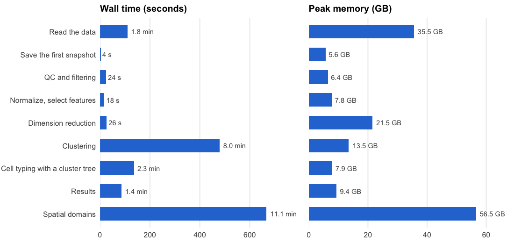
```

Memory is what macOS counts for the R session and its workers together (the
Memory column of Activity Monitor), sampled once a second; each bar is the
highest value during that section. Fewer workers in [Setup](#setup) lower it.

<details>
<summary>Time and memory per section</summary>

| Section | Time | Memory |
|:--------|-----:|-----:|
| Read the data | 1.8 min | 35.5 GB |
| Save the first snapshot | 4 s | 5.6 GB |
| QC and filtering | 24 s | 6.4 GB |
| Normalize, select features | 18 s | 7.8 GB |
| Dimension reduction | 26 s | 21.5 GB |
| Clustering | 8.0 min | 13.5 GB |
| Cell typing with a cluster tree | 2.3 min | 7.9 GB |
| Results | 1.4 min | 9.4 GB |
| Spatial domains | 11.1 min | 56.5 GB |

</details>

# Session info

```{r session, eval = FALSE}
sessionInfo()
```

```
R version 4.5.1 (2025-06-13)
Platform: aarch64-apple-darwin20
Running under: macOS Sonoma 14.5

Matrix products: default
BLAS:   /Library/Frameworks/R.framework/Versions/4.5-arm64/Resources/lib/libRblas.0.dylib 
LAPACK: /Library/Frameworks/R.framework/Versions/4.5-arm64/Resources/lib/libRlapack.dylib;  LAPACK version 3.12.1

locale:
[1] en_US/C/en_US/C/en_US/en_US

time zone: America/New_York
tzcode source: internal

attached base packages:
[1] stats     graphics  grDevices utils     datasets  methods   base     

other attached packages:
[1] GiottoDisk_0.0.0.6 Giotto_4.3.5       GiottoClass_0.7.26 arrow_23.0.1.2    

loaded via a namespace (and not attached):
  [1] RColorBrewer_1.1-3          ggdendro_0.2.0             
  [3] jsonlite_2.0.0              wk_0.9.5                   
  [5] magrittr_2.0.4              magick_2.9.1               
  [7] farver_2.1.2                rmarkdown_2.31             
  [9] vctrs_0.7.2                 memoise_2.0.1              
 [11] GiottoUtils_0.2.9           terra_1.9-11               
 [13] htmltools_0.5.9             S4Arrays_1.8.1             
 [15] BiocNeighbors_2.2.0         Rhdf5lib_1.30.0            
 [17] SparseArray_1.8.1           rhdf5_2.52.1               
 [19] sass_0.4.10                 parallelly_1.46.1          
 [21] bslib_0.10.0                htmlwidgets_1.6.4          
 [23] plotly_4.12.0               cachem_1.1.0               
 [25] igraph_2.2.2                lifecycle_1.0.5            
 [27] pkgconfig_2.0.3             rsvd_1.0.5                 
 [29] Matrix_1.7-3                R6_2.6.1                   
 [31] fastmap_1.2.0               GenomeInfoDbData_1.2.14    
 [33] MatrixGenerics_1.20.0       future_1.70.0              
 [35] digest_0.6.39               colorspace_2.1-2           
 [37] S4Vectors_0.48.1            dqrng_0.4.1                
 [39] irlba_2.3.7                 GenomicRanges_1.60.0       
 [41] beachmat_2.24.0             filelock_1.0.3             
 [43] labeling_0.4.3              progressr_0.19.0           
 [45] httr_1.4.8                  polyclip_1.10-7            
 [47] abind_1.4-8                 compiler_4.5.1             
 [49] bit64_4.6.0-1               withr_3.0.2                
 [51] S7_0.2.1                    backports_1.5.1            
 [53] BiocParallel_1.42.2         viridis_0.6.5              
 [55] ggforce_0.5.0               R.utils_2.13.0             
 [57] sedonadb_0.5.0.9000         MASS_7.3-65                
 [59] DelayedArray_0.34.1         rjson_0.2.23               
 [61] bluster_1.18.0              gtools_3.9.5               
 [63] GiottoVisuals_0.2.16        tools_4.5.1                
 [65] otel_0.2.0                  future.apply_1.20.2        
 [67] R.oo_1.27.1                 glue_1.8.0                 
 [69] dbscan_1.2.4                rhdf5filters_1.20.0        
 [71] grid_4.5.1                  checkmate_2.3.4            
 [73] cluster_2.1.8.3             generics_0.1.4             
 [75] gtable_0.3.6                R.methodsS3_1.8.2          
 [77] tidyr_1.3.2                 data.table_1.18.2.1        
 [79] metapod_1.18.0              BiocSingular_1.24.0        
 [81] tidygraph_1.3.1             ScaledMatrix_1.16.0        
 [83] XVector_0.48.0              BiocGenerics_0.54.1        
 [85] tilework_1.0.0              ggrepel_0.9.8              
 [87] pillar_1.11.1               limma_3.64.3               
 [89] RcppHNSW_0.7.0              nanoarrow_0.9.0            
 [91] dplyr_1.2.0                 tweenr_2.0.3               
 [93] lattice_0.22-7              bit_4.6.0                  
 [95] tidyselect_1.2.1            locfit_1.5-9.12            
 [97] SingleCellExperiment_1.30.1 scuttle_1.20.0             
 [99] knitr_1.51                  gridExtra_2.3              
[101] IRanges_2.42.0              Seqinfo_1.0.0              
[103] edgeR_4.6.3                 SummarizedExperiment_1.38.1
[105] scattermore_1.2             stats4_4.5.1               
[107] xfun_0.61                   graphlayouts_1.2.3         
[109] Biobase_2.68.0              statmod_1.5.1              
[111] matrixStats_1.5.0           UCSC.utils_1.4.0           
[113] lazyeval_0.2.2              yaml_2.3.12                
[115] GiottoKernels_0.3.0         evaluate_1.0.5             
[117] codetools_0.2-20            ggraph_2.2.2               
[119] tibble_3.3.1                colorRamp2_0.1.0           
[121] cli_3.6.5                   uwot_0.2.4                 
[123] reticulate_1.45.0           jquerylib_0.1.4            
[125] Rcpp_1.1.2                  GenomeInfoDb_1.44.3        
[127] globals_0.19.1              png_0.1-9                  
[129] parallel_4.5.1              ggplot2_4.0.2              
[131] assertthat_0.2.1            scran_1.38.1               
[133] listenv_0.10.1              SpatialExperiment_1.20.0   
[135] geoarrow_0.4.4              viridisLite_0.4.3          
[137] scales_1.4.0                purrr_1.2.1                
[139] crayon_1.5.3                rlang_1.1.7                
[141] cowplot_1.2.0
```
