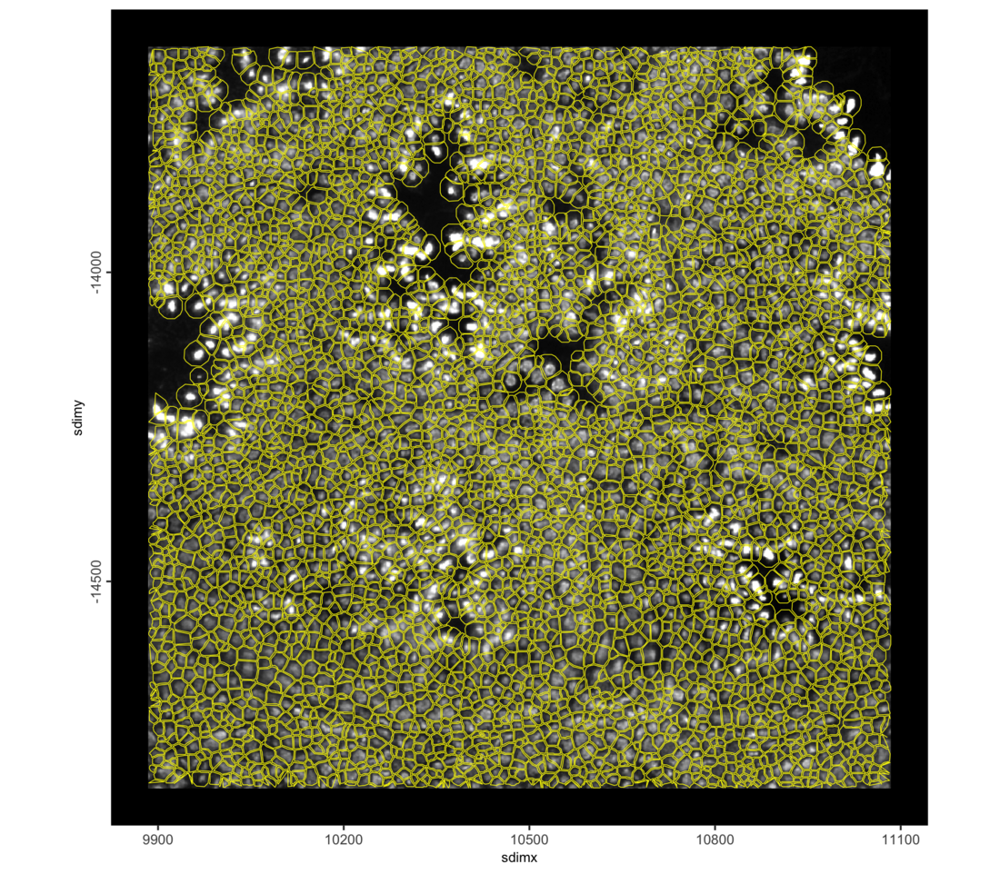
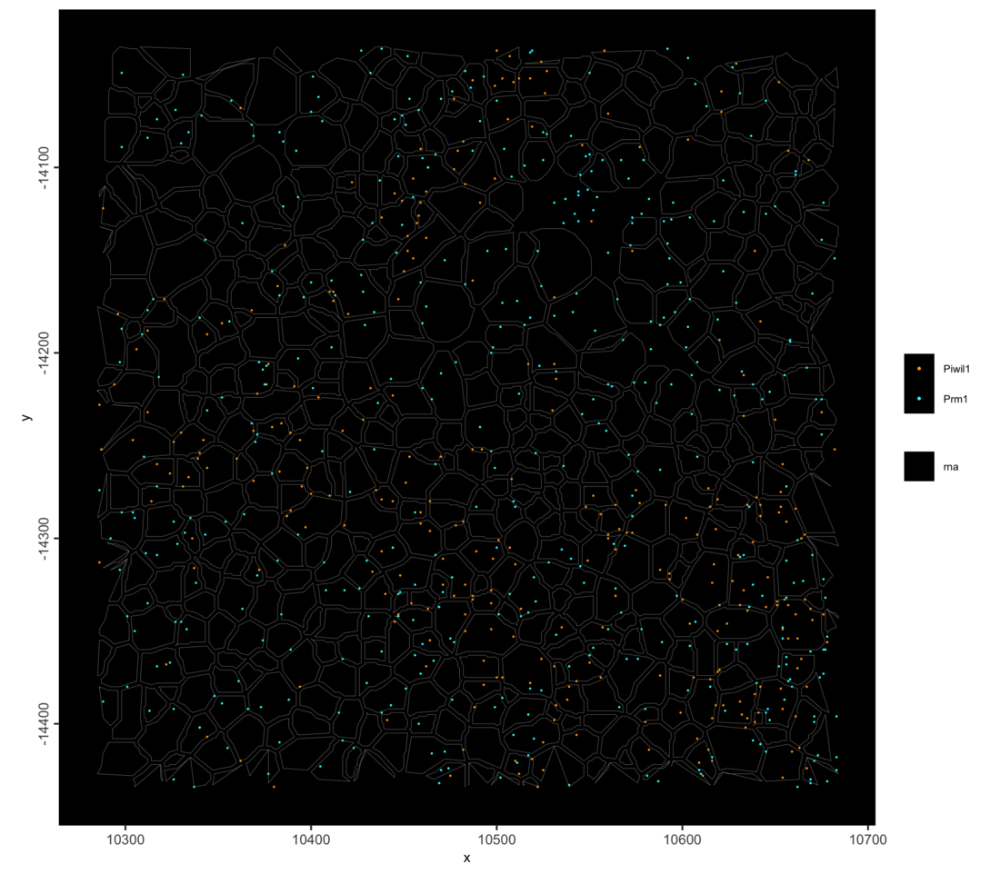
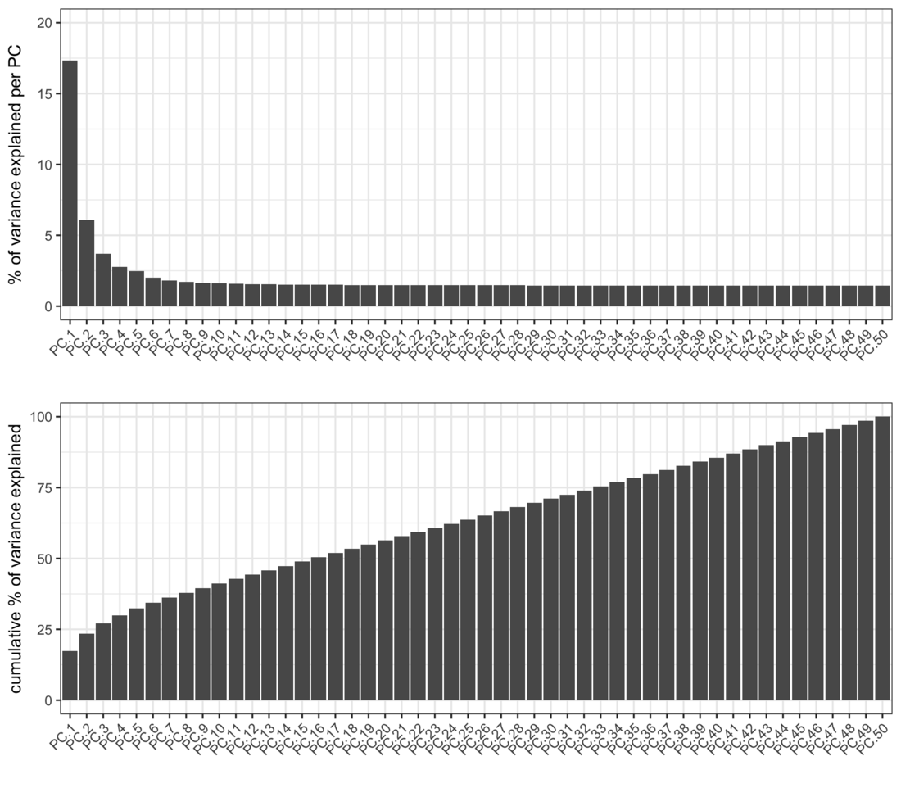
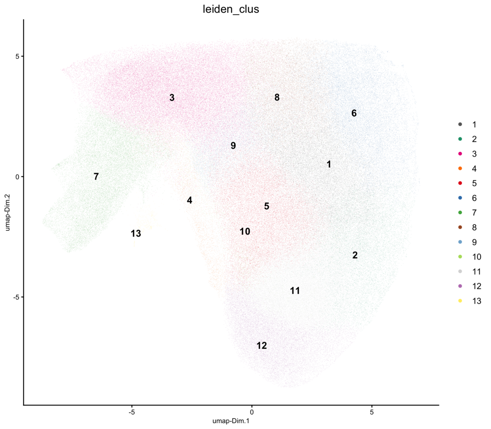
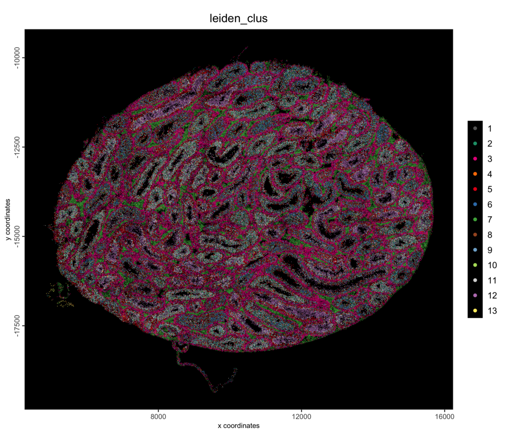
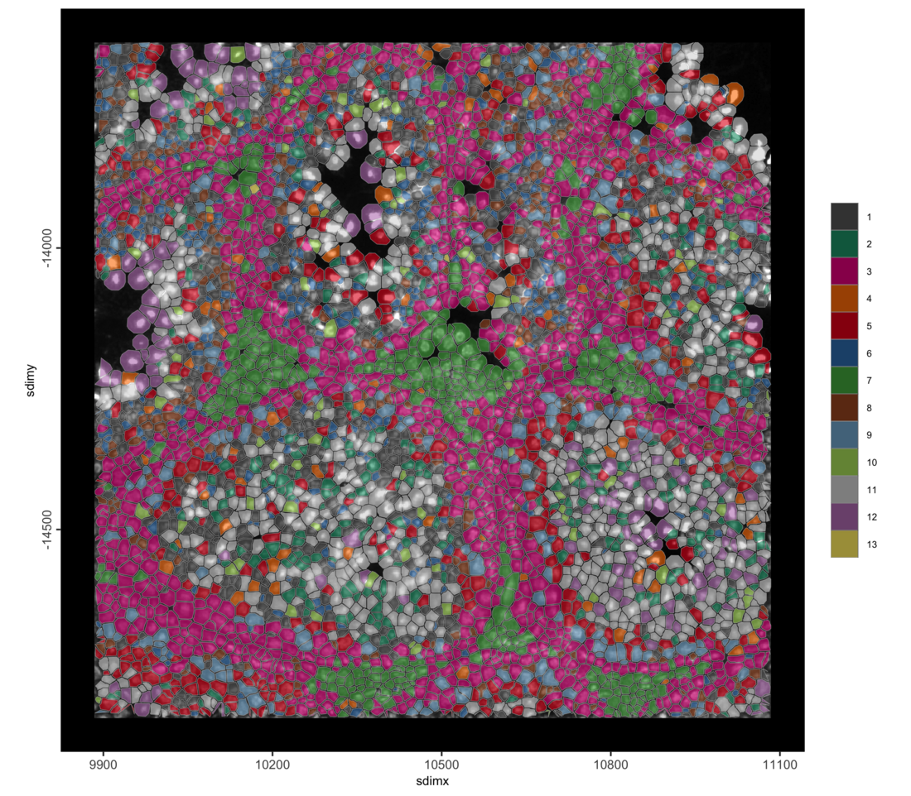
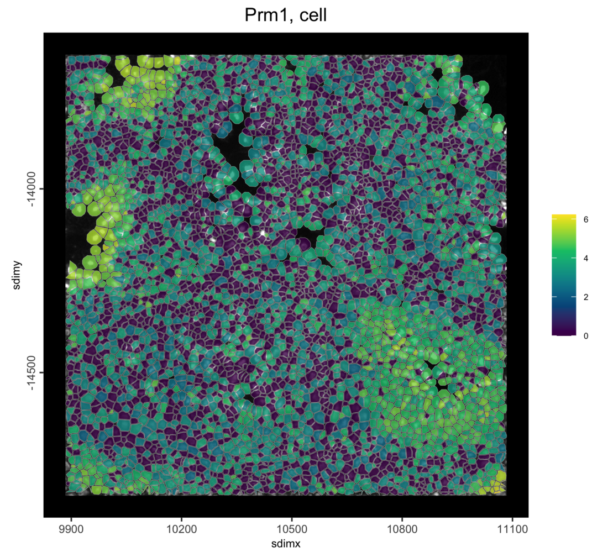
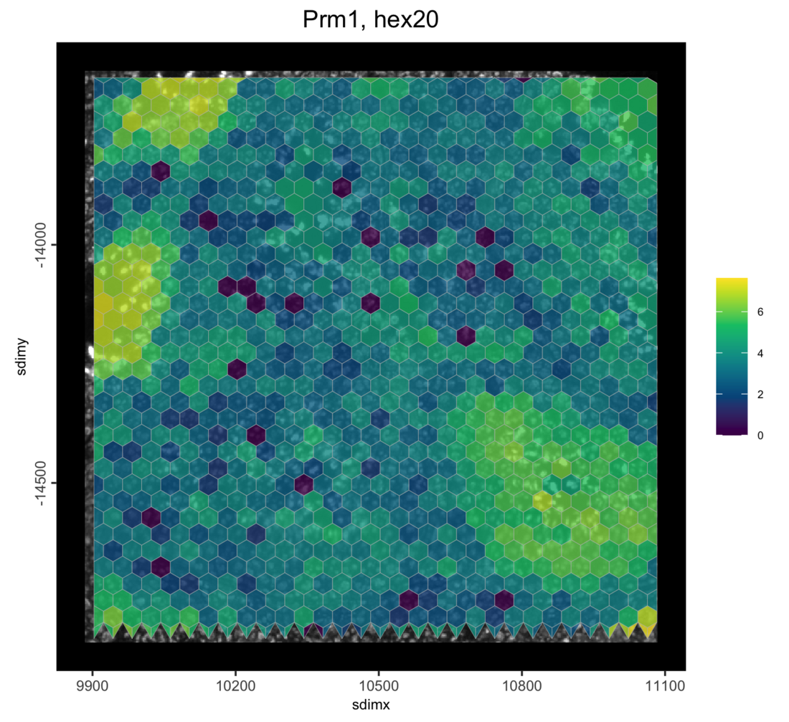
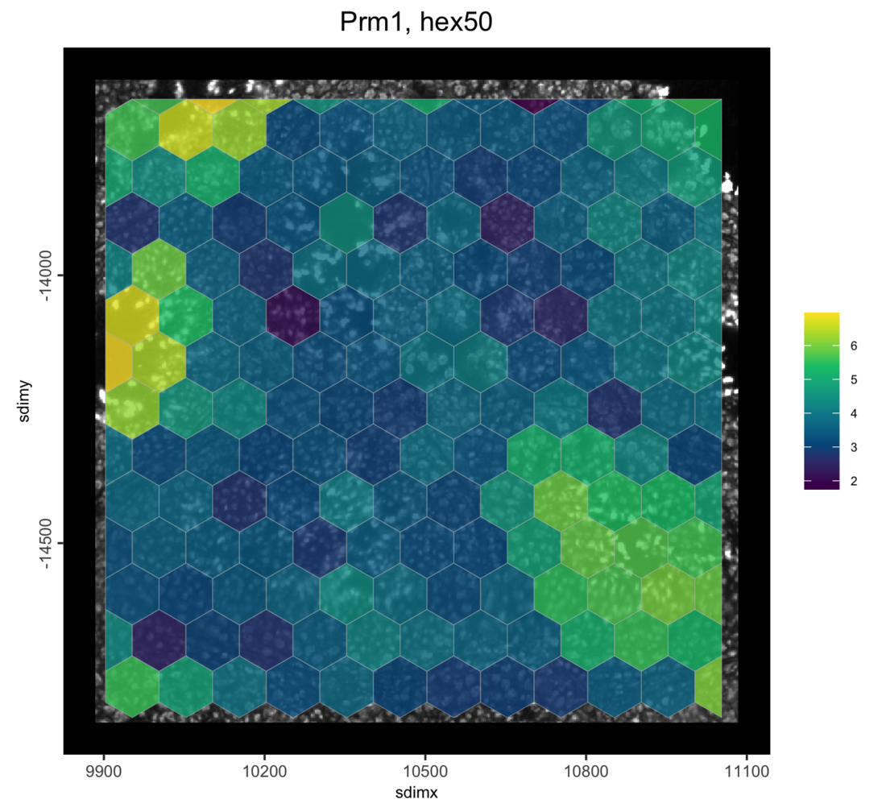

```{r, include=FALSE}
knitr::opts_chunk$set(eval = FALSE)
```

# Overview

Stereo-seq captures transcripts on spots 0.5 µm apart. This tutorial reads
those single spots (`bin1`) into an on-disk GiottoDisk project and sums them
into polygons of your choice: here the cell outlines from SAW's segmentation,
and then hexagon grids of two sizes. The same spots can be summed into any
other set of polygons without reading the data again.

On a disk-backed object the spots, the polygons and the expression matrices
live as parquet files in a project directory, so the same Giotto commands run
on data larger than memory. Two related tutorials start from the
[segmented cells](stereoseq_testis_cells_giottodisk.html) and from
[the 10 µm bins](stereoseq_testis_bins_giottodisk.html).

# Install extra packages

This tutorial uses GiottoDisk for on-disk processing. These are preview dev
builds off the dev and gsource Giotto package branches. If GiottoDisk has not
been installed yet, use the following:

```{r install, eval = FALSE}
# GiottoDisk install
GiottoUtils::suite_install("GiottoDisk")
# Optional for matrix maths speedup:
install.packages("GiottoKernels",
    repos = c("https://giotto-suite.r-universe.dev", "https://cloud.r-project.org")
)
```

# Dataset explanation

STOmics'
[mouse testis demo dataset](https://demo.stomicsdb.tech/B04652F6_Mouse_Testis_Stereo-seq_FF_V1.3_mIF/outs/)
(chip B04652F6): a fresh frozen section of mouse testis on the Stereo-seq
Transcriptomics T FF V1.3 kit, stained with DAPI and processed with SAW. The
tissue GEF holds the counts of every spot under the tissue (`bin1`), about 109
million spot and gene pairs here, and the same counts summed into larger bins.
The adjusted cellbin GEF holds SAW's cell outlines.

## Download links

<details><summary>`curl` links from STOmics</summary>
```
base=https://demo.stomicsdb.tech/B04652F6_Mouse_Testis_Stereo-seq_FF_V1.3_mIF/outs
mkdir B04652F6 && cd B04652F6
curl -O ${base}/B04652F6.tissue.gef             # 7.8 GB
curl -O ${base}/B04652F6.adjusted.cellbin.gef   # 1.2 GB
curl -O ${base}/B04652F6_DAPI_regist.tif        # 140 MB
```
</details>

<br>

The Giotto Stereo-seq readers take this folder as downloaded, with the files
side by side, as well as a SAW `outs/` directory with `feature_expression/` and
`image/` subdirectories.

# Setup

```{r libs, eval = FALSE}
library(arrow) # this must be libraried before terra or GiottoClass
library(Giotto)
library(GiottoDisk)

data_dir    <- "path/to/B04652F6"
project_dir <- "path/to/stereoseq_testis_polygons_project"

# parallel workers for writing the spots; each holds about as much memory as
# this R session, so use fewer on a laptop
future::plan(future::multisession, workers = 2)
# GiottoDisk sizes its working memory to a fraction of the free RAM (0.25 by
# default). Lower it on a busy machine; raise it on a dedicated one.
options(giottodisk.chunk_ram_frac = 0.25)
```


# Read the 0.5 µm spots

`sourceCreate()` sets up a `gDirSource`: a managed project directory that holds
the object on disk. `setArtifactDumpDir()` points the expression and spatial
writes at it.

```{r backend, eval = FALSE}
# declare a Giotto directory backend to use
gdsrc <- GiottoDisk::sourceCreate(project_dir, type = "gDirSource")
# point data content writes to the backend's artifact subdirectory
GiottoDisk::setArtifactDumpDir(gdsrc)
```

`createGiottoStereoSeqObjectBin()` with `bin_size = "bin1"` and
`load_binpoints = TRUE` reads the spots as points: one point per spot with
counts, kept on disk together with the spots' gene counts. No `bin1` spatial
unit is created, because the spots are summed into the polygons below. The
registered DAPI image is read too.

```{r read, eval = FALSE}
g <- createGiottoStereoSeqObjectBin(data_dir,
    bin_size        = "bin1",
    load_binpoints  = TRUE,  # the spots as points
    load_expression = FALSE,
    load_spatlocs   = FALSE,
    load_mask       = FALSE,
    backend = gdsrc          # creates the object as a backed project
)
g
```

```
An object of class giotto 
>Active feat_type:  rna
dimensions    : 27487, NA (features, cells)
[SUBCELLULAR INFO]
features      : rna 
[AGGREGATE INFO]
attached images ------------------
images      : image 


Use objHistory() to see steps and params used
```

The spots are written, so the workers can go: the steps below run in this
session, and stopping the workers frees their memory.

```{r workers-off, eval = FALSE}
future::plan(future::sequential)
```

# Add your polygons

Any `giottoPolygon` works here: polygons read with `terra::vect()` from a
GeoJSON, shapefile or GeoPackage and passed to `createGiottoPolygon()`, or
polygons from a segmentation mask with `createGiottoPolygonsFromMask()`. They
must use the same coordinates as the spots: one unit per spot, with y counting
down from the top of the chip, flipped to negative as the Giotto Stereo-seq
readers do.

Here the polygons are SAW's cell outlines. The Stereo-seq reader for cells
builds them from the cellbin GEF, already in the spots' coordinates:

```{r polygons, eval = FALSE}
cells <- importStereoSeq(data_dir,
    type = "cell",
    gef_type = "adjusted_cellbin"
)$load_polygons()

# the polygon centroids become the spatial locations of the new unit
g <- setGiotto(g, cells, centroids_to_spatlocs = TRUE, verbose = FALSE)
cat(format(length(spatIDs(cells)), big.mark = ","), "polygons\n")
```

```
198,248 polygons
```

The polygons over the DAPI image, zoomed in:

```{r polygons-roi, eval = FALSE}
sl <- getSpatialLocations(g, spat_unit = "cell", output = "data.table")
roi_x <- stats::median(sl$sdimx)
roi_y <- stats::median(sl$sdimy)
half <- 600 # spots; 0.6 mm across at 0.5 um per spot

spatInSituPlotPoints(g,
    show_image = TRUE,
    feats = NULL,
    show_polygon = TRUE,
    polygon_feat_type = "cell",
    polygon_color = "yellow",
    polygon_alpha = 0,
    polygon_line_size = 0.2,
    xlim = c(roi_x - half, roi_x + half),
    ylim = c(roi_y - half, roi_y + half)
)
```

```{r polygons-roi-fig, eval = TRUE, echo = FALSE, out.width = "100%"}

```

The spots of two marker genes in part of the same region: Piwil1 marks
spermatocytes, Prm1 elongating spermatids.

```{r bins-roi, eval = FALSE}
spatInSituPlotPoints(g,
    feats = list(rna = c("Piwil1", "Prm1")),
    feats_color_code = c(Piwil1 = "orange", Prm1 = "cyan"),
    use_overlap = FALSE,
    point_size = 0.3,
    show_polygon = TRUE,
    polygon_feat_type = "cell",
    polygon_color = "grey60",
    polygon_alpha = 0,
    polygon_line_size = 0.1,
    xlim = c(roi_x - half / 3, roi_x + half / 3),
    ylim = c(roi_y - half / 3, roi_y + half / 3)
)
```

```{r bins-roi-fig, eval = TRUE, echo = FALSE, out.width = "100%"}

```

# Aggregate

`calculateOverlap()` finds the polygon each spot falls in, and
`overlapToMatrix()` sums the spots' counts per polygon into a new expression
matrix for the `cell` unit.

```{r aggregate, eval = FALSE}
g <- calculateOverlap(g, spat_info = "cell", feat_info = "rna")
g <- overlapToMatrix(g, poly_info = "cell", feat_info = "rna", name = "raw")
g
```

```
An object of class giotto 
>Active spat_unit:  cell 
>Active feat_type:  rna 
dimensions    : 27487, 198248 (features, cells)
[SUBCELLULAR INFO]
polygons      : cell 
features      : rna 
[AGGREGATE INFO]
expression -----------------------
  [cell][rna] raw
spatial locations ----------------
  [cell] raw
attached images ------------------
images      : image 


Use objHistory() to see steps and params used
```

```{r save-aggregated, eval = FALSE}
# The return value is needed since saveGiotto makes changes during the write
g <- saveGiotto(g, name = "aggregated")
```

```
  backend : `gDirSource`
  path    : path/to/stereoseq_testis_polygons_project
```

# Quality control and filtering

```{r stats, eval = FALSE}
g <- addStatistics(g, spat_unit = "cell", expression_values = "raw")
cx <- pDataDT(g, spat_unit = "cell")
cat(sprintf("%s cells | median %d counts, %d features per cell\n",
    format(nrow(cx), big.mark = ","),
    median(cx$total_expr), median(cx$nr_feats))
)
```

```
198,248 cells | median 391 counts, 334 features per cell
```

Because the polygons here are SAW's, the per-cell totals can be compared with
SAW's own cell counts in the cellbin GEF:

```{r check, eval = FALSE}
saw <- data.table::as.data.table(rhdf5::h5read(
    file.path(data_dir, "B04652F6.adjusted.cellbin.gef"), "cellBin/cell"
))
saw_total <- stats::setNames(saw$expCount, paste0("cell_", saw$id))[cx$cell_ID]
cat(sprintf("%s of %s cells match SAW's total; all counts: %s here, %s in SAW\n",
    format(sum(cx$total_expr == saw_total), big.mark = ","),
    format(nrow(cx), big.mark = ","),
    format(sum(cx$total_expr), big.mark = ","),
    format(sum(saw_total), big.mark = ",")))
```

```
19,348 of 198,248 cells match SAW's total; all counts: 88,587,664 here, 92,639,377 in SAW
```

The totals agree closely, but most cells get a few percent fewer counts here
(about 4% for the median cell). The GEF stores each outline with at most 32
points, a simplified version of the masks SAW assigned the spots with, so some
spots at the cell edges fall just outside the polygons.

```{r filter, eval = FALSE}
g <- filterGiotto(g,
    spat_unit = "cell",
    expression_threshold   = 1,
    feat_det_in_min_cells  = 10,
    min_det_feats_per_cell = 50,
    verbose = FALSE
)
cat(sprintf("%s cells x %s features retained\n",
    format(length(spatIDs(g, spat_unit = "cell")), big.mark = ","),
    format(nrow(fDataDT(g, spat_unit = "cell")), big.mark = ","))
)
```

```
197,253 cells x 23,167 features retained
```

# Normalize, reduce and cluster

```{r normalize, eval = FALSE}
g <- normalizeGiotto(g,
    spat_unit = "cell",
    scalefactor = 1e4,
    logbase = exp(1),
    log_offset = 1,
    scale_feats = FALSE,
    scale_cells = FALSE,
    verbose = FALSE
)
g <- calculateHVF(g,
    spat_unit = "cell",
    method = "var_p_resid",
    n_top_feats = 2000,
    verbose = FALSE
)
g <- runPCA(g,
    spat_unit = "cell",
    feats_to_use = "hvf",
    ncp = 50,
    scale_unit = TRUE,
    center = TRUE,
    verbose = FALSE
)
screePlot(g, spat_unit = "cell", ncp = 50)
```

```{r normalize-fig, eval = TRUE, echo = FALSE, out.width = "100%"}

```

The kNN network is built first. `runUMAP()` then reuses it instead of
searching for neighbors again, and Leiden clusters on the same network.

```{r cluster, eval = FALSE}
dims_to_use <- 1:10

g <- createNearestNetwork(g,
    spat_unit = "cell",
    type = "kNN",
    dimensions_to_use = dims_to_use,
    k = 30,
    engine = "hnsw",
    verbose = FALSE
)
g <- runUMAP(g,
    spat_unit = "cell",
    dimensions_to_use = dims_to_use,
    n_neighbors = 30,
    min_dist = 0.3,
    verbose = FALSE
)
g <- doLeidenCluster(g,
    spat_unit = "cell",
    nn_network_to_use = "kNN",
    network_name = "kNN.pca",
    resolution = 0.6,
    n_iterations = 20,
    objective_function = "modularity",
    verbose = FALSE
)
clusters <- sort(unique(pDataDT(g, spat_unit = "cell")$leiden_clus))
cat(length(clusters), "clusters\n")
# one color per cluster, shared by the plots below
clus_colors <- stats::setNames(getDistinctColors(length(clusters)), clusters)

g <- saveGiotto(g, name = "clustered")
```

```
13 clusters
  backend : `gDirSource`
  path    : path/to/stereoseq_testis_polygons_project
```

```{r umap, eval = FALSE}
plotUMAP(g,
    spat_unit = "cell",
    cell_color = "leiden_clus",
    color_as_factor = TRUE,
    cell_color_code = clus_colors,
    point_border_stroke = 0,
    point_size = 0.1
)
```

```{r umap-fig, eval = TRUE, echo = FALSE, out.width = "100%"}

```

```{r spatial, eval = FALSE}
spatPlot2D(g,
    spat_unit = "cell",
    cell_color = "leiden_clus",
    color_as_factor = TRUE,
    cell_color_code = clus_colors,
    point_border_stroke = 0,
    point_size = 0.3,
    background_color = "black"
)
```

```{r spatial-fig, eval = TRUE, echo = FALSE, out.width = "100%"}

```

```{r roi, eval = FALSE}
spatInSituPlotPoints(g,
    show_image = TRUE,
    feats = NULL,
    show_polygon = TRUE,
    polygon_feat_type = "cell",
    polygon_fill = "leiden_clus",
    polygon_fill_as_factor = TRUE,
    polygon_fill_code = clus_colors,
    polygon_line_size = 0.1,
    polygon_alpha = 0.6,
    xlim = c(roi_x - half, roi_x + half),
    ylim = c(roi_y - half, roi_y + half)
)
```

```{r roi-fig, eval = TRUE, echo = FALSE, out.width = "100%"}

```

The object is saved to the project directory and can be reloaded with
`loadGiotto(project_dir, name = "clustered")`.

# Re-aggregate into a grid

Any set of polygons can be aggregated from the same spots, not only cells.
`tessellate()` makes a grid of hexagons (or squares or triangles) over the
spots. Each grid becomes a new spatial unit next to `cell`, so the spots can be
re-aggregated at any size without reading the data again.

The GEF records the distance between spots (`resolution`, in nm), so the grid
can be set in µm. `shape_size` is the width of one hexagon, in spots:

```{r grid-scale, eval = FALSE}
gef_attr <- rhdf5::h5readAttributes(
    file.path(data_dir, "B04652F6.tissue.gef"), "geneExp/bin1/expression"
)
um_to_px <- 1000 / gef_attr$resolution
um_to_px
```

```
[1] 2
```

```{r grid, eval = FALSE}
bins_ext <- ext(getFeatureInfo(g, feat_type = "rna", return_giottoPoints = TRUE))

for (size_um in c(20, 50)) {
    unit <- paste0("hex", size_um)
    hex <- tessellate(
        extent = bins_ext,
        shape = "hexagon",
        shape_size = size_um * um_to_px,
        name = unit
    )
    g <- setGiotto(g, hex, centroids_to_spatlocs = TRUE, verbose = FALSE)
    g <- calculateOverlap(g, spat_info = unit, feat_info = "rna")
    g <- overlapToMatrix(g, spat_info = unit, feat_info = "rna", name = "raw")
    g <- normalizeGiotto(g,
        spat_unit = unit,
        scale_feats = FALSE,
        scale_cells = FALSE,
        verbose = FALSE
    )
    cat(unit, ":", format(length(spatIDs(g, spat_unit = unit)), big.mark = ","),
        "hexagons\n")
}
```

```
hex20 : 76,300 hexagons
hex50 : 12,152 hexagons
```

The extent comes from the spots rather than from `g`, because the extent of
`g` also covers the whole DAPI image.

Prm1 in the cells and in both grids, in the zoom region from above:

```{r grid-roi, fig.width = 6, fig.height = 5.5, eval = FALSE}
for (unit in c("cell", "hex20", "hex50")) {
    print(spatInSituPlotPoints(g,
        show_image = TRUE,
        feats = NULL,
        show_polygon = TRUE,
        polygon_feat_type = unit,
        polygon_fill = "Prm1",
        expression_values = "normalized",
        polygon_fill_as_factor = FALSE,
        polygon_fill_gradient_style = "sequential",
        polygon_line_size = 0.1,
        polygon_alpha = 0.8,
        xlim = c(roi_x - half, roi_x + half),
        ylim = c(roi_y - half, roi_y + half),
        show_plot = FALSE,
        return_plot = TRUE
    ) + ggplot2::ggtitle(paste("Prm1,", unit)))
}
```

```{r grid-roi-fig, eval = TRUE, echo = FALSE, out.width = "100%"}



```

```{r save-grid, eval = FALSE}
g <- saveGiotto(g, name = "grid")
```

```
  backend : `gDirSource`
  path    : path/to/stereoseq_testis_polygons_project
```

# Further reading

* [Stereo-seq mouse testis: segmented cells](stereoseq_testis_cells_giottodisk.html),
  with cell typing from a cluster tree
* [Stereo-seq mouse testis: 10 µm bins](stereoseq_testis_bins_giottodisk.html),
  with spatially variable genes and co-expression modules
* [Stereo-seq Data Import](stereoseq_importer.html), which covers the readers
  and the files in a SAW output directory

# Session info

```{r session, eval = FALSE}
sessionInfo()
```

```
R version 4.5.3 (2026-03-11)
Platform: aarch64-apple-darwin20
Running under: macOS Tahoe 26.6.2

Matrix products: default
BLAS:   /Library/Frameworks/R.framework/Versions/4.5-arm64/Resources/lib/libRblas.0.dylib 
LAPACK: /Library/Frameworks/R.framework/Versions/4.5-arm64/Resources/lib/libRlapack.dylib;  LAPACK version 3.12.1

locale:
[1] C.UTF-8/C.UTF-8/C.UTF-8/C/C.UTF-8/C.UTF-8

time zone: America/New_York
tzcode source: internal

attached base packages:
[1] stats     graphics  grDevices utils     datasets  methods   base     

other attached packages:
[1] GiottoDisk_0.0.0.6 Giotto_4.3.5       GiottoClass_0.7.18 arrow_23.0.1.2    

loaded via a namespace (and not attached):
  [1] DBI_1.3.0                   colorRamp2_0.1.0           
  [3] gridExtra_2.3               rlang_1.3.0                
  [5] magrittr_2.0.4              otel_0.2.0                 
  [7] GiottoUtils_0.2.7           matrixStats_1.5.0          
  [9] compiler_4.5.3              vctrs_0.7.2                
 [11] wk_0.9.5                    pkgconfig_2.0.3            
 [13] SpatialExperiment_1.20.0    fastmap_1.2.0              
 [15] dbplyr_2.5.2                backports_1.5.0            
 [17] magick_2.9.1                XVector_0.50.0             
 [19] labeling_0.4.3              ggraph_2.2.2               
 [21] rmarkdown_2.31              purrr_1.2.1                
 [23] bit_4.6.0                   bluster_1.20.0             
 [25] xfun_0.57                   cachem_1.1.0               
 [27] beachmat_2.26.0             jsonlite_2.0.0             
 [29] blob_1.3.0                  rhdf5filters_1.22.0        
 [31] DelayedArray_0.36.0         Rhdf5lib_1.32.0            
 [33] BiocParallel_1.44.0         tweenr_2.0.3               
 [35] terra_1.9-11                cluster_2.1.8.2            
 [37] irlba_2.3.7                 parallel_4.5.3             
 [39] R6_2.6.1                    bslib_0.10.0               
 [41] RColorBrewer_1.1-3          parallelly_1.47.0          
 [43] GenomicRanges_1.62.1        jquerylib_0.1.4            
 [45] scattermore_1.2             Rcpp_1.1.1                 
 [47] Seqinfo_1.0.0               assertthat_0.2.1           
 [49] SummarizedExperiment_1.40.0 knitr_1.51                 
 [51] future.apply_1.20.2         R.utils_2.13.0             
 [53] IRanges_2.44.0              Matrix_1.7-5               
 [55] igraph_2.2.2                tidyselect_1.2.1           
 [57] dichromat_2.0-0.1           abind_1.4-8                
 [59] yaml_2.3.12                 viridis_0.6.5              
 [61] codetools_0.2-20            listenv_0.10.1             
 [63] lattice_0.22-9              tibble_3.3.1               
 [65] Biobase_2.70.0              withr_3.0.2                
 [67] S7_0.2.1                    evaluate_1.0.5             
 [69] future_1.70.0               polyclip_1.10-7            
 [71] filelock_1.0.3              pillar_1.11.1              
 [73] MatrixGenerics_1.22.0       checkmate_2.3.4            
 [75] stats4_4.5.3                plotly_4.12.0              
 [77] generics_0.1.4              RcppHNSW_0.6.0             
 [79] S4Vectors_0.48.0            ggplot2_4.0.2              
 [81] scales_1.4.0                globals_0.19.1             
 [83] gtools_3.9.5                glue_1.8.0                 
 [85] lazyeval_0.2.2              tools_4.5.3                
 [87] tilework_1.0.0              GiottoVisuals_0.2.16       
 [89] BiocNeighbors_2.4.0         data.table_1.18.2.1        
 [91] ScaledMatrix_1.18.0         graphlayouts_1.2.3         
 [93] rhdf5_2.54.1                tidygraph_1.3.1            
 [95] cowplot_1.2.0               grid_4.5.3                 
 [97] tidyr_1.3.2                 colorspace_2.1-2           
 [99] SingleCellExperiment_1.32.0 duckdb_1.5.1               
[101] BiocSingular_1.26.1         ggforce_0.5.0              
[103] rsvd_1.0.5                  cli_3.6.5                  
[105] S4Arrays_1.10.1             viridisLite_0.4.3          
[107] dplyr_1.2.0                 uwot_0.2.4                 
[109] gtable_0.3.6                R.methodsS3_1.8.2          
[111] sass_0.4.10                 digest_0.6.39              
[113] progressr_0.18.0            BiocGenerics_0.56.0        
[115] SparseArray_1.10.9          ggrepel_0.9.8              
[117] rjson_0.2.23                htmlwidgets_1.6.4          
[119] farver_2.1.2                R.oo_1.27.1                
[121] memoise_2.0.1               htmltools_0.5.9            
[123] lifecycle_1.0.5             httr_1.4.8                 
[125] bit64_4.6.0-1               MASS_7.3-65
```
NA
```
