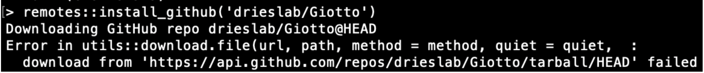

## Installation Issues

<details><summary>Installation Timeout</summary>
If you're installing Giotto using the devtools or remote packages, with the most recent version of Giotto, the following error has been observed:




This error is related to the time required for downloading the package. To solve the error, increase the limit of downloading time by running this code in your R console:

```{r, eval=FALSE}
options(timeout = max(1000, getOption("timeout")))
```

If you are doing the installation through a linux terminal, you can run instead this command to directly modify your R environment variable:

```
echo "R_DEFAULT_INTERNET_TIMEOUT = 1000" >> .Renviron
```

Alternatively, you can use the package pak to install Giotto

```{r, eval=FALSE}
if(!"pak" %in% installed.packages()) {
  install.packages("pak")
}

pak::pkg_install("giotto-suite/Giotto")
```
</details>


<details><summary>A Python tool fails to install or run</summary>

Python tools (cellpose, StarDist, Mesmer, scikit-image, tifffile, ONTraC,
Scrublet) install their own environment on first use and run in a worker R
session; no Giotto environment or conda is needed. See
[Giotto Configuration](configuration.html). If one fails:

- The first run of a tool needs internet. Behind a proxy or on an offline
  node, fill the uv cache on a machine with internet first.
- reticulate 1.41 or later is needed: `install.packages("reticulate")`.
- With your own Python (`options(giotto.py_python =)` or `python_env`), the
  tool's packages must be installed there; the error names the missing one.
- To debug a tool, run it in your own R session instead of a worker:
  `options(giotto.py_isolate = FALSE)`.

If the issue persists, please post an issue on
[GitHub](https://github.com/giotto-suite/Giotto/issues).
</details>

<hr>

## Errors during package usage
<details><summary>function `as_cholmod_sparse` not provided by package 'Matrix'</summary>
Matrix underwent a breaking change after versoin 1.6-2. Reinstalling _irlba_ from source will fix this.
See this GitHub [issue](https://github.com/bwlewis/irlba/issues/70) for more info.

```{r, eval=FALSE}
install.packages("irlba", type = "source")
```
</details>

<details><summary>Xenium/VisiumHD: arrow and ZSTD support</summary>
*arrow* is a suggested package Giotto uses to open `parquet` files. The parquet files that 10X provides use ZSTD compression which the default *arrow* installation may not provide.
The following code will check for whether arrow is installed with ZSTD support, and reinstall if it is not present.

```{r, eval=FALSE}
has_arrow <- requireNamespace("arrow", quietly = TRUE)
zstd <- TRUE
if (has_arrow) {
    zstd <- arrow::arrow_info()$capabilities[["zstd"]]
}
if (!has_arrow || !zstd) {
    Sys.setenv(ARROW_WITH_ZSTD = "ON") 
    # this may take a while
    install.packages("arrow",
        repos = c("https://apache.r-universe.dev", "https://cloud.r-project.org"),
        type = "source")
}
```
</details>


