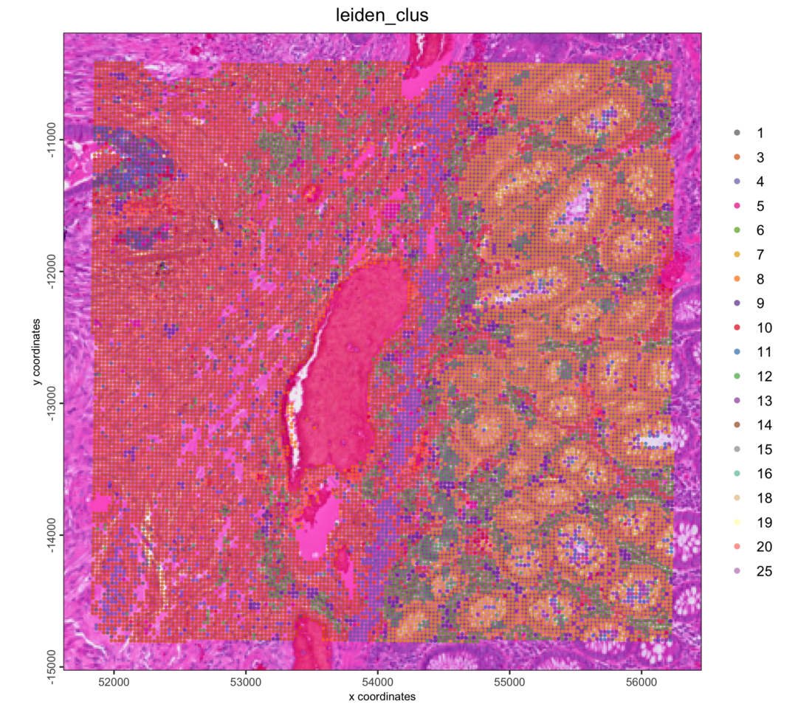

```{r, include=FALSE}
knitr::opts_chunk$set(eval = FALSE)
```

# Overview

This tutorial starts from the 8 µm bins that Space Ranger already aggregated
from the 2 µm grid. It reads them into an on-disk GiottoDisk project, then
filters, normalizes, clusters and plots them.

On a disk-backed object the expression matrix lives as parquet files in a
project directory, so the same Giotto commands run on data larger than memory.
Two related tutorials start from the
[segmented cells](visiumhd_crc_cells_giottodisk.html) and from
[the 2 µm bins and your own polygons](visiumhd_crc_own_polygons_giottodisk.html).

# Install extra packages

This tutorial uses GiottoDisk for on-disk processing. These are preview dev
builds off the dev and gsource Giotto package branches. If GiottoDisk has not
been installed yet, use the following:

```{r install, eval = FALSE}
# GiottoDisk install
GiottoUtils::suite_install("GiottoDisk")
# Optional for matrix maths speedup:
install.packages("GiottoKernels",
    repos = c("https://giotto-suite.r-universe.dev", "https://cloud.r-project.org")
)
```

# Dataset explanation

10x Genomics'
[Visium HD Spatial Gene Expression Library, Human Colorectal Cancer (FFPE)](https://www.10xgenomics.com/datasets/visium-hd-cytassist-gene-expression-libraries-of-human-crc-v4),
processed with Space Ranger 4.0.1. Space Ranger bins the probe counts at 2, 8
and 16 µm; this tutorial uses the 8 µm bins.

## Download links

<details><summary>`curl` links from 10x Genomics</summary>
```
base=https://cf.10xgenomics.com/samples/spatial-exp/4.0.1/Visium_HD_Human_Colon_Cancer/Visium_HD_Human_Colon_Cancer
mkdir outs && cd outs
curl -O ${base}_binned_outputs.tar.gz      # 15.9 GB
tar -xzf Visium_HD_Human_Colon_Cancer_binned_outputs.tar.gz
```
</details>

<br>

This gives `outs/binned_outputs/` with one `square_002um`, `square_008um` and
`square_016um` folder per bin size.

# Setup

```{r libs, eval = FALSE}
library(arrow) # this must be libraried before terra or GiottoClass
library(Giotto)
library(GiottoDisk)

data_dir    <- "path/to/outs"
project_dir <- "path/to/visiumhd_crc_bins_project"

# set an appropriate amount of parallel workers for your computer
future::plan(future::multisession, workers = 4)
```


# Read the data

`sourceCreate()` sets up a `gDirSource`: a managed project directory that holds
the object on disk. `setArtifactDumpDir()` points the expression and spatial
writes at it.

```{r backend, eval = FALSE}
# declare a Giotto directory backend to use
gdsrc <- GiottoDisk::sourceCreate(project_dir, type = "gDirSource")
# point data content writes to the backend's artifact subdirectory
GiottoDisk::setArtifactDumpDir(gdsrc)
```

`createGiottoVisiumHDObjectBin()` reads one bin size. Passing the backend to
`backend` creates the object as a disk-backed project. `bin = 16` reads the
16 µm bins the same way.

```{r read, eval = FALSE}
g <- createGiottoVisiumHDObjectBin(file.path(data_dir, "binned_outputs"),
    bin = 8,
    tissue_only = TRUE, # only the bins under the tissue
    backend = gdsrc     # creates the object as a backed project
)
g
```

```
An object of class giotto 
>Active spat_unit:  bin008 
>Active feat_type:  rna 
dimensions    : 18982, 516880 (features, cells)
[SUBCELLULAR INFO]
[AGGREGATE INFO]
expression -----------------------
  [bin008][rna] raw
spatial locations ----------------
  [bin008] raw
attached images ------------------
images      : image 


Use objHistory() to see steps and params used
```

The expression matrix is a disk store:

```{r stores, eval = FALSE}
class(getExpression(g, output = "exprObj")[])
```

```
[1] "parquetExprStore"
attr(,"package")
[1] "GiottoDisk"
```

Each bin, colored by the number of genes it detects:

```{r preview-bins, eval = FALSE}
g <- addStatistics(g, expression_values = "raw")
spatPlot2D(g,
    cell_color = "nr_feats",
    color_as_factor = FALSE,
    gradient_style = "sequential",
    point_size = 0.3,
    point_border_stroke = 0,
    background_color = "black"
)
```

```{r preview-bins-fig, eval = TRUE, echo = FALSE, out.width = "100%"}
knitr::include_graphics("images/visiumhd_crc_bins_giottodisk/01_preview-bins.png")
```

## Save

Backed Giotto projects write named snapshots of the analysis state to the
project directory, which can be treated as checkpoints.

```{r save-ingest, eval = FALSE}
# The return value is needed since saveGiotto makes changes during the write
g <- saveGiotto(g, name = "ingest")
```

```
  backend : `gDirSource`
  path    : path/to/visiumhd_crc_bins_project
```

# Quality control and filtering

```{r stats, eval = FALSE}
cx <- pDataDT(g)
cat(sprintf("%s bins | median %d counts, %d features per bin\n",
    format(nrow(cx), big.mark = ","),
    median(cx$total_expr), median(cx$nr_feats))
)
```

```
516,880 bins | median 435 counts, 337 features per bin
```

```{r filter, eval = FALSE}
g <- filterGiotto(g,
    expression_threshold   = 1,
    feat_det_in_min_cells  = 10,
    min_det_feats_per_cell = 50,
    verbose = FALSE
)
cat(sprintf("%s bins x %s features retained\n",
    format(length(spatIDs(g)), big.mark = ","),
    format(nrow(fDataDT(g)), big.mark = ","))
)
```

```
467,941 bins x 18,871 features retained
```

# Normalize and select features

```{r normalize, eval = FALSE}
g <- normalizeGiotto(g,
    scalefactor = 1e4,
    logbase = exp(1),
    log_offset = 1,
    scale_feats = FALSE,
    scale_cells = FALSE,
    verbose = FALSE
)
g <- calculateHVF(g,
    method = "cov_loess",
    n_top_feats = 2000,
    verbose = FALSE
)
```

# Dimension reduction

```{r pca, eval = FALSE}
g <- runPCA(g,
    feats_to_use = "hvf",
    ncp = 50,
    scale_unit = TRUE,
    center = TRUE,
    verbose = FALSE
)
screePlot(g, ncp = 50)
```

```{r pca-fig, eval = TRUE, echo = FALSE, out.width = "100%"}
knitr::include_graphics("images/visiumhd_crc_bins_giottodisk/02_pca.png")
```

The scree plot flattens after about 15 PCs, so those are used below.

# Clustering

The kNN network is built first. `runUMAP()` then reuses it instead of
searching for neighbors again, and Leiden clusters on the same network.

```{r cluster, eval = FALSE}
dims_to_use <- 1:15

g <- createNearestNetwork(g,
    type = "kNN",
    dimensions_to_use = dims_to_use,
    k = 30,
    engine = "hnsw",
    verbose = FALSE
)
g <- runUMAP(g,
    dimensions_to_use = dims_to_use,
    n_neighbors = 30,
    min_dist = 0.3,
    verbose = FALSE
)
g <- doLeidenCluster(g,
    nn_network_to_use = "kNN",
    network_name = "kNN.pca",
    resolution = 0.2,
    n_iterations = 20,
    objective_function = "modularity",
    verbose = FALSE
)
cat(length(unique(pDataDT(g)$leiden_clus)), "clusters\n")

g <- saveGiotto(g, name = "clustered")
```

```
26 clusters
  backend : `gDirSource`
  path    : path/to/visiumhd_crc_bins_project
```

One color per cluster, reused by every plot below so the zoom matches the
overview:

```{r umap, eval = FALSE}
clus <- GiottoUtils::mixedsort(unique(pDataDT(g)$leiden_clus))
clus_colors <- stats::setNames(getDistinctColors(length(clus)), clus)

plotUMAP(g,
    cell_color = "leiden_clus",
    cell_color_code = clus_colors,
    color_as_factor = TRUE,
    point_border_stroke = 0,
    point_size = 0.1
)
```

```{r umap-fig, eval = TRUE, echo = FALSE, out.width = "100%"}
knitr::include_graphics("images/visiumhd_crc_bins_giottodisk/03_umap.png")
```

```{r spatial, eval = FALSE}
spatPlot2D(g,
    cell_color = "leiden_clus",
    cell_color_code = clus_colors,
    color_as_factor = TRUE,
    point_border_stroke = 0,
    point_size = 0.3,
    background_color = "black"
)
```

```{r spatial-fig, eval = TRUE, echo = FALSE, out.width = "100%"}
knitr::include_graphics("images/visiumhd_crc_bins_giottodisk/04_spatial.png")
```

Zoom into a region over the H&E image. `subsetGiottoLocs()` keeps the bins
inside a window:

```{r roi, eval = FALSE}
sl <- getSpatialLocations(g, output = "data.table")
roi_x <- stats::median(sl$sdimx)
roi_y <- stats::median(sl$sdimy)
half <- 2200 # pixels; about 0.6 mm at 0.27 um per pixel

g_roi <- subsetGiottoLocs(g,
    x_min = roi_x - half, x_max = roi_x + half,
    y_min = roi_y - half, y_max = roi_y + half
)
spatPlot2D(g_roi,
    cell_color = "leiden_clus",
    cell_color_code = clus_colors,
    color_as_factor = TRUE,
    show_image = TRUE,
    point_size = 1.2,
    point_alpha = 0.7,
    point_border_stroke = 0
)
```

```{r roi-fig, eval = TRUE, echo = FALSE, out.width = "100%"}

```

The object is saved to the project directory and can be reloaded with
`loadGiotto(project_dir, name = "clustered")`.

# Further reading

* [Visium HD colorectal cancer: segmented cells](visiumhd_crc_cells_giottodisk.html),
  with cell typing from a cluster tree
* [Visium HD colorectal cancer: 2 µm bins into your own polygons](visiumhd_crc_own_polygons_giottodisk.html)
* The in-memory [Visium HD colorectal cancer tutorial](VisiumHD_Human_Colorectal_Cancer.html),
  which aggregates the 2 µm bins into hexagons of several sizes

# Session info

```{r session, eval = FALSE}
sessionInfo()
```

```
R version 4.5.3 (2026-03-11)
Platform: aarch64-apple-darwin20
Running under: macOS Tahoe 26.6.2

Matrix products: default
BLAS:   /Library/Frameworks/R.framework/Versions/4.5-arm64/Resources/lib/libRblas.0.dylib 
LAPACK: /Library/Frameworks/R.framework/Versions/4.5-arm64/Resources/lib/libRlapack.dylib;  LAPACK version 3.12.1

locale:
[1] C.UTF-8/C.UTF-8/C.UTF-8/C/C.UTF-8/C.UTF-8

time zone: America/New_York
tzcode source: internal

attached base packages:
[1] stats     graphics  grDevices utils     datasets  methods   base     

other attached packages:
[1] GiottoDisk_0.0.0.5 Giotto_4.3.2       GiottoClass_0.7.13 arrow_23.0.1.2    

loaded via a namespace (and not attached):
  [1] colorRamp2_0.1.0            gridExtra_2.3              
  [3] rlang_1.3.0                 magrittr_2.0.4             
  [5] otel_0.2.0                  GiottoUtils_0.2.7          
  [7] matrixStats_1.5.0           compiler_4.5.3             
  [9] vctrs_0.7.2                 hdf5r_1.3.12               
 [11] pkgconfig_2.0.3             SpatialExperiment_1.20.0   
 [13] fastmap_1.2.0               backports_1.5.0            
 [15] magick_2.9.1                XVector_0.50.0             
 [17] labeling_0.4.3              ggraph_2.2.2               
 [19] rmarkdown_2.31              purrr_1.2.1                
 [21] bit_4.6.0                   bluster_1.20.0             
 [23] xfun_0.57                   cachem_1.1.0               
 [25] beachmat_2.26.0             jsonlite_2.0.0             
 [27] DelayedArray_0.36.0         BiocParallel_1.44.0        
 [29] tweenr_2.0.3                terra_1.9-11               
 [31] cluster_2.1.8.2             irlba_2.3.7                
 [33] parallel_4.5.3              R6_2.6.1                   
 [35] bslib_0.10.0                RColorBrewer_1.1-3         
 [37] parallelly_1.47.0           GenomicRanges_1.62.1       
 [39] jquerylib_0.1.4             scattermore_1.2            
 [41] Rcpp_1.1.1                  Seqinfo_1.0.0              
 [43] assertthat_0.2.1            SummarizedExperiment_1.40.0
 [45] knitr_1.51                  future.apply_1.20.2        
 [47] R.utils_2.13.0              IRanges_2.44.0             
 [49] Matrix_1.7-5                igraph_2.2.2               
 [51] tidyselect_1.2.1            dichromat_2.0-0.1          
 [53] abind_1.4-8                 yaml_2.3.12                
 [55] viridis_0.6.5               codetools_0.2-20           
 [57] listenv_0.10.1              lattice_0.22-9             
 [59] tibble_3.3.1                Biobase_2.70.0             
 [61] withr_3.0.2                 S7_0.2.1                   
 [63] evaluate_1.0.5              future_1.70.0              
 [65] polyclip_1.10-7             filelock_1.0.3             
 [67] pillar_1.11.1               MatrixGenerics_1.22.0      
 [69] checkmate_2.3.4             stats4_4.5.3               
 [71] plotly_4.12.0               generics_0.1.4             
 [73] RcppHNSW_0.6.0              S4Vectors_0.48.0           
 [75] ggplot2_4.0.2               scales_1.4.0               
 [77] globals_0.19.1              gtools_3.9.5               
 [79] glue_1.8.0                  lazyeval_0.2.2             
 [81] tools_4.5.3                 tilework_1.0.0             
 [83] GiottoVisuals_0.2.16        BiocNeighbors_2.4.0        
 [85] data.table_1.18.2.1         ScaledMatrix_1.18.0        
 [87] graphlayouts_1.2.3          tidygraph_1.3.1            
 [89] cowplot_1.2.0               grid_4.5.3                 
 [91] tidyr_1.3.2                 colorspace_2.1-2           
 [93] SingleCellExperiment_1.32.0 BiocSingular_1.26.1        
 [95] ggforce_0.5.0               rsvd_1.0.5                 
 [97] cli_3.6.5                   S4Arrays_1.10.1            
 [99] viridisLite_0.4.3           dplyr_1.2.0                
[101] uwot_0.2.4                  gtable_0.3.6               
[103] R.methodsS3_1.8.2           sass_0.4.10                
[105] digest_0.6.39               BiocGenerics_0.56.0        
[107] SparseArray_1.10.9          ggrepel_0.9.8              
[109] rjson_0.2.23                htmlwidgets_1.6.4          
[111] farver_2.1.2                R.oo_1.27.1                
[113] memoise_2.0.1               htmltools_0.5.9            
[115] lifecycle_1.0.5             httr_1.4.8                 
[117] bit64_4.6.0-1               MASS_7.3-65
```
NA
```
