```{r, include=FALSE}
knitr::opts_chunk$set(eval = FALSE)
```

# Overview

This tutorial starts from the cells that Space Ranger segmented. It reads them
into an on-disk GiottoDisk project, clusters them, and names the clusters with
a cluster tree, following
[Cell typing with a cluster tree](cell_typing_cluster_tree.html).

On a disk-backed object the expression matrix and the cell and nucleus
polygons live as parquet files in a project directory, so the same Giotto
commands run on data larger than memory. Two related tutorials start from the
[8 µm bins](visiumhd_crc_bins_giottodisk.html) and from
[the 2 µm bins and your own polygons](visiumhd_crc_own_polygons_giottodisk.html).

# Install extra packages

This tutorial uses GiottoDisk for on-disk processing. These are preview dev
builds off the dev and gsource Giotto package branches. If GiottoDisk has not
been installed yet, use the following:

```{r install, eval = FALSE}
# GiottoDisk install; also installs arrow (with zstd support) and tilework
remotes::install_github("giotto-suite/GiottoUtils", ref = "dev")
GiottoUtils::suite_install("GiottoDisk", install_arrow = TRUE)
# Optional for matrix maths speedup:
install.packages("GiottoKernels",
    repos = c("https://giotto-suite.r-universe.dev", "https://cloud.r-project.org")
)
```

# Dataset explanation

10x Genomics'
[Visium HD Spatial Gene Expression Library, Human Colorectal Cancer (FFPE)](https://www.10xgenomics.com/datasets/visium-hd-cytassist-gene-expression-libraries-of-human-crc-v4),
processed with Space Ranger 4.0.1. Space Ranger 4 finds the nuclei in the H&E
image and expands each nucleus by a fixed distance to outline its cell; no
other stain is used. Each 2 µm bin is then assigned to the cell it falls in,
giving a cell by gene matrix and the cell and nucleus outlines.

## Download links

<details><summary>`curl` links from 10x Genomics</summary>
```
base=https://cf.10xgenomics.com/samples/spatial-exp/4.0.1/Visium_HD_Human_Colon_Cancer/Visium_HD_Human_Colon_Cancer
mkdir outs && cd outs
curl -O ${base}_segmented_outputs.tar.gz   # 9.5 GB
tar -xzf Visium_HD_Human_Colon_Cancer_segmented_outputs.tar.gz
```
</details>

<br>

This gives `outs/segmented_outputs/`: the cell matrix, the cell and nucleus
`.geojson` outlines and the `spatial/` images.

# Setup

```{r libs, eval = FALSE}
library(arrow) # this must be libraried before terra or GiottoClass
library(Giotto)
library(GiottoDisk)

data_dir    <- "path/to/outs"
project_dir <- "path/to/visiumhd_crc_cells_project"

# set an appropriate amount of parallel workers for your computer
future::plan(future::multisession, workers = 4)
```


# Read the data

`sourceCreate()` sets up a `gDirSource`: a managed project directory that holds
the object on disk. `setArtifactDumpDir()` points the expression and spatial
writes at it.

```{r backend, eval = FALSE}
# declare a Giotto directory backend to use
gdsrc <- GiottoDisk::sourceCreate(project_dir, type = "gDirSource")
# point data content writes to the backend's artifact subdirectory
GiottoDisk::setArtifactDumpDir(gdsrc)
```

`createGiottoVisiumHDObjectCell()` reads the segmented outputs: the cell matrix,
the cell and nucleus polygons, and the H&E image. Passing the backend to
`backend` creates the object as a disk-backed project.

```{r read, eval = FALSE}
g <- createGiottoVisiumHDObjectCell(file.path(data_dir, "segmented_outputs"),
    backend = gdsrc # creates the object as a backed project
)
g
```

```
An object of class giotto 
>Active spat_unit:  cell 
>Active feat_type:  rna 
dimensions    : 18980, 220704 (features, cells)
[SUBCELLULAR INFO]
polygons      : cell nucleus 
[AGGREGATE INFO]
expression -----------------------
  [cell][rna] raw
spatial locations ----------------
  [cell] raw
  [nucleus] raw
attached images ------------------
images      : image 


Use objHistory() to see steps and params used
```

The expression matrix and the polygons are disk stores:

```{r stores, eval = FALSE}
class(getExpression(g, output = "exprObj")[])
class(getPolygonInfo(g, "cell", return_giottoPolygon = TRUE)[])
```

```
[1] "parquetExprStore"
attr(,"package")
[1] "GiottoDisk"
[1] "parquetGeomStore"
attr(,"package")
[1] "GiottoDisk"
```

## Save

Backed Giotto projects write named snapshots of the analysis state to the
project directory, which can be treated as checkpoints.

```{r save-ingest, eval = FALSE}
# The return value is needed since saveGiotto makes changes during the write
g <- saveGiotto(g, name = "ingest")
```

```
  backend : `gDirSource`
  path    : path/to/visiumhd_crc_cells_project
```

# Quality control and filtering

```{r stats, eval = FALSE}
g <- addStatistics(g, expression_values = "raw")
cx <- pDataDT(g)
cat(sprintf("%s cells | median %d counts, %d features per cell\n",
    format(nrow(cx), big.mark = ","),
    median(cx$total_expr), median(cx$nr_feats))
)
```

```
220,704 cells | median 779 counts, 590 features per cell
```

```{r filter, eval = FALSE}
g <- filterGiotto(g,
    expression_threshold   = 1,
    feat_det_in_min_cells  = 10,
    min_det_feats_per_cell = 50,
    verbose = FALSE
)
cat(sprintf("%s cells x %s features retained\n",
    format(length(spatIDs(g)), big.mark = ","),
    format(nrow(fDataDT(g)), big.mark = ","))
)
```

```
218,779 cells x 18,847 features retained
```

# Normalize and select features

```{r normalize, eval = FALSE}
g <- normalizeGiotto(g,
    scalefactor = 1e4,
    logbase = exp(1),
    log_offset = 1,
    scale_feats = FALSE,
    scale_cells = FALSE,
    verbose = FALSE
)
g <- calculateHVF(g,
    method = "cov_loess",
    n_top_feats = 2000,
    verbose = FALSE
)
```

# Dimension reduction

```{r pca, eval = FALSE}
g <- runPCA(g,
    feats_to_use = "hvf",
    ncp = 50,
    scale_unit = TRUE,
    center = TRUE,
    verbose = FALSE
)
screePlot(g, ncp = 50)
```

```{r pca-fig, eval = TRUE, echo = FALSE, out.width = "100%"}
knitr::include_graphics("images/visiumhd_crc_cells_giottodisk/01_pca.png")
```

The scree plot flattens after about 15 PCs, so those are used below.

# Clustering

The kNN network is built first. `runUMAP()` then reuses it instead of
searching for neighbors again, and Leiden clusters on the same network. The
resolution is set on the high side: the cluster tree below groups the clusters
again, so it is better to split too much than too little.

```{r cluster, eval = FALSE}
dims_to_use <- 1:15

g <- createNearestNetwork(g,
    type = "kNN",
    dimensions_to_use = dims_to_use,
    k = 30,
    engine = "hnsw",
    verbose = FALSE
)
g <- runUMAP(g,
    dimensions_to_use = dims_to_use,
    n_neighbors = 30,
    min_dist = 0.3,
    verbose = FALSE
)
g <- doLeidenCluster(g,
    nn_network_to_use = "kNN",
    network_name = "kNN.pca",
    resolution = 0.6,
    n_iterations = 20,
    objective_function = "modularity",
    verbose = FALSE
)
table(pDataDT(g)$leiden_clus)
clusters <- GiottoUtils::mixedsort(unique(as.character(pDataDT(g)$leiden_clus)))
# one color per cluster, shared by the plots below
clus_colors <- stats::setNames(getDistinctColors(length(clusters)), clusters)

g <- saveGiotto(g, name = "clustered")
```

```

    1     2     3     4     5     6     7     8     9    10    11    12    13 
11362 10806  6976  7670 14623  4165  3784 17228 31940 26600 17560  9043  7215 
   14    15    16    17    18    19    20    21 
 3804  8726  3679  3159   543  4065 14766 11065
  backend : `gDirSource`
  path    : path/to/visiumhd_crc_cells_project
```

```{r umap, eval = FALSE}
plotUMAP(g,
    cell_color = "leiden_clus",
    color_as_factor = TRUE,
    cell_color_code = clus_colors,
    point_border_stroke = 0,
    point_size = 0.1
)
```

```{r umap-fig, eval = TRUE, echo = FALSE, out.width = "100%"}
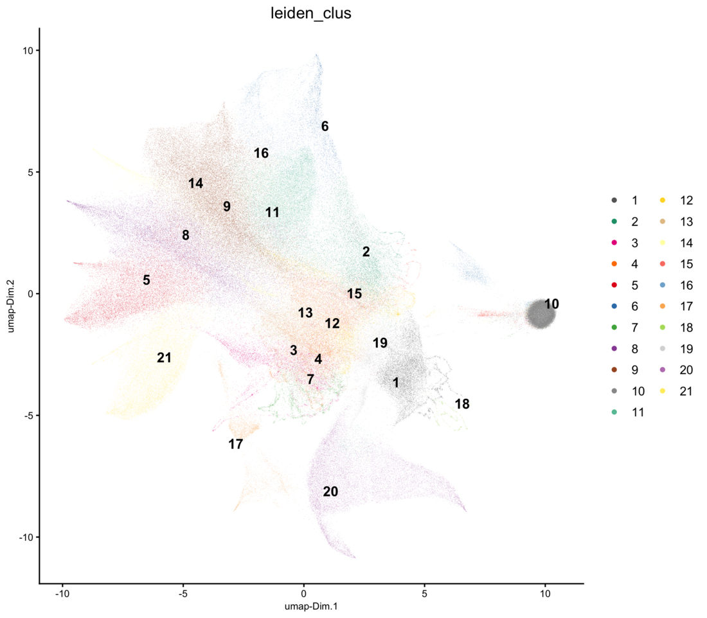
```

```{r spatial-clusters, eval = FALSE}
spatPlot2D(g,
    cell_color = "leiden_clus",
    color_as_factor = TRUE,
    cell_color_code = clus_colors,
    point_border_stroke = 0,
    point_size = 0.3,
    background_color = "black"
)
```

```{r spatial-clusters-fig, eval = TRUE, echo = FALSE, out.width = "100%"}
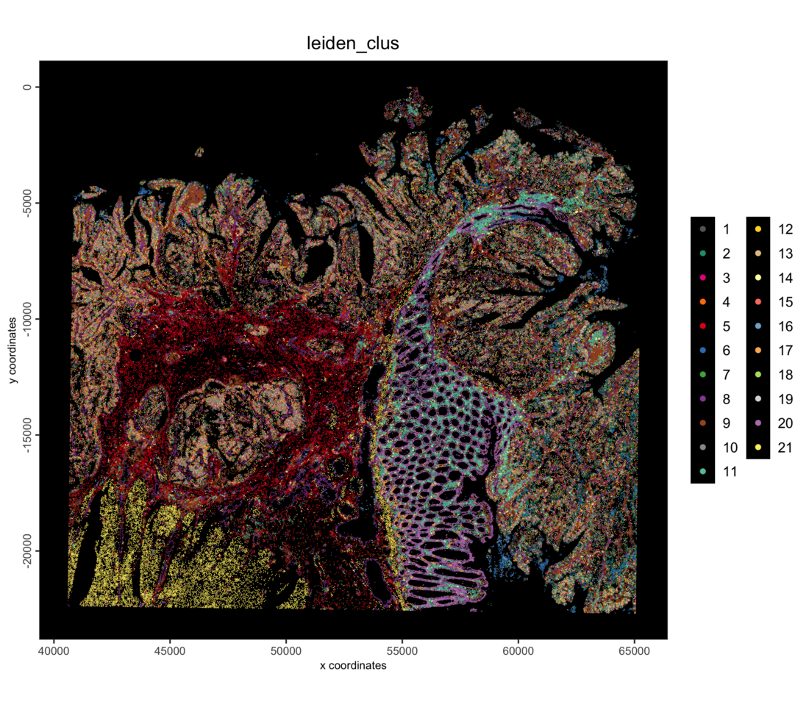
```

# Cell typing with a cluster tree

The steps below follow [Cell typing with a cluster tree](cell_typing_cluster_tree.html),
which explains each of them in more detail.

## Build the cluster tree

```{r tree, eval = FALSE}
CLUS <- "leiden_clus"
hvf  <- fDataDT(g)[hvf == "yes"]$feat_ID

tree <- calculateClusterTree(g,
    cluster_column = CLUS,
    feats = hvf,
    cor = "pearson",
    distance = "average"
)
plot(tree, hang = -1)
```

```{r tree-fig, eval = TRUE, echo = FALSE, out.width = "100%"}
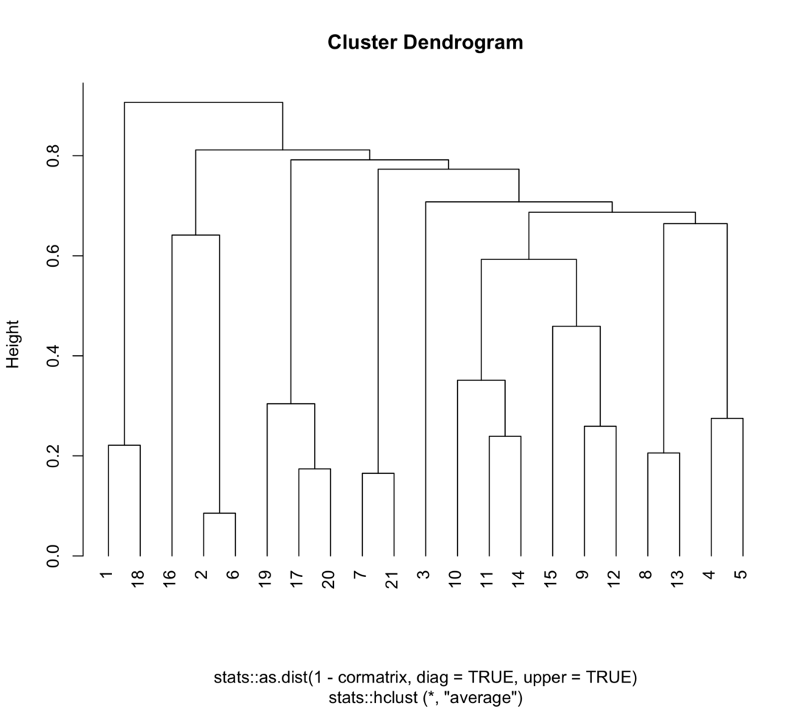
```

## Markers

```{r markers, eval = FALSE}
mk <- findMarkers_one_vs_all(g,
    method = "scran",
    cluster_column = CLUS,
    min_feats = 10,
    verbose = FALSE
)
gi <- findGiniMarkers_one_vs_all(g,
    cluster_column = CLUS,
    min_feats = 10,
    verbose = FALSE
)
nm <- findClusterTreeMarkers(g,
    cluster_column = CLUS,
    tree = tree,
    method = "scran",
    verbose = FALSE
)
```

## Assemble the annotation prompt

`writeClusterTreeQuery()` writes the tree, the per-cluster markers and the
markers of each split into one prompt for a language model, together with a
description of the sample.

```{r query, eval = FALSE}
prompt_file <- file.path(tempdir(), "visiumhd_crc_celltyping_prompt.txt")

q <- writeClusterTreeQuery(g,
    cluster_column = CLUS,
    tree = tree,
    markers = mk,
    gini_markers = gi,
    node_markers = nm,
    context = list(
        tissue = "human colon",
        disease = "colorectal adenocarcinoma",
        assay = "Visium HD whole-transcriptome probe panel, FFPE section, segmented cells"
    ),
    file_name = prompt_file
)
cat(length(q), "lines\n")
```

```
354 lines
```


## Apply the annotation

The model answers with a label for each cluster and for each node of the tree,
saved here as `crc_cell_types.json`. Check the answer against the markers above
before using it. Ten clusters carry the tumor epithelial markers (CEACAM5,
CEACAM6, EPCAM) and are flagged as low specificity. Most of them correlate with
a neighboring cell type, because segmented cells on Visium HD pick up counts
from the cells around them, so they are named by the signal they share.

<details><summary>`crc_cell_types.json`</summary>
```
{
  "nodes": [
    {
      "node": 20,
      "short": "all cells",
      "label": "all cells"
    },
    {
      "node": 19,
      "short": "main tissue",
      "label": "main tissue compartments"
    },
    {
      "node": 5,
      "short": "surface tumor epithelium",
      "label": "KRT20+ surface-like tumor epithelium and colonocytes"
    },
    {
      "node": 13,
      "short": "inflamed tumor",
      "label": "tumor epithelium with neutrophils and erythrocytes"
    },
    {
      "node": 1,
      "short": "tumor and neutrophils",
      "label": "tumor epithelium and neutrophils"
    },
    {
      "node": 18,
      "short": "mucosa, tumor and stroma",
      "label": "mucosa, tumor, stroma and immune cells"
    },
    {
      "node": 9,
      "short": "secretory and REG3A+ epithelium",
      "label": "secretory and REG3A+ epithelium"
    },
    {
      "node": 3,
      "short": "secretory epithelium",
      "label": "secretory epithelium of the normal mucosa"
    },
    {
      "node": 17,
      "short": "tumor, stroma and muscle",
      "label": "tumor, stroma, immune cells and smooth muscle"
    },
    {
      "node": 2,
      "short": "smooth muscle niche",
      "label": "smooth muscle and adjacent tumor cells"
    },
    {
      "node": 16,
      "short": "tumor and microenvironment",
      "label": "tumor epithelium and its microenvironment"
    },
    {
      "node": 15,
      "short": "tumor, immune and stroma",
      "label": "tumor epithelium mixed with immune and stromal cells"
    },
    {
      "node": 12,
      "short": "tumor and immune cells",
      "label": "tumor epithelium and immune cells"
    },
    {
      "node": 10,
      "short": "tumor and plasma/mast cells",
      "label": "tumor epithelium, plasma cells and mast cells"
    },
    {
      "node": 6,
      "short": "plasma and mast cells",
      "label": "plasma cells and mast cells"
    },
    {
      "node": 11,
      "short": "tumor and macrophages",
      "label": "tumor epithelium and macrophages"
    },
    {
      "node": 7,
      "short": "macrophage niche",
      "label": "macrophages and adjacent tumor cells"
    },
    {
      "node": 14,
      "short": "tumor stroma",
      "label": "fibroblasts, endothelium and adjacent tumor cells"
    },
    {
      "node": 4,
      "short": "vascular niche",
      "label": "endothelial cells and adjacent tumor cells"
    },
    {
      "node": 8,
      "short": "fibroblast niche",
      "label": "cancer-associated fibroblasts and adjacent tumor cells"
    }
  ],
  "clusters": [
    {
      "cluster": "1",
      "cell_type": "tumor epithelium, KRT20+ surface-like",
      "confidence": "medium",
      "markers": [
        "CEACAM5",
        "CEACAM6",
        "KRT20",
        "DUOX2",
        "LCN2",
        "CXCL8"
      ],
      "merge_with": null
    },
    {
      "cluster": "2",
      "cell_type": "tumor epithelium, neutrophil-mixed",
      "confidence": "low",
      "markers": [
        "CEACAM5",
        "CEACAM6",
        "EPCAM",
        "LCN2",
        "CXCL8"
      ],
      "merge_with": "3"
    },
    {
      "cluster": "3",
      "cell_type": "tumor epithelium",
      "confidence": "medium",
      "markers": [
        "CEACAM5",
        "CEACAM6",
        "MUC12",
        "EPCAM",
        "KRT8",
        "KRT18"
      ],
      "merge_with": null
    },
    {
      "cluster": "4",
      "cell_type": "tumor epithelium, fibroblast-mixed",
      "confidence": "low",
      "markers": [
        "CEACAM5",
        "CEACAM6",
        "EPCAM",
        "COL1A1",
        "COL3A1"
      ],
      "merge_with": "3"
    },
    {
      "cluster": "5",
      "cell_type": "cancer-associated fibroblasts",
      "confidence": "high",
      "markers": [
        "COL1A1",
        "COL3A1",
        "THBS2",
        "COL10A1",
        "COMP",
        "COL11A1",
        "SFRP4"
      ],
      "merge_with": null
    },
    {
      "cluster": "6",
      "cell_type": "neutrophils",
      "confidence": "high",
      "markers": [
        "CXCL8",
        "S100A8",
        "S100A9",
        "CSF3R",
        "IL1B",
        "G0S2",
        "AQP9"
      ],
      "merge_with": null
    },
    {
      "cluster": "7",
      "cell_type": "tumor epithelium, smooth muscle-mixed",
      "confidence": "low",
      "markers": [
        "CEACAM5",
        "CEACAM6",
        "EPCAM",
        "TAGLN",
        "DES"
      ],
      "merge_with": "3"
    },
    {
      "cluster": "8",
      "cell_type": "endothelial cells",
      "confidence": "medium",
      "markers": [
        "PECAM1",
        "VWF",
        "PLVAP",
        "AQP1",
        "ENG",
        "ACKR1"
      ],
      "merge_with": null
    },
    {
      "cluster": "9",
      "cell_type": "macrophages",
      "confidence": "medium",
      "markers": [
        "CD74",
        "LYZ",
        "C1QA",
        "C1QB",
        "C1QC",
        "MMP12",
        "CCL18"
      ],
      "merge_with": null
    },
    {
      "cluster": "10",
      "cell_type": "tumor epithelium, plasma cell-mixed",
      "confidence": "low",
      "markers": [
        "CEACAM5",
        "CEACAM6",
        "MUC12",
        "EPCAM"
      ],
      "merge_with": "3"
    },
    {
      "cluster": "11",
      "cell_type": "plasma cells",
      "confidence": "high",
      "markers": [
        "JCHAIN",
        "IGKC",
        "IGHA1",
        "MZB1",
        "XBP1",
        "TXNDC5"
      ],
      "merge_with": null
    },
    {
      "cluster": "12",
      "cell_type": "tumor epithelium, macrophage-mixed",
      "confidence": "low",
      "markers": [
        "CEACAM5",
        "CEACAM6",
        "EPCAM",
        "CD74"
      ],
      "merge_with": "3"
    },
    {
      "cluster": "13",
      "cell_type": "tumor epithelium, endothelium-mixed",
      "confidence": "low",
      "markers": [
        "CEACAM5",
        "CEACAM6",
        "EPCAM",
        "PECAM1"
      ],
      "merge_with": "3"
    },
    {
      "cluster": "14",
      "cell_type": "mast cells",
      "confidence": "high",
      "markers": [
        "TPSAB1",
        "TPSB2",
        "CPA3",
        "KIT",
        "MS4A2",
        "HDC"
      ],
      "merge_with": null
    },
    {
      "cluster": "15",
      "cell_type": "tumor epithelium, immune-mixed",
      "confidence": "low",
      "markers": [
        "CEACAM5",
        "CEACAM6",
        "MUC12",
        "EPCAM"
      ],
      "merge_with": "3"
    },
    {
      "cluster": "16",
      "cell_type": "erythrocytes",
      "confidence": "high",
      "markers": [
        "HBB",
        "HBA1",
        "HBA2",
        "HBD"
      ],
      "merge_with": null
    },
    {
      "cluster": "17",
      "cell_type": "enteroendocrine cells",
      "confidence": "high",
      "markers": [
        "CHGA",
        "CHGB",
        "TPH1",
        "PYY"
      ],
      "merge_with": null
    },
    {
      "cluster": "18",
      "cell_type": "colonocytes, SLC26A3+",
      "confidence": "medium",
      "markers": [
        "SLC26A3",
        "FABP1",
        "CEACAM5"
      ],
      "merge_with": null
    },
    {
      "cluster": "19",
      "cell_type": "tumor epithelium, REG3A+",
      "confidence": "low",
      "markers": [
        "CEACAM6",
        "MYC",
        "LAPTM4B",
        "KLF5",
        "REG3A"
      ],
      "merge_with": null
    },
    {
      "cluster": "20",
      "cell_type": "goblet and crypt epithelium",
      "confidence": "high",
      "markers": [
        "MUC2",
        "FCGBP",
        "CLCA1",
        "PIGR",
        "OLFM4",
        "TFF3"
      ],
      "merge_with": null
    },
    {
      "cluster": "21",
      "cell_type": "smooth muscle",
      "confidence": "high",
      "markers": [
        "DES",
        "TAGLN",
        "MYH11",
        "ACTG2",
        "CNN1"
      ],
      "merge_with": null
    }
  ]
}
```
</details>

<br>

`annotateClusterTree()` turns the tree into cell type columns at several
levels of detail: `k` is the number of groups at each level. Annotating the
tree at 5, 10, 15 and 20 groups shows how the broad compartments split into
cell types and niches further down the tree.

```{r annotate, eval = FALSE}
ans <- jsonlite::fromJSON(labels_json, simplifyVector = FALSE)

labels <- list(
    clusters = stats::setNames(
        vapply(ans$clusters, function(x) x$cell_type, ""),
        vapply(ans$clusters, function(x) as.character(x$cluster), "")
    ),
    nodes = stats::setNames(
        vapply(ans$nodes, function(x) x$short, ""),
        vapply(ans$nodes, function(x) as.character(x$node), "")
    )
)
lvls <- GiottoUtils::mixedsort(unique(as.character(pDataDT(g)[[CLUS]])))

g <- annotateClusterTree(g,
    tree = tree,
    labels = labels,
    cluster_column = CLUS,
    k = c(5, 10, 15, 20, length(lvls))
)
table(g$cell_types_k5)
```

```

                 inflamed tumor secretory and REG3A+ epithelium 
                          18650                           21990 
            smooth muscle niche        surface tumor epithelium 
                          14849                           11905 
     tumor and microenvironment 
                         151385
```

```{r tree-annotated, fig.width = 14, fig.height = 10, eval = FALSE}
GiottoVisuals::plotClusterTree(g,
    cluster_column = CLUS,
    tree = tree,
    labels = labels,
    k = c(5, 10, 15, 20),
    gini_markers = gi,
    node_labels = FALSE
)
```

```{r tree-annotated-fig, eval = TRUE, echo = FALSE, out.width = "100%"}
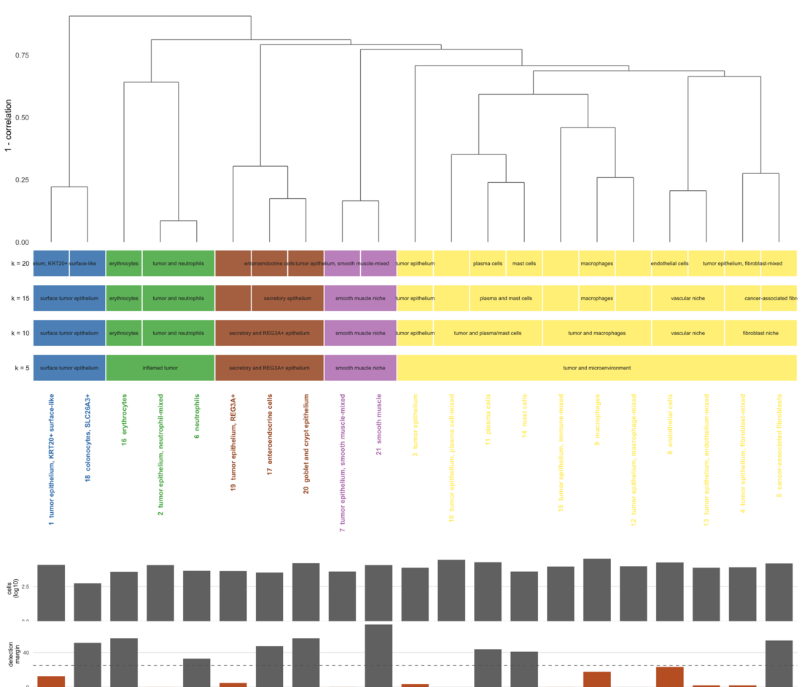
```

`k` sets the number of groups. The tree can also be cut by how different the
clusters are: with `h`, clusters that are more than that fraction dissimilar
(1 - correlation, averaged between the two groups) stay apart. The same `h`
then means the same thing in another dataset, while the number of groups it
gives depends on the data. Here no two clusters are within 5% of each other,
so `h = 0.05` keeps all of them:

```{r annotate-h, eval = FALSE}
g <- annotateClusterTree(g,
    tree = tree,
    labels = labels,
    cluster_column = CLUS,
    h = c(0.05, 0.2, 0.4)
)
```

```{r tree-annotated-h, fig.width = 14, fig.height = 9, eval = FALSE}
GiottoVisuals::plotClusterTree(g,
    cluster_column = CLUS,
    tree = tree,
    labels = labels,
    h = c(0.05, 0.2, 0.4),
    gini_markers = gi,
    node_labels = FALSE
)
```

```{r tree-annotated-h-fig, eval = TRUE, echo = FALSE, out.width = "100%"}
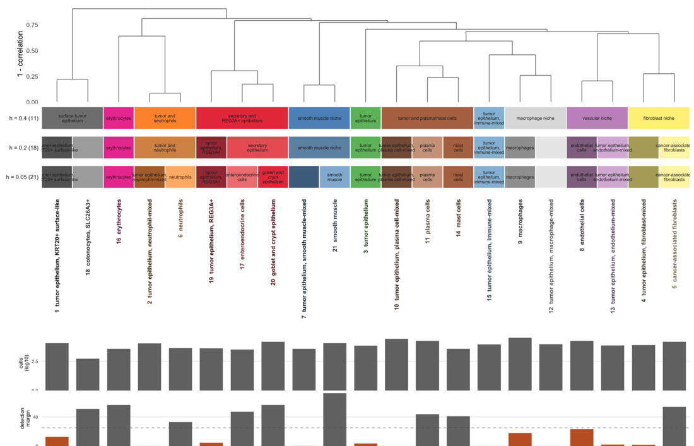
```

# Results

```{r spatial-k5, eval = FALSE}
spatPlot2D(g,
    color_as_factor = TRUE,
    cell_color = "cell_types_k5",
    point_border_stroke = 0,
    point_size = 0.3,
    background_color = "black",
    theme_param = list(legend.position = "bottom")
)
```

```{r spatial-k5-fig, eval = TRUE, echo = FALSE, out.width = "100%"}
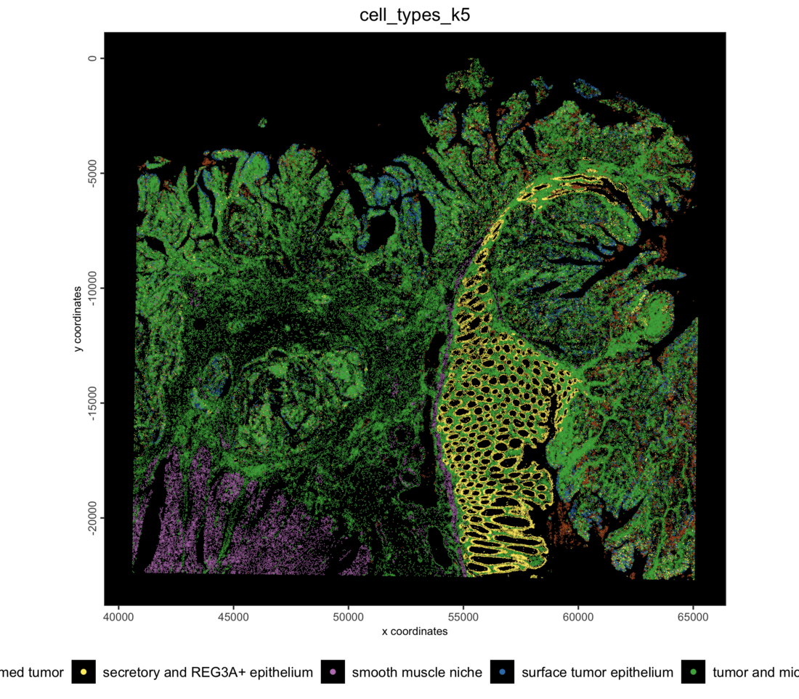
```

One color per type, reused in the zoom below:

```{r spatial-k20, fig.width = 12, fig.height = 7, eval = FALSE}
k20_types <- sort(unique(g$cell_types_k20))
k20_colors <- stats::setNames(getDistinctColors(length(k20_types)), k20_types)

spatPlot2D(g,
    color_as_factor = TRUE,
    cell_color = "cell_types_k20",
    cell_color_code = k20_colors,
    point_border_stroke = 0,
    point_size = 0.3,
    background_color = "black",
    theme_param = list(legend.position = "right")
)
```

```{r spatial-k20-fig, eval = TRUE, echo = FALSE, out.width = "100%"}
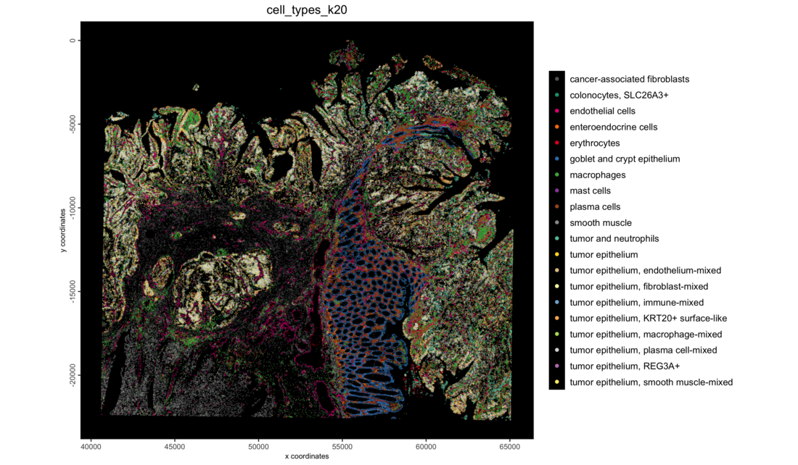
```

Zoom into a region with the cell polygons, filled by cell type, over the H&E
image:

```{r roi, eval = FALSE}
sl <- getSpatialLocations(g, output = "data.table")
roi_x <- stats::median(sl$sdimx)
roi_y <- stats::median(sl$sdimy)
half <- 2200 # pixels; about 0.6 mm at 0.27 um per pixel

spatInSituPlotPoints(g,
    show_image = TRUE,
    feats = NULL,
    show_polygon = TRUE,
    polygon_feat_type = "cell",
    polygon_fill = "cell_types_k20",
    polygon_fill_as_factor = TRUE,
    polygon_fill_code = k20_colors,
    polygon_line_size = 0.1,
    polygon_alpha = 0.6,
    xlim = c(roi_x - half, roi_x + half),
    ylim = c(roi_y - half, roi_y + half)
)
```

```{r roi-fig, eval = TRUE, echo = FALSE, out.width = "100%"}
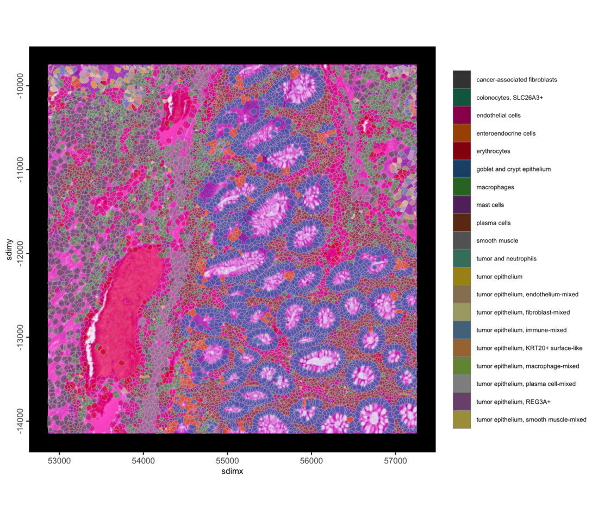
```

The same region, with the cells filled by the normalized expression of a few
marker genes instead:

```{r roi-genes, fig.width = 6, fig.height = 5.5, eval = FALSE}
marker_genes <- c("CEACAM5", "MUC2", "COL1A1", "DES", "CD74", "JCHAIN")

for (gene in marker_genes) {
    print(spatInSituPlotPoints(g,
        show_image = TRUE,
        feats = NULL,
        show_polygon = TRUE,
        polygon_feat_type = "cell",
        polygon_fill = gene,
        expression_values = "normalized",
        polygon_fill_as_factor = FALSE,
        polygon_fill_gradient_style = "sequential",
        polygon_line_size = 0.1,
        polygon_alpha = 0.8,
        xlim = c(roi_x - half, roi_x + half),
        ylim = c(roi_y - half, roi_y + half),
        show_plot = FALSE,
        return_plot = TRUE
    ) + ggplot2::ggtitle(gene))
}
```

```{r roi-genes-fig, eval = TRUE, echo = FALSE, out.width = "100%"}
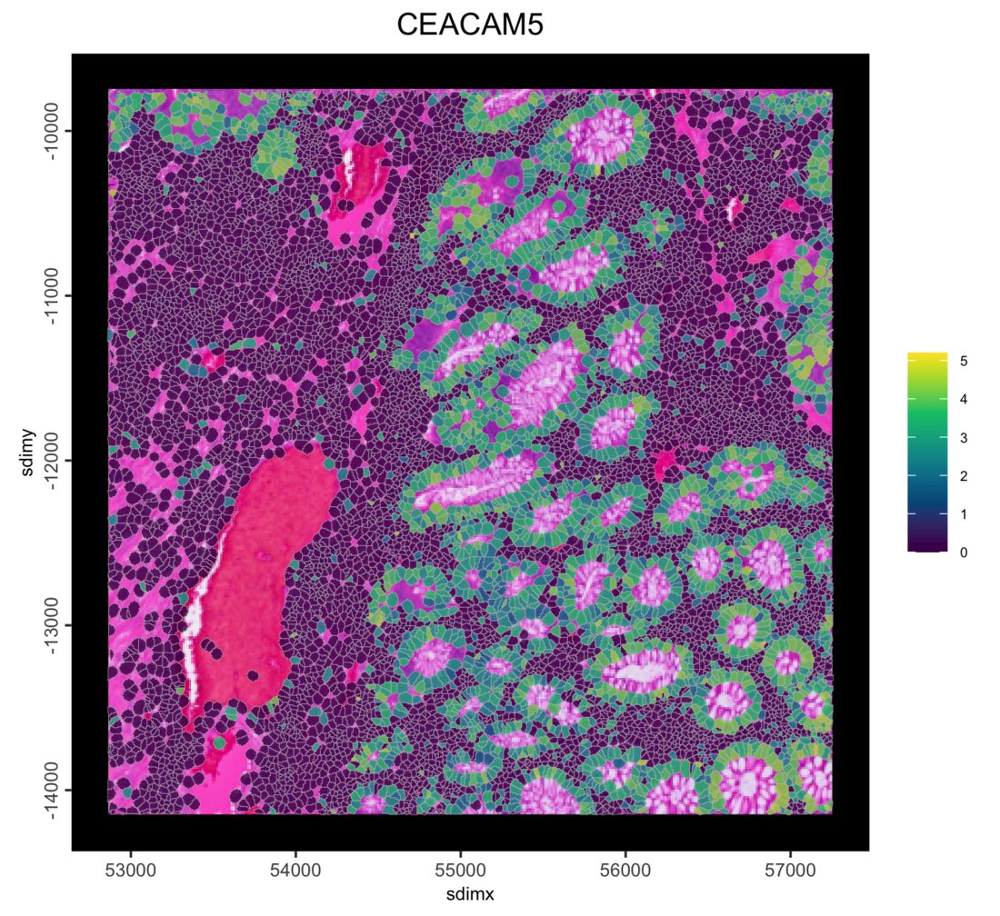
knitr::include_graphics("images/visiumhd_crc_cells_giottodisk/11_roi-genes.png")
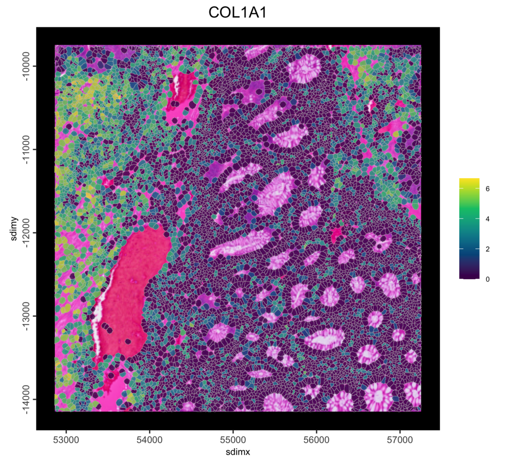
knitr::include_graphics("images/visiumhd_crc_cells_giottodisk/13_roi-genes.png")
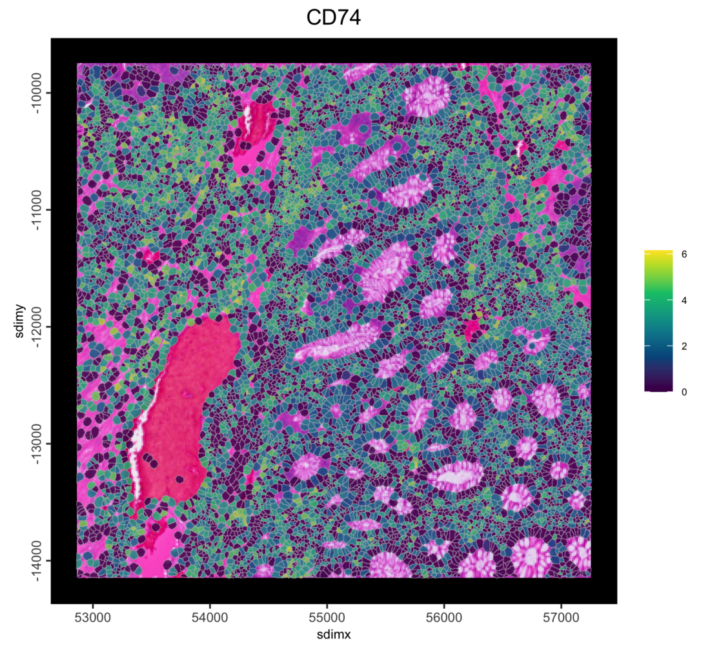
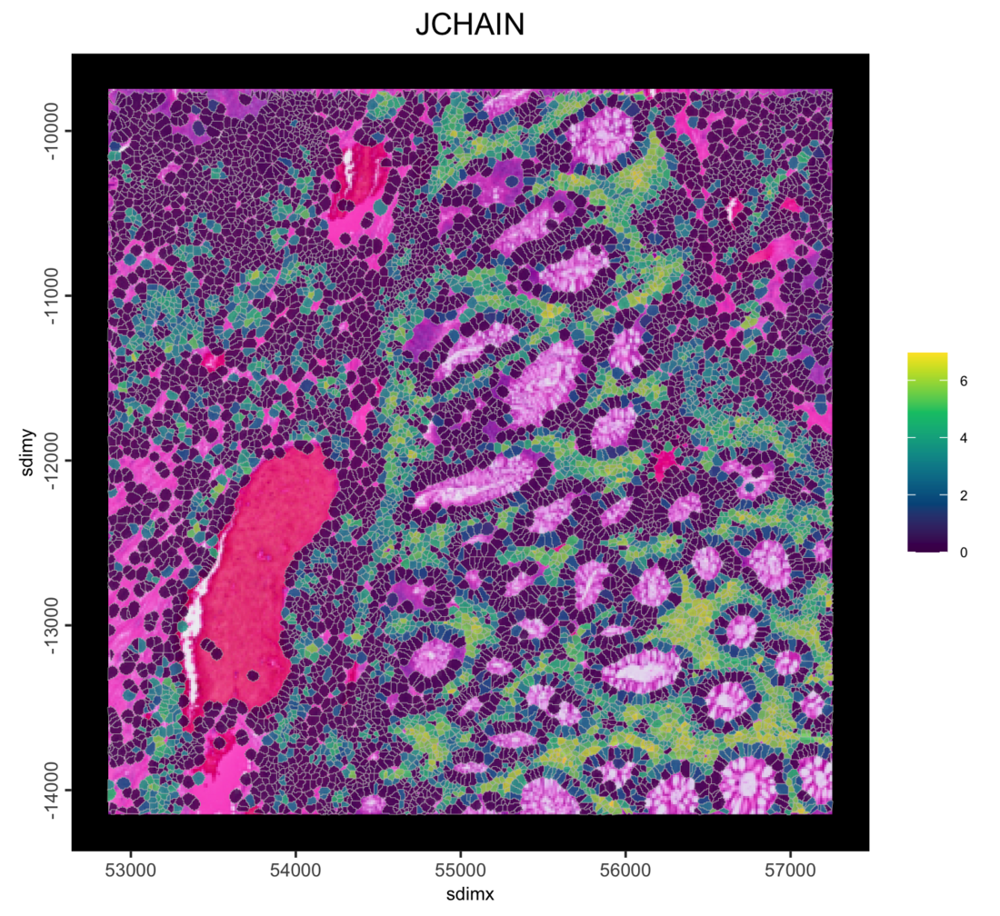
```

```{r save-annotated, eval = FALSE}
g <- saveGiotto(g, name = "annotated")
```

```
  backend : `gDirSource`
  path    : path/to/visiumhd_crc_cells_project
```

The object is saved to the project directory and can be reloaded with
`loadGiotto(project_dir, name = "annotated")`.

# Further reading

* [Visium HD colorectal cancer: 8 µm bins](visiumhd_crc_bins_giottodisk.html)
* [Visium HD colorectal cancer: 2 µm bins into your own polygons](visiumhd_crc_own_polygons_giottodisk.html)
* [Cell typing with a cluster tree](cell_typing_cluster_tree.html), with each
  step of the annotation in detail
* The in-memory [Visium HD colorectal cancer tutorial](VisiumHD_Human_Colorectal_Cancer.html)

# Session info

```{r session, eval = FALSE}
sessionInfo()
```

```
R version 4.5.3 (2026-03-11)
Platform: aarch64-apple-darwin20
Running under: macOS Tahoe 26.6.2

Matrix products: default
BLAS:   /Library/Frameworks/R.framework/Versions/4.5-arm64/Resources/lib/libRblas.0.dylib 
LAPACK: /Library/Frameworks/R.framework/Versions/4.5-arm64/Resources/lib/libRlapack.dylib;  LAPACK version 3.12.1

locale:
[1] C.UTF-8/C.UTF-8/C.UTF-8/C/C.UTF-8/C.UTF-8

time zone: America/New_York
tzcode source: internal

attached base packages:
[1] stats     graphics  grDevices utils     datasets  methods   base     

other attached packages:
[1] GiottoDisk_0.0.0.5 Giotto_4.3.3       GiottoClass_0.7.15 arrow_23.0.1.2    

loaded via a namespace (and not attached):
  [1] RColorBrewer_1.1-3          wk_0.9.5                   
  [3] ggdendro_0.2.0              jsonlite_2.0.0             
  [5] magrittr_2.0.4              magick_2.9.1               
  [7] farver_2.1.2                rmarkdown_2.31             
  [9] vctrs_0.7.2                 memoise_2.0.1              
 [11] GiottoUtils_0.2.7           terra_1.9-11               
 [13] htmltools_0.5.9             S4Arrays_1.10.1            
 [15] BiocNeighbors_2.4.0         SparseArray_1.10.9         
 [17] sass_0.4.10                 parallelly_1.47.0          
 [19] bslib_0.10.0                htmlwidgets_1.6.4          
 [21] plotly_4.12.0               cachem_1.1.0               
 [23] igraph_2.2.2                lifecycle_1.0.5            
 [25] pkgconfig_2.0.3             rsvd_1.0.5                 
 [27] Matrix_1.7-5                R6_2.6.1                   
 [29] fastmap_1.2.0               MatrixGenerics_1.22.0      
 [31] future_1.70.0               digest_0.6.39              
 [33] colorspace_2.1-2            S4Vectors_0.48.0           
 [35] dqrng_0.4.1                 irlba_2.3.7                
 [37] GenomicRanges_1.62.1        beachmat_2.26.0            
 [39] filelock_1.0.3              labeling_0.4.3             
 [41] progressr_0.18.0            httr_1.4.8                 
 [43] polyclip_1.10-7             abind_1.4-8                
 [45] compiler_4.5.3              bit64_4.6.0-1              
 [47] withr_3.0.2                 S7_0.2.1                   
 [49] backports_1.5.0             BiocParallel_1.44.0        
 [51] DBI_1.3.0                   viridis_0.6.5              
 [53] ggforce_0.5.0               R.utils_2.13.0             
 [55] duckdb_1.5.1                MASS_7.3-65                
 [57] DelayedArray_0.36.0         rjson_0.2.23               
 [59] bluster_1.20.0              gtools_3.9.5               
 [61] GiottoVisuals_0.2.16        tools_4.5.3                
 [63] otel_0.2.0                  future.apply_1.20.2        
 [65] R.oo_1.27.1                 glue_1.8.0                 
 [67] grid_4.5.3                  checkmate_2.3.4            
 [69] cluster_2.1.8.2             generics_0.1.4             
 [71] hdf5r_1.3.12                gtable_0.3.6               
 [73] R.methodsS3_1.8.2           tidyr_1.3.2                
 [75] data.table_1.18.2.1         BiocSingular_1.26.1        
 [77] tidygraph_1.3.1             ScaledMatrix_1.18.0        
 [79] metapod_1.18.0              XVector_0.50.0             
 [81] BiocGenerics_0.56.0         tilework_1.0.0             
 [83] ggrepel_0.9.8               pillar_1.11.1              
 [85] RcppHNSW_0.6.0              limma_3.66.0               
 [87] dplyr_1.2.0                 tweenr_2.0.3               
 [89] lattice_0.22-9              bit_4.6.0                  
 [91] tidyselect_1.2.1            SingleCellExperiment_1.32.0
 [93] locfit_1.5-9.12             scuttle_1.20.0             
 [95] knitr_1.51                  gridExtra_2.3              
 [97] IRanges_2.44.0              Seqinfo_1.0.0              
 [99] edgeR_4.8.2                 SummarizedExperiment_1.40.0
[101] scattermore_1.2             stats4_4.5.3               
[103] xfun_0.57                   graphlayouts_1.2.3         
[105] Biobase_2.70.0              statmod_1.5.2              
[107] matrixStats_1.5.0           lazyeval_0.2.2             
[109] yaml_2.3.12                 evaluate_1.0.5             
[111] codetools_0.2-20            ggraph_2.2.2               
[113] tibble_3.3.1                colorRamp2_0.1.0           
[115] cli_3.6.5                   uwot_0.2.4                 
[117] jquerylib_0.1.4             dichromat_2.0-0.1          
[119] Rcpp_1.1.1                  globals_0.19.1             
[121] dbplyr_2.5.2                parallel_4.5.3             
[123] ggplot2_4.0.2               assertthat_0.2.1           
[125] scran_1.38.1                listenv_0.10.1             
[127] SpatialExperiment_1.20.0    viridisLite_0.4.3          
[129] scales_1.4.0                purrr_1.2.1                
[131] rlang_1.3.0                 cowplot_1.2.0
```
NA
```
