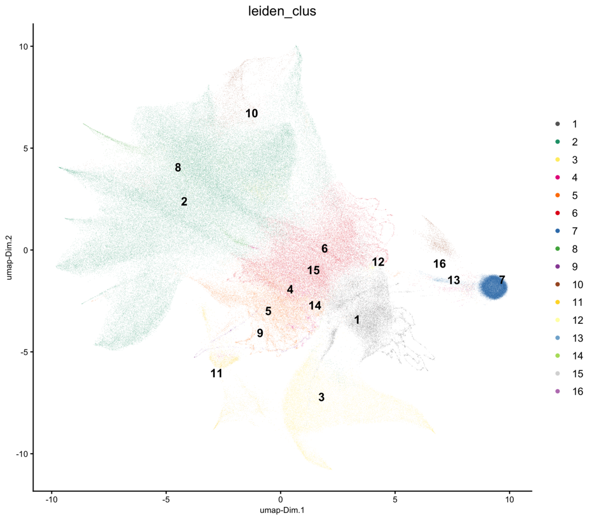
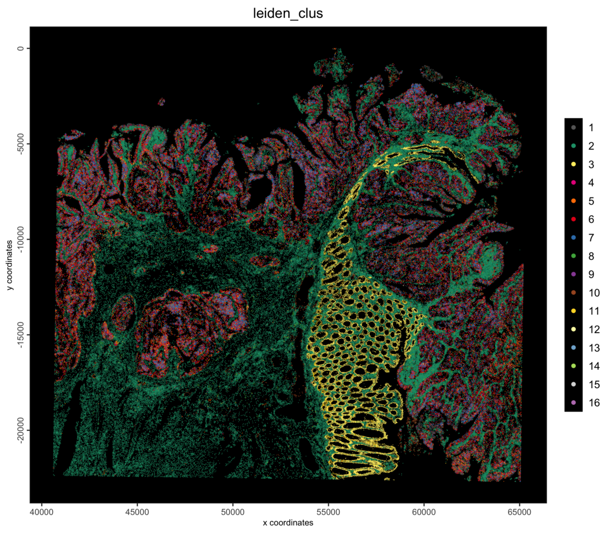
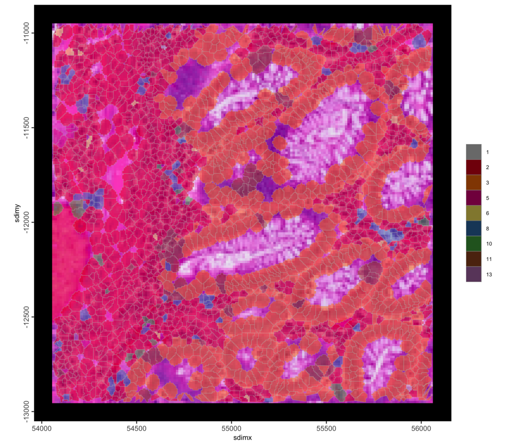
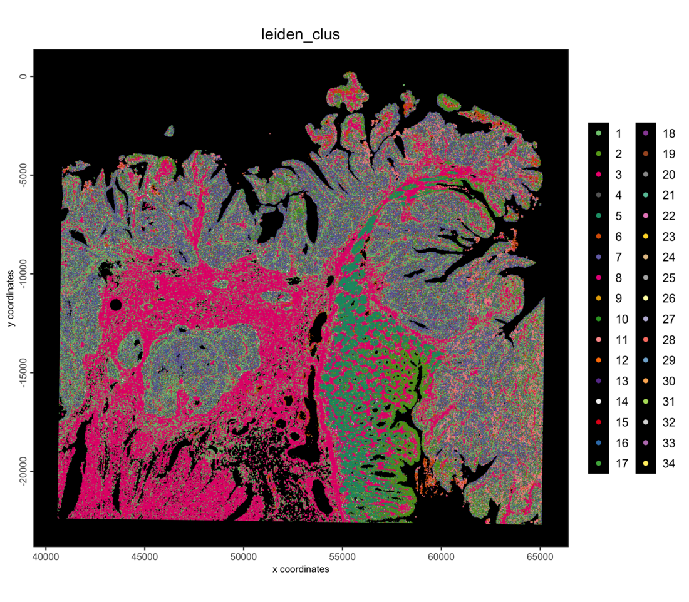

```{r, include=FALSE}
knitr::opts_chunk$set(eval = FALSE)
```

# Overview

This tutorial reads the 10x Visium HD human colorectal cancer FFPE dataset
into an on-disk GiottoDisk project: the 8 µm bins and the segmented cells,
as two spatial units of one object. It then filters, normalizes, clusters and
plots both.

On a disk-backed object the expression matrices and the cell and nucleus
polygons live as parquet files in a project directory, so the same Giotto
commands run on data larger than memory.

# Install extra packages

This tutorial uses GiottoDisk for on-disk processing. These are preview dev
builds off the dev and gsource Giotto package branches. If GiottoDisk has not
been installed yet, use the following:

```{r install, eval = FALSE}
# GiottoDisk install
GiottoUtils::suite_install("GiottoDisk")
# Optional for matrix maths speedup:
install.packages("GiottoKernels",
    repos = c("https://giotto-suite.r-universe.dev", "https://cloud.r-project.org")
)
```

# Dataset explanation

10x Genomics'
[Visium HD Spatial Gene Expression Library, Human Colorectal Cancer (FFPE)](https://www.10xgenomics.com/datasets/visium-hd-cytassist-gene-expression-libraries-of-human-crc-v4),
processed with Space Ranger 4.0.1. Space Ranger 4 bins the probe counts at 2,
8 and 16 µm and also segments cells from the H&E image, so the same section
comes as square bins and as cells.

## Download links

<details><summary>`curl` links from 10x Genomics</summary>
```
base=https://cf.10xgenomics.com/samples/spatial-exp/4.0.1/Visium_HD_Human_Colon_Cancer/Visium_HD_Human_Colon_Cancer
mkdir outs && cd outs
curl -O ${base}_binned_outputs.tar.gz      # 15.9 GB
curl -O ${base}_segmented_outputs.tar.gz   #  9.5 GB
curl -O ${base}_barcode_mappings.parquet   #  115 MB
tar -xzf Visium_HD_Human_Colon_Cancer_binned_outputs.tar.gz
tar -xzf Visium_HD_Human_Colon_Cancer_segmented_outputs.tar.gz
mv Visium_HD_Human_Colon_Cancer_barcode_mappings.parquet barcode_mappings.parquet
```
</details>

<br>

This gives the `outs/` layout Space Ranger writes: `binned_outputs/`,
`segmented_outputs/` and `barcode_mappings.parquet`.

# Setup

```{r libs, eval = FALSE}
library(arrow) # this must be libraried before terra or GiottoClass
library(Giotto)
library(GiottoDisk)

data_dir    <- "path/to/outs"
project_dir <- "path/to/visiumhd_crc_project"

# set an appropriate amount of parallel workers for your computer
future::plan(future::multisession, workers = 4)
```


# Read the data

First we set up a `gDirSource` with `sourceCreate()`: a managed project
directory that holds the object on disk. `setArtifactDumpDir()` points the
expression and spatial writes at it.

```{r backend, eval = FALSE}
# declare a Giotto directory backend to use
gdsrc <- GiottoDisk::sourceCreate(project_dir, type = "gDirSource")
# point data content writes to the backend's artifact subdirectory
GiottoDisk::setArtifactDumpDir(gdsrc)
```

`importVisiumHDDisk()` is the disk-backed counterpart of `importVisiumHD()`:
same arguments, plus `backend`. Its `create_gobject()` reads the 8 µm bins
under the tissue. A second reader adds the segmented cells into the same
object with `gobject =`.

```{r read, eval = FALSE}
bins <- importVisiumHDDisk(file.path(data_dir, "binned_outputs"),
    backend = gdsrc,
    bin = 8,
    tissue_only = TRUE
)
g <- bins$create_gobject(image_type = "hires")

cells <- importVisiumHDDisk(file.path(data_dir, "segmented_outputs"),
    backend = gdsrc
)
g <- cells$create_gobject(gobject = g, load_image = FALSE)
g
```

```
An object of class giotto 
>Active spat_unit:  bin008 
>Active feat_type:  rna 
dimensions    : 18982, 516880 (features, cells)
[SUBCELLULAR INFO]
polygons      : cell nucleus 
[AGGREGATE INFO]
expression -----------------------
  [bin008][rna] raw
  [cell][rna] raw
spatial locations ----------------
  [bin008] raw
  [cell] raw
  [nucleus] raw
attached images ------------------
images      : image 


Use objHistory() to see steps and params used
```

The expression of both units, and the cell and nucleus polygons, are disk
stores:

```{r stores, eval = FALSE}
class(getExpression(g, spat_unit = "bin008", output = "exprObj")[])
class(getExpression(g, spat_unit = "cell", output = "exprObj")[])
class(getPolygonInfo(g, "cell", return_giottoPolygon = TRUE)[])
```

```
[1] "parquetExprStore"
attr(,"package")
[1] "GiottoDisk"
[1] "parquetExprStore"
attr(,"package")
[1] "GiottoDisk"
[1] "parquetGeomStore"
attr(,"package")
[1] "GiottoDisk"
```

Each 8 µm bin, colored by the number of genes it detects:

```{r preview-bins, eval = FALSE}
g <- addStatistics(g, spat_unit = "bin008", expression_values = "raw")
spatPlot2D(g,
    spat_unit = "bin008",
    cell_color = "nr_feats",
    color_as_factor = FALSE,
    gradient_style = "sequential",
    point_size = 0.3,
    point_border_stroke = 0,
    background_color = "black"
)
```

```{r preview-bins-fig, eval = TRUE, echo = FALSE, out.width = "100%"}
knitr::include_graphics("images/visiumhd_human_colorectal_cancer_giottodisk/01_preview-bins.png")
```

## Save

Backed Giotto projects write named snapshots of the analysis state to the
project directory, which can be treated as checkpoints.

```{r save-ingest, eval = FALSE}
# The return value is needed since saveGiotto makes changes during the write
g <- saveGiotto(g, name = "ingest")
```

```
  backend : `gDirSource`
  path    : path/to/visiumhd_crc_project
```

# Cells

## Quality control and filtering

```{r cell-stats, eval = FALSE}
g <- addStatistics(g, spat_unit = "cell", expression_values = "raw")
cx <- pDataDT(g, spat_unit = "cell")
cat(sprintf("%s cells | median %d counts, %d features per cell\n",
    format(nrow(cx), big.mark = ","),
    median(cx$total_expr), median(cx$nr_feats))
)
```

```
220,704 cells | median 779 counts, 590 features per cell
```

```{r cell-filter, eval = FALSE}
g <- filterGiotto(g,
    spat_unit = "cell",
    expression_threshold   = 1,
    feat_det_in_min_cells  = 10,
    min_det_feats_per_cell = 50,
    verbose = FALSE
)
cat(sprintf("%s cells x %s features retained\n",
    format(length(spatIDs(g, spat_unit = "cell")), big.mark = ","),
    format(nrow(fDataDT(g, spat_unit = "cell")), big.mark = ","))
)
```

```
218,779 cells x 18,847 features retained
```

## Normalize and select features

On disk, z-score scaling is left out (`scale_feats`, `scale_cells`): it would
write a dense matrix. PCA scales on the fly instead (`scale_unit = TRUE`).

```{r cell-normalize, eval = FALSE}
g <- normalizeGiotto(g,
    spat_unit = "cell",
    scalefactor = 1e4,
    logbase = exp(1),
    log_offset = 1,
    scale_feats = FALSE,
    scale_cells = FALSE,
    verbose = FALSE
)
g <- calculateHVF(g,
    spat_unit = "cell",
    method = "cov_loess",
    n_top_feats = 2000,
    verbose = FALSE
)
```

## Dimension reduction and clustering

```{r cell-pca, eval = FALSE}
g <- runPCA(g,
    spat_unit = "cell",
    feats_to_use = "hvf",
    ncp = 50,
    scale_unit = TRUE,
    center = TRUE,
    verbose = FALSE
)
screePlot(g, spat_unit = "cell", ncp = 50)
```

```{r cell-pca-fig, eval = TRUE, echo = FALSE, out.width = "100%"}
knitr::include_graphics("images/visiumhd_human_colorectal_cancer_giottodisk/02_cell-pca.png")
```

The scree plot flattens after about 15 PCs, so those are used for the
neighbor network and UMAP.

```{r cell-cluster, eval = FALSE}
dims_to_use <- 1:15

g <- runUMAP(g,
    spat_unit = "cell",
    dimensions_to_use = dims_to_use,
    n_neighbors = 30,
    min_dist = 0.3,
    verbose = FALSE
)
g <- createNearestNetwork(g,
    spat_unit = "cell",
    dimensions_to_use = dims_to_use,
    k = 20,
    engine = "hnsw",
    verbose = FALSE
)
g <- doLeidenCluster(g,
    spat_unit = "cell",
    resolution = 0.1,
    n_iterations = 20,
    objective_function = "modularity",
    verbose = FALSE
)
cat(length(unique(pDataDT(g, spat_unit = "cell")$leiden_clus)), "cell clusters\n")

g <- saveGiotto(g, name = "cells_clustered")
```

```
16 cell clusters
  backend : `gDirSource`
  path    : path/to/visiumhd_crc_project
```

```{r cell-umap, eval = FALSE}
plotUMAP(g,
    spat_unit = "cell",
    cell_color = "leiden_clus",
    color_as_factor = TRUE,
    point_border_stroke = 0,
    point_size = 0.1
)
```

```{r cell-umap-fig, eval = TRUE, echo = FALSE, out.width = "100%"}

```

```{r cell-spatial, eval = FALSE}
spatPlot2D(g,
    spat_unit = "cell",
    cell_color = "leiden_clus",
    color_as_factor = TRUE,
    point_border_stroke = 0,
    point_size = 0.3,
    background_color = "black"
)
```

```{r cell-spatial-fig, eval = TRUE, echo = FALSE, out.width = "100%"}

```

Zoom into a region with the cell polygons over the H&E image.

```{r cell-roi, eval = FALSE}
sl <- getSpatialLocations(g, spat_unit = "cell", output = "data.table")
cx <- stats::median(sl$sdimx)
cy <- stats::median(sl$sdimy)
roi <- c(cx - 1000, cx + 1000, cy - 1000, cy + 1000) # xmin/xmax/ymin/ymax

spatInSituPlotPoints(g,
    spat_unit = "cell",
    show_image = TRUE,
    feats = NULL,
    show_polygon = TRUE,
    polygon_feat_type = "cell",
    polygon_fill = "leiden_clus",
    polygon_fill_as_factor = TRUE,
    polygon_line_size = 0.1,
    polygon_alpha = 0.5,
    xlim = roi[1:2],
    ylim = roi[3:4]
)
```

```{r cell-roi-fig, eval = TRUE, echo = FALSE, out.width = "100%"}

```

# 8 µm bins

The bins run through the same steps. An 8 µm bin often spans parts of two
cells, so the bins split into more, smaller clusters than the cells at a
lower resolution.

```{r bin-pipeline, eval = FALSE}
g <- filterGiotto(g,
    spat_unit = "bin008",
    expression_threshold   = 1,
    feat_det_in_min_cells  = 10,
    min_det_feats_per_cell = 50,
    verbose = FALSE
)
g <- normalizeGiotto(g,
    spat_unit = "bin008",
    scalefactor = 1e4,
    logbase = exp(1),
    log_offset = 1,
    scale_feats = FALSE,
    scale_cells = FALSE,
    verbose = FALSE
)
g <- calculateHVF(g,
    spat_unit = "bin008",
    method = "cov_loess",
    n_top_feats = 2000,
    verbose = FALSE
)
g <- runPCA(g,
    spat_unit = "bin008",
    feats_to_use = "hvf",
    ncp = 50,
    scale_unit = TRUE,
    center = TRUE,
    verbose = FALSE
)
g <- runUMAP(g,
    spat_unit = "bin008",
    dimensions_to_use = dims_to_use,
    n_neighbors = 30,
    min_dist = 0.3,
    verbose = FALSE
)
g <- createNearestNetwork(g,
    spat_unit = "bin008",
    dimensions_to_use = dims_to_use,
    k = 20,
    engine = "hnsw",
    verbose = FALSE
)
g <- doLeidenCluster(g,
    spat_unit = "bin008",
    resolution = 0.05,
    n_iterations = 20,
    objective_function = "modularity",
    verbose = FALSE
)
cat(sprintf("%s bins | %d clusters\n",
    format(length(spatIDs(g, spat_unit = "bin008")), big.mark = ","),
    length(unique(pDataDT(g, spat_unit = "bin008")$leiden_clus))))

g <- saveGiotto(g, name = "bins_clustered")
```

```
467,939 bins | 34 clusters
  backend : `gDirSource`
  path    : path/to/visiumhd_crc_project
```

```{r bin-spatial, eval = FALSE}
spatPlot2D(g,
    spat_unit = "bin008",
    cell_color = "leiden_clus",
    color_as_factor = TRUE,
    point_border_stroke = 0,
    point_size = 0.3,
    background_color = "black"
)
```

```{r bin-spatial-fig, eval = TRUE, echo = FALSE, out.width = "100%"}

```

The object is saved to the project directory and can be reloaded with
`loadGiotto(project_dir, name = "bins_clustered")`.

# Further reading

* The in-memory [Visium HD colorectal cancer tutorial](VisiumHD_Human_Colorectal_Cancer.html)
  aggregates the 2 µm bins into hexagons of several sizes.
* Continue with [Cell typing with a cluster tree](cell_typing_cluster_tree.html).

# Session info

```{r session, eval = FALSE}
sessionInfo()
```

```
R version 4.5.3 (2026-03-11)
Platform: aarch64-apple-darwin20
Running under: macOS Tahoe 26.6.2

Matrix products: default
BLAS:   /Library/Frameworks/R.framework/Versions/4.5-arm64/Resources/lib/libRblas.0.dylib 
LAPACK: /Library/Frameworks/R.framework/Versions/4.5-arm64/Resources/lib/libRlapack.dylib;  LAPACK version 3.12.1

locale:
[1] C.UTF-8/C.UTF-8/C.UTF-8/C/C.UTF-8/C.UTF-8

time zone: America/New_York
tzcode source: internal

attached base packages:
[1] stats     graphics  grDevices utils     datasets  methods   base     

other attached packages:
[1] GiottoDisk_0.0.0.5 Giotto_4.3.2       GiottoClass_0.7.10 arrow_23.0.1.2    

loaded via a namespace (and not attached):
  [1] DBI_1.3.0                   colorRamp2_0.1.0           
  [3] gridExtra_2.3               rlang_1.3.0                
  [5] magrittr_2.0.4              otel_0.2.0                 
  [7] GiottoUtils_0.2.7           matrixStats_1.5.0          
  [9] compiler_4.5.3              vctrs_0.7.2                
 [11] hdf5r_1.3.12                wk_0.9.5                   
 [13] pkgconfig_2.0.3             SpatialExperiment_1.20.0   
 [15] fastmap_1.2.0               dbplyr_2.5.2               
 [17] backports_1.5.0             magick_2.9.1               
 [19] XVector_0.50.0              labeling_0.4.3             
 [21] ggraph_2.2.2                rmarkdown_2.31             
 [23] purrr_1.2.1                 bit_4.6.0                  
 [25] bluster_1.20.0              xfun_0.57                  
 [27] cachem_1.1.0                beachmat_2.26.0            
 [29] jsonlite_2.0.0              DelayedArray_0.36.0        
 [31] BiocParallel_1.44.0         tweenr_2.0.3               
 [33] terra_1.9-11                cluster_2.1.8.2            
 [35] irlba_2.3.7                 parallel_4.5.3             
 [37] R6_2.6.1                    bslib_0.10.0               
 [39] RColorBrewer_1.1-3          parallelly_1.47.0          
 [41] GenomicRanges_1.62.1        jquerylib_0.1.4            
 [43] scattermore_1.2             Rcpp_1.1.1                 
 [45] Seqinfo_1.0.0               assertthat_0.2.1           
 [47] SummarizedExperiment_1.40.0 knitr_1.51                 
 [49] future.apply_1.20.2         R.utils_2.13.0             
 [51] IRanges_2.44.0              Matrix_1.7-5               
 [53] igraph_2.2.2                tidyselect_1.2.1           
 [55] dichromat_2.0-0.1           abind_1.4-8                
 [57] yaml_2.3.12                 viridis_0.6.5              
 [59] codetools_0.2-20            listenv_0.10.1             
 [61] lattice_0.22-9              tibble_3.3.1               
 [63] Biobase_2.70.0              withr_3.0.2                
 [65] S7_0.2.1                    evaluate_1.0.5             
 [67] future_1.70.0               polyclip_1.10-7            
 [69] filelock_1.0.3              pillar_1.11.1              
 [71] MatrixGenerics_1.22.0       checkmate_2.3.4            
 [73] stats4_4.5.3                dbscan_1.2.4               
 [75] plotly_4.12.0               generics_0.1.4             
 [77] RcppHNSW_0.6.0              S4Vectors_0.48.0           
 [79] ggplot2_4.0.2               scales_1.4.0               
 [81] globals_0.19.1              gtools_3.9.5               
 [83] glue_1.8.0                  lazyeval_0.2.2             
 [85] tools_4.5.3                 tilework_1.0.0             
 [87] GiottoVisuals_0.2.16        BiocNeighbors_2.4.0        
 [89] data.table_1.18.2.1         ScaledMatrix_1.18.0        
 [91] graphlayouts_1.2.3          tidygraph_1.3.1            
 [93] cowplot_1.2.0               grid_4.5.3                 
 [95] tidyr_1.3.2                 colorspace_2.1-2           
 [97] SingleCellExperiment_1.32.0 duckdb_1.5.1               
 [99] BiocSingular_1.26.1         ggforce_0.5.0              
[101] rsvd_1.0.5                  cli_3.6.5                  
[103] S4Arrays_1.10.1             viridisLite_0.4.3          
[105] dplyr_1.2.0                 uwot_0.2.4                 
[107] gtable_0.3.6                R.methodsS3_1.8.2          
[109] sass_0.4.10                 digest_0.6.39              
[111] BiocGenerics_0.56.0         SparseArray_1.10.9         
[113] ggrepel_0.9.8               rjson_0.2.23               
[115] htmlwidgets_1.6.4           farver_2.1.2               
[117] R.oo_1.27.1                 memoise_2.0.1              
[119] htmltools_0.5.9             lifecycle_1.0.5            
[121] httr_1.4.8                  bit64_4.6.0-1              
[123] MASS_7.3-65
```
NA
```
