```{r setup, include=FALSE, eval = FALSE}
knitr::opts_chunk$set(echo = TRUE, class.message = "message", class.warning = "warning",
                      fig.align = "center", dpi = 150, fig.retina = 1,
                      fig.path = "figures/")
```

# Overview

This tutorial reads one section of the 10x
[Xenium v1 Human Breast FFPE with Biomarkers and Housekeeping Genes Custom Panel](https://www.10xgenomics.com/datasets/xenium-ffpe-human-breast-biomarkers)
dataset as a disk-backed GiottoDisk project, builds the expression matrix from
its 142.7 million transcripts, and takes it through clustering and cell type
annotation. It then groups cells into spatial niches and compares the cell
arrangements, or motifs, in the tumor with the rest of the section. For the
same platform in memory, see
[Xenium Human Breast Cancer Pre-Release](xenium_breast_cancer.html).

The whole tutorial took about 7.5 minutes with 4 parallel workers on a 64 GB
computer, and about 8 minutes in a simulated 16 GB setup
([Using less memory](#using-less-memory));
[Run time and memory](#run-time-and-memory) shows the time and memory of each
step for both.

# Install packages

```r
remotes::install_github("giotto-suite/GiottoUtils", ref = "dev")
GiottoUtils::suite_install("GiottoDisk", install_arrow = TRUE) # Giotto 4.3.5 or later
install.packages(c("RcppHNSW", "geometry", "wk", "duckdb", "DBI", "dbplyr"))
BiocManager::install("scran")
# optional: compiled kernels that speed up PCA and spatial statistics
install.packages("GiottoKernels", repos = c("https://giotto-suite.r-universe.dev", "https://cloud.r-project.org"))
```

The Xenium files are zarr archives, decoded with the **blosc** package. On
Linux, `pak::pak("blosc")` also installs the system library it needs.

```{r install-blosc, eval = FALSE}
install.packages("blosc")
```

The motif section uses **smotif** and its Rust backend **smotifrs**, both
prebuilt on r-universe:

```{r install-smotif, eval = FALSE}
install.packages(c("smotif", "smotifrs"), repos = c("https://drieslab.r-universe.dev", "https://cloud.r-project.org"))
```

# Dataset explanation

10x Genomics **Xenium In Situ** on FFPE human breast cancer. The published
dataset covers three sections of sample S1; **this tutorial uses S1_Bot only**,
and every figure and count below is that one section. S1_Bot is ductal
carcinoma in situ, T1c N0 M0, grade 3, HER2 1+: tumor fills the ducts but an
intact myoepithelial layer still bounds them, with stroma and immune
infiltrate around both.

The gene panel, number of cells, transcripts and area of section S1_Bot:

|  |  |
|:--|:---------------------------------------------------------------|
| panel: | Xenium Human Breast Cancer HK Gene Panel, 280 targets + 261 controls |
| cells: | 254,480 |
| transcripts: | 142,664,090 decoded, 117,682,273 above the Q20 cutoff |
| area: | 89.0 mm^2 of section S1_Bot, 204 fields of view, 0.2125 um/px |

The export comes from Xenium Onboard Analysis 4.0.1.1. Cells are segmented by
the vendor pipeline, and a cell x gene matrix ships with the export; this
tutorial rebuilds the matrix from the transcripts instead.

From the command line:

```{bash download, eval=FALSE}
curl -O https://cf.10xgenomics.com/samples/xenium/4.0.0/Human_Breast_Biomarkers_S1_Bot/Human_Breast_Biomarkers_S1_Bot_xe_outs.zip
unzip Human_Breast_Biomarkers_S1_Bot_xe_outs.zip -d Human_Breast_Biomarkers_S1_Bot_xe_outs
```

Or by clicking through: the
[Xenium v1 Human Breast FFPE with Biomarkers and Housekeeping Genes Custom Panel](https://www.10xgenomics.com/datasets/xenium-ffpe-human-breast-biomarkers)
page > **Output and supplemental files** > **Section 1, bottom** > **General
output files** > **Xenium Output Bundle (Xenium Explorer subset)**.

That is 5.9 GB zipped and about the same unpacked, because the files inside
are already compressed. It holds `experiment.xenium`,
`gene_panel.json`, `morphology_focus/` and four `*.zarr.zip` archives. Leave
the `.zarr.zip` archives zipped: GiottoDisk reads them in place.

| zarr archive | what it holds | size |
|---|---|---:|
| `transcripts.zarr.zip` | 142.7 M decoded detections in a 7-level tile grid | 2.72 GB |
| `cells.zarr.zip` | centroids, areas, and cell + nucleus boundary vertices | 300 MB |
| `cell_feature_matrix.zarr.zip` | vendor cell x gene matrix | 43 MB |

`gene_panel.json` carries the panel, `experiment.xenium` the micron scaling,
and the DAPI channel of `morphology_focus/` is the backdrop for the zoom
figures. Start R in the folder you unpacked into, so the default path below
finds the data, or set `XENIUM_DIR` to where it is.

# Packages and setup

```{r config, message=FALSE, eval = FALSE}
library(arrow)
library(Giotto); library(GiottoDisk)
library(data.table)

XENIUM_DIR     <- Sys.getenv("XENIUM_DIR", "Human_Breast_Biomarkers_S1_Bot_xe_outs")  # the unpacked bundle, read only
VAULT          <- Sys.getenv("GIOTTO_VAULT", "vault")                                  # the GiottoDisk store
results_folder <- "results"                                                            # Giotto figures, saved as PNGs

# set an appropriate amount of parallel workers for your computer
WORKERS <- 4
# on a 16 GB computer, uncomment these two lines (see Using less memory below)
# WORKERS <- 2
# options(giotto.cores = 4)
future::plan(future::multisession, workers = WORKERS)

instructions <- createGiottoInstructions(save_dir = results_folder,
                                         save_plot = TRUE, show_plot = TRUE,
                                         return_plot = FALSE)

# a managed project directory to hold the object on disk
giotto_source <- sourceCreate(VAULT, type = "gDirSource")
# send expression and spatial writes there instead of a temp folder
setArtifactDumpDir(giotto_source)
```

`sourceCreate()` makes the vault, a managed project folder that holds the
object on disk. `setArtifactDumpDir()` sends every expression and spatial
write into it, so saving later has nothing to gather from temporary folders.

## Using less memory

Each worker is a separate R session holding its own share of the work, so the
worker count above is the setting to lower on a smaller machine; the tiled
steps then run more slowly. Reading the transcripts also converts them with one
process per Giotto core, about 2 GB each here. On a 16 GB computer,
uncomment the two lines under `WORKERS <- 4` above, for 2 workers and 4
cores; `options(giotto.cores = 4)` has to come after `library(Giotto)`, which
resets it. The workers keep the memory they used to read the
data until they are restarted, which
[Aggregating transcripts into expression](#aggregating-transcripts-into-expression)
does before the next step. [Run time and memory](#run-time-and-memory) shows
the 16 GB setup beside this one. The vault grows to about 6.5 GB, next to the 6 GB bundle.

# Read the data

`createGiottoXeniumObject()` reads the zarr archives in place, converts each
product to parquet once, and caches it in the vault. Passing the vault as
`backend` makes the object a disk-backed project. The transcripts are loaded
and the vendor's cell x gene matrix is not: the expression is built from the
transcripts below.

```{r create, eval = FALSE}
g_xen <- createGiottoXeniumObject(
  xenium_dir       = XENIUM_DIR,
  backend          = giotto_source,
  bounds_path      = list(cell = "cell"),
  qv_threshold     = 20,     # 10x's recommended Phred cutoff, applied as the grid is read
  load_transcripts = TRUE,   # all 142.7 M detections, as a disk-backed points store
  load_expression  = FALSE,  # built from the transcripts below instead
  load_cellmeta    = TRUE,
  load_images      = "focus",
  instructions     = instructions)
g_xen
```

```
An object of class giotto 
>Active spat_unit:  cell 
>Active feat_type:  rna 
dimensions    : 280, 254480 (features, cells)
[SUBCELLULAR INFO]
polygons      : cell 
features      : rna NegControlProbe UnassignedCodeword NegControlCodeword 
[AGGREGATE INFO]
spatial locations ----------------
  [cell] raw
attached images ------------------
images      : 4 items...


Use objHistory() to see steps and params used
```

Only `cell` boundaries are loaded; the archive also carries nucleus boundaries,
which can be several rings per cell and are not used here.

## Saving the object

`saveGiotto()` writes a named snapshot of the object to the vault. Snapshots
are checkpoints: `loadGiotto(VAULT, name = "ingest")` reopens this one in
seconds, after running [Packages and setup](#packages-and-setup), so the
reading above never has to be repeated.

```{r save-ingest, results="hide", warning=FALSE, message=FALSE, eval = FALSE}
g_xen <- saveGiotto(g_xen, name = "ingest", overwrite = TRUE, verbose = FALSE)
# uncomment below to reload this snapshot
# g_xen <- loadGiotto(VAULT, name = "ingest", verbose = FALSE)
```

## Aggregating transcripts into expression

The transcripts carry no cell assignment, so `aggregateFeatures()` assigns
each one to the segmentation polygon it falls in and counts them into a
cell x gene matrix. The 20 negative-control probes are counted the same way,
for the quality control below. Both take under a minute.

<span style="color:#c0392b; font-weight:bold;">This step can be skipped</span> in favor of the cell x gene matrix that 10x provides,
which counts the same qv >= 20 transcripts: set `load_expression = TRUE` in
`createGiottoXeniumObject()` above and leave out `aggregateFeatures()`. Here
the expression is built from the transcripts instead, so that the counts come
from the same polygons and transcripts as the rest of the analysis.
`load_transcripts = FALSE` would skip the transcripts as well, but then they
cannot be plotted (see
[Segmentation boundaries and transcripts](#segmentation-boundaries-and-transcripts))
or re-aggregated later.

```{r aggregate, message=FALSE, eval = FALSE}
# restart the workers: they keep the memory they used to read the data, new ones start empty
future::plan(future::sequential); future::plan(future::multisession, workers = WORKERS)
g_xen <- aggregateFeatures(g_xen, spat_info = "cell", feat_info = "rna",
                           verbose = FALSE)
g_xen <- aggregateFeatures(g_xen, spat_info = "cell", feat_info = "NegControlProbe",
                           verbose = FALSE)
list_expression(g_xen)
```

```
spat_unit  feat_type        name
cell       rna              raw 
cell       NegControlProbe  raw 
```

# Quality control and filtering

```{r stats, eval = FALSE}
g_xen <- addStatistics(g_xen, stats = "cell", expression_values = "raw")

# the 20 negative-control probes target nothing, so their counts are this panel's noise floor
g_xen <- addStatistics(g_xen, feat_type = "NegControlProbe",
                       stats = "cell", expression_values = "raw")
```

```{r negprobe-stats, eval = FALSE}
cell_metadata <- pDataDT(g_xen)
neg_metadata  <- pDataDT(g_xen, feat_type = "NegControlProbe")
cat(sprintf("mean counts per cell: %.1f over 280 genes, %.3f over 20 control probes | %.1f%% of cells have any control count | signal-to-noise per feature %.0f\n",
            mean(cell_metadata$total_expr), mean(neg_metadata$total_expr),
            100 * mean(neg_metadata$total_expr > 0),
            (mean(cell_metadata$total_expr) / 280) / (mean(neg_metadata$total_expr) / 20)))
```

```
mean counts per cell: 339.2 over 280 genes, 0.023 over 20 control probes | 2.2% of cells have any control count | signal-to-noise per feature 1054
```

A real gene is detected about a thousand times more often than a control
probe, and most cells carry no control count at all, so no background
correction is needed.

```{r spatial-overview, fig.cap="Every cell in the section, colored by genes detected (1st to 99th percentile). Centroids come from the segmentation polygons.", fig.height=7, eval = FALSE}
spatPlot2D(g_xen, cell_color = "nr_feats", color_as_factor = FALSE,
           gradient_style = "sequential",
           gradient_limits = quantile(cell_metadata$nr_feats, c(0.01, 0.99)),
           point_size = 0.25, point_shape = "border", point_border_stroke = 0,
           coord_fix_ratio = 1, background_color = "white",
           save_param = list(save_name = "section_genes_per_cell"))
```

```{r spatial-overview-fig, echo = FALSE, out.width = "100%"}
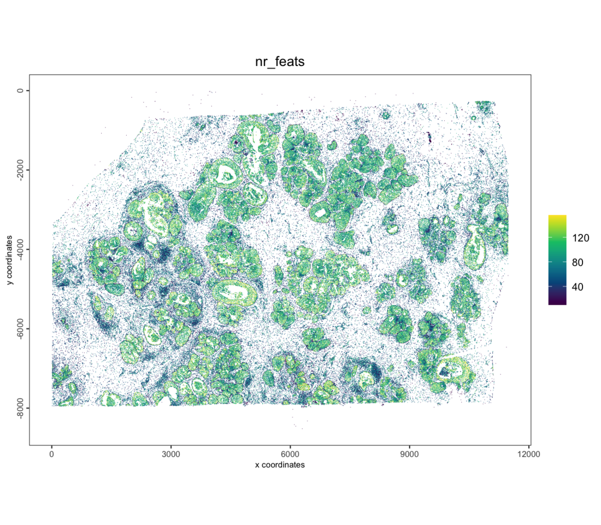
```

```{r qc-counts, fig.cap="Counts per cell before filtering.", fig.height=3.4, eval = FALSE}
filterDistributions(g_xen, detection = "cells", method = "sum",
                    nr_bins = 90, scale_axis = "log10",
                    save_param = list(save_name = "qc_counts"))
```

```{r qc-counts-fig, echo = FALSE, out.width = "100%"}
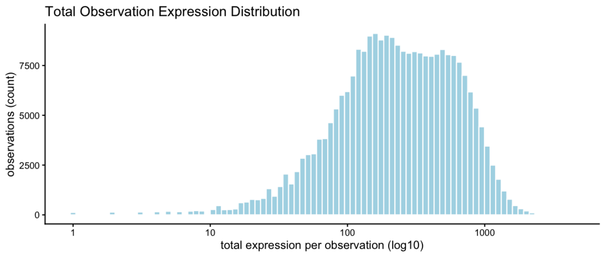
```

```{r qc-genes, fig.cap="Genes detected per cell before filtering, with the 10-gene threshold drawn.", fig.height=3.4, eval = FALSE}
filterDistributions(g_xen, detection = "cells", method = "threshold",
                    expression_threshold = 1,
                    nr_bins = max(pDataDT(g_xen)$nr_feats) + 1,
                    show_plot = FALSE, return_plot = TRUE, save_plot = FALSE) +
  ggplot2::geom_vline(xintercept = 10, color = "#C44E52", linetype = "dashed")
```

```{r qc-genes-fig, echo = FALSE, out.width = "100%"}
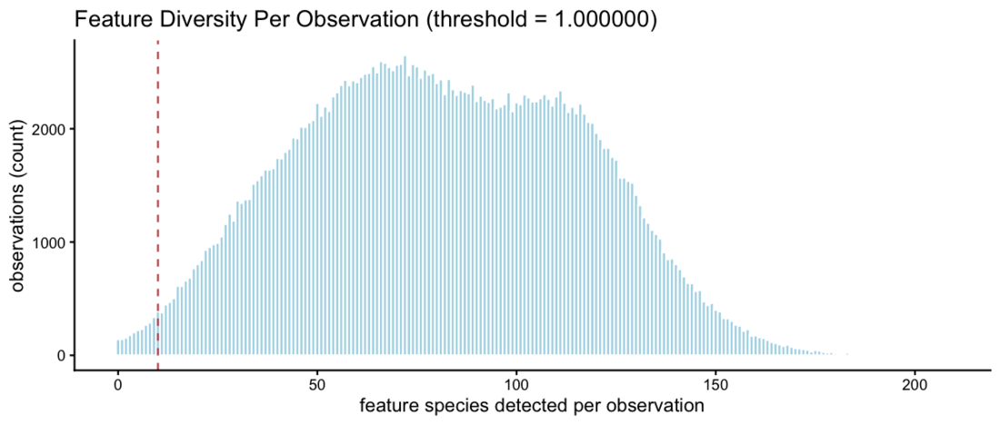
```

```{r qc-summary, eval = FALSE}
cat(sprintf("%s cells | median %s counts and %s genes per cell | %s cells under 10 genes\n",
            format(nrow(cell_metadata), big.mark = ","),
            median(cell_metadata$total_expr), median(cell_metadata$nr_feats),
            format(sum(cell_metadata$nr_feats < 10), big.mark = ",")))
```

```
254,480 cells | median 231 counts and 80 genes per cell | 2,165 cells under 10 genes
```

`min_det_feats_per_cell = 10` is low because a cell here detects only a few
tens of the 280 genes. `feat_det_in_min_cells = 100` keeps genes seen in at
least 100 cells.

```{r filter, eval = FALSE}
g_xen <- filterGiotto(g_xen,
                      expression_threshold   = 1,
                      feat_det_in_min_cells  = 100,
                      min_det_feats_per_cell = 10,
                      verbose                = FALSE)
g_xen
```

```
An object of class giotto 
>Active spat_unit:  cell 
>Active feat_type:  rna 
dimensions    : 280, 252315 (features, cells)
[SUBCELLULAR INFO]
polygons      : cell 
features      : rna NegControlProbe UnassignedCodeword NegControlCodeword 
[AGGREGATE INFO]
expression -----------------------
  [cell][rna] raw
  [cell][NegControlProbe] raw
spatial locations ----------------
  [cell] raw
attached images ------------------
images      : 4 items...


Use objHistory() to see steps and params used
```

# Normalization and feature selection

This is a 280-gene targeted panel, so there is no feature selection: every
gene was chosen to be informative, and selecting highly variable genes from
it would discard deliberate design rather than noise. The whole panel goes
into the dimension reduction.

```{r normalize, eval = FALSE}
g_xen <- normalizeGiotto(g_xen, scale_feats = FALSE, scale_cells = FALSE,
                         scalefactor = 6000)

g_xen <- addStatistics(g_xen, stats = c("cell", "feature"))
```

# Dimension reduction

```{r pca, eval = FALSE}
SEED <- 1234

g_xen <- runPCA(g_xen, feats_to_use = NULL, scale_unit = TRUE, center = TRUE,
                ncp = 50, method = "auto", set_seed = TRUE,
                seed_number = SEED, verbose = FALSE)
```

```{r scree, fig.cap="Variance per principal component. Percentages are of the variance in the 50 components computed.", fig.height=6, eval = FALSE}
screePlot(g_xen, ncp = 50, verbose = FALSE,
          save_param = list(save_name = "scree"))
```

```{r scree-fig, echo = FALSE, out.width = "100%"}
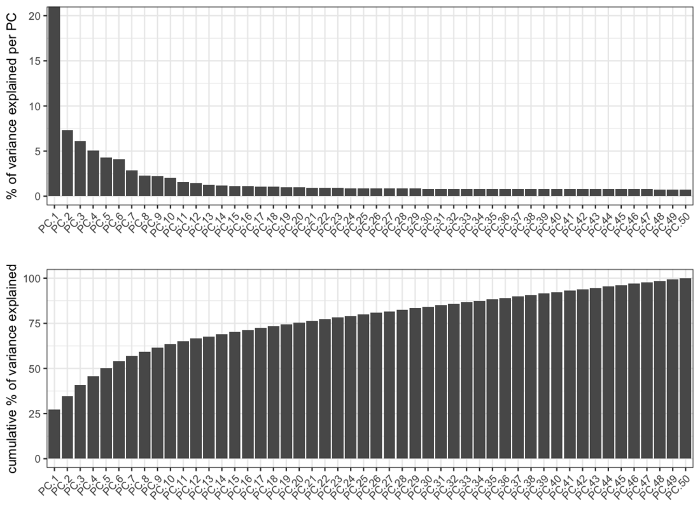
```

```{r pc-depth, fig.cap="Absolute correlation of each PC with log10 total counts per cell. The dashed line is the 0.5 threshold used to decide whether PC1 is a depth axis.", fig.height=4.2, eval = FALSE}
plotDimCovariateCor(g_xen, covariates = "total_expr", dimensions_to_use = 1:30,
                    threshold = 0.5, # |r| >= 0.5 means depth explains at least a quarter of a PC's variance
                    save_param = list(save_name = "pc_depth_correlation"))

# drop PC1 only if it is a depth axis
PCS_USE <- 2:30
```

```{r pc-depth-fig, echo = FALSE, out.width = "100%"}
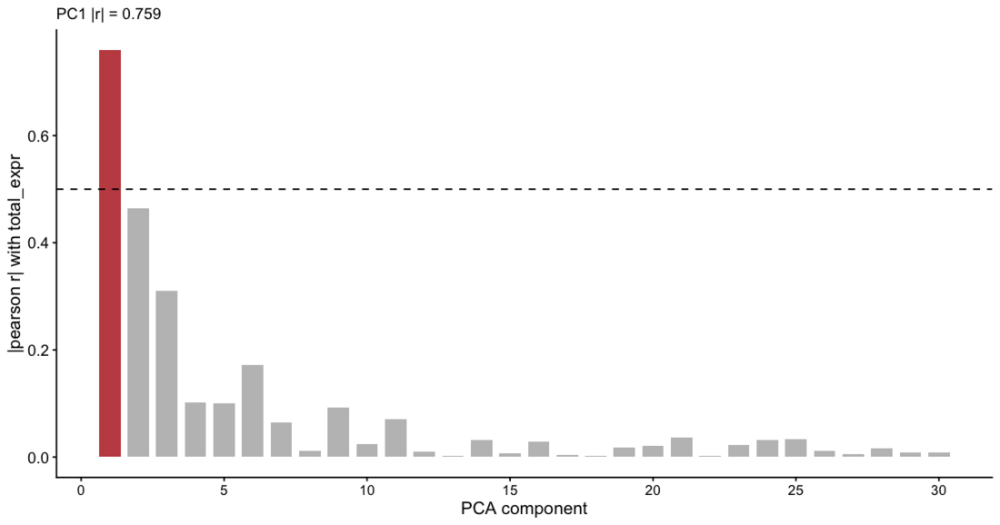
```

PC1 is the only component above the 0.5 line, so it is treated as a depth
axis and left out: `PCS_USE` is **2:30**.

# Clustering

The neighbor graph is built once and both steps below read it: UMAP embeds
on the kNN that `createNearestNetwork()` keeps, and Leiden partitions the sNN
built from it.

```{r nn-network, eval = FALSE}
g_xen <- createNearestNetwork(g_xen, type = "sNN", k = 30,
                              dimensions_to_use = PCS_USE,
                              engine = "hnsw", ef = 400, keep_knn = TRUE,
                              verbose = FALSE)
```

```{r umap, eval = FALSE}
g_xen <- runUMAP(g_xen, dimensions_to_use = PCS_USE, n_neighbors = 30,
                 min_dist = 0.3, spread = 1, n_sgd_threads = 0,
                 nn_engine = "giotto", set_seed = TRUE, seed_number = SEED,
                 verbose = FALSE)
```

```{r cluster, eval = FALSE}
g_xen <- doLeidenCluster(g_xen, name = "leiden_clus", resolution = 1,
                         n_iterations = 20, set_seed = TRUE,
                         seed_number = SEED)
```

```{r save-clustered, results="hide", warning=FALSE, message=FALSE, eval = FALSE}
g_xen <- saveGiotto(g_xen, name = "clustered", overwrite = TRUE, verbose = FALSE)
```

```{r cluster-summary, eval = FALSE}
cell_metadata <- pDataDT(g_xen)
cluster_sizes <- cell_metadata[, .N, by = leiden_clus]
cat(sprintf("%d clusters | %s to %s cells each\n", nrow(cluster_sizes),
            format(min(cluster_sizes$N), big.mark = ","),
            format(max(cluster_sizes$N), big.mark = ",")))
```

```
27 clusters | 163 to 28,606 cells each
```

```{r umap-clusters, fig.cap="Every cell in UMAP space by Leiden cluster.", eval = FALSE}
plotUMAP(g_xen, cell_color = "leiden_clus",
         point_size = 0.25, point_alpha = 0.4,
         point_shape = "border", point_border_stroke = 0,
         legend_symbol_size = 3,
         save_param = list(save_name = "umap_clusters"))
```

```{r umap-clusters-fig, echo = FALSE, out.width = "100%"}
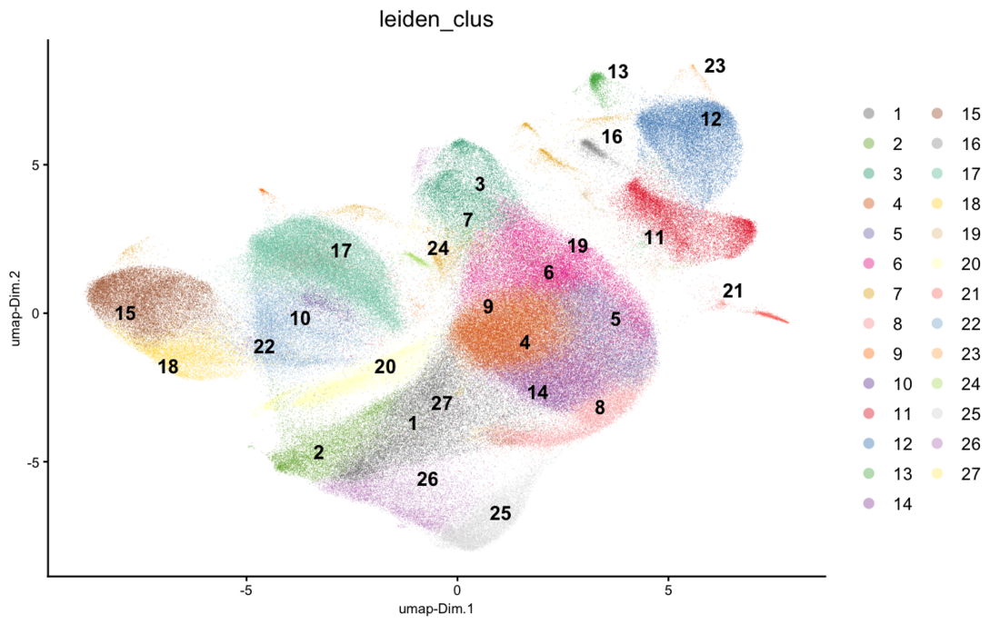
```

```{r umap-genes, fig.cap="The same embedding colored by genes detected (1st to 99th percentile).", eval = FALSE}
plotUMAP(g_xen, cell_color = "nr_feats", color_as_factor = FALSE,
         gradient_style = "sequential",
         gradient_limits = quantile(cell_metadata$nr_feats, c(0.01, 0.99)),
         point_size = 0.25, point_alpha = 0.4,
         point_shape = "border", point_border_stroke = 0,
         save_param = list(save_name = "umap_genes"))
```

```{r umap-genes-fig, echo = FALSE, out.width = "100%"}
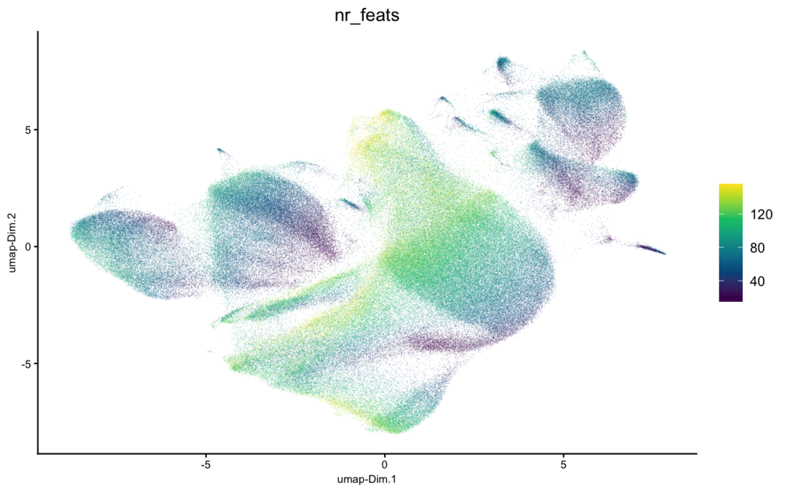
```

# Cell type annotation

## Markers

`findScranMarkers_one_vs_all()` compares each cluster against the pooled
remainder and returns a `ranking` column, which orders the genes within each
cluster.

```{r markers, warning=FALSE, eval = FALSE}
scran_markers <- findScranMarkers_one_vs_all(g_xen,
                                             cluster_column = "leiden_clus",
                                             expression_values = "normalized",
                                             verbose = FALSE)
```

```{r tidy-markers, eval = FALSE}
markers_de <- scran_markers[
  , .(feats, cluster = as.character(cluster), logFC, p_value = p.value, FDR,
      ranking)]
markers_de <- markers_de[logFC >= 0.25 & FDR <= 0.05][order(cluster, ranking)]

cat(sprintf("%s marker genes across %d of %d clusters\n",
            format(nrow(markers_de), big.mark = ","),
            uniqueN(markers_de$cluster), nrow(cluster_sizes)))
```

```
1,496 marker genes across 27 of 27 clusters
```

<details>
<summary><strong>Top 10 markers per cluster</strong></summary>

```{r top-markers, eval = FALSE}
top_markers <- markers_de[order(ranking), .(top = paste(head(feats, 10), collapse = ", ")),
                          by = "cluster"]
top_markers[order(as.integer(cluster))]
```

```
cluster  top                                                                      
1        ACTA2, TAGLN, KRT14, MYLK, TFF3, SLC39A6, KRT5, GATA3, CXCL14, MYH11     
2        MYLK, KRT5, KRT17, KRT14, COL17A1, TAGLN, LAMC2, ACTA2, TP63, CDH3       
3        MKI67, TYMS, HMGB2, RRM2, TOP2A, PRR11, ANLN, MYBL2, CENPF, UBE2C        
4        MLPH, SCUBE2, AGR3, SLC39A6, ESR1, FOXA1, GATA3, EPCAM, TPD52, TFF3      
5        GATA3, SLC39A6, FOXA1, AGR3, MLPH, CD24, ESR1, SCUBE2, MDM2, EPCAM       
6        GATA3, SLC39A6, FOXA1, MLPH, EPCAM, AGR3, CD24, DSP, ESR1, MDM2          
7        S100A9, S100A8, LYZ, CD74, CD68, CD163, ARHGDIB, HLA-G, PECAM1, HSPA6    
8        SLC39A6, GATA3, FOXA1, MLPH                                              
9        ADIPOQ, ESR1, MLPH, AGR3, SCUBE2, FOXA1, SLC39A6, GATA3, EPCAM, NPY1R    
10       SFRP4, FBLN1, C1R, CCDC80, MMP2, LEPR, IGFBP3, IL1R1, IGFBP5, TAGLN      
11       CD74, LYZ, CD68, CD163, HSPA6, ARHGDIB, ITGAX, PECAM1, LYVE1, CXCR4      
12       TRAC, IL7R, ARHGDIB, CXCR4, CD3E, IL2RG, CD74, CCL5, CYTIP, HLA-G        
13       MS4A1, CD74, BANK1, TNFRSF13C, CXCR4, ARHGDIB, IL2RG, BIRC3, CYTIP, HLA-G
14       TFF3, SLC39A6, MLPH, FOXA1, GATA3, SCUBE2, AGR3, TPD52, TFPI2, NPY1R     
15       AQP1, PECAM1, VWF, FLT1, PLVAP, HSPG2, RGS5, CLEC14A, COL4A1, CD74       
16       TENT5C, IL2RG, PECAM1, CD27, SDC1, CD74, BIRC3, CYTIP, HLA-G, DNAJC3     
17       CXCL12, C1R, MMP2, LAMB1, FBLN1, LAMA2, CCDC80, PDGFRB, COLEC12, ADH1B   
18       RGS5, ACTA2, PDGFRB, TAGLN, COL4A1, NDUFA4L2, IGFBP5, HEYL, MYLK, ARHGDIB
19       MMP9, MMP12, CD68, APOC1, LYZ, CHIT1, CD74, ITGAX, LPL, CD83             
20       PTN, CD24, KRT23, KIT, VTCN1, SFRP1, KRT15, KRT6B, SERPINA3, ANPEP       
21       CPA3, KIT, CXCL12, MMP2, C1R, CCDC80, LAMB1, FBLN1, LAMA2, ADH1B         
22       PDGFRB, LAMB1, CXCL14, TIMP1, LAMA2, IGFBP5, LOXL1, MMP2, MMP11, CCDC80  
23       MKI67, ARHGDIB, TRAC, CD8A, CD3E, CD74, HMGB2, IL2RG, TYMS, CCL5         
24       LYVE1, PECAM1, COLEC12, LAMA4, VWF, HSPG2, COL4A1, HLA-G, NDRG1, IL1R1   
25       ANKRD30A, S100A14, CD24, VTCN1, SERPINA3, KRT19, MLPH, LYPD3, PIP, MDM2  
26       S100A14, CD24, TAGLN, SEMA3C, ACTA2, KRT14, COL17A1, OXTR, VTCN1, SFRP1  
27       PIP, ANKRD30A, TFPI2, FASN, LDHB, PGR, LTF, MLPH, SCUBE2, IL1R1          
```

</details>

Each cluster is annotated from these markers, from its QC profile, and from
the dot plot below, which shows up to three curated marker genes per cell
type. The table shows the five clusters with the fewest counts per cell.

```{r cluster-qc, eval = FALSE}
cluster_qc <- cell_metadata[
  , .(cells         = .N,
      median_counts = as.numeric(median(total_expr)),
      median_genes  = as.numeric(median(nr_feats))),
  by = .(cluster = leiden_clus)]
head(cluster_qc[order(median_counts)], 5)
```

```
cluster  cells  median_counts  median_genes
8        8561   266.8017       38          
21       2385   290.9558       44          
11       12743  312.9462       48          
22       10939  353.7626       55          
24       829    353.8207       55          
```

## Curated marker panels

Up to five curated marker genes per broad cell type, all on this 280-gene
panel.

```{r panels-data, eval = FALSE}
breast_markers_l1 <- list(
  epithelial_luminal = c("EPCAM", "FOXA1", "GATA3", "KRT19", "ESR1"),
  epithelial_basal   = c("KRT5", "KRT14", "KRT17", "KRT6B", "LAMC2"),
  myoepithelial      = c("ACTA2", "ACTG2", "MYH11", "OXTR", "COL17A1"),
  proliferating      = c("MKI67", "TOP2A", "CCNE1", "ANLN", "RRM2"),
  fibroblast_CAF     = c("MMP2", "FBLN1", "CXCL12", "CCDC80", "C1R"),
  pericyte_SMC       = c("RGS5", "NDUFA4L2", "HEYL"),
  endothelial        = c("PECAM1", "VWF", "FLT1", "PLVAP", "CLEC14A"),
  lymphatic          = c("LYVE1"),
  immune_myeloid     = c("CD68", "ITGAX", "LYZ", "CD163", "S100A8"),
  immune_t_nk        = c("CD3E", "TRAC", "CD8A", "IL7R", "CCL5"),
  immune_b           = c("MS4A1", "BANK1", "TNFRSF13C"),
  immune_plasma      = c("TENT5C", "SDC1", "CD27"),
  mast               = c("CPA3", "KIT"),
  adipocyte          = c("ADIPOQ", "LPL", "LEPR")
)
```

## Naming the clusters

This tissue section is ductal carcinoma in situ (DCIS), so malignant cells sit
inside ducts that still carry a myoepithelial layer, alongside normal luminal
epithelium. Telling the two luminal populations apart needs copy number or a
matched normal, and a 280-gene panel gives neither. Clusters are therefore
named by cell type, not by malignancy, and `proliferating` marks a cycling
signature that appears in both.

Manually assign cell-type annotations per Leiden cluster. Leiden cluster
numbers can change between package versions or numbers of workers, so check
the markers before reusing this mapping on your own run.

```{r label-map, eval = FALSE}
broad_palette <- c(
  epithelial_luminal = "#238B45", epithelial_basal   = "#74C476",
  proliferating      = "#B2182B", fibroblast_CAF     = "#8C510A",
  myoepithelial      = "#BCBD22", pericyte_SMC       = "#7B3294",
  endothelial        = "#00BFC4", lymphatic          = "#3690C0",
  immune_myeloid     = "#E08214", immune_t_nk        = "#2166AC",
  immune_b           = "#8073AC", immune_plasma      = "#67A9CF",
  mast               = "#FDB863", adipocyte          = "#C51B7D",
  unassigned         = "gray85")

BROAD <- c(
  "1"  = "myoepithelial",       "2"  = "epithelial_basal",
  "3"  = "proliferating",       "4"  = "epithelial_luminal",
  "5"  = "epithelial_luminal",  "6"  = "epithelial_luminal",
  "7"  = "immune_myeloid",      "8"  = "unassigned",
  "9"  = "adipocyte",           "10" = "fibroblast_CAF",
  "11" = "immune_myeloid",      "12" = "immune_t_nk",
  "13" = "immune_b",            "14" = "epithelial_luminal",
  "15" = "endothelial",         "16" = "immune_plasma",
  "17" = "fibroblast_CAF",      "18" = "pericyte_SMC",
  "19" = "immune_myeloid",      "20" = "epithelial_basal",
  "21" = "mast",                "22" = "fibroblast_CAF",
  "23" = "immune_t_nk",         "24" = "lymphatic",
  "25" = "epithelial_luminal",  "26" = "myoepithelial",
  "27" = "epithelial_luminal")
```

```{r annotate, eval = FALSE}
g_xen <- annotateGiotto(g_xen, annotation_vector = BROAD,
                        cluster_column = "leiden_clus",
                        name = "cell_type_broad")

cell_metadata <- pDataDT(g_xen)

CELL_TYPES <- intersect(names(broad_palette), cell_metadata$cell_type_broad)
CELL_TYPE_COLORS <- broad_palette[CELL_TYPES]
```

```{r save-annotated, results="hide", warning=FALSE, message=FALSE, eval = FALSE}
g_xen <- saveGiotto(g_xen, name = "annotated", overwrite = TRUE, verbose = FALSE)
```

```{r dot-broad, fig.cap="Up to three curated panel genes per cell type: color is mean normalized expression, size is the percent of cells detecting the gene.", fig.height=7, eval = FALSE}
panel_feats <- featIDs(g_xen)
dot_genes <- unique(unlist(lapply(
  breast_markers_l1[intersect(CELL_TYPES, names(breast_markers_l1))],
  function(genes) head(genes[genes %in% panel_feats], 3)),
  use.names = FALSE))

dotPlot(g_xen, feats = dot_genes,
        cluster_column       = "cell_type_broad",
        cluster_custom_order = CELL_TYPES,
        expression_values    = "normalized",
        gradient_style       = "sequential",
        dot_scale            = 7,
        axis_text            = 6,
        theme_param = list(axis.text.x = ggplot2::element_text(angle = 45, hjust = 1)),
        save_param  = list(save_name = "celltype_dotplot"))
```

```{r dot-broad-fig, echo = FALSE, out.width = "100%"}
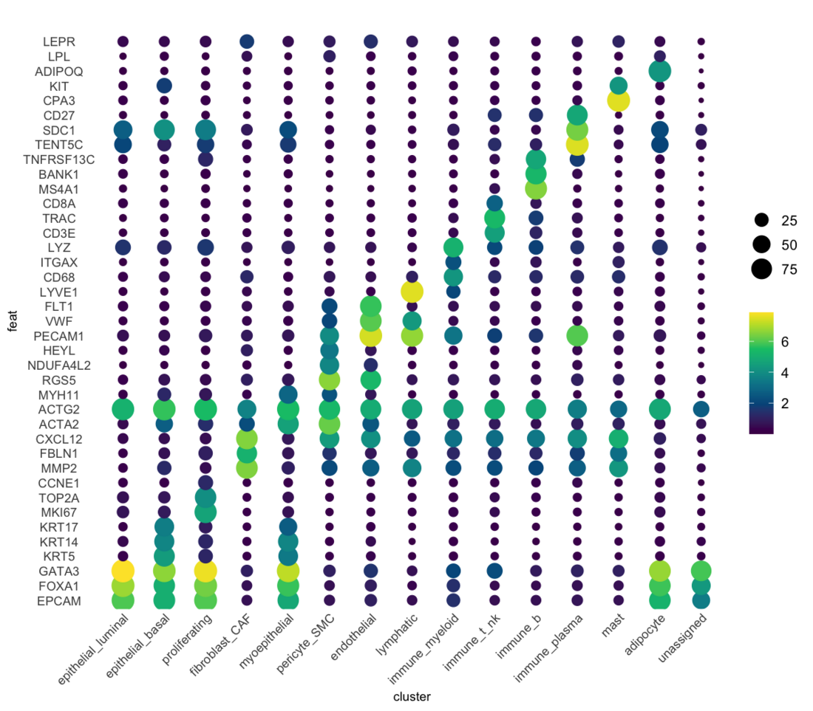
```

```{r marker-heatmap, fig.cap="The top two de novo markers of each cluster, averaged per cell type, z-scored across cell types and rescaled.", fig.height=8, eval = FALSE}
heat_genes <- unique(markers_de[order(cluster, ranking)][
  , head(.SD, 2), by = cluster]$feats)

plotMetaDataHeatmap(g_xen, metadata_cols = "cell_type_broad",
                    selected_feats = heat_genes,
                    expression_values = "normalized",
                    show_values = "zscores_rescaled",
                    custom_cluster_order = CELL_TYPES,
                    x_text_angle = 45, x_text_size = 8,
                    y_text_size = 8,
                    save_param = list(save_name = "marker_heatmap"))
```

```{r marker-heatmap-fig, echo = FALSE, out.width = "100%"}
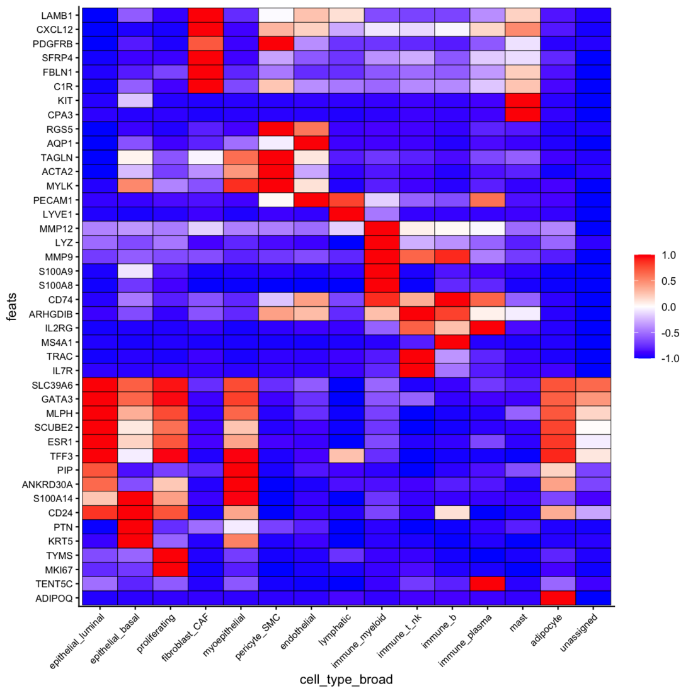
```

```{r celltype-counts, eval = FALSE}
cell_type_props <- calculateLabelProportions(g_xen, labels = "cell_type_broad",
                                             groups = data.frame(group = "all", cell_ID = spatIDs(g_xen)),
                                             column_group_id = "group", output = "data.table")
cell_type_props <- melt(cell_type_props, id.vars = "group",
                        variable.name = "cell_type", value.name = "proportion")
cell_type_props[order(-proportion),
                .(cell_type, cells = round(proportion * length(spatIDs(g_xen))),
                  percent = round(100 * proportion, 1))]
```

```
cell_type           cells  percent
epithelial_luminal  80325  31.8   
fibroblast_CAF      41308  16.4   
myoepithelial       24250  9.6    
epithelial_basal    19194  7.6    
immune_myeloid      17742  7.0    
immune_t_nk         17454  6.9    
endothelial         16835  6.7    
proliferating       10137  4.0    
unassigned          8561   3.4    
pericyte_SMC        7081   2.8    
mast                2385   0.9    
adipocyte           2325   0.9    
immune_b            2039   0.8    
immune_plasma       1850   0.7    
lymphatic           829    0.3    
```

# Cell types in the tissue

## Full annotated section

```{r umap-celltype, fig.cap="The same embedding as in Clustering, now in the curated cell type colors.", eval = FALSE}
plotUMAP(g_xen, cell_color = "cell_type_broad",
         cell_color_code = CELL_TYPE_COLORS,
         point_size = 0.25, point_alpha = 0.4,
         point_shape = "border", point_border_stroke = 0,
         show_center_label = FALSE, legend_symbol_size = 3,
         save_param = list(save_name = "umap_celltype"))
```

```{r umap-celltype-fig, echo = FALSE, out.width = "100%"}
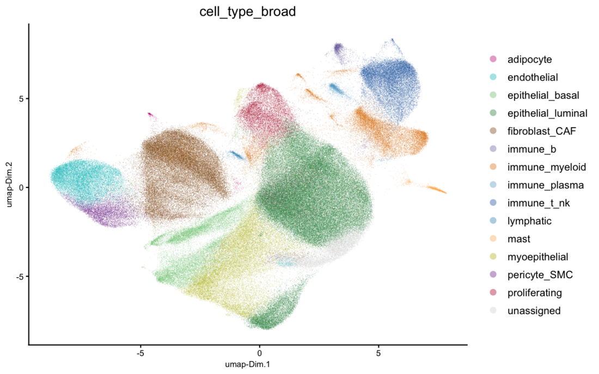
```

```{r spatial-celltype, fig.cap="The whole section by cell type.", fig.height=6.8, eval = FALSE}
spatPlot2D(
  g_xen, cell_color = "cell_type_broad",
  cell_color_code = CELL_TYPE_COLORS,
  point_size = 0.25, point_shape = "border",
  point_border_stroke = 0, coord_fix_ratio = 1,
  title = sprintf("%s cells | %d clusters | %d cell types",
                  format(nrow(cell_metadata), big.mark = ","),
                  uniqueN(cell_metadata$leiden_clus), length(CELL_TYPES)),
  background_color = "white",
  save_param = list(save_name = "section_celltype"))
```

```{r spatial-celltype-fig, echo = FALSE, out.width = "100%"}
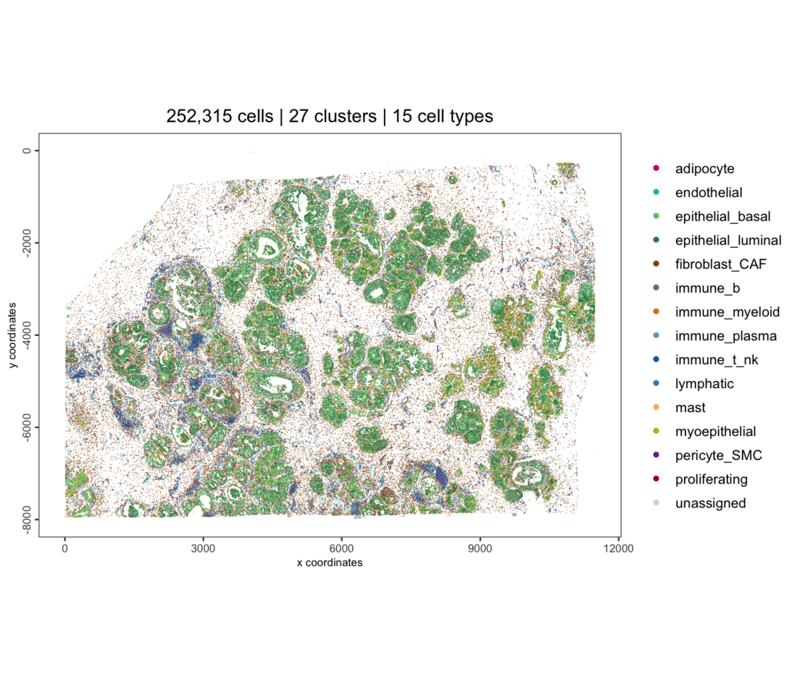
```

```{r spatial-facets, fig.cap="One panel per cell type, every other cell in gray behind it.", fig.height=7.5, eval = FALSE}
cell_type_plots <- lapply(CELL_TYPES, function(cell_type)
  spatPlot2D(g_xen, cell_color = "cell_type_broad",
             cell_color_code = CELL_TYPE_COLORS,
             select_cell_groups = cell_type, show_other_cells = TRUE,
             other_cell_color = "#ECECEC", other_point_size = 0.06,
             point_size = 0.18, point_shape = "border",
             point_border_stroke = 0, coord_fix_ratio = 1,
             show_legend = FALSE, title = cell_type, background_color = "white",
             axis_text = 5, axis_title = 6,
             theme_param = list(plot.title = ggplot2::element_text(size = 8)),
             show_plot = FALSE, return_plot = TRUE, save_plot = FALSE))
cowplot::plot_grid(plotlist = cell_type_plots, ncol = 4)
```

```{r spatial-facets-fig, echo = FALSE, out.width = "100%"}
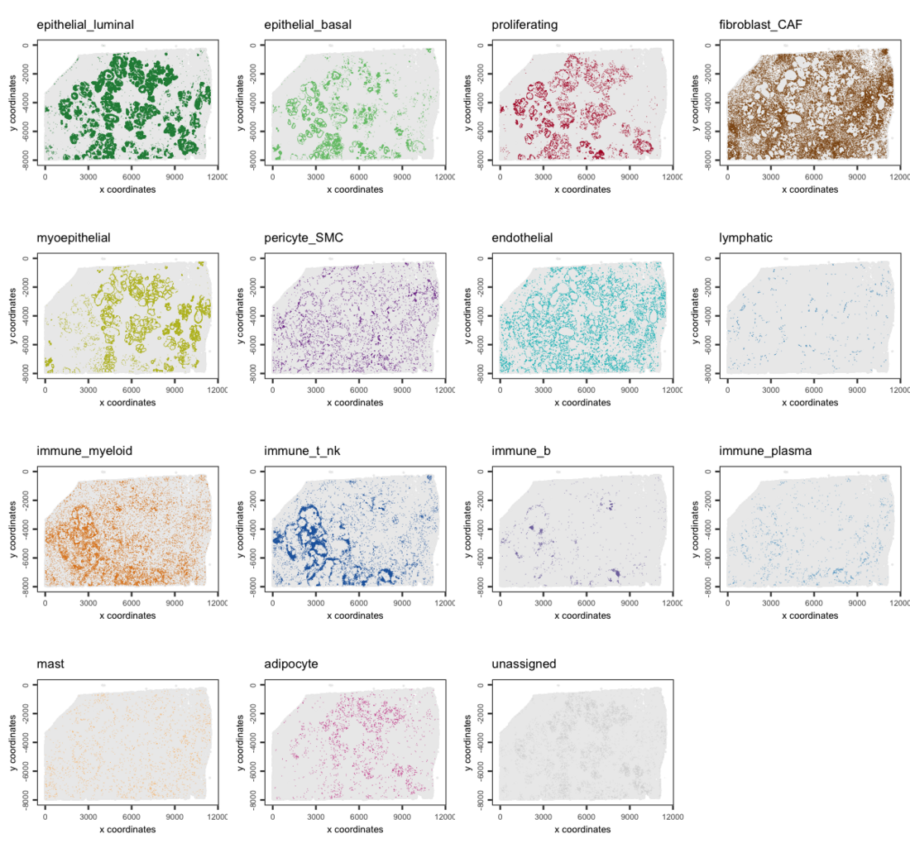
```

## Segmentation boundaries and transcripts

The window below is the most cell-dense 400 x 400 um square of the section,
given in microns. `crop(..., view = "roi")` narrows the object to it, so the
zoom plots read only the cells, polygons and transcripts inside it.

```{r zoom-window, eval = FALSE}
g_zoom <- crop(g_xen, c(9200, 9600, -7200, -6800), view = "roi")
```

```{r polygons, fig.cap="A 400 x 400 um window of Xenium segmentation boundaries over DAPI, filled by cell type.", fig.height=6.8, warning=FALSE, message=FALSE, eval = FALSE}
spatInSituPlotPoints(g_zoom,
                     show_image = TRUE, image_name = "dapi",
                     polygon_feat_type = "cell", show_polygon = TRUE,
                     polygon_fill = "cell_type_broad",
                     polygon_fill_as_factor = TRUE,
                     polygon_fill_code = CELL_TYPE_COLORS,
                     polygon_alpha = 0.6,
                     polygon_color = "gray30", polygon_line_size = 0.06,
                     legend_text = 9, background_color = "black",
                     view = "roi",
                     save_param = list(save_name = "polygons_zoom"))
```

```{r polygons-fig, echo = FALSE, out.width = "100%"}
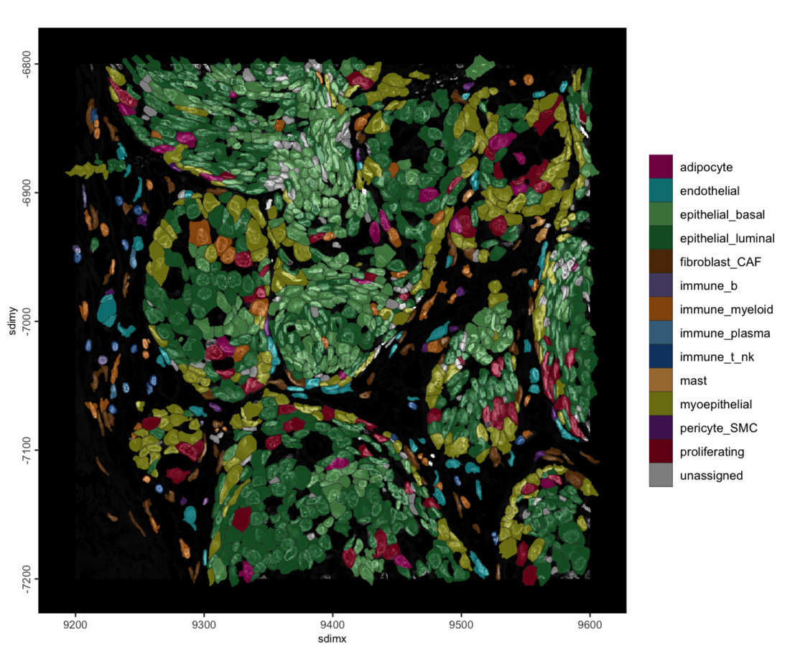
```

```{r transcripts-in-place, fig.cap="Epithelial, stromal and immune transcripts over the segmentation they were assigned to.", fig.height=6.8, warning=FALSE, message=FALSE, eval = FALSE}
spatInSituPlotPoints(g_zoom,
                     show_image = TRUE, image_name = "dapi",
                     feats = list(rna = c("KRT5", "CD24", "MMP11", "LYZ")),
                     feat_type = "rna",
                     feats_color_code = c(KRT5 = "#FFFFFF", CD24 = "#00B0FF",
                                          MMP11 = "#FF0000", LYZ = "#A6FF00"),
                     use_overlap = FALSE, plot_last = "points",
                     polygon_feat_type = "cell", show_polygon = TRUE,
                     polygon_fill = "cell_type_broad",
                     polygon_fill_as_factor = TRUE,
                     polygon_fill_code = CELL_TYPE_COLORS, polygon_alpha = 0.6,
                     polygon_color = "gray40", polygon_line_size = 0.04,
                     point_size = 0.75, legend_text = 9,
                     background_color = "black", view = "roi",
                     save_param = list(save_name = "transcripts_zoom"))
```

```{r transcripts-in-place-fig, echo = FALSE, out.width = "100%"}
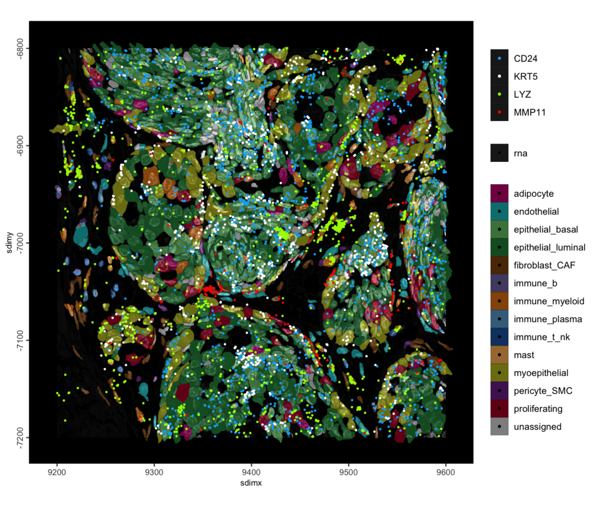
```

# Spatial niches

Two cells share a niche when the mix of cell types *around* them looks the
same, however different the two cells are themselves. A niche takes three
steps: a spatial network, the cell type composition of each cell's
neighborhood over that network, and a clustering of those compositions.

```{r niche-network, eval = FALSE}
g_xen <- createSpatialNetwork(g_xen, method = "kNN", k = 30,
                              name = "niche_knn_30", verbose = FALSE)
```

```{r niche-composition, eval = FALSE}
g_xen <- calculateLabelProportions(
  g_xen, labels = "cell_type_broad", group_method = "spatialnetwork",
  spatial_network_name = "niche_knn_30", weights = FALSE,
  name = "niche_prop_celltypes", output = "gobject", verbose = FALSE)
```

## Choosing the number of niches

`sweepClusterK()` runs k-means on the neighborhood compositions over a range
of `k` and records the total within-cluster sum of squares, which always
falls as `k` grows. The chosen `k` is the elbow: the point furthest from the
line joining the two ends of the curve. A 25,000-cell subsample resolves the
shape of the curve and keeps the sweep short.

```{r niche-k, fig.cap="Total within-cluster sum of squares against the number of niches, with the elbow marked.", fig.height=3.6, eval = FALSE}
k_plot <- sweepClusterK(g_xen, values_to_use = "spatial_enrichment",
                        spat_enr_name = "niche_prop_celltypes", k_range = 3:16,
                        score = "wss", subsample = 25000, seed = SEED,
                        return_plot = TRUE,
                        save_param = list(save_name = "niche_k"))
NICHE_K <- k_plot$data[selected == TRUE, k]
NICHE_K
```

```
[1] 7
```

```{r niche-k-fig, echo = FALSE, out.width = "100%"}
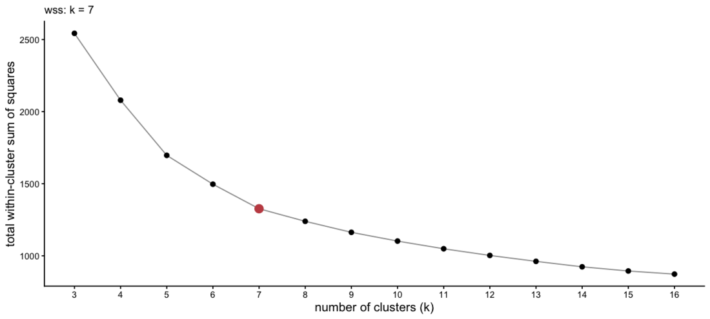
```

```{r niche-kmeans, eval = FALSE}
set.seed(SEED)
g_xen <- clusterData(g_xen,
                     clusterParam("kmeans", centers = NICHE_K,
                                  nstart = 25, iter.max = 100),
                     what = "spatial_enrichment", spat_enr_name = "niche_prop_celltypes",
                     name = "niche_k", output = "gobject")
```

## Naming the niches

Each niche is named from the composition of the neighborhoods in it, shown in
the bars and table below. k-means numbers its clusters arbitrarily, so as
with the cell types, check the composition before reusing these names.

```{r niche-names, eval = FALSE}
NICHE_NAMES <- c(
  "1" = "vascular immune stroma",
  "2" = "TLS",
  "3" = "tumor core (basal)",
  "4" = "tumor core (luminal)",
  "5" = "fibroblast-rich stroma",
  "6" = "tumor-duct interface",
  "7" = "duct basal layer")

g_xen <- annotateGiotto(g_xen, annotation_vector = NICHE_NAMES,
                        cluster_column = "niche_k", name = "niche")
NICHE_COLORS <- setNames(getDistinctColors(length(NICHE_NAMES)), NICHE_NAMES)

cell_metadata <- pDataDT(g_xen)
```

```{r niche-composition-bars, fig.cap="Mean neighborhood composition of each niche, with niches ordered by how alike their compositions are.", fig.height=5, eval = FALSE}
GiottoVisuals::plotLabelComposition(g_xen, groups = "niche",
                                    spat_enr_name = "niche_prop_celltypes",
                                    label_color_code = CELL_TYPE_COLORS,
                                    save_param = list(save_name = "niche_composition"))
```

```{r niche-composition-bars-fig, echo = FALSE, out.width = "100%"}
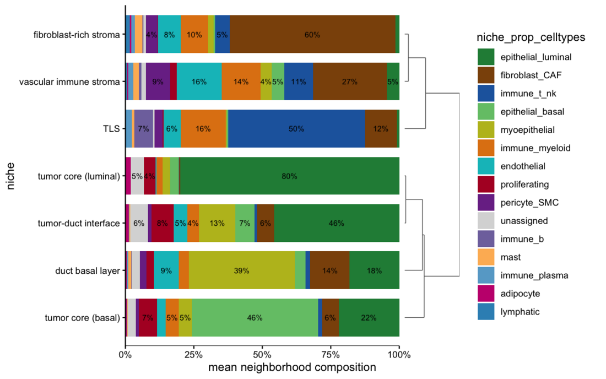
```

<details>
<summary><strong>Cells of each type in each niche</strong></summary>

```{r niche-by-celltype, eval = FALSE}
table(niche = cell_metadata$niche,
      cell_type = factor(cell_metadata$cell_type_broad, levels = CELL_TYPES))
```

```
                        cell_type
niche                    epithelial_luminal epithelial_basal proliferating
  duct basal layer                     4044             1330           836
  fibroblast-rich stroma                238               66            29
  TLS                                   141               28            46
  tumor core (basal)                   4361            11941          1507
  tumor core (luminal)                45203             1195          1938
  tumor-duct interface                25747             3449          5439
  vascular immune stroma                591             1185           342
                        cell_type
niche                    fibroblast_CAF myoepithelial pericyte_SMC endothelial
  duct basal layer                 4674         13843          862        3556
  fibroblast-rich stroma          19173           128         1120        2222
  TLS                              2289            13          565        1226
  tumor core (basal)               1157          1152          190         617
  tumor core (luminal)               30           386            7          41
  tumor-duct interface             1844          8180          470        1969
  vascular immune stroma          12141           548         3867        7204
                        cell_type
niche                    lymphatic immune_myeloid immune_t_nk immune_b
  duct basal layer              14           1146         484       67
  fibroblast-rich stroma       498           3128        1671       96
  TLS                           49           3471       10359     1420
  tumor core (basal)             0            864         175       11
  tumor core (luminal)           0           1118          45       17
  tumor-duct interface           7           1792         184       41
  vascular immune stroma       261           6223        4536      387
                        cell_type
niche                    immune_plasma  mast adipocyte unassigned
  duct basal layer                 149   282        92        955
  fibroblast-rich stroma           352   941       208        237
  TLS                              410   195        21         91
  tumor core (basal)                 5    22        88        653
  tumor core (luminal)               2     5      1170       2494
  tumor-duct interface              30    74       604       3504
  vascular immune stroma           902   866       142        627
```

</details>

```{r niche-spatial, fig.cap="Spatial niches across the section: each cell colored by the niche of its 30-nearest-neighbor neighborhood.", fig.height=6.8, eval = FALSE}
spatPlot2D(g_xen, cell_color = "niche", cell_color_code = NICHE_COLORS,
           point_size = 0.25, point_shape = "border", point_border_stroke = 0,
           coord_fix_ratio = 1, background_color = "white",
           legend_symbol_size = 3,
           save_param = list(save_name = "niche_spatial"))
```

```{r niche-spatial-fig, echo = FALSE, out.width = "100%"}
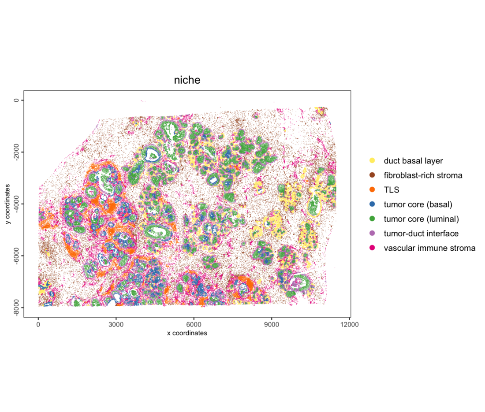
```

```{r save-niches, results="hide", warning=FALSE, message=FALSE, eval = FALSE}
g_xen <- saveGiotto(g_xen, name = "niches", overwrite = TRUE, verbose = FALSE)
```

# Spatial motifs

A niche describes the mix of cell types around a cell; a **motif** describes
how they are arranged. A motif is a small connected group of cells, here
three, classed by its cell types and its shape: an open chain (A-B-C, where
the first type listed is the center linking the other two) or a closed
triangle. `cellProximityMotifs()` counts each motif class on the spatial
network and compares the count against a null model.

With `null = "conditional"` the null holds the observed pairs of neighboring
cell types fixed, so a motif that is still enriched is enriched beyond what
its pairs already explain.

Motifs are counted on a **Delaunay** network, which links each cell to only
its touching neighbors, about six, so counting stays fast at this size.

```{r motif-network, eval = FALSE}
g_xen <- createSpatialNetwork(g_xen, name = "Delaunay_network",
                              method = "Delaunay",
                              delaunay_method = "delaunayn_geometry",
                              verbose = FALSE)
```

## Comparing motifs in tumor versus non-tumor compartments

The niches split the section in two. The tumor / interface compartment pools
the two tumor core niches and the tumor-duct interface; the non-tumor
compartment pools the vascular immune stroma, the TLS, the fibroblast-rich
stroma and the duct basal layer. In DCIS the tumor stays inside the
myoepithelial layer. The duct basal layer niche is mostly that layer and the
stroma next to it, so it is counted with the non-tumor tissue. Each
compartment is cut out with `subsetGiotto()` and its motifs counted on its
own part of the network, so a motif is counted only when all three of its
cells are in the compartment.

```{r motif-groups, eval = FALSE}
TUMOR_INTERFACE_NICHES <- c("tumor core (basal)", "tumor core (luminal)",
                            "tumor-duct interface")
MOTIF_GROUPS <- list(
  tumor_interface = cell_metadata[niche %in% TUMOR_INTERFACE_NICHES, cell_ID],
  non_tumor       = cell_metadata[!niche %in% TUMOR_INTERFACE_NICHES, cell_ID])
cat(sprintf("%s: %s cells\n", names(MOTIF_GROUPS),
            format(lengths(MOTIF_GROUPS), big.mark = ",")), sep = "")
```

```
tumor_interface: 129,728 cells
non_tumor: 122,587 cells
```

```{r motifs, eval = FALSE}
motifs <- lapply(MOTIF_GROUPS, function(cell_ids)
  cellProximityMotifs(subsetGiotto(g_xen, cell_ids = cell_ids, verbose = FALSE),
                      spatial_network_name = "Delaunay_network",
                      cluster_column       = "cell_type_broad",
                      size                 = 3L,
                      null                 = "conditional",
                      n_perm               = 1000L,
                      set_seed             = TRUE,
                      seed_number          = SEED))

cat(sprintf("%s: %d motif classes, %d enriched and %d depleted at adjusted p <= 0.05\n",
            names(motifs), vapply(motifs, nrow, 1L),
            vapply(motifs, function(m) sum(m$p_adj <= 0.05 & m$z > 0), 1L),
            vapply(motifs, function(m) sum(m$p_adj <= 0.05 & m$z < 0), 1L)), sep = "")
```

```
tumor_interface: 2297 motif classes, 160 enriched and 171 depleted at adjusted p <= 0.05
non_tumor: 2480 motif classes, 325 enriched and 277 depleted at adjusted p <= 0.05
```

```{r motif-enrichment-tumor, fig.cap="Motifs in the tumor / interface compartment: effect size against how often each occurs, colored by significance. Closed motifs are triangles of three cells that all touch; open motifs are chains, with the first cell type listed linking the other two.", fig.height=6, fig.width=10, eval = FALSE}
plotMotifEnrichment(g_xen, motifs$tumor_interface, min_observed = 100, top = 10,
                    save_param = list(save_name = "motif_enrichment_tumor_interface"))
```

```{r motif-enrichment-tumor-fig, echo = FALSE, out.width = "100%"}
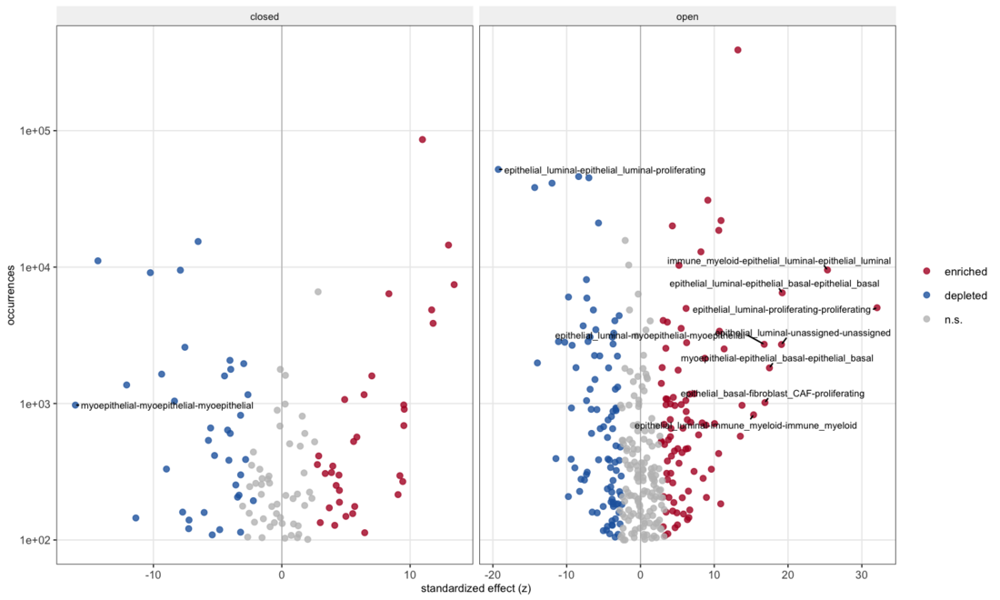
```

```{r motif-glyphs-tumor, fig.cap="The most enriched motifs in the tumor / interface compartment, drawn in the cell type colors.", fig.height=6, eval = FALSE}
plotMotifGlyphs(g_xen, motifs$tumor_interface, cell_color_code = CELL_TYPE_COLORS,
                save_param = list(save_name = "motif_glyphs_tumor_interface"))
```

```{r motif-glyphs-tumor-fig, echo = FALSE, out.width = "100%"}
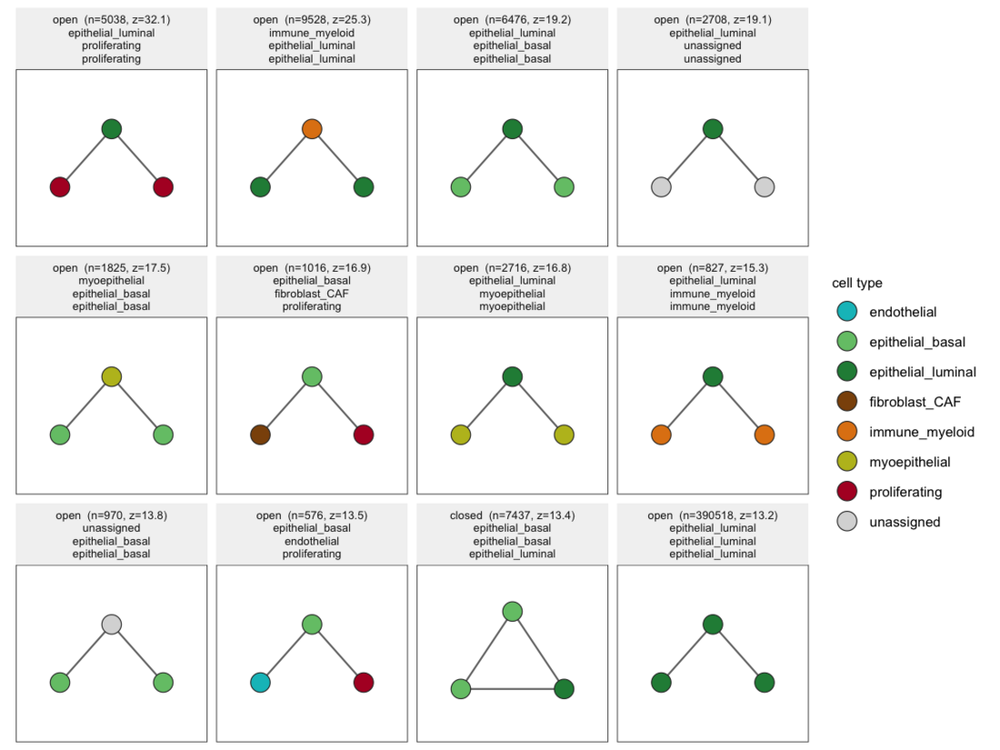
```

```{r motif-glyphs-non-tumor, fig.cap="The most enriched motifs in the non-tumor compartment, for comparison.", fig.height=6, eval = FALSE}
plotMotifGlyphs(g_xen, motifs$non_tumor, cell_color_code = CELL_TYPE_COLORS,
                save_param = list(save_name = "motif_glyphs_non_tumor"))
```

```{r motif-glyphs-non-tumor-fig, echo = FALSE, out.width = "100%"}
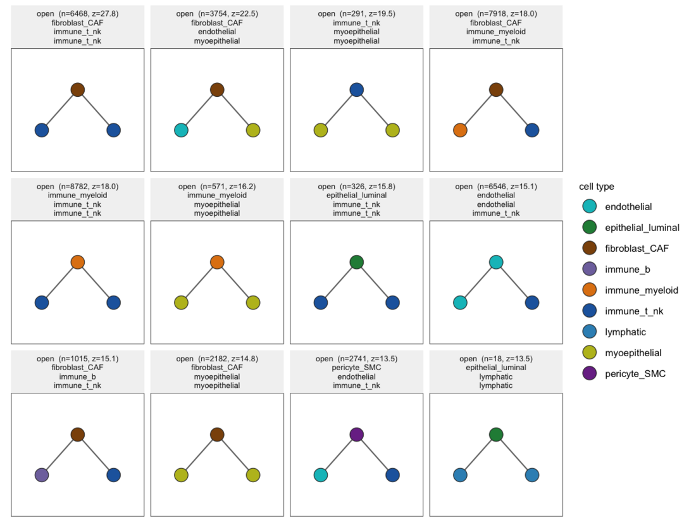
```

The same motif can be compared between the two compartments by its fold over
the null. Only motifs seen at least 100 times in both are compared, so neither
fold rests on a handful of instances, and only motifs enriched in the tumor /
interface compartment (adjusted p <= 0.05) are kept. They are ranked by that
adjusted p-value, then by the ratio of the two folds. The ratio ranks the
motifs; it is not a test of the difference between the compartments.

```{r motif-contrast, eval = FALSE}
motif_contrast <- merge(
  motifs$tumor_interface[, .(motif_id, observed_tumor = observed, fold_tumor = fold,
                             p_adj_tumor = p_adj)],
  motifs$non_tumor[, .(motif_id, observed_non_tumor = observed, fold_non_tumor = fold)],
  by = "motif_id")[observed_tumor >= 100 & observed_non_tumor >= 100 &
                     p_adj_tumor <= 0.05 & fold_tumor > 1]
motif_contrast[, log2_tumor_vs_non_tumor := log2(fold_tumor / fold_non_tumor)]
setorder(motif_contrast, p_adj_tumor, -log2_tumor_vs_non_tumor)

head(motif_contrast[, .(motif_id, p_adj_tumor = signif(p_adj_tumor, 2),
                        fold_tumor = round(fold_tumor, 2),
                        fold_non_tumor = round(fold_non_tumor, 2),
                        log2_tumor_vs_non_tumor = round(log2_tumor_vs_non_tumor, 2))], 10)
```

```
motif_id                                                       p_adj_tumor  fold_tumor  fold_non_tumor  log2_tumor_vs_non_tumor
size3_open_epithelial_luminal-endothelial-myoepithelial        0.016        1.48        0.75            0.98                   
size3_open_epithelial_basal-endothelial-proliferating          0.016        2.15        1.13            0.93                   
size3_closed_endothelial-epithelial_luminal-myoepithelial      0.016        1.49        0.84            0.82                   
size3_open_epithelial_luminal-fibroblast_CAF-proliferating     0.016        1.24        0.70            0.82                   
size3_closed_epithelial_luminal-fibroblast_CAF-myoepithelial   0.016        1.49        0.86            0.80                   
size3_open_unassigned-endothelial-myoepithelial                0.016        1.63        0.99            0.72                   
size3_closed_epithelial_luminal-fibroblast_CAF-fibroblast_CAF  0.016        1.93        1.17            0.72                   
size3_open_epithelial_basal-myoepithelial-proliferating        0.016        1.19        0.75            0.68                   
size3_open_epithelial_luminal-myoepithelial-myoepithelial      0.016        1.54        0.97            0.67                   
size3_open_fibroblast_CAF-epithelial_luminal-pericyte_SMC      0.016        1.87        1.23            0.60                   
```

```{r motif-spatial, fig.cap="Where the first motif of the table above occurs within the tumor / interface compartment.", fig.height=6.8, eval = FALSE}
top_tumor_motif <- motif_contrast[1, motif_id]
spatMotifPlot(subsetGiotto(g_xen, cell_ids = MOTIF_GROUPS$tumor_interface, verbose = FALSE),
              motif_id = top_tumor_motif,
              cluster_column       = "cell_type_broad",
              spatial_network_name = "Delaunay_network",
              save_param = list(save_name = "motif_spatial_tumor_interface"))
```

```{r motif-spatial-fig, echo = FALSE, out.width = "100%"}
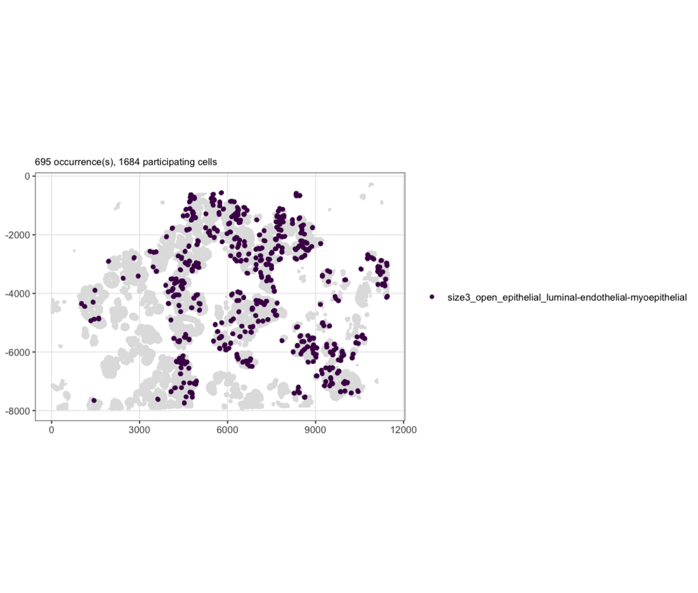
```

```{r save-motifs, results="hide", warning=FALSE, message=FALSE, eval = FALSE}
g_xen <- saveGiotto(g_xen, name = "motifs", overwrite = TRUE, verbose = FALSE)
```

```{r reload, eval = FALSE}
# uncomment below to reload the last snapshot
# g_xen <- loadGiotto(VAULT, name = "motifs", verbose = FALSE)
```

# Further reading

- [Atera Human Breast Cancer](atera_human_breast_cancer.html): breast cancer
  on 10x's Atera platform, with spatial co-expression and motifs on a whole
  transcriptome panel.
- [Xenium Human Breast Cancer Pre-Release](xenium_breast_cancer.html): an
  earlier Xenium breast dataset, read in memory rather than from disk.

# Run time and memory

This page was built on a computer with 18 cores and 64 GB of memory. The time
and peak memory of each section were measured in two setups:

- **4 workers and 10 cores, 64 GB** (blue): the tutorial as written, with the
  workers set in [Packages and setup](#packages-and-setup). About 7.5 minutes
  in total.
- **2 workers and 4 cores, 16 GB** (orange): the setup from
  [Using less memory](#using-less-memory), simulated on the same computer.
  GiottoDisk was told only the memory a 16 GB laptop has free, and the run
  would have been stopped past 16 GB. About 8.3 minutes in total.

Reading the data is the only section where the two setups differ: 3.5 minutes
and 26 GB with 4 workers, 4.3 minutes and 15 GB with 2 workers and 4 cores.
The analysis after it takes about 4 minutes and at most 11 GB in both, with
clustering the longest step at about 1.5 minutes. Both runs gave the same
clusters, cell types and niches; only the UMAP layout differs. A 16 GB
computer usually has about 12 GB free once the system and other programs are
running, so expect reading the data to be slower there while the system swaps
or compresses memory.

```{r run-cost-fig, echo = FALSE, out.width = "100%"}
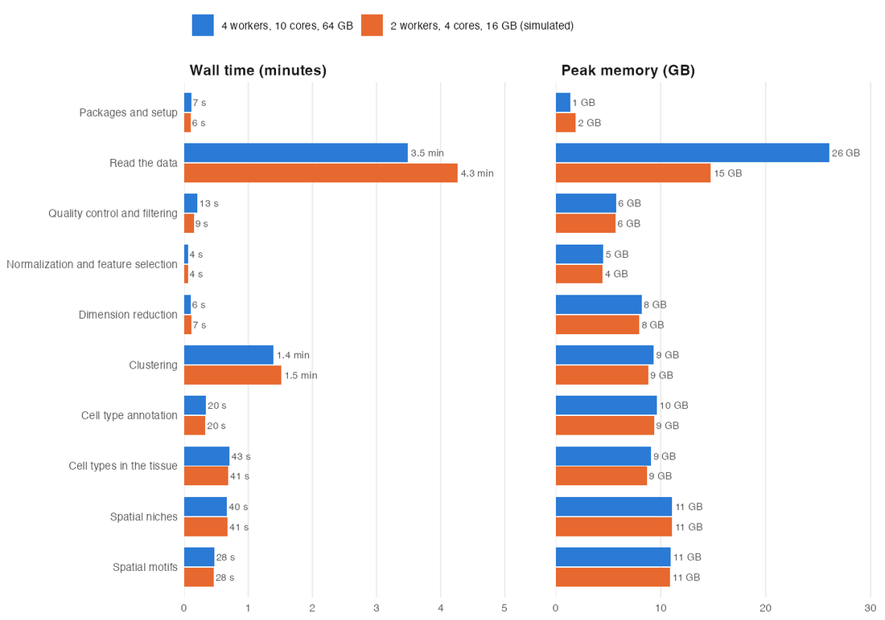
```

Memory is the physical memory of the R session and its parallel workers
together, as a task manager reports it, sampled once a second; each bar is
the highest value during that section.

<details>
<summary><strong>Time and memory per section</strong></summary>

| Section | Time, 64 GB | Peak memory, 64 GB | Time, 16 GB | Peak memory, 16 GB |
|---|---:|---:|---:|---:|
| Packages and setup | 7 s | 1 GB | 6 s | 2 GB |
| Read the data | 3.5 min | 26 GB | 4.3 min | 15 GB |
| Quality control and filtering | 13 s | 6 GB | 9 s | 6 GB |
| Normalization and feature selection | 4 s | 5 GB | 4 s | 4 GB |
| Dimension reduction | 6 s | 8 GB | 7 s | 8 GB |
| Clustering | 1.4 min | 9 GB | 1.5 min | 9 GB |
| Cell type annotation | 20 s | 10 GB | 20 s | 9 GB |
| Cell types in the tissue | 43 s | 9 GB | 41 s | 9 GB |
| Spatial niches | 40 s | 11 GB | 41 s | 11 GB |
| Spatial motifs | 28 s | 11 GB | 28 s | 11 GB |
| **Total** | **7.5 min** | **26 GB** | **8.3 min** | **15 GB** |

</details>

# Session information

```{r session, eval = FALSE}
future::plan(future::sequential)

sessionInfo()
```

```
R version 4.6.1 (2026-06-24)
Platform: aarch64-apple-darwin23
Running under: macOS Golden Gate 27.0.1

Matrix products: default
BLAS:   /Library/Frameworks/R.framework/Versions/4.6/Resources/lib/libRblas.0.dylib 
LAPACK: /Library/Frameworks/R.framework/Versions/4.6/Resources/lib/libRlapack.dylib;  LAPACK version 3.12.1

locale:
[1] C.UTF-8/C.UTF-8/C.UTF-8/C/C.UTF-8/C.UTF-8

time zone: America/New_York
tzcode source: internal

attached base packages:
[1] stats     graphics  grDevices utils     datasets  methods   base     

other attached packages:
[1] data.table_1.18.6.1 GiottoDisk_0.0.0.6  Giotto_4.3.5       
[4] GiottoClass_0.7.26  arrow_25.0.1       

loaded via a namespace (and not attached):
  [1] RColorBrewer_1.1-3          ggdendro_0.2.0             
  [3] wk_0.9.5                    jsonlite_2.0.0             
  [5] magrittr_2.0.5              farver_2.1.2               
  [7] rmarkdown_2.32              ragg_1.5.2                 
  [9] vctrs_0.7.3                 memoise_2.0.1              
 [11] GiottoUtils_0.2.9           terra_1.9-50               
 [13] htmltools_0.5.9             S4Arrays_1.12.1            
 [15] BiocNeighbors_2.6.0         blosc_0.1.2                
 [17] SparseArray_1.12.3          sass_0.4.10                
 [19] parallelly_1.48.0           bslib_0.12.0               
 [21] htmlwidgets_1.6.4           plotly_4.12.1              
 [23] cachem_1.1.0                igraph_2.3.4               
 [25] lifecycle_1.0.5             pkgconfig_2.0.3            
 [27] rsvd_1.0.6                  Matrix_1.7-5               
 [29] R6_2.6.1                    fastmap_1.2.0              
 [31] magic_1.6-1-1               MatrixGenerics_1.24.0      
 [33] future_1.80.0               digest_0.6.39              
 [35] colorspace_2.1-4            S4Vectors_0.50.3           
 [37] dqrng_0.4.1                 irlba_2.4.1                
 [39] textshaping_1.0.5           GenomicRanges_1.64.0       
 [41] beachmat_2.28.0             filelock_1.0.3             
 [43] labeling_0.4.3              progressr_1.1.0            
 [45] httr_1.4.9                  polyclip_1.10-7            
 [47] abind_1.4-8                 compiler_4.6.1             
 [49] smotif_0.2.0                bit64_4.8.6                
 [51] withr_3.0.3                 smotifrs_0.2.0             
 [53] S7_0.2.2                    backports_1.5.1            
 [55] BiocParallel_1.46.0         viridis_0.6.5              
 [57] DBI_1.3.0                   ggforce_0.5.0              
 [59] R.utils_2.13.0              duckdb_1.5.6               
 [61] MASS_7.3-65                 DelayedArray_0.38.2        
 [63] bluster_1.22.0              gtools_3.9.5               
 [65] GiottoVisuals_0.2.16        tools_4.6.1                
 [67] otel_0.2.0                  future.apply_1.21.0        
 [69] R.oo_1.27.1                 glue_1.8.1                 
 [71] dbscan_1.2.7                grid_4.6.1                 
 [73] checkmate_2.3.4             cluster_2.1.8.2            
 [75] generics_0.1.4              gtable_0.3.6               
 [77] R.methodsS3_1.8.2           tidyr_1.3.2                
 [79] metapod_1.20.0              BiocSingular_1.28.1        
 [81] tidygraph_1.3.1             ScaledMatrix_1.20.0        
 [83] xml2_1.6.0                  XVector_0.52.0             
 [85] BiocGenerics_0.58.1         tilework_1.0.0.9000        
 [87] ggrepel_0.9.8               pillar_1.11.1              
 [89] limma_3.68.5                nanoarrow_0.9.0            
 [91] RcppHNSW_0.7.0              dplyr_1.2.1                
 [93] tweenr_2.0.3                lattice_0.22-9             
 [95] bit_4.6.0                   tidyselect_1.2.1           
 [97] locfit_1.5-9.12             SingleCellExperiment_1.34.0
 [99] scuttle_1.22.0              knitr_1.52                 
[101] gridExtra_2.3.1             IRanges_2.46.0             
[103] Seqinfo_1.2.0               edgeR_4.10.7               
[105] SummarizedExperiment_1.42.0 scattermore_1.2            
[107] stats4_4.6.1                xfun_0.62                  
[109] graphlayouts_1.2.5          Biobase_2.72.0             
[111] statmod_1.5.2               matrixStats_1.5.0          
[113] yaml_2.3.12                 GiottoKernels_0.3.0        
[115] evaluate_1.0.5              codetools_0.2-20           
[117] ggraph_2.2.2                tibble_3.3.1               
[119] colorRamp2_0.1.1            cli_3.6.6                  
[121] uwot_0.2.5                  geometry_0.5.2             
[123] systemfonts_1.3.2           jquerylib_0.1.4            
[125] Rcpp_1.1.2                  globals_0.20.0             
[127] dbplyr_2.6.0                png_0.1-9                  
[129] parallel_4.6.1              ggplot2_4.0.3              
[131] assertthat_0.2.1            scran_1.40.0               
[133] listenv_1.1.0               viridisLite_0.4.3          
[135] scales_1.4.0                purrr_1.2.2                
[137] rlang_1.3.0                 cowplot_1.2.0
```
